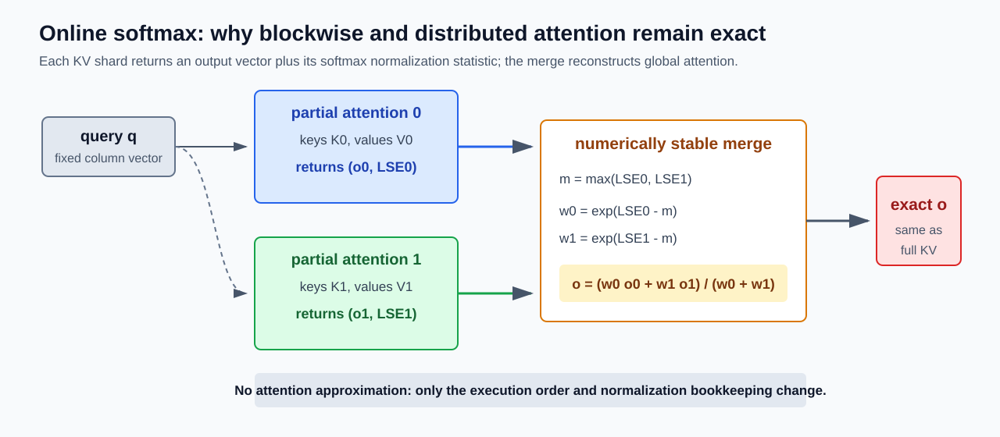
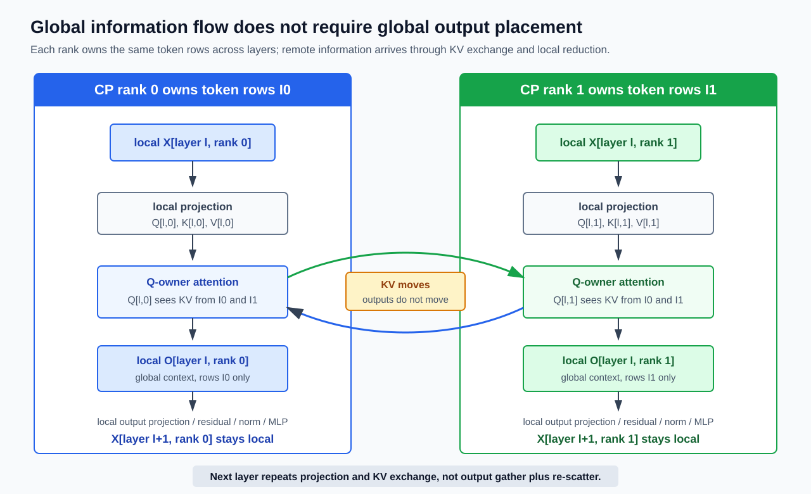
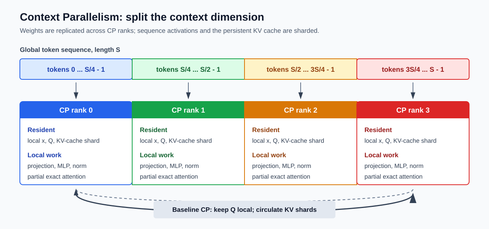
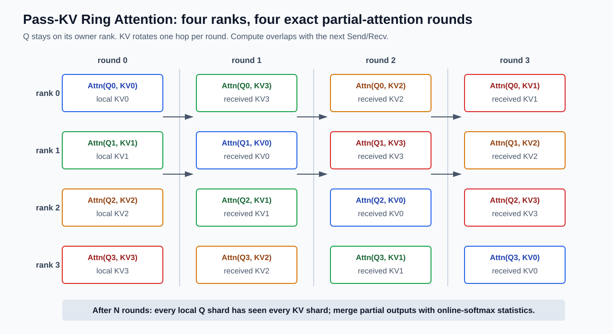
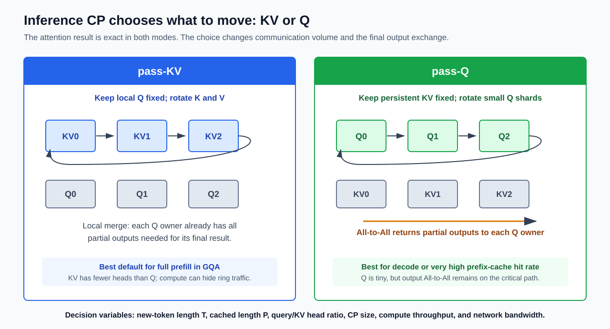
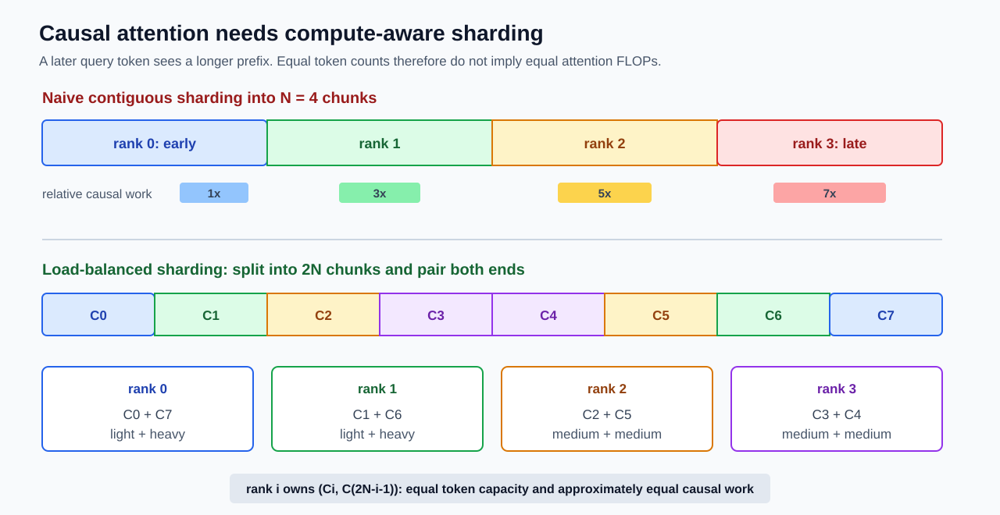

# Context Parallelism：从 Ring Attention 到百万 Token 推理

> 推理主论文：**Context Parallelism for Scalable Million-Token Inference**  
> 作者：Amy (Jie) Yang、Jingyi Yang、Aya Ibrahim、Xinfeng Xie、Bangsheng Tang、Grigory Sizov、Jeremy Reizenstein、Jongsoo Park、Jianyu Huang  
> 会议：MLSys 2025  
> arXiv：`2411.01783v3`，2025-04-21 版本  
> 原文：[arXiv 页面](https://arxiv.org/abs/2411.01783)  
> 算法前身：**Ring Attention with Blockwise Transformers for Near-Infinite Context**，ICLR 2024，[arXiv 页面](https://arxiv.org/abs/2310.01889)  
> 本文目标：从精确注意力的数学结构出发，先用 query-owner、环传 KV 的基础路径解释 Context Parallelism（CP），再讨论多轮推理需要的高级变体、分布式 KV Cache、复杂度、实验结果，以及 1M 上下文推理中的工程取舍。

---

## 0. 先给出结论

Context Parallelism 的核心不是“把一个大张量随便切到多张卡上”，而是：

> **沿单个序列的上下文长度维度分片，使每个 CP rank 只长期保存一部分 token 激活和一部分 KV Cache；在最基础的 query-owner 路径中，本地 Q 保持不动，KV shards 依次沿 ring 流过，使每个 query 最终仍与所有合法 key/value 做精确注意力。**

它同时解决两个问题：

1. **容量问题**：1M token 的激活与 KV Cache 很可能无法放进单个节点；CP 让每个 rank 只保存约 $1/N$ 的序列状态。
2. **延迟问题**：Prefill 的精确 dense attention 需要 $O(S^2)$ 计算；CP 把 query 维的工作分给 $N$ 个 rank，使理想单 rank 计算量降到约 $O(S^2/N)$。

但 CP 不会改变精确 dense attention 的全局渐近复杂度。系统总体仍完成 $O(S^2)$ 次 token-pair 交互，只是将它们并行分配到更多设备。因此：

- CP 能扩展**容量**，并能显著降低长上下文 **prefill 的 TTFT**。
- CP 不能把精确注意力变成线性注意力，也不能消除 1M 上下文的巨大总算力成本。
- Decode 每步只有少量 query，计算并行度低，通信和 kernel launch 更容易暴露；CP 增大时 **TTIT 可能反而上升**。
- “分布式 KV Cache”只是 CP 的一个结果。若没有跨 rank 的精确 attention 算法，单纯把 KV Cache 切开并不能得到正确输出。

主论文在 16 个节点、128 张 H100 上以 Llama 3 405B 完成了 1M token 的精确 prefill：TTFT 为 77 秒，论文报告 93% 并行效率与约 63% FLOPS 利用率。这个结果证明 CP 能把百万 token 的精确 prefill 变成可运行的系统任务，但它并不意味着 1M 推理已经便宜，也不意味着 decode 会随 CP 同样加速。

---

## 1. 哪一篇才是“原始 CP 论文”？

“Context Parallelism”并不是某篇论文凭空创造的一套完全独立的数学算法。它有一条清晰的技术演化链，因此要区分三个问题。

### 1.1 如果问题是“沿序列维跨设备做 attention，最早的直接前身是什么？”

较早的系统论文是 Li 等人的 **Sequence Parallelism: Long Sequence Training from System Perspective**。其预印本最早发布于 2021 年，正式发表于 ACL 2023。它让本地 query 保持不动，并让 key/value 沿设备环传递，从而计算跨分片 attention。

这篇工作使用的是 “Sequence Parallelism” 一词。它与后来 Megatron-Core 中也叫 Sequence Parallelism 的技术并不完全相同：后者主要把 LayerNorm、Dropout 等张量并行区域之外的激活沿序列维分片，通常与 TP 配合；前者则直接处理跨序列分片的 attention 依赖。

### 1.2 如果问题是“现代 CP 的核心 attention 算法从哪里来？”

最直接的算法基础是 Liu、Zaharia、Abbeel 的 **Ring Attention with Blockwise Transformers for Near-Infinite Context**，arXiv 首发于 2023 年，发表于 ICLR 2024。

Ring Attention 的关键改进是把三件事组合起来：

1. 序列始终按上下文维分片。
2. 本地使用块化、内存高效的精确 attention。
3. KV block 沿环流动，并将通信与本地 attention 计算重叠。

这项工作的重点是超长序列训练，也说明算法可用于推理。现代 PyTorch、Megatron-Core 等系统通常把这一类“attention 期间保持序列分片”的机制称为 Context Parallelism。

### 1.3 如果问题是“面向多轮 LLM 推理、分布式 KV Cache 与 1M prefill 的原始系统论文是什么？”

答案是本文的主论文 **Context Parallelism for Scalable Million-Token Inference** [1]。它明确声称自己是首篇公开披露 inference CP 系统实现细节的论文，其核心贡献不是重新发明 Ring Attention，而是把它改造成适合在线推理的完整机制：

1. 将推理区分为 full prefill、persistent-KV partial prefill 与 decode。
2. 扩展精确 Ring Attention，使其覆盖 full prefill、partial prefill 和 decode 的不同张量长度。
3. 根据新 token 数、历史 KV 长度、GQA head 比例、算力和网络带宽动态选路。
4. 对因果 attention、变长 batch 和多轮持久化 KV Cache 做计算与容量负载均衡。
5. 将节点内 TP 与节点间 CP 组合，在 128 张 H100 上验证 1M token prefill。

因此，本文采用如下术语：

- **Ring Attention**：CP attention 的核心块化环形算法。
- **Context Parallelism**：沿 context/sequence 维分片整个 Transformer 输入状态，并在 attention 层处理跨分片依赖的并行维度。
- **Inference CP**：主论文中进一步支持 persistent KV、partial prefill、decode 与多轮会话的系统实现。

### 1.4 为什么不能把“CP 的发明”只归给一个日期？

公开记录显示，算法思想、名称与工程实现并不是严格串行出现的。更准确的时间线是：

| 时间 | 工作 | 可安全归属的贡献 |
|---|---|---|
| 2021/2023 | Sequence Parallelism | 更早公开的本地 Q、环传 KV 的序列并行 attention |
| 2023-05 | Blockwise Parallel Transformer（BPT） | 将 exact attention 与 FFN 按 block 执行，压低整层激活峰值 |
| 2023-08/09 | DeepSpeed-Ulysses | sequence-to-head 的 all-to-all 并列路线 |
| 2023-09-22 | NVIDIA Transformer Engine commit `479dbb7` | 公开使用 `context parallelism` 名称的 FlashAttention KV-P2P 工程实现 |
| 2023-10-03 | Ring Attention arXiv v1 | 将 blockwise attention、online softmax 与可重叠 KV ring 系统化 |
| 2024-01 | Infinite-LLM | KV 常驻远端、发送 Q 与部分 softmax 结果的分布式 serving 路线 |
| 2024-11/2025 | Meta inference CP | Persistent KV、partial prefill/decode、自适应通信路径与 1M latency 实证 |

NVIDIA 的公开 commit 比 Ring Attention arXiv 首版早 11 天，因此不能声称 `Context Parallelism` 这个名称必然来自 Ring Attention；Ring Attention 自己也引用了更早的 Sequence Parallelism。反过来，框架代码早期使用某个名称，也不能替代论文对算法、复杂度和实验的系统论证。

所以“原始 CP 论文”没有脱离语境的唯一答案：

1. 追溯 ring self-attention，应读 Sequence Parallelism。
2. 学习现代可扩展 exact ring 算法，应读 Ring Attention。
3. 学习百万 token、多轮 persistent-KV 推理，应以 Meta MLSys 2025 论文为直接主论文。

---

## 2. 为什么 1M 上下文必须跨设备？

### 2.1 Prefill 的主要矛盾是二次计算

设序列长度为 $S$，query head 数为 $N_H$，每个 head 的维度为 $d_h$。对单个 head，attention score 包含 $S^2$ 个 query-key 配对。忽略常数后，score 计算与 value 聚合的 FLOPs 都随 $S^2d_h$ 增长。

完整多头 attention 的主项可以粗略写成：

$$ \operatorname{FLOPs}_{\mathrm{attn}} \approx 4S^2D $$

其中 $D=N_Hd_h$ 是模型隐藏维度，系数 4 来自 $QK^\top$ 与概率矩阵乘 $V$ 两个乘加过程。因果 mask 只计算下三角时，常数约减半，但渐近复杂度仍是 $O(S^2D)$。

从 128K 增长到 1M，长度约增长 $7.8125$ 倍，attention 主项约增长：

$$ \left(\frac{1{,}000{,}000}{128{,}000}\right)^2 \approx 61.0 $$

因此，1M full prefill 不是“比 128K 多处理约 8 倍 token”这么简单：仅 attention 的 token-pair 计算主项就增长到约 61 倍。端到端 TTFT 是否也接近二次增长，则取决于系统是否已经进入下面定义的 attention 主导区。

#### 2.1.1 什么是 attention 主导区？

Full prefill 的主要计算可以粗略分成两类：

1. **参数 GEMM**：Q/K/V 投影、attention 输出投影和 MLP 等操作。每个 token 分别通过同一组模型参数，因此计算量随序列长度 $S$ 近似线性增长。
2. **Attention token-pair 计算**：每个 query 与大量 key 做点积，再用 attention 权重聚合 value。因果 attention 需要处理下三角区域，其计算量随 $S^2$ 增长。

设模型参数量为 $W$、Transformer 层数为 $L$、隐藏维度为 $D$，batch size 为 1。沿用主论文附录的近似，参数 GEMM 与因果 attention 的 FLOPs 分别为：

$$ F_{\mathrm{GEMM}}\approx 2WS $$

$$ F_{\mathrm{attn}}\approx 2LS^2D $$

##### 1. 参数 GEMM：为什么是 $2WS$？

先考虑一个数学上写成 $y=Ax$ 的线性层，其中 $x\in\mathbb{R}^{d_{in}}$、$A\in\mathbb{R}^{d_{out}\times d_{in}}$、$y\in\mathbb{R}^{d_{out}}$。矩阵 $A$ 含有：

$$ P_A=d_{out}d_{in} $$

个权重。计算一个输出分量 $y_j$，需要对长度为 $d_{in}$ 的向量做点积，即 $d_{in}$ 次乘法和约 $d_{in}$ 次加法。按照深度学习性能分析的常用口径，一次乘法计 1 FLOP、一次加法计 1 FLOP，因此一个 token 通过该线性层约需：

$$ F_{A,\mathrm{1\ token}}\approx2d_{out}d_{in}=2P_A $$

这里的系数 2 表示“乘法与加法”，不是 forward 加 backward，也不是 K 和 V 两份张量。GPU 上一条 FMA 指令可能同时完成乘加，但性能统计仍通常将它记作 2 FLOPs。

长度为 $S$ 的序列中，每个 token 都要使用一次该权重矩阵，所以该层的 prefill 计算量为：

$$ F_A\approx2SP_A $$

再对模型中所有参与 dense GEMM 的权重矩阵求和。令这些矩阵的参数量之和为 $W_{\mathrm{GEMM}}$，则：

$$ F_{\mathrm{GEMM}}\approx2S\sum_A P_A=2SW_{\mathrm{GEMM}} $$

Transformer 的绝大多数参数位于 attention projection 和 MLP 的大矩阵中，因此主论文用模型总参数量 $W$ 近似 $W_{\mathrm{GEMM}}$，得到：

$$ F_{\mathrm{GEMM}}\approx2WS $$

该近似忽略了 bias、LayerNorm、激活函数、RoPE、embedding lookup 等非 GEMM 操作，也可能把不在每个 token 上执行一次的少量参数计入 $W$。由于大模型的矩阵权重占绝对多数，这个近似适合做数量级分析。

数学上单 token 写成列向量 $y=Ax$；在 PyTorch 中，$S$ 个 token 通常堆叠为 feature-last 张量 `X`，线性层对应 `Y = X @ A.T`。两种写法的 FLOPs 相同。

代入 Llama 3 405B 的 $W=405\times10^9$ 和 $S=10^6$：

$$ F_{\mathrm{GEMM}}\approx2\times405\times10^9\times10^6=8.1\times10^{17}\ \mathrm{FLOPs} $$

##### 2. 因果 attention：为什么是 $2LS^2D$？

先看一层中的 score 计算。对一个 attention head，单个 score 为 $q_i^\top k_j$。向量长度为 $d_h$，所以一个 query-key pair 约需 $2d_h$ FLOPs。

非因果 attention 有 $S^2$ 个 query-key pairs；因果 attention 只保留下三角区域，有效 pair 数为：

$$ N_{\mathrm{pair}}=\frac{S(S+1)}{2}\approx\frac{S^2}{2} $$

将全部 $N_H$ 个 query heads 相加，并使用 $D=N_Hd_h$，$QK^\top$ 的计算量为：

$$ F_{QK^\top}\approx2d_hN_H\frac{S^2}{2}=S^2D $$

得到 attention 权重后，还要计算每个输出列向量 $o_i=\sum_j\alpha_{ij}v_j$。这一过程对相同的有效 token pairs 做加权乘加，计算量与 $QK^\top$ 近似相同：

$$ F_{PV}\approx S^2D $$

因此，一层因果 attention 的两个主要矩阵乘法合计为：

$$ F_{\mathrm{attn,layer}}\approx F_{QK^\top}+F_{PV}\approx2S^2D $$

模型共有 $L$ 层，于是：

$$ F_{\mathrm{attn}}\approx2LS^2D $$

这也可以写成主论文附录的形式 $F_{\mathrm{attn}}\approx\frac12\times4LS^2D$：其中 4 来自 $QK^\top$ 和 $PV$ 两次乘加，$\frac12$ 来自 causal mask 的下三角区域。

该式没有计入 softmax、mask 和位置编码等较小项，并假设 causal attention kernel 能跳过大部分上三角计算。如果实现先计算完整 $S\times S$ 矩阵再做 mask，实际 FLOPs 会更接近 $4LS^2D$；FlashAttention 的 causal kernel 会按块跳过无效区域，因此论文采用下三角近似。

代入 $L=126$、$S=10^6$、$D=16384$：

$$ F_{\mathrm{attn}}\approx2\times126\times(10^6)^2\times16384=4.128768\times10^{18}\approx4.1\times10^{18}\ \mathrm{FLOPs} $$

以上两个公式都是单序列、batch size 为 1 的全模型聚合 FLOPs。若 batch size 为 $B$，二者都再乘 $B$；TP 或 CP 只把这些工作分给多张 GPU，不改变系统必须完成的聚合 FLOPs。

二者的比值为：

$$ \frac{F_{\mathrm{attn}}}{F_{\mathrm{GEMM}}}\approx\frac{LSD}{W} $$

因此，两部分计算量大致相等的理论交叉长度为：

$$ S_{\mathrm{cross}}\approx\frac{W}{LD} $$

这给出了“attention 主导区”的计算意义：

| 序列长度 | 主要特征 | Full prefill 的增长趋势 |
|---|---|---|
| $S\ll S_{\mathrm{cross}}$ | 参数 GEMM 占主要 FLOPs | 总计算更接近随 $S$ 线性增长 |
| $S\approx S_{\mathrm{cross}}$ | GEMM 与 attention 都不可忽略 | 处于混合区，增长速度介于线性与二次之间 |
| $S\gg S_{\mathrm{cross}}$ | Attention 占主要 FLOPs | 总计算越来越接近随 $S^2$ 增长 |

对论文使用的 Llama 3 405B，取 $W=405\times10^9$、$L=126$、$D=16384$，可得：

$$ S_{\mathrm{cross}}\approx\frac{405\times10^9}{126\times16384}\approx196\mathrm{K} $$

所以 128K 尚处于交叉点附近，参数 GEMM 仍不可忽略；到 1M 时，attention FLOPs 已约为 GEMM FLOPs 的 5.1 倍，进入明显的 attention 主导区。这里的“主导”是指 attention 成为总计算或总延迟中最大的组成部分，并不表示 GEMM、通信和调度开销已经消失。

还要区分两种口径：

1. **FLOPs 主导**：由上面的理论公式判断，适合解释算法复杂度。
2. **Latency 主导**：通过 profiler 观察 attention kernel 及其 CP 通信是否占据最大运行时间。它还受 kernel 吞吐、并行效率、网络带宽和 padding 影响，实际交叉点不一定恰好是 196K。

因此，128K 到 1M 的“61 倍”只表示 attention 二次项的增长。论文中相同 CP16 配置的 TTFT 从 3.8 秒增长到 77 秒，约为 20.3 倍，而不是 61 倍，因为端到端时间还包含线性增长的参数 GEMM，以及没有按同一比例变化的通信和系统开销。

最后，“attention 主导区”在这里专指 **full prefill**。Decode 每一步通常只有一个新 query，它与长度为 $S$ 的历史 KV 做 attention，单步计算随 $S$ 近似线性增长，不存在同样的 $S^2$ prefill 计算形态。

FlashAttention 可以避免显式物化 $S\times S$ attention 矩阵，并显著降低 HBM 读写，但它没有删掉这些精确 token-pair 计算。它解决的是单设备 attention 的 IO 与临时显存问题；CP 解决的是单设备容量和跨设备计算并行问题。两者是上下层关系，实际系统通常在每个 CP rank 内运行 FlashAttention。

### 2.2 Decode 的主要矛盾是 KV Cache 容量与带宽

自回归 decode 每一步通常只有一个新 query，却要读取此前全部 KV Cache。设模型有 $L$ 层、上下文长度为 $S$、KV head 数为 $N_{KV}$、head dimension 为 $d_h$、每元素占 $b_e$ bytes，则单序列 KV Cache 大小近似为：

$$ M_{KV}=2LSN_{KV}d_hb_e $$

式中的 2 分别代表 key 与 value。继续使用主论文的 Llama 3 405B 配置，取 $L=126$、$N_{KV}=8$、$d_h=128$、$S=10^6$、BF16 的 $b_e=2$ bytes，则：

$$ M_{KV}=2\times126\times10^6\times8\times128\times2\ \mathrm{bytes}=5.16096\times10^{11}\ \mathrm{bytes}\approx480.7\ \mathrm{GiB} $$

这还只是一个序列的 KV Cache，不含模型权重、运行时 workspace、激活、内存碎片，也不含并发请求。单张 80GB 或 96GB GPU 无法容纳它。

GQA/MQA 之所以对长上下文重要，是因为 KV Cache 与 $N_{KV}$ 成正比，而不是与 query head 数 $N_H$ 成正比。若从 MHA 的 $N_{KV}=N_H$ 降到 GQA 的少量 KV heads，容量和 KV 通信都会按比例下降。MHA、GQA、MQA 的 head 映射、容量公式、质量取舍及工程实现属于独立主题，本文只使用上述容量结论。

然而，KV Cache 能放下不等于 decode 会快。每个 decode step 都要扫描历史 KV；算术强度通常较低，瓶颈容易落在 HBM 带宽。CP 将 KV Cache 分到 $N$ 个 rank 后，每个 rank 只读取约 $1/N$ 的 KV，但还要交换 query 或部分输出。随着 rank 增多，本地 kernel 变短，通信延迟更难被计算掩盖。

### 2.3 1M 推理其实有三个不同问题

| 阶段 | Query 数 | 要访问的 KV | 主要压力 | CP 的典型价值 |
|---|---:|---:|---|---|
| Full prefill | $T=S$ | 当前 prompt 的 $T$ | $O(T^2)$ 计算、激活、KV 建立 | 分摊二次计算与 KV 容量 |
| Partial prefill | 新 token 数 $T$ | 历史 $P$ 加新 token $T$ | $O(T(P+T))$ 计算、持久化 KV 通信 | 复用历史 KV 并自适应选择通信路径 |
| Decode | 通常 $T=1$ | 约 $P+1$ | KV 容量、HBM 读取、通信延迟 | 扩容量；延迟未必改善 |

把三者混成“长上下文 attention 很慢”会掩盖系统设计的关键。现阶段只需先掌握 full prefill 的 query-owner、环传 KV 路径；多轮推理中 $|Q|\ne|KV|$ 带来的新问题，将在第 6-9 节逐步展开。

---

## 3. 数学基础：Online Softmax 与跨 rank 精确合并

这一节的核心数学确实是 online softmax。普通 attention 公式只用于确定输入和输出；真正让 Ring Attention 成立的是：每个 KV block 可以压缩成可重标定的 softmax 状态，再在同一 GPU 或不同 CP ranks 之间精确合并。

Online softmax 的逐块更新、数值例子和正确性证明已经在 Assignment 2 的[《FlashAttention-2 Forward 初学者教材》第 4 章](../stanford_cs336/assignments/assignment2-systems/notes/03_02_flash_attention_2_beginner_textbook.md#4-online-softmax从一个-query-的输出开始)完整推导。本文不重复其手算过程，只沿用其中的 $s,m,\ell,z,o,L$ 记号，并说明如何把一个 owner 内的 KV-tile 归约扩展成跨 CP ranks 的归约。关于多个独立 key partitions 的合并，还可对照 Assignment 2 的[跨 block online-softmax 状态合并](../stanford_cs336/assignments/assignment2-systems/notes/03_04_flash_attention_1_to_2_evolution.md#64-第四步不要把同一-query-的-key-reduction-随意拆给多个-blocks)。

### 3.1 Online softmax 的 $m,\ell,z$ 状态

本文数学上把单个 token 的向量写成列向量。对位置 $i$ 的 hidden state $x_i\in\mathbb{R}^{D}$：

$$ q_i=W_Qx_i,\qquad k_i=W_Kx_i,\qquad v_i=W_Vx_i $$

其中 $W_Q$、$W_K$、$W_V$ 在左，向量在右。单个 query 对 key $k_j$ 的 score 记为：

$$ s_{ij}=\frac{q_i^\top k_j}{\sqrt{d_h}}+b_{ij} $$

$b_{ij}$ 是 mask bias；因果 attention 中，当 $j>i$ 时 $b_{ij}=-\infty$。固定一个 query $q_i$ 后，为简化记号，令 $s_j=s_{ij}$，则：

$$ o=\sum_{j=0}^{S-1}p_jv_j,\qquad p_j=\frac{\exp(s_j)}{\sum_{t=0}^{S-1}\exp(s_t)} $$

采用常见记号，online softmax 为这个 query 维护三个状态：

$$ m=\max_j s_j,\qquad \ell=\sum_j\exp(s_j-m),\qquad z=\sum_j\exp(s_j-m)v_j $$

其中 $m$ 是指数基准，$\ell$ 是未归一化分母，$z$ 是未归一化的 value 加权和，最终输出为：

$$ o=\frac{z}{\ell} $$

新 KV tile 到来时，可以递推更新 $m,\ell,z$。这里使用的核心不变量是：无论 KV 被顺序扫描、分块处理还是分配给不同 rank，只要合并时统一指数基准，最终 $o$ 就等于对完整 score 行一次执行 softmax。

在 PyTorch/JAX 的实际张量中，特征通常位于最后一维，批量 Q/K/V 常写成 `(batch, seq, heads, head_dim)`，score kernel 对应 `Q @ K.transpose(-1, -2)`。这只是框架的 feature-last 布局；它与数学上的列向量 $q_i^\top k_j$ 不冲突。

### 3.2 把 KV-tile 状态提升为 CP-rank 状态

把全部 key/value 索引集合分成 $N$ 个互不相交的块 $\mathcal{J}_0,\ldots,\mathcal{J}_{N-1}$，并让第 $r$ 个 CP rank 负责 $\mathcal{J}_r$。继续固定同一个 query，并用方括号上标表示 KV partition。rank $r$ 产生的局部 online-softmax 状态为：

$$ m^{[r]}=\max_{j\in\mathcal{J}_r}s_j $$

$$ \ell^{[r]}=\sum_{j\in\mathcal{J}_r}\exp\!\left(s_j-m^{[r]}\right) $$

$$ z^{[r]}=\sum_{j\in\mathcal{J}_r}\exp\!\left(s_j-m^{[r]}\right)v_j $$

局部输出为 $o^{[r]}=z^{[r]}/\ell^{[r]}$。不能直接平均这些 $o^{[r]}$，因为各 partition 的指数基准 $m^{[r]}$ 和概率质量 $\ell^{[r]}$ 不同。

先选择统一的全局指数基准：

$$ m=\max_{0\le r<N}m^{[r]} $$

再把每个 partition 的分母和分子从局部基准 $m^{[r]}$ 重标定到 $m$：

$$ \ell=\sum_{r=0}^{N-1}\exp\!\left(m^{[r]}-m\right)\ell^{[r]} $$

$$ z=\sum_{r=0}^{N-1}\exp\!\left(m^{[r]}-m\right)z^{[r]} $$

最终仍使用相同的输出关系：

$$ o=\frac{z}{\ell} $$

如果 attention kernel 返回局部输出 $o^{[r]}$ 和局部 log-sum-exp：

$$ L^{[r]}=m^{[r]}+\log\ell^{[r]} $$

则主论文附录采用的等价合并式为：

$$ o=\frac{\sum_r o^{[r]}\exp\!\left(L^{[r]}-L^{\max}\right)}{\sum_r\exp\!\left(L^{[r]}-L^{\max}\right)},\qquad L^{\max}=\max_r L^{[r]} $$

这里的 $L^{[r]}$ 表示每行的 log-sum-exp，不是本文其他章节表示 Transformer 层数的 $L$。

这就是 online softmax、FlashAttention 与 Ring Attention 共享的数学基础。三者的差别不在 softmax 恒等式，而在状态位于哪里：

| 场景 | $m,\ell,z$ 状态的 owner | KV block 从哪里来 |
|---|---|---|
| 单 GPU FlashAttention | 一个 query-tile program | 同一 GPU 上依次读取的 KV tiles |
| Ring pass-KV | Query 所属 CP rank | 沿 ring 依次到达的远端 KV shards |



### 3.3 “精确”到底指什么？

这里的 exact 或 lossless 指算法没有主动删减任何合法的 query-key 配对，也没有使用局部窗口、稀疏检索或低秩近似。除了浮点运算顺序变化可能造成的舍入差异，合并结果与在单设备上对完整 K/V 做 dense attention 相同。

它不代表：

1. 数值结果逐 bit 相同。并行归约顺序不同可能带来正常的浮点尾差。
2. 算法复杂度变成线性。全局 token-pair 数量仍是二次的。
3. 不需要 mask。因果边界、padding、变长 batch 的 mask 必须在每个局部 block 上正确应用。

---

## 4. Context Parallelism 的数据布局

设全局序列长度为 $S$，CP degree 为 $N$。最基本的布局让 rank $r$ 长期保存约 $S/N$ 个 token：

$$ X=[X^{(0)};X^{(1)};\ldots;X^{(N-1)}] $$

每个 rank 对本地 $X^{(r)}$ 完成 LayerNorm、QKV projection、MLP 等逐 token 或局部算子。真正产生跨 token 依赖的是 attention：本地 $Q^{(r)}$ 必须访问全局所有允许的 K/V block。

### 4.1 全局信息聚合不等于全局张量聚合

这里讨论的不是最开始由 token ids 得到的词向量，而是上一层输出、即当前层输入的 hidden states。问题可以更准确地表述为：上一层 attention 已经融合了跨 rank 信息，是否必须先把它的全局输出 gather 出来，再 scatter 成当前层的输入？答案仍然是否定的。CP 的 sequence-sharded layout 通常跨 Transformer layers 持续保持：

1. 进入第 $\ell$ 层时，rank $r$ 已持有上一层输出的本地 token shard $X_\ell^{(r)}$。
2. rank $r$ 在本地重新执行本层 projection，得到新的 $Q_\ell^{(r)},K_\ell^{(r)},V_\ell^{(r)}$。重新计算 projection 是每层模型本来就要做的工作，不是一次 scatter。
3. $Q_\ell^{(r)}$ 留在本 rank；只有各 rank 的 $K_\ell^{(r)},V_\ell^{(r)}$ 在本层 attention 中沿 ring 流动。
4. rank $r$ 得到的 attention 输出 $O_\ell^{(r)}$ 仍对应原来的本地 token shard，随后在本地完成 output projection、residual、LayerNorm 和 MLP。
5. 得到 $X_{\ell+1}^{(r)}$ 后直接进入下一层，sequence 维仍然是分片状态。

关键是区分**信息依赖范围**与**张量物理布局**。设 token 位置集合 $\mathcal I_r$ 归 rank $r$ 所有。对任意 $i\in\mathcal I_r$，本地 query 的输出为：

$$ o_{\ell,i}=\sum_{j=0}^{S-1}p_{\ell,ij}v_{\ell,j} $$

求和遍历全局所有合法 key/value positions，所以 $o_{\ell,i}$ 已经包含来自其他 ranks 的上下文信息。但是它仍然只是位置 $i$ 的一个 $D$ 维输出列向量，其 owner 仍是 rank $r$。把 rank $r$ 拥有的输出行放在一起：

$$ O_\ell^{(r)}=\{o_{\ell,i}\mid i\in\mathcal I_r\}=O_\ell[\mathcal I_r,:] $$

在 query-owner 的 pass-KV 中，远端 $K_\ell^{(s)},V_\ell^{(s)}$ 被送到 rank $r$，rank $r$ 用 online softmax 将它们对本地 queries 的贡献累计进 $O_\ell^{(r)}$。跨 rank 聚合发生在每个本地 query 的 **key/value 归约维**；系统并没有把其他 ranks 所拥有的 query 输出行收集到 rank $r$。

从数学结果看，$O_\ell^{(r)}$ 恰好等于“先在某处计算完整 $O_\ell$，再取属于 $\mathcal I_r$ 的行”。但实现不会先物化完整 $O_\ell$：query owner 从一开始就只为自己的 query rows 分配输出，远端 KV 贡献到达后直接归约进这些本地行。可以把它理解为**输出天然以目标分片布局生成**，而不是计算完成后再执行一次 scatter。

| 操作 | 是否需要 | 原因 |
|---|---|---|
| 让本地 Q 访问远端 K/V | 需要 | Attention 对所有合法 key/value positions 有依赖 |
| 将远端 K/V 的贡献归约进本地输出 | 需要 | 每个本地 query 必须得到完整的 weighted sum |
| Gather 全部 ranks 的 $O_\ell$ | 不需要 | rank $r$ 的后续逐 token 算子只消费 $O_\ell^{(r)}$ |
| 再把完整 $O_\ell$ scatter 回各 rank | 不需要 | Attention 输出从未离开其 query owner |

随后一层内的局部计算可以抽象为：

$$ X_{\ell+1}^{(r)}=\operatorname{TokenLocalBlock}_\ell\left(X_\ell^{(r)},O_\ell^{(r)}\right) $$

$\operatorname{TokenLocalBlock}_\ell$ 表示 output projection、residual、LayerNorm 和 MLP 等不需要其他 token 行的操作。虽然 $X_{\ell+1}^{(r)}$ 在物理上仍只有约 $S/N$ 行，但其中每个 token 表示都已经通过 $O_\ell^{(r)}$ 融合了全局上下文。可以把它概括为：

> **信息是全局的，token row 的所有权仍是局部的。**

因此，每一层确实都会重新生成该层自己的 Q/K/V，也会执行一次该层的 KV ring；但不会在层与层之间把完整序列 gather 后再重新 scatter。可以把一层的数据流写成：

```text
local X_l^(r)
  -> local Q_l^(r), K_l^(r), V_l^(r)
  -> keep Q_l^(r), circulate K_l^(r)/V_l^(r)
  -> local O_l^(r)
  -> local output projection / residual / norm / MLP
  -> local X_(l+1)^(r)
```



只有在模型入口处把原本复制的输入转换为 CP layout，或者在 CP 与其他并行布局之间显式切换时，才可能出现一次 scatter、all-to-all 或等价的 layout redistribution。那不是每个 Transformer 层固定重复的 CP 操作。若同时启用 TP，层内还会有 TP 自己的 all-reduce、reduce-scatter 或 all-gather；这些通信也不应误认为 CP 在重新 scatter query。

还有一种实现使用每层 K/V all-gather，而不是 ring：每个 rank 暂时收集本层全局 K/V，再只为本地 $Q_\ell^{(r)}$ 计算 $O_\ell^{(r)}$。这种实现每层确实有 K/V all-gather，但仍没有“gather 全局输出再重新 scatter query”。Ring 版本进一步避免同时物化完整 K/V，只让 KV shards 逐轮经过 query owner。



这带来四个重要性质：

1. **激活分片**：每个 rank 只保存本地 token 对应的 residual、normalization 与 MLP 激活。
2. **KV Cache 分片**：推理时每个 rank 只长期保存一部分历史 K/V。
3. **模型参数通常不由 CP 分片**：仅使用 CP 时，每个 rank 仍有完整模型副本。
4. **attention 内通信**：为了恢复全局依赖，基础路径让 KV shards 在 CP group 内流动。

因此，CP 与 TP 可以正交组合。主论文的 405B 实验在每个 8-GPU 节点内使用 TP8，让模型权重放得下；然后跨节点使用 CP。若有 $N$ 个节点，总 GPU 数为 $8N$，但 CP group 不是把同一节点的 8 张卡串起来，而是将不同节点中持有同一 KV head 分片的 GPU 组成组：

```text
node 0: TP rank 0  TP rank 1  ...  TP rank 7
          |          |                |
node 1: TP rank 0  TP rank 1  ...  TP rank 7
          |          |                |
node 2: TP rank 0  TP rank 1  ...  TP rank 7

vertical columns: CP groups across nodes
horizontal rows:  TP groups within one node
```

这种映射顺着硬件层级安排通信：高流量 TP collective 尽量留在 NVLink 节点内，基础 CP 路径在跨节点时只环传 KV blocks。

### 4.2 CP 与“只切 KV Cache”的区别

如果只把 KV Cache 分散存储，而每一步先 all-gather 全部 KV 到每张卡，那么容量在静态存储阶段虽然被分摊，attention 期间仍可能出现完整 KV 的临时峰值与大规模通信。

CP 的要求更强：

1. KV Cache 的 owner 固定且可定位。
2. attention kernel 消费一个局部 block 后即可丢弃或转发，不需要聚齐完整 KV。
3. 部分 attention 输出通过 online-softmax 统计精确合并。
4. attention 输出仍按 sequence 维分片，后续层可以继续保持相同布局。

所以“分布式 KV Cache”描述的是状态放在哪里，CP 描述的是围绕这种状态布局组织整层计算与通信的方法。

---

## 5. Ring Attention：固定 Q，环传 KV

### 5.1 基本算法

先考虑训练或 full prefill，此时 Q、K、V 的序列长度相同。rank $r$ 初始持有 $Q^{(r)},K^{(r)},V^{(r)}$。在 $N$ 个 round 中：

1. rank $r$ 用固定的本地 $Q^{(r)}$ 与当前持有的 $K^{(s)},V^{(s)}$ 计算一块部分 attention。
2. 同时把当前 KV block 发给下一个 rank，并从前一个 rank 接收下一块 KV。
3. 用 online-softmax 状态更新本地最大值、分母和分子。
4. $N$ 轮后，本地 $Q^{(r)}$ 已经见过全部 KV block，得到最终 $O^{(r)}$。



若令当前 KV 所属 rank 为 $s=(r-t)\bmod N$，其概念伪代码为：

```text
state = empty_online_softmax_state(local_Q)
current_KV = local_KV

for round in 0 .. N-1:
    async_send(current_KV, next_rank)
    next_KV = async_recv(previous_rank)
    state = exact_partial_attention(local_Q, current_KV, state, mask)
    wait_until_next_KV_is_ready()
    current_KV = next_KV

local_output = finalize(state)
```

伪代码把发送写在计算前，意图是表达双缓冲：通信 stream 传输下一轮数据，compute stream 消费当前数据。具体实现必须用 event 或等价同步保证 buffer 生命周期正确。

### 5.2 为什么是 $N$ 轮而不是一次 all-gather？

all-gather KV 后再计算在数学上也正确，但会带来两个问题：

1. 每个 rank 临时持有完整 KV，破坏 $1/N$ 容量分片的目标。
2. 一次大 collective 更难与细粒度 attention 计算重叠，通信容易直接进入关键路径。

Ring Attention 每次只需要当前 KV block 和下一 KV block 的双缓冲。局部 kernel 足够长时，传输可以隐藏在计算后面。

### 5.3 通信能否完全隐藏？

Ring Attention 论文用 block size $c$、hidden size $d$、设备算力 $F$ FLOP/s、单向链路带宽 $B$ bytes/s 建立了一个简化模型。

一个 query block 与一个 KV block 的两次矩阵乘法约需要：

$$ \operatorname{FLOPs}_{\mathrm{block}}\approx4dc^2 $$

以 BF16 传输一个 K block 和一个 V block 约需要：

$$ \operatorname{Bytes}_{KV}\approx4dc $$

若计算时间不小于传输时间，则：

$$ \frac{4dc^2}{F}\ge\frac{4dc}{B}\quad\Longleftrightarrow\quad c\ge\frac{F}{B} $$

$F/B$ 是机器的计算/网络比。它说明一个反直觉事实：**上下文越长、block 越大，本地 attention 的算术强度越高，反而越可能把跨设备通信藏住。** 短上下文或 decode query 很少时，本地计算过短，环通信就会暴露。

论文还估计每个设备需要当前 Q、当前 KV、接收 KV、输出等六个 block，BF16 激活峰值约为 $6bch$ bytes，其中 $b$ 是 batch size、$h$ 是 hidden size。关键是该峰值依赖 block size $c$，而不再直接依赖全局序列长度 $S$。

### 5.4 因果 mask 如何处理？

对 causal self-attention，query block 与 KV block 的相对位置决定局部工作：

- KV block 完全位于 query block 之后：整块被 mask，可以跳过。
- KV block 完全位于 query block 之前：整块有效，执行无 mask 的局部 attention。
- 两个 block 覆盖同一对角区域：执行带局部 causal mask 的 attention。

只要被 mask 的位置在 softmax 中按 $-\infty$ 处理，online-softmax 合并仍然精确。工程实现还要避免“全被 mask 的 block”产生 `NaN`，通常直接跳过该 block，或让 kernel 返回中性统计量。

### 5.5 训练时的 backward

Ring Attention 原论文的重点是训练。Forward 中 KV 沿环传递；Backward 需要再次取得相应 Q/K/V block，并累积 $dQ$、$dK$、$dV$。原论文 JAX 实现让 K、V 及其梯度沿环移动，以自定义 VJP 完成反向传播。

训练实现还必须在两个目标之间取舍：

1. 保存更多前向中间状态，减少 backward 重算。
2. 只保存 online-softmax 统计和必要输入，在 backward 重算局部 score/probability，降低激活显存。

这与 FlashAttention backward、activation checkpointing 的思想一致。推理没有 backward，因此主论文可以把重点转向 persistent KV、变长请求和延迟。

> **基础 CP 学习检查点**：读到这里，可以先把 CP 理解为“每个 rank 固定拥有本地 query 与 online-softmax 状态，KV shards 沿 ring 流动”。这已经构成完整、正确的 query-owner CP 模型，不需要预先理解其他通信路径。

---

## 6. 推理的三个阶段与 Persistent KV

前五节有意只使用 query-owner、环传 KV 的基础模型。推理系统在 full prefill 中仍满足 Q/K/V 等长；到了多轮 partial prefill 和 decode，Q 往往远短于已有 KV。只有在理解这种长度不对称后，才有必要引入第 8 节的 pass-Q。它是面向推理的后续优化，不是理解 CP 基本原理的前置条件。

### 6.1 Full prefill

用户第一次提交长度为 $T$ 的 prompt。此时没有历史缓存，即 $P=0$：

$$ |Q|=|K|=|V|=T $$

模型需要为全部 prompt token 建立 KV Cache，并执行完整因果 attention。长上下文下，这一阶段通常是计算密集型，决定首 token 延迟 TTFT。由于现代 GQA 模型的 KV heads 远少于 query heads，pass-KV 往往是最自然的选择。

### 6.2 Decode

Prefill 完成后，模型逐 token 生成回复。每一步通常有一个新 token：

$$ T=1,\qquad |KV|=P+1 $$

新 token 的 K/V 被追加到 persistent KV Cache。该步的 query 很小，而历史 KV 很大；若仍把全部 KV 沿环传一圈，通信量会极不合理。主论文因此使用 pass-Q：让很小的 query 访问各 rank 固定保存的 KV shard。

### 6.3 Partial prefill

用户在已有对话后提交新 prompt。历史 prompt、模型回复以及此前 decode token 的 K/V 已存在缓存中，长度为 $P$；只有新输入的 $T$ 个 token 需要 projection 和 prefill。

每个新 query 既要看历史 KV，也要看当前新 prompt 中位于它之前的 token，因此 attention 计算主项为：

$$ \operatorname{FLOPs}_{\mathrm{partial}}\approx4TD(T+P) $$

定义 KV Cache miss rate：

$$ r_{miss}=\frac{T}{T+P} $$

- $r_{miss}=1$：没有可复用历史，退化为 full prefill。
- $r_{miss}\ll1$：绝大多数历史已缓存，只增加少量 query，接近 decode。

同一个 online serving 系统会频繁跨越这两个极端。因此，“训练时固定传 KV”的算法不能直接覆盖所有推理负载。

### 6.4 Persistent KV 不只是 Prefix Cache

这里需要区分三层概念：

1. **KV Cache**：某次请求已经计算出的 key/value 张量。
2. **Persistent KV**：在同一会话的多轮请求之间继续保留这些张量。
3. **Prefix Cache**：让相同前缀在不同请求或不同会话之间复用 KV block，通常需要哈希与引用计数。

CP 论文主要要求第一、二层状态能够跨 rank 持久化并保持均衡。Prefix Cache 与 CP 正交：命中前缀后，新 token 数 $T$ 下降，系统更可能进入 pass-Q 的优势区间，但 prefix-cache allocator 本身仍需知道每个 KV block 的 CP owner。

---

## 7. Pass-KV：让本地 Q 看遍所有 KV shard

### 7.1 数据流

Pass-KV 与原始 Ring Attention 最接近。对 CP rank $k$：

1. $Q^{(k)}$ 固定在本地。
2. 本地先计算 $\operatorname{Attn}(Q^{(k)},KV^{(k)})$。
3. 每轮把当前 KV 发给后继 rank，从前驱 rank 接收另一 KV shard。
4. 对每个收到的 KV shard 计算局部输出和 LSE。
5. 本地合并全部部分输出，直接得到 $O^{(k)}$。

它的一个关键优点是：**最终输出天然回到 query 的 owner 上，不需要额外的输出 all-to-all。**

### 7.2 为什么 GQA 特别有利于 pass-KV？

定义模型隐藏维度 $D=N_Hd_h$。新 query 张量大小约为 $TD$ 个元素；历史加新 token 的 K/V 一共约为：

$$ 2(T+P)N_{KV}d_h=2(T+P)D\frac{N_{KV}}{N_H} $$

在 MHA 中 $N_{KV}=N_H$，K/V 合计通常比 Q 大约两倍。但在 GQA 中，$N_{KV}\ll N_H$，KV 可能远小于 Q。

Llama 3 405B 有 $N_H=128$ 个 query heads，只有 $N_{KV}=8$ 个 KV heads。对等长 Q/KV：

$$ \frac{|KV|}{|Q|}=\frac{2N_{KV}}{N_H}=\frac{16}{128}=\frac18 $$

所以 full prefill 时传 KV 的消息元素数只有传 Q 的 $1/8$。这也是主论文认为 CP 跨节点通信量可低于 TP 的重要原因。

### 7.3 Partial prefill 中的消息长度

多轮会话中，每个 CP rank 已持有不同时间积累的 persistent KV，又要接收本轮新 token 的 KV。为了使用等长 send/recv 接口，主论文对每个序列按各 rank 最大本地 KV 长度做 padding。

若 rank $i$ 的历史 KV 长度为 $P_i$，本轮新 token 在每个 rank 上约为 $\lceil T/N\rceil$，ring 中的统一消息长度取：

$$ L_{msg}=\max_{0\le i<N}P_i+\left\lceil\frac{T}{N}\right\rceil $$

变长 batch 中需要对每条 sequence 分别计算长度，再拼接为 fused VarSeq buffer。有效长度与 padding 元数据必须跟着 KV block 一起传递，否则局部 kernel 会把填充位置当成真实历史。

### 7.4 优点与代价

优点：

1. full prefill 中 GQA 的 KV 消息很小。
2. 每个 rank 在本地完成最终 merge，不需要输出 all-to-all。
3. 长 query block 提供足够计算，Send/Recv 容易被掩盖。
4. KV 流过后可以释放接收 buffer，不需要聚齐全局 KV。

代价：

1. 历史 $P$ 很大而新 token $T$ 很小时，仍要移动大块 persistent KV。
2. rank 间有效 KV 长度不一致时，padding 会浪费带宽。
3. CP degree 增大后本地 query 变短，通信最终会暴露。

---

## 8. Pass-Q：让小 Q 访问静止的分布式 KV Cache

### 8.1 数据流反转

Pass-Q 交换了 stationary operand 与 moving operand：

1. 每个 rank 固定保存自己的 KV Cache shard。
2. 新 query shard 沿 CP ring 传递。
3. rank $k$ 用本地 $KV^{(k)}$ 处理每个收到的 $Q^{(s)}$。
4. 这样生成的部分输出属于不同 query owner，暂时散落在 KV owners 上。
5. ring 结束后，通过一次 permute/all-to-all 把部分输出及 LSE 送回各 query owner。
6. query owner 执行 online-softmax merge，得到最终输出。



### 8.2 是否可以改成一次 Reduce？

从数学上看，可以把这一步理解为一次 **按 query owner 的 online-softmax reduce**。但它不是对局部输出执行普通的 `SUM` 或 `AVG`。

设同一个 query 在 KV rank $r$ 上产生局部状态：

$$ \mathcal S^{[r]}=\left(m^{[r]},\ell^{[r]},z^{[r]}\right) $$

两个局部状态 $\mathcal S^{[a]}$ 与 $\mathcal S^{[b]}$ 的合并算子 $\oplus$ 定义为：

$$ m=\max\left(m^{[a]},m^{[b]}\right) $$

$$ \ell=\exp\!\left(m^{[a]}-m\right)\ell^{[a]}+\exp\!\left(m^{[b]}-m\right)\ell^{[b]} $$

$$ z=\exp\!\left(m^{[a]}-m\right)z^{[a]}+\exp\!\left(m^{[b]}-m\right)z^{[b]} $$

合并结果为 $\mathcal S^{[a]}\oplus\mathcal S^{[b]}=(m,\ell,z)$，最终输出仍为 $o=z/\ell$。在实数算术下，这个算子满足交换律和结合律，因为它等价于合并两个互不相交的 score/value 集合。因此，如果通信库支持对 $(m,\ell,z)$ 的自定义归约，并能把每个 query 的结果送到对应 owner，那么一次逻辑上的 reduce 或 reduce-scatter 就能得到目标结果。

普通 collective 通常只提供 `SUM`、`MAX` 等简单算子，不能在一次 `SUM` 中自动完成“先取最大值、再按新最大值重标定旧分母和分子”。以下操作都是错误的：

$$ o\ne\sum_r o^{[r]},\qquad o\ne\frac{1}{N}\sum_r o^{[r]},\qquad L\ne\sum_r L^{[r]} $$

若只使用标准 collective，可以拆成两个阶段：

1. 对局部 $m^{[r]}$ 执行 `AllReduce(MAX)`，使每个 rank 都得到全局 $m$；或者先 `Reduce(MAX)` 到 owner，再把 $m$ broadcast 回参与者。
2. 每个 rank 按 $\exp(m^{[r]}-m)$ 重标定 $\ell^{[r]},z^{[r]}$，再对二者执行 `Reduce(SUM)` 或 `ReduceScatter(SUM)`。

用公式表示为：

$$ m=\operatorname{AllReduceMax}_r\left(m^{[r]}\right) $$

$$ (\ell,z)=\operatorname{ReduceSum}_r\left(\exp(m^{[r]}-m)\ell^{[r]},\exp(m^{[r]}-m)z^{[r]}\right)\quad\text{to the query owner} $$

但 pass-Q 还有一个数据布局问题：ring 结束后，rank 是按 **KV owner** 持有部分结果，而最终输出要按 **query owner** 分片。一次普通 `Reduce` 只归约到一个固定 root；`AllReduce` 会把所有 query 的最终结果复制到所有 ranks，通信和显存都浪费。理论上可以设计带自定义 $\oplus$ 的 keyed reduce-scatter，使每个 query 只落到自己的 owner，但常规通信库未必直接提供这种复合归约。

论文采用的 `permute + All-to-All + local merge` 把问题拆成两步：

1. All-to-All 只负责把布局从“按 KV owner 分散”转置为“按 query owner 聚集”。
2. 每个 query owner 使用普通本地 kernel 完成 online-softmax merge。

因此，“做一次 reduce 也能得到结果”在数学上成立，前提是它是带正确 online-softmax 合并算子的 owner-aware reduce；若指标准 `Reduce(SUM)`，则不能直接得到正确结果。

### 8.3 为什么 pass-Q 适合 decode？

Decode 时 $T=1$。即便历史 $P$ 达到 1M，单步 query 仍只是一个 token 对应的 $D$ 个元素。传 Q 的通信量与 $P$ 无关，而传 KV 的通信量与整个历史长度成正比。

Pass-Q 还保留了 distributed KV Cache 的物理所有权：历史 K/V 不需要在每个 decode step 搬家，rank 只扫描自己的 shard。这使单 rank KV 读取量从 $O(P)$ 降到 $O(P/N)$。

### 8.4 为什么 pass-Q 不是无条件更好？

Pass-Q 有一个 pass-KV 没有的关键路径：部分 attention 输出和 LSE 必须 all-to-all 回 query owner。对 $N$ 个 rank、$T$ 个 query、每元素 $e$ bytes，论文近似其延迟为：

$$ t_{A2A}\approx\frac{(N-1)(D+1)Te}{BW} $$

$D+1$ 中的 1 对应每个 query 的 LSE 统计。即使 Q 的 ring 传输很小，all-to-all 的启动延迟与输出流量仍然存在。

当 $T$ 增大时，pass-Q 不仅要传更大的 Q，还要传更大的部分输出；full prefill 中通常不如 pass-KV。它最适合 $T\ll P$ 的 partial prefill 和 $T=1$ 的 decode。

### 8.5 Decode 中如何保持 KV 容量均衡？

如果一条会话生成的每个新 token 都把 K/V 写到同一个 rank，该 rank 会先耗尽 KV Cache，而其他 ranks 仍有空闲容量。主论文因此对 batched decode 使用 round-robin：每个 decode iteration 将新 token 的 owner 偏移一个 rank。

例如 4 个 CP ranks 上，同一序列连续生成 token 的 owner 可以是：

```text
decode step:   0  1  2  3  4  5  6  7
KV owner:      0  1  2  3  0  1  2  3
```

对 batch 中多条序列，可以把规则抽象成：

$$ \operatorname{owner}(b,u)=\left(h(b)+u\right)\bmod N $$

其中 $b$ 是稳定的 sequence/batch identity，$h(b)$ 给出该序列的初始偏移，$u$ 是 decode iteration，$N$ 是 CP degree。具体实现不必使用这个精确公式，但要同时满足两个目标：同一 iteration 的 batch tokens 尽量均匀分到各 ranks，单条长会话随时间写入的 KV 也尽量均匀。

这里轮转的是**新 token 的物理 owner**，不是把旧 KV Cache 每步搬家。历史 token 仍留在原 owner；下一步生成的 token 可以写到另一个 owner。长期来看，每个 rank 保存的 decode KV 数量只相差很小。

#### 8.5.1 为什么 KV 的物理顺序不会改变 attention 结果？

先忽略浮点舍入，只看实数算术。对全局位置为 $i$ 的 query，设它允许访问的 key 位置集合为 $\mathcal A_i$，score 为：

$$ s_{ij}=\frac{q_i^\top k_j}{\sqrt{d_h}}+b_{ij} $$

其中 $b_{ij}$ 包含 causal、padding、sequence boundary 或其他 attention bias。输出为：

$$ o_i=\frac{\sum_{j\in\mathcal A_i}\exp(s_{ij}-m_i)v_j}{\sum_{j\in\mathcal A_i}\exp(s_{ij}-m_i)},\qquad m_i=\max_{j\in\mathcal A_i}s_{ij} $$

这个表达式对 $j$ 的遍历顺序不敏感。只要合法集合 $\mathcal A_i$ 不变，并且每个 $k_j$ 始终与同一个 $v_j$ 配对，把这些 K/V pairs 换一种物理存放顺序不会改变分子、分母或最终 $o_i$。

也可以用 permutation matrix 直接证明。把 K/V token vectors 按列排列：

$$ K=\begin{bmatrix}k_0&k_1&\cdots&k_{S-1}\end{bmatrix},\qquad V=\begin{bmatrix}v_0&v_1&\cdots&v_{S-1}\end{bmatrix} $$

对单个列向量 query $q$，令 mask/bias 向量为 $b$：

$$ s=K^\top q+b,\qquad \alpha=\operatorname{softmax}(s),\qquad o=V\alpha $$

设 $\Pi$ 是任意 permutation matrix。若 K、V 和 mask metadata 做**同一个排列**：

$$ K'=K\Pi,\qquad V'=V\Pi,\qquad b'=\Pi^\top b $$

则：

$$ \alpha'=\operatorname{softmax}\!\left((K')^\top q+b'\right)=\operatorname{softmax}\!\left(\Pi^\top s\right)=\Pi^\top\alpha $$

因此：

$$ o'=V'\alpha'=V\Pi\Pi^\top\alpha=V\alpha=o $$

所以 attention 对 K/V pairs 的**联合排列**具有 permutation invariance。这里允许改变的是物理排列；token 的逻辑 position、sequence identity、K/V 配对和 mask 语义都没有改变。

数学上把 $q,k_j,v_j$ 写成列向量；在 PyTorch/FlashAttention 中，张量通常按 feature-last 布局保存。框架布局不改变上述结论。

#### 8.5.2 分布到多个 ranks 后，为什么仍然等价？

把合法 key 集合拆成互不相交的 shards：

$$ \mathcal A_i=\mathcal A_i^{(0)}\mathbin{\dot\cup}\mathcal A_i^{(1)}\mathbin{\dot\cup}\cdots\mathbin{\dot\cup}\mathcal A_i^{(N-1)} $$

每个 rank $r$ 只对 $\mathcal A_i^{(r)}$ 计算局部 online-softmax 状态 $(m^{[r]},\ell^{[r]},z^{[r]})$。前文定义的合并算子 $\oplus$ 等价于对这些互不相交集合取并集，而且在实数算术下满足交换律与结合律：

$$ \mathcal S_i=\mathcal S_i^{[0]}\oplus\mathcal S_i^{[1]}\oplus\cdots\oplus\mathcal S_i^{[N-1]} $$

因此，下面三种变化都不改变数学结果：

1. 改变某个 rank 内部扫描 KV blocks 的顺序。
2. 改变 KV shards 沿 ring 到达 query 的顺序。
3. 改变某个历史 token 归哪个 CP rank 所有。

前提是每个合法 K/V pair **恰好出现一次**，非法 pair 被 mask，最终局部状态使用正确的 online-softmax 规则合并。若漏掉一个 shard、重复访问一个 shard，或直接对局部输出做普通 `SUM/AVG`，结果都会改变。

#### 8.5.3 Round-robin decode 为保持语义做了哪些工作？

Round-robin 不是只修改一个 owner 数字。要保持精确语义，系统至少要完成以下工作：

1. **保留全局 position。** 新 token 即使写到另一个 rank，仍携带原始绝对/逻辑 position。RoPE 必须按这个 position 应用；实现可以在写 cache 前旋转 K，也可以在读取时处理，但不能把本地 slot index 当成 position。
2. **K/V 联合分配 ownership。** 同一个 token 的 $k_j$ 与 $v_j$ 必须写到同一个逻辑 cache entry，不能分别采用不同 permutation。
3. **保留 sequence identity。** Batched decode 中，每个 cache entry 必须知道属于哪条序列。论文的 pass-Q 算法让 query 与 `bid` 一起沿 ring 传递，使 rank $r$ 查询的是 `KV_r[bid]`，而不是本地其他会话的 KV。
4. **维护 block table。** Paged KV Cache 需要从 `(sequence id, logical token position, layer)` 映射到 `(owner rank, physical block, block offset)`。物理 block 可以不连续，但映射必须完整。
5. **按逻辑位置做 mask。** Causal 条件应是 `key_position <= query_position`，不能写成 `local_k_index <= local_q_index`。Padding、sliding window、prefix-LM 和 sequence boundary 也必须基于 metadata。
6. **让 query 访问全部 shards。** Pass-Q 中，小 query 与 `bid` 依次访问所有 CP ranks 的本地 KV；pass-KV 中则由所有 KV shards 访问 query owner。无论选哪条路径，合法 KV 集合必须覆盖完整。
7. **把结果送回 query owner。** Pass-Q ring 结束后，partial outputs 按 KV owner 分散。系统使用 `permute + All-to-All` 恢复 query-owner 布局，再在 owner 上按 LSE/online-softmax 权重合并。
8. **让各层使用一致的 token owner。** 同一个 decode token 在 Transformer 各层的 hidden state 和新增 KV 应沿一致的 CP ownership 路径前进，避免层间隐式 gather/scatter 或错误查询。

Query owner 可以在相邻 decode iterations 之间变化，因为 sampled token id 很小，scheduler 可以把它分发到下一 owner，从该 rank 开始下一轮 embedding/hidden 计算。旧 KV 不随 owner 变化而移动；新 query 会在 pass-Q 中访问所有历史 owners。

#### 8.5.4 Decode 场景为什么尤其容易允许 KV 乱序？

标准自回归 decode 的当前 query 位于序列最末端。对它而言，cache 中所有历史 K/V 都满足 causal 条件，因此历史 K/V 的物理排列尤其不重要：

```text
logical positions:  0  1  2  3  4  5  6  7
physical owners:    0  1  2  3  0  1  2  3
rank 0 local KV:    position 0, position 4
rank 1 local KV:    position 1, position 5
rank 2 local KV:    position 2, position 6
rank 3 local KV:    position 3, position 7
```

位置 8 的 query 依次访问四个 ranks 后，仍能看到位置 0 到 7 的完整历史集合。标准 causal self-attention 还允许它访问本步生成的 $k_8,v_8$；runtime 必须在同一次 attention 中让当前 K/V 可见，因此最终合法集合是位置 0 到 8。它不要求这些 vectors 在内存中按 0、1、2、... 连续排列。

不过下面几类 decode 仍必须显式检查 mask metadata：

- Sliding-window attention 只能看最近窗口。
- Prefix-LM 或自定义 attention mask 不一定允许全部历史。
- [Speculative decoding](../speculative_decoding/speculative_decoding.md) 一轮可能同时验证多个 query positions。
- Beam search、分支推理或 sequence fork 可能共享部分 prefix、分叉后拥有不同合法集合。

所以“decode 的 KV 可以乱序”不等于“decode 可以丢掉 position 与 mask”。

#### 8.5.5 Prefill 时也可以让 KV 乱序吗？

**数学上可以，工程上通常只做带 position metadata 的结构化重排，而不是任意随机 shuffle。**

Full prefill 有很多 query positions，每个 query 的 causal 合法集合不同。例如位置 2 的 query 只能访问位置 0、1、2，而位置 100 的 query 可以访问 0 到 100。只要 kernel 根据全局 `query_position` 和 `key_position` 计算 mask，K/V 的物理顺序可以变化，前面的 permutation proof 仍然成立。

主论文的 load-balanced full prefill 正是在做一种结构化“乱序”。对 $N$ 个 CP ranks，它把每条序列均匀切成 $2N$ 个连续 chunks：

$$ C_0,C_1,\ldots,C_{2N-1} $$

rank $r$ 同时拥有一前一后两个 chunks：

$$ \left(C_r,C_{2N-r-1}\right) $$

例如序列位置 0 到 7、CP2 时，先切成四块：

```text
C0 = [0, 1]
C1 = [2, 3]
C2 = [4, 5]
C3 = [6, 7]

rank 0 owns C0 + C3 = [0, 1, 6, 7]
rank 1 owns C1 + C2 = [2, 3, 4, 5]
```

rank 0 的物理 token 集合已经不是一个连续区间，但逻辑 positions 没变。位置 1 的 query 必须 mask 掉同 rank 上位置 6、7 的 K/V；位置 6 的 query 则可以访问位置 0 到 6。结构化首尾配对让每个 rank 同时拥有“较轻的早期 queries”和“较重的后期 queries”，从而平衡 causal attention 的 token-pair 计算。

Prefill 中 Q rows 也可以按同样的 chunk ownership 重排。每个输出仍绑定原 query 的 global position，并以该 query owner 的布局进入下一层；不需要为了恢复全局时间顺序而在每层 gather 全部输出。

Partial prefill 更进一步：新 query tokens 按计算负载重新分片，而历史 KV 保持此前多轮形成的 persistent layout。新 Q 与历史 KV 本来就不要求具有相同的连续物理顺序，kernel 必须依赖 sequence id、global position、有效长度和 block table 恢复 attention 语义。

#### 8.5.6 为什么不在 prefill 中任意随机打乱每个 token？

任意 token-level permutation 在数学上仍可行，但通常不是高性能实现的好选择：

1. FlashAttention 的 causal kernel 擅长处理连续 query/key blocks，并按 block 的相对位置跳过全 mask 区域。
2. 连续 chunks 能保持 coalesced memory access，随机 token slots 会增加 gather 和地址计算。
3. 结构化 chunks 可以快速判断某个 Q/KV block 是“全可见、全不可见或局部 causal”；随机排列常需要逐元素 mask。
4. Paged KV Cache、prefix cache 和 DMA/SendRecv 都更适合连续 blocks。
5. Debug 时，连续 global-position ranges 更容易验证覆盖、重复与边界。

所以实践中的原则是：**语义上把 K/V 当作带 position 的集合，物理上尽量使用规则、连续、可向量化的 blocks。** 主论文的 $2N$ chunks 首尾配对就是这种折中。

#### 8.5.7 哪些“乱序”会真正改变结果？

以下操作不是安全重排：

- 只重排 K、不以同一 permutation 重排 V。
- 重排后丢失 global position，按本地 offset 重新应用 RoPE。
- Causal mask 仍假设物理下标就是时间顺序。
- Batched cache 查询没有携带 sequence/batch id，读到其他会话的 KV。
- 一个 KV shard 被重复计入或完全漏掉。
- Padding slot 被当成真实 token。
- Relative position bias、ALiBi、sliding window 等仍使用重排后的物理距离。
- Pass-Q partial outputs 没有按 query owner 还原，或用普通平均代替 online-softmax merge。

在浮点算术中，即使所有语义都正确，改变 KV 扫描或合并顺序也可能因舍入顺序不同产生微小数值差异。因此这里的“不影响结果”是指数学等价并在数值容差内一致，不保证跨不同 kernel、不同 ring 顺序仍 bitwise identical。

可以把结论压缩成一句话：

> **Prefill 和 decode 都允许改变 KV 的物理顺序与 owner；不允许改变 token 的逻辑位置、K/V 配对、合法 attention 集合和精确归约语义。**

---

## 9. Pass-KV 与 pass-Q 的选择模型

### 9.1 先只比较消息字节数

设：

- 新 token 长度为 $T$。
- 已缓存历史长度为 $P$。
- query head 数为 $N_H$。
- KV head 数为 $N_{KV}$。
- hidden size 为 $D=N_Hd_h$。
- 每元素占 $e$ bytes。

Q 与 K/V 消息大小分别近似为：

$$ B_Q=TDe $$

$$ B_{KV}=2(T+P)D\frac{N_{KV}}{N_H}e $$

当 $B_Q\le B_{KV}$ 时，传 Q 的原始消息更小：

$$ \frac{T}{T+P}\le2\frac{N_{KV}}{N_H} $$

左边恰好是 KV Cache miss rate。对 Llama 3 405B，右边为 12.5%。因此，若只看 Q/KV 字节数，miss rate 不超过 12.5% 时 pass-Q 更小；full prefill 的 miss rate 是 100%，显然应传 KV。

但这个阈值不是最终调度规则，因为 pass-KV 的大部分通信可能被 attention 计算掩盖，而 pass-Q 还有输出 all-to-all。

### 9.2 加入计算/通信重叠

设 CP degree 为 $N$，单 rank attention 峰值算力为 $C$，CP 链路带宽为 $BW$。Partial prefill 的总 attention 主项为 $4TD(T+P)$，均摊后每 rank 约为：

$$ t_{compute}\approx\frac{4TD(T+P)}{NC} $$

Pass-KV 的环消息时间近似为：

$$ t_{KV}\approx\frac{2(T+P)D(N_{KV}/N_H)e}{BW} $$

若 $t_{compute}\ge t_{KV}$，通信可被计算掩盖。约去公共项后得到：

$$ T\ge\frac{NCN_{KV}e}{2N_HBW} $$

重要之处在于右边与 $P$ 无关。对给定模型、硬件和 CP degree，它是“新 token 是否足以隐藏 pass-KV 通信”的静态阈值。

Pass-Q 的 ring 通信可被隐藏的条件近似为：

$$ T+P\ge\frac{NeC}{4BW} $$

它依赖总上下文长度而不是 cache miss rate。总上下文足够长时，本地扫描 KV 的计算可以隐藏 query 的 ring 传输；但最后的 all-to-all 仍要单独计入。

### 9.3 论文的调度思想

忽略 all-to-all 的第一版规则是：只要 pass-KV 能被计算隐藏，或者其原始消息已经不大于 Q，就选 pass-KV；否则选 pass-Q：

```text
if new_tokens_can_hide_KV_traffic
   or cache_miss_rate >= 2 * num_kv_heads / num_query_heads:
    choose pass-KV
else:
    choose pass-Q
```

论文附录进一步把 pass-Q 的输出 all-to-all 纳入分析，使 pass-Q 的有效优势区间比单纯字节比较更窄。实际系统从硬件峰值建立初始阈值，再用实测带宽、kernel 吞吐、消息启动延迟和 workload 分布校准。

### 9.4 一个具体判断例子

仍以 $N_H=128$、$N_{KV}=8$ 为例，总上下文固定为 128K：

- $T=1.28$K，miss rate 1%：Q 很小，pass-Q 更有利。
- $T=6.4$K，miss rate 5%：论文 CP4 实验中两者基本打平。
- $T=12.8$K，miss rate 10%：尽管低于 12.5% 的字节阈值，pass-KV 已能用更多 attention 计算隐藏传输，实测更快。
- $T=128$K，miss rate 100%：full prefill，pass-KV 明显合理。

这说明选路不能只问“谁传的字节更少”，还要问“谁的通信留在关键路径上”。

---

## 10. 因果注意力的计算与容量负载均衡

### 10.1 连续均分 token 为什么不均衡？

在 causal attention 中，位置 $i$ 的 query 可以访问约 $i+1$ 个 key。越靠后的 query block，合法 token-pair 越多。

若把长度 $S$ 的序列连续均分给 $N$ 个 rank，最后一个 rank 虽然与第一个 rank 拿到同样多 token，却承担明显更多 attention FLOPs。系统同步执行时，快 rank 必须等待慢 rank，整体延迟由最重的 rank 决定。

### 10.2 双端配对分片

主论文将每条 sequence 均分为 $2N$ 个小 chunk：

$$ C_0,C_1,\ldots,C_{2N-1} $$

rank $i$ 取得：

$$ \left(C_i,C_{2N-i-1}\right) $$

即一个较早 chunk 与一个对称的较晚 chunk 配对。早 chunk 的 causal 工作轻，晚 chunk 的工作重，两者相加后各 rank 更接近。



这个布局同时保持每 rank token 数相等，因此 KV Cache 容量也均衡。对 fused variable-length batch，需要对每条序列分别做双端配对，而不是先把所有 token 粗暴拼起来再全局切分，否则短序列与长序列的因果边界会被破坏。

### 10.3 Partial prefill 的特殊性

Partial prefill 只对新 token $T$ 做 load-balanced query sharding；历史 KV 的位置由此前轮次的持久化布局决定。也就是说：

- **计算均衡对象**是本轮新 query。
- **容量均衡对象**是跨轮积累的 KV Cache。
- 两者不一定具有相同的连续位置布局，kernel 必须依赖 sequence id、position id、有效长度和 block table 恢复语义。

### 10.4 负载均衡不等于零 padding

双端配对解决的是因果 FLOPs 不均；变长 batch 的 padding、KV page 空洞、decode round-robin 产生的离散 block 仍会带来额外开销。高质量实现通常需要：

1. VarSeq/packed attention kernel。
2. 每序列的 cumulative lengths。
3. Paged KV allocator 与 CP owner 映射。
4. 对 send/recv buffer 按有效上界分桶，避免每次按全局最大值过度 padding。
5. 调度器按序列长度与 cache hit rate 组 batch。

---

## 11. 复杂度、内存与扩展上限

### 11.1 必须区分“全局工作量”和“单 rank 工作量”

令 $D_{KV}=N_{KV}d_h$。对 full prefill 的精确 dense attention，可用下表概括：

| 指标 | 单设备 | $N$ 路 CP 的单 rank | $N$ 路 CP 的系统总量 |
|---|---:|---:|---:|
| Attention 计算 | $O(S^2D)$ | $O(S^2D/N)$ | $O(S^2D)$ |
| 常驻 KV Cache | $O(LSD_{KV})$ | $O(LSD_{KV}/N)$ | $O(LSD_{KV})$ |
| 序列激活 | $O(SD)$ | 约 $O(SD/N)$ | $O(SD)$ |
| Pass-KV 环通信 | 0 | 约 $O(SD_{KV})$ | 约 $O(NSD_{KV})$ |

Pass-KV 的单 rank 通信为何没有继续除以 $N$？因为每轮只发约 $1/N$ 的 KV，但要经历约 $N-1$ 次转发：

$$ (N-1)\times\frac{2SD_{KV}e}{N}\approx2SD_{KV}e $$

增加 CP ranks 会持续降低单 rank 计算和常驻内存，却不会同等降低每 rank 总环流量，并且会增加消息轮数。因此 CP 不可能无限强扩展。

### 11.2 理想延迟模型

这里固定模型、batch size、序列长度 $S$、TP degree、dtype、attention kernel 和硬件类型，只改变 CP degree。定义：

- $N$：CP group 中的 rank 数，即 CP degree。
- $t_1$：相同 full prefill workload 在 CP1 下的实测延迟。
- $t_N$：相同 workload 在 CP$N$ 下的实测延迟。
- $t_{compute,1}$：CP1 延迟中可由 CP 分摊的 attention 计算部分。
- $t_{nonparallel}$：不会随 CP degree 理想缩短的固定或串行开销。
- $t_{unhidden\_comm,N}$：CP$N$ 下未被计算隐藏的通信、同步与启动开销。

这里的 $t_1$ 与 $t_N$ 必须使用相同测量边界：可以都指 attention 子阶段，也可以都指端到端 prefill/TTFT，但不能用 CP1 的 attention kernel 时间除以 CP$N$ 的端到端 TTFT。

若每一轮通信都被对应局部 attention 完全掩盖，full prefill 延迟近似按 $1/N$ 缩短：

$$ t_N\approx\frac{t_{compute,1}}{N}+t_{nonparallel}+t_{unhidden\_comm,N} $$

相对于 CP1 的 strong-scaling speedup 为：

$$ \operatorname{Speedup}_N=\frac{t_1}{t_N} $$

再用理想线性加速 $N$ 归一化，得到 strong-scaling efficiency：

$$ \eta_N=\frac{t_1}{Nt_N} $$

例如 CP1 用时 $t_1=80$ 秒，CP8 用时 $t_8=12.5$ 秒，则实际加速为 $6.4\times$，并行效率为：

$$ \eta_8=\frac{80}{8\times12.5}=0.8=80\% $$

若目标 workload 在 CP1 上因 OOM 无法运行，就不能凭空使用 $t_1$。可以选择最小可运行基线 CP$N_0$，并报告相对于该基线继续扩展的效率：

$$ \eta_{N\mid N_0}=\frac{N_0t_{N_0}}{Nt_N},\qquad N\ge N_0 $$

这一标准 strong-scaling 定义与主论文报告的 93% `parallelization efficiency` 不是同一测量口径。论文的 1M workload 无法在单个 H100 上运行，因此它以单 H100、8K FlashAttention-3 的 540 TFLOP/s 为参考，将 1M/128-H100 实验中每 GPU 的 502 TFLOP/s 除以该参考值，得到约 93%；详见第 13.3 节。

当本地 block 仍足够大时，$t_{unhidden\_comm,N}$ 很小，$\eta_N$ 接近 1。继续增加 $N$ 后会出现四类损失：

1. 本地 attention block 变短，Tensor Core 利用率下降。
2. Send/Recv 无法继续被计算完全掩盖。
3. 每轮固定启动延迟累计。
4. 变长序列与 causal mask 造成 padding 或负载尾部。

### 11.3 容量扩展也不是严格的 $N$ 倍

理想情况下，每 rank KV Cache 为：

$$ M_{KV,rank}\approx\frac{2LSN_{KV}d_hb_e}{N} $$

实际容量还要扣除：

1. 模型权重或 TP 权重 shard。
2. CUDA context、NCCL buffer、attention workspace。
3. 当前/下一通信 block 的双缓冲。
4. Paged KV 的未填满 page 与内存碎片。
5. batch 中不同序列的 padding。
6. 输出、logits、采样状态和框架保留显存。

因此不能用“总 HBM 除以 KV Cache bytes”直接承诺最大上下文。容量规划必须保留运行时安全余量，并用目标 batch 形态做峰值实测。

### 11.4 CP 优化 latency，PP 主要优化 throughput

Pipeline Parallelism 把不同层放到不同 stage。对单个 micro-batch，一层仍要等待前一层输出，因此 PP 不能像 CP 那样把同一 attention 的 $S^2$ 工作同时摊开。PP 借助多个 micro-batch 填满流水线，主要提高吞吐并解决模型容量。

CP 在同一层内部并行 query-token 工作，因此能降低单个长请求的 prefill latency。这是主论文将 CP 与 PP 区分开的核心角度。

---

## 12. CP 与其他并行方法的关系

### 12.1 总表

| 方法 | 主要切分对象 | 模型权重 | 序列状态 | Attention 通信 | 最擅长解决 |
|---|---|---|---|---|---|
| DP | batch/request | 每 rank 复制 | 每 rank 独立请求 | 无跨副本 attention | 提高独立请求吞吐 |
| FSDP/ZeRO | 参数、梯度、优化器状态 | 分片 | 通常不按单序列分片 | 参数 all-gather 等 | 训练模型状态显存 |
| TP | hidden/head/矩阵维 | 分片 | 常被复制或局部分片 | 线性层 all-reduce/all-gather | 单节点内放下大模型并加速算子 |
| PP | Transformer 层 | 分 stage | 激活跨 stage 传递 | stage 间 point-to-point | 模型容量与多 micro-batch 吞吐 |
| Megatron SP | TP 区域外的 sequence 激活 | 随 TP 分片 | LayerNorm 等激活分片 | 与 TP collective 配套 | 降低训练激活冗余 |
| Ulysses | sequence 与 attention heads 互换 | 通常不因它分片 | 输入按 sequence 分片 | QKV 与输出 all-to-all | 长序列训练，高带宽 collective |
| Ring CP | context/sequence | CP 维复制 | 激活与 KV Cache 分片 | 环传 KV 或 Q | 超长上下文容量与 prefill latency |

这些维度可以组合，而不是互斥选择。一个实际部署可能写成：

$$ N_{GPU}=N_{DP}\times N_{PP}\times N_{TP}\times N_{CP}\times N_{EP} $$

这个乘积只是逻辑进程网格。实际映射必须考虑节点内 NVLink、节点间 RDMA/TCP、MoE token 路由和 pipeline stage 边界，不能任意交换维度。

### 12.2 CP 与 TP

TP 对每个 Transformer block 的大线性层做张量切分，通常需要高频 all-reduce/reduce-scatter/all-gather。CP 不切权重，只在 attention 中交换 token embeddings。

对主论文讨论的 full prefill，TP 每个 block 的通信量近似与 $2TN_HD_H$ 成正比；pass-KV CP 约与 $TN_{KV}D_H$ 成正比。GQA 中 $N_{KV}\ll N_H$，所以跨节点扩展时 CP 的消息可显著更小。

但 CP 不减少模型权重显存。405B 模型仍需节点内 TP8 才能放下。合理组合通常是：

1. 节点内使用 TP，利用 NVLink 的高带宽。
2. 节点间使用 CP，减少低带宽链路上的消息。

### 12.3 CP 与 Ulysses

DeepSpeed-Ulysses 先沿 sequence 分片 Q/K/V，再通过 all-to-all 变换为沿 attention heads 分片，使每个 rank 在完整序列上计算一部分 heads，最后再 all-to-all 回 sequence layout。

两者对比：

| 维度 | Ulysses | Ring CP |
|---|---|---|
| 核心通信 | 两次 all-to-all | $N-1$ 轮邻居 Send/Recv，pass-Q 另有输出 all-to-all |
| 本地 attention | 完整 sequence、部分 heads | 本地 query block 与流动 KV block |
| 并行度约束 | 常受 attention head 数与整除关系限制 | 不直接受 head 数上限限制 |
| 通信形态 | 大 collective、轮数少 | 邻居通信、轮数随 CP degree 增长 |
| 合适条件 | collective 高效、head 足够多 | 很长 block 可隐藏 ring 通信 |

不能只凭渐近通信量判断谁更快。网络拓扑、collective 实现、head 数、GQA 比例、序列长度和 CP degree 都会改变结论。现代框架也可能组合 all-gather、all-to-all、ring 或分层通信，而不是固定使用一种实现。

### 12.4 CP 与 FlashAttention

FlashAttention 是 rank 内 kernel；CP 是 rank 间并行。二者分别回答：

- FlashAttention：一个 GPU 怎样以更少 HBM IO 计算一块精确 attention？
- CP：多个 GPU 怎样分担全局序列，并让每块 query 访问全局 KV？

主论文 prefill 使用 FlashAttention-3 作为局部 attention kernel，decode 使用 Flash Decoding。CP 的性能上限直接受这些单 rank kernel 的块尺寸效率影响。

### 12.5 CP 与稀疏检索、线性注意力

CP 不改变模型语义，适合必须保持原始 dense attention 结果的场景。稀疏 attention、检索式 KV 选择、压缩记忆、线性 attention 会减少参与计算的历史信息，可能把总成本从二次降下来，但会改变算法或模型行为。

主论文在结论中明确指出：上下文继续超过 1M 后，对全部历史 token 做精确 attention 的边际效用可能下降；CP 与近似检索结合，可能比无限增加设备更合理。

### 12.6 CP 与更广义的分布式 KV serving

Inference CP 不是“远程 KV Cache”的唯一系统形态。Infinite-LLM 的 DistAttention 也让 KV blocks 常驻多个 serving instances：decode 时把 Q 发给 KV owner，各 owner 计算局部 attention 统计，再返回小型部分结果；系统还用全局 manager 动态迁移 KV blocks。

两者关注点不同：

- Meta inference CP 使用固定 CP group，重点优化 full/partial prefill latency，并让同一组设备承载精确 ring attention。
- Infinite-LLM 更强调 attention/non-attention 解耦、KV 资源池化和集群吞吐，实验覆盖到 2M context。

二者都利用 online-softmax 可合并性，但 placement、调度目标和数据流不同。不能把所有“把 KV 分散到多机”的方案都称为同一个 CP 算法。

---

## 13. 主论文实验应怎样解读？

### 13.1 实验平台

论文使用行级 FP8 权重量化的 Llama 3 405B：

| 项目 | 配置 |
|---|---:|
| Transformer 层数 | 126 |
| 模型隐藏维度 $D$ | 16384 |
| Query heads $N_H$ | 128 |
| KV heads $N_{KV}$ | 8 |
| 单节点 GPU | 8 张 H100 |
| 单 GPU HBM | 96GB HBM2e |
| 节点内并行 | TP8 |
| 节点间并行 | CP1 到 CP16 |

每个 TP8 rank 持有 1 个 KV head 和 16 个 query heads。不同节点中持有同一 KV head 的 GPU 组成一个 CP group，因此跨节点 ring 由 8 组并行 Send/Recv 承载。

论文比较两种节点网络：

1. GTT：每 GPU 400 Gb/s backend RDMA。
2. GTI：每 GPU 100 Gb/s frontend TCP/IP；trace 中每 rank 实际约 3 GB/s。

即使在较低带宽 GTI 上，足够长的 prefill 仍能把 pass-KV 通信隐藏到 attention 计算中，并在 4 个节点内保持类似扩展趋势。这验证的是长 block 的计算/通信重叠，不代表 TCP 对任意 CP workload 都足够。

### 13.2 Fixed context：更多 CP nodes 降低 TTFT

在 128K full prefill、batch size 1 下：

- GTT 上 CP8 的 TTFT 为 5.85 秒。
- 增加 CP nodes 后，足够长输入的延迟接近按比例下降。
- 与跨节点 TP 相比，CP 的扩展效率更高；到 8 个节点时，两者的 scaling ratio 差异扩大到约 100%。

原因并非 CP 没有通信，而是 pass-KV 在 GQA 下消息较小，且 attention 计算足以掩盖它；跨节点 TP 的线性层 AllReduce 更容易受低带宽限制。

### 13.3 Fixed capacity：1M prefill

论文用 CP8 和 CP16 测试 128K 到 1M：

| Context length | CP 配置 | TTFT |
|---:|---:|---:|
| 128K | CP16，128 张 H100 | 3.8 秒 |
| 1M | CP16，128 张 H100 | 77 秒 |

1M 实验报告每张 H100 达到 502 TFLOP/s。论文以单 H100、8K FlashAttention-3 的 540 TFLOP/s 作为对照，得到约 93% 的 parallelization efficiency；相对该 H100 配置的理论峰值，约为 63% FLOPS utilization。

这里应注意三个边界：

1. 93% 是相对选定单卡 attention benchmark 的系统扩展效率，不是相对硬件理论峰值；后者是 63%。
2. 1M TTFT 仍有 77 秒，说明 CP 让任务可运行且比单节点显著更快，并没有让二次计算消失。
3. Llama 3 405B 的公开原生上下文窗口是 128K；该 1M 结果是系统性能与容量 benchmark，不能据此证明模型在 1M 位置上仍有可靠语义质量。

论文附录估计 1M、batch size 1 的总计算约为：

$$ \operatorname{FLOPs}_{GEMM}=2WT=8.1\times10^{17} $$

$$ \operatorname{FLOPs}_{attn}\approx\frac12\times4T^2D\times L=4.1\times10^{18} $$

总计约 $4.9\times10^{18}$ FLOPs，attention 已明显主导 GEMM。这正是长到 1M 后 CP 能有效并行的工作来源。

### 13.4 Partial prefill：实测切换点不是纯字节阈值

在总长度 $P+T=128$K、CP4 上，论文测得：

| Miss rate | $P$ | $T$ | pass-KV TTFT | pass-Q TTFT | 更优者 |
|---:|---:|---:|---:|---:|---|
| 1% | 126720 | 1280 | 1023.39 ms | 898.71 ms | pass-Q |
| 2.5% | 124800 | 3200 | 1110.18 ms | 1046.43 ms | pass-Q |
| 5% | 121600 | 6400 | 1305.56 ms | 1302.01 ms | 基本持平 |
| 10% | 115200 | 12800 | 2080.67 ms | 2205.27 ms | pass-KV |
| 100% | 0 | 128000 | 11462.15 ms | 12360.57 ms | pass-KV |

原始 Q/KV 字节比较给出 12.5% 阈值，但实测约 5% 就发生反转。原因是 10% miss 时新 query 已提供足够计算，pass-KV 的 Send/Recv 被 attention 隐藏；pass-Q 的 all-to-all 则仍留在关键路径上。

### 13.5 Decode：CP 的主要代价

128K、batch size 1 的论文实验显示：

| 配置 | TTFT | TTIT |
|---|---:|---:|
| CP1 + TP8 | 42010 ms | 46.26 ms |
| CP2 + TP8 | 21042 ms | 60.23 ms |
| CP4 + TP8 | 10950 ms | 71.31 ms |

CP 将 prefill TTFT 大致降低一半、再降低一半，却让单 token decode 间隔 TTIT 从 46.26 ms 增至 60.23 ms 和 71.31 ms。

论文给出两个直接原因：

1. batch size 1 时，为使 query 数可被 CP degree 整除，当前实现需要 padding，CP 越大，相对浪费越明显。
2. 单 rank 的本地 KV 长度缩短后，attention kernel 本身变快，但 Q ring 和输出 all-to-all 的延迟增长，超过了计算节省。

所以主论文的系统结论不是“推理全阶段都把 CP 开到最大”，而是：**CP 最适合长上下文 prefill；prefill 与 decode 最好使用解耦的并行配置。**

---

## 14. 面向 1M 推理的系统设计

### 14.1 第一步：先做 KV Cache 容量账

对每个候选模型，先计算：

$$ M_{KV}=2LSN_{KV}d_hb_eB $$

这里额外加入并发序列数 $B$。若 KV 在 TP 维按 heads 分片、在 CP 维按 context 分片，则理想单 GPU 常驻量约为：

$$ M_{KV,GPU}\approx\frac{M_{KV}}{N_{TP,KV}N_{CP}} $$

$N_{TP,KV}$ 是 KV heads 实际参与的 TP 分片数，不能机械地用总 TP degree 替代：当 TP degree 超过 KV head 数时，系统可能复制 KV heads。

以此前 1M、Llama 3 405B 的 480.7 GiB KV 为例，先只考虑沿 context 维分片：

| CP degree | 理想每个逻辑 CP rank 的 KV 合计 |
|---:|---:|
| 1 | 480.7 GiB |
| 4 | 120.2 GiB |
| 8 | 60.1 GiB |
| 16 | 30.0 GiB |

表中的“逻辑 CP rank”暂时聚合了全部 8 个 KV heads，用来单独展示 CP 的 $1/N_{CP}$ 容量缩减。主论文实际还在每个节点内使用 TP8，将 8 个 KV heads 分给 8 张 GPU；因此在 TP8+CP16 下，理想单 GPU KV 占用约为 $480.7/(8\times16)\approx3.76$ GiB。

这些数字只计算一个序列的 BF16 KV Cache，没有包含 FP8 模型权重、运行时 workspace、通信双缓冲、paged allocator、内存碎片和 batch 波动。实际选 CP degree 时必须为这些部分保留显存余量。

### 14.2 第二步：把阶段拆开设计

推荐把 1M 请求路径按以下方式思考：

```text
request arrives
  -> prefix lookup / persistent-KV lookup
  -> full or partial prefill pool: larger CP, pass-KV or adaptive pass-Q
  -> transfer/hand off distributed KV ownership metadata
  -> decode pool: smaller CP or another parallel layout, pass-Q
  -> append generated KV round-robin or by page ownership policy
```

Prefill pool 追求高算力利用率和低 TTFT，可以使用较大的 CP degree。Decode pool 追求低 TTIT 与高 batch throughput，通常应减少 CP degree，并通过 continuous batching、PagedAttention、CUDA Graph 等方式提高小 query 工作量。

这种 disaggregated prefill/decode 架构会引入 KV ==交接成本==。只有当 prefill 节省足以覆盖 KV transfer、排队与调度成本时才值得采用。对 1M KV，交接本身可能是大流量操作，因此需要：

1. 保持 prefill/decode 的 KV page 格式一致。
2. 尽量让目标 decode rank 直接接管已有 shard，减少重排。
3. 将跨节点传输与后续层或后续请求预处理重叠。
4. 把 KV placement 纳入 scheduler，而不是推理完成后临时决定。

### 14.3 第三步：选择正交优化

CP 之外，1M 推理通常还需要：

| 技术 | 作用 | 与 CP 的关系 |
|---|---|---|
| FlashAttention/FlashInfer | 降低局部 attention IO 与 workspace | 每个 CP rank 内的 kernel |
| GQA/MQA | 减少 KV heads | 同时降低 KV 容量与 pass-KV 通信 |
| KV Cache FP8/INT8/INT4 | 降低 KV bytes 与 HBM 带宽 | 需要量化 kernel 与精度验证 |
| PagedAttention | 降低连续大块分配与碎片 | page 还需记录 CP owner |
| Prefix Cache | 避免重复 prefill | 高命中率会把选路推向 pass-Q |
| Chunked Prefill | 限制单次调度占用，改善混部 | 不能消除总 attention 工作 |
| 稀疏/检索 attention | 减少被访问的历史 | 改变算法语义，可突破 dense $O(S^2)$ |
| Position extension | 让模型可处理更远位置 | 解决模型能力，不解决系统成本 |

其中“模型支持 1M position”和“系统能在 1M 上完成计算”是两件事。RoPE scaling、长上下文训练和 needle/retrieval 质量决定前者；CP、kernel、显存与网络决定后者。

### 14.4 第四步：按拓扑放置并行维度

一个保守的初始策略是：

1. 用节点内 NVLink 承载 TP collective。
2. 用节点间 RDMA 承载 CP ring。
3. 让 CP ring 顺着物理拓扑排列，避免同一链路热点。
4. 为每个 TP-held KV head 建立独立 CP group，使多条链路并发。
5. 对跨机 TCP 部署先测有效 per-rank bandwidth 与尾延迟，不拿网卡标称带宽代替。

Ring 的逻辑邻居不必等于设备编号相邻。rank mapping 应由拓扑感知的 placement 生成，并在多租户环境中考虑网络争用。

### 14.5 第五步：用目标 workload 找拐点

至少要覆盖以下 benchmark 矩阵：

| 轴 | 建议取值 |
|---|---|
| 总上下文 $P+T$ | 128K、256K、512K、1M |
| Miss rate $T/(P+T)$ | 0%、1%、2.5%、5%、10%、50%、100% |
| Batch size | 1、交互式典型值、吞吐目标值 |
| CP degree | 1、2、4、8、16 |
| 模式 | pass-KV、pass-Q、自动选路 |
| 网络 | 节点内、RDMA 跨节点、生产共享网络 |
| 指标 | TTFT、TTIT、tokens/s、峰值 HBM、链路利用率、padding 比例 |

只报告 1M full prefill 的单个最好数字不够。生产系统常见负载是多轮 partial prefill 与长时间 decode，最佳 CP degree 可能完全不同。

---

## 15. 实现一个 CP attention 时应守住哪些不变量？

### 15.1 张量形状

以 PyTorch 常见 feature-last 布局为例，full prefill 在每个 rank 上可有：

```text
Q_local:  (batch, local_seq, num_query_heads, head_dim)
K_local:  (batch, local_seq, num_kv_heads,    head_dim)
V_local:  (batch, local_seq, num_kv_heads,    head_dim)
O_local:  (batch, local_seq, num_query_heads, head_dim)
```

其中 `local_seq` 通常约为 `global_seq / cp_size`。数学上单 token 仍按列向量写 $q_i=W_Qx_i$；上述形状只是框架将 token、head 作为批量维，把 feature 放在最后一维。

Partial prefill 的 Q 与 KV 长度不同：

```text
Q_local:   local shard of T new tokens
KV_local:  local shard of P cached tokens plus owned new-token KV
```

不能让 attention API 默认 `q_len == kv_len`。position、causal offset、sequence boundary 都必须作为显式元数据传入。

### 15.2 精确性的五个不变量

1. **覆盖完整**：每个 query 必须恰好访问所有合法 KV shard。
2. **不重复计数**：同一个 KV block 不能因 ring wrap-around 被合并两次。
3. **mask 正确**：causal、padding、变长序列边界必须基于全局 position，而不是本地 offset。
4. **归一化正确**：部分输出必须连同 LSE 或等价 $(m,\ell,u)$ 状态合并，不能直接相加或平均。
5. **输出归属正确**：pass-Q 的 all-to-all 后，部分结果必须回到原 query owner，并恢复原 sequence/token 顺序。

### 15.3 通信正确性的五个不变量

1. 所有 rank 使用一致的 ring 方向、轮数、tag 或 collective 顺序。
2. send buffer 在异步发送完成前不能被覆盖。
3. recv buffer 在 event 就绪前不能被 compute stream 读取。
4. 变长消息使用一致的 padded shape，真实长度单独传递。
5. CP process group 与 TP/DP/PP group 不得混淆。

最常见的错误不是公式推导错误，而是 stream 生命周期错误：单测偶尔通过，压力运行时才出现数据污染或死锁。因此实现应采用固定双缓冲槽，并显式记录每个槽的通信与计算完成事件。

### 15.4 一个可执行的测试阶梯

建议按以下顺序验证：

1. `cp_size=1` 与标准 SDPA/FlashAttention 对齐。
2. 两个 rank、无 mask、固定长度，对齐单卡全量 reference。
3. 加 causal mask，并覆盖不能整除 CP degree 的长度。
4. 覆盖 MHA、GQA、MQA，特别检查 query head 到 KV head 的映射。
5. 覆盖 packed VarSeq、多序列不同长度与空 block。
6. 覆盖 partial prefill 的 $P=0$、$T=1$、$T\ll P$、$T\approx P$。
7. 分别强制 pass-KV 与 pass-Q，对齐相同 reference。
8. 检查 decode 多步 round-robin 后的 KV owner 与 position。
9. 若支持训练，对齐 $dQ,dK,dV$ 并做多轮随机 backward。
10. 在通信压力下重复运行，检测 deadlock、越界、buffer reuse 与非确定性错误。

数值比较应根据 BF16/FP16/FP8 与归约顺序设置容差。若精确 reference 和分布式实现误差随 CP degree 单调爆炸，应优先检查 LSE merge 与 mask，而不是简单放宽容差。

### 15.5 性能观测项

只测端到端 TTFT 很难定位问题。每一轮至少记录：

1. 局部 attention kernel 时间。
2. Send/Recv 发起、完成与被计算掩盖的区间。
3. Pass-Q 输出 all-to-all 时间。
4. merge-attention 时间。
5. 每 rank 有效 token、padding token 与合法 token-pair 数。
6. 每 rank KV Cache 已用 page、空洞与峰值 HBM。
7. NCCL/RDMA 实际吞吐及最慢 rank。

理想 trace 中，除 warm-up 和最后一轮排空外，通信条带应大部分落在 attention kernel 下方。若 Send/Recv 串行地排在每个 kernel 后面，说明实现虽然“用了 ring”，却没有获得 Ring Attention 的主要系统收益。

---

## 16. 适用边界与失败模式

### 16.1 CP 不一定适合短上下文

短上下文时，attention 不是主要瓶颈，本地 block 也不足以隐藏通信。增加 CP ranks 只会增加启动延迟、同步和 padding。此时单节点 TP 或单卡执行可能更快。

### 16.2 CP 不一定改善 decode latency

Decode 的 $T=1$ 缺少足够计算。CP 可以让 1M KV 放得下，也能让每 rank 少读一些 HBM，但 pass-Q 的 ring、all-to-all 与 host launch 可能占主导。容量需求与 latency 需求必须分开评估。

### 16.3 GQA 优势不能直接外推到 MHA

Pass-KV 的低通信依赖 $N_{KV}\ll N_H$。MHA 中 $N_{KV}=N_H$，KV 消息是 Q 的约两倍；同一选路阈值和跨节点扩展结论不再成立。MQA 则更偏向 pass-KV。

### 16.4 网络平均带宽不能代表尾延迟

Ring 每轮都依赖邻居，慢链路或慢 rank 会逐轮传播。共享网络拥塞、跨 NUMA 路径、错误的 NIC affinity 和 collective channel 竞争，都可能让平均带宽看似足够而 P99 TTFT 明显恶化。

### 16.5 精确 attention 的总成本仍会失控

CP 通过增加设备降低墙钟时间，但总 GPU-seconds 不会随意下降。上下文从 1M 继续增长时，$O(S^2)$ 总工作最终在成本、能耗和服务配额上不可接受。那时需要模型级稀疏化、检索或记忆压缩，而不是继续线性增加 CP ranks。

### 16.6 系统容量不等于模型能力

一个 checkpoint 若只在 128K 上训练或校准，系统强行执行到 1M 可能遇到位置外推、注意力退化、检索失败和输出质量下降。CP 保证的是执行语义相对该 dense attention 定义保持精确，不保证 checkpoint 在超出训练分布的位置上有效。

---

## 17. 参考资料

1. Amy (Jie) Yang et al. **Context Parallelism for Scalable Million-Token Inference**. MLSys 2025. [arXiv:2411.01783](https://arxiv.org/abs/2411.01783)。本文关于 inference CP、pass-KV/pass-Q、persistent KV、负载均衡与实验数据的主来源。
2. Hao Liu, Matei Zaharia, Pieter Abbeel. **Ring Attention with Blockwise Transformers for Near-Infinite Context**. ICLR 2024. [arXiv:2310.01889](https://arxiv.org/abs/2310.01889)。Ring Attention 与通信计算重叠的算法来源。
3. Shenggui Li et al. **Sequence Parallelism: Long Sequence Training from System Perspective**. ACL 2023. [ACL Anthology](https://aclanthology.org/2023.acl-long.134/)。沿环传递 KV 的更早序列并行工作。
4. Sam Ade Jacobs et al. **DeepSpeed Ulysses: System Optimizations for Enabling Training of Extreme Long Sequence Transformer Models**. [arXiv:2309.14509](https://arxiv.org/abs/2309.14509)。基于 all-to-all 的 sequence/head 转置路线。
5. Maxim Milakov, Natalia Gimelshein. **Online Normalizer Calculation for Softmax**. [arXiv:1805.02867](https://arxiv.org/abs/1805.02867)。在线 softmax 归一化统计的来源。
6. Tri Dao et al. **FlashAttention: Fast and Memory-Efficient Exact Attention with IO-Awareness**. NeurIPS 2022. [arXiv:2205.14135](https://arxiv.org/abs/2205.14135)。单设备块化精确 attention 的基础。
7. Jay Shah et al. **FlashAttention-3: Fast and Accurate Attention with Asynchrony and Low-precision**. [arXiv:2407.08608](https://arxiv.org/abs/2407.08608)。主论文 prefill 使用的本地 attention kernel 路线。
8. NVIDIA. **Megatron-Core Context Parallelism**. [官方文档](https://docs.nvidia.com/megatron-core/developer-guide/latest/user-guide/features/context_parallel.html)。现代训练框架中的 CP 定义、通信模式及并行组合。
9. PyTorch. **Context Parallel Tutorial**. [官方教程](https://docs.pytorch.org/tutorials/unstable/context_parallel.html)。PyTorch DTensor/attention CP 的使用入口。
10. Meta. **The Llama 3 Herd of Models**. [arXiv:2407.21783](https://arxiv.org/abs/2407.21783)。Llama 3 模型结构与 405B 配置背景。
11. xFormers. **Memory-efficient attention operators**. [官方文档](https://facebookresearch.github.io/xformers/components/ops.html#module-xformers.ops.fmha)。主论文引用的 merge-attention 实现入口。
12. Hao Liu, Pieter Abbeel. **Blockwise Parallel Transformer for Large Context Models**. NeurIPS 2023. [arXiv:2305.19370](https://arxiv.org/abs/2305.19370)。Ring Attention 所依赖的 blockwise attention/FFN 基础。
13. NVIDIA Transformer Engine. **add flash implementation with context parallelism**. 2023-09-22. [官方 commit `479dbb7`](https://github.com/NVIDIA/TransformerEngine/commit/479dbb73ade4c944ba51dbad5f28a4fb830c6d4e)。用于界定 `Context Parallelism` 名称与工程实现的公开时间。
14. Xupeng Miao et al. **Serving LLM with Infinite Context Length in Loosely-Coupled Distributed Systems**. [arXiv:2401.02669](https://arxiv.org/abs/2401.02669)。分布式 KV Cache 与 DistAttention serving 路线。
15. NVIDIA Megatron-LM. **Context parallel process-group merge**. 2023-10-05. [官方 commit `4c0daab`](https://github.com/NVIDIA/Megatron-LM/commit/4c0daab17a0dd2a644b13e16d50ce7541d34cab2)。Megatron CP 工程时间线。

---

## 18. 最后总结

Context Parallelism 的本质可以压缩成一条因果链：

```text
1M context
  -> 单设备放不下 KV/激活，prefill 的 O(S^2) 延迟过高
  -> 沿 context 维把 token 状态分到多个 rank
  -> attention 必须恢复跨 shard 的全局依赖
  -> 用 online softmax 让部分 attention 可精确合并
  -> 用 ring 在本地计算时逐块交换 KV 或 Q
  -> full prefill 通常 pass-KV
  -> decode 与高 cache-hit partial prefill 通常 pass-Q
  -> 因果双端配对和 decode round-robin维持计算/容量均衡
  -> prefill 获得近线性扩展，decode 则可能受通信拖累
```

对 1M 推理，最重要的系统判断不是“是否启用 CP”，而是三个更具体的问题：

1. **容量**：模型权重与 1M KV Cache 应怎样在 TP、CP 和节点拓扑上共同分片？
2. **阶段**：Full prefill、partial prefill、decode 分别移动 KV 还是 Q，是否需要分离部署？
3. **边界**：何时计算足以隐藏通信，何时应该减少 CP degree，何时必须从精确 dense attention 转向检索或稀疏方法？

Ring Attention 给出了精确分布式 attention 的算法骨架；MLSys 2025 的 inference CP 论文则把这个骨架补成了适应多轮会话、persistent KV、GQA 与在线延迟目标的系统。理解两篇论文之间的这层关系，才能准确理解“把 1M KV 分散到多张 GPU”背后的完整含义。
