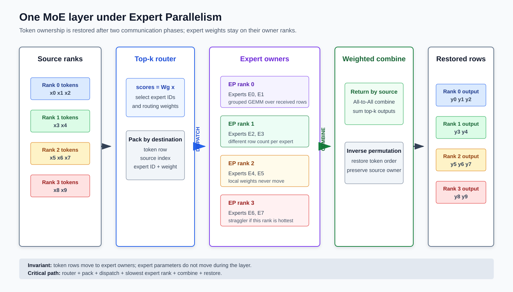
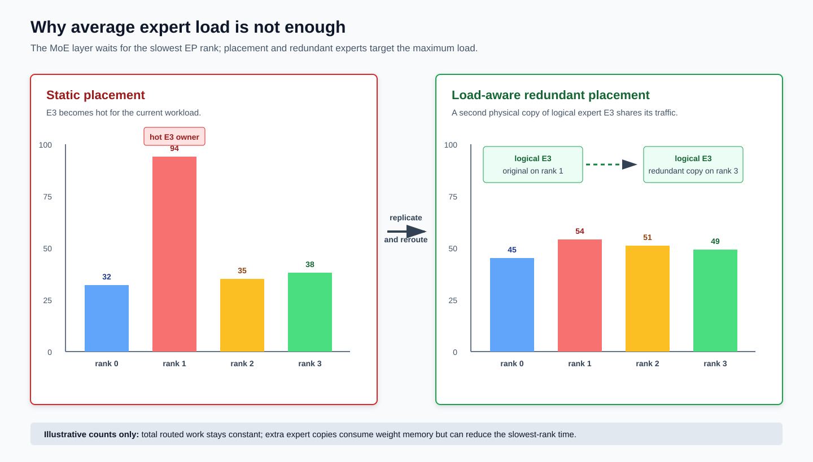
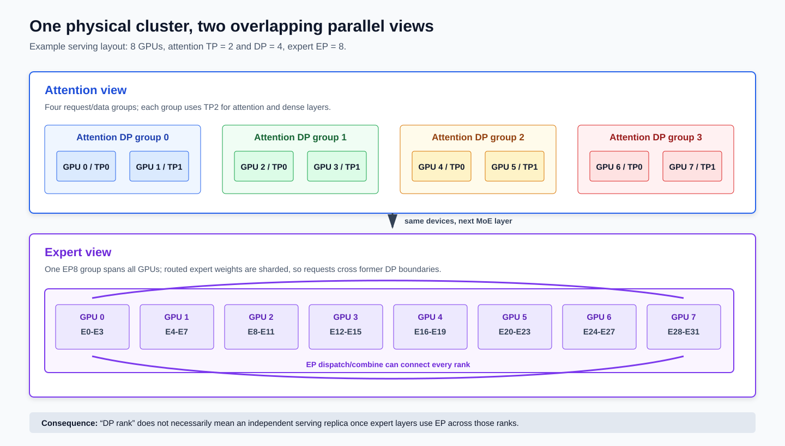
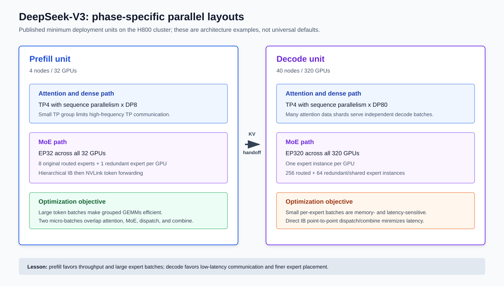

# Expert Parallelism：从稀疏 MoE 到 DeepSeek 超大模型部署

> 模型结构主线：Noam Shazeer et al., **Outrageously Large Neural Networks: The Sparsely-Gated Mixture-of-Experts Layer**，ICLR 2017，[论文](https://arxiv.org/abs/1701.06538)  
> Transformer MoE 主线：Dmitry Lepikhin et al., **GShard: Scaling Giant Models with Conditional Computation and Automatic Sharding**，2020/2021，[论文](https://arxiv.org/abs/2006.16668)  
> DeepSeek 主线：**DeepSeekMoE**、**DeepSeek-V2** 与 **DeepSeek-V3 Technical Report**，[DeepSeekMoE](https://arxiv.org/abs/2401.06066)，[DeepSeek-V2](https://arxiv.org/abs/2405.04434)，[DeepSeek-V3](https://arxiv.org/abs/2412.19437)  
> 工程实现主线：[Megatron-Core MoE](https://docs.nvidia.com/megatron-core/developer-guide/latest/user-guide/features/moe.html)、[DeepEP](https://github.com/deepseek-ai/DeepEP)、[EPLB](https://github.com/deepseek-ai/EPLB)、[vLLM Expert Parallel Deployment](https://docs.vllm.ai/en/latest/serving/expert_parallel_deployment/)、[SGLang Expert Parallelism](https://docs.sglang.io/docs/advanced_features/expert_parallelism)  
> 本文目标：从 MoE 的数学结构出发，完整解释 Expert Parallelism（EP）的参数 ownership、token dispatch/combine、All-to-All 通信、负载均衡、训练与推理差异、多维并行组合，以及 DeepSeek-V3 这类超大 MoE 模型为什么必须采用阶段化部署。

---

## 0. 先给出结论

Expert Parallelism 的核心可以压缩成一句话：

> **把不同 experts 的参数长期放在不同设备上；每个 token 先由 router 选出少量 experts，再把 token activation 发送到对应 expert owner，计算后把结果送回 token owner。**

因此，EP 不是“把一个 dense 矩阵平均切开”，也不是“把请求复制到多张卡”。它是一种由 **稀疏路由** 驱动的模型并行：

1. **MoE 是模型结构，EP 是分布式执行策略。** 单卡也能运行 MoE；只有把 experts 分散到多卡，才出现 EP。
2. **Expert 参数通常不随 token 移动。** 移动的是 token hidden states、路由 metadata 和 expert outputs。
3. **一次 MoE forward 通常有两次跨 rank 数据交换。** 第一次是 dispatch，第二次是 combine。
4. **EP 只切 expert 参数。** Attention、embedding、router、dense FFN、KV Cache 是否分片，要由 TP、PP、CP、DP/FSDP 等其他策略决定。
5. **“总参数 671B、每 token 激活 37B”不代表只需保存 37B 权重。** DeepSeek-V3 的全部 expert 权重仍要由整个部署组持有；37B 描述单 token 的活跃计算路径。
6. **EP 的性能由最慢 rank 决定。** 平均 expert load 很漂亮也不够，真正关键的是最热 expert、最忙 GPU、跨节点流量和 p99 All-to-All 延迟。
7. **Prefill 与 decode 的最佳 EP 配置通常不同。** Prefill 有大量 tokens，偏向吞吐和大 grouped GEMM；decode 每步 token 少，偏向低延迟通信、细粒度放置和冗余 experts。



阅读全文时，应始终追踪四类 ownership：

| 对象 | 典型 owner | 是否跨 EP rank 移动 |
|---|---|---|
| Routed expert weights | Expert owner rank | 通常不在每层 forward 中移动 |
| Shared expert weights | 本地复制、TP/ETP 分片或专门放置 | 取决于实现 |
| Token hidden state | Attention/data/context owner | Dispatch 时可能复制到多个 expert owners |
| Expert output | 暂时位于 expert owner | Combine 时返回 token owner |

---

## 1. 为什么需要 MoE？

### 1.1 Dense Transformer 的 FFN 会怎样扩展？

现代 Decoder-only Transformer block 通常由 attention 与 FFN 两部分组成。以 SwiGLU FFN 为例，本文把单 token hidden state 记为列向量：

$$ x\in\mathbb{R}^{d} $$

一个 expert 或 dense FFN 可以写成：

$$ \operatorname{FFN}(x)=W_2\left(\operatorname{SiLU}(W_1x)\odot W_3x\right) $$

其中：

$$ W_1,W_3\in\mathbb{R}^{f\times d},\qquad W_2\in\mathbb{R}^{d\times f} $$

忽略 bias，参数量约为：

$$ P_{\mathrm{FFN}}\approx3df $$

若直接增大 $f$，每个 token 都要使用新增参数，参数量、FLOPs 和权重读取量会一起增长。Dense scaling 的特点是：

> **模型容量增长多少，每个 token 的计算路径通常也增长多少。**

### 1.2 MoE 的条件计算

Mixture-of-Experts 将一个 FFN 替换成 $E$ 个参数独立的 experts，但每个 token 只选择其中 $k$ 个，通常 $k\ll E$。

若每个 expert 的参数量为 $P_e$，则 routed expert 总参数量近似为：

$$ P_{\mathrm{routed,total}}\approx E P_e $$

每个 token 使用的 routed expert 参数量近似为：

$$ P_{\mathrm{routed,active}}\approx kP_e $$

当 $E$ 增大而 $k$ 保持不变时：

- 总参数容量随 $E$ 增长。
- 单 token 的 expert 主计算近似保持不变。
- 权重总容量、路由开销、通信和负载均衡难度仍会增长。

这就是 sparse MoE 的基本承诺：**让模型容量和每 token 计算量部分解耦**。

### 1.3 稀疏计算不等于便宜部署

MoE 经常被概括为“参数多、激活少”，但这句话只描述了计算路径，没有回答系统问题：

1. 未激活的 experts 仍然要存储。
2. 不同 token 可能激活不同 experts，因此整个 batch 仍可能访问很多 expert weights。
3. Expert 分散在多卡后，token 必须跨设备移动。
4. 每个 expert 收到的 token 数不同，GEMM 形状不规则。
5. Decode batch 较小时，某些 experts 可能只收到 0、1 或几个 tokens。

所以 MoE 的 FLOPs 优势不会自动转化为低延迟或低成本。EP 正是把 MoE 变成可扩展系统所需的关键执行机制之一。

### 1.4 从 MoE 到现代 EP 的技术演进

| 时间 | 工作 | 与 EP 相关的关键贡献 |
|---|---|---|
| 1991/1994 | Classical Mixture of Experts | 建立 gating network 组合多个 experts 的统计学习框架 |
| 2017 | Sparsely-Gated MoE | 用稀疏 top-$k$ gating 扩大模型容量，系统讨论 shrinking batch、网络带宽与负载均衡 |
| 2020/2021 | GShard | 将 Transformer FFN 替换为 top-2 MoE，并用 SPMD sharding 与 All-to-All 扩展到 2048 个 TPU cores |
| 2021/2022 | Switch Transformer | 将 router 简化为 top-1，系统研究 capacity、token dropping 与训练稳定性 |
| 2022 | DeepSpeed-MoE、MegaBlocks | 组合 EP/expert slicing/dense parallelism，并用分层通信或 block-sparse/grouped computation 改善系统效率 |
| 2024 | Mixtral、DeepSeekMoE/V2/V3 | 把开放权重 MoE 推向通用 LLM；发展 fine-grained/shared experts、拓扑受限路由与超大规模训练部署 |
| 2025 以后 | DeepEP、EPLB 与 serving runtimes | 将 high-throughput/low-latency dispatch、动态冗余 expert placement、P/D 分离纳入生产 serving |

这条演进线反复解决三个相互制约的问题：**模型怎样选择 experts、系统怎样移动 tokens、集群怎样避免最慢 expert rank。**

---

## 2. MoE、EP、ETP 与普通 TP 不是同一概念

### 2.1 四个容易混淆的名词

| 名词 | 切分对象 | token 是否跨 rank | 主要目的 |
|---|---|---:|---|
| MoE | 模型结构中的多个 experts | 单卡时不需要 | 条件计算，扩大总参数容量 |
| EP，Expert Parallelism | 不同 experts | 是 | 分片 expert 参数与 expert 计算 |
| ETP，Expert Tensor Parallelism | 单个 expert 内部的矩阵 | 通常还需要 expert 内 collective | 单个 expert 本身过大时继续切矩阵 |
| 普通 TP | Attention、dense FFN 等矩阵 | hidden shards 参与 collective | 切单层 dense 权重与算子 |

在部分论文或框架中，EP 也被称为 expert model parallelism；ETP 也可能被称为 expert slicing。阅读配置时不能只看缩写，必须确认它是在“不同 experts 之间切”还是在“一个 expert 内部切”。

### 2.2 一个最小例子

假设一层有 8 个 experts，使用 4 张 GPU：

```text
GPU 0: E0, E1
GPU 1: E2, E3
GPU 2: E4, E5
GPU 3: E6, E7
```

这叫 EP4。若 token $x$ 的 router 选择 $E_1$ 和 $E_6$：

1. $x$ 的一份 route 被送到 GPU 0。
2. $x$ 的另一份 route 被送到 GPU 3。
3. GPU 0 和 GPU 3 分别计算 expert output。
4. 两份结果返回 token owner，按路由权重相加。

如果 $E_6$ 自身太大，再把 $E_6$ 的三个矩阵切到两张 GPU 上，那一层同时使用 EP 与 ETP。

### 2.3 EP 不要求每张卡只放一个 expert

设逻辑 routed expert 数为 $E$，EP degree 为 $N_{\mathrm{EP}}$。若不复制 experts，且 $E$ 能被 $N_{\mathrm{EP}}$ 整除，则每 rank 放置：

$$ E_{\mathrm{local}}=\frac{E}{N_{\mathrm{EP}}} $$

但这只是最简单的均匀放置。真实系统还可能：

- 每卡放多个 experts。
- 一个 expert 跨 ETP ranks 分片。
- 热 expert 有多个物理副本。
- 某些 shared experts 在每卡复制。
- 不同 MoE layers 使用不同 physical placement。
- 逻辑 expert 数小于物理 expert instances 数。

因此，`EP=320` 并不必然表示模型有 320 个互不重复的逻辑 experts。DeepSeek-V3 decode 正是一个 physical expert instances 多于 256 个 routed experts 的例子。

---

## 3. Router 的数学定义

### 3.1 Router logits

设 MoE 层有 $E$ 个 routed experts，router 权重为：

$$ W_g\in\mathbb{R}^{E\times d} $$

对列向量 $x$，router logits 为：

$$ a=W_gx\in\mathbb{R}^{E} $$

最常见的实现对 $a$ 做 softmax 或 sigmoid，再选择 top-$k$ experts。设选中的 expert 集合为：

$$ \mathcal{T}(x)=\operatorname{TopK}(a,k) $$

对 softmax top-$k$，可在选中集合内重新归一化：

$$ g_e(x)=\frac{\exp(a_e)}{\sum_{j\in\mathcal{T}(x)}\exp(a_j)},\qquad e\in\mathcal{T}(x) $$

未选中的 experts 权重为 0。

### 3.2 Routed experts 与 shared experts

设 routed expert 函数为 $F_e(x)$，shared expert 函数为 $S_j(x)$，shared expert 的数量为 $E_s$。MoE 子层输出可写成：

$$ M(x)=\sum_{j=1}^{E_s}S_j(x)+\sum_{e\in\mathcal{T}(x)}g_e(x)F_e(x) $$

若把 residual 也写入 block：

$$ y=x+M(x) $$

Shared experts 对每个 token 都执行，用来吸收跨领域的公共知识；routed experts 则更专注于条件选择。DeepSeekMoE 将“细粒度 expert 切分”和“shared expert isolation”作为两项核心设计。

### 3.3 Top-$k$ 的含义

增大 $k$ 会带来：

- 更高 active parameter count。
- 更高 expert FLOPs。
- 更多 dispatch routes。
- 更大的通信量。
- 更平滑的专家组合能力。

增大 $E$ 而保持 $k$ 不变，主要增加总参数容量和专家选择空间，但也会使每个 expert 的平均 token batch 变小。

### 3.4 Router 不是免费的

对任意一批 $T_{\mathrm{batch}}$ 个 tokens，router projection 的主计算量约为：

$$ F_{\mathrm{router}}\approx2T_{\mathrm{batch}}Ed $$

Expert 主计算近似为：

$$ F_{\mathrm{experts}}\approx2T_{\mathrm{batch}}kP_e $$

通常 $P_e\gg Ed$，所以 router FLOPs 不是主要项；但 top-$k$、排序、计数、prefix sum、permutation 和 CPU/GPU synchronization 可能成为实际延迟中的显著固定开销，尤其是在 decode 小 batch 下。

### 3.5 数学记法与 PyTorch layout

本文数学上把 $x$ 写成列向量，线性层写成 $a=W_gx$。PyTorch 中 tokens 通常使用 feature-last 张量：

```text
x.shape       = (num_tokens, hidden_size)
router_weight = (num_experts, hidden_size)
logits        = x @ router_weight.T
```

即框架实现对应 $xW_g^\top$。这与列向量数学记法没有矛盾，只是张量布局不同。

---

## 4. 一次 EP forward 到底发生了什么？

### 4.1 第 0 步：输入仍属于原 token owner

MoE 层的输入可能来自：

- 某个 data/serving rank 的本地 requests。
- 某个 CP rank 的 token shard。
- 某个 TP group 的 sequence-parallel shard。
- 某个 PP stage 接收到的 activation。

将本 rank 的 batch 与 sequence 维展平后，记本地 token 数为 $T_r$：

```text
x_local: [T_r, d]
```

此时 token 的原始顺序、sequence id、position 和 source rank 必须可恢复。

### 4.2 第 1 步：Router 选择 experts

这一阶段只回答一个问题：

> **当前 rank 上的每个 token，应该交给哪些 logical routed experts 处理，各 expert 的输出最终占多大权重？**

此时还没有查询 expert 位于哪张 GPU，也没有发生跨卡通信。Logical expert 到 physical rank 的映射属于下一步。

#### 4.2.1 Router 的输入是什么？

设本 rank 有 $T_r$ 个 token hidden states：

```text
x_local: [T_r, d]
```

对第 $t$ 个 token，其 hidden state 在数学上记为列向量：

$$ x_t\in\mathbb{R}^{d} $$

Router 权重为：

$$ W_g\in\mathbb{R}^{E\times d} $$

其中 $E$ 是 logical routed expert 总数。Router 为该 token 计算 $E$ 个分数：

$$ a_t=W_gx_t\in\mathbb{R}^{E} $$

$a_{t,e}$ 表示 token $t$ 与 routed expert $e$ 的匹配程度。它不是 expert 的计算结果，只是用于做路由决策的分数。

#### 4.2.2 `topk_ids` 表示选中了谁

对每个 token 的 $E$ 个 router scores 取 top-$k$：

$$ \mathcal{T}(x_t)=\operatorname{TopK}(a_t,k) $$

得到：

```text
topk_ids: [T_r, k]
```

记 token $t$ 选中的 $k$ 个 logical expert ids 为：

$$ e_{t,1},e_{t,2},\ldots,e_{t,k} $$

则 `topk_ids[t, j]` 保存 $e_{t,j}$。它只表示第 $j$ 个被选中的 logical expert，还没有包含该 expert 的 physical rank。

#### 4.2.3 `topk_weights` 表示最后怎样混合

除了 expert ids，router 还要为选中的 experts 生成 mixture weights：

```text
topk_weights: [T_r, k]
```

记对应的 $k$ 个 weights 为：

$$ g_{t,1},g_{t,2},\ldots,g_{t,k} $$

这些 experts 分别计算 $F_{e_{t,j}}(x_t)$。返回 token owner 后，routed 部分输出为：

$$ z_t=\sum_{j=1}^{k}g_{t,j}F_{e_{t,j}}(x_t) $$

所以：

- `topk_ids` 决定**调用哪些 experts**。
- `topk_weights` 决定**这些 expert outputs 如何加权合并**。

不同模型的权重规则并不完全相同。DeepSeek-V3 使用 sigmoid scores、group-limited selection、selection bias 和额外 route scale，不能机械地假设任意模型的 $k$ 个 weights 之和都严格等于 1；但“expert id + combine weight”这两个输出角色不变。

#### 4.2.4 一个 token 为什么会变成 $k$ 条 routes？

对 EP dispatcher 而言，token $t$ 的 top-$k$ 结果可以写成：

```text
token t -> [e_{t,1}, e_{t,2}, ..., e_{t,k}]
```

Router 执行前，每个 token 仍属于保存其输入 hidden state 的 rank。将这个 token owner 记为 source rank $r_{\mathrm{src}}$，并把 $t$ 视为该 source rank 内的本地 token index。

Router 不会改变 token ownership。它只是把这个本地 token 逻辑展开成 $k$ 条 token-expert assignments。第 $j$ 条 route 可表示为：

$$ (r_{\mathrm{src}},t,e_{t,j},g_{t,j}),\qquad 1\le j\le k $$

其中：

- $r_{\mathrm{src}}$：router 前持有该 token hidden state 的 source rank。
- $t$：token 在 source rank 内的本地位置。
- $e_{t,j}$：第 $j$ 个被选中的 logical expert。
- $g_{t,j}$：该 expert output 的 combine weight。

这里说的“展开”首先是**逻辑上的 route expansion**。实现可以稍后才复制或打包 hidden row，也可以在同节点多个 experts 之间复用一次跨节点传输；并不要求 router kernel 立即物理复制出 $k$ 份完整 tensor。

到下一步查询 expert placement 后，每条 route 才会获得 destination rank $r_{\mathrm{dst}}$。因此，$r_{\mathrm{src}}$ 描述 router 前的 token ownership，$r_{\mathrm{dst}}$ 描述 router 后该 route 应前往的 expert owner；二者可能相同，也可能不同。

#### 4.2.5 Shared expert 为什么不在 `topk_ids` 中？

这里的 router 只在 $E$ 个 **routed experts** 中做 top-$k$。Shared experts 对所有 tokens 都执行，不需要 router 选择：

```text
x_t -> all shared experts
x_t -> top-k routed experts
```

因此，若一层有 $E_s$ 个 shared experts，并从 routed experts 中选择 top-$k$，则每个 token 执行：

- $E_s$ 个始终激活的 shared experts。
- $k$ 个由 router 选出的 routed experts。

下一节只需要对 routed routes 查询 physical owner；shared expert 是否本地复制、TP/ETP 分片或作为特殊 physical slot 部署，由具体 runtime 决定。

### 4.3 第 2 步：按目标 rank 和 local expert 打包

运行时根据 expert placement 映射：

$$ \operatorname{owner}(e)\rightarrow(r_{\mathrm{dst}},\text{local expert slot}) $$

把 routes 按 $r_{\mathrm{dst}}$ 分桶，并保存：

- Hidden row。
- Logical expert id 或 local expert id。
- Routing weight。
- Source rank。
- Source token index。
- Top-$k$ slot，若 combine 阶段需要。

这一步通常包含计数、prefix sum、permutation、padding/alignment 等 kernel。

### 4.4 第 3 步：All-to-All dispatch

每个 source rank 向多个 expert owner 发送 token rows。通信完成后，每个 EP rank 拿到“本地 experts 应处理的所有 routes”，这些 routes 可能来自全部 source ranks。

Dispatch 前数据按 source token 排列；dispatch 后数据通常按 local expert 排列：

```text
source-major token rows
  -> destination-rank buckets
  -> local-expert-contiguous rows
```

### 4.5 第 4 步：本地 expert grouped GEMM

Dispatch 完成后，token routes 已经到达各自的 expert owner。对当前 EP rank 而言：

- Expert weights 原本就常驻本 rank，不需要在这一阶段移动。
- 接收到的 token hidden rows 可能来自 EP group 中的任意 source ranks。
- 不同 local experts 收到的 route 数通常不同。
- 本 rank 只计算自己持有的 experts。

因此，这里的“本地”是从 **expert ownership** 角度描述的：输入 token 可能是远端发送来的，但 expert weights 和实际 GEMM 都位于当前 rank。

#### 4.5.1 Dispatch 后的数据怎样组织？

设当前 rank 持有的 logical experts 集合为：

$$ \mathcal{E}_{\mathrm{local}}=\{e_1,e_2,\ldots,e_m\} $$

Expert $e$ 收到 $n_e$ 条 routes。Dispatcher 通常已将接收 buffer 重排为 expert-contiguous layout：

```text
recv_x:
  rows for expert e_1
  rows for expert e_2
  ...
  rows for expert e_m

tokens_per_expert:
  [n_{e_1}, n_{e_2}, ..., n_{e_m}]
```

还可以通过 prefix sum 得到每个 expert 在连续 buffer 中的起止位置：

$$ o_0=0,\qquad o_j=\sum_{i=1}^{j}n_{e_i} $$

于是 expert $e_j$ 的输入 rows 位于：

$$ X_{e_j}=\operatorname{recv\_x}[o_{j-1}:o_j] $$

这里的 $X_{e_j}$ 只包含路由给 expert $e_j$ 的 token rows，而不是本 rank 在 router 前持有的原始 token shard。

#### 4.5.2 单个 expert 实际计算什么？

对单个 token 列向量 $x\in\mathbb{R}^{d}$，SwiGLU expert $e$ 的数学定义为：

$$ F_e(x)=W_{2,e}\left(\operatorname{SiLU}(W_{1,e}x)\odot W_{3,e}x\right) $$

其中：

$$ W_{1,e},W_{3,e}\in\mathbb{R}^{f\times d},\qquad W_{2,e}\in\mathbb{R}^{d\times f} $$

可以拆成四步：

$$ u_e=W_{1,e}x $$

$$ v_e=W_{3,e}x $$

$$ h_e=\operatorname{SiLU}(u_e)\odot v_e $$

$$ z_e=W_{2,e}h_e $$

这与普通 dense SwiGLU FFN 的计算完全相同；MoE 的特殊之处不是 expert 内部公式，而是不同 token 使用不同的 expert 参数。

#### 4.5.3 多条 routes 在框架张量中怎样计算？

数学上以上公式使用列向量。PyTorch 和 GEMM kernel 则通常把 expert $e$ 收到的 $n_e$ 条 token rows 堆叠为 feature-last 矩阵：

```text
X_e:  [n_e, d]
W1_e: [f, d]
W3_e: [f, d]
W2_e: [d, f]
```

对应矩阵计算为：

$$ U_e=X_eW_{1,e}^{\top},\qquad V_e=X_eW_{3,e}^{\top} $$

$$ H_e=\operatorname{SiLU}(U_e)\odot V_e $$

$$ Z_e=H_eW_{2,e}^{\top} $$

其形状为：

```text
U_e, V_e, H_e: [n_e, f]
Z_e:           [n_e, d]
```

数学上的 $W_{1,e}x$ 与框架中的 `X_e @ W1_e.T` 表达的是同一线性变换，只是列向量记法和 feature-last batch layout 不同。

#### 4.5.4 Grouped GEMM 的执行组织

前面已经明确了每个 expert 的输入切片、权重与输出形状。下面进一步说明，runtime 为什么要使用 grouped GEMM，以及它怎样组织这些彼此独立但形状不规则的 expert 计算。

##### 4.5.4.1 为什么不能简单写一个普通大 GEMM？

不同 experts 有不同参数：

$$ W_{1,e_i}\ne W_{1,e_j},\qquad e_i\ne e_j $$

而且各 expert 的 token 数也不同：

$$ n_{e_i}\ne n_{e_j} $$

因此它不是一个共享同一权重矩阵的普通 batch GEMM。运行时面对的是一组彼此独立、$M$ 维不同的矩阵乘：

$$ X_eW_{1,e}^{\top},\qquad e\in\mathcal{E}_{\mathrm{local}} $$

它们通常具有相同或兼容的 $K=d$ 与 $N=f$，但每个 expert 的：

- 输入起始地址不同。
- Weight 地址不同。
- Token rows 数 $n_e$ 不同。
- 输出起始地址不同。

##### 4.5.4.2 Grouped GEMM 到底“group”了什么？

Grouped GEMM 把上述多组独立 GEMMs 交给同一个 kernel launch 或统一调度器：

```text
grouped_gemm(
    input_ptrs,
    weight_ptrs,
    output_ptrs,
    tokens_per_expert,
    matrix_shapes,
)
```

它“group”的是**执行调度**，不是模型语义：

- 不会把不同 experts 的权重求和。
- 不会让 expert $e_i$ 读取 expert $e_j$ 的参数。
- 不会在 experts 之间做 attention。
- 不会在这一步合并同一 token 的 top-$k$ outputs。

每个 expert 仍然独立执行自己的 SwiGLU；grouped GEMM 只是减少逐 expert 启动 kernel 的开销，并更有效地把许多大小不规则的 GEMMs 分配到 GPU thread blocks。

##### 4.5.4.3 为什么逐 expert Python loop 很低效？

若按 expert 逐个执行：

```text
for each local expert e:
    run GEMM for W1_e
    run GEMM for W3_e
    run activation
    run GEMM for W2_e
```

会产生：

- 大量小 kernel launches。
- CPU launch overhead。
- 很多 expert GEMM 无法占满 GPU。
- Expert 之间出现串行 launch 间隙。
- 动态 token counts 带来频繁 shape handling。

Grouped GEMM、block-sparse GEMM 或 fused MoE kernel 的目标，就是让多个 experts 的小任务在 GPU 上并发或统一调度。

##### 4.5.4.4 不规则 token counts 怎样处理？

由于 router 选择不均匀：

- 某些 experts 可能收到很多 routes。
- 某些 experts 可能只收到很少 routes。
- 某些 experts 可能没有收到 route。

Runtime 通常需要：

- 跳过 $n_e=0$ 的 experts。
- 依据 `tokens_per_expert` 生成 descriptors 或 offsets。
- 为 Tensor Core tile 做少量 alignment padding。
- 在静态 CUDA Graph 中使用预分配 capacity 和 mask。
- 为量化 expert weights 读取对应 scale metadata。

Grouped GEMM 能改善本 rank 内的不规则计算效率，但不能消除跨 ranks 的负载不均衡。若另一个 EP rank 持有热点 experts，整个 MoE 层仍要等待最慢 rank。

##### 4.5.4.5 Expert 输出怎样交给 combine？

Expert $e$ 计算得到：

$$ Z_e\in\mathbb{R}^{n_e\times d} $$

每一行仍然对应一条 route，而不是一个已经完成 top-$k$ 聚合的 token。Runtime 必须保留或能够恢复：

- Source rank $r_{\mathrm{src}}$。
- Source token index $t$。
- Top-$k$ slot 或 logical expert id。
- Routing weight $g_{t,j}$。

Routing weight 可以在 expert owner 上先乘：

$$ \widetilde z_{t,j}=g_{t,j}F_{e_{t,j}}(x_t) $$

也可以把未加权的 expert output 返回 source rank 后再乘。无论采用哪种实现，同一 token 的 $k$ 条 route outputs 都要到 combine 阶段才恢复成一个 token output。

Shared expert 通常走独立的本地计算路径，并可能与 routed expert dispatch/GEMM 重叠；它不属于这里按 routed expert id 分组的 grouped GEMM，除非具体 runtime 将其显式纳入同一 fused kernel。

### 4.6 第 5 步：All-to-All combine

Expert outputs 依据 source rank 和 source token index 返回。若一个 token 选择 $k$ 个 experts，token owner 需要计算：

$$ y_t=\sum_{e\in\mathcal{T}(x_t)}g_{t,e}F_e(x_t) $$

路由权重可以在 expert owner 上乘，也可以返回后再乘；具体位置会影响通信格式、融合机会和数值累加顺序。

### 4.7 第 6 步：恢复原 token layout

Combine 后执行 inverse permutation，使输出恢复到进入 MoE 层前的 token 顺序和 ownership。下一层不需要知道这些 tokens 曾被发送到哪些 experts。

整个关键路径可以写成：

$$ T_{\mathrm{MoE}}=T_{\mathrm{router}}+T_{\mathrm{pack}}+T_{\mathrm{dispatch}}+\max_{r_{\mathrm{dst}}}T_{\mathrm{expert},r_{\mathrm{dst}}}+T_{\mathrm{combine}}+T_{\mathrm{restore}} $$

式中的 $\max_{r_{\mathrm{dst}}}$ 很重要：只要一个 expert-owner rank 因热 expert 变慢，整个 EP group 就会等待它。

---

## 5. 为什么典型通信是 All-to-All？

### 5.1 All-to-All 与 All-Gather 的语义区别

All-Gather 会让每个 rank 收到所有 ranks 的完整输入 shard；All-to-All 则允许每个 source rank 给不同 destination rank 发送不同数据。

EP 的目的地由 router 动态决定，因此天然符合 All-to-All：

```text
rank 0: some rows -> rank 0, 1, 3
rank 1: some rows -> rank 0, 2
rank 2: some rows -> rank 1, 2, 3
...
```

不同 source-destination pair 的字节数通常不相等，所以更准确地说是 variable-size All-to-All 或 All-to-All-v 语义。

### 5.2 Dispatch 与 combine 为什么各需要一次？

Dispatch 改变 ownership：

```text
token owner -> expert owner
```

Combine 恢复 ownership：

```text
expert owner -> token owner
```

如果不恢复，residual、attention、下一层 token layout 和请求状态都会失去稳定 owner。EP 的普通实现因此不是“一次把 token 发走就结束”，而是往返通信。

### 5.3 简化通信量模型

设：

- Source rank $r_{\mathrm{src}}$ 在 router 前持有 $T_{r_{\mathrm{src}}}$ 个 tokens。
- EP group 的 source token 总数为 $T_{\mathrm{EP}}=\sum_{r_{\mathrm{src}}=0}^{N_{\mathrm{EP}}-1}T_{r_{\mathrm{src}}}$。
- 每 token 选择 $k$ 个 routed experts。
- Hidden dimension 为 $d$。
- 传输 activation 每元素占 $b_a$ bytes。
- 暂时忽略 metadata、padding、量化 scale 和本地 routes。

若每条 route 都需要发送一个完整 hidden row，则 dispatch 与 combine 的逻辑 payload 总量约为：

$$ V_{\mathrm{logical}}\approx2T_{\mathrm{EP}}kd b_a $$

若 experts 均匀分布在 $N_{\mathrm{EP}}$ 个 ranks，route 留在 source rank 的理想比例约为 $1/N_{\mathrm{EP}}$，则跨 rank payload 可粗略写成：

$$ V_{\mathrm{remote}}\approx2T_{\mathrm{EP}}kd b_a\left(1-\frac{1}{N_{\mathrm{EP}}}\right) $$

这只是数量级模型。真实流量还受以下因素影响：

- 同一 token 在同一远端节点选择多个 experts 时能否先传一次再节点内复制。
- Dispatch 是否使用 FP8，combine 是否仍使用 BF16。
- Router weights、expert ids、source indices 的 metadata。
- Alignment、固定 capacity 或 CUDA Graph buffer 的 padding。
- Shared expert 是否走通信。
- Combine 是否在网络路径中累加。

### 5.4 延迟模型

将一次 collective 粗略写成：

$$ T_{\mathrm{A2A}}\approx\alpha\cdot N_{\mathrm{phase}}+\frac{V}{B_{\mathrm{effective}}}+T_{\mathrm{contention}} $$

其中：

- $\alpha$ 表示软件、协议与网络固定延迟。
- $N_{\mathrm{phase}}$ 取决于 collective 算法和拓扑。
- $V$ 是实际链路 payload。
- $B_{\mathrm{effective}}$ 是有效带宽，不是硬件宣传峰值。
- $T_{\mathrm{contention}}$ 包含其他 ranks、其他 communicators 和 shared fabric 干扰。

Prefill 的 $V$ 大，带宽项重要；decode 的消息小而频繁，$\alpha$ 和同步项更重要。

### 5.5 为什么也有 All-Gather dispatcher？

某些实现选择：

1. All-Gather 全部 token activations。
2. 每个 rank 本地筛出属于本地 experts 的 rows。
3. 计算后用 Reduce-Scatter 或等价操作恢复输出。

这种方法发送了更多不属于本地 expert 的数据，却可能在以下场景更简单或更快：

- EP degree 小。
- Top-$k$ 较大。
- All-to-All backend 不成熟。
- TP/EP layout 使 All-Gather 能与已有 collective 合并。
- 静态 shape 或编译器更偏好规则 tensor。

因此“EP 必定使用 NCCL All-to-All”不是定义。EP 的定义是 experts 的分布式 ownership；All-to-All 只是最典型的数据交换实现。

### 5.6 分层 dispatch

跨节点网络通常远慢于节点内 NVLink/NVSwitch。分层 dispatch 可以先做：

```text
source GPU
  -> target node ingress GPU over IB/RoCE
  -> target expert GPU over NVLink
```

若 router 限制每 token 只访问少数节点，跨节点副本数可以小于 expert route 数。DeepSeek-V3 的训练设计将每个 token 限制在最多 4 个节点，并把 IB 与 NVLink forwarding 重叠。

---

## 6. 负载均衡：EP 最难的部分

### 6.1 平均负载

沿用第 4 节的 source-rank 记号，EP group 的 source token 总数为：

$$ T_{\mathrm{EP}}=\sum_{r_{\mathrm{src}}=0}^{N_{\mathrm{EP}}-1}T_{r_{\mathrm{src}}} $$

设每层有 $E$ 个 routed experts，每 token 选择 $k$ 个 experts。整个 EP group 共产生 $T_{\mathrm{EP}}k$ 条 assignments，理想平均每 expert 收到：

$$ \bar n=\frac{T_{\mathrm{EP}}k}{E} $$

若每 rank 放相同数量 experts，理想 rank load 也相等。

但实际 router 分布不是均匀随机的。语言、领域、序列位置、模型层、训练阶段和线上流量变化都可能造成 expert 热度偏斜。

### 6.2 为什么最大值比平均值重要？

用 $r_{\mathrm{dst}}$ 索引 EP group 中的 expert-owner ranks，并设其收到的 expert 计算成本为 $C_{r_{\mathrm{dst}}}$。MoE 层完成时间至少受：

$$ C_{\max}=\max_{r_{\mathrm{dst}}}C_{r_{\mathrm{dst}}} $$

限制。常见的平衡指标包括：

$$ \rho_{\mathrm{max/mean}}=\frac{\max_{r_{\mathrm{dst}}}C_{r_{\mathrm{dst}}}}{\frac{1}{N_{\mathrm{EP}}}\sum_{r_{\mathrm{dst}}}C_{r_{\mathrm{dst}}}} $$

或其倒数：

$$ \rho_{\mathrm{balancedness}}=\frac{\operatorname{mean}_{r_{\mathrm{dst}}}C_{r_{\mathrm{dst}}}}{\max_{r_{\mathrm{dst}}}C_{r_{\mathrm{dst}}}} $$

前者理想值为 1，越大越差；后者理想值为 1，越小越差。监控系统必须注明采用哪一种定义。



### 6.3 Router collapse

Router 可能逐渐偏好少数 experts：

1. 某个 expert 被更多 tokens 选中。
2. 它得到更多训练信号。
3. 它更快学会有用模式。
4. Router 更倾向继续选择它。

这会形成自强化的热点，使其他 experts 欠训练，同时造成系统 straggler。

### 6.4 辅助负载均衡损失

早期 sparsely-gated MoE 使用 importance/load losses；GShard、Switch Transformer 等工作也加入 expert usage 约束。

一种常见抽象是：

$$ \mathcal{L}_{\mathrm{balance}}\propto E\sum_{e=1}^{E}f_ep_e $$

其中 $f_e$ 表示实际路由到 expert $e$ 的 token 比例，$p_e$ 表示 router 给该 expert 的平均概率。具体归一化、top-$k$ 和分组方式因模型而异。

辅助损失的矛盾是：

- 系数太小，负载可能失衡。
- 系数太大，router 为了均匀而牺牲模型最优选择。
- Batch-level 均衡不保证每个 sequence、每个 device 或每个 node 都均衡。

### 6.5 Capacity factor

早期静态-shape MoE 常为每个 expert 设置容量：

$$ C=\left\lceil c\frac{T_{\mathrm{EP}}k}{E}\right\rceil $$

其中 $c$ 是 capacity factor。若某 expert 收到超过 $C$ 条 assignments，可以：

- 丢弃溢出 routes。
- 让 token 只走次优 expert。
- 让 residual 直接旁路。
- 把溢出任务放到额外 buffer 或下一轮执行。

增大 $c$：

- 减少 token dropping。
- 增加 padding、activation buffer 和无效计算。
- 使静态 shape 更容易满足峰值负载。

### 6.6 Token dropping 与 dropless MoE

Token dropping 用有限 capacity 换取规则 shape 和显存上界，但会改变模型的实际计算图。Dropless MoE 则为真实 token counts 分配或复用动态 buffer，不因为 expert 过载而丢 route。

Dropless 不等于没有代价：

- 最热 expert 的 batch 可能很大。
- Dispatcher buffer 需要覆盖高分位负载。
- Grouped GEMM shape 更不规则。
- CUDA Graph 需要固定上限、masked layout 或多个 graph buckets。
- 极端热点仍会拖慢整个 EP group。

### 6.7 DeepSeek-V3 的 auxiliary-loss-free balancing

DeepSeek-V3 对每个 routed expert 维护一个可调 bias。简化地说：

1. Router 产生原始 affinity score。
2. Expert 选择使用“score + bias”。
3. 最终 route weight 仍来自原始 score。
4. Expert 过载时降低其 bias，欠载时提高其 bias。

这样可以调整选择边界，而不把主要负载均衡压力直接写入语言模型目标。需要注意：

> “Auxiliary-loss-free”不应被误读为训练中绝对没有任何平衡约束。DeepSeek-V3 仍保留了很小的 sequence-wise balance loss，用于避免单序列内的极端失衡。

### 6.8 Group-limited routing

如果 experts 分布在多个节点，单纯 top-$k$ 可能让一个 token 的 $k$ 条 routes 散到很多节点。

Group-limited routing 先把 experts 分组，再限制 token 只从少数组中选 experts。DeepSeek-V3 配置为：

- 256 个 routed experts。
- 8 个 expert groups。
- 每 token 最多选择 4 个 groups。
- 最终激活 8 个 routed experts。

这把模型路由约束与物理拓扑结合起来，主要目标是减少跨节点通信 fan-out。

### 6.9 冗余 experts

算法层的 router balancing 不能消除线上 workload drift。Serving 系统还可以复制热 expert：

```text
logical expert E17
  -> physical copy E17a on rank 3
  -> physical copy E17b on rank 11
```

Router 的逻辑输出仍是 E17，运行时 placement layer 再决定使用哪个物理副本。

冗余 experts 的收益：

- 分摊热点。
- 降低最慢 rank 时间。
- 可根据最近负载周期性重排。

代价：

- 占用额外 HBM。
- 训练时需同步副本梯度或恢复主副本语义。
- 在线迁移 expert weights 有带宽与一致性成本。
- Placement 改变时，route mapping、CUDA Graph 和 checkpoint metadata 都要保持一致。

[DeepSeek EPLB](https://github.com/deepseek-ai/EPLB) 提供了 hierarchical 与 global 两类 expert replication/placement 策略：前者利用 expert groups 和节点边界，后者在更大 EP 范围内全局平衡。

---

## 7. Shrinking batch problem：experts 越多，GEMM 可能越小

### 7.1 平均 expert batch

理想情况下，每个 expert 收到：

$$ \bar n=\frac{T_{\mathrm{EP}}k}{E} $$

条 routes。若 $E$ 增大而 $T_{\mathrm{EP}},k$ 不变，$\bar n$ 会下降。GPU 擅长大矩阵乘，却不擅长大量极小 GEMMs。

这就是 Shazeer 2017 论文强调的 shrinking batch problem。

### 7.2 一个直观概率模型

若暂时假设 assignments 独立且均匀，单 expert 的 route count 可近似为均值 $\lambda=T_{\mathrm{EP}}k/E$ 的 Poisson 分布。Expert 没收到任何 route 的概率约为：

$$ \Pr[n_e=0]\approx e^{-\lambda} $$

以 $E=256,k=8$ 为例：

| EP group 总 token 数 $T_{\mathrm{EP}}$ | $\lambda=T_{\mathrm{EP}}k/E$ | Expert 为空的近似概率 |
|---:|---:|---:|
| 32 | 1 | 36.8% |
| 64 | 2 | 13.5% |
| 128 | 4 | 1.83% |
| 256 | 8 | 0.0335% |

真实 router 并不均匀独立，因此这不是容量承诺；它只说明为什么 decode 小 batch 下大量 expert GEMM 很难高效。

### 7.3 为什么要聚合多个 data ranks 的 tokens？

Attention/dense 路径上的多个 data ranks 可以各自处理不同请求；进入 MoE 层后，EP group 将这些 ranks 的 routes 汇聚到 expert owners。

这会提高每 expert batch：

$$ \bar n\approx\frac{k\sum_{r_{\mathrm{src}}}T_{r_{\mathrm{src}}}}{E}=\frac{T_{\mathrm{EP}}k}{E} $$

因此，在部分 MoE serving 系统中，所谓 attention DP ranks 并不是完整独立 replicas：它们会在 expert 层通过 EP 重新耦合。

### 7.4 Grouped GEMM 的作用

假设本 rank 有 8 个 local experts，token counts 为：

```text
[0, 3, 17, 5, 28, 1, 9, 12]
```

逐 expert 启动 8 组独立 SwiGLU kernels 会产生：

- 大量 launch overhead。
- 很差的 Tensor Core occupancy。
- 重复的 metadata 与 synchronization。

Grouped GEMM 把不同 $M=n_j$、但 $K/N$ 相近的 GEMMs 放入一个调度器中。它不会把不同 experts 的权重混成一个逻辑矩阵，而是让一个 kernel/调度框架高效处理多个独立矩阵乘。

### 7.5 Padding-free 与 alignment

完全不 padding 也不一定最快。Tensor Core kernel 常要求：

- Token rows 对齐到某个 tile size。
- Expert offsets 对齐。
- FP8 scale layout 符合特定 block。

工程目标通常是“少量对齐 padding + 无固定大 capacity padding”，而不是字面意义的零 padding。

---

## 8. EP 的参数、显存和 FLOPs 模型

### 8.1 每个 expert 的参数量

对 SwiGLU expert：

$$ P_e\approx3df $$

若模型有 $L_m$ 个 MoE layers、每层 $E$ 个 routed experts，则 routed expert 总参数约为：

$$ P_{\mathrm{routed}}\approx3L_mEdf $$

若每层激活 $k$ 个 routed experts 和 $E_s$ 个等宽 shared experts，则每 token 的 expert active parameters 约为：

$$ P_{\mathrm{expert,active}}\approx3L_m(k+E_s)df $$

这里不含 attention、embedding、router、norm 和输出 head。

### 8.2 EP 后每 rank 持有多少 expert 参数？

最简单的均匀、无冗余、无 ETP 情形：

$$ P_{\mathrm{expert,rank}}\approx\frac{P_{\mathrm{routed}}}{N_{\mathrm{EP}}} $$

若 expert tensor parallel degree 为 $N_{\mathrm{ETP}}$：

$$ P_{\mathrm{expert,rank}}\approx\frac{P_{\mathrm{routed}}}{N_{\mathrm{EP}}N_{\mathrm{ETP}}} $$

但这不包括：

- Non-expert weights。
- Shared expert replicas。
- Redundant experts。
- Router 与 placement metadata。
- Quantization scales。
- Communication buffers。
- CUDA Graph pools。
- Training gradients、master weights 和 optimizer states。

### 8.3 EP 不切 KV Cache

EP 作用于 MoE FFN。KV Cache 来自 attention，通常由：

- TP 的 KV head layout。
- CP 的 context shard。
- PP 的 layer partition。
- Serving request ownership。

共同决定。增加 EP degree 不会自动把 KV Cache 除以 EP degree。

### 8.4 EP 不保证 activation 除以 degree

在 dispatch 期间，一个 token 会因 top-$k$ 被复制成 $k$ 条 routes。每 rank 的接收 buffer 由实际 expert load 决定，不一定是原 activation 的 $1/N_{\mathrm{EP}}$。

因此，EP 的主要确定性容量收益是 **expert weights 分片**；activation buffer 收益与负载和 dispatcher 设计有关。

### 8.5 FLOPs 是否随 EP degree 下降？

系统聚合 expert FLOPs 不因 EP degree 改变：

$$ F_{\mathrm{expert,total}}\approx2T_{\mathrm{EP}}kP_e $$

理想均衡时，每 rank expert FLOPs 约为：

$$ F_{\mathrm{expert,rank}}\approx\frac{2T_{\mathrm{EP}}kP_e}{N_{\mathrm{EP}}} $$

但只有在以下条件下才接近线性加速：

- Token load 均衡。
- 每 rank grouped GEMM 仍足够大。
- Dispatch/combine 被计算隐藏。
- 网络没有成为瓶颈。
- 没有明显 CPU、permutation 或 launch overhead。

### 8.6 复杂度与可并行性总表

令 $T_{\mathrm{EP}}$ 为 EP group 的 source token 总数，$E$ 为 routed expert 数，$k$ 为 top-$k$，$d$ 为 hidden dimension，$f$ 为 expert intermediate dimension。

| 阶段 | 聚合复杂度或数据量 | 主要并行维度 | 关键限制 |
|---|---|---|---|
| Router projection | $O(T_{\mathrm{EP}}Ed)$ | Tokens、experts | Router dtype、top-$k$ latency |
| Top-$k$ 与计数 | 朴素上界 $O(T_{\mathrm{EP}}E)$，实现可用并行 selection | Tokens | Expert 数大时 selection 与统计开销 |
| Pack/permutation | $O(T_{\mathrm{EP}}k)$ 条 routes，搬运量 $O(T_{\mathrm{EP}}kd)$ | Routes | Prefix sum、alignment、动态 shape |
| Dispatch | 逻辑 payload 约 $T_{\mathrm{EP}}kd b_a$ | Source-destination pairs | 带宽、fan-out、固定延迟 |
| Expert forward | $O(T_{\mathrm{EP}}kdf)$ | Experts、token rows、GEMM tiles | Max-rank load 与 shrinking batch |
| Combine | 逻辑 payload 约 $T_{\mathrm{EP}}kd b_a$ | Source-destination pairs | Reduce 顺序、低延迟与拥塞 |
| Routed weights / rank | 理想约 $O(L_mEdf/N_{\mathrm{EP}})$ | Experts | Non-expert/shared/redundant weights 不包含在内 |

Router、pack 和不同 experts 的 GEMM 都具有大量并行性；但同一个 token 的最终输出必须等待其全部 top-$k$ routes 返回。跨 tokens 的并行很丰富，跨自回归 decode steps 的并行仍受因果依赖限制。

---

## 9. 训练中的 EP

### 9.1 Forward 与 backward 的数据流

Forward：

```text
route -> dispatch -> expert forward -> combine
```

Backward 需要把 output gradient 重新发送到对应 expert owners，再把 input gradient 返回 token owners。抽象上：

```text
combine backward  ~= dispatch
dispatch backward ~= combine
```

所以训练中的 expert activation 通信通常不只 forward 两次交换，还要承担 backward 对应交换。

### 9.2 Expert gradients 在哪里产生？

某 expert 的权重常驻 expert owner。所有路由到该 expert 的 tokens 在 owner 上计算，因此该 expert 的局部梯度也在那里产生。

如果模型只有一份 expert shard，不需要在 EP ranks 之间对不同 experts 做梯度 All-Reduce，因为它们不是同一参数。

如果同一逻辑 expert 在多个 Expert Data Parallel（EDP）副本中存在，则这些副本之间需要同步该 expert 的梯度或 optimizer update。

### 9.3 Dense DP group 与 expert DP group 可能不同

MoE 模型中常有两类参数：

1. Attention、embedding、norm、router 等 non-expert parameters。
2. Routed/shared expert parameters。

Non-expert parameters 可能按普通 DP/FSDP 复制或分片；expert parameters 则先按 EP 分布，再在剩余 ranks 上形成 EDP replicas。

因此不能假设所有参数共享同一个 DP communicator。

### 9.4 ZeRO/FSDP 与 EP

训练时，EP 解决“不同 experts 放在哪里”；ZeRO/FSDP 解决“同一数据并行语义下，参数、梯度和 optimizer states 如何分片”。

可能的组合包括：

- Non-expert 参数使用 FSDP。
- Expert 参数按 EP 分片，并对 EDP peers 使用 distributed optimizer。
- Expert 权重也进一步由 FSDP/ETP 分片。
- PP stages 各自建立独立 EP groups。

具体支持矩阵高度依赖框架版本，不能只凭 degree 乘积推导。

### 9.5 Sequence Parallelism 的作用

当 TP 与 EP 组合时，MoE 输入可能先按 sequence/token 维分片，使每个 TP rank 持有不同 token rows，再进入 expert dispatch。这能避免在 MoE 区域复制完整 sequence activation。

Megatron-Core 的某些配置明确要求 TP+EP 同时启用时配合 sequence parallel。应以所用版本的 feature matrix 和启动校验为准。

### 9.6 Checkpoint 必须保存逻辑 expert identity

Checkpoint 不能只记录“rank 7 上的第 2 个 tensor”，还应能恢复：

- Layer id。
- Logical expert id。
- Tensor shard id。
- EP/ETP/PP coordinates。
- Shared/routed/redundant identity。
- Quantization scale layout。

这样才能在 EP degree 改变时 reshard checkpoint。Redundant expert 通常不应被误保存成新的逻辑模型参数。

---

## 10. 推理中的 EP

### 10.1 推理没有 optimizer，却更关心动态性

纯推理不需要：

- Backward。
- Gradient synchronization。
- Optimizer state。

但会面对训练中较弱的动态性：

- 请求持续到达和取消。
- Batch 每一步变化。
- Prompt/output 长度不同。
- Prefix cache 命中不同。
- Expert 热度随用户流量漂移。
- TTFT 与 TTIT 是不同 SLO。

### 10.2 Prefill

Prefill 一次处理大量 prompt tokens。对 MoE：

- $T_{\mathrm{EP}}$ 大。
- 每 expert batch 较大。
- Grouped GEMM 更容易利用 Tensor Core。
- All-to-All payload 大，带宽重要。
- 可以用两个 micro-batches 隐藏通信。
- 有空间计算更复杂的 placement 或动态路由方案。

Prefill 更适合 high-throughput dispatcher。

### 10.3 Decode

Decode 每个 active sequence 每步通常只有一个新 token。对 MoE：

- $T_{\mathrm{EP}}$ 约等于当前 batch 中活跃 sequences 数。
- Expert batch 小且不规则。
- 很多 experts 可能为空。
- 权重读取与 kernel 固定开销显著。
- 小消息通信更受固定延迟影响。
- CUDA Graph 要处理动态 expert counts。

Decode 更适合 low-latency dispatcher、masked layout、direct P2P 和更细粒度 expert placement。

### 10.4 为什么同一模型要拆 prefill/decode 集群？

若同一套 workers 同时服务两阶段，只能在两类相反目标之间折中：

| 维度 | Prefill 偏好 | Decode 偏好 |
|---|---|---|
| Batch | 大 token batch | 多会话、每步少量 token |
| A2A | 高吞吐、大消息 | 低延迟、小消息 |
| Expert GEMM | Compute-efficient | Memory/launch-sensitive |
| EP degree | 保持足够 expert batch | 更细放置可减少每卡权重读取 |
| 调度 | 吞吐与 overlap | TTIT 与 jitter |

P/D disaggregation 允许两侧分别选择 EP layout，并通过 KV transfer 连接。

### 10.5 EP 不改变 autoregressive dependency

EP 可以并行处理同一步的不同 expert routes，但不能让第 $t+1$ 个 token 在第 $t$ 个 token 之前生成。它优化的是每层 MoE 子计算的容量与并行，而不是消除 decode 的时间依赖。

---

## 11. EP 与 TP、PP、CP、DP 如何组合？

### 11.1 同一批 GPU 可以有两套重叠视图

Attention/dense layer 与 MoE layer 的最佳切分不同：

- Attention view：TP、CP、DP/Replica、PP。
- Expert view：EP、ETP、EDP、PP。

同一 rank 在 attention 层可能是某个 TP group 的成员，在 MoE 层又属于一个更大的 EP group。



### 11.2 EP 与 TP

普通 TP 切 attention/dense 矩阵；EP 切不同 experts。

组合方式包括：

1. `EP > 1, ETP = 1`：每个 expert 完整放在一个 rank，通常优先。
2. `EP > 1, ETP > 1`：一个 expert 再跨多个 ranks 切分。
3. Attention TP degree 与 ETP degree 不相同。
4. EP group 可能横跨多个 attention TP/DP groups。

如果单个 expert 能放入一张卡，优先用完整 local expert 往往能避免 expert 内高频 TP collective；但最终应以 kernel 效率、HBM 和拓扑实测为准。

### 11.3 EP 与 PP

PP 按层切分。每个 PP stage 只保存其层范围内的 experts，并在该 stage 内建立 EP groups。

对同一个 micro-batch：

```text
PP stage 0 attention
  -> stage 0 MoE EP
  -> P2P to stage 1
  -> stage 1 attention
  -> stage 1 MoE EP
```

PP 解决总层数容量与流水吞吐；EP 解决每个 MoE layer 的 expert 容量和条件计算。二者不能互相替代。

### 11.4 EP 与 CP

CP 按单序列 token/context 维分片；EP 按 experts 分片。

进入 MoE 层前，各 CP ranks 已拥有不同 token rows。这些 rows 分别做 router，再按 expert ownership dispatch。MoE 输出 combine 回原 CP/token owner，下一层继续保持 context-sharded layout。

CP 与 EP 都会移动 activation，但原因不同：

- CP attention 为恢复全局 token-token 依赖而交换 Q/K/V。
- EP 为把 token 送到条件选中的 expert 而交换 hidden rows。

两类通信可能竞争同一 NVLink/IB fabric，必须联合 profile。

### 11.5 EP 与 serving DP

Dense serving 中，DP ranks 常被解释为独立 replicas；启用 wide EP 后，这个解释可能失效。

例如当前 vLLM EP 文档中的一种布局：

```text
TP = 2
DP = 4
EP = TP x DP = 8
```

Attention 在 4 个 DP groups 中执行，每组 TP2；expert layer 却跨全部 8 ranks 做 EP。于是这些 DP ranks 在 MoE 层有 forward 数据依赖，不是四个完全独立模型副本。

### 11.6 为什么不能总写五个 degree 相乘？

有时系统使用正交 Cartesian mesh：

$$ N_{\mathrm{GPU}}=N_{\mathrm{DP}}N_{\mathrm{PP}}N_{\mathrm{TP}}N_{\mathrm{CP}}N_{\mathrm{EP}} $$

但另一些系统让 EP 复用 DP×TP ranks，或为 dense/expert layers 构造两套 parallel views，此时 EP 不是额外乘数。

正确做法是先回答：

1. 每个 rank 的坐标是什么？
2. 哪些 degree 是正交维度？
3. 哪些 group 只是同一批 ranks 的不同重组？
4. Attention 与 expert layer 分别使用哪些 communicator？

然后再写 world-size 公式。

---

## 12. 物理拓扑如何决定 EP？

### 12.1 节点内与节点间

典型 GPU 集群：

- 节点内：NVLink/NVSwitch，高带宽、低延迟。
- 节点间：InfiniBand 或 RoCE，带宽更低、拥塞与 tail latency 更明显。

EP 的 dispatch/combine 可能在每个 MoE layer 发生，因此粗暴扩大跨节点 EP 会给网络带来持续压力。

### 12.2 Expert placement 的三个层次

1. **Logical placement**：哪个 logical expert 属于哪个 EP rank。
2. **Physical placement**：rank 映射到哪台主机、哪张 GPU、哪个 NIC rail。
3. **Redundant placement**：热点 logical expert 的额外副本放在哪里。

只平衡 logical expert 数，不保证物理负载或跨节点流量平衡。

### 12.3 Group-aware placement

若 router 限制 token 只访问少数 expert groups，最好把同一 group 的 experts 尽量放在同一节点或有限节点集合中。

这样可以：

- 减少目标节点数。
- 在节点内通过 NVLink 完成细分。
- 提高 IB 消息聚合程度。

但若某个 group 整体变热，也可能造成 node hotspot，所以还需在 group locality 与 node load 之间权衡。

### 12.4 通信 kernel 会占用 SM

GPU 发起的 NVLink/RDMA 通信并非总是“网络自己完成、GPU 零成本”。DeepEP 等通信库会使用部分 SM 执行数据搬运、转发、reduce 和协议控制。

因此 overlap 的真实问题是：

> 分给通信多少 SM，既能跑满网络，又不会明显挤压 grouped GEMM？

只看网络 GB/s 而不看 SM、L2 cache 和计算 kernel 干扰，容易误判瓶颈。

### 12.5 Fabric 隔离与拥塞

训练时可能同时存在：

- EP All-to-All。
- TP collectives。
- DP gradient/parameter collectives。
- PP P2P。
- Checkpoint 与数据加载流量。

生产部署还可能有 KV transfer。应按硬件能力配置 traffic class/service level、NIC affinity、rail mapping 和 adaptive routing，并分别监控各通信域。

---

## 13. DeepSeek-V3 数值案例

### 13.1 模型配置

DeepSeek-V3 官方参考配置给出：

| 参数 | 数值 |
|---|---:|
| Hidden dimension（$d$） | 7168 |
| 总 Transformer layers | 61 |
| 前置 dense layers | 3 |
| MoE layers（$L_m$） | 58 |
| Routed experts / layer（$E$） | 256 |
| Shared experts / layer（$E_s$） | 1 |
| Activated routed experts / token（$k$） | 8 |
| MoE expert intermediate dimension（$f$） | 2048 |
| Expert groups | 8 |
| 每 token 最多选择 groups | 4 |
| MTP extra prediction depths（$D_{\mathrm{MTP}}$） | 1 |

官方报告将主模型描述为 671B total parameters、每 token 37B activated parameters。Hugging Face 发布物还包含约 14B MTP module weights，因此完整下载规模被说明为 685B。

#### 13.1.1 MTP 是什么？

MTP 是 Multi-Token Prediction，即“多 token 预测”。标准 next-token prediction 只要求位置 $t$ 的模型表示预测下一个 token：

$$ p_\theta(w_{t+1}\mid w_{\le t}) $$

MTP 在这个主目标之外增加若干顺序连接的辅助预测深度。设主模型在位置 $t$ 的输出表示为 $h_t^{(0)}$。第 $j$ 个 MTP module 先把前一深度的表示 $h_t^{(j-1)}$ 与未来位置 $w_{t+j}$ 的 token embedding 拼接并投影：

$$ \widetilde h_t^{(j)}=M_j\left[\operatorname{RMSNorm}\left(h_t^{(j-1)}\right);\operatorname{RMSNorm}\left(\operatorname{Emb}(w_{t+j})\right)\right] $$

其中方括号中的分号表示向量拼接。随后，额外的 Transformer block 生成当前深度表示：

$$ h_t^{(j)}=\operatorname{TRM}_j\left(\widetilde h_t^{(j)}\right) $$

第 $j$ 个 MTP depth 再用 $h_t^{(j)}$ 预测：

$$ p_\theta^{(j)}\left(w_{t+j+1}\mid h_t^{(j)}\right),\qquad 1\le j\le D_{\mathrm{MTP}} $$

因此，MTP 并不是让主模型仅凭同一个 $h_t^{(0)}$ 独立猜多个未来 token，而是把额外预测组织成一条有因果顺序的辅助链。训练时，$w_{t+j}$ 来自已知训练序列，相当于在 MTP module 内使用 teacher forcing。

简化后的联合训练目标可以写成：

$$ \mathcal{L}=\mathcal{L}_{\mathrm{NTP}}+\frac{\lambda}{D_{\mathrm{MTP}}}\sum_{j=1}^{D_{\mathrm{MTP}}}\mathcal{L}_{\mathrm{MTP}}^{(j)} $$

其中：

- $\mathcal{L}_{\mathrm{NTP}}$：主模型的标准 next-token prediction loss。
- $\mathcal{L}_{\mathrm{MTP}}^{(j)}$：第 $j$ 个额外预测深度的交叉熵损失。
- $D_{\mathrm{MTP}}$：额外预测深度数量。
- $\lambda$：MTP 辅助损失的权重。

DeepSeek-V3 设置 $D_{\mathrm{MTP}}=1$，即除了主模型的标准 next-token target，每个位置还通过 MTP module 预测一个更远的未来 token。Embedding 与 output head 可以和主模型共享，但额外 Transformer block 仍引入独立参数。

MTP 的训练目的包括：

1. **增加训练信号密度**：一个位置不只为下一个 token 提供监督，还为更远的未来 token 提供监督。
2. **改善表示的前瞻性**：当前 hidden state 需要包含对后续多个 token 有用的信息。
3. **支持推测解码**：MTP module 可以充当与主模型紧密耦合的 draft proposer，一次提出多个候选 token，再由主模型验证。

MTP module 是附加在主模型之外的训练/推测解码分支。主模型仍保留标准 next-token prediction 路径，因此：

- 不使用 MTP 推测解码时，可以移除 MTP modules，671B 主模型仍能正常自回归推理。
- 使用 MTP 推测解码时，需要推理引擎显式实现 MTP proposal、verification 和对应的 KV/state 管理。
- MTP 增加的约 14B 参数不应计入前文 671B 主模型参数，也不应混入后续 EP routed-expert 参数复算。

### 13.2 单个 routed expert 有多少参数？

DeepSeek expert 使用 SwiGLU 三矩阵结构：

$$ P_e=3df=3\times7168\times2048=44{,}040{,}192 $$

即单层单 expert 约 44.04M 参数。

Router 本身每层约有：

$$ P_{\mathrm{router}}=Ed=256\times7168=1{,}835{,}008 $$

它远小于该层的 expert 参数总量。

### 13.3 Routed expert 总参数

58 个 MoE layers 的 routed expert 参数约为：

$$ P_{\mathrm{routed}}=58\times256\times44{,}040{,}192=653{,}908{,}770{,}816 $$

约 653.91B。仅这一项已经占 671B 主模型的绝大多数。

Shared expert 参数约为：

$$ P_{\mathrm{shared}}=58\times44{,}040{,}192=2{,}554{,}331{,}136 $$

### 13.4 每 token 激活多少 expert 参数？

每个 token 激活 8 个 routed experts 与 1 个 shared expert：

$$ P_{\mathrm{expert,active}}=58\times(8+1)\times44{,}040{,}192=22{,}988{,}980{,}224 $$

约 22.99B expert parameters。

还可以用总参数做一个近似闭环。把官方 671B 当作取整后的主模型参数量，除 routed/shared experts 外的参数约为：

$$ P_{\mathrm{nonexpert}}\approx671\mathrm{B}-653.909\mathrm{B}-2.554\mathrm{B}=14.537\mathrm{B} $$

若这些 non-expert 参数都在普通 token forward 中激活，则：

$$ P_{\mathrm{active}}\approx22.989\mathrm{B}+14.537\mathrm{B}=37.526\mathrm{B} $$

这与官方取整后的 37B activated parameters 一致。这里的 37B 还包括：

- Attention/MLA 参数。
- 前 3 个 dense FFNs。
- Embedding 与输出相关参数。
- Norm、router 等其他 active weights。

进一步按官方 reference inference 中的主要矩阵形状复算，可得到更细的数量级闭环：

| Active 部分 | 参数量主项 |
|---|---:|
| 8 个 routed experts × 58 层 | 20.435B |
| 1 个 shared expert × 58 层 | 2.554B |
| 61 层 MLA/attention projections | 11.413B |
| 前 3 层 dense SwiGLU | 1.189B |
| 58 层 routers | 0.106B |
| Input embedding + LM head | 1.853B |
| Norm 等小参数 | 小于 0.001B |
| 合计 | 约 37.552B |

同一组矩阵形状计算出的主模型总参数约为 671.026B，与官方 671B 的取整口径一致。这里是在做参数规模核算，不是在声称 embedding lookup 会为每个 token 读取整张 embedding table；实际显存流量与 active-parameter 统计是两个不同口径。

所以“37B active”不能直接拿 `top-8 expert params` 得到。

### 13.5 不同 EP degree 下的 routed expert 权重

以下只统计 58 层 routed expert 矩阵，不含 non-expert weights、shared/redundant experts、scale 和 workspace：

| EP degree | 每 rank 每层原始 routed experts | 每 rank routed expert 参数 | FP8 原始 bytes | BF16 原始 bytes |
|---:|---:|---:|---:|---:|
| 32 | 8 | 20.435B | 19.03 GiB | 38.06 GiB |
| 64 | 4 | 10.217B | 9.52 GiB | 19.03 GiB |
| 256 | 1 | 2.554B | 2.38 GiB | 4.76 GiB |

这些数字解释了为什么 MoE 可以用较大的 EP degree 分散总权重，但不能据此直接宣布“某张卡能放下模型”：attention、dense、shared expert、KV Cache 和运行时 buffer 仍需另外计算。

### 13.6 单 token 的简化通信量

取 $d=7168,k=8$，若 dispatch 和 combine 都用 BF16，且每条 route 都跨 rank，忽略 metadata：

$$ V_{\mathrm{token}}\approx2\times8\times7168\times2=229{,}376\ \mathrm{bytes}=224\ \mathrm{KiB} $$

这是每个 MoE layer、每 token 的逻辑往返 route payload 上界式估算，不是实际 IB 流量。DeepSeek 的 node-limited routing、分层转发、FP8 dispatch 和本地 routes 都会改变真实值。

### 13.7 训练布局

DeepSeek-V3 报告的训练布局包括：

- PP16。
- EP64，跨 8 个节点。
- ZeRO-1 DP。
- 不依赖常规 TP 扩展主训练配置。

每个 token 最多发送到 4 个节点。论文还描述了自定义跨节点 dispatch/combine kernels，将 IB 传输与节点内 NVLink forwarding 重叠。依靠训练侧的负载均衡和推理侧的冗余 expert 策略，DeepSeek-V3 报告训练与推理都不做 token dropping。

### 13.8 Prefill 部署

论文给出的最小 prefill 部署单元：

- 4 个节点，32 张 H800。
- Attention：TP4 + SP，与 DP8 组合。
- MoE：EP32。
- 每 GPU 放 8 个原始 routed experts，并额外放 1 个 redundant expert。
- 两个负载接近的 micro-batches 做计算通信重叠。

只算 routed expert 原始权重，每 rank 是前表中的 19.03 GiB FP8。再增加每层 1 个 redundant expert，对应：

$$ 58\times9\times44{,}040{,}192=22{,}988{,}980{,}224\ \mathrm{FP8\ bytes} $$

约 21.41 GiB。这里仍未计 shared expert 和其他模型状态。

### 13.9 Decode 部署

论文给出的最小 decode 部署单元：

- 40 个节点，320 张 H800。
- Attention：TP4 + SP，与 DP80 组合。
- MoE：EP320。
- 将 shared expert 视作始终选中的 routed expert，因此每 token 相当于选择 9 个 experts。
- 每 GPU 只放一个 expert instance。
- 256 个 routed expert instances 之外，其余 64 张 GPU 承载 redundant/shared expert instances。
- Dispatch/combine 采用面向低延迟的直接 IB point-to-point，并使用 IBGDA。

这说明 EP degree 不必小于逻辑 routed expert 数。EP320 描述的是 320 个物理 expert slots/ranks，而不是 320 个互不重复的 routed experts。



### 13.10 为什么 prefill EP32、decode EP320？

Prefill：

- 每层 token 数大。
- 8 个 experts/GPU 仍能形成较大 grouped GEMM。
- 更少 ranks 意味着更小通信域。
- 冗余 experts 用来平衡热点。

Decode：

- 每 expert batch 通常较小。
- 每 GPU 只读取一个 expert 的权重，可降低单步 HBM 读取压力。
- 更细粒度物理 slots 容纳热点副本。
- 代价是极大的部署单元和复杂的低延迟网络。

这不是“一般部署 DeepSeek 必须 320 卡”的结论，而是论文为其线上 H800 集群、SLO 与吞吐目标设计的最小 decode 单元。

---

## 14. DeepSeekMoE 与普通 top-2 MoE 有何不同？

### 14.1 Fine-grained expert segmentation

假设传统 MoE 有 $N$ 个大 experts，每 token 激活 $K$ 个。DeepSeekMoE 将每个大 expert 切成 $m$ 个较小 experts：

```text
N large experts, top-K
  -> mN fine-grained experts, top-mK
```

若每个小 expert 的 intermediate dimension 降为原来的 $1/m$，则总 active expert FLOPs近似保持不变，但组合数量显著增加。

例如 DeepSeekMoE 论文给出的组合直觉：

$$ \binom{16}{2}=120 $$

把每个 expert 切成 4 份并激活 8 个后：

$$ \binom{64}{8}=4{,}426{,}165{,}368 $$

组合数不直接等于有效模型能力，但说明细粒度 experts 提供了更丰富的条件组合空间。

### 14.2 Shared expert isolation

普通 routed experts 可能重复学习所有 token 都需要的公共知识。Shared expert 始终执行，让 routed experts 更专注于差异化模式。

系统上，shared expert 也带来特殊问题：

- 它的 load 是确定的 100%。
- 若放在单个 rank，会成为永久热点。
- 可以本地复制、TP/ETP 分片，或在 combine 路径中融合。
- Decode 时可把它视作需要大量物理副本的“超热 routed expert”。

### 14.3 专家“专门化”不能过度解释

论文中经常能观察到某些 experts 偏向特定语言、语法或领域，但 expert id 不是稳定的人类标签：

- 不同 layer 的同编号 expert 没有必然相同语义。
- Checkpoint 重训后 expert specialization 可能置换。
- Router balancing 与物理 placement 不应依赖人工语义命名。
- 热度来自 workload 分布，不等于 expert 更重要。

---

## 15. 通信与计算重叠

### 15.1 为什么单 batch 很难完全隐藏？

同一批 token 的依赖链是：

```text
router
  -> dispatch
  -> expert GEMM
  -> combine
```

Expert GEMM 必须等待 dispatch 对应 rows 到达，后续层必须等待 combine。因此，要隐藏通信，需要找到独立工作。

### 15.2 Two-batch overlap

将 batch 分成 A、B 两个 micro-batches，可以尝试：

```text
dispatch(A)  overlaps attention/shared work(B)
expert(A)    overlaps dispatch(B)
combine(A)   overlaps expert/shared work(B)
```

代价包括：

- 更多 activation 与通信 buffer。
- 更复杂的 stream/event 依赖。
- Micro-batch 过小会降低 GEMM 效率。
- 两个 micro-batches 负载差异大时 overlap 失效。

### 15.3 Single-batch overlap

如果 shared expert 本地计算与 routed expert dispatch 独立，可以：

```text
launch routed dispatch
  -> compute shared expert
  -> wait dispatched rows
  -> compute routed experts
```

也可以把通信按 chunk 流水化：前一块 token 到达后立即开始 expert GEMM，后续块继续传输。

### 15.4 Overlap 的判定指标

不能只看 Nsight timeline 上颜色重叠。应计算：

$$ T_{\mathrm{exposed\ comm}}=T_{\mathrm{MoE}}-T_{\mathrm{MoE\ without\ comm\ on\ idealized\ path}} $$

工程上更常用对照实验：

1. 记录 dispatch/combine kernel 总 duration。
2. 记录 MoE critical-path duration。
3. 改变通信 SM 数、micro-batch 数或 backend。
4. 观察端到端 TTFT/TTIT，而不是只看 kernel 相加。

若通信与计算争抢 SM/L2，时间重叠甚至可能让总延迟变差。

---

## 16. Prefill 与 decode 的通信 backend

### 16.1 High-throughput/normal 模式

适合 prefill 和训练：

- Token 数较大。
- 可以先统计精确 receive counts。
- 使用 contiguous expert layout。
- 追求聚合带宽。
- 允许较大的通信 buffer。
- Grouped GEMM 使用真实连续 ranges。

### 16.2 Low-latency/masked 模式

适合 decode：

- Token 数小。
- 避免 CPU 读取动态 counts。
- 使用预分配上限与 GPU-side masks。
- 支持 CUDA Graph。
- 直接 P2P 或 one-sided communication。
- 优先降低固定 RTT 和 jitter。

### 16.3 不能只按模型选择 backend

同一个 DeepSeek-V3：

- Prefill instance 可能选 high-throughput DeepEP。
- Decode instance 可能选 low-latency DeepEP。
- 混合实例可能需要自动切换或折中 backend。

Backend 选择应基于 phase、batch、拓扑、dtype 和 kernel support，而不是只看模型名。

---

## 17. 框架中的 EP

> 本节命令与配置项具有版本敏感性，只用于解释参数语义。部署时应固定框架 commit/version，并查看该版本文档。

### 17.1 Megatron-Core

典型训练配置的核心参数形态：

```bash
--num-experts 256
--moe-router-topk 8
--expert-model-parallel-size 64
--moe-token-dispatcher-type alltoall
--moe-grouped-gemm
```

Megatron-Core 还区分：

- Router load-balancing type。
- Shared expert intermediate size。
- EP/TP communication overlap。
- All-to-All、All-Gather 或 Flex/DeepEP dispatcher。
- Expert tensor parallel。
- Distributed optimizer 与 parallel folding。

框架支持矩阵会持续变化；例如 CP、EP、FSDP、MTP、MLA 的组合支持必须以具体 release 为准。

### 17.2 DeepEP

[DeepEP](https://github.com/deepseek-ai/DeepEP) 是面向 MoE dispatch/combine 的通信库，提供：

- High-throughput 与 low-latency 路径。
- FP8 dispatch。
- NVLink 与 RDMA 分层通信。
- Expert-aligned expanded layout。
- Async event 与计算通信重叠。
- 冗余 expert weight/gradient exchange primitives。

DeepEP 解决的是通信与 layout，不负责定义语言模型 router 的训练目标，也不自动决定哪个 expert 应复制。

### 17.3 EPLB

[EPLB](https://github.com/deepseek-ai/EPLB) 根据 expert load 估计生成：

- Physical-to-logical expert mapping。
- Logical-to-physical replicas mapping。
- 每个 logical expert 的 replica count。

它提供 placement/rebalancing 算法，但“如何预测未来 expert load”仍属于上层 serving 系统。

### 17.4 vLLM

当前 vLLM 文档使用：

```bash
vllm serve MODEL \
  --tensor-parallel-size 1 \
  --data-parallel-size 8 \
  --enable-expert-parallel
```

在其描述的一类布局中：

$$ N_{\mathrm{EP}}=N_{\mathrm{TP}}N_{\mathrm{DP}} $$

Expert layers 跨该 EP group 分片；attention layers 则按 TP/DP view 执行。可选 All-to-All backend 包括通用 collective 路径和针对 prefill/decode 的 DeepEP 路径。

这个 `EP=TP×DP` 是 vLLM 当前实现语义，不是 EP 的通用数学定义。

### 17.5 SGLang

SGLang 将通信 backend 与 expert compute backend 分开选择，例如：

```bash
python -m sglang.launch_server \
  --model-path deepseek-ai/DeepSeek-V3 \
  --tp 8 \
  --ep 8 \
  --moe-a2a-backend deepep \
  --moe-runner-backend deep_gemm
```

这种分层很重要：

- Dispatcher 决定 token 怎样移动。
- MoE runner 决定 grouped GEMM 怎样执行。
- Permute/unpermute 负责两者之间的 layout 转换。
- Quantization method 决定 weights、activations 和 scales 的格式。

### 17.6 DeepSpeed-MoE

DeepSpeed-MoE 系统化讨论了：

- Expert Parallelism：不同 experts 分布。
- Expert slicing：单 expert 内切分。
- Non-expert tensor slicing/data parallel。
- Hierarchical All-to-All。

它说明 EP 并不排斥 TP/DP，而是需要针对 expert 与 non-expert 参数使用不同并行组合。

---

## 18. 如何选择 EP degree？

### 18.1 第一步：先满足权重容量

设：

- Routed expert 权重 bytes 为 $M_e$。
- 每 GPU 可给 routed experts 的预算为 $H_e$。
- 暂不考虑冗余与 ETP。

容量下界：

$$ N_{\mathrm{EP}}\ge\left\lceil\frac{M_e}{H_e}\right\rceil $$

这里的 $H_e$ 必须从总 HBM 中扣除：

- Attention/dense/shared weights。
- KV Cache。
- Activation 与 communication buffers。
- CUDA Graph pool。
- Kernel workspace。
- 碎片与故障余量。

### 18.2 第二步：检查 expert batch

估计各 phase 的：

$$ \bar n=\frac{T_{\mathrm{EP}}k}{E} $$

注意 $\bar n$ 与 EP degree 不直接相关，而与 EP group 聚合的总 token 数有关。扩大 EP group 如果同时聚合更多 attention/data ranks，可能增加 $T_{\mathrm{EP}}$；若只是把同一批 tokens 分到更多 ranks，则每 rank local work 更小。

应检查：

- 每 expert token count 分布，而非仅平均值。
- p50/p95/p99 max-rank token count。
- Grouped GEMM tile utilization。
- 空 experts 比例。

### 18.3 第三步：检查通信域

优先回答：

1. EP 是否能限制在单个 NVLink domain？
2. 若跨节点，每 token 会访问多少节点？
3. IB/RoCE 是否与 TP、DP、KV transfer 争用？
4. Dispatcher 能否利用拓扑分层？
5. 网络 p99 是否满足 TTIT？

### 18.4 第四步：分别优化 prefill 与 decode

不要只给一个混合 workload benchmark。至少分别测：

| Phase | 关键 sweep |
|---|---|
| Prefill | Prompt tokens、micro-batch、EP degree、high-throughput backend、overlap |
| Decode | Active sequences、EP degree、low-latency backend、CUDA Graph、redundancy |

可能的最终结果是：

- 同一集群上 phase-aware backend。
- Prefill/decode 分离但 EP degree 相同。
- Prefill/decode 分离且 EP degree 不同。

### 18.5 第五步：把剩余 GPU 用于副本还是更大 EP？

若当前 EP 已满足容量和单请求延迟，继续扩大 EP 可能降低 expert batch 并增加通信。此时把资源用于更多 serving replicas，往往能提高 aggregate goodput。

选择标准不是“GPU 利用率最高”，而是在 SLO 下：

$$ \operatorname{Goodput}=\frac{\text{满足 TTFT/TTIT SLO 的有效 tokens 或 requests}}{\text{时间}} $$

---

## 19. 性能分析框架

### 19.1 分解一次 MoE 层

建议 profiler 至少拆成：

```text
router projection
top-k / group selection
count + prefix sum
permutation / packing
dispatch communication
local grouped GEMM
routing weight application
combine communication
inverse permutation
```

如果只看到一个 `fused_moe` 时间，无法判断是 router、通信还是 expert GEMM 在限制性能。

### 19.2 Roofline 视角

Expert GEMM 的算术强度取决于 expert batch $n_e$：

- $n_e$ 大：权重被更多 tokens 复用，更接近 compute-bound。
- $n_e$ 小：每次为少量 tokens 读取大权重，更接近 HBM-bound。

Decode 中“每 GPU 只放一个 expert”可以减少一次 MoE step 需要触碰的不同 expert weight sets，但不会改变该 expert 本身的参数量。

### 19.3 EP 并行效率

设 EP1 或某个基准配置延迟为 $t_1$，EP degree 为 $N$ 时延迟为 $t_N$：

$$ \operatorname{Speedup}(N)=\frac{t_1}{t_N} $$

$$ \operatorname{Efficiency}(N)=\frac{t_1}{Nt_N} $$

但对超大模型，EP1 可能根本放不下。此时应选择最小可运行 degree $N_0$ 作为基准，并明确报告：

$$ \operatorname{RelativeSpeedup}(N;N_0)=\frac{t_{N_0}}{t_N} $$

不能把它误称为相对单卡的线性效率。

### 19.4 系统瓶颈判断

| 现象 | 更可能的瓶颈 |
|---|---|
| Dispatch/combine 时间随 bytes 线性增长 | 网络带宽 |
| 小 batch 下通信时间几乎不随 bytes 变 | 固定延迟、同步、launch |
| 某 rank grouped GEMM 明显最长 | Expert load/placement |
| 所有 grouped GEMM 都很短但 GPU 利用率低 | Shrinking batch、launch、CPU |
| 开 overlap 后通信变短但 GEMM 变长 | SM/L2 争用 |
| Prefill 好、decode TTIT 差 | Backend/EP degree 未按 phase 优化 |
| 平均快但 p99 抖动大 | Hot expert、网络拥塞、动态 batch |

---

## 20. 正确性验证

### 20.1 单卡黄金实现

对小模型和小 batch，实现或使用不分布式的 MoE reference：

1. 对每 token 计算 router。
2. 直接调用选中的 experts。
3. 按 routing weights 求和。

再与 EP 结果比较：

$$ \|Y_{\mathrm{EP}}-Y_{\mathrm{ref}}\| $$

### 20.2 必须覆盖的 case

- Top-1 与 top-$k$。
- 多条 routes 目的地相同。
- 同一 token 的多个 experts 位于同一 rank。
- 某 local expert 收到 0 token。
- 某 expert 达到最大 buffer capacity。
- Uneven send/receive counts。
- Variable sequence lengths。
- Token dropping 与 dropless。
- Shared experts。
- Redundant expert mapping。
- Quantized dispatch/combine。

### 20.3 浮点顺序

EP 会改变：

- Top-$k$ outputs 的累加顺序。
- Combine reduce 顺序。
- Grouped GEMM kernel。
- FP8 quantize/dequantize 路径。

因此数学等价不保证 bitwise identical。测试应按 dtype 设置合理的 absolute/relative tolerance，并单独验证 router indices 是否一致。

### 20.4 Collective ordering

所有 communicator members 必须以一致顺序进入 collective。某 rank 因“本地没有 token”而跳过 dispatch/combine，可能导致全组 hang。

空 rank 也应参与协议，只是 send counts 可能为 0。

---

## 21. 可观测性

### 21.1 Router 指标

- 每层每 expert token/assignment count。
- Router probability mean/max。
- Top-$k$ margin。
- Route entropy。
- Expert utilization。
- Dropped/overflow routes。
- 每 token 目标节点数。

### 21.2 Rank 指标

- 每 rank received routes。
- 每 rank grouped GEMM FLOPs 与 duration。
- Max/mean load ratio。
- Empty local experts。
- Hot expert id 与 physical replica。
- Dispatcher buffer 使用率。

### 21.3 通信指标

- Dispatch/combine bytes。
- Intra-node 与 inter-node bytes。
- A2A/P2P p50、p95、p99。
- Effective bandwidth。
- Communication SM 数。
- Overlap ratio 与 exposed communication。
- IB retransmit、congestion、rail imbalance。

### 21.4 Serving 指标

- Prefill/decode 分阶段 TTFT、TTIT。
- Batch token 数与 active sequences。
- Expert placement version。
- EPLB rebalance 时间与迁移 bytes。
- Rebalance 前后 balancedness。
- CUDA Graph hit/fallback。

### 21.5 推荐 trace 字段

```text
request_id, model_version, phase
world_rank, pp_rank, tp_rank, cp_rank, ep_rank
layer_id, logical_expert_id, physical_expert_slot
source_rank, destination_rank
local_tokens, routed_assignments, recv_assignments
dispatch_bytes, dispatch_us, expert_gemm_us, combine_bytes, combine_us
placement_version, redundant_replica_id
```

---

## 22. 常见失败模式

| 失败模式 | 表现 | 根因 | 修复方向 |
|---|---|---|---|
| 把 active parameters 当总权重 | 启动时 OOM | 全部 experts 仍需驻留 | 用 total parameters 做全局容量规划 |
| 只按 expert 数均匀放置 | 某 rank 长期最慢 | Expert 热度不均 | 按历史 load placement，必要时复制热 expert |
| Capacity factor 太小 | 质量下降、routes 丢失 | Expert overflow | 提高 capacity 或使用 dropless |
| Capacity factor 太大 | HBM 浪费、padding GEMM | 静态 buffer 过度预留 | 分 bucket、动态 counts、masked layout |
| EP degree 过大 | token/s 下降 | Expert batch 太小、A2A 域变大 | 减小 EP 或聚合更多 tokens |
| EP degree 过小 | 权重 OOM、每卡读太多 experts | Local expert 数太多 | 增大 EP 或使用 ETP/PP |
| Prefill backend 用于 decode | TTIT 高、抖动大 | 大吞吐协议固定开销 | 使用 low-latency/masked backend |
| Decode backend 用于大 prefill | 带宽利用率低 | 小消息优化不适合大 payload | 使用 high-throughput backend |
| TP、EP 都跨慢网 | 通信互相干扰 | 高频 collective 和 A2A 争用 | 重做 topology mapping |
| 某 rank 无 token 就跳过 collective | NCCL hang | Collective 顺序不一致 | 空 counts 也参与协议 |
| Redundant expert 被当新逻辑参数 | Checkpoint/输出错误 | Logical/physical identity 混淆 | 保存 placement metadata，主权重去重 |
| 只看平均 load | p99 仍很差 | 最慢 rank 决定 critical path | 监控 max/mean 与 per-rank timeline |
| Rebalance 太频繁 | 吞吐抖动 | 权重迁移与 graph 重建 | 增大统计窗口，异步迁移 |
| Rebalance 太慢 | 热点持续 | Workload drift | 缩短窗口或增加稳定冗余 slots |
| 量化 scale layout 不匹配 | 错误输出或 kernel fallback | Dispatcher/runner contract 不一致 | 固定 layout contract 并做端到端校验 |

---

## 23. 常见问题

### 23.1 MoE 一定需要 EP 吗？

不需要。只要所有 experts 能放进单卡，就可以本地 MoE。EP 是把 experts 分散到多设备后的执行方式。

### 23.2 EP 会让一个 token 同时使用全部 GPU 吗？

不一定。一个 token 只发送到其 top-$k$ experts 所在 ranks；但一个 batch 的不同 tokens 往往覆盖整个 EP group。

### 23.3 Top-8 是不是比 top-2 通信多 4 倍？

在最朴素的“每 route 发送完整 hidden”模型下近似如此。但同节点多 experts 的去重传输、量化、shared experts、combine fusion 和本地 routes 会改变实际比例。

### 23.4 EP 能减少单 token FLOPs 吗？

MoE 的稀疏 router 通过 $k\ll E$ 控制 active FLOPs；EP 主要把这些 FLOPs 和权重分布到设备。EP 本身不改变模型定义中的 $k$。

### 23.5 EP 能减少每卡权重吗？

能减少 routed expert 权重，理想情况下约按 $1/N_{\mathrm{EP}}$；不能自动减少 attention、dense、embedding、shared expert 或 KV Cache。

### 23.6 为什么不把 EP 直接设成 expert 数？

每 rank 一个 expert 虽然 placement 简单，却可能：

- 需要过多 GPU。
- 使 EP 通信域过大。
- 让每 GPU expert batch 太小。
- 让 non-expert weights 复制过多。

是否合适取决于阶段和集群。DeepSeek-V3 prefill 没这样做，decode 才采用接近“一 rank 一 expert instance”的布局。

### 23.7 EP 与 ETP 哪个优先？

若单 expert 能放入一张 GPU，通常优先 EP，以避免单 expert 内 collective。若单 expert 太大或 GEMM 需要更多算力，再引入 ETP。

### 23.8 Shared expert 放在哪里？

没有统一答案。可以：

- 每 rank 复制。
- 在 attention TP group 内分片。
- 作为特殊 routed expert 放置并复制。
- 与 routed communication overlap。

必须查具体 runtime。

### 23.9 Dropless 是否表示绝不 OOM？

不是。Dropless 表示不因固定 capacity 丢弃 token，但 buffer 仍有物理上限。极端路由偏斜仍可能 OOM 或触发 fallback。

### 23.10 EP 是不是只适用于训练？

不是。EP 同时用于训练和推理；推理没有 backward，却有更强的动态 batch、SLO、热 expert 和 P/D 分离问题。

### 23.11 DeepSeek-R1 与 EP 的关系是什么？

完整 DeepSeek-R1 基于 DeepSeek-V3 类 MoE 主模型架构。部署完整模型时同样需要处理全部 expert 权重和 EP 数据流；蒸馏版 Qwen/Llama dense 模型则不需要 EP。

### 23.12 “671B/37B”能否理解为 37B dense 模型的推理成本？

不能直接等同。Active FLOPs 可能接近较小 dense 模型的数量级，但还存在：

- 671B 总权重的存储与分布。
- Router 和 token permutation。
- 两次 expert 通信。
- 小 expert batches 的 HBM/launch 效率。
- Load imbalance。

所以 active parameter count 是重要指标，但不是延迟或成本的完整模型。

---

## 24. 设计与上线检查清单

### 24.1 模型语义

- [ ] 明确 routed/shared expert 数与 top-$k$。
- [ ] 明确 router score function、group-limited routing 和 route scaling。
- [ ] 明确 token dropping、capacity factor 或 dropless 策略。
- [ ] 明确 logical experts 与 redundant physical instances 的映射。

### 24.2 并行配置

- [ ] 分别列出 attention view 与 expert view。
- [ ] 明确 EP、ETP、EDP、TP、PP、CP degrees。
- [ ] 不把重叠 views 的所有 degree 机械相乘。
- [ ] 打印每个 rank 的 process groups 和 expert slots。
- [ ] 验证 checkpoint reshard 与 logical expert identity。

### 24.3 容量

- [ ] 用 total expert parameters，不用 active parameters，计算全局权重。
- [ ] 单独计算 non-expert、shared 与 redundant weights。
- [ ] 计入 quantization scales、workspace、communication buffer 和 CUDA Graph pool。
- [ ] KV Cache 按 attention layout 计算，不除以 EP。
- [ ] 为 route skew 和故障迁移保留余量。

### 24.4 性能

- [ ] 分开 benchmark prefill 与 decode。
- [ ] Sweep token count、EP degree、micro-batch 和 backend。
- [ ] 报告 per-expert、per-rank 与 max/mean load。
- [ ] 报告 intra/inter-node dispatch/combine bytes。
- [ ] 验证 overlap 是否改善端到端 TTFT/TTIT。
- [ ] 使用真实 router 分布，不只用 uniform synthetic routes。

### 24.5 可靠性

- [ ] 空 rank 仍按相同顺序参与 collective。
- [ ] 请求取消不会破坏 EP group 的 op sequence。
- [ ] Rebalance 有 placement version 和原子切换协议。
- [ ] Expert weight 迁移失败可回滚。
- [ ] Rolling upgrade 能识别 checkpoint、quantization 与 placement 兼容性。

---

## 25. 建议学习顺序

学习 EP 前，建议先掌握：

1. [集合通信](../ml-engineering/network/comms.md)：尤其是 All-to-All、All-Gather、Reduce-Scatter 与 P2P。
2. [Tensor Parallelism](../megatron/megatron.md)：理解矩阵分片与 collective。
3. [MHA、GQA 与 MQA](../context_parallel/gqa_mqa.md)：理解 attention 与 KV Cache。
4. 本文：建立 MoE router、expert ownership 和 token movement。
5. [Context Parallelism](../context_parallel/context_parallel.md)：理解另一种 activation movement。
6. [纯推理多维并行](../context_parallel/4d_parallelism.md)：把 EP 放入 TP/PP/CP/Replica 的综合 mesh。

读完本文后，应能独立回答：

1. MoE 与 EP 的定义边界是什么？
2. 为什么 expert weights 不动而 token rows 移动？
3. 为什么一次 forward 通常需要 dispatch 与 combine 两次交换？
4. EP 减少哪些显存，不减少哪些显存？
5. Capacity factor、dropless 和 redundant experts 分别解决什么问题？
6. 为什么最慢 rank 而不是平均 expert 决定延迟？
7. 为什么 prefill 和 decode 的 EP degree/backend 可以不同？
8. 为什么 EP 与 DP/TP 可能是重叠 views，而不是独立乘数？
9. DeepSeek-V3 的 671B total 与 37B activated 怎样同时成立？
10. 给定模型、GPU 与网络，怎样从容量下界走到性能最优配置？

---

## 26. 参考资料

1. Noam Shazeer et al. [Outrageously Large Neural Networks: The Sparsely-Gated Mixture-of-Experts Layer](https://arxiv.org/abs/1701.06538). ICLR 2017。
2. Dmitry Lepikhin et al. [GShard: Scaling Giant Models with Conditional Computation and Automatic Sharding](https://arxiv.org/abs/2006.16668). 2020/2021。
3. William Fedus, Barret Zoph, Noam Shazeer. [Switch Transformers: Scaling to Trillion Parameter Models with Simple and Efficient Sparsity](https://www.jmlr.org/papers/v23/21-0998.html). JMLR 2022。
4. Samyam Rajbhandari et al. [DeepSpeed-MoE: Advancing Mixture-of-Experts Inference and Training to Power Next-Generation AI Scale](https://arxiv.org/abs/2201.05596). ICML 2022。
5. Mistral AI. [Mixtral of Experts](https://arxiv.org/abs/2401.04088). 2024。
6. Damai Dai et al. [DeepSeekMoE: Towards Ultimate Expert Specialization in Mixture-of-Experts Language Models](https://arxiv.org/abs/2401.06066). 2024。
7. DeepSeek-AI. [DeepSeek-V2: A Strong, Economical, and Efficient Mixture-of-Experts Language Model](https://arxiv.org/abs/2405.04434). 2024。
8. DeepSeek-AI. [DeepSeek-V3 Technical Report](https://arxiv.org/abs/2412.19437). 2024/2025。
9. DeepSeek-AI. [DeepSeek-V3 official repository and reference inference](https://github.com/deepseek-ai/DeepSeek-V3)。
10. NVIDIA. [Megatron-Core Mixture of Experts](https://docs.nvidia.com/megatron-core/developer-guide/latest/user-guide/features/moe.html)。
11. DeepSeek-AI. [DeepEP](https://github.com/deepseek-ai/DeepEP)。
12. DeepSeek-AI. [EPLB](https://github.com/deepseek-ai/EPLB)。
13. vLLM. [Expert Parallel Deployment](https://docs.vllm.ai/en/latest/serving/expert_parallel_deployment/)。
14. SGLang. [Expert Parallelism](https://docs.sglang.io/docs/advanced_features/expert_parallelism)。
15. Megablocks authors. [MegaBlocks: Efficient Sparse Training with Mixture-of-Experts](https://arxiv.org/abs/2211.15841)。

---

## 27. 最后总结

EP 的本质不是一个缩写，而是一套动态 ownership 转换：

```text
token owner
  -> router chooses logical experts
  -> placement maps logical experts to physical ranks
  -> dispatch moves token routes
  -> expert owners run grouped GEMMs
  -> combine returns weighted outputs
  -> original token ownership is restored
```

MoE 用 $E$ 个总 experts 与每 token 的 $k$ 个 active experts，把模型容量和计算量部分解耦；EP 再把这套结构映射到集群。但 EP 的代价也来自同一个动态路由：不规则 token counts、两次通信、最慢 rank、热 experts、拓扑 fan-out 和 phase-specific kernel。

对 DeepSeek-V3 这类模型，正确的容量与性能推导顺序是：

```text
全部 expert 权重能否由集群持有
  -> 每卡还剩多少空间给 non-expert weights、KV 与 buffers
  -> router 产生怎样的真实 expert load
  -> dispatch/combine 在物理拓扑上走哪条路径
  -> prefill 的 expert batch 是否足够大
  -> decode 的小消息延迟与权重读取是否达标
  -> 是否需要冗余 experts、P/D 分离或更多 replicas
```

真正理解 Expert Parallelism 的标准，是能够从任意一个 token 和任意一个 rank 出发，准确说明：这个 token 为什么来到这里、使用了哪个 logical/physical expert、传输了多少数据、由谁把结果送回、哪个 rank 决定 critical path，以及扩大 EP degree 后哪些容量下降、哪些通信上升、哪些状态根本没有被切分。

---

## 源路径

```text
institutionalized/expert_parallelism/expert_parallelism.md
```
