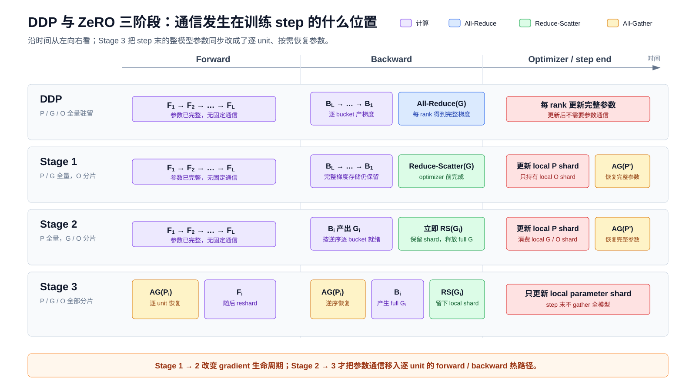
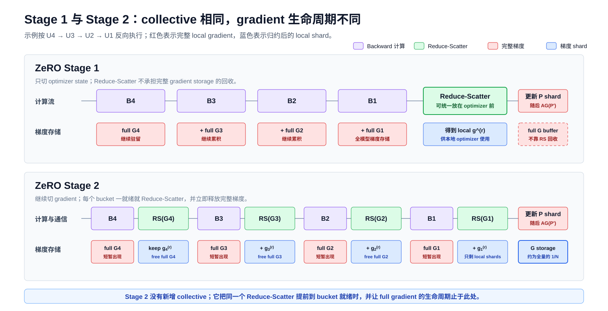
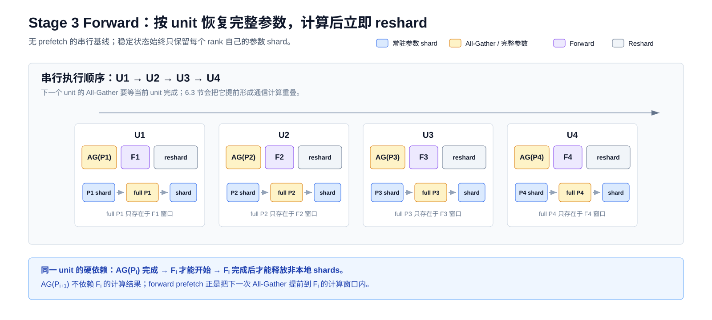
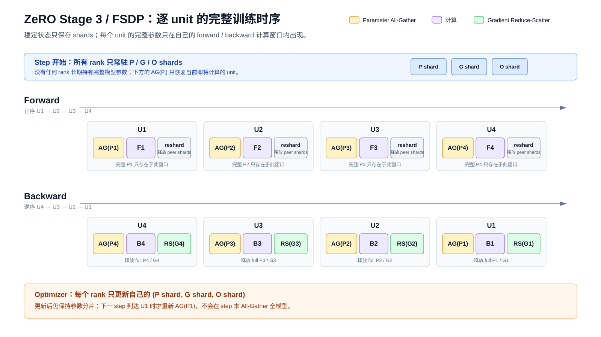
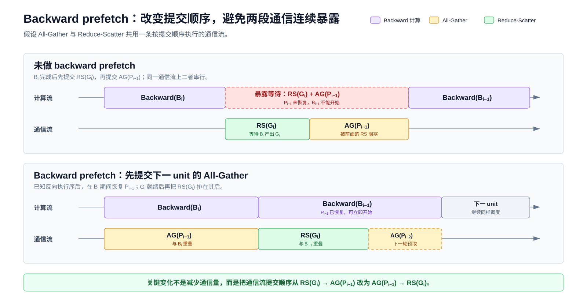
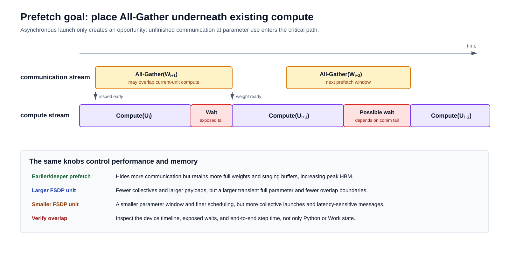

# 从 DDP 到 FSDP：ZeRO 的状态分片与通信机制

## 1. 带着以下问题阅读

ZeRO 的三个 stage 不是三个孤立的内存公式，而是三套不同的训练时序。每多切分一种状态，运行时就必须在这个状态被使用之前通信，并在使用结束后尽快恢复为分片形态。

本文只回答这条核心主线：

1. DDP、ZeRO Stage 1、Stage 2、Stage 3 分别让哪些状态全量驻留，哪些状态分片驻留？
2. 每个 stage 的 forward、backward、optimizer step 中分别发生什么通信？
3. 对一个由多个层组成的模型，这些 collective 按什么顺序穿插在层间计算中？
4. 为什么 Stage 1/2 的通信量可以与 DDP 相同，而 Stage 3 通常增加到约 $1.5\times$？
5. FSDP 如何通过 prefetch 改变通信发起顺序，却不改变通信总量？

本文不展开 API、类层次、hook、checkpoint、state dict、offload 或 mixed precision。它们会改变具体张量表示和字节数，但不会改变本文推导的基本通信依赖。

### 1.1 符号约定 （正文中首次出现仍会提及）

| 记号 | 定义 |
|---|---|
| $\Psi$ | 模型参数元素总数；使用 $2\Psi$、$3\Psi$ 描述通信量时，单位是“等价参数元素数”，并假设参数与梯度采用相同的通信元素宽度 |
| $N$ | 数据并行进程组大小 |
| $L$ | 按执行顺序排列的通信单元总数 |
| $i$ | 通信单元索引，$i\in\{1,\ldots,L\}$ |
| $r,k$ | rank 索引，$r,k\in\{0,\ldots,N-1\}$；$k$ 也用作跨 rank 求和的哑变量 |
| $t$ | optimizer step 索引 |
| $U_i$ | 第 $i$ 个通信单元；它可以是一层，也可以是由多层组成的 FSDP unit |
| $F_i,B_i$ | 通信单元 $U_i$ 的 forward 与 backward 计算 |
| $\theta_i$ | 通信单元 $U_i$ 的完整参数 |
| $\theta_i^{(r)}$ | rank $r$ 常驻的 $\theta_i$ 参数分片；上标 $(r)$ 表示 rank 归属，不表示幂 |
| $\widetilde g_i^{(r)}$ | rank $r$ 在本地数据上得到的、尚未跨 rank 归约的 $U_i$ 局部梯度 |
| $g_i$ | $U_i$ 在数据并行组上的全局平均梯度，$g_i=\frac{1}{N}\sum_r\widetilde g_i^{(r)}$ |
| $g_i^{(r)}$ | rank $r$ 持有的全局梯度分片，即 $\operatorname{Shard}_r(g_i)$ |
| $\theta_t^{(r)},g_t^{(r)},o_t^{(r)}$ | step $t$ 时 rank $r$ 持有的参数分片、全局梯度分片与 optimizer-state 分片 |
| $P_i,G_i$ | 时序图中的简写：$P_i$ 表示 $U_i$ 的完整参数，$G_i$ 表示 $U_i$ 的完整局部梯度或其所在 bucket |
| $\operatorname{AG},\operatorname{RS},\operatorname{AR}$ | 时序图中的 All-Gather、Reduce-Scatter 与 All-Reduce |
| $\operatorname{Shard}_r(\cdot)$ | 取出按照既定分片布局分配给 rank $r$ 的结果区间 |
| $\operatorname{OptStep}(\cdot)$ | optimizer 的一次本地分片更新 |
| $z$ | collective 分解公式中的任意输入张量 |
| $x,W,y$ | 线性层的输入列向量、权重矩阵与输出列向量，满足 $y=Wx$ |
| $d_{\mathrm{in}},d_{\mathrm{out}}$ | 线性层的输入与输出特征维度 |
| $S$ | 某次 collective 输入张量的总 payload 字节数 |
| $S_\theta$ | 完整模型参数或完整模型梯度的 collective payload 字节数 |
| $S_i$ | 第 $i$ 个通信单元的参数 payload 字节数，满足 $\sum_i S_i=S_\theta$ |
| $c_N$ | ring collective 的规模因子，$c_N=(N-1)/N$ |
| $V_{\mathrm{AG}},V_{\mathrm{RS}},V_{\mathrm{AR}}$ | 单次 All-Gather、Reduce-Scatter、All-Reduce 中每个 rank 的近似发送字节数 |
| $V_{\mathrm{DDP}},V_{\mathrm{S1/S2}},V_{\mathrm{S3}},V_{\mathrm{S3,no\ reshard}}$ | 对应调度策略每步中每个 rank 的近似总发送字节数；no reshard 表示 Stage 3 在 forward 后保留完整参数 |
| $C,\alpha,V,B_{\mathrm{eff}},T_{\mathrm{comm}}$ | collective 次数、单次固定启动/同步延迟、总通信字节数、实际有效带宽与总通信时间 |
| $M_p,M_g,M_o$ | 完整 parameter、gradient、optimizer state 的常驻字节数 |
| $M_i,M_{\max}$ | 第 $i$ 个 unit 的完整参数字节数，以及所有 unit 中的最大值 |
| $M_{\mathrm{parameter,peak}}$ | Stage 3 中每个 rank 的参数相关峰值 HBM 占用 |

同一字母的大小写表示不同对象：$\theta_i$ 或 $P_i$ 是参数，$\widetilde g_i^{(r)}$、$g_i$ 或 $G_i$ 是梯度；$S_i$ 是通信 payload，$M_i$ 是参数在 HBM 中的占用。上下文不区分具体 unit 或 step 时，会省略下标 $i$ 或 $t$，例如 $\theta^{(r)}$、$g^{(r)}$ 和 $o^{(r)}$。若公式按字节精确核算，应使用 $S_\theta$ 等字节量，而不能把元素数 $\Psi$ 直接当作字节数。

### 1.2 结论预览

先给出全文结论。设模型参数总量为 $\Psi$，以下通信量使用 ZeRO 原论文的大消息近似口径：

| 方法 | forward | backward | optimizer 后 | 单步通信量 |
|---|---|---|---|---:|
| DDP | 无参数通信 | gradient All-Reduce | 每个 rank 更新完整参数，无通信 | $2\Psi$ |
| ZeRO Stage 1 | 无参数通信 | gradient Reduce-Scatter；暂不回收完整 gradient storage | 各 rank 更新自己的分片，再 All-Gather 完整参数 | $2\Psi$ |
| ZeRO Stage 2 | 无参数通信 | gradient Reduce-Scatter，归约后只保留本地 shard | owner 更新分片，再 All-Gather 完整参数 | $2\Psi$ |
| ZeRO Stage 3 / FSDP | 逐 unit All-Gather 参数 | 逆序逐 unit All-Gather 参数，再 Reduce-Scatter 梯度 | 只更新本地 shard，无全模型 All-Gather | $3\Psi$ |

最关键的区别是：

- Stage 1/2 的参数始终全量驻留，所以 forward 和 backward 计算层本身不需要临时拉取参数；参数只在 optimizer 更新后同步一次。
- Stage 3 的参数常态是分片，因而每个计算单元在 forward 和 backward 前都要临时恢复完整参数。



## 2. 先建立统一的层级模型

### 2.1 计算顺序

考虑一个按顺序执行的模型，包含 $L$ 个计算单元：

$$ U_1\rightarrow U_2\rightarrow\cdots\rightarrow U_L $$

其中：

- $U_i$：第 $i$ 个计算单元；
- $F_i$：单元 $U_i$ 的 forward 计算；
- $B_i$：单元 $U_i$ 的 backward 计算；
- $\theta_i$：单元 $U_i$ 的完整参数；
- $\theta_i^{(r)}$：rank $r$ 常驻的参数 shard；
- $\widetilde g_i^{(r)}$：rank $r$ 根据本地数据得到的、尚未跨 rank 归约的局部梯度；
- $g_i$：数据并行组上的全局平均梯度。

forward 的依赖顺序是：

```text
F1 -> F2 -> ... -> FL
```

backward 的依赖顺序相反：

```text
BL -> B(L-1) -> ... -> B1
```

对数据并行组大小 $N$，目标梯度为：

$$ g_i=\frac{1}{N}\sum_{r=0}^{N-1}\widetilde g_i^{(r)} $$

每个 rank 处理不同数据，但对同一个 $U_i$ 执行相同形状的完整算子。ZeRO/FSDP 改变的是参数、梯度和 optimizer state 的驻留位置，不是把 $F_i$ 或 $B_i$ 的算子计算切到不同 rank。

### 2.2 “一层”在通信中实际指什么

为便于讲解，本文把 $U_i$ 称为“层”。实际系统中的通信单元不一定等于一个数学层：

- DDP 和 ZeRO Stage 1/2 通常把多个参数梯度装入一个 gradient bucket，再发起一次 collective。
- Stage 3/FSDP 通常把一个或多个相邻模块的参数组成一个 FSDP unit，再对整个 unit 发起 All-Gather 和 Reduce-Scatter。
- 一个 Transformer block 常被选作一个 unit，但这不是算法要求。

把多个参数合并进同一个 bucket 或 unit，首要目的之一是减少 collective 次数，从而摊薄每次通信的固定启动与同步延迟，并让较大的消息更接近链路的有效带宽。它不是越大越好：DDP/Stage 1/2 的 bucket 过大会推迟梯度通信的发起时间，缩短通信与 backward 的重叠窗口；Stage 3 的 unit 过大还会增加完整参数的瞬时 HBM 峰值，并减少可用于 prefetch 的边界。因此，通信单元粒度是在启动开销、带宽利用率、计算通信重叠和峰值 HBM 之间取舍。

因此，本文的“逐层通信”应精确理解为“按执行顺序排列的逐通信单元操作”。如果一个 unit 包含两个层，那么这两个层共享一次参数 All-Gather，直到整个 unit 的 backward 完成后才 Reduce-Scatter 其梯度。

### 2.3 三个 collective 的关系

本文只需要三种 collective：

- **All-Reduce**：归约所有 rank 的同形输入，并把完整结果发给每个 rank。
- **Reduce-Scatter**：归约所有 rank 的输入，但每个 rank 只得到结果的一段。
- **All-Gather**：收集各 rank 的不同分片，并让每个 rank 得到完整拼接结果。

对任意输入张量 $z$，在布局和归约算子相容时：

$$ \operatorname{AllReduce}(z)=\operatorname{AllGather}\!\left(\operatorname{ReduceScatter}(z)\right) $$

这个分解是理解 ZeRO Stage 1/2 通信量的关键。DDP 需要完整归约梯度，所以执行两个逻辑阶段；ZeRO 的 optimizer owner 只需要自己的梯度 shard，因此可以省掉“让所有 rank 都获得完整梯度”的后半段，并在参数更新后用一次 parameter All-Gather 补回来。

## 3. 基线：DDP 的单步通信时序

### 3.1 常驻状态

DDP 的每个 rank 都全量持有：

- 完整 parameter；
- 完整 gradient；
- 完整 optimizer state。

训练开始时，各 rank 的参数相同。只要每一步都得到相同的全局梯度，并执行相同 optimizer 更新，参数副本就会一直保持一致。

### 3.2 Forward

DDP forward 不需要逐层参数通信，因为每个 rank 已经拥有全部参数：

```text
F1 -> F2 -> ... -> FL
```

除了模型本身显式包含的分布式算子，普通数据并行 forward 没有固定的 collective。

### 3.3 Backward

backward 按 $U_L$ 到 $U_1$ 的顺序产生梯度。某个 bucket 中的梯度全部就绪后，就可以立即异步发起 All-Reduce：

```text
BL
  -> gradient bucket L ready
  -> launch All-Reduce(GL)

B(L-1)
  -> gradient bucket L-1 ready
  -> launch All-Reduce(G(L-1))

...

B1
  -> gradient bucket 1 ready
  -> launch All-Reduce(G1)
```

时间线上，较深层的梯度通信可以与较浅层的 backward 计算重叠：

```text
compute stream:  BL -------- B(L-1) -------- ... -------- B1
comm stream:         AR(GL) -------- AR(G(L-1)) -------- ...
```

标准 DDP 时序会在 backward 返回前等待所有 All-Reduce 完成，之后每个 rank 都拥有同一个完整全局梯度，再统一执行 optimizer step。

还可以进一步把 optimizer 更新流水化。某个 bucket 的 backward 和 All-Reduce 都完成后，只要后续 backward 不再读取该 bucket 对应的参数，就可以在独立 optimizer stream 上更新它，并与其他 bucket 的 backward 或通信重叠：

```text
dependency per bucket:  Bi -> AR(Gi) -> Opt(i)

compute stream:         BL -------- B(L-1) -------- ... -------- B1
comm stream:                AR(GL) -------- AR(G(L-1)) -------- ...
optimizer stream:                Opt(L) ---------- Opt(L-1) ---- ...
```

这里能重叠的是不同 bucket 的工作；同一 bucket 的 optimizer 必须等待其梯度归约完成。参数共享、梯度累积、全局梯度范数裁剪和溢出检测还可能引入跨 bucket 屏障。optimizer kernel 也会与 backward 和通信争用计算单元及 HBM 带宽，因此独立 stream 只提供并发机会，不保证一定缩短单步时间。本文后续仍采用“完整 backward 后统一 optimizer step”的基线时序。

### 3.4 Optimizer step

每个 rank 使用相同参数、相同梯度和相同 optimizer state，独立更新完整模型：

```text
rank 0: update(theta, g, optimizer_state)
rank 1: update(theta, g, optimizer_state)
...
```

更新结果天然一致，因此 optimizer step 后不需要 parameter broadcast 或 All-Gather。

DDP 单步的核心通信只有 gradient All-Reduce。

## 4. ZeRO Stage 1：切分 optimizer state

### 4.1 切分后谁拥有什么

Stage 1 为参数空间建立唯一 owner。rank $r$ 只保存并更新自己负责参数区间的 optimizer state：

```text
rank 0 owns optimizer state shard 0
rank 1 owns optimizer state shard 1
...
rank N-1 owns optimizer state shard N-1
```

但 parameter 和 gradient 仍按 Stage 1 的内存语义全量驻留。每个 rank 在 forward/backward 中仍能直接使用完整参数。

### 4.2 Forward：没有新增通信

Stage 1 的 parameter 没有切分，所以 forward 与 DDP 相同：

```text
F1 -> F2 -> ... -> FL
```

不需要在 $F_i$ 前 All-Gather $\theta_i$。

### 4.3 Backward：对梯度执行 Reduce-Scatter

rank $r$ 只更新 parameter shard $\theta^{(r)}$，因此只需要对应的全局 gradient shard $g^{(r)}$。backward 本身先按 $B_L,\ldots,B_1$ 产生完整 local gradients；进入 optimizer step 前，系统对 gradient buckets 执行 Reduce-Scatter：

```text
BL -> B(L-1) -> ... -> B1
  -> Reduce-Scatter gradient buckets
  -> rank r receives reduced gradient shard g^(r)
  -> optimizer step
```

某些实现可能把它拆成多次、分别以不同 rank 为目的端的分段 Reduce；其整体通信语义仍然是 Reduce-Scatter。下文统一称为 Reduce-Scatter。

Stage 1 不依靠这一步回收完整 gradient storage，所以 Reduce-Scatter 可以延迟到 backward 结束后统一执行；bucketized 调度也可以在某个 bucket 就绪时提前发起，以尝试和后续 backward 计算重叠。无论选择哪种发起时机，gradient 的内存仍按全量计算。

这里必须区分存储布局与 collective 输出。“gradient 全量驻留”表示 Stage 1 仍为全模型梯度保留完整存储，不会像 Stage 2 那样在逐层归约后只留下 $1/N$ shard；Reduce-Scatter 的输出仍然只有本 rank 负责的全局 gradient shard。

### 4.4 Optimizer step：本地更新 shard

记 $t$ 为 optimizer step 索引，$o_t^{(r)}$ 为 step $t$ 时 rank $r$ 持有的 optimizer-state shard，$\operatorname{OptStep}$ 为一次本地分片更新。所有 gradient Reduce-Scatter 完成后，rank $r$ 使用 $g_t^{(r)}$ 更新 $\theta_t^{(r)}$ 和 $o_t^{(r)}$：

$$ \theta_{t+1}^{(r)},o_{t+1}^{(r)}=\operatorname{OptStep}\!\left(\theta_t^{(r)},g_t^{(r)},o_t^{(r)}\right) $$

此时只有 owner 上的参数区间是新版本。其他 rank 对这段参数仍持有旧值。

### 4.5 更新后：All-Gather 新参数

为了让下一步的所有 rank 再次拥有同一个完整模型，必须收集各 owner 更新后的 parameter shard：

```text
local optimizer update on each owner
  -> All-Gather(updated parameter shards)
  -> every rank receives the full updated model
  -> next step
```

这个 parameter All-Gather 是 Stage 1 相对 DDP 新出现的通信阶段。

### 4.6 Stage 1 的完整时序

```text
step start:
  every rank has full parameters
  every rank has full gradient storage
  every rank has only its optimizer-state shard

forward:
  F1 -> F2 -> ... -> FL
  no ZeRO parameter communication

backward:
  BL -> B(L-1) -> ... -> B1
  Reduce-Scatter gradient buckets
  optional: launch a bucket Reduce-Scatter once it is ready

optimizer:
  each rank updates only its owned parameter shard

step end:
  All-Gather updated parameter shards
  every rank again has the full updated parameters
```

## 5. ZeRO Stage 2：再切分 gradient

### 5.1 Stage 2 新增的不是另一种数学梯度

Stage 2 在 Stage 1 基础上继续消除 gradient 冗余。用 $\operatorname{Shard}_r(\cdot)$ 表示取出按照既定布局分配给 rank $r$ 的结果区间，则 rank $r$ 最终只保留与 $\theta^{(r)}$ 对齐的全局梯度 shard：

$$ g^{(r)}=\operatorname{Shard}_r\!\left(\frac{1}{N}\sum_{k=0}^{N-1}\widetilde g^{(k)}\right) $$

这个 shard 已经聚合了所有 rank 的数据，不是“只来自 rank $r$ 本地 batch 的梯度”。

### 5.2 Forward：仍然没有参数通信

Stage 2 的 parameter 依然全量驻留，因此 forward 与 DDP、Stage 1 完全相同：

```text
F1 -> F2 -> ... -> FL
```

这是 Stage 2 与 Stage 3 最容易混淆的地方。只有切分 parameter 之后，forward 才需要逐 unit All-Gather。

### 5.3 Backward：梯度就绪后立即 Reduce-Scatter

Stage 2 的关键发生在 backward。某个层或 bucket 的梯度一旦完整，就执行 Reduce-Scatter：

```text
BL
  -> full local gradient for bucket L becomes ready
  -> Reduce-Scatter(GL)
  -> keep local reduced shard
  -> release non-local/full gradient storage

B(L-1)
  -> Reduce-Scatter(G(L-1))
  -> keep local reduced shard
  -> release non-local/full gradient storage

...
```

[ZeRO 原论文第 5.2 节](https://arxiv.org/html/1910.02054v3#S5.SS2)明确强调：梯度在 backward 中逐层产生，只归约到负责更新对应参数的进程，归约后即可释放不再需要的梯度。

因此，Stage 2 的 backward 同时完成三件事：

1. 跨 rank 求和或求平均；
2. 把不同结果区间交给不同 owner；
3. 缩短完整 gradient 的存活时间。

### 5.4 层间顺序与通信重叠

backward 的依赖仍是 $B_L,B_{L-1},\ldots,B_1$。当 $B_i$ 的梯度进入 Reduce-Scatter 后，计算流可以继续执行 $B_{i-1}$：

```text
compute stream:  BL -------- B(L-1) -------- ... -------- B1
comm stream:         RS(GL) -------- RS(G(L-1)) -------- ...
```

这与 DDP 的“梯度 All-Reduce 与更浅层 backward 重叠”相同，只是 collective 的输出从完整梯度变成 gradient shard。

实际系统按 bucket 发通信。若一个 bucket 跨越多个参数，只有 bucket 中最后一个梯度就绪后才能发起 Reduce-Scatter。bucket 过大，会推迟通信开始；bucket 过小，则 collective 启动延迟占比上升。

### 5.5 Optimizer step 与参数同步

backward 和所有 Reduce-Scatter 完成后：

```text
rank r owns:
  parameter shard theta^(r)
  gradient shard g^(r)
  optimizer-state shard o^(r)

rank r performs:
  local OptStep(theta^(r), g^(r), o^(r))
```

由于 parameter 在 Stage 2 中仍要求每个 rank 全量驻留，owner 更新后还必须执行一次 updated-parameter All-Gather：

```text
local shard updates
  -> All-Gather(updated parameter shards)
  -> full updated parameters on every rank
```

下一轮 forward 直接使用这个完整参数，不需要逐层重新 gather。

### 5.6 Stage 1 与 Stage 2 到底差在哪里

| 维度 | Stage 1 | Stage 2 |
|---|---|---|
| parameter | 全量驻留 | 全量驻留 |
| optimizer state | 分片驻留 | 分片驻留 |
| gradient 的最终有效结果 | owner 只需对应区间 | owner 只保留对应区间 |
| **gradient storage** | **按全量口径，不要求及时回收** | **归约后及时释放完整梯度，只保留 shard** |
| **backward collective** | **optimizer 前完成 Reduce-Scatter；可按 bucket 提前** | **gradient 就绪即 Reduce-Scatter 并释放完整梯度** |
| optimizer 后 | parameter All-Gather | parameter All-Gather |
| 理想通信量 | $2\Psi$ | $2\Psi$ |

Stage 2 的核心贡献不是再增加一轮通信，而是让 Stage 1 已经存在的 gradient Reduce-Scatter 同时承担梯度生命周期优化：某个 bucket 归约完成后，只保留本地 shard，立即释放完整 gradient storage。



### 5.7 Stage 2 的完整时序

```text
step start:
  every rank has full parameters
  every rank has only gradient/optimizer shards as persistent state

forward:
  F1 -> F2 -> ... -> FL
  no ZeRO parameter communication

backward:
  BL -> Reduce-Scatter(GL) -> keep gL shard, free full GL
  B(L-1) -> Reduce-Scatter(G(L-1)) -> keep shard, free full gradient
  ...
  B1 -> Reduce-Scatter(G1) -> keep g1 shard, free full G1

optimizer:
  each rank updates only its parameter shard

step end:
  All-Gather updated parameter shards
  every rank again has full updated parameters
```

## 6. ZeRO Stage 3 / FSDP：再切分 parameter

### 6.1 参数切分改变了 forward 和 backward 的入口条件

Stage 3 让 parameter、gradient 和 optimizer state 都以 shard 形式常驻：

```text
rank r persistent state:
  parameter shard theta^(r)
  gradient shard g^(r)
  optimizer-state shard o^(r)
```

但典型 FSDP 不是 tensor parallel。以数学线性层为例，$x$ 和 $y$ 分别表示输入、输出列向量，$W$ 表示权重矩阵，$d_{\mathrm{in}}$ 和 $d_{\mathrm{out}}$ 分别表示输入、输出特征维度：

$$ y=Wx,\qquad W\in\mathbb{R}^{d_{\mathrm{out}}\times d_{\mathrm{in}}},\quad x\in\mathbb{R}^{d_{\mathrm{in}}},\quad y\in\mathbb{R}^{d_{\mathrm{out}}} $$

每个数据并行 rank 仍对自己的样本执行完整 $Wx$。因此，计算 $F_i$ 或 $B_i$ 前必须先把 $\theta_i$ 从各 rank 的 shards 恢复出来。

### 6.2 Forward：按正向顺序逐 unit All-Gather

不考虑 prefetch 时，可以先从最简单的串行基线理解 Stage 3 forward。以下时序图用 $P_i$ 表示 $U_i$ 的完整参数，并将 All-Gather 简写为 $AG$：



这里的 `reshard` 通常不是一次网络通信。rank 原本就保留自己的权威 shard；reshard 的主要动作是释放 All-Gather 得到的非本地部分，并恢复 shard 视图。

[ZeRO 原论文第 7.2.2 节](https://arxiv.org/html/1910.02054v3#S7.SS2.SSS2)把这描述为：在某段模型 forward 前，由负责该参数分片的进程向其他进程提供权重，计算完成后丢弃临时参数。现代 FSDP 通常为每个 unit 构造等长的通信 shards，再通过 All-Gather 恢复完整参数，但依赖关系相同。

“等长”描述的是同一次 All-Gather 的**物理通信布局**：每个 rank 提供的 shard 具有相同的元素数、数据类型和字节数，并不是说不同层或不同 unit 的参数量相同。若某个 unit 的逻辑参数元素总数不能被 $N$ 整除，系统可以先在物理 buffer 末尾加入 padding，使其长度成为 $N$ 的整数倍，再均分给 $N$ 个 ranks；All-Gather 后移除 padding，恢复原来的逻辑参数。因此，padding 只服务于 collective 的等长输入约束，不改变模型参数的数学含义。

### 6.3 Forward prefetch：把下一次 All-Gather 放到当前计算下面

$F_i$ 依赖完整 $\theta_i$，但不依赖 $\theta_{i+1}$。因此，$\theta_{i+1}$ 的 All-Gather 可以在 $F_i$ 计算期间进行。

一种 one-unit lookahead 时序是：

```text
wait AG(P1)
launch AG(P2)
F1
reshard(P1)

wait AG(P2) tail
launch AG(P3)
F2
reshard(P2)

...
```

对应时间线：

```text
compute:  |---- F1 ----|---- F2 ----|---- F3 ----|
comm:        |-- AG(P2) --|-- AG(P3) --|-- AG(P4) --|
```

如果 $AG(P_{i+1})$ 比 $F_i$ 更慢，未被隐藏的尾部仍会阻塞 $F_{i+1}$。因此 prefetch 只是改变发起时间，不会自动消除通信。

更早或更深的 prefetch 可以增加重叠窗口，但会让更多完整参数和通信 buffer 同时占用 HBM。FSDP 的调度必须限制在途 All-Gather 数量，不能无限向前预取。

### 6.4 为什么 backward 前还要再次 All-Gather

forward 后释放完整参数，可以避免所有层参数在 activation 存活期间全量驻留。但是 backward 仍需要参数：

- 计算输入梯度时需要当前层权重；
- 计算参数梯度时需要 forward 保存的 activation 和当前输出梯度；
- 产生完整局部参数梯度后，才能对它 Reduce-Scatter。

因此，若 forward 后已经 reshard，backward 必须按逆序再次恢复参数。

### 6.5 Backward：逆序 All-Gather 参数，再 Reduce-Scatter 梯度

不考虑 prefetch 时：

```text
All-Gather(thetaL shards)
  -> materialize full thetaL
  -> BL produces full local gradient G_L
  -> Reduce-Scatter(G_L)
  -> keep local gradient shard
  -> release full thetaL and full G_L

All-Gather(theta(L-1) shards)
  -> B(L-1)
  -> Reduce-Scatter(G_(L-1))
  -> release transient full states

...

All-Gather(theta1 shards)
  -> B1
  -> Reduce-Scatter(G1)
```

写成一条串行时间线：

```text
AG(PL) -> BL -> RS(GL) -> reshard(PL)
       -> AG(P(L-1)) -> B(L-1) -> RS(G(L-1))
       -> ...
       -> AG(P1) -> B1 -> RS(G1)
```

每个 Reduce-Scatter 的输出都是已跨全部 rank 归约的 gradient shard。完整 local gradient 只在当前 unit 的 backward 窗口短暂存在。



### 6.6 Backward prefetch 的关键是 collective 排序

串行调度中，当前 unit 的 Reduce-Scatter 之后才发起下一个 backward unit 的 parameter All-Gather：

```text
Bi -> RS(Gi) -> AG(P(i-1)) -> B(i-1)
```

如果 All-Gather 与 Reduce-Scatter 共用一条按提交顺序执行的通信流，$RS(G_i)$ 会阻塞 $AG(P_{i-1})$，而 $AG(P_{i-1})$ 又阻塞 $B_{i-1}$。于是两段通信连续暴露在关键路径上。

[FSDP 系统论文第 3.3.2 节](https://arxiv.org/html/2304.11277#S3.SS3.SSS2)给出的核心重排是：把下一 backward unit 的 All-Gather 提到当前 unit 的 Reduce-Scatter 之前。

理想顺序变为：

```text
full Pi is ready
launch AG(P(i-1))
Bi
launch RS(Gi)
wait for P(i-1) only if needed
B(i-1)
```

通信流上的提交顺序是：

```text
AG(P(i-1)) -> RS(Gi)
```

计算流上的顺序是：

```text
Bi -> B(i-1)
```

这样可以形成两种重叠：

1. $AG(P_{i-1})$ 与 $B_i$ 重叠；
2. $RS(G_i)$ 与 $B_{i-1}$ 重叠。

时间线可以写成：

```text
compute:  |------ Bi ------|------ B(i-1) ------|
comm:        |-- AG(P(i-1)) --|-- RS(Gi) --|
```

这说明 backward prefetch 不是简单地“异步执行 collective”，而是改变 All-Gather 与 Reduce-Scatter 的提交顺序。顺序不改，即使两者都是异步调用，也可能在同一通信流上串行形成气泡。



### 6.7 Optimizer step：只更新 shard，不做全模型 All-Gather

所有 backward unit 完成后，rank $r$ 已经持有彼此对齐的：

```text
parameter shard theta^(r)
gradient shard g^(r)
optimizer-state shard o^(r)
```

optimizer 直接在本地更新：

$$ \theta_{t+1}^{(r)},o_{t+1}^{(r)}=\operatorname{OptStep}\!\left(\theta_t^{(r)},g_t^{(r)},o_t^{(r)}\right) $$

Stage 3 在 optimizer step 后不需要像 Stage 1/2 那样立即 All-Gather 全模型。下一步 forward 到达 $U_1$ 时，才 All-Gather 更新后的 $\theta_1$；到达 $U_2$ 时，再 All-Gather 更新后的 $\theta_2$。

这是 Stage 2 与 Stage 3 参数通信位置的本质区别：

```text
Stage 2:
  optimizer update shards
  -> gather the entire updated model at step end
  -> next forward uses resident full parameters

Stage 3:
  optimizer update shards
  -> keep parameters sharded
  -> next forward gathers each unit just before use
```

### 6.8 不在 forward 后 reshard 会发生什么

如果保留 forward All-Gather 得到的完整参数直到相应 backward 完成，就可以省去 backward 前的第二次 All-Gather：

```text
AG(Pi) -> Fi -> keep full Pi -> ... -> Bi -> RS(Gi) -> reshard(Pi)
```

代价是 $\theta_i$ 从 forward 到 backward 的整个间隔都全量驻留。对深层模型，很多 units 的完整参数可能同时存活，显著提高 HBM 峰值。

因此有两种基本调度：

| 调度 | parameter All-Gather | forward 到 backward 之间的参数内存 |
|---|---:|---:|
| forward 后 reshard | forward、backward 各一次 | 低 |
| forward 后保留完整参数 | forward 一次 | 高 |

算法的常驻所有权仍是 Stage 3；改变的是完整参数的瞬时存活窗口。

### 6.9 Stage 3 的完整时序

```text
step start:
  every rank keeps only parameter/gradient/optimizer shards

forward:
  AG(P1) -> F1 -> reshard(P1)
  AG(P2) -> F2 -> reshard(P2)
  ...
  AG(PL) -> FL -> reshard(PL)

backward:
  AG(PL) -> BL -> RS(GL) -> keep gL shard -> reshard(PL)
  AG(P(L-1)) -> B(L-1) -> RS(G(L-1)) -> keep shard
  ...
  AG(P1) -> B1 -> RS(G1) -> keep g1 shard

optimizer:
  every rank updates only its local parameter shard

step end:
  parameters remain sharded
  no full-model parameter All-Gather
```

## 7. 四层模型的逐 stage 对照 (仅作举例，可跳过)

设模型有四个通信单元 $U_1,U_2,U_3,U_4$。下面暂时忽略 overlap，只看必须满足的数据依赖顺序。

### 7.1 DDP

```text
forward:
  F1 -> F2 -> F3 -> F4

backward:
  B4 -> AR(G4)
  B3 -> AR(G3)
  B2 -> AR(G2)
  B1 -> AR(G1)

optimizer:
  every rank updates P1, P2, P3, P4

after optimizer:
  no communication
```

### 7.2 ZeRO Stage 1

```text
forward:
  F1 -> F2 -> F3 -> F4

backward:
  B4 -> B3 -> B2 -> B1
  Reduce-Scatter G4, G3, G2, G1 buckets
  optional: launch a bucket Reduce-Scatter as soon as that bucket is ready

optimizer:
  each rank updates its owned parameter shard

after optimizer:
  All-Gather updated P1, P2, P3, P4 shards
  every rank recovers the full updated model
```

Stage 1 的 gradient storage 仍按全量口径，不要求每层归约后立即把完整梯度内存回收。

### 7.3 ZeRO Stage 2

```text
forward:
  F1 -> F2 -> F3 -> F4

backward:
  B4 -> RS(G4) -> keep local G4 shard, free full G4
  B3 -> RS(G3) -> keep local G3 shard, free full G3
  B2 -> RS(G2) -> keep local G2 shard, free full G2
  B1 -> RS(G1) -> keep local G1 shard, free full G1

optimizer:
  each rank updates its owned parameter shard

after optimizer:
  All-Gather updated P1, P2, P3, P4 shards
  every rank recovers the full updated model
```

### 7.4 ZeRO Stage 3 / FSDP

```text
forward:
  AG(P1) -> F1 -> free non-local P1
  AG(P2) -> F2 -> free non-local P2
  AG(P3) -> F3 -> free non-local P3
  AG(P4) -> F4 -> free non-local P4

backward:
  AG(P4) -> B4 -> RS(G4) -> free full P4/G4
  AG(P3) -> B3 -> RS(G3) -> free full P3/G3
  AG(P2) -> B2 -> RS(G2) -> free full P2/G2
  AG(P1) -> B1 -> RS(G1) -> free full P1/G1

optimizer:
  each rank updates its local parameter shard

after optimizer:
  no full-model All-Gather
  next step repeats per-unit AG before forward use
```

这四条时间线已经包含 ZeRO/FSDP 最核心的差异。其他工程策略都在改变 collective 的分组、发起时机、进程组或 dtype，而不是改变这些数据依赖。

## 8. 通信量推导

### 8.1 Ring collective 的每 rank 链路量

设某个 tensor 大小为 $S$ bytes，进程组大小为 $N$。记 $V_{\mathrm{AG}}$、$V_{\mathrm{RS}}$ 和 $V_{\mathrm{AR}}$ 分别为一次 All-Gather、Reduce-Scatter 和 All-Reduce 中每个 rank 的发送字节数。带宽最优 ring 算法中：

$$ V_{\mathrm{AG}}=V_{\mathrm{RS}}=\frac{N-1}{N}S $$

All-Reduce 可分解为 Reduce-Scatter 和 All-Gather，因此：

$$ V_{\mathrm{AR}}=2\frac{N-1}{N}S $$

为简化书写，记：

$$ c_N=\frac{N-1}{N} $$

设一次完整 parameter 或完整 gradient collective 的 payload 都是 $S_\theta$ bytes。这里默认二者采用相同的通信元素宽度；若通信 dtype 不同，应分别代入各自字节数，不能继续直接使用同一个 $S_\theta$。

### 8.2 DDP

DDP 每步对完整梯度执行 All-Reduce：

$$ V_{\mathrm{DDP}}=2c_NS_\theta $$

### 8.3 Stage 1 和 Stage 2

通信等量调度包含：

1. gradient Reduce-Scatter；
2. optimizer 更新后的 parameter All-Gather。

因此：

$$ V_{\mathrm{S1/S2}}=c_NS_\theta+c_NS_\theta=2c_NS_\theta $$

这与 DDP 相同。

### 8.4 Stage 3 / full shard

forward 对所有 units 的参数各 gather 一次，累计 payload 等于全模型参数；backward 再 gather 一次，并 Reduce-Scatter 一次完整模型梯度：

$$ V_{\mathrm{S3}}=c_NS_\theta+c_NS_\theta+c_NS_\theta=3c_NS_\theta $$

与 DDP 的比值为：

$$ \frac{V_{\mathrm{S3}}}{V_{\mathrm{DDP}}}=\frac{3}{2} $$

这就是 ZeRO 原论文“Stage 3 通信量相对普通 DP 增加 50%”的来源。

如果 forward 后不 reshard，省去 backward 参数 All-Gather，则理论 payload 回到：

$$ V_{\mathrm{S3,no\ reshard}}=2c_NS_\theta $$

但通信量下降是用更长的完整参数生命周期换来的。

### 8.5 总字节数相同不代表耗时相同

Stage 2 和 DDP 都是约 $2c_NS_\theta$，但运行时间仍可能不同。记 collective 次数为 $C$、固定启动和同步延迟为 $\alpha$、总通信字节数为 $V$、实际有效带宽为 $B_{\mathrm{eff}}$，总通信时间 $T_{\mathrm{comm}}$ 可粗略写为：

$$ T_{\mathrm{comm}}\approx C\alpha+\frac{V}{B_{\mathrm{eff}}} $$

因此还必须考虑：

- 全模型被拆成多少个 bucket 或 FSDP units；
- 消息是否足够大，能否接近链路带宽；
- collective 是否跨节点；
- 通信是否被计算隐藏；
- 所有 rank 是否同时到达 collective；
- All-Gather 与 Reduce-Scatter 在通信流上的提交顺序。

## 9. 层间调度的三个核心问题

### 9.1 什么时候可以发起 collective

不同 collective 的最早发起时间不同：

| collective | 最早发起条件 |
|---|---|
| DDP gradient All-Reduce | bucket 内所有局部梯度就绪 |
| Stage 1 gradient Reduce-Scatter | bucket 内所有局部梯度就绪；也可以延迟到 backward 结束 |
| Stage 2 gradient Reduce-Scatter | bucket 内所有局部梯度就绪 |
| Stage 3 forward parameter All-Gather | 已知下一个即将执行的 unit |
| Stage 3 backward parameter All-Gather | 已知下一个即将反向执行的 unit |
| Stage 3 gradient Reduce-Scatter | 当前 unit 的完整参数梯度已完成 |

梯度 collective 依赖当前层 backward 的输出，所以只能放在 $B_i$ 之后。下一层参数的 All-Gather 不依赖当前层计算结果，所以可以提前到 $F_i$ 或 $B_i$ 期间执行。

这正是 Stage 3 能做 parameter prefetch 的根本原因。

### 9.2 通信单元越小不一定越好

设 Stage 3 有 $L$ 个 units，第 $i$ 个 unit 参数大小为 $S_i$，满足 $\sum_iS_i=S_\theta$。

较小 unit 的好处是：

- 单次完整参数物化更小；
- forward/backward 后可以更早释放；
- 有更多边界用于 prefetch 和 overlap。

代价是：

- forward、backward 各有 $L$ 次 All-Gather；
- backward 还有 $L$ 次 Reduce-Scatter；
- collective 固定延迟累计为 $O(L\alpha)$；
- 小消息可能无法充分利用网络带宽。

较大 unit 的权衡相反：collective 少且消息大，但单次完整参数峰值更高，能用于 overlap 的层间边界更少。

因此 unit 粒度同时决定：

1. collective 次数；
2. 消息大小；
3. 完整参数的峰值；
4. 通信与计算的重叠窗口。

### 9.3 所有 rank 必须保持相同 collective 顺序

collective 不只是“最终调用次数相同”即可。所有 rank 必须以同一顺序加入同一组 collective。

例如 rank 0 的顺序是：

```text
AG(P2) -> RS(G3)
```

而 rank 1 的顺序是：

```text
RS(G3) -> AG(P2)
```

即使两边最终都调用了一次 All-Gather 和一次 Reduce-Scatter，通信库也无法正确匹配，可能报错或挂起。

因此动态分支、rank-dependent unused layer 和不同的模块执行顺序都会直接影响 Stage 3 的通信协议。prefetch 只能提前已确定会被所有 rank 以相同顺序使用的 unit。



## 10. 模型状态内存与峰值 HBM 分析

设完整 parameter、gradient 和 optimizer state 分别占 $M_p$、$M_g$、$M_o$ bytes。忽略 activation、padding、通信 buffer 和 allocator 后：

| 方法 | 每 rank 理想化常驻模型状态 |
|---|---:|
| DDP | $M_p+M_g+M_o$ |
| Stage 1 | $M_p+M_g+M_o/N$ |
| Stage 2 | $M_p+(M_g+M_o)/N$ |
| Stage 3 | $(M_p+M_g+M_o)/N$ |

Stage 3 还必须加上当前完整 unit 的瞬时参数。记第 $i$ 个 unit 的完整参数字节数为 $M_i$，最大 unit 参数字节数为 $M_{\max}=\max_i M_i$，每个 rank 的参数相关峰值 HBM 占用为 $M_{\mathrm{parameter,peak}}$。不考虑 prefetch 时：

$$ M_{\mathrm{parameter,peak}}\approx\frac{M_p}{N}+M_{\max} $$

one-unit lookahead prefetch 还可能让当前 unit 与下一个 unit 的完整参数同时存在：

$$ M_{\mathrm{parameter,peak}}\approx\frac{M_p}{N}+\max_i(M_i+M_{i+1}) $$

<!-- 所以 $1/N$ 只描述常驻模型状态，不描述总训练峰值。activation、checkpoint、mixed precision、CPU offload 与 state dict 等运行时机制的完整分析见配套文档[《FSDP 进阶：从状态分片到完整运行时》](./fsdp_advanced_runtime.md)。 -->

## 11. 常见概念辨析

### 11.1 Stage 2 的 forward 是否也要逐层 All-Gather

不需要。Stage 2 没有切分 parameter，每个 rank 在 step 开始前已经全量持有参数。逐层参数 All-Gather 从 Stage 3 才开始。

### 11.2 Stage 1 与 Stage 2 的通信为什么看起来一样

二者都采用“gradient Reduce-Scatter + updated-parameter All-Gather”。Stage 1 可以把 Reduce-Scatter 延迟到 backward 结束，并继续按全量 gradient storage 核算；Stage 2 在 bucket 就绪时立即 Reduce-Scatter，归约后只保留 gradient shard，并释放完整 gradient storage。

### 11.3 Stage 3 optimizer 后为什么没有全模型 All-Gather

因为 Stage 3 的稳定状态就是 parameter sharded。更新后继续保持 shard，下一轮 forward 再按 $U_1,U_2,\ldots$ 的使用顺序逐 unit gather。

### 11.4 Reshard 是否会再发送一次网络消息

通常不会。All-Gather 前的本地 shard 一直是权威状态；reshard 主要是释放临时收集的 peer shards。真正发生网络通信的是 unshard/All-Gather。

### 11.5 FSDP 是否把一层矩阵乘切到多个 rank

典型 FSDP 不会。它在计算前恢复完整参数，每个 rank 对自己的数据执行完整层计算。把矩阵乘本身切开的方案是 tensor parallel。

### 11.6 异步 collective 是否等于通信已经隐藏

不等于。异步调用只允许通信与计算并发。只有通信在参数真正被使用前完成，剩余等待接近零，才能说它被隐藏。backward 中还必须正确安排 All-Gather 与 Reduce-Scatter 的提交顺序。

## 12. 最后总结

可以用四句话记住全文：

1. **DDP**：参数、梯度和 optimizer state 全量驻留；backward 逐 bucket All-Reduce 梯度；所有 rank 独立更新完整模型。
2. **Stage 1**：只切 optimizer state；optimizer 前 Reduce-Scatter 梯度；各 rank 更新自己的参数 shard；step 末 All-Gather 更新后参数。
3. **Stage 2**：通信主线与 Stage 1 相同，但 gradient 在 backward 中逐 bucket Reduce-Scatter，归约后只保留本地 shard并释放完整梯度。
4. **Stage 3/FSDP**：parameter 也切分；forward 正序逐 unit All-Gather，backward 逆序逐 unit All-Gather 参数并 Reduce-Scatter 梯度；optimizer 只更新本地 shard，step 末不再 gather 全模型。

Stage 3 的完整状态机是：

```text
parameter shard
  -> All-Gather before compute
  -> full parameter
  -> forward/backward compute
  -> reshard parameter

full local gradient
  -> Reduce-Scatter
  -> reduced gradient shard
  -> local optimizer update
  -> updated parameter shard
```

理解 FSDP 的关键不是记住配置项，而是沿模型执行顺序持续追踪三个问题：

1. 当前 unit 的完整参数是否已经就绪？
2. 当前 unit 的梯度何时完整，何时可以 Reduce-Scatter？
3. 下一次 All-Gather 能否提前到当前计算期间，并排在会阻塞它的 collective 之前？

## 13. 资料来源

### 13.1 一手资料

1. Rajbhandari et al., [ZeRO: Memory Optimizations Toward Training Trillion Parameter Models](https://arxiv.org/abs/1910.02054)。
2. [ZeRO 原论文第 5.1 节：Optimizer State Partitioning](https://arxiv.org/html/1910.02054v3#S5.SS1)。
3. [ZeRO 原论文第 5.2 节：Gradient Partitioning](https://arxiv.org/html/1910.02054v3#S5.SS2)。
4. [ZeRO 原论文第 5.3 节：Parameter Partitioning](https://arxiv.org/html/1910.02054v3#S5.SS3)。
5. [ZeRO 原论文第 7 节：Communication Analysis](https://arxiv.org/html/1910.02054v3#S7)。
6. Zhao et al., [PyTorch FSDP: Experiences on Scaling Fully Sharded Data Parallel](https://arxiv.org/abs/2304.11277)。
7. [FSDP 系统论文第 3.2.1 节：Full Sharding](https://arxiv.org/html/2304.11277#S3.SS2.SSS1)。
8. [FSDP 系统论文第 3.3 节：Communication Optimizations](https://arxiv.org/html/2304.11277#S3.SS3)。

---

## 源路径

```text
institutionalized/ZeRO/fsdp.md
```
