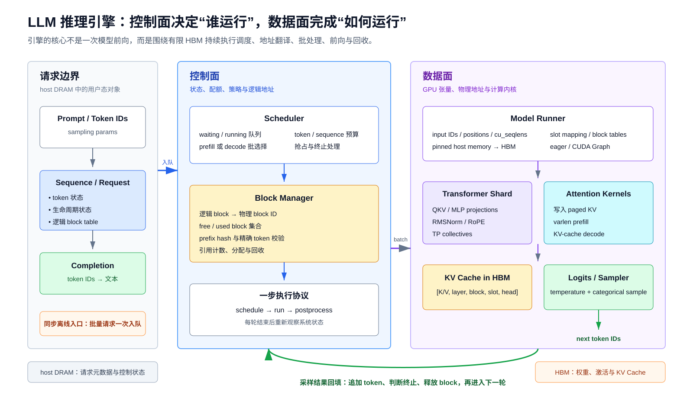
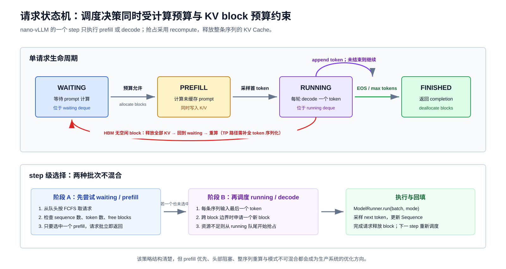
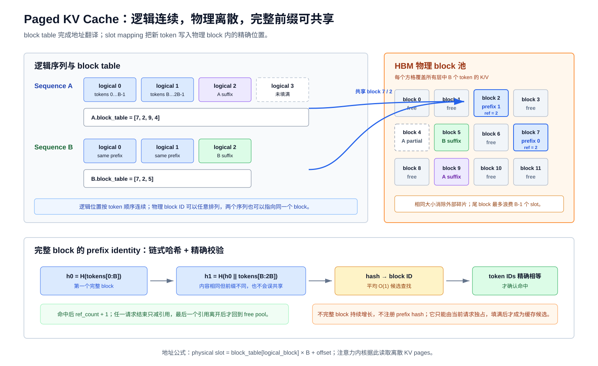
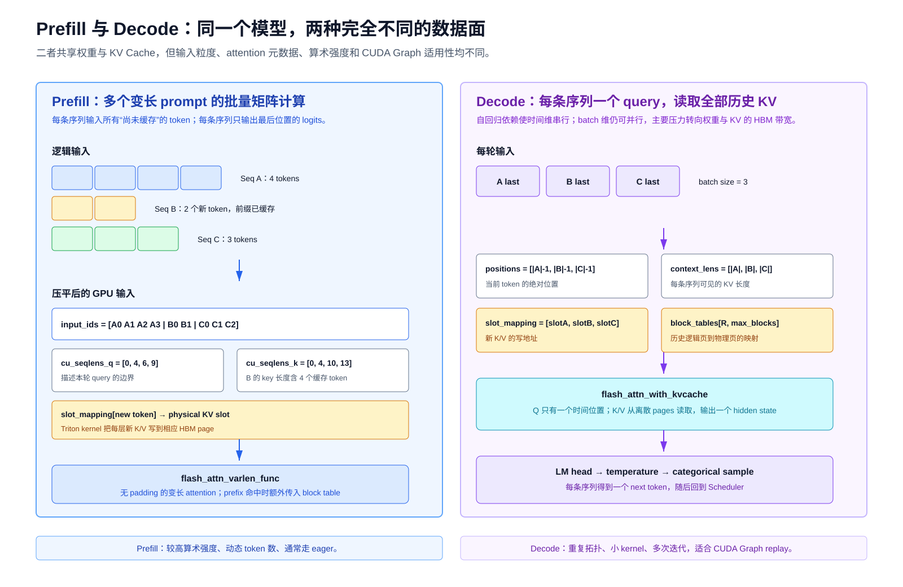
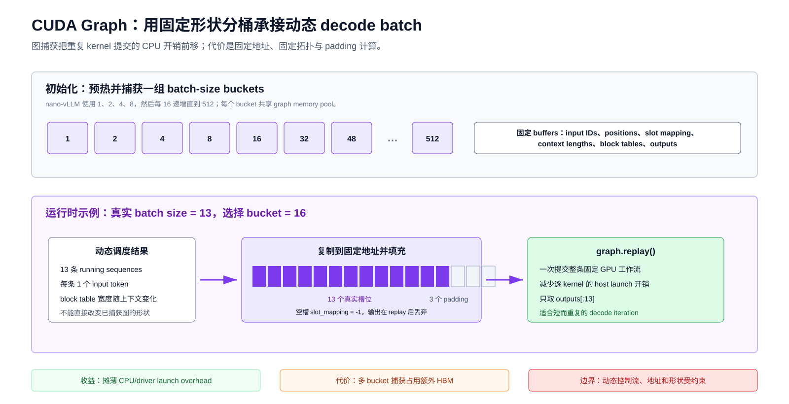
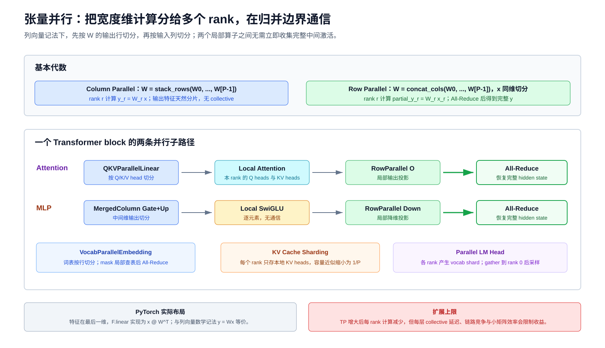

# LLM 推理引擎：调度、Paged KV Cache 与 GPU 执行路径

> 本文以 [nano-vLLM 提交 `2f21442`](https://github.com/GeeeekExplorer/nano-vllm/tree/2f214426530e2841e7d24c73ee0dfa914d62df56) 为可执行案例，从系统原理出发分析离线推理引擎。重点不是逐文件复述源码，而是建立请求状态、KV Cache 所有权、逻辑/物理地址、GPU 执行、张量并行和性能边界之间的统一模型。

## 0. 带着以下问题阅读

一个 decoder-only Transformer 能完成模型前向，并不等于它已经成为高吞吐推理引擎。后者还必须持续回答：

1. 多个长短不同的请求中，下一轮应选择哪些请求进入 GPU？
2. Prefill 与 decode 为什么具有不同的计算形态，能否放进同一个 batch？
3. KV Cache 为什么需要分页，逻辑 token 位置如何映射到 HBM 中的物理地址？
4. 两个请求拥有相同前缀时，何时可以共享 K/V，何时必须重新计算？
5. Decode 每轮只有一个新 token，为什么仍值得使用 CUDA Graph？
6. Tensor Parallelism 如何切分权重、attention heads、KV Cache 与词表，通信发生在哪里？
7. 一份只报告总体 `tokens/s` 的 benchmark 能证明什么，不能证明什么？
8. 一个约千行的教学实现与生产级在线服务之间，还缺少哪些机制？

本文沿着以下主线展开：

```text
请求进入
  -> Sequence 状态机
  -> Scheduler 选择 batch
  -> Block Manager 分配逻辑页
  -> Model Runner 构造 GPU 元数据
  -> Transformer / Attention 执行
  -> Sampling 产生 next token
  -> 状态回填、终止或下一轮
```



图 1：控制面维护请求状态、预算与逻辑 block；数据面持有权重、激活和物理 KV Cache。两者通过 `block_table`、`slot_mapping` 和 attention 元数据连接。

### 0.1 研究范围与证据标准

本文把结论分为三个层次：

1. **通用原理**：由自回归分解、attention 数据依赖、GPU 执行模型或经典系统论文支持；
2. **案例实现**：由 nano-vLLM 固定提交中的源码直接支持，并给出不可变 GitHub 行号；
3. **演进方向**：根据当前实现的结构性限制提出，不把“可以演进”表述成“已经支持”。

nano-vLLM 将自己定位为轻量、可读的离线 vLLM 实现，依赖 PyTorch、Triton、FlashAttention、Transformers 与 xxHash；当前案例提交没有测试目录。因此，本文不把 README 中的一次吞吐结果外推为普遍性能结论，也不把教学实现等同于当前生产版 vLLM。[项目定位与特性](https://github.com/GeeeekExplorer/nano-vllm/blob/2f214426530e2841e7d24c73ee0dfa914d62df56/README.md#L7-L15)；[依赖定义](https://github.com/GeeeekExplorer/nano-vllm/blob/2f214426530e2841e7d24c73ee0dfa914d62df56/pyproject.toml#L12-L21)

### 0.2 符号约定

| 记号 | 含义 |
|---|---|
| $R$ | 当前 batch 中的请求数 |
| $L$ | Transformer 层数 |
| $P$ | Tensor Parallelism 的 rank 数 |
| $d$ | hidden size |
| $d_h$ | 单个 attention head 的维度 |
| $H_q,H_{kv}$ | query head 总数与 key/value head 总数 |
| $S$ | 一个 KV block 可容纳的 token 数 |
| $N_{\mathrm{blk}}$ | 每个 rank 在 HBM 中分配的物理 KV block 数 |
| $\beta$ | 单个 KV 元素的字节数 |
| $V$ | 词表大小 |
| $n_i$ | 第 $i$ 条序列的当前总 token 数 |
| $c_i$ | 第 $i$ 条序列命中 prefix cache 的 token 数 |
| $u_i=n_i-c_i$ | 第 $i$ 条序列本轮实际计算的 prefill query token 数 |
| $b_i=\lceil n_i/S\rceil$ | 第 $i$ 条序列需要的逻辑 block 数 |
| $b_{\max}$ | 当前 batch 中最大的逻辑 block 数 |

数学上，向量均按列向量书写。例如线性层为 $y=Wx$，attention score 为 $q^\top k/\sqrt{d_h}$。PyTorch 张量把特征放在最后一维，`F.linear(x, weight)` 对应批量实现 $xW^\top$；这是框架布局与数学记法的差异，不是两个不同的线性变换。[线性层参数布局](https://github.com/GeeeekExplorer/nano-vllm/blob/2f214426530e2841e7d24c73ee0dfa914d62df56/nanovllm/layers/linear.py#L12-L33)

## 1. 推理引擎到底增加了什么

### 1.1 从模型函数到长期运行的资源管理器

单次模型前向可以抽象为：

$$ (\text{input ids},\text{positions},\text{state})\longmapsto\text{logits}. $$

推理引擎则是一个反复执行决策的闭环：

$$ \text{schedule}\rightarrow\text{prepare}\rightarrow\text{execute}\rightarrow\text{sample}\rightarrow\text{update}. $$

它额外管理四类状态：

| 状态 | 典型内容 | 主要驻留位置 |
|---|---|---|
| 请求状态 | token IDs、采样参数、到达/完成状态 | host DRAM |
| 调度状态 | waiting/running 队列、预算、优先级 | host DRAM |
| 地址状态 | block table、slot mapping、context lengths | host DRAM 与 HBM |
| 模型状态 | 权重、激活、KV Cache、CUDA Graph buffers | HBM |

因此，推理引擎的核心对象不是“模型层”，而是**随时间增长的请求集合与有限 HBM 之间的映射关系**。

### 1.2 nano-vLLM 的模块边界

| 层次 | 模块 | 职责 |
|---|---|---|
| 用户入口 | `LLM`, `SamplingParams` | 暴露同步离线生成接口；采样参数只包含 temperature、`max_tokens`、`ignore_eos` |
| 编排层 | `LLMEngine` | 配置、进程创建、tokenizer、请求入队、step 循环和结果解码 |
| 调度层 | `Sequence`, `Scheduler` | 请求状态机、waiting/running 队列、prefill/decode 选择、抢占与终止 |
| 缓存元数据层 | `BlockManager` | block ID、free/used 集合、prefix hash、引用计数和逻辑 block table |
| 执行层 | `ModelRunner` | 设备/NCCL 初始化、权重加载、HBM 预算、输入组织、CUDA Graph、前向与采样 |
| 模型层 | Qwen model 与 layers | Qwen decoder、TP 线性层、RoPE、RMSNorm、FlashAttention、LM head |

这些边界可以直接从 [引擎编排](https://github.com/GeeeekExplorer/nano-vllm/blob/2f214426530e2841e7d24c73ee0dfa914d62df56/nanovllm/engine/llm_engine.py#L15-L93)、[调度器](https://github.com/GeeeekExplorer/nano-vllm/blob/2f214426530e2841e7d24c73ee0dfa914d62df56/nanovllm/engine/scheduler.py#L8-L71)、[Block Manager](https://github.com/GeeeekExplorer/nano-vllm/blob/2f214426530e2841e7d24c73ee0dfa914d62df56/nanovllm/engine/block_manager.py#L8-L112) 和 [Model Runner](https://github.com/GeeeekExplorer/nano-vllm/blob/2f214426530e2841e7d24c73ee0dfa914d62df56/nanovllm/engine/model_runner.py#L15-L251) 中观察到。

最关键的所有权边界是：

- `Scheduler/BlockManager` 只管理整数 block ID 和引用关系，不直接持有 K/V 张量；
- `ModelRunner/Attention` 持有 HBM 中的物理 K/V；
- `Sequence.block_table` 把序列的逻辑块连接到物理 block；
- `slot_mapping` 把本轮新 token 连接到物理 block 内的具体 slot。

### 1.3 初始化不是“加载权重”这么简单

案例实现的初始化顺序为：

1. 解析配置并读取 Hugging Face model config；
2. 按 TP world size 创建进程；
3. 每个 rank 初始化 NCCL，绑定同编号 GPU；
4. 构造本地 Qwen2/Qwen3 兼容模型并按 rank 加载权重分片；
5. 按配置构造一组长序列，执行一次 prefill warmup；
6. 根据 HBM 余量计算可分配 KV block 数；
7. 分配物理 KV Cache 并绑定到各 attention 层；
8. 非 eager 模式下捕获多种 decode batch size 的 CUDA Graph；
9. rank 0 创建共享内存控制通道，worker ranks 进入命令循环。

源码顺序见 [引擎进程创建](https://github.com/GeeeekExplorer/nano-vllm/blob/2f214426530e2841e7d24c73ee0dfa914d62df56/nanovllm/engine/llm_engine.py#L17-L34) 与 [Runner 初始化](https://github.com/GeeeekExplorer/nano-vllm/blob/2f214426530e2841e7d24c73ee0dfa914d62df56/nanovllm/engine/model_runner.py#L17-L48)。

初始化的本质是建立三种容量：

- **模型容量**：权重能否装入一个或多个 rank；
- **运行容量**：最坏形状的激活和临时 workspace 需要多少 HBM；
- **请求容量**：剩余 HBM 能容纳多少 KV blocks。

### 1.4 一次 `generate()` 的端到端调用链

```text
prompt
  -> tokenizer.encode
  -> Sequence(status=WAITING)
  -> Scheduler.waiting

while waiting or running:
  -> Scheduler.schedule()
  -> ModelRunner.run()
  -> Scheduler.postprocess()

completion token IDs
  -> tokenizer.decode
  -> text
```

`LLMEngine.step()` 精确串联 `schedule -> run -> postprocess`；prefill 前向也会立即经 LM head 和 sampler 产生第一个 completion token，后续 decode step 再逐 token 推进。[请求入队与 step](https://github.com/GeeeekExplorer/nano-vllm/blob/2f214426530e2841e7d24c73ee0dfa914d62df56/nanovllm/engine/llm_engine.py#L42-L54)；[主循环与结果收集](https://github.com/GeeeekExplorer/nano-vllm/blob/2f214426530e2841e7d24c73ee0dfa914d62df56/nanovllm/engine/llm_engine.py#L59-L93)

## 2. Prefill 与 Decode：同一模型的两种工作负载

### 2.1 自回归分解决定了时间依赖

对 token 序列 $x_1,\ldots,x_T$，自回归模型分解为：

$$ p(x_1,\ldots,x_T)=\prod_{t=1}^{T}p(x_t\mid x_1,\ldots,x_{t-1}). $$

Prompt 的 token 已全部已知，因此 prefill 可以同时计算多个位置；生成阶段的 $x_{t+1}$ 必须等待 $x_t$ 被采样后才能确定，因此单条序列沿时间维不可并行。

### 2.2 Prefill：并行计算已知 token

设一条 prompt 长度为 $n$。忽略常数与具体投影宽度时：

- QKV/MLP 等位置独立算子具有近似 $O(nd^2)$ 的计算；
- causal attention 具有近似 $O(n^2d)$ 的计算；
- 每个位置生成的 K/V 被写入 KV Cache；
- 只需要最后一个 query 位置的 logits 来采样第一个 completion token。

Prefill 通常具有较高算术强度：权重被多个 token 重用，矩阵乘更接近 GEMM。长 prompt 的 attention 项又会随 $n^2$ 增长，因此它既可能充分利用计算单元，也可能形成较长的不可抢占 kernel 区间。

### 2.3 Decode：复用历史 K/V，但时间维串行

生成第 $t$ 个 completion token 时，模型只输入上一轮产生的一个 token，并计算这个新位置的 Q/K/V：

$$ q_t=W_qx_t,\qquad k_t=W_kx_t,\qquad v_t=W_vx_t. $$

历史 $k_1,\ldots,k_{t-1}$ 与 $v_1,\ldots,v_{t-1}$ 已在 KV Cache 中，不必重新投影；当前 query 仍需读取全部历史：

$$ o_t=\sum_{j=1}^{t}\operatorname{softmax}_j\!\left(\frac{q_t^\top k_j}{\sqrt{d_h}}\right)v_j. $$

因此，单层 decode attention 的历史相关项由 prefill 的 $O(n^2d)$ 降为每步 $O(nd)$，但每一步仍要：

- 读取模型权重；
- 读取不断增长的 KV Cache；
- 启动大量较小 kernel；
- 在 TP ranks 之间执行 collectives；
- 采样并把 next token 送回控制面。

这使 decode 常表现为低算术强度、对 HBM 带宽和 kernel launch latency 敏感的工作负载。

### 2.4 为什么 KV Cache 只保存 K/V

历史 query $q_j$ 只用于位置 $j$ 当时的输出；生成未来位置 $t$ 时，需要的是新 query $q_t$ 与所有历史 keys/values。缓存历史 Q 不会避免未来所需的投影，也不会参与未来 attention：

$$ \text{future output at }t\ \text{depends on}\ q_t,\{k_j,v_j\}_{j\le t},\ \text{not on}\ \{q_j\}_{j<t}. $$

### 2.5 两阶段对比

| 维度 | Prefill | Decode |
|---|---|---|
| 每请求本轮输入 | 多个未缓存 token | 最后一个 token |
| 时间维并行 | prompt token 可并行 | 单序列必须逐 token |
| Attention 形态 | 变长 causal attention | 单 query 读取历史 KV |
| 常见主导资源 | 计算吞吐、长序列 attention | HBM 带宽、launch latency |
| Batch 波动 | 总 token 数变化大 | 主要随活动序列数变化 |
| CUDA Graph 适配 | 动态形状较难 | 重复拓扑更适合 |
| 用户指标 | TTFT | TPOT / inter-token latency |

## 3. 请求状态机与调度

### 3.1 最小状态机

nano-vLLM 只定义 `WAITING`、`RUNNING` 和 `FINISHED` 三种状态。[状态枚举与 Sequence 字段](https://github.com/GeeeekExplorer/nano-vllm/blob/2f214426530e2841e7d24c73ee0dfa914d62df56/nanovllm/engine/sequence.py#L8-L29)



图 2：请求经 prefill 进入 running；每个 decode step 追加一个 token。HBM 中的空闲 KV blocks 不足时采用 recompute preemption：释放整条序列的 KV blocks，并回到 waiting 队首。

状态转移为：

```text
new -> WAITING
WAITING -> RUNNING      prefill 成功准入并分配 blocks
RUNNING -> FINISHED     EOS 或达到 max_tokens
RUNNING -> WAITING      decode 扩容失败，被抢占
```

被抢占请求没有把 KV Cache 交换到 host DRAM。调度语义要求它丢弃当前 K/V，随后把“prompt + 已生成 completion”重新走 prefill，因此抢占成本随当前序列长度增长。[抢占实现](https://github.com/GeeeekExplorer/nano-vllm/blob/2f214426530e2841e7d24c73ee0dfa914d62df56/nanovllm/engine/scheduler.py#L60-L63)

这一重算路径在单卡下可以访问主进程中完整的 `token_ids`；当前 TP 控制面却存在实现缺口：已有 completion 的 `Sequence` 被序列化到 worker 时只发送 `last_token`，抢占后 worker 进入 prefill 会再次访问完整 `token_ids`，因而无法完成重算。[Sequence 序列化](https://github.com/GeeeekExplorer/nano-vllm/blob/2f214426530e2841e7d24c73ee0dfa914d62df56/nanovllm/engine/sequence.py#L74-L83)；[prefill 读取完整 token 后缀](https://github.com/GeeeekExplorer/nano-vllm/blob/2f214426530e2841e7d24c73ee0dfa914d62df56/nanovllm/engine/model_runner.py#L126-L139) 因此，“支持 recompute preemption”必须限定为调度器语义和单卡可达路径，不能外推为当前 TP 路径已正确实现。

### 3.2 调度预算

调度器显式维护：

- `max_num_seqs`：单次 schedule 最多选择多少条序列；
- `max_num_batched_tokens`：单次 prefill 的 token 预算；
- free KV block 数：物理容量约束。

配置默认值见 [Config](https://github.com/GeeeekExplorer/nano-vllm/blob/2f214426530e2841e7d24c73ee0dfa914d62df56/nanovllm/config.py#L6-L18)。

一个容易误读的细节是：`max_num_seqs` 在当前源码中不是 running 队列的全局上限。prefill 分支每次从 0 计数，成功后继续向现有 running 队列追加；它约束的是**本轮新选 batch 的大小**。[prefill 选择逻辑](https://github.com/GeeeekExplorer/nano-vllm/blob/2f214426530e2841e7d24c73ee0dfa914d62df56/nanovllm/engine/scheduler.py#L24-L41)

### 3.3 Prefill-first 策略

每个 step 先从 waiting 队头连续尝试 prefill：

1. 检查本轮 sequence 数；
2. 检查 `num_batched_tokens + len(seq)`；
3. 检查 `BlockManager.can_allocate(seq)`；
4. 分配 blocks，设为 `RUNNING`；
5. 从 waiting 移到 running；
6. 一旦选中至少一个 prefill 请求，立即返回 prefill batch。

这带来三个确定性质：

- **严格 FCFS**：遇到第一个不可准入请求就停止，不会检查其后的短请求；
- **head-of-line blocking**：队首长请求可能阻塞后续可运行请求；
- **模式互斥**：一个 step 不混合 prefill 与 decode。

完整控制流见 [Scheduler.schedule](https://github.com/GeeeekExplorer/nano-vllm/blob/2f214426530e2841e7d24c73ee0dfa914d62df56/nanovllm/engine/scheduler.py#L24-L58)。

Prefix cache 对 token 预算的影响也不是完全一致：

- 准入判断按完整 `len(seq)` 收费；
- 成功分配后，累计值按 `len(seq)-num_cached_tokens` 增加。

因此，它会对已准入请求记录真实 query token 数，却可能因保守的候选判断而少装一些本可容纳的请求。[预算判断与累计](https://github.com/GeeeekExplorer/nano-vllm/blob/2f214426530e2841e7d24c73ee0dfa914d62df56/nanovllm/engine/scheduler.py#L29-L35)

### 3.4 Decode 选择与稳定批

只有本轮没有选中任何 prefill 请求时，Scheduler 才进入 decode：

1. 从 running 队首取序列；
2. 若跨 block 边界且无空闲 block，从队尾抢占其他序列；
3. 必要时分配一个新 block；
4. 最多选择 `max_num_seqs` 条；
5. 把选中序列按原顺序放回 running 队首。

这形成一个相对稳定的“队首 decode 批”，不是每轮完整轮转的 round-robin。若 batch 上限小于 running 总数，队尾请求的服务机会依赖队首请求完成或被抢占。

### 3.5 这是不是 continuous batching

从算法骨架看，它具备 iteration-level batching 的关键性质：请求跨多个 iteration 驻留，完成的请求可以退出，剩余请求继续组成下一批。

但当前入口是同步离线 `generate()`：

- 所有 prompts 在循环前一次性入队；
- 循环期间没有新请求注入接口；
- 没有异步流式输出；
- prefill 与 decode 不能混合；
- 没有 chunked prefill。

因此，准确表述应是“实现了 continuous batching 的简化调度骨架”，而不是“实现了生产级在线 continuous batching”。同步主循环见 [LLMEngine.generate](https://github.com/GeeeekExplorer/nano-vllm/blob/2f214426530e2841e7d24c73ee0dfa914d62df56/nanovllm/engine/llm_engine.py#L59-L93)。

### 3.6 调度策略的性能目标

生产系统通常需要在以下目标之间权衡：

| 目标 | 倾向的策略 | 可能代价 |
|---|---|---|
| 降低 TTFT | 尽快接纳 prefill | 延迟已有请求的 decode |
| 降低 TPOT | 优先 running/decode | 新请求排队时间增加 |
| 提高吞吐 | 扩大 token batch | 单轮执行时间与尾延迟增加 |
| 降低 HBM 压力 | 抢占或限制并发 | 重算、swap 或利用率下降 |
| 公平性 | aging、轮转、配额 | 调度器更复杂 |
| SLO goodput | 按 deadline/预算装箱 | 可能牺牲原始 tokens/s |

nano-vLLM 的 prefill-first 规则结构清楚，适合教学；在持续在线到达下，生产调度器通常需要 decode priority、chunked prefill、admission control 与 SLO-aware policy。

## 4. Paged KV Cache

### 4.1 KV Cache 容量模型

一个 token 在一张 rank 上的 K/V 元素数为：

$$ 2L(H_{kv}/P)d_h. $$

一条长度为 $n$ 的序列，其每-rank KV Cache 字节数为：

$$ M_{\mathrm{seq,rank}}(n)=2Ln(H_{kv}/P)d_h\beta. $$

若为每条请求按 `max_model_len` 预留连续空间，会同时产生：

- **reserved waste**：请求尚未增长到预留上限；
- **internal fragmentation**：分配单元内部没有被 token 使用；
- **external fragmentation**：空闲区虽足够但不连续。

PagedAttention 原论文把 KV Cache 划成固定 token 数的 blocks，以操作系统分页为类比：逻辑块连续，物理块无需连续；按需分配消除外部碎片，并把内部碎片限制在最后一个 block。[PagedAttention 论文第 3–4 节](https://arxiv.org/html/2309.06180#S3)

### 4.2 物理布局

nano-vLLM 每个 rank 分配一个统一 HBM 张量：

$$ \text{shape}=[2,L,N_{\mathrm{blk}},S,H_{kv}/P,d_h]. $$

第一维区分 K/V。ModelRunner 再按 layer index 把形状为 $[N_{\mathrm{blk}},S,H_{kv}/P,d_h]$ 的视图绑定到每个 attention 层。[KV Cache 字节数、分配与层绑定](https://github.com/GeeeekExplorer/nano-vllm/blob/2f214426530e2841e7d24c73ee0dfa914d62df56/nanovllm/engine/model_runner.py#L100-L118)

单个物理 block 在每个 rank 上的字节数为：

$$ M_{\mathrm{block,rank}}=2LS(H_{kv}/P)d_h\beta. $$

物理 block 数由运行时 HBM 预算决定：

$$ N_{\mathrm{blk}}=\left\lfloor\frac{\rho M_{\mathrm{total}}-M_{\mathrm{used}}-(M_{\mathrm{peak}}-M_{\mathrm{current}})}{M_{\mathrm{block,rank}}}\right\rfloor. $$

其中 $\rho$ 是 `gpu_memory_utilization`。`M_{\mathrm{peak}}-M_{\mathrm{current}}` 近似表示 warmup 期间出现、之后已释放但真实执行仍需预留的临时峰值。[warmup 与峰值统计](https://github.com/GeeeekExplorer/nano-vllm/blob/2f214426530e2841e7d24c73ee0dfa914d62df56/nanovllm/engine/model_runner.py#L91-L112)

这种启发式定容比只按参数量手写 HBM 公式更贴近当前模型和算子实现，但不能视为严格上界。它隐含三个要求：

1. warmup 形状必须覆盖真实运行的峰值；
2. 后续初始化步骤新增的常驻 HBM 必须被计入；
3. 多 rank 必须对可用 block 数达成一致。

当前 warmup 只运行 `min(max_num_batched_tokens // max_model_len, max_num_seqs)` 条等长序列，不能覆盖所有合法的 sequence-count/token-count 组合；此时 KV Cache 尚未分配，attention 也不会执行真实 cache 写入。更重要的是，源码先按余量定容并分配 KV Cache，随后才捕获 CUDA Graph，graph 静态 buffers 与 memory pool 没有从上述预算中扣除。因此，真实峰值可能超过 $\rho M_{\mathrm{total}}$，极端情况下仍可能 OOM。[warmup 形状](https://github.com/GeeeekExplorer/nano-vllm/blob/2f214426530e2841e7d24c73ee0dfa914d62df56/nanovllm/engine/model_runner.py#L91-L99)；[KV 定容先于 graph capture](https://github.com/GeeeekExplorer/nano-vllm/blob/2f214426530e2841e7d24c73ee0dfa914d62df56/nanovllm/engine/model_runner.py#L31-L39)

此外，各 rank 独立计算 block 数，没有对异构容量或不对称占用取全局最小值，这是单机同构假设的一部分。

### 4.3 逻辑 block table

对序列 $i$，`block_table[j]=b` 表示第 $j$ 个逻辑 block 位于物理 block $b$。逻辑 block 内 offset 为 $r$ 的 token 对应扁平物理 slot：

$$ \operatorname{slot}(j,r)=\operatorname{block\_table}[j]\cdot S+r,\qquad 0\le r<S. $$



图 3：两个请求可共享完整前缀 blocks，后缀映射到不同物理页。逻辑顺序由 block table 保持，不要求 HBM 中物理连续。

`ModelRunner.prepare_block_tables()` 将不同长度的 Python lists 用 `-1` 补成二维 `int32` tensor，再复制到 GPU。[block table 构造](https://github.com/GeeeekExplorer/nano-vllm/blob/2f214426530e2841e7d24c73ee0dfa914d62df56/nanovllm/engine/model_runner.py#L120-L124)

### 4.4 Block Manager 的 CPU 元数据

每个物理 block 保存：

- `block_id`：物理页号；
- `ref_count`：当前有多少序列引用；
- `hash`：完整 block 的 prefix identity；
- `token_ids`：用于候选命中的内容校验。

管理器还维护：

- `hash_to_block_id`：prefix hash 到物理 block；
- `free_block_ids`：空闲页队列；
- `used_block_ids`：当前被引用的页集合。

结构定义见 [Block 与 BlockManager](https://github.com/GeeeekExplorer/nano-vllm/blob/2f214426530e2841e7d24c73ee0dfa914d62df56/nanovllm/engine/block_manager.py#L8-L33)。

### 4.5 Prefix cache 的链式哈希

若第 $j$ 个 block 的 token 内容为 $T_j$，链式哈希为：

$$ h_0=H(T_0),\qquad h_j=H(h_{j-1}\Vert T_j). $$

它编码了“此前全部 blocks 的摘要 + 当前 block 内容”。同一 token block 出现在不同前缀后时，K/V 一般不同，因为它可见的历史不同；链式哈希避免只按当前 block 文本错误共享。

源码还比较候选 block 的当前 `token_ids`，以避免仅凭当前 64-bit hash 接受内容不同的 block。[哈希计算](https://github.com/GeeeekExplorer/nano-vllm/blob/2f214426530e2841e7d24c73ee0dfa914d62df56/nanovllm/engine/block_manager.py#L35-L41)；[命中校验](https://github.com/GeeeekExplorer/nano-vllm/blob/2f214426530e2841e7d24c73ee0dfa914d62df56/nanovllm/engine/block_manager.py#L63-L81)

但必须精确说明安全边界：

- 当前 block 的 token IDs 会精确比较；
- 更早前缀只由链式 64-bit hash 表示；
- 因而这不是数学上的无碰撞证明。

更高保证的实现可以使用更强摘要、额外 metadata 或完整前缀验证，但会增加 CPU 成本和元数据体积。

### 4.6 为什么只缓存完整 block

未填满尾 block 还会随着 decode 继续追加。如果把它共享给另一序列：

- 任一序列追加都可能修改另一序列看到的内容；
- 当前 hash 会随内容增长而失效；
- copy-on-write 或细粒度引用管理会显著复杂化。

因此，当前实现只为长度恰为 $S$ 的 block 建立 hash；尾 block 使用 `hash=-1`，由请求独占。第一次 miss 后，本次分配不再尝试复用后续 blocks，保证可共享部分严格是连续前缀。[完整块判断与连续前缀规则](https://github.com/GeeeekExplorer/nano-vllm/blob/2f214426530e2841e7d24c73ee0dfa914d62df56/nanovllm/engine/block_manager.py#L59-L82)

### 4.7 引用计数与回收

若 Sequence A 和 B 都映射到物理 block 7，则 `ref_count=2`。A 完成时只减为 1，不能释放；B 也结束后才回到 free pool。

回收时源码：

1. 逆序遍历 `seq.block_table`；
2. 每个 block 的 `ref_count -= 1`；
3. 归零后从 used set 移除并放回 free deque；
4. 清空序列的 block table 与 cached token 计数。

见 [deallocate](https://github.com/GeeeekExplorer/nano-vllm/blob/2f214426530e2841e7d24c73ee0dfa914d62df56/nanovllm/engine/block_manager.py#L84-L91)。

一个值得注意的设计是：block 回到 free pool 时仍保留 hash 和 token IDs，因此只要还未被覆盖，它仍可被未来相同前缀重新激活；真正重新分配给新内容时才 `reset()`。[block reset](https://github.com/GeeeekExplorer/nano-vllm/blob/2f214426530e2841e7d24c73ee0dfa914d62df56/nanovllm/engine/block_manager.py#L20-L23)；[free/used 转换](https://github.com/GeeeekExplorer/nano-vllm/blob/2f214426530e2841e7d24c73ee0dfa914d62df56/nanovllm/engine/block_manager.py#L43-L54)；[空闲 cache block 的重新激活](https://github.com/GeeeekExplorer/nano-vllm/blob/2f214426530e2841e7d24c73ee0dfa914d62df56/nanovllm/engine/block_manager.py#L69-L90)

### 4.8 Decode 跨页边界

采样 token 先追加到 `Sequence`，下一轮 schedule 再检查 block 状态：

- 若新长度满足 $n\bmod S=1$，刚进入新逻辑 block，需要分配物理页；
- 若 $n\bmod S=0$，尾 block 刚填满，计算 hash 并注册为 prefix cache；
- 其他情况继续使用当前未满 block。

实现见 [can_append 与 may_append](https://github.com/GeeeekExplorer/nano-vllm/blob/2f214426530e2841e7d24c73ee0dfa914d62df56/nanovllm/engine/block_manager.py#L93-L112)。

### 4.9 Block size 的权衡

设平均每条活动序列的最后一个 block 未使用 slot 数为 $w$，则 $0\le w<S$。若尾长度近似均匀分布，期望内部碎片约为 $(S-1)/2$ 个 token slots。

较小的 $S$：

- 降低尾部内部碎片；
- 提高 prefix cache 的匹配粒度；
- 增大 block table、hash metadata 和地址翻译开销。

较大的 $S$：

- 减少 metadata 与查表次数；
- 提高连续访问长度；
- 增加尾部浪费；
- 降低短公共前缀的复用概率。

nano-vLLM 默认 $S=256$，同时因为所调用的 FlashAttention paged KV 接口要求 page block size 是 256 的倍数，配置也检查该约束。由于当前 `Sequence.block_size` 仍硬编码为 256，案例实现中逻辑与物理布局能够保持一致的配置实际上只有 256。[block size 配置](https://github.com/GeeeekExplorer/nano-vllm/blob/2f214426530e2841e7d24c73ee0dfa914d62df56/nanovllm/config.py#L17-L23)；[Sequence.block_size](https://github.com/GeeeekExplorer/nano-vllm/blob/2f214426530e2841e7d24c73ee0dfa914d62df56/nanovllm/engine/sequence.py#L14-L15)；[FlashAttention KV-cache 接口](https://github.com/Dao-AILab/flash-attention#how-to-use-flashattention)

## 5. 从逻辑地址到 Attention Kernel

### 5.1 Prefill 输入组织

对第 $i$ 条序列：

- 总长度为 $n_i$；
- 已缓存前缀为 $c_i$；
- 本轮 query token 数为 $u_i=n_i-c_i$；
- query positions 为 $c_i,\ldots,n_i-1$；
- key/value 上下文长度仍为 $n_i$。

ModelRunner 将不同请求的未缓存 token 压平成一维：

$$ T_q=\sum_{i=1}^{R}u_i. $$

并构造：

- `input_ids[T_q]`；
- `positions[T_q]`；
- `cu_seqlens_q[R+1]`：query 分段边界；
- `cu_seqlens_k[R+1]`：完整 key context 分段边界；
- `slot_mapping[T_q]`：每个新 token 的物理写地址；
- 可选 `block_tables[R,b_{\max}]`：prefix 命中时读取历史 KV。

源码见 [prepare_prefill](https://github.com/GeeeekExplorer/nano-vllm/blob/2f214426530e2841e7d24c73ee0dfa914d62df56/nanovllm/engine/model_runner.py#L126-L162)。

### 5.2 Decode 输入组织

Decode 时，每条序列只有一个新输入：

- `input_ids[i]=seq.last_token`；
- `positions[i]=n_i-1`；
- `context_lens[i]=n_i`；
- `slot_mapping[i]` 指向当前尾 slot；
- `block_tables[i,:]` 描述完整历史。

因此 input 数量为 $R$，但 block table 的元数据量仍与 $Rb_{\max}$ 成正比。[prepare_decode](https://github.com/GeeeekExplorer/nano-vllm/blob/2f214426530e2841e7d24c73ee0dfa914d62df56/nanovllm/engine/model_runner.py#L164-L180)



图 4：Prefill 使用 packed varlen 表示，不按 batch 最大序列长度 padding；decode 每请求只输入最后一个 token，但仍需完整 context lengths 与 block tables。

### 5.3 KV 写入

每层 attention 先计算当前 token 的 K/V，再调用 Triton kernel 写入 cache。设每个 token 在本 rank 上的 K 或 V 宽度为：

$$ D=(H_{kv}/P)d_h. $$

kernel 为每个 token 启动一个 program：

1. 读取 `slot_mapping[token]`；
2. 若 slot 为 `-1`，直接返回；
3. 连续读取该 token 的 $D$ 个 K 元素与 $D$ 个 V 元素；
4. 写入 `slot\cdot D` 对应的 cache 区间。

见 [store_kvcache Triton kernel](https://github.com/GeeeekExplorer/nano-vllm/blob/2f214426530e2841e7d24c73ee0dfa914d62df56/nanovllm/layers/attention.py#L10-L40)。

### 5.4 三条 Attention 路径

案例实现有三条数据路径：

1. **无 prefix 命中的 prefill**：新 K/V 写入 cache，但 FlashAttention 直接消费本次 packed K/V；
2. **有 prefix 命中的 prefill**：新 K/V 写入 cache，FlashAttention 通过 block table 从 paged cache 读取“缓存前缀 + 新后缀”；
3. **decode**：新 K/V 写入尾 slot，`flash_attn_with_kvcache` 根据 context lengths 与 block tables 读取全部历史。

分支逻辑见 [Attention.forward](https://github.com/GeeeekExplorer/nano-vllm/blob/2f214426530e2841e7d24c73ee0dfa914d62df56/nanovllm/layers/attention.py#L43-L75)。

### 5.5 隐式 Context

`ModelRunner` 没有把所有 attention metadata 显式传过每层函数签名，而是写入进程内模块全局 `Context`；Attention 与 LM head 在 forward 中读取，step 结束后 reset。[Context 定义](https://github.com/GeeeekExplorer/nano-vllm/blob/2f214426530e2841e7d24c73ee0dfa914d62df56/nanovllm/utils/context.py#L5-L27)

这种设计减少了教学代码中的参数传递，但形成了隐式依赖：

- 同一进程内不能安全地让两个 forward 并发使用不同 context；
- 单元测试必须显式设置/清理全局状态；
- 图捕获依赖 context 中静态 tensors 的生命周期。

### 5.6 Host 到 GPU 的传输

输入 metadata 先构造为 pinned host tensor，再以 `.cuda(non_blocking=True)` 复制到 GPU。Pinned memory 是异步 DMA 传输的必要条件之一，但 `non_blocking=True` 只提供异步机会；若没有独立 stream、双缓冲和计算重叠，不能据此断言 H2D 已被隐藏。[prefill tensor 构造](https://github.com/GeeeekExplorer/nano-vllm/blob/2f214426530e2841e7d24c73ee0dfa914d62df56/nanovllm/engine/model_runner.py#L154-L161)

## 6. CUDA Graph：降低 Decode 提交开销

### 6.1 为什么 decode 更适合 graph replay

普通 CUDA stream 模式下，host 需要逐个提交 kernel。对执行时间很短的 kernel，driver setup 与 launch 本身可能占据显著比例。CUDA Graph 把操作及依赖先定义和实例化，随后用较低 host overhead 重复启动整个图。[NVIDIA CUDA Programming Guide：CUDA Graphs](https://docs.nvidia.com/cuda/cuda-programming-guide/04-special-topics/cuda-graphs.html)

Decode 具有三个适配条件：

- 每轮执行相同模型拓扑；
- 每请求 token 数固定为 1；
- 同一 batch size 下张量形状稳定。

Prefill 的总 query token 数、变长边界与 block table 宽度波动更大，因此当前实现只 graph 化 decode 模型主干。

### 6.2 静态地址与 batch buckets

CUDA Graph 通常要求捕获期间使用的地址与形状在 replay 时保持稳定。nano-vLLM 预分配静态 buffers，并捕获：

```text
[1, 2, 4, 8, 16, 32, 48, ..., 512]
```

这些 batch-size buckets。运行时真实 batch size 为 $R$ 时，选择最小的 $g\ge R$，把真实输入复制到前 $R$ 个槽位，其余槽位作为 padding。[graph 捕获 buckets](https://github.com/GeeeekExplorer/nano-vllm/blob/2f214426530e2841e7d24c73ee0dfa914d62df56/nanovllm/engine/model_runner.py#L216-L251)



图 5：真实 batch 13 选择 graph bucket 16。静态地址换取低 launch overhead，同时引入 3 行 padding 计算。

### 6.3 Replay 路径

Replay 前：

1. 把 input IDs 与 positions 复制到静态 buffer；
2. `slot_mapping` 全部填 `-1`，再覆盖真实请求区域；
3. `context_lens` 清零，再覆盖真实请求区域；
4. 把真实 block tables 复制到静态二维 buffer；
5. 调用 `graph.replay()`；
6. 只取 `outputs[:R]` 计算 logits。

实现见 [run_model graph 分支](https://github.com/GeeeekExplorer/nano-vllm/blob/2f214426530e2841e7d24c73ee0dfa914d62df56/nanovllm/engine/model_runner.py#L189-L206)。

Padding 行仍会执行模型主干，只是 `slot_mapping=-1` 阻止它写入有效 KV，最终输出被切掉。因此 bucket 越粗，越可能浪费计算；bucket 越细，捕获时间、graph 对象与 HBM 占用越高。

### 6.4 Graph 覆盖范围

当前 CUDA Graph 只捕获：

```python
self.model(input_ids, positions)
```

以下部分仍在 graph 外：

- prefill；
- LM head；
- rank 0 logits gather；
- temperature sampling；
- CPU 调度与 metadata 构造。

因此，准确表述是“面向 decode 模型主干的 CUDA Graph 优化”，而不是“整条推理链路 graph 化”。

### 6.5 何时退回 eager

以下情况直接走 eager：

- 当前 step 是 prefill；
- 用户指定 `enforce_eager=True`；
- batch size 大于 512。

见 [eager/graph 分支](https://github.com/GeeeekExplorer/nano-vllm/blob/2f214426530e2841e7d24c73ee0dfa914d62df56/nanovllm/engine/model_runner.py#L189-L206)。

## 7. Tensor Parallelism

### 7.1 Column Parallel

对数学线性层 $y=Wx$，沿输出维把 $W$ 切成行块：

$$ W=\begin{bmatrix}W^{(0)}\\W^{(1)}\\\vdots\\W^{(P-1)}\end{bmatrix}. $$

rank $r$ 独立计算：

$$ y^{(r)}=W^{(r)}x. $$

结果沿输出特征天然分片，不需要立即通信。Q/K/V 投影和 SwiGLU 的 gate/up 投影都采用这种模式。[ColumnParallelLinear 与融合投影](https://github.com/GeeeekExplorer/nano-vllm/blob/2f214426530e2841e7d24c73ee0dfa914d62df56/nanovllm/layers/linear.py#L54-L128)

### 7.2 Row Parallel

沿输入维切分：

$$ W=\begin{bmatrix}W^{(0)}&W^{(1)}&\cdots&W^{(P-1)}\end{bmatrix},\qquad x=\begin{bmatrix}x^{(0)}\\x^{(1)}\\\vdots\\x^{(P-1)}\end{bmatrix}. $$

每个 rank 先算局部部分和：

$$ \widetilde y^{(r)}=W^{(r)}x^{(r)}. $$

完整输出为：

$$ y=\sum_{r=0}^{P-1}\widetilde y^{(r)}. $$

因此需要一次 All-Reduce。Attention 的输出投影和 MLP 的 down projection 都是 row parallel，每个 decoder layer 共两次 activation All-Reduce。[RowParallelLinear](https://github.com/GeeeekExplorer/nano-vllm/blob/2f214426530e2841e7d24c73ee0dfa914d62df56/nanovllm/layers/linear.py#L131-L153)；[Qwen attention/MLP 布局](https://github.com/GeeeekExplorer/nano-vllm/blob/2f214426530e2841e7d24c73ee0dfa914d62df56/nanovllm/models/qwen3.py#L14-L116)



图 6：Column parallel 产生局部分片，后续局部 attention/SwiGLU 继续消费；row parallel 在子层出口 All-Reduce，恢复完整 hidden state。

### 7.3 Attention heads 与 KV Cache 一起切分

每个 rank 持有：

$$ H_q/P\ \text{个 query heads},\qquad H_{kv}/P\ \text{个 KV heads}. $$

这要求 $H_q$ 与 $H_{kv}$ 均可被 $P$ 整除。[Qwen3Attention 的 head 切分](https://github.com/GeeeekExplorer/nano-vllm/blob/2f214426530e2841e7d24c73ee0dfa914d62df56/nanovllm/models/qwen3.py#L29-L39)

因为 KV Cache 也沿 KV-head 维分片，对同一组逻辑 token，单 rank 的 KV HBM 占用近似下降为 $1/P$。若设这组逻辑状态包含 $N_{\mathrm{tok}}$ 个不同物理 token slots，则：

$$ M_{\mathrm{active,rank}}=2LN_{\mathrm{tok}}(H_{kv}/P)d_h\beta,\qquad \sum_{r=0}^{P-1}M_{\mathrm{active,rank}}^{(r)}=2LN_{\mathrm{tok}}H_{kv}d_h\beta. $$

即相同逻辑 KV 的跨 rank 总字节数不变；固定每卡 HBM 预算时，减小单 block 字节数反而可能允许每个 rank 分配更多物理 blocks。不能把“单 rank 占用下降”误写成“单 rank 容量下降”。

### 7.4 Vocab Parallel Embedding 与 LM Head

Embedding 权重沿词表行切分。每个 rank：

1. 判断 token ID 是否落在本地词表区间；
2. 对非本地 token 置零；
3. 本地查表；
4. All-Reduce 后恢复完整 hidden state。

见 [VocabParallelEmbedding](https://github.com/GeeeekExplorer/nano-vllm/blob/2f214426530e2841e7d24c73ee0dfa914d62df56/nanovllm/layers/embed_head.py#L9-L42)。

LM head 反向使用同一词表切分：每个 rank 产生局部 logits，`dist.gather` 到 rank 0，rank 0 拼接完整词表并采样；其他 ranks 不物化完整 logits。[ParallelLMHead](https://github.com/GeeeekExplorer/nano-vllm/blob/2f214426530e2841e7d24c73ee0dfa914d62df56/nanovllm/layers/embed_head.py#L45-L66)

### 7.5 权重加载

每个 rank 打开 safetensors，然后由参数对象绑定的 `weight_loader` 选取本地 shard。Hugging Face 中分离的 `q_proj/k_proj/v_proj` 被装入融合 `qkv_proj`，`gate_proj/up_proj` 被装入融合 `gate_up_proj`。[通用 loader](https://github.com/GeeeekExplorer/nano-vllm/blob/2f214426530e2841e7d24c73ee0dfa914d62df56/nanovllm/utils/loader.py#L8-L28)；[packed module mapping](https://github.com/GeeeekExplorer/nano-vllm/blob/2f214426530e2841e7d24c73ee0dfa914d62df56/nanovllm/models/qwen3.py#L185-L202)

### 7.6 进程与控制面通信

每个 GPU 对应一个进程和 CUDA context。rank 0 用固定 1 MiB shared memory 写入 pickle 后的 `[method_name,*args]`，再通过每个 worker 的 `Event` 发出命令；worker 读取后在本地调用同名方法。[shared memory RPC](https://github.com/GeeeekExplorer/nano-vllm/blob/2f214426530e2841e7d24c73ee0dfa914d62df56/nanovllm/engine/model_runner.py#L41-L89)

`Sequence` 自定义 pickle：

- prefill 前需要完整 prompt token IDs；
- 已进入 decode 后只发送长度、cache metadata、block table 与最后一个 token。

正常 decode 时，历史 token 的语义状态已经编码在每个 rank 的 KV Cache 中，因此 worker 无需每轮接收完整 token 列表。[Sequence 序列化](https://github.com/GeeeekExplorer/nano-vllm/blob/2f214426530e2841e7d24c73ee0dfa914d62df56/nanovllm/engine/sequence.py#L74-L83)

但该优化必须与抢占状态联动。抢占清空 KV 后，下一次调用属于 prefill/recompute，worker 必须重新获得完整 token IDs；当前 `__getstate__()` 仅依据“是否已有 completion”决定发送 `last_token`，没有依据“本轮是否 prefill”切换 payload，因而 TP 抢占重算路径不成立。

### 7.7 TP 的扩展上限

增加 $P$ 会降低每 rank 的权重、head 和 KV Cache 占用，但不会免费加速：

- 每层固定两次 activation All-Reduce；
- embedding 需要一次 All-Reduce；
- LM head 需要向 rank 0 gather logits；
- 单 rank GEMM 变窄后，kernel 效率可能下降；
- collective latency 和链路竞争不会随本地计算同比下降。

因此，TP 的目标首先是让模型和 KV Cache 适配设备容量，其次才是延迟优化。它尤其依赖单机 NVLink/NVSwitch 等高带宽低延迟互联；跨低速链路盲目扩大 TP 通常会使通信主导。

## 8. 模型主干与 Sampling

### 8.1 推理模型的结构边界

当前执行层直接构造名为 `Qwen3ForCausalLM` 的本地实现，没有模型注册表。该提交包含 `attention_bias` 与缺省 `head_dim` 等 Qwen2 兼容处理，因此更准确的范围是“本地 Qwen2/Qwen3 兼容 decoder”，而不是任意 Hugging Face causal LM。主干为：

```text
VocabParallelEmbedding
  -> L × Qwen3DecoderLayer
     -> RMSNorm + residual
     -> Qwen3Attention
     -> RMSNorm + residual
     -> SwiGLU MLP
  -> final RMSNorm
  -> ParallelLMHead
```

源码入口见 [Qwen3Model 与 Qwen3ForCausalLM](https://github.com/GeeeekExplorer/nano-vllm/blob/2f214426530e2841e7d24c73ee0dfa914d62df56/nanovllm/models/qwen3.py#L119-L215)。

Attention 路径包含：

1. 融合 QKV projection；
2. 按本 rank heads reshape；
3. 可选 Q/K RMSNorm；
4. RoPE；
5. paged/varlen FlashAttention；
6. row-parallel output projection。

MLP 路径包含：

1. 融合 gate/up column-parallel projection；
2. $\operatorname{SiLU}(g)\odot u$；
3. row-parallel down projection。

这些结构既减少 Python 模块边界，也为 fused kernel 或编译器融合创造条件，但“源码把权重放在一个参数中”不等于“运行时必然只有一个 GPU kernel”；最终 kernel 数仍取决于 PyTorch 编译、FlashAttention 与硬件后端。

### 8.2 数值计算

RMSNorm 在 float32 中计算均方与归一化，再转回输入 dtype；带 residual 的路径把 residual add 与 norm 放入同一个 `torch.compile` 函数。[RMSNorm](https://github.com/GeeeekExplorer/nano-vllm/blob/2f214426530e2841e7d24c73ee0dfa914d62df56/nanovllm/layers/layernorm.py#L5-L50)

RoPE 也先把 Q/K 转为 float32 完成旋转，再转回原 dtype；cos/sin cache 在初始化时预计算。[RoPE](https://github.com/GeeeekExplorer/nano-vllm/blob/2f214426530e2841e7d24c73ee0dfa914d62df56/nanovllm/layers/rotary_embedding.py#L6-L60)

这是一种常见的精度/性能折中：权重和主干激活可用 FP16/BF16，归一化与角度旋转的关键中间步骤采用 FP32。

### 8.3 只计算每条 Prefill 序列的最后位置 logits

Prefill 产生 $T_q=\sum_i u_i$ 个 hidden states，但生成只需要每条序列最后 query 位置的 next-token distribution。LM head 使用：

$$ \text{last\_index}_i=\operatorname{cu\_seqlens_q}[i+1]-1 $$

选择 $R$ 个 hidden states，再执行词表 projection。这把 prefill 的 LM-head 成本从 $O(T_qV)$ 降为 $O(RV)$。[最后位置选择](https://github.com/GeeeekExplorer/nano-vllm/blob/2f214426530e2841e7d24c73ee0dfa914d62df56/nanovllm/layers/embed_head.py#L56-L65)

### 8.4 Temperature 与指数竞赛采样

Sampler 先计算：

$$ p_i=\frac{\exp(z_i/\tau)}{\sum_j\exp(z_j/\tau)},\qquad \tau>0. $$

随后为每个 token 独立采样 $E_i\sim\operatorname{Exp}(1)$，并选择：

$$ \arg\max_i\frac{p_i}{E_i}=\arg\min_i\frac{E_i}{p_i}. $$

若 $E_i\sim\operatorname{Exp}(1)$，则 $E_i/p_i$ 服从 rate 为 $p_i$ 的 exponential race；在理想实数运算中，某一项最先到达的概率为 $p_i/\sum_jp_j=p_i$，并与 log-probability 加 Gumbel noise 的 Gumbel-Max 表述等价。源码对 exponential sample 执行 `clamp_min_(1e-10)`，softmax 也受浮点舍入与下溢影响，因此应表述为“忽略 clamp 与浮点误差时等价于 categorical sampling”，而不是严格概率证明。[Sampler 实现](https://github.com/GeeeekExplorer/nano-vllm/blob/2f214426530e2841e7d24c73ee0dfa914d62df56/nanovllm/layers/sampler.py#L5-L15)

当前采样边界很窄：

- temperature 必须大于 $10^{-10}$，不允许 greedy；
- 没有 top-k、top-p、min-p；
- 没有 repetition penalty；
- 没有 logprobs；
- 没有 beam search；
- 没有请求级 RNG 接口。

这说明系统主链路与完整解码策略是两个独立扩展维度。采样参数定义见 [SamplingParams](https://github.com/GeeeekExplorer/nano-vllm/blob/2f214426530e2841e7d24c73ee0dfa914d62df56/nanovllm/sampling_params.py#L4-L11)。

## 9. 复杂度与可并行性

### 9.1 CPU 调度与元数据复杂度

设当前 batch 有 $R$ 条序列。

| 操作 | 时间复杂度 | 附加空间 | 说明 |
|---|---:|---:|---|
| 初次 block 分配与 prefix 匹配 | $O(\sum_i n_i)$ | $O(\sum_i b_i)$ | 每个完整 block 需要哈希并可能比较 token IDs |
| 回收单条序列 | $O(b_i)$ | $O(1)$ | 遍历其 block table |
| Prefill 输入准备 | $O(\sum_i u_i+Rb_{\max})$ | 同阶 | token/position/slot + padded block table |
| Decode 输入准备 | $O(Rb_{\max})$ | 同阶 | input 本身仅 $O(R)$，block table 占主导 |
| `running.remove(seq)` | 最坏 $O(R)$ | $O(1)$ | deque 中部删除 |

`hash_to_block_id` 的平均候选查询是 $O(1)$，但哈希和精确比较仍需读取 block token IDs。源码回收 block 时不删除旧 hash key；block 重用后旧 key 会因 token mismatch 退化为 miss，但字典大小可随进程生命周期中见过的内容持续增长。[hash 索引与分配](https://github.com/GeeeekExplorer/nano-vllm/blob/2f214426530e2841e7d24c73ee0dfa914d62df56/nanovllm/engine/block_manager.py#L26-L91)

### 9.2 Prefill 计算复杂度

对第 $i$ 条序列，本轮只计算 $u_i$ 个新 query，但每个 query 需要访问总长 $n_i$ 的 keys/values。每层 attention 的主项近似为：

$$ O\!\left(\sum_{i=1}^{R}u_in_iH_qd_h\right). $$

无 prefix 命中时 $u_i=n_i$，退化为：

$$ O\!\left(\sum_{i=1}^{R}n_i^2H_qd_h\right). $$

位置独立 projection 与 MLP 的主项近似为：

$$ O\!\left(\left(\sum_i u_i\right)d^2\right) $$

或在显式区分 FFN 宽度 $d_{\mathrm{ff}}$ 时写成 $O((\sum_i u_i)dd_{\mathrm{ff}})$。

### 9.3 Decode 计算复杂度

每条序列每步只有一个 query。每层 attention 的历史相关主项为：

$$ O\!\left(\sum_{i=1}^{R}n_iH_qd_h\right). $$

Projection 与 MLP 主项为：

$$ O(Rd^2). $$

虽然单步 FLOPs 远低于长 prefill，但每一层仍需读取权重，每个 query 还需扫描历史 KV。小 batch 下，权重和 KV 的 HBM 传输难以被足够计算摊薄，decode 因而常落入 memory-bound 区域。

### 9.4 KV Cache HBM 复杂度

每 rank 的总物理 KV Cache 为：

$$ M_{\mathrm{KV,rank}}=2LN_{\mathrm{blk}}S(H_{kv}/P)d_h\beta. $$

对当前活动请求，实际有效 token slots 近似为 $\sum_i n_i$，尾部内部碎片小于 $RS$。若忽略共享前缀，每 rank 已用 KV 字节近似为：

$$ M_{\mathrm{active,rank}}\approx2L\left(\sum_i n_i\right)(H_{kv}/P)d_h\beta. $$

Prefix sharing 会按被共享 token 数减少物理占用，但不会减少每个请求的逻辑上下文长度。

### 9.5 Tensor Parallel 通信

设本轮模型主干处理 $T$ 个 token：

- prefill 时 $T=\sum_i u_i$；
- decode 时 $T=R$。

每个 decoder layer 有两个 hidden-state All-Reduce，每次 payload 为 $O(Td)$ 个元素；另有 embedding All-Reduce。LM head 只处理每请求最后 hidden state，向 rank 0 gather 的总 logits 为 $O(RV)$。

因此，TP 每轮的通信次数近似随 $L$ 线性增长，而不是随 token 数增长；token 数改变的是每次 payload。Decode 的 $T$ 较小，更容易进入 latency-dominated collective 区域。

### 9.6 Sampling 复杂度

Rank 0 sampling 显式物化：

- float32 logits；
- probabilities；
- 同形状 exponential random tensor。

时间复杂度与主要临时 HBM 均为 $O(RV)$。[sampling tensor 操作](https://github.com/GeeeekExplorer/nano-vllm/blob/2f214426530e2841e7d24c73ee0dfa914d62df56/nanovllm/layers/sampler.py#L10-L15)

词表很大而 batch 较小时，LM head、logits gather 和 sampling 可能成为 decode 尾部不可忽略的成本。生产实现常进一步融合 filtering、sampling 与分布式词表处理，减少完整 logits 的传输和中间张量。

### 9.7 可并行性总表

| 维度 | 可并行部分 | 串行依赖或限制 |
|---|---|---|
| 请求维 | 多请求组成 batch | 调度器当前为单控制线程 |
| Prefill token 维 | 已知 prompt token 可并行 | causal attention 仍有 mask 依赖但可块化计算 |
| Decode token 维 | 不同请求的当前 token 可并行 | 单请求未来 token 必须等待采样 |
| Head/hidden 维 | TP 切分 Q/K/V、MLP 与词表 | row-parallel 出口必须 collective |
| 层维 | 单请求按层顺序执行 | 普通 decoder 没有 pipeline overlap |
| KV blocks | 不同请求分配/访问独立页 | 当前 CPU BlockManager 串行修改元数据 |
| H2D | pinned memory 允许异步 copy | 当前没有显式多 stream 双缓冲 |
| Graph replay | 同 bucket 重复拓扑 | 静态地址/形状限制，padding 有浪费 |

## 10. Benchmark：从一个数字到可解释实验

### 10.1 现有 `bench.py` 测量什么

现有脚本：

1. 固定 Python 随机种子；
2. 构造 256 条随机 token 序列；
3. 输入长度与输出长度各在 100–1024 随机；
4. 设置 `ignore_eos=True`，确保生成长度等于 `max_tokens`；
5. 先运行一次小请求 warmup；
6. 计时整个 `llm.generate()`；
7. 报告 $\text{output tokens}/\text{wall time}$。

见 [bench.py](https://github.com/GeeeekExplorer/nano-vllm/blob/2f214426530e2841e7d24c73ee0dfa914d62df56/bench.py#L1-L33)。

它准确测量的是：

> 在一个固定离线批次、随机长度、强制输出长度的 workload 下，从请求入队到全部文本解码完成的 aggregate output-token throughput。

计时包含：

- Scheduler 与 BlockManager；
- host metadata 准备；
- H2D；
- 模型与 attention；
- sampling；
- 每轮 GPU 到 CPU 的 token 回收；
- 最终 tokenizer decode。

它不包含模型初始化、权重加载、KV Cache 分配和 CUDA Graph capture。

### 10.2 这个 benchmark 的优点

- 固定 seed，使长度分布可复现；
- 直接输入 token IDs，避免输入 tokenizer 干扰；
- `ignore_eos=True` 让输出工作量精确；
- 长短请求混合，能触发动态完成和 batch 收缩；
- 启用 CUDA Graph 的正常路径；
- 与系统主链路一致，不是只测单个 kernel。

### 10.3 不能从中推出什么

单个 aggregate throughput 不能回答：

- 首 token latency 是否可接受；
- token 间延迟是否稳定；
- 短请求是否被长请求阻塞；
- P50/P95/P99 尾延迟；
- 在线 arrival rate 下的排队与 goodput；
- prefix cache 的命中收益；
- HBM 峰值与碎片率；
- prefill 与 decode 分别消耗多少时间；
- eager 与 CUDA Graph 的真实差值；
- TP 扩展效率；
- 多次运行的方差；
- 与 vLLM 是否在相同版本、配置、采样语义和 workload 下公平比较。

README 中的单次对比可作为项目自述，不能替代可复现实验矩阵。

### 10.4 建议的指标体系

| 指标 | 定义 | 说明 |
|---|---|---|
| TTFT | arrival 到首 token | 主要受排队与 prefill 影响 |
| TPOT | 首 token 后每输出 token 平均时间 | 主要反映 decode |
| ITL | 相邻输出 token 时间间隔 | 应报告分位数与抖动 |
| E2E latency | arrival 到请求结束 | 与输入/输出长度强相关 |
| Output throughput | 总输出 tokens / wall time | 容易比较，但可能掩盖延迟 |
| Total token throughput | input + output tokens / wall time | 需注明 prefill/decode 混合比例 |
| Request throughput | 完成请求数 / 秒 | 长度分布不同不能直接横比 |
| SLO goodput | 在 TTFT/TPOT SLO 内完成的请求率 | 更接近服务价值 |
| KV utilization | 有效 token slots / 已分配 slots | 反映碎片 |
| Prefix hit rate | 命中 tokens / 可缓存 prompt tokens | 应同时报告节省的 prefill 工作量 |
| Preemption cost | 次数、被重算 tokens、额外延迟 | 反映容量不足 |
| Peak HBM | 权重、KV、graph、workspace 分类 | 解释最大并发 |

### 10.5 Workload 必须显式给出

至少固定：

- 模型与 dtype；
- GPU 型号、数量、互联与软件版本；
- TP size；
- 输入/输出长度联合分布；
- arrival process 或离线批大小；
- temperature 与 EOS policy；
- prefix 重复率；
- `max_num_seqs`、token budget、block size；
- eager/graph；
- warmup 轮数；
- 重复次数、均值、标准差与置信区间。

### 10.6 最小实验矩阵

| 实验 | 自变量 | 主要观测 |
|---|---|---|
| Prefill scaling | input length、prefill token budget | TTFT、prefill tok/s |
| Decode scaling | active sequences、context length | TPOT、output tok/s |
| Graph ablation | eager vs CUDA Graph | TPOT、CPU launch gap、HBM |
| Prefix ablation | shared prefix length/ratio | hit tokens、TTFT、HBM |
| Block-size sweep | $S$ | 内部碎片、metadata、吞吐 |
| Capacity stress | KV occupancy | preemption、重算 tokens、P99 |
| TP scaling | $P$ | latency、throughput、collective time、每卡 HBM |
| Sampling cost | $V$、batch、filter 策略 | LM head/sampler 时间 |

只有把 workload 和机制变量分开，性能结果才具有可归因性。

## 11. 正确性不变量与测试阶梯

### 11.1 请求状态不变量

1. 每个非 FINISHED 请求必须恰好位于 waiting 或 running 之一；
2. WAITING 请求可以没有 block table；
3. RUNNING 请求必须拥有覆盖当前 token 序列的有效 block table；
4. FINISHED 请求不得继续引用物理 blocks；
5. completion 数达到 `max_tokens` 或命中有效 EOS 后必须终止。

### 11.2 KV 地址不变量

对任意序列 $i$ 和 token position $t$：

$$ j=\lfloor t/S\rfloor,\qquad r=t\bmod S. $$

必须满足：

$$ 0\le \operatorname{block\_table}_i[j]<N_{\mathrm{blk}} $$

以及：

$$ \operatorname{slot}_i(t)=\operatorname{block\_table}_i[j]S+r. $$

同一逻辑 token 在所有层必须使用同一个 block/slot 坐标，只是 layer 维不同。

### 11.3 Prefix sharing 不变量

1. 只有完整 block 可共享；
2. 共享 block 的 token 内容与此前 prefix identity 必须一致；
3. 共享 block 在任一引用者存在时不得覆盖；
4. `ref_count` 必须等于当前引用序列数；
5. 第一次 prefix miss 后，后续 block 不得重新命中；
6. 新 completion 不得写入共享的完整前缀 block。

### 11.4 Prefill/Decode 等价性

对固定模型、固定 token 序列和确定性采样选择：

- 一次完整 prefill 得到的最后位置 logits；
- “较短 prefill + 逐 token decode”到同一位置得到的 logits；
- 命中 prefix cache 后只计算后缀得到的 logits；

三者应在数值容差内一致。

这是验证位置索引、causal mask、slot mapping 和 block table 的最强端到端不变量之一。

### 11.5 Tensor Parallel 等价性

设单卡权重为 $W$，TP 分片重组成同一 $W$。对同一输入，应验证：

1. Column-parallel shards 拼接等于完整输出；
2. Row-parallel partial sums 的 All-Reduce 等于完整输出；
3. Vocab embedding All-Reduce 等于单卡查表；
4. Gather 后 logits 与单卡 logits 一致；
5. 每个 rank 的 collective 次序完全一致。

最后一条是分布式正确性的必要条件；任一 rank 少执行、多执行或重排 collective 都可能死锁。

### 11.6 CUDA Graph 等价性

对每个 bucket 边界和 bucket 内代表性 batch：

- eager hidden states 与 graph hidden states 一致；
- padding 行不写入有效 KV slot；
- `outputs[:R]` 与真实请求一一对应；
- 上一轮残留 block-table 内容不影响本轮；
- 捕获时 buffers 在 graph 生命周期内地址稳定。

### 11.7 建议测试阶梯

1. **纯函数级**：block 计算、slot 计算、链式 hash、终止条件；
2. **BlockManager 状态机**：allocate/share/append/deallocate/preempt；
3. **单层 attention**：连续 KV 与 paged KV 等价；
4. **单卡模型**：prefill/decode 等价；
5. **Prefix cache**：无命中、部分命中、完整块边界；
6. **CUDA Graph**：eager/graph 等价与多 bucket；
7. **双卡 TP**：各层输出与单卡基线；
8. **压力测试**：HBM 接近耗尽、频繁抢占、长短序列混合；
9. **随机性质测试**：随机 block tables 下地址与引用计数不变量；
10. **故障测试**：非法长度、空 prompt、共享内存溢出、rank 容量不一致。

## 12. 当前实现的边界

### 12.1 配置与模型

1. **逻辑 block size 实际固定为 256。** Config 允许任意 256 的倍数，但 `Sequence.block_size` 硬编码为 256；设置 512 等值会让逻辑分块与物理 cache 不一致。[Config](https://github.com/GeeeekExplorer/nano-vllm/blob/2f214426530e2841e7d24c73ee0dfa914d62df56/nanovllm/config.py#L17-L23)；[Sequence.block_size](https://github.com/GeeeekExplorer/nano-vllm/blob/2f214426530e2841e7d24c73ee0dfa914d62df56/nanovllm/engine/sequence.py#L14-L15)
2. **没有通用模型注册机制。** ModelRunner 固定构造本地 `Qwen3ForCausalLM`；当前提交包含 Qwen2 兼容分支，但不能据此支持任意 Hugging Face 模型。[模型构造](https://github.com/GeeeekExplorer/nano-vllm/blob/2f214426530e2841e7d24c73ee0dfa914d62df56/nanovllm/engine/model_runner.py#L26-L33)；[Qwen2/Qwen3 兼容字段](https://github.com/GeeeekExplorer/nano-vllm/blob/2f214426530e2841e7d24c73ee0dfa914d62df56/nanovllm/models/qwen3.py#L119-L136)
3. **RoPE scaling 不支持。** 非空 `rope_scaling` 直接触发 assert。[get_rope](https://github.com/GeeeekExplorer/nano-vllm/blob/2f214426530e2841e7d24c73ee0dfa914d62df56/nanovllm/layers/rotary_embedding.py#L51-L60)
4. **权重只扫描模型目录顶层 `*.safetensors`。** 没有 index 文件或远程模型解析。[loader](https://github.com/GeeeekExplorer/nano-vllm/blob/2f214426530e2841e7d24c73ee0dfa914d62df56/nanovllm/utils/loader.py#L12-L28)

### 12.2 长度与采样

1. 空 prompt 会在 `token_ids[-1]` 失败；
2. `prompt length + max_tokens` 没有显式受 `max_model_len` 约束；
3. `max_tokens<=0` 不会在参数层拒绝；
4. prompts 与 SamplingParams list 长度不一致时，`zip` 会静默截断；
5. Greedy、top-k/top-p、stop strings 与 logprobs 均不支持。

相关路径见 [add_request](https://github.com/GeeeekExplorer/nano-vllm/blob/2f214426530e2841e7d24c73ee0dfa914d62df56/nanovllm/engine/llm_engine.py#L42-L46)、[Sequence 初始化](https://github.com/GeeeekExplorer/nano-vllm/blob/2f214426530e2841e7d24c73ee0dfa914d62df56/nanovllm/engine/sequence.py#L18-L29)、[参数列表展开](https://github.com/GeeeekExplorer/nano-vllm/blob/2f214426530e2841e7d24c73ee0dfa914d62df56/nanovllm/engine/llm_engine.py#L67-L70) 与 [终止条件](https://github.com/GeeeekExplorer/nano-vllm/blob/2f214426530e2841e7d24c73ee0dfa914d62df56/nanovllm/engine/scheduler.py#L65-L70)。

### 12.3 Prefix Cache

1. `can_allocate` 按序列全部逻辑 blocks 要求 free capacity，没有先扣除可共享 blocks，因此可能保守拒绝；
2. prompt 若恰好由完整 blocks 组成且全部命中，会产生零 query token，当前 LM-head 最后位置索引没有保护；
3. 旧 hash key 不随 block 重用删除，索引可能增长；
4. 64-bit 链式前缀摘要没有完整碰撞证明。

### 12.4 调度

1. 无 chunked prefill；
2. Prefill 与 decode 不混合；
3. 严格队头准入产生 head-of-line blocking；
4. Prefill-first 在持续到达模型下可能损害 decode latency；
5. Recompute preemption 释放整条序列 KV，长序列代价高；
6. `max_num_seqs` 不是 running 总量硬上限。

### 12.5 并行与运行时

1. NCCL rendezvous 固定为 `tcp://localhost:2333`；
2. rank 直接映射同编号 GPU，只支持单机假设；
3. shared memory 名固定为 `nanovllm`，并发引擎实例会冲突；
4. RPC payload 固定 1 MiB，没有写入长度检查；
5. 各 rank 独立计算 KV block 数，没有容量协商；
6. 全局 `Context` 不支持同进程多 forward 并发；
7. worker 完成没有独立 ack event，主要依赖模型中的 NCCL collectives 保持步调；
8. 已有 completion 的 `Sequence` 只向 worker 发送 `last_token`，与抢占后的完整 prefill/recompute 不兼容。

这些边界并不否定教学实现的价值。相反，它们清楚展示了“算法主线跑通”与“服务化正确性”之间还需要哪些工程机制。

## 13. 从教学引擎到生产系统

### 13.1 演进矩阵

| 当前机制 | 生产演进 | 目标 |
|---|---|---|
| 同步离线 `generate()` | 异步请求入口、streaming、cancel | 支持在线到达与部分结果 |
| Prefill-first、模式互斥 | decode priority + chunked prefill + mixed batch | 平衡 TTFT 与 TPOT |
| FCFS 队首停止 | priority/aging/deadline-aware bin packing | 降低队头阻塞与尾延迟 |
| 保守 `can_allocate` | 先计算 prefix hits 和真实新增 blocks | 提高 KV 容量利用率 |
| 整序列 recompute | 成本模型选择 recompute/swap/延迟准入 | 降低长请求抢占损失 |
| 无 cache eviction policy | LRU/clock/priority + bounded hash index | 控制 prefix metadata 生命周期 |
| 固定模型类 | 模型注册、配置校验、backend capability | 支持多模型且早失败 |
| 固定单机 TP | rank 拓扑、容量协商、多机 executor | 分布式部署 |
| Python 全局 Context | 显式 metadata 或并发隔离 | 可测试、可并发 |
| 完整 logits gather | 分布式 filtering/sampling | 降低大词表通信 |
| 固定 graph buckets | 自动调优 bucket/compile 策略 | 平衡 padding、capture 与 HBM |
| 单一吞吐日志 | tracing、分阶段 metrics、SLO dashboard | 可观测与可归因 |

### 13.2 Chunked Prefill 的意义

长 prompt 若必须整体进入一个 step，会：

- 占据很大 token budget；
- 形成长执行区间；
- 推迟 running 请求的 decode；
- 在队首不满足预算时阻塞后续请求。

Chunked prefill 把 $u_i$ 拆成多个 chunks，使调度器能在 chunks 之间插入 decode。它改变的不是模型数学结果，而是执行时序与中间 KV 的增量提交：

```text
prefill chunk 0
  -> decode active requests
  -> prefill chunk 1
  -> decode active requests
  -> ...
```

代价是更多调度轮次、更多 metadata、可能较低的单次 GEMM 效率，以及更复杂的 fairness/SLO 策略。

### 13.3 Mixed Prefill/Decode Batch

现代执行器可把不同请求的新 token 数统一抽象为“本轮需要计算的 token 数”，在一个 packed batch 中同时容纳：

- decode 请求的 1 个 token；
- partial prefill 请求的若干 token。

模型主干仍处理一条压平 token 流，attention backend 根据每个 token 的 query/key 边界执行不同语义。这样能降低模式切换并改善 token-budget 利用率，但对 metadata、kernel 与 scheduler 的要求明显高于二选一教学实现。

### 13.4 SLO-aware Admission Control

最大吞吐不等于最大服务价值。设请求 $i$ 的 TTFT 与 TPOT 阈值分别为 $D_i^{\mathrm{first}}$ 与 $D_i^{\mathrm{token}}$，生产调度器可优化：

$$ \operatorname{goodput}=\frac{\#\{\text{满足 SLO 的完成请求}\}}{\text{wall time}}. $$

这要求估计：

- prompt chunk 的执行时间；
- 当前 decode batch 的 TPOT；
- KV blocks 的未来增长；
- 抢占重算成本；
- 不同 priority/deadline 的风险。

因此，调度器最终会从“队列操作”演化为一个受 HBM、token budget、执行时间预测与服务等级共同约束的在线决策器。

### 13.5 可观测性必须与状态机对齐

至少应按 step 记录：

- waiting/running 数；
- scheduled prefill/decode tokens；
- free/used/shared blocks；
- prefix hit tokens；
- preemption count 与 recompute tokens；
- H2D、model、attention、collective、LM head、sampling 时间；
- CUDA Graph bucket 与 padding ratio；
- TTFT/ITL/TPOT 分位数；
- 每 rank HBM 与 collective stall。

只有观测对象与状态机、block 生命周期和执行阶段对齐，性能回归才能被定位到具体机制。

## 14. 常见误解

### 14.1 “Paged KV Cache 会降低 attention 的数学复杂度”

不会。分页主要改善内存分配、碎片、共享与地址管理。精确 decode attention 仍需读取全部可见历史 K/V，架构级复杂度仍随上下文长度线性增长。

### 14.2 “Prefix cache 命中后整条 prompt 都不用计算”

只有连续的完整 blocks 可命中。未满尾 block 和首次 miss 后的全部后缀仍需计算；当前实现还对候选请求采用保守容量检查。

### 14.3 “KV Cache 在 CPU 上由 BlockManager 保存”

BlockManager 保存的是 host DRAM 中的 metadata：block IDs、hash、token IDs 与引用计数。真正的 K/V tensor 在每个 rank 的 HBM 中，由 ModelRunner 分配、Attention 读写。

### 14.4 “CUDA Graph 会让模型计算量下降”

不会。它主要减少重复 kernel 提交的 host overhead，并可能让驱动看到完整依赖图。Padding 到更大 bucket 甚至会增加部分 GPU 计算。

### 14.5 “Tensor Parallelism 不需要通信，因为每张卡都有自己的 heads”

QKV 和局部 attention 可以独立，但 row-parallel output 与 MLP down projection 必须把 partial sums 归并。每个 decoder layer 在当前实现中有两次 All-Reduce。

### 14.6 “Decode 只输入一个 token，所以不再访问历史”

它只重新投影一个新 token，却必须读取历史 KV 来计算当前 attention。上下文越长，KV 读取越大。

### 14.7 “`tokens/s` 越高，在线体验一定越好”

Aggregate throughput 可以通过更大 batch 提高，同时 TTFT、TPOT 或 P99 变差。在线系统必须同时报告 workload、延迟分位数与 SLO goodput。

## 15. 结论

可以用六句话概括全文：

1. **推理引擎是长期运行的资源管理器。** 模型前向只是数据面的一部分；控制面还要管理请求状态、预算、地址和生命周期。
2. **Prefill 与 decode 是两种不同工作负载。** 前者并行处理已知 token，后者沿单请求时间维串行并反复读取权重与历史 KV。
3. **Paged KV Cache 把逻辑序列与物理 HBM 解耦。** Block table 提供地址翻译，固定大小 blocks 支持按需分配、回收和前缀共享。
4. **调度与内存管理必须协同。** Scheduler 能否准入请求取决于 token budget 与 block capacity；抢占策略又决定重算成本和尾延迟。
5. **GPU 优化围绕重复与结构展开。** Packed varlen 减少 prefill padding，CUDA Graph 摊薄 decode launch overhead，TP 沿宽度切分计算并在子层出口通信。
6. **性能结论必须绑定 workload 与指标。** 单一吞吐数字不能替代 TTFT、TPOT、P99、HBM、cache hit 和 preemption 的联合分析。

nano-vLLM 的价值在于用较小代码面把这些核心对象连接起来：显式请求状态机、paged KV metadata、prefix sharing、FlashAttention 数据路径、CUDA Graph decode、单机 TP 与采样闭环。它同时保留了足够清晰的边界，使读者能准确看到一个教学引擎走向生产级 LLM serving 还需补齐哪些层次。

## 16. 一手资料

1. Xingkai Yu, [nano-vLLM source at commit `2f214426`](https://github.com/GeeeekExplorer/nano-vllm/tree/2f214426530e2841e7d24c73ee0dfa914d62df56)，MIT License。
2. Kwon et al., [Efficient Memory Management for Large Language Model Serving with PagedAttention](https://arxiv.org/abs/2309.06180)，SOSP 2023。
3. [PagedAttention 论文第 3 节：Memory Challenges](https://arxiv.org/html/2309.06180#S3)。
4. [PagedAttention 论文第 4 节：Method](https://arxiv.org/html/2309.06180#S4)。
5. Dao et al., [FlashAttention: Fast and Memory-Efficient Exact Attention with IO-Awareness](https://arxiv.org/abs/2205.14135)。
6. Dao, [FlashAttention-2: Faster Attention with Better Parallelism and Work Partitioning](https://tridao.me/publications/flash2/flash2.pdf)。
7. [FlashAttention official implementation and KV-cache interface](https://github.com/Dao-AILab/flash-attention)。
8. NVIDIA, [CUDA Programming Guide: CUDA Graphs](https://docs.nvidia.com/cuda/cuda-programming-guide/04-special-topics/cuda-graphs.html)。
9. Shoeybi et al., [Megatron-LM: Training Multi-Billion Parameter Language Models Using Model Parallelism](https://arxiv.org/abs/1909.08053)。
10. [NVIDIA Megatron-LM model-parallel overview](https://research.nvidia.com/labs/adlr/MegatronLM/)。
11. vLLM Project, [Inside vLLM: Anatomy of a High-Throughput LLM Inference System](https://vllm.ai/blog/anatomy-of-vllm)，用于区分教学实现与现代 vLLM V1 的调度/执行边界。

---

## 源路径

```text
institutionalized/nano-vllm/
nano-vllm/ @ 2f214426530e2841e7d24c73ee0dfa914d62df56
```
