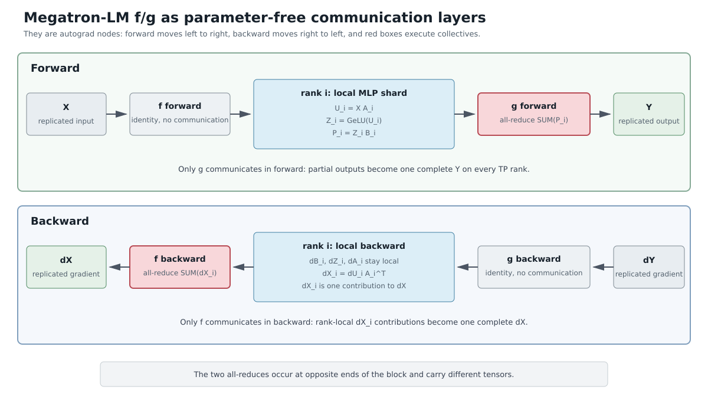
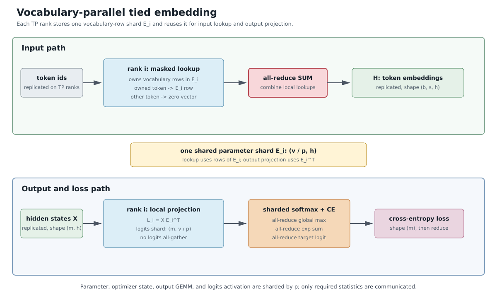

# Megatron-LM：用模型并行训练十亿级 Transformer 语言模型

> 论文：**Megatron-LM: Training Multi-Billion Parameter Language Models Using Model Parallelism**  
> 作者：Mohammad Shoeybi, Mostofa Patwary, Raul Puri, Patrick LeGresley, Jared Casper, Bryan Catanzaro  
> 团队：NVIDIA  
> arXiv：`1909.08053v4`，2020-03-13 版本  
> 原文：[arXiv:1909.08053](https://arxiv.org/abs/1909.08053)  
> 本文目标：像教材一样系统解释这篇论文，包括大模型训练背景、Transformer 并行切分原理、Megatron-LM 的张量并行设计、实验结果、替代方案、优缺点和工程启示。

---

## 0. 一句话概括

[Megatron-LM](#术语-megatron-lm) 是 NVIDIA 提出的一个用于训练十亿级 Transformer 语言模型的 PyTorch 框架。它的核心思想是：**不要把 Transformer 只当作一串层来切，而要利用 Transformer 内部矩阵乘法和多头注意力的结构，把一个层内部的张量计算切到多张 GPU 上**。

更具体地说，论文提出了一种简单的[层内模型并行](#术语-intra-layer-model-parallelism)方案：

1. 在 MLP 中把第一个线性层做列切分，把第二个线性层做行切分。
2. 在 Self-Attention 中按注意力头切分 Q、K、V 和后续输出投影。
3. 在每个 Transformer 层中只引入少量 `all-reduce` 通信。
4. 不依赖新编译器，不需要重写深度学习框架，只需在 PyTorch Transformer 实现中插入少量通信原语。

论文最终在最多 512 张 NVIDIA V100 32GB GPU 上训练了 GPT-2 风格的 8.3B 参数模型和 BERT 风格的 3.9B 参数模型，并在 WikiText103、LAMBADA、RACE 等任务上取得当时的 SOTA 结果。

如果只用一个类比：

> 数据并行像“很多学生各自做不同习题，然后一起对答案”；流水线并行像“把一篇文章交给多个编辑，每个编辑负责一段”；Megatron-LM 的张量并行像“把同一道大矩阵乘法题拆成几块，让几个学生同时算不同矩阵块，最后把结果合起来”。

---

## 1. 这篇论文要解决什么问题？

### 1.1 大模型为什么重要？

论文开头基于 2018-2019 年 NLP 的趋势提出问题：无监督预训练语言模型越大，越容易在下游任务上取得更强效果。

当时的代表性模型包括：

1. GPT、GPT-2：使用左到右语言模型目标进行生成式预训练。
2. BERT：使用 Masked Language Modeling 和句子关系任务进行双向表征学习。
3. Transformer-XL、XLNet、RoBERTa、ALBERT 等：进一步改进预训练目标、训练数据和模型结构。

这些模型背后的共同观察是：

> 当有足够数据和算力时，扩大 Transformer 参数规模通常会降低语言建模困惑度，提高下游任务效果。

这也就是后来“Scaling Law”被系统研究的背景。虽然 Megatron-LM 论文并不专门研究 scaling law，但它所解决的工程问题正是 scaling law 的前提：**如果模型变大确实有收益，那么我们首先必须有能力把模型训练起来。**

### 1.2 大模型训练的第一个障碍：HBM 容量

训练神经网络时，HBM 中并不只保存参数。以一个参数量为 $P$ 的模型为例，训练期间通常至少需要保存：

1. 参数：权重本身。
2. 梯度：反向传播得到的 $\nabla W$。
3. 优化器状态：Adam 会维护一阶动量 $m$ 和二阶动量 $v$。
4. 激活值：前向传播中每层的中间结果，反向传播时要用。
5. 临时 buffer：矩阵乘法、softmax、归一化、通信等操作的中间张量。

如果使用 FP32 Adam，单个参数大致可能需要：

- 参数 $W$：4 bytes。
- 梯度 $\nabla W$：4 bytes。
- Adam 一阶动量 $m$：4 bytes。
- Adam 二阶动量 $v$：4 bytes。

仅这些就可能达到每参数 16 bytes；混合精度训练还可能保存 FP16 参数、FP32 master weight 等，实际估算要看实现。

可以粗略写成：

$$ \text{Memory} \approx \text{Parameters} + \text{Gradients} + \text{Optimizer States} + \text{Activations} + \text{Temporary Buffers} $$

因此，10 亿参数模型并不是只需要 4 GB HBM。训练时参数、梯度、优化器状态和激活一起算，HBM 需求可能达到数十 GB 甚至更多。

### 1.3 大模型训练的第二个障碍：计算量

Transformer 的主要计算来自矩阵乘法，尤其是：

1. Self-Attention 中的 Q、K、V 投影。
2. Attention score 的 $QK^T$。
3. Attention output 与 $V$ 的乘法。
4. MLP 中两个大线性层。
5. 输出词表投影。

设 batch size 为 $b$，序列长度为 $s$，隐藏维度为 $h$，MLP 中间维度通常约为 $4h$。一个 Transformer 层的大致计算量随 $b$、$s$、$h$、层数 $L$ 快速增长。

如果只靠单张 GPU 训练十亿级甚至百亿级模型，时间会非常长。论文强调，训练大模型不只是“放得下”的问题，也是“训得动”的问题。

### 1.4 大模型训练的第三个障碍：通信

一旦使用多 GPU，通信就成为核心瓶颈。并行训练不是简单地“多加几张卡就更快”。不同并行方式对应不同通信模式：

1. 数据并行：每张 GPU 有完整模型，处理不同数据，反向传播后对梯度做 `all-reduce`。
2. 流水线并行：不同 GPU 放不同层，前向和反向期间在相邻阶段传递激活和梯度。
3. 张量并行：同一层的矩阵乘法被切到多个 GPU 上，需要在层内部使用 `all-reduce`、`all-gather` 等 collective。

通信量、通信频率、通信拓扑都会影响最终效率。Megatron-LM 的关键贡献，就是在 Transformer 结构里选择通信较少、计算较饱满的切分方式。

---

## 2. 论文背景：并行训练有哪些基本路线？

### 2.1 数据并行：最常用，但不能解决单卡放不下

[数据并行](#术语-data-parallelism)是最直观的并行方式：每张 GPU 都持有一份完整模型副本，不同 GPU 处理不同样本，最后同步梯度。

示意图：

```text
GPU 0: 完整模型 + batch shard 0 -> grad 0
GPU 1: 完整模型 + batch shard 1 -> grad 1
GPU 2: 完整模型 + batch shard 2 -> grad 2
GPU 3: 完整模型 + batch shard 3 -> grad 3
                         |
                         v
                    all-reduce 梯度
                         |
                         v
              每张 GPU 得到相同更新后参数
```

这里容易产生一个误解：既然每张 GPU 都有完整模型，能不能前向传播后先把各卡的 loss 加起来，然后每张 GPU 独立反向传播、独立更新自己的模型？

答案是：标准数据并行不是这样做的。原因是 loss 是一个标量，梯度才是优化器真正需要的量。设第 $i$ 张 GPU 处理自己的 batch shard，得到局部 loss $L_i$。全局训练目标通常是所有局部 loss 的平均：

$$ L = \frac{1}{N}\sum_i L_i $$

根据求导的线性性，全局梯度是各局部梯度的平均：

$$ \nabla_\theta L = \frac{1}{N}\sum_i \nabla_\theta L_i $$

所以数据并行的正确同步对象是梯度：每张 GPU 先根据自己的 $L_i$ 反向传播得到局部梯度 $g_i = \nabla_\theta L_i$，然后通过 `all-reduce` 对所有 $g_i$ 求和或求平均，使每张 GPU 都拿到相同的全局梯度 $g$，最后每张 GPU 用同一个 $g$ 更新自己的模型。因为更新前参数相同、更新梯度相同、优化器状态也同步演化，所以更新后每张卡上的模型仍然相同。

如果只是把前向得到的 loss 标量做加和，而每张 GPU 仍然只用自己的局部 loss 反向传播，那么第 $i$ 张卡得到的仍然是 $g_i$，不是全局梯度 $g$。不同 batch shard 通常产生不同梯度，各卡独立更新后参数会逐步分叉。只有在所有卡的局部梯度刚好相同，或者额外再同步参数和优化器状态时，模型才可能重新一致；但这已经不是普通数据并行的高效做法。

那么梯度更新时，各卡之间到底要同步多少数据？逻辑上，同步对象是一份“完整模型的梯度”。如果模型有 $P$ 个参数，每个梯度元素占 $q$ bytes，那么一份完整梯度的大小约为：

$$ G = Pq $$

这不是同步一个标量 loss，而是同步和模型参数同形状的一整套梯度张量。比如 10 亿参数模型，如果用 fp16 或 bf16 梯度通信，$q = 2$ bytes，则一份梯度约为 2GB；如果用 fp32 梯度通信，$q = 4$ bytes，则一份梯度约为 4GB。

实际 `all-reduce` 不一定让每张卡把整份梯度直接发给所有其他卡。常见的 `ring all-reduce` 会把梯度切成多个块，经过 reduce-scatter 和 all-gather 两个阶段完成同步。设数据并行组里有 $N$ 张 GPU，按常见通信成本口径，每张 GPU 需要传输的数据量约为：

$$ \text{Traffic per GPU} \approx 2\frac{N-1}{N}G $$

当 $N$ 很大时，这个量接近 $2G$。所以数据并行的梯度同步通信量主要由模型梯度大小决定，而不是由局部 batch size 直接决定。batch size 会影响计算量和梯度数值，但只要模型参数量不变，每一步需要 `all-reduce` 的梯度张量规模基本不变。

数据并行的优点：

1. 实现简单，PyTorch DDP 等框架支持成熟。
2. 每张卡上计算相同，负载均衡容易。
3. 对模型代码侵入小。
4. 通信主要集中在反向传播梯度同步阶段。

数据并行的局限：

1. 每张 GPU 必须放得下完整模型、梯度、优化器状态和激活。
2. 扩大 GPU 数量通常意味着增大全局 batch size，可能影响优化和泛化。
3. 当单卡 batch size 很小时，GPU 利用率会下降。
4. 它解决的是“训练吞吐”问题，不解决“单个模型太大放不下”问题。

因此，如果模型本身已经超过单卡 HBM 容量，单纯数据并行无能为力。

### 2.2 激活重计算：用计算换 HBM

[激活重计算](#术语-activation-checkpointing)也叫 activation checkpointing 或 gradient checkpointing。它的思想是：前向传播时不保存所有中间激活，只保存少量检查点；反向传播需要某些激活时再重新前向计算一遍。

示意图：

```text
普通训练：
Layer1 -> save a1 -> Layer2 -> save a2 -> Layer3 -> save a3 -> backward

激活重计算：
Layer1 -> save checkpoint -> Layer2 -> discard -> Layer3 -> save checkpoint
backward 时重新计算中间激活
```

这张图想表达的是：训练神经网络时，反向传播并不是只需要参数 $W$ 和最终 loss，它还需要前向传播产生的中间激活值。比如一个三层网络可以简化写成：

```text
x0 --Layer1--> x1 --Layer2--> x2 --Layer3--> x3 --loss--> L
```

反向传播计算梯度时会从 $L$ 往回走：

```text
dL/dx3 -> dL/dx2 -> dL/dx1 -> dL/dx0
```

但是计算 `Layer3` 的梯度时通常需要它前向时的输入 $x2$，计算 `Layer2` 的梯度时通常需要它前向时的输入 $x1$，计算 `Layer1` 的梯度时通常需要它前向时的输入 $x0$。所以普通训练会在前向阶段把很多中间激活都存下来。

普通训练可以理解为：

```text
前向：
x0 -> Layer1 -> x1  保存 x1
x1 -> Layer2 -> x2  保存 x2
x2 -> Layer3 -> x3  保存 x3

反向：
读取 x2，计算 Layer3 的梯度
读取 x1，计算 Layer2 的梯度
读取 x0，计算 Layer1 的梯度
```

这种方式的好处是反向传播很快，因为需要的中间结果都已经在 HBM 中。缺点是 HBM 占用很高。对于 Transformer 来说，每一层都会产生很多激活，例如 attention 的 Q/K/V、attention score、softmax 结果、MLP 中间层输出、LayerNorm 输入输出、dropout mask 等。当层数、batch size、序列长度、hidden size 增大时，激活所占 HBM 会非常可观。

激活重计算的做法是：前向传播时不保存所有中间激活，只保存少数“检查点”。反向传播走到某个区间时，再从最近的检查点重新做一小段前向，把当初丢掉的中间激活临时算回来，然后立刻用于反向传播。

更细一点，可以把三层网络分成两个 checkpoint 区间：

```text
前向阶段：
x0 -> Layer1 -> x1     保存 checkpoint x1
x1 -> Layer2 -> x2     不保存 x2，前向用完就释放
x2 -> Layer3 -> x3     保存 checkpoint x3

反向阶段：
已有 checkpoint x1 和 x3
为了反传 Layer3，需要 x2
于是从 x1 重新执行 Layer2，临时得到 x2
用 x2 反传 Layer3
再继续反传 Layer2 和 Layer1
```

所以 `discard` 不是说前向结果完全不要了，而是说“这个中间激活不长期留在 HBM 中”。它在前向阶段用完就释放；等反向阶段真的需要它时，再用保存的 checkpoint 重新计算出来。

可以把它类比成做数学题：

```text
普通训练：
每一步草稿都拍照保存，回头检查时直接看照片。

激活重计算：
只保存关键中间结论，细节草稿先擦掉；
回头需要检查某一步时，从最近的关键结论重新推一遍。
```

HBM 占用为什么会下降？因为普通训练要保存几乎每一层的中间激活，而激活重计算只保存 checkpoint。假设一个网络有 $L$ 层，每层激活大小近似为 $A$，普通训练的激活 HBM 占用大致随 $L \times A$ 增长；如果每隔 $k$ 层保存一个 checkpoint，那么长期保存的激活数量会少很多，HBM 压力显著降低。

代价是什么？代价是反向传播期间要重复执行一部分前向计算。也就是说，它用更多计算时间换取更少的 HBM 占用。这个取舍在大模型训练中非常划算，因为很多时候训练卡住不是因为算力不够，而是因为 HBM 无法容纳更大的 batch、更长的 sequence 或更多层。

在 Transformer 里，常见做法不是对每个小算子都单独 checkpoint，而是按 Transformer layer 或按 attention/MLP block 做 checkpoint。例如 Megatron-LM 论文中提到，它在每个 Transformer 层之后使用 activation checkpointing。直观理解就是：

```text
输入 embedding
  |
  v
Transformer Layer 1 -> 保存 checkpoint
Transformer Layer 2 -> 保存 checkpoint
Transformer Layer 3 -> 保存 checkpoint
...
Transformer Layer N -> 保存 checkpoint
```

每层内部的许多细小中间激活可以不长期保存；反向传播到某一层时，从该层输入 checkpoint 重新跑这一层前向，恢复该层内部需要的 Q/K/V、MLP 中间值等，再计算梯度。

优点：

1. 对模型结构改动较小。
2. 可以显著降低激活的 HBM 占用。
3. 常与数据并行、模型并行组合使用。

缺点：

1. 增加额外计算，训练时间变长。
2. 不减少参数、梯度和优化器状态的 HBM 占用。
3. 如果模型参数本身已经超过单卡 HBM 容量，它仍然不够。

Megatron-LM 论文也使用了 activation checkpointing，每个 Transformer 层后做 checkpoint，以进一步控制 HBM 占用。

### 2.3 流水线并行：按层切分模型

[流水线并行](#术语-pipeline-parallelism)把模型按层切成多个连续阶段，不同阶段放在不同 GPU 上。例如 24 层 Transformer 可以切成 4 段，每张 GPU 负责 6 层。

```text
输入 -> GPU0: Layer 1-6 -> GPU1: Layer 7-12 -> GPU2: Layer 13-18 -> GPU3: Layer 19-24 -> 输出
```

如果每次只处理一个 batch，则 GPU0 算完后 GPU1 才能开始，GPU 利用率很低。GPipe 的做法是把一个 batch 切成多个 micro-batch，让它们像流水线一样流动。

```text
时间 1: GPU0 处理 micro-batch 1
时间 2: GPU0 处理 micro-batch 2, GPU1 处理 micro-batch 1
时间 3: GPU0 处理 micro-batch 3, GPU1 处理 micro-batch 2, GPU2 处理 micro-batch 1
```

优点：

1. 可以让单张 GPU 只保存部分层，降低单卡参数的 HBM 占用。
2. 非常适合层数很深、结构顺序明显的网络。
3. 可以与数据并行、张量并行组合。

缺点：

1. 有 pipeline bubble，首尾阶段会有空闲。
2. 不同层计算量可能不同，负载均衡不一定容易。
3. stage 之间要传激活和梯度，通信与 micro-batch 数有关。
4. 对训练调度有额外复杂性。

Megatron-LM 论文明确说它的方法与 GPipe 这类流水线并行是正交且互补的。也就是说，Megatron-LM 的 2019 论文重点是“层内张量并行”，而后续 Megatron-LM 系统进一步把张量并行、流水线并行和数据并行组合起来。

### 2.4 张量并行：按矩阵切分层内计算

[张量并行](#术语-tensor-parallelism)不是按层切，而是把某一层里的大张量运算切到多张 GPU 上。例如一个线性层：

线性层可以写作：$Y = XA$。

其中 $X$ 是输入，$A$ 是权重矩阵，$Y$ 是输出。可以按 $A$ 的列切，也可以按 $A$ 的行切。

列切分：

列切分可以写作：$A = [A_1, A_2]$，于是 $Y = [XA_1, XA_2]$。

行切分：

行切分可以理解为：$X$ 被切成 $[X_1, X_2]$，$A$ 被按行切成 $A_1$ 和 $A_2$，于是 $Y = X_1A_1 + X_2A_2$。

注意：行切分里的“按行切成 $A_1$ 和 $A_2$”可以理解为把权重矩阵上下切开；列切分里的“$A = [A_1, A_2]$”可以理解为把权重矩阵左右切开。

你觉得它像 GEMM 的 tile，这个直觉是对的：二者在数学上都利用了矩阵乘法可以分块计算这一事实。只不过它们处在不同层级。

先看普通 GEMM。设 $X$ 的形状是 $m \times k$，$A$ 的形状是 $k \times n$，输出 $Y$ 的形状是 $m \times n$。矩阵乘法本质上是：

```text
Y[i, j] = sum over t: X[i, t] * A[t, j]
```

GEMM tile 会把 $Y$ 的二维输出平面切成很多小块，例如一个 GPU kernel 里的一个 thread block 负责 $Y$ 的一个 tile：

```text
输出矩阵 Y 的 tile：

          n 方向
     +----+----+----+
     | T0 | T1 | T2 |
m    +----+----+----+
方向 | T3 | T4 | T5 |
     +----+----+----+
```

每个 tile 仍然需要沿 $k$ 维度累加。高性能 GEMM 内核会把 $X$ 和 $A$ 的小块搬到 shared memory 或寄存器里，分阶段累加，最后把 tile 写回 HBM。这个过程发生在**单个 GPU 内部**，关注点是提高缓存复用、减少 global memory 访问、提高 tensor core/SM 利用率。

Megatron-LM 这里的列切分/行切分则是更高一层的切分：它不是把一个 GEMM kernel 的计算 tile 分给同一张 GPU 内的不同 thread block，而是把一个大线性层的权重矩阵切成几大块，分别放到不同 GPU 上。

可以这样对比：

| 维度 | GEMM tile | Megatron 张量并行切分 |
|---|---|---|
| 切分层级 | GPU kernel 内部 | 模型层/权重矩阵级别 |
| 执行单元 | thread block、warp、tensor core | 多张 GPU |
| 主要目标 | 提高单卡矩阵乘性能 | 让单层大矩阵跨卡存储和计算 |
| 数据位置 | 同一 GPU 的 HBM、shared memory、寄存器 | 不同 GPU 的 HBM |
| 合并方式 | kernel 内部累加后写回 | 可能需要跨 GPU `all-reduce` 或 `all-gather` |
| 主要瓶颈 | HBM 带宽、shared memory、计算单元利用率 | GPU 间通信带宽和延迟 |

所以二者确实都叫“分块”，但一个是**单卡算子实现层面的 tile**，一个是**分布式训练系统层面的 tensor parallel partition**。

列切分时，权重矩阵按输出维度切开：

```text
A = [A1 | A2]

X @ A = [X @ A1 | X @ A2]

GPU0 保存 A1，计算 Y1 = X @ A1
GPU1 保存 A2，计算 Y2 = X @ A2
最后输出 Y = [Y1 | Y2]
```

这个过程很像把输出矩阵 $Y$ 的列方向切成几个大 tile。每张 GPU 负责一段输出列，所以每张 GPU 得到的是输出的一个分片。关键点是：列切分后通常不需要立刻把 $Y1$ 和 $Y2$ 相加，因为它们本来就是不同列，拼起来才是完整输出。

行切分时，权重矩阵按输入维度切开：

```text
X = [X1 | X2]

    [A1]
A = [A2]

X @ A = X1 @ A1 + X2 @ A2

GPU0 保存 A1，计算 partial0 = X1 @ A1
GPU1 保存 A2，计算 partial1 = X2 @ A2
最后输出 Y = partial0 + partial1
```

这个过程更像 GEMM 中沿 reduction 维度 $k$ 切分。因为矩阵乘法的 $k$ 维度需要求和，所以每张 GPU 算出来的是同一个输出 $Y$ 的“部分和”。部分和必须加起来，才能得到最终结果。这就是为什么行切分通常需要 `all-reduce`。

从 GEMM 角度看，可以这样理解：

```text
列切分：切 n 维度，也就是输出列维度
结果：每个 GPU 产生不同输出列，通常是 concat/gather 关系

行切分：切 k 维度，也就是乘法累加维度
结果：每个 GPU 产生同一输出的部分和，必须 reduce-sum
```

这也是 Megatron-LM 设计 MLP 切分时非常关键的点。第一个线性层后面接 GeLU，GeLU 是逐元素非线性。如果第一个线性层采用列切分，每张 GPU 得到的是不同输出列，GeLU 可以各自在本地做，不需要通信；如果第一个线性层采用行切分，每张 GPU 得到的是部分和，必须先跨 GPU 求和后才能做 GeLU，否则数学上就错了。

因此，Megatron-LM 的切分不是随便把 GEMM 切成块，而是考虑了两件事：

1. 线性代数上这个维度切开后，结果是“拼接”还是“求和”。
2. 模型结构上切分点后面有没有 GeLU、softmax、LayerNorm、residual 这类会改变通信位置的算子。

这就是它和普通 GEMM tile 最重要的区别：GEMM tile 只需要保证一个矩阵乘法算得快；Megatron-LM 的张量并行切分还要保证整个 Transformer layer 的前向/反向语义正确，并且尽量少通信。

张量并行的优点：

1. 能把单个大矩阵乘法切到多 GPU 上。
2. 对 Transformer 这类 GEMM 密集模型很有效。
3. 可以降低每张卡的参数、梯度和优化器状态压力。
4. 层内并行可与数据并行、流水线并行组合。

缺点：

1. 每层内部会产生通信。
2. 需要理解模型结构，选择合适切分方式。
3. 如果切分不当，会频繁 `all-reduce` 或 `all-gather`，通信压过计算。
4. GPU 间互联带宽非常关键，适合 NVLink/NVSwitch 等高速互联环境。

Megatron-LM 正是一个面向 Transformer 的高效张量并行方案。

---

## 3. Megatron-LM 的核心洞察

### 3.1 Transformer 层的结构给了我们切分机会

一个标准 Transformer 层大致由两块组成：

1. Multi-Head Self-Attention。
2. Feed-Forward Network，也就是 MLP。

可以画成：

```text
输入 X
  |
  v
LayerNorm
  |
  v
Multi-Head Self-Attention
  |
  v
Dropout + Residual
  |
  v
LayerNorm
  |
  v
MLP: Linear -> GeLU -> Linear
  |
  v
Dropout + Residual
  |
  v
输出
```

Transformer 的计算高度集中在几个矩阵乘法上，而矩阵乘法天然可以分块。这正是 Megatron-LM 选择层内模型并行的基础。

### 3.2 不是所有矩阵切分都等价

以 MLP 的第一层为例：

MLP 的第一层可以写作：$Y = \text{GeLU}(XA)$。

假设我们把 $A$ 按行切分，同时把 $X$ 按列切分，则：

此时有 $XA = X_1A_1 + X_2A_2$。

于是：

于是 $Y = \text{GeLU}(X_1A_1 + X_2A_2)$。

这里的问题是 GeLU 是非线性函数。一般来说：

一般来说，$\text{GeLU}(u + v) \ne \text{GeLU}(u) + \text{GeLU}(v)$。

因此，如果先在各 GPU 上分别计算 $X_1A_1$ 和 $X_2A_2$，必须先把它们加起来，再做 GeLU。这意味着 GeLU 前就要通信。

换一种切法：把 $A$ 按列切分：

也就是 $A = [A_1, A_2]$。

则：

于是 $[Y_1, Y_2] = [\text{GeLU}(XA_1), \text{GeLU}(XA_2)]$。

此时每张 GPU 可以独立完成自己的线性层和 GeLU，不需要在 GeLU 前通信。

这就是 Megatron-LM 最重要的设计思想之一：

> 切分方式必须顺着非线性、残差、归一化、attention head 的结构走，尽量把通信放到不可避免的位置，而不是在每个算子之间通信。

### 3.3 Megatron-LM 在 MLP 中怎么切？

Transformer MLP 通常是：

Transformer MLP 通常是 $\text{MLP}(X) = \text{GeLU}(XA)B$。

其中 $A$ 把隐藏维度从 $h$ 扩到 $4h$，$B$ 再从 $4h$ 投影回 $h$。

Megatron-LM 的切分方式：

1. 第一个矩阵 $A$ 按列切分。
2. GeLU 在每张 GPU 本地独立执行。
3. 第二个矩阵 $B$ 按行切分。
4. 第二个 GEMM 的输出需要跨 GPU 求和，因此在输出处做一次 `all-reduce`。

示意图：

```text
输入 X 在每个张量并行 GPU 上全量驻留
          |
          v
     A 按列切分
   +-------------+
   | GPU0: XA_0  | -> GeLU -> 与 B_0 相乘 -> partial output 0
   | GPU1: XA_1  | -> GeLU -> 与 B_1 相乘 -> partial output 1
   | GPU2: XA_2  | -> GeLU -> 与 B_2 相乘 -> partial output 2
   | GPU3: XA_3  | -> GeLU -> 与 B_3 相乘 -> partial output 3
   +-------------+
          |
          v
       all-reduce 求和
          |
          v
       MLP 输出
```

用更抽象的公式表示，若张量并行度为 $p$：

若张量并行度为 $p$，则 $A = [A_1, A_2, \ldots, A_p]$。

每个 GPU 计算：

每个 GPU 计算 $Z_i = \text{GeLU}(XA_i)$。

第二个权重按行切成 $B_i$，最终输出：

最终输出为 $Y = \sum_{i=1}^{p} Z_iB_i$。

这个求和就是 `all-reduce`。

### 3.4 为什么第二次矩阵乘法不继续使用列切分？

核心原因是：**第一次矩阵乘法按列切分以后，每张 GPU 只拥有 MLP 中间维度的一部分；第二次矩阵乘法的输入正好就是这个中间维度，所以第二个权重矩阵最自然、通信最少的切法是按行切分。**

先把 MLP 写成两个线性层：

```text
X: b*s x h
A: h x 4h
B: 4h x h

Z = GeLU(XA)
Y = ZB
```

其中 $A$ 是第一个投影矩阵，把 hidden size 从 $h$ 扩到 $4h$；$B$ 是第二个投影矩阵，把 hidden size 从 $4h$ 压回 $h$。

第一层按列切分：

```text
A = [A1 | A2 | A3 | A4]

X @ A = [X @ A1 | X @ A2 | X @ A3 | X @ A4]
```

于是每张 GPU 拿到的是 $Z$ 的一段列分片：

```text
GPU0: Z1 = GeLU(XA1)
GPU1: Z2 = GeLU(XA2)
GPU2: Z3 = GeLU(XA3)
GPU3: Z4 = GeLU(XA4)

完整 Z = [Z1 | Z2 | Z3 | Z4]
```

现在看第二层 $Y = ZB$。因为 $Z$ 已经按列切成 $[Z_1, Z_2, Z_3, Z_4]$，所以为了让每张 GPU 只用自己本地的 $Z_i$ 就能继续计算，$B$ 应该沿着对应的输入维度按行切开：

```text
    [B1]
B = [B2]
    [B3]
    [B4]

Y = [Z1 | Z2 | Z3 | Z4] @ B
  = Z1B1 + Z2B2 + Z3B3 + Z4B4
```

这样每张 GPU 可以本地计算一个 partial output：

```text
GPU0: P1 = Z1B1
GPU1: P2 = Z2B2
GPU2: P3 = Z3B3
GPU3: P4 = Z4B4

Y = P1 + P2 + P3 + P4
```

最后只需要一次 `all-reduce` 把这些 partial output 加起来。这个 `all-reduce` 发生在第二层输出处，也就是 MLP block 的末尾。

如果第二次矩阵乘法也使用列切分，会发生什么？设第二个矩阵也按列切：

```text
B = [B1 | B2 | B3 | B4]

Y = ZB = [ZB1 | ZB2 | ZB3 | ZB4]
```

表面看这和第一层很像：每张 GPU 负责一段输出列。但问题是，每个 $ZB_i$ 都需要完整的 $Z$，因为 $B_i$ 的形状是 $4h \times h/p$，它的输入维度覆盖整个 $4h$。而现在每张 GPU 只有自己的 $Z_i$，没有完整 $Z$。

因此，如果第二层继续列切，就必须先做一次 `all-gather`：

```text
GPU0: Z1
GPU1: Z2
GPU2: Z3
GPU3: Z4

先 all-gather：
每张 GPU 都得到完整 Z = [Z1 | Z2 | Z3 | Z4]

再列切 B：
GPU0: Y1 = ZB1
GPU1: Y2 = ZB2
GPU2: Y3 = ZB3
GPU3: Y4 = ZB4
```

这会带来两个坏处。

第一，通信提前发生在中间激活 $Z$ 上。$Z$ 的维度是 $4h$，通常比 MLP 输出 $Y$ 的维度 $h$ 大 4 倍。把 $Z$ `all-gather` 成完整张量，通信量和 HBM 压力都更大。

第二，后续 Transformer 结构通常需要完整 hidden size 的 MLP 输出与 residual 相加。如果第二层列切后输出仍然是按 hidden 维度切开的 $[Y_1, Y_2, Y_3, Y_4]$，那么后面还可能需要额外 `all-gather` 或改变后续算子的切分方式。这样通信点会变多，设计也更复杂。

所以 Megatron-LM 的 MLP 切分是一个很巧妙的配对：

```text
第一层：列切分
目的：让 GeLU 在本地分片上执行，不需要通信。

第二层：行切分
目的：直接消费第一层产生的本地分片，只在 MLP 末尾做一次 all-reduce。
```

用一句话记忆：

```text
第一层列切产生 Z 的列分片；
第二层行切正好消费 Z 的列分片；
最后只需要把 partial output 求和。
```

如果两层都列切，就等于第一层产生了“分片中间激活”，第二层却要求“完整中间激活”，中间必须 `all-gather`。Megatron-LM 避免了这次昂贵通信，把通信推迟到第二层输出处，用一次 `all-reduce` 完成语义合并。

### 3.5 Megatron-LM 在 Self-Attention 中怎么切？

Multi-Head Attention 天然包含多个 attention head。设总共有 $n_h$ 个 head，每个 head 的维度为 $d_h$，隐藏维度 $h = n_h d_h$。

每个 head 可以相对独立地计算：

每个 head 可以相对独立地计算 $\text{head}_i = \text{Attention}(Q_i, K_i, V_i)$。

最后把所有 head 拼接，再做输出线性投影：

多头注意力可以写作 $\text{MHA}(X) = \text{Concat}(\text{head}_1, \ldots, \text{head}_{n_h})W_o$。

这里的 $W_o$ 是 output projection matrix，即多头注意力的输出投影矩阵。每个 attention head 会产生一段局部表示，把所有 head 沿 hidden 维度拼接以后，得到的仍然只是“多个 head 的并排结果”。$W_o$ 的作用是把这些并排的 head 表示重新线性混合，投影回 Transformer block 需要的 hidden 表示空间。

如果设 batch 和 sequence 合并后的 token 数为 $m$，则拼接后的 head 输出形状可以理解为 $m \times h$，其中 $h = n_hd_h$。此时 $W_o$ 的形状通常是 $h \times h$：

```text
H = Concat(head_1, ..., head_nh)   # shape: m x h
O = H @ W_o                        # shape: m x h
```

所以 $W_o$ 不是某个单独 head 的参数，而是所有 head 拼接以后共同使用的输出线性层。它负责让不同 head 的信息发生跨 head 混合；否则多个 head 只是被简单并排放在一起，后续层需要自己慢慢混合这些信息。

在 Megatron-LM 的张量并行里，每张 GPU 只负责一部分 head，因此每张 GPU 只拥有 $H$ 的一部分列分片。这和 MLP 中第一层列切后得到 $Z_i$ 的情况很像。为了直接消费本地 head 分片，$W_o$ 也按输入维度做行切分：每张 GPU 用自己的 head 输出分片乘以对应的 $W_{o,i}$，得到 attention 输出的 partial sum，最后再通过 `all-reduce` 求和。

Megatron-LM 的切分方式：

1. Q、K、V 的线性投影按列切分。
2. 每张 GPU 负责一部分 attention heads。
3. 每张 GPU 本地完成这些 heads 的 attention 计算。
4. 输出投影 $W_o$ 按行切分。
5. 输出投影后做 `all-reduce` 得到完整 attention 输出。

这几个操作可以按“先生成 head，再把 head 分给不同 GPU”来理解。

在普通多头注意力中，输入 $X$ 会分别乘以三个投影矩阵：

```text
Q = XW_q
K = XW_k
V = XW_v
```

其中 $W_q$、$W_k$、$W_v$ 的输出维度都可以看成由多个 head 拼出来。若隐藏维度 $h = n_hd_h$，则 $Q$ 可以被理解为：

```text
Q = [Q_head1 | Q_head2 | ... | Q_head_nh]
K = [K_head1 | K_head2 | ... | K_head_nh]
V = [V_head1 | V_head2 | ... | V_head_nh]
```

所以 “Q、K、V 的线性投影按列切分” 的意思是：不是让每张 GPU 都计算完整的 $Q$、$K$、$V$，而是把 $W_q$、$W_k$、$W_v$ 的输出列按 head 分组切开。每张 GPU 只保存和计算一部分 head 对应的投影权重。

例如有 8 个 head、4 张 GPU，则可以这样分：

```text
GPU0: head 0, head 1 对应的 W_q/W_k/W_v 列
GPU1: head 2, head 3 对应的 W_q/W_k/W_v 列
GPU2: head 4, head 5 对应的 W_q/W_k/W_v 列
GPU3: head 6, head 7 对应的 W_q/W_k/W_v 列
```

于是每张 GPU 只产生自己负责 head 的 $Q_i$、$K_i$、$V_i$：

```text
GPU0: Q_0, Q_1, K_0, K_1, V_0, V_1
GPU1: Q_2, Q_3, K_2, K_3, V_2, V_3
GPU2: Q_4, Q_5, K_4, K_5, V_4, V_5
GPU3: Q_6, Q_7, K_6, K_7, V_6, V_7
```

第二步“每张 GPU 负责一部分 attention heads”其实就是第一步列切分的自然结果。因为一个 head 的 $Q_i$、$K_i$、$V_i$ 都在同一张 GPU 上，所以这个 head 后续的 attention score、softmax 和 value 加权求和都可以在本地完成。

对单个 head 来说，attention 计算大致是：

```text
score_i = Q_i K_i^T / sqrt(d_h)
prob_i = softmax(score_i)
head_i = prob_i V_i
```

这些计算只依赖同一个 head 内部的 $Q_i$、$K_i$、$V_i$。它不需要别的 head 的 $Q$、$K$、$V$，也不需要完整的所有 head 拼接结果。因此第三步“每张 GPU 本地完成这些 heads 的 attention 计算”是成立的。

这也是 Megatron-LM 按 head 切 attention 的关键好处：softmax 发生在每个 head 内部，而不是跨 head 发生。如果每张 GPU 拥有完整 head，那么 attention score 和 softmax 都不需要跨 GPU 通信。

可以用一句话总结：

```text
Q/K/V 列切分把不同 head 分到不同 GPU；
head 内 attention 只依赖本 head 的 Q/K/V；
所以 attention score、softmax、prob @ V 都可以本地完成。
```

真正需要通信的是后面的输出投影 $W_o$。因为不同 GPU 得到的是不同 head 的输出分片，经过 $W_o$ 行切分以后，每张 GPU 得到的是最终 attention 输出的 partial sum，必须通过一次 `all-reduce` 合并。

示意图：

```text
输入 X
  |
  v
Q/K/V 投影按 head 切分
  |
  +--> GPU0: heads 0..k       -> local attention -> local output projection
  +--> GPU1: heads k..2k      -> local attention -> local output projection
  +--> GPU2: heads 2k..3k     -> local attention -> local output projection
  +--> GPU3: heads 3k..4k     -> local attention -> local output projection
  |
  v
all-reduce
  |
  v
Self-Attention 输出
```

这里的优势非常清楚：attention head 本来就可以分组计算，只要每张 GPU 拥有自己负责 head 的 Q、K、V，就不需要在 attention score 或 softmax 中间频繁通信。

### 3.6 一个 Transformer 层需要多少通信？

论文强调：通过这种切分，一个 Transformer 层中所有 GEMM 可以通过很少的通信完成。

粗略地说：

1. Self-Attention 块：forward 在输出投影后归约 partial outputs；backward 在 Q/K/V 投影的共享输入处归约各 rank 的输入梯度贡献。
2. MLP 块：forward 在第二个线性层后归约 partial outputs；backward 在第一个线性层的共享输入处归约各 rank 的输入梯度贡献。

论文 Figure 4 总结为：一个模型并行 Transformer 层在前向和反向总共有 4 个通信操作。

这正是它高效的原因：

> 通信没有出现在每个小算子之间，而是被延迟和合并到较大的 GEMM 之后；GPU 大部分时间仍然在做大矩阵乘法，保持 compute-bound。

---

## 4. f 和 g：Megatron-LM 的通信原语

### 4.1 核心：两个无参数通信层

把 $f$ 和 $g$ 看成插入模型的**无参数通信层**：

| 层 | Forward | Backward | 放置位置 |
|---|---|---|---|
| $f$ | identity | `all-reduce(SUM)` | Column-parallel 层之前 |
| $g$ | `all-reduce(SUM)` | identity | Row-parallel 层之后 |

它们不改变模型要计算的数学函数，也没有 parameter；作用是在 autograd graph 中标记通信边界。模型作者只写 forward，反向传播经过这些节点时，PyTorch 自动调用对应的 backward。

单看某个 rank，$f$ 的 forward 只是返回原 tensor；从整个 TP group 看，它表示“让同一个 replicated 输入进入多个并行分支”。这一 replicated 布局的反向自然是把各分支梯度求和，所以 $f$ 的 identity 并非多余。

### 4.2 用一个两卡 MLP 走通前向和反向

本节继续使用前文的框架张量布局：token 位于行维，feature 位于最后一维。设 $X\in\mathbb{R}^{m\times h}$，$A\in\mathbb{R}^{h\times4h}$ 按列切为 $A_1,A_2$，$B\in\mathbb{R}^{4h\times h}$ 按对应的行切为 $B_1,B_2$。

第 $i$ 张 GPU 的模型路径是：

```text
X -> f -> column-parallel A_i -> local GeLU
  -> row-parallel B_i -> g -> Y
```

**Forward：**

1. $f$ 原样返回已经 replicated 的 $X$，不通信。
2. 本地计算 $Z_i=\operatorname{GeLU}(XA_i)$。
3. 本地计算 partial output $P_i=Z_iB_i$。
4. $g$ 执行 `all-reduce(SUM)`，得到 $Y=P_1+P_2$。

**Backward：**

1. $g$ 原样传回完整的 $dY$，不通信。
2. 每张 GPU 本地计算自己的 $dB_i$、$dZ_i$ 和 $dA_i$。
3. Column-parallel 分支得到输入梯度贡献 $dX_i=dU_iA_i^\top$。
4. $f$ 执行 `all-reduce(SUM)`，得到 $dX=dX_1+dX_2$。

因此，一个 MLP block 的 forward 只在 $g$ 通信一次，backward 只在 $f$ 通信一次。这两个 all-reduce 位于 block 的两端，传输的 tensor 也不同。

每张 GPU 的 $A_i$ 和 $B_i$ 是不同 parameter shards，所以 $dA_i$ 和 $dB_i$ 保持本地即可。纯 TP group 不需要把它们还原成完整 parameter gradient；如果外面还叠加了数据并行，则另由 DP group 同步同名 shards。



**图 1：** 上半部分从左向右展示 forward，唯一通信是 $g$ 的输出 all-reduce；下半部分从右向左展示 backward，唯一通信是 $f$ 的输入梯度 all-reduce。

### 4.3 放回 MLP 和 Self-Attention

$f$ 和 $g$ 在两个子块中的位置完全平行：

| 子块 | Column-parallel 部分 | Rank 内局部计算 | Row-parallel 部分 | $g$ 的 forward | $f$ 的 backward |
|---|---|---|---|---|---|
| MLP | 上投影 $A$ | GeLU | 下投影 $B$ | 合并输出 partials | 合并对 MLP 输入的梯度贡献 |
| Self-Attention | Q/K/V 投影 | 各 rank 负责的 heads | 输出投影 $W_o$ | 合并输出 partials | 合并对 attention 输入的梯度贡献 |

Attention 中每个 rank 拥有完整的若干 heads，所以 attention score、softmax 和 `prob @ V` 都能本地完成。它与 MLP 的 GeLU 一样，位于 column-parallel 和 row-parallel 两层之间，不引入额外通信。

因此，前文“反向中对应一次通信”的准确含义是：

> Self-Attention 的 forward 在 $W_o$ 输出后通过 $g$ 归约 partial outputs；backward 在 Q/K/V 投影的共享输入处通过 $f$ 归约各 rank 对 $X$ 的梯度贡献。

这两个 all-reduce 位于 block 的两端，传输的 tensor 也不同，不能理解成“同一个 all-reduce 在 backward 中再执行一次”。

### 4.4 对应到 PyTorch 代码

仓库中的[手写 TP 训练示例](../stanford_cs336/assignments/assignment2-systems/scripts/train_tensor_parallel_manual.py)没有使用 DTensor，而是直接把 $f/g$ 写成两个 `torch.autograd.Function`：

```python
class _CopyToTensorParallelRegion(torch.autograd.Function):
    @staticmethod
    def forward(ctx, inputs):
        return inputs

    @staticmethod
    def backward(ctx, gradient):
        gradient = gradient.contiguous().clone()
        dist.all_reduce(gradient)
        return gradient


class _ReduceFromTensorParallelRegion(torch.autograd.Function):
    @staticmethod
    def forward(ctx, partial_outputs):
        outputs = partial_outputs.contiguous().clone()
        dist.all_reduce(outputs)
        return outputs

    @staticmethod
    def backward(ctx, gradient):
        return gradient
```

`clone()` 和连续内存处理用于避免 collective 原地修改 autograd 输入；核心语义仍然只有：

```text
f：forward identity，backward all-reduce
g：forward all-reduce，backward identity
```

模型代码把 $f$ 放在两个 column-parallel 分支的共同输入之前，把 $g$ 放在 row-parallel 输出之后。这样 PyTorch autograd 逆向遍历计算图时，会自动在正确边界执行反向通信，而不需要手写整个 backward。

### 4.5 重新核算每层的四次通信

每个 Transformer 层有 Self-Attention 和 MLP 两个子块：

| 子块 | Forward | Backward | 合计 |
|---|---:|---:|---:|
| Self-Attention | $g$：输出 all-reduce 1 次 | $f$：输入梯度 all-reduce 1 次 | 2 次 |
| MLP | $g$：输出 all-reduce 1 次 | $f$：输入梯度 all-reduce 1 次 | 2 次 |
| 整个 Transformer 层 | 2 次 | 2 次 | 4 次 |

这里统计的是 collective 调用次数，不代表四次通信的数据量或耗时完全相同。它们通常传输 hidden-state 或 hidden-gradient 大小的 tensor，实际代价还取决于 batch、sequence length、hidden size、TP degree 和互联带宽。

### 4.6 一遍读懂后的检查点

读完本节，只需要确认下面五句话：

1. $f/g$ 可以看作无参数、带自定义 backward 的通信层。
2. Column parallel 产生不同输出 feature，forward 不求和。
3. 多个 column-parallel shards 共享同一输入，所以 backward 的输入梯度必须求和；这是 $f$。
4. Row parallel 产生同一输出的 partial sums，所以 forward 必须求和；这是 $g$。
5. $g$ 的 backward 是 identity；“每个 block 的一次 backward 通信”发生在另一端的 $f$。

Megatron-LM 的工程价值在于把这两个方向不同的通信规则封装进 autograd 边界。模型代码仍然按普通 Transformer 的顺序书写，collective 却会在 forward 和 backward 的正确位置自动执行。

---

## 5. 输入输出 Embedding 怎么处理？

### 5.1 分片一张共享词表矩阵

模型只保存一张 embedding parameter $E\in\mathbb{R}^{v\times h}$，输入 lookup 使用它的行，输出 projection 使用它的转置。TP 沿 vocabulary dimension 把 $E$ 的行切到 $p$ 个 rank：

$$ E=\begin{bmatrix}E_1\\E_2\\\vdots\\E_p\end{bmatrix},\qquad E_i\in\mathbb{R}^{(v/p)\times h}. $$

第 $i$ 个 rank 只保存 $E_i$，并在三个位置复用它：

1. 输入阶段：负责本地 vocabulary range 内 token 的 embedding lookup。
2. 输出阶段：计算本地 logits shard $L_i=XE_i^\top$。
3. 更新阶段：只保存和更新 $E_i$ 对应的 gradient 与 optimizer state。

输入、输出共享同一个 $E_i$，因此不会再保存一份独立的 output projection parameter。

以论文 8.3B GPT-2 的 $v=51{,}200$、$h=3{,}072$ 为例：

| 存储对象 | Shape | 参数量 | FP32 | FP16/BF16 |
|---|---:|---:|---:|---:|
| 完整 $E$ | `(51,200, 3,072)` | 157,286,400 | 600 MiB | 300 MiB |
| 8-way TP 的每 rank $E_i$ | `(6,400, 3,072)` | 19,660,800 | 75 MiB | 37.5 MiB |

这些数字只计算 parameter tensor，不包含 gradient、FP32 master weight 或 AdamW state。

### 5.2 输入 embedding：局部查表后求和

输入 token ids 在 TP ranks 上相同。第 $i$ 个 rank 只处理落在自己 vocabulary range 内的 token：

$$ \widetilde{H}_i[t]=\begin{cases}E_i[\operatorname{local\_id}(t)],&t\text{ 属于第 }i\text{ 个词表分片},\\0,&\text{否则}.\end{cases} $$

由于每个 token 只属于一个词表分片，所有 rank 对局部结果执行 `all-reduce(SUM)` 后即可得到完整 embedding：

$$ H=\sum_{i=1}^{p}\widetilde{H}_i,\qquad H\in\mathbb{R}^{b\times s\times h}. $$

该通信传输的是 hidden tensor $H$，大小与 $bsh$ 成正比，不需要在各 rank 上全量驻留或传输完整的 $v\times h$ embedding 表。Backward 中只有拥有对应 token row 的 rank 更新本地 $E_i$。

### 5.3 输出 projection：保留 logits 分片

把最后一层 hidden states 展平为 $X\in\mathbb{R}^{m\times h}$，其中 $m=bs$。第 $i$ 个 rank 使用同一个 parameter shard $E_i$ 计算：

$$ L_i=XE_i^\top,\qquad L_i\in\mathbb{R}^{m\times(v/p)}. $$

$L_i$ 只包含本地 vocabulary range 的 logits。训练时保持这个布局，不把 $L_1,\ldots,L_p$ all-gather 成完整 $m\times v$ tensor。

例如 $b=8$、$s=1024$、$v=51{,}200$ 时，完整 logits 有 419,430,400 个元素，BF16/FP16 下为 800 MiB；8-way TP 的每 rank logits shard 为 100 MiB。保持分片同时减少输出 GEMM、logits activation 和通信压力。

### 5.4 Sharded softmax 与 parallel cross entropy

对单个 token，设全词表 logits 为 $\lambda_1,\ldots,\lambda_v$，target token id 为 $y$。对应的 softmax 概率为 $p_j=\exp(\lambda_j)/\sum_{k=1}^{v}\exp(\lambda_k)$，cross entropy 定义为 $\ell=-\log p_y$。将 softmax 代入 cross entropy：

$$ \ell=-\log\frac{\exp(\lambda_y)}{\sum_{k=1}^{v}\exp(\lambda_k)}=\log\left(\sum_{k=1}^{v}\exp(\lambda_k)\right)-\lambda_y. $$

为避免指数溢出，令全局最大 logit 为 $a=\max_k\lambda_k$。由于 $\sum_k\exp(\lambda_k)=\exp(a)\sum_k\exp(\lambda_k-a)$，定义 $s=\sum_k\exp(\lambda_k-a)$、$\tau=\lambda_y$ 后：

$$ \ell=\log s+a-\tau. $$

当 vocabulary 被切为 $V_1,\ldots,V_p$ 时，第 $i$ 个 rank 基于本地 logits shard 计算：

1. $a_i=\max_{j\in V_i}\lambda_j$，再通过 `all-reduce(MAX)` 得到 $a=\max_i a_i$。
2. $s_i=\sum_{j\in V_i}\exp(\lambda_j-a)$，再通过 `all-reduce(SUM)` 得到 $s=\sum_i s_i$。
3. 若 $y\in V_i$，令 $\tau_i=\lambda_y$，否则令 $\tau_i=0$；通过 `all-reduce(SUM)` 得到 $\tau=\sum_i\tau_i$。

拿到全局 $a$ 和 $s$ 后，每个 rank 可以在本地恢复自己的 softmax shard：对 $j\in V_i$，有 $p_j=\exp(\lambda_j-a)/s$。Backward 同样保持分片，因为 $\partial\ell/\partial\lambda_j=p_j-\mathbf{1}[j=y]$ 可以在本地计算。

这些 collective 传输的是长度为 $m$ 的 max、sum 和 target-logit vectors，而不是形状为 $m\times v$ 的完整 logits。完整 softmax 和完整 logits 都不需要在任何 rank 上物化。



**图 2：** 同一个 parameter shard $E_i$ 同时用于 masked input lookup 和 local output projection；输入路径只归约 hidden vectors，输出 loss 路径只归约 cross-entropy 所需统计量。

### 5.5 优势与通信代价

| 项目 | 每 rank 保存完整 vocabulary | Vocabulary parallel |
|---|---:|---:|
| Embedding parameter | $vh$ | $vh/p$ |
| Embedding gradient 与 optimizer state | 完整 | 约为 $1/p$ |
| 输出 projection GEMM | $\Theta(mhv)$ | $\Theta(mhv/p)$ |
| Logits activation | $mv$ | $mv/p$ |
| 输入/输出权重共享 | 复用完整 $E$ | 复用本地 $E_i$ |
| Cross entropy | 需要完整 logits | 保持 logits sharded |

直接收益是：

1. Embedding parameter、gradient 和 optimizer state 都按 $1/p$ 分片。
2. 输出 projection 的计算量和 logits activation 也按 $1/p$ 分摊。
3. 输入输出权重共享避免保存第二张同规模矩阵。
4. Parallel cross entropy 避免 all-gather 巨大的 $m\times v$ logits。

对应的通信代价是：

1. 输入 lookup 后需要一次大小为 $bsh$ 的 all-reduce。
2. Cross entropy 需要归约长度为 $m$ 的 max、sum 和 target-logit statistics。

因此，Vocabulary Parallelism 的核心做法是：**让 $E_i$、$L_i$ 和 loss gradient 始终留在本地，只在输入 embedding 和 cross entropy 的必要统计量上通信。**

---

## 6. 随机数、Dropout 和重复计算

### 6.1 为什么随机数也会成为并行问题？

在单卡训练中，dropout 随机 mask 只需要一个随机数生成器。但在模型并行中，不同 GPU 保存的是同一层的不同分片，有些 dropout 应该在各 GPU 上保持一致，有些则应该不同。

论文在附录 B.2 中说明：

1. 对模型并行区域外、残差连接前的 dropout，需要让模型并行 worker 使用相同随机模式。
2. 对模型并行区域内部的 dropout，需要每个 worker 使用不同随机模式，以保证整个操作有足够随机性。

### 6.2 直观理解

如果某个张量在多个 GPU 上全量驻留，那么 dropout mask 也应一致，否则同一个逻辑张量在不同 GPU 上会变成不同值。

如果某个张量在多个 GPU 上是切分的，那么每张 GPU 只负责自己的分片，此时不同分片使用不同随机 mask 是合理的。

示意图：

```text
全量驻留张量：
GPU0: X  -> dropout mask A
GPU1: X  -> dropout mask A
需要相同 mask，否则各 rank 上的张量不再一致

切分张量：
GPU0: X_part0 -> dropout mask A
GPU1: X_part1 -> dropout mask B
可以不同 mask，因为它们本来就是不同分片
```

这说明模型并行不只是矩阵切分，还牵涉训练语义的一致性。

---

## 7. 混合模型并行与数据并行

### 7.1 张量并行只解决单个模型副本的切分

如果用 8 张 GPU 组成一个张量并行组，那么这 8 张 GPU 共同保存一个完整模型副本。为了提升吞吐，还可以部署多个这样的张量并行组，对不同数据做数据并行。

论文附录 B.1 描述了这种组合方式：

1. 一个 model parallel group 内部的 GPU 共同保存一个模型副本。
2. 多个 model parallel group 之间形成 data parallel group。
3. 同一位置的 GPU 之间同步数据并行梯度。

示意图，以 8-way 张量并行和 64-way 数据并行为例：

```text
模型副本 0: GPU 0-7      <- 8 张 GPU 做张量并行
模型副本 1: GPU 8-15     <- 8 张 GPU 做张量并行
模型副本 2: GPU 16-23    <- 8 张 GPU 做张量并行
...
模型副本 63: GPU 504-511 <- 8 张 GPU 做张量并行

数据并行组例子：
GPU 0, GPU 8, GPU 16, ..., GPU 504 同步各自持有的同位置参数梯度
GPU 1, GPU 9, GPU 17, ..., GPU 505 同步各自持有的同位置参数梯度
...
```

总 GPU 数为：

总 GPU 数为 $\text{total GPUs} = \text{tensor parallel size} \times \text{data parallel size}$。

论文中的 8.3B GPT-2 模型使用 8-way 模型并行和 64-way 数据并行，总共 512 张 GPU。

### 7.2 为什么这种组合有效？

张量并行解决“一个模型副本太大，单卡放不下/算不快”的问题。

数据并行解决“一个模型副本吞吐不够，需要处理更多数据”的问题。

两者互补：

```text
单个模型副本内部：张量并行
多个模型副本之间：数据并行
```

这也是现代大模型训练中常说的 3D parallelism 的前身之一。后来的系统通常把它扩展为：

1. Tensor Parallelism：层内切分。
2. Pipeline Parallelism：层间切分。
3. Data Parallelism：模型副本切分数据。

Megatron-LM 2019 论文主要讲第 1 和第 3 种组合，并明确指出未来更大模型需要再加入层间并行。

---

## 8. 训练设置与数据集

### 8.1 训练硬件

论文实验使用最多 32 台 DGX-2H 服务器，总共 512 张 Tesla V100 SXM3 32GB GPU。

硬件互联：

1. 单机内部 GPU 之间通过 NVSwitch，带宽约 300 GB/s。
2. 服务器之间使用 InfiniBand，每台服务器 8 个适配器，互联带宽约 100 GB/s。

这个硬件背景非常重要，因为张量并行高度依赖 GPU 间高速通信。如果 GPU 间互联较弱，Megatron-LM 的层内 `all-reduce` 可能成为瓶颈。

### 8.2 训练数据

论文构造了一个 174GB 的去重文本语料，来源包括：

1. Wikipedia。
2. CC-Stories。
3. RealNews。
4. OpenWebText。
5. 对 BERT 训练还加入 BooksCorpus；对 GPT-2 训练排除 BooksCorpus，因为它与 LAMBADA 任务有重叠。

预处理包括：

1. 移除 WikiText103 测试集中出现的 Wikipedia 文章，避免测试泄漏。
2. 清理 CC-Stories 中由预处理引入的不必要换行。
3. 过滤长度少于 128 tokens 的文档。
4. 使用 locality-sensitive hashing，也就是 LSH，去除 Jaccard 相似度大于 0.7 的重复内容。

### 8.3 GPT-2 风格模型训练设置

GPT-2 风格模型设置：

1. 序列长度：1024 subword tokens。
2. batch size：512。
3. 训练步数：300k iterations。
4. 学习率：$1.5 \times 10^{-4}$。
5. warmup：3k iterations。
6. 后续使用 cosine decay，最终最小学习率 $1 \times 10^{-5}$。
7. dropout：0.1。
8. 优化器：AdamW 风格，weight decay 为 0.01。
9. 梯度裁剪：global gradient norm clip 为 1.0。
10. 使用混合精度训练和动态 loss scaling。
11. 每个 Transformer 层后使用 activation checkpointing。

### 8.4 BERT 风格模型训练设置

BERT 风格模型设置：

1. 词表：原始 BERT 词表，大小 30,522。
2. batch size：1024。
3. 学习率：$1.0 \times 10^{-4}$。
4. warmup：10,000 iterations。
5. 训练总步数：2 million iterations，3.9B 模型训练 1.5 million iterations 时仍在训练。
6. 替换 next sentence prediction 为 sentence order prediction，参考 ALBERT。
7. 使用 whole word n-gram masking，参考 SpanBERT 思路。
8. 其它训练参数大体沿用 BERT。

### 8.5 权重初始化

论文使用简单正态分布初始化：

论文使用简单正态分布初始化：$W \sim \mathcal{N}(0, 0.02)$。

并在残差层前按层数缩放权重：

并在残差层前按层数缩放权重，缩放系数为 $\text{scale} = \frac{1}{\sqrt{2N}}$。

其中 $N$ 是由 self-attention 和 MLP block 组成的 Transformer 层数。这个缩放用于提升深层模型训练稳定性。

---

## 9. 实验结果：扩展效率

### 9.1 模型规模设置

论文为 scaling study 使用了 4 个 GPT-2 风格模型配置。隐藏维度、head 数和层数随模型增大而增加，但每个 attention head 的隐藏维度保持为 96。

| Hidden size | Attention heads | Layers | 参数量 | 模型并行 GPU | 模型+数据并行 GPU |
|---:|---:|---:|---:|---:|---:|
| 1536 | 16 | 40 | 1.2B | 1 | 64 |
| 1920 | 20 | 54 | 2.5B | 2 | 128 |
| 2304 | 24 | 64 | 4.2B | 4 | 256 |
| 3072 | 32 | 72 | 8.3B | 8 | 512 |

### 9.2 单 GPU baseline 很强

论文强调 baseline 不是一个弱基线。1.2B 模型在单张 V100 32GB GPU 上能达到 39 TFLOPs，约为 DGX-2H 中单 GPU 理论峰值的 30%。

这是一个重要细节：如果 baseline 很弱，那么多 GPU 扩展效率看起来容易很高；但如果 baseline 已经比较优化，仍能保持高扩展效率，说明并行方案确实有效。

### 9.3 模型并行扩展效率

论文结果：

1. 8.3B 模型使用 8-way 模型并行时，达到约 77% 的线性扩展效率。
2. 8.3B 模型使用 512 GPU，也就是 8-way 模型并行乘 64-way 数据并行时，达到约 74% 的线性扩展效率。
3. 摘要中报告最多达到 15.1 PFLOPs 的整体应用持续性能，相对于强单 GPU baseline 达到 76% scaling efficiency。

这说明 Megatron-LM 的切分方式没有让通信完全吞掉收益。

### 9.4 如何理解 weak scaling？

论文讨论的是 weak scaling。传统 weak scaling 常指：增加设备数时也增加 batch size，使每个设备工作量近似不变。

Megatron-LM 这里更特殊：它增加 GPU 数时也增加模型参数量，让每张 GPU 仍大约负责相似规模的参数和计算。例如 1 GPU 训练 1.2B，2 GPU 训练 2.5B，4 GPU 训练 4.2B，8 GPU 训练 8.3B。

这不是单纯追求“同一个模型跑得更快”，而是追求：

> 当模型变大到单卡放不下时，多 GPU 能否让我们以较高效率训练更大的模型？

---

## 10. 实验结果：GPT-2 风格语言模型

### 10.1 模型配置

论文训练了 3 个 GPT-2 风格模型：

| 参数量 | 层数 | Hidden size | Attention heads | 每 head hidden size | 总 GPU | 每 epoch 时间 |
|---:|---:|---:|---:|---:|---:|---:|
| 355M | 24 | 1024 | 16 | 64 | 64 | 0.86 天 |
| 2.5B | 54 | 1920 | 20 | 96 | 128 | 2.27 天 |
| 8.3B | 72 | 3072 | 24 | 128 | 512 | 2.10 天 |

这里 8.3B 模型虽然参数更多，但用 512 GPU，因此每 epoch 时间约 2.10 天。

### 10.2 WikiText103 与 LAMBADA

论文报告 zero-shot 结果：

| 模型 | WikiText103 Perplexity 越低越好 | LAMBADA Accuracy 越高越好 |
|---|---:|---:|
| 355M | 19.31 | 45.18% |
| 2.5B | 12.76 | 61.73% |
| 8.3B | 10.81 | 66.51% |
| Previous SOTA | 15.79 | 63.24% |

可以看到，模型规模增大带来明显收益：

1. WikiText103 perplexity 从 19.31 降到 10.81。
2. LAMBADA accuracy 从 45.18% 提升到 66.51%。
3. 8.3B 模型超过了当时已有 SOTA。

### 10.3 为什么 LAMBADA 重要？

LAMBADA 是一个 cloze-style 任务，需要根据较长上下文预测最后一个词。它不是只靠局部 n-gram 就能做好，通常要求模型理解更长程语义关系。

因此，Megatron-LM 在 LAMBADA 上取得提升，说明大模型不只是记住局部模式，也更善于利用长上下文。

### 10.4 数据泄漏检查

论文还检查了测试集 8-gram 与训练集的重叠：

1. WikiText103 test set 最多 10.8% overlap。
2. LAMBADA test set 最多 1.4% overlap。
3. WikiText103 test set 本身与 WikiText103 train set 已有 9.09% overlap。

论文据此认为训练数据没有不小心包含完整测试文档，结果不是简单数据泄漏造成的。

---

## 11. 实验结果：BERT 风格模型

### 11.1 BERT 扩大后为什么会退化？

论文关注到一个重要现象：ALBERT 论文曾指出，直接把 BERT-Large 扩大到更大规模时，效果可能变差。ALBERT 通过参数共享降低参数量并改善扩展。

Megatron-LM 作者进一步研究后发现：BERT 风格模型扩展不稳定，与 LayerNorm 和 residual connection 的位置有关。

论文认为，调整 LayerNorm 和残差连接顺序后，大 BERT 可以稳定训练，且模型变大后效果单调提升。

### 11.2 LayerNorm 位置为什么关键？

Transformer 有两种常见结构：

1. Post-LN：子层之后再 LayerNorm，早期 Transformer 和原始 BERT 常见。
2. Pre-LN：子层之前做 LayerNorm，残差连接更直接，深层训练更稳定。

简化示意：

```text
Post-LN:
X -> Sublayer -> Dropout -> + X -> LayerNorm -> output

Pre-LN:
X -> LayerNorm -> Sublayer -> Dropout -> + X -> output
```

从梯度角度看，Pre-LN 给残差路径保留了更直接的梯度通道。深层网络中，梯度可以更容易沿残差主干传播，不必每次都穿过 LayerNorm 后的复杂变换。

Megatron-LM 论文并没有从理论上完整证明这个结论，而是通过实验证明：调整 LayerNorm 和 residual 的位置后，大 BERT 的训练 loss 更低、更稳定。

### 11.3 BERT 模型配置

论文训练了 3 个 BERT 风格模型：

| 参数量 | 层数 | Hidden size | Attention heads | 总 GPU |
|---:|---:|---:|---:|---:|
| 336M | 24 | 1024 | 16 | 128 |
| 1.3B | 24 | 2048 | 32 | 256 |
| 3.9B | 48 | 2560 | 40 | 512 |

### 11.4 下游任务结果

论文在 MNLI、QQP、SQuAD 1.1、SQuAD 2.0、RACE 上评估。关键结果如下：

| 模型 | MNLI m/mm | QQP | SQuAD 1.1 F1/EM | SQuAD 2.0 F1/EM | RACE m/h |
|---|---:|---:|---:|---:|---:|
| Megatron-336M | 89.7 / 90.0 | 92.3 | 94.2 / 88.0 | 88.1 / 84.8 | 83.0 |
| Megatron-1.3B | 90.9 / 91.0 | 92.6 | 94.9 / 89.1 | 90.2 / 87.1 | 87.3 |
| Megatron-3.9B | 91.4 / 91.4 | 92.7 | 95.5 / 90.0 | 91.2 / 88.5 | 89.5 |

趋势非常清楚：模型从 336M 到 3.9B，几乎所有任务都提升。

论文尤其强调 RACE：Megatron-3.9B 单模型和 ensemble 都取得当时 SOTA。

---

## 12. Megatron-LM 的创新点

### 12.1 创新一：面向 Transformer 结构的层内张量并行

论文不是泛泛地说“把矩阵切开”，而是针对 Transformer 两个核心模块设计切分：

1. MLP：第一个 GEMM 列并行，第二个 GEMM 行并行。
2. Attention：按 head 分割 Q/K/V 和 attention 计算，输出投影行并行。
3. Embedding：词表维度切分，并融合 cross entropy 避免大 logits 通信。

这种设计充分利用了 Transformer 的结构特性。

### 12.2 创新二：把通信点降到很少

它避免了以下低效做法：

1. 每个小矩阵乘法后都通信。
2. GeLU 前通信。
3. Attention head 中间通信。
4. 输出词表 logits 全量 all-gather。

它把通信集中在少数 `all-reduce` 上，使 GPU 大部分时间仍在执行大 GEMM。

### 12.3 创新三：PyTorch 原生实现

论文强调不需要：

1. 新编译器。
2. 新 DSL。
3. 大规模重写模型。
4. 自定义 C++ 框架。

通信通过 PyTorch 调用 NCCL 完成，模型并行逻辑通过少量 autograd function 表达。

这对工程落地很重要：研究者可以基于已有 PyTorch Transformer 代码改造，而不是迁移到完全不同的系统。

### 12.4 创新四：系统展示模型规模与效果的关系

论文不仅展示吞吐，还展示扩大 GPT-2/BERT 模型后下游效果提升。

这点很关键。一个并行系统如果只能跑得快，但不能带来模型效果提升，就只是工程优化。Megatron-LM 证明：通过它训练出来的更大模型，确实在多个 NLP 任务上更强。

### 12.5 创新五：发现 BERT 扩展中的 LayerNorm 位置问题

论文指出，BERT-like 模型扩大后需要小心 LayerNorm 与 residual 的位置。这个发现影响很大，因为后来大模型基本普遍使用 Pre-LN 或相关稳定化结构。

---

## 13. 与替代方案比较

### 13.1 数据并行 vs Megatron-LM 张量并行

| 维度 | 数据并行 | Megatron-LM 张量并行 |
|---|---|---|
| 切分对象 | 数据 batch | 层内张量和矩阵乘法 |
| 每张 GPU 是否有完整模型 | 是 | 否 |
| 能否解决模型单卡放不下 | 不能 | 能 |
| 通信内容 | 梯度 all-reduce | 层内 activation/gradient all-reduce |
| 优点 | 简单、成熟、负载均衡好 | 可训练更大模型，层内计算并行 |
| 缺点 | 受单卡 HBM 容量限制 | 依赖高速互联，模型代码需改造 |

结论：如果模型能放进单卡，数据并行通常是首选；如果模型单卡放不下，就需要模型并行或参数/状态分片。

### 13.2 GPipe 流水线并行 vs Megatron-LM 张量并行

| 维度 | GPipe | Megatron-LM |
|---|---|---|
| 切分方式 | 按层切分 | 按层内矩阵/attention head 切分 |
| 主要通信 | stage 间激活和梯度 | 层内 all-reduce |
| 主要瓶颈 | pipeline bubble、负载均衡 | GPU 间 all-reduce 带宽 |
| 适合模型 | 层数深、可顺序切分 | Transformer GEMM 密集层 |
| 是否互补 | 是 | 是 |

GPipe 更像“纵向切模型”，Megatron-LM 更像“横向切每一层”。

示意图：

```text
流水线并行：
Layer1 Layer2 Layer3 Layer4 Layer5 Layer6
|------ GPU0 ------| |------ GPU1 ------|

张量并行：
每一层内部的大矩阵乘法被切开：
Layer k: [GPU0 算矩阵块0] [GPU1 算矩阵块1] [GPU2 算矩阵块2] [GPU3 算矩阵块3]
```

现代大模型训练往往同时使用两者。

### 13.3 Mesh-TensorFlow vs Megatron-LM

Mesh-TensorFlow 允许用户以更通用的方式指定张量维度如何映射到设备 mesh 上，然后由框架编译成合适的分布式计算图。

| 维度 | Mesh-TensorFlow | Megatron-LM |
|---|---|---|
| 目标 | 通用张量分布式计算 | 面向 Transformer 训练 |
| 表达方式 | 专门 API/语言和编译 | PyTorch 中插入通信原语 |
| 灵活性 | 更通用 | 更专用 |
| 易落地性 | 需要适应新框架 | 更接近已有 PyTorch 代码 |
| 优化方向 | 编译器自动规划 | 人工利用 Transformer 结构 |

Megatron-LM 的策略可以概括为：牺牲一定通用性，换取简单、高效和工程可控。

### 13.4 ALBERT 参数共享 vs Megatron-LM 扩大模型

ALBERT 通过跨层参数共享降低参数量，试图在不显著增加参数的情况下训练更深/更宽模型。

| 维度 | ALBERT | Megatron-LM |
|---|---|---|
| 核心思想 | 减少参数、共享参数 | 切分模型、训练更大参数量 |
| 解决问题 | 参数效率 | HBM 与计算扩展 |
| 优点 | HBM 友好，参数少 | 保留模型容量，效果随规模提升 |
| 缺点 | 参数共享可能限制容量 | 训练成本高，依赖多 GPU 通信 |

ALBERT 是“把模型做得更省”，Megatron-LM 是“让硬件能训练更大的模型”。

### 13.5 ZeRO/FSDP 与 Megatron-LM 的关系

ZeRO 和 FSDP 在 Megatron-LM 论文之后成为大模型训练的重要路线。它们主要切分数据并行中的参数、梯度和优化器状态。

| 维度 | ZeRO/FSDP | Megatron-LM 张量并行 |
|---|---|---|
| 切分对象 | 参数、梯度、优化器状态 | 层内矩阵计算 |
| 主要目的 | 降低数据并行副本冗余 | 让单层大计算跨卡执行 |
| 通信模式 | 参数 all-gather、梯度 reduce-scatter 等 | 层内 all-reduce |
| 优点 | 对模型结构侵入较小 | 对 Transformer GEMM 计算并行高效 |
| 缺点 | 可能频繁拉取参数 | 需要模型结构感知切分 |

现代训练常把 ZeRO/FSDP 与 Tensor Parallel、Pipeline Parallel 结合使用。

### 13.6 专家并行 MoE 与 Megatron-LM

MoE，即 Mixture of Experts，不是这篇论文的主题，但也是扩展模型容量的重要路线。MoE 让每个 token 只激活少数 expert，从而用较低计算激活更大参数量。

| 维度 | MoE | Megatron-LM |
|---|---|---|
| 扩大对象 | 参数容量，稀疏激活 | dense Transformer 模型 |
| token 是否经过所有参数 | 否 | 是 |
| 主要通信 | token dispatch/combine | 层内 all-reduce |
| 优点 | 参数量可极大，计算相对可控 | 训练和推理语义简单，dense 模型稳定 |
| 缺点 | 路由、负载均衡、通信复杂 | dense 模型计算成本随参数量增长 |

MoE 是另一种技术范式；Megatron-LM 则是把 dense Transformer 扩大到多 GPU 的基础设施。

---

## 14. 论文的局限性

### 14.1 强依赖高速 GPU 互联

Megatron-LM 的层内 all-reduce 非常依赖 NVLink/NVSwitch 这类高速互联。如果只有普通 PCIe 或跨机网络较慢，张量并行效率可能明显下降。

原因是张量并行通信发生在每个 Transformer 层内部，而不是只在每个 iteration 末尾同步一次梯度。

### 14.2 并行度不能无限增加

张量并行度越大，每张 GPU 上矩阵块越小，单个 GEMM 的效率可能下降。通信也会变得更频繁、更相对昂贵。

因此，tensor parallel size 通常不会无限增大。实际工程中常见选择是 2、4、8，有时到 16，具体取决于模型大小、GPU 类型和互联拓扑。

### 14.3 主要适合 Transformer 类结构

Megatron-LM 的切分方式强依赖 Transformer 的特点：

1. MLP 是两个大 GEMM，中间是逐元素非线性。
2. Multi-head attention 天然可按 head 切分。
3. 词表投影可按 vocabulary 切分。

对其它模型结构，比如包含大量不规则算子、稀疏计算、动态控制流的模型，不能直接套用。

### 14.4 没有完整解决更大规模训练

论文结论中也承认：如果模型超过 16B 参数，仅靠 DGX-2H 内部 16 张 GPU 的层内并行可能不够，需要 hybrid intra-layer and inter-layer model parallelism，也就是把层内张量并行和层间流水线并行结合起来。

这正是后续 Megatron-LM、DeepSpeed、Megatron-DeepSpeed、Megatron-Core 等系统继续发展的方向。

### 14.5 训练成本极高

论文展示了强大的结果，但代价是 512 张 V100 GPU 级别的集群。对普通研究者来说，这类实验难以复现。它的价值更偏向系统路线和工程范式，而不是一个低成本算法技巧。

---

## 15. 工程实现时要注意什么？

### 15.1 通信拓扑要匹配硬件拓扑

张量并行组最好放在同一台机器或同一高速互联域内。原因是层内 all-reduce 频繁发生，如果跨慢速网络，会显著拖慢训练。

论文使用 DGX-2H 的 NVSwitch，这非常适合 8-way 或 16-way 张量并行。

### 15.2 切分维度要能整除

hidden size、attention head 数、词表大小等最好能被张量并行度整除。论文就把 GPT-2 词表 padding 到 51,200，以适配高效 GEMM 和 8-way 切分。

实际工程中经常需要让这些维度满足：

$h \bmod p = 0$。

$n_h \bmod p = 0$。

$v \bmod p = 0$。

其中 $p$ 是 tensor parallel size。

### 15.3 通信和计算要重叠

论文主要强调减少通信点。后续工程系统还会进一步尝试通信计算重叠，例如：

1. 梯度通信与反向计算重叠。
2. reduce-scatter 与下一层计算重叠。
3. 参数 all-gather 与前向计算重叠。

这些不是 2019 论文的核心，但对现代大模型训练很重要。

### 15.4 训练稳定性不能忽视

Megatron-LM 不只是并行系统，还使用了一系列稳定训练技巧：

1. 混合精度和动态 loss scaling。
2. 残差层前权重缩放。
3. global gradient norm clipping。
4. activation checkpointing。
5. 对 BERT 调整 LayerNorm 与 residual 位置。

大模型训练常常不是“系统跑通就行”，而是系统、优化和结构三者共同决定成败。

---

## 16. 与现代大模型训练的关系

### 16.1 Megatron-LM 是后续 3D 并行的重要基础

今天训练大模型时，经常听到：

1. DP：Data Parallelism。
2. TP：Tensor Parallelism。
3. PP：Pipeline Parallelism。
4. SP：Sequence Parallelism。
5. CP：Context Parallelism。
6. EP：Expert Parallelism。
7. ZeRO/FSDP：参数、梯度、优化器状态分片。

Megatron-LM 2019 论文奠定的是 TP 在 Transformer 上的基本范式，尤其是：

1. ColumnParallelLinear。
2. RowParallelLinear。
3. VocabParallelEmbedding。
4. Parallel cross entropy。
5. Attention head parallelism。

这些概念后来成为许多大模型训练框架中的基本组件。

### 16.2 为什么后续还需要 Sequence Parallel？

Megatron-LM 2019 的张量并行会让一些非张量并行区域的激活在每个 TP rank 上全量驻留，例如 LayerNorm、Dropout、Residual 相关张量。随着序列长度增大，这些激活也会占用大量 HBM。

Sequence Parallel 的思路是进一步沿 sequence 维度切分某些激活，减少张量并行组内的重复激活。这不是原论文内容，但可以看作对原始 TP 的自然扩展。

### 16.3 为什么超长上下文还需要 Context Parallel？

当序列长度从 1K、2K 扩展到 128K、1M 时，attention 的激活和 KV cache 压力巨大。Context Parallel 会沿上下文长度维度切分 attention 计算，解决超长序列训练/推理问题。

这也不是原论文内容，但和 Megatron-LM 的思想一致：

> 找到模型中最膨胀的维度，把它按硬件拓扑切开，并把通信控制在可接受范围内。

---

## 17. 论文贡献总结

可以把这篇论文的贡献压缩成五句话：

1. 它提出了一种简单有效的 Transformer 层内模型并行方案。
2. 它通过 MLP 列切/行切和 attention head 切分，把通信点减少到很少。
3. 它证明这种方案可以在 PyTorch 中用少量通信原语实现，不需要新编译器。
4. 它在最多 512 张 V100 GPU 上高效训练了 8.3B GPT-2 和 3.9B BERT 模型。
5. 它展示了大模型在 WikiText103、LAMBADA、RACE 等任务上的显著效果提升，并指出 BERT 扩展中 LayerNorm 位置很关键。

---

## 18. 如果我是学生，应该怎样学习这篇论文？

建议按以下顺序学习：

1. 先理解数据并行为什么不能解决单卡放不下。
2. 再理解线性层按列切和按行切的区别。
3. 然后推导 MLP 中为什么第一层列切、第二层行切。
4. 再理解 multi-head attention 为什么可以按 head 切。
5. 接着看 embedding 和 parallel cross entropy，理解为什么不能 all-gather 全词表 logits。
6. 最后看实验，理解 scaling efficiency 与模型效果提升之间的关系。

如果要动手实现，最小实现路径是：

1. 实现 `ColumnParallelLinear`。
2. 实现 `RowParallelLinear`。
3. 用它们替换 Transformer MLP。
4. 把 Q/K/V projection 换成 column parallel。
5. 把 attention output projection 换成 row parallel。
6. 实现 vocab parallel embedding 和 parallel cross entropy。
7. 用 NCCL process group 区分 tensor parallel group 与 data parallel group。

---

## 19. 术语表

### 术语 Megatron-LM

Megatron-LM 是 NVIDIA 开源的大规模 Transformer 语言模型训练框架。这篇论文中的 Megatron-LM 主要指其模型并行训练方法和对应 PyTorch 实现。

### 术语 Data Parallelism

Data Parallelism，数据并行。每个 worker 保存完整模型副本，不同 worker 处理不同数据分片，反向传播后同步梯度。

### 术语 Model Parallelism

Model Parallelism，模型并行。把一个模型拆到多个设备上，每个设备保存和计算模型的一部分。

### 术语 Intra-Layer Model Parallelism

Intra-Layer Model Parallelism，层内模型并行。不是按层切分，而是在同一层内部切分矩阵乘法、attention head 或 embedding 等张量计算。

### 术语 Tensor Parallelism

Tensor Parallelism，张量并行。模型并行的一类形式，把大张量或大矩阵运算按某些维度切到多个设备上。

### 术语 Pipeline Parallelism

Pipeline Parallelism，流水线并行。把模型按层或 block 切成多个 stage，micro-batch 在 stage 间流水线式执行。

### 术语 Activation Checkpointing

Activation Checkpointing，激活检查点或激活重计算。前向时只保存部分激活，反向时重新计算未保存的激活，以节省 HBM。

### 术语 All-Reduce

All-Reduce 是分布式训练中的集合通信操作。每个 worker 输入一个张量，系统对所有张量做规约，例如求和，然后把结果返回给所有 worker。完整 API 语义可参见 [PyTorch Distributed 官方文档](https://docs.pytorch.org/docs/stable/distributed.html)。

### 术语 NCCL

NCCL 是 NVIDIA Collective Communications Library，用于 GPU 间高性能集合通信。Megatron-LM 通过 PyTorch 调用 NCCL 实现通信。

### 术语 GEMM

GEMM 是 General Matrix Multiply，通用矩阵乘法。Transformer 的主要计算量来自大规模 GEMM。

### 术语 GeLU

GeLU 是 Gaussian Error Linear Unit，是 GPT-2、BERT 等 Transformer 中常用的非线性激活函数。

### 术语 LayerNorm

LayerNorm 是 Layer Normalization，层归一化。Transformer 中常用于稳定训练。它的位置会显著影响深层模型训练稳定性。

### 术语 Pre-LN 与 Post-LN

Pre-LN 指在子层之前做 LayerNorm；Post-LN 指在子层和残差之后做 LayerNorm。Megatron-LM 论文发现，对大规模 BERT-like 模型，调整 LayerNorm 和 residual 位置对稳定扩展很关键。

### 术语 Perplexity

Perplexity，困惑度，是语言模型常用指标。越低表示模型给真实文本分配的概率越高。可以直观理解为模型在每个位置平均面对的有效候选词数量。

### 术语 LAMBADA

LAMBADA 是一个根据长上下文预测最后一个词的语言理解任务。它要求模型利用较长程语义关系，而不是只依赖局部上下文。

### 术语 RACE

RACE 是阅读理解数据集，来自英语考试题。它通常比简单抽取式阅读理解更需要推理和篇章理解。

---

## 20. 参考资料

1. Mohammad Shoeybi et al. [**Megatron-LM: Training Multi-Billion Parameter Language Models Using Model Parallelism**](https://arxiv.org/abs/1909.08053). 2019/2020.
2. Ashish Vaswani et al. [**Attention Is All You Need**](https://arxiv.org/abs/1706.03762). 2017.
3. Jacob Devlin et al. [**BERT: Pre-training of Deep Bidirectional Transformers for Language Understanding**](https://arxiv.org/abs/1810.04805). 2018.
4. Alec Radford et al. [**Language Models are Unsupervised Multitask Learners**](https://cdn.openai.com/better-language-models/language_models_are_unsupervised_multitask_learners.pdf). 2019.
5. Yanping Huang et al. [**GPipe: Efficient Training of Giant Neural Networks using Pipeline Parallelism**](https://arxiv.org/abs/1811.06965). 2018/2019.
6. Noam Shazeer et al. [**Mesh-TensorFlow: Deep Learning for Supercomputers**](https://arxiv.org/abs/1811.02084). 2018.
7. Zhenzhong Lan et al. [**ALBERT: A Lite BERT for Self-supervised Learning of Language Representations**](https://arxiv.org/abs/1909.11942). 2019.
8. PyTorch. [**Distributed communication package**](https://docs.pytorch.org/docs/stable/distributed.html).
9. NVIDIA. [**NCCL Documentation**](https://docs.nvidia.com/deeplearning/nccl/user-guide/docs/).

---

## 21. 最后总结

Megatron-LM 这篇论文的核心价值，不是“发明了 Transformer”，也不是“只是在更多 GPU 上训练模型”，而是给出了一个非常清晰的工程原则：

> 大模型并行训练必须理解模型结构本身。只有顺着矩阵乘法、非线性、attention head、embedding 和 loss 的依赖关系切分，才能同时降低 HBM 占用、扩大模型、保持计算效率，并避免通信成为瓶颈。

这篇论文之后，Transformer 大模型训练逐渐形成了一个标准范式：层内用张量并行，层间可用流水线并行，模型副本之间用数据并行，再结合 activation checkpointing、混合精度、优化器状态分片等技术。Megatron-LM 可以看作现代大语言模型训练系统的关键起点之一。

---

## 源路径

```text
institutionalized/megatron/megatron.md
```
