# Pipeline Parallelism：从 GPipe 到现代大模型流水线调度

## 摘要

流水线并行（Pipeline Parallelism，PP）将神经网络按执行顺序划分为多个 stage，把不同 stage 放置在不同加速器上，再将一个 mini-batch 拆成多个 microbatch，使多个 stage 能够同时处理不同 microbatch。它同时解决两个问题：模型状态可以分散到多张设备，顺序模型并行造成的设备空闲也可以被流水化执行部分掩盖。

GPipe 的历史地位在于给出了一套清晰、通用且保持同步优化语义的方案：连续层分区、microbatch 流水、先全部 forward 再全部 backward 的 fill-drain 调度、mini-batch 末尾统一更新，以及分区内 rematerialization。原论文将模型表达为顺序层，把相邻层组成 cell，并以代价估计辅助 load balancing；论文报告的 bubble 比例量级为 $O((K-1)/(M+K-1))$，其中 $K$ 是 stage 数，$M$ 是 microbatch 数。[[1]](#ref-1)

现代流水线运行时已经超出 GPipe 原始设计：

1. **同步 1F1B**：在不改变 mini-batch 更新语义的前提下交错 forward 与 backward，以降低 activation 峰值。[[6]](#ref-6)
2. **Interleaved 1F1B**：为每张设备分配多个 virtual stages，以更细的调度粒度缩短 bubble。[[6]](#ref-6)
3. **PipeDream**：取消周期性 flush，采用异步 1F1B、weight stashing 和版本管理，以更复杂的优化语义换取更高硬件利用率。[[2]](#ref-2)

因此，“1F1B”只描述局部执行顺序，不自动意味着异步更新或 weight staleness。

本文以 GPipe 为主线，建立流水线并行的数学模型，推导 bubble、吞吐与延迟，分析 activation 内存、rematerialization 和通信，并进一步解释跨进程 autograd、P2P 协议、tensor 元数据、死锁不变量、故障恢复、推理以及与 DP、TP、FSDP 的组合方式。

## 1. 问题定义与术语

可以带着以下问题阅读本文：

1. 数据并行已经能够扩展吞吐，为什么模型仍可能无法训练，Pipeline Parallelism 解决的究竟是哪一维容量问题？
2. 模型被切到多个进程后，autograd graph 在通信边界中断，backward gradient 如何严格恢复完整链式法则？
3. GPipe 为什么要把 mini-batch 切成 microbatch，bubble fraction 又如何从时序中推导出来？
4. 增加 microbatch 数明明能降低理论 bubble，为什么真实吞吐反而可能下降？
5. GPipe、同步 1F1B、Interleaved 1F1B 与 PipeDream 的差异是执行顺序，还是 optimizer 更新语义？
6. PP 如何与 TP、DP/FSDP 组合，通信组、参数 ownership 和更新屏障应怎样定义？

本文讨论训练系统原理与公开 runtime 的设计约束，不讨论课程实验命令、私有实现接口或内部运行数据。

### 1.1 流水线并行解决什么问题

训练大型神经网络时，单个设备的 HBM 需要容纳参数、梯度、优化器状态、activation、通信缓冲区和算子工作区。数据并行虽然能够提高吞吐，但普通复制式数据并行要求每个副本容纳完整模型；即使采用 FSDP 分片模型状态，执行一层之前也通常需要进行参数物化或 all-gather。流水线并行采取不同路线：每个设备长期拥有一部分层，只在 stage 边界传输 activation 及其 gradient。

若只做朴素的顺序模型并行，一个输入必须依次经过所有设备，同一时刻往往只有一个 stage 在计算。

流水线并行把输入批次拆成多个独立的调度单元，使 stage $s$ 处理 microbatch $m+1$ 时，stage $s+1$ 可以处理 microbatch $m$。并行性来自不同 microbatch 之间，而不是来自破坏单个样本的层间依赖。

PyTorch 官方文档将流水线系统拆为两个正交部分：模型切分前端负责形成 stage 及其数据流，分布式运行时负责 microbatch 切分、调度、通信和梯度传播；其官方实现同时提供 GPipe、1F1B、Interleaved 1F1B 等调度。[[3]](#ref-3)

### 1.2 统一记号

| 记号 | 含义 |
|---|---|
| $L$ | 顺序层或可切分计算单元的总数 |
| $K$ | 逻辑 pipeline stage 数 |
| $P$ | 物理 pipeline workers/ranks 数，即 pipeline parallel degree；每个 worker 只持有一个 stage 时 $K=P$ |
| $s$ | stage 编号，$s\in\{0,\ldots,K-1\}$ |
| $N$ | 一个 mini-batch 的样本数或 token 归约单位数 |
| $M$ | 一个 mini-batch 中的 microbatch 数 |
| $m$ | microbatch 编号，$m\in\{0,\ldots,M-1\}$ |
| $n_m$ | microbatch $m$ 的样本数或有效 token 数 |
| $F_s$ | stage $s$ 的 forward 函数 |
| $\theta_s$ | stage $s$ 拥有的参数 |
| $h_m^{(s)}$ | microbatch $m$ 离开 stage $s$ 时的边界 activation |
| $t_s^f,t_s^b$ | stage $s$ 处理一个 microbatch 的 forward、backward 耗时 |
| $A_s$ | stage $s$ 到 $s+1$ 的边界 tensor 字节数 |

数学公式中的向量均为列向量。若 stage 内包含线性变换，则写作 $y=Wx$，其中 $x\in\mathbb{R}^{d_{\mathrm{in}}}$、$W\in\mathbb{R}^{d_{\mathrm{out}}\times d_{\mathrm{in}}}$。在 PyTorch 中，特征位于 tensor 最后一维，批量线性层对应实现为 $Y=XW^\top$；数学记号与框架 tensor 布局必须分开理解。

本文统一使用以下 canonical terms：`stage`、`forward`、`backward`、`activation`、`P2P`、`rematerialization`、`weight stashing`、`weight staleness`、`dgrad` 与 `wgrad`。其中，rematerialization 指在 backward 时重新生成未保存的中间 activation；activation checkpointing 则是选择保存哪些 checkpoint 的策略，二者相关但不完全同义。

### 1.3 Stage、rank 与设备不是同义词

Stage 是逻辑计算分区，rank 是分布式进程编号，device 是执行资源。最简单的系统令一个 rank 在一张 GPU 上拥有一个 stage，但这不是定义的一部分：

- 一个 rank 可以拥有多个 virtual stages，交错调度即采用这种映射。
- 一个 stage 可以在数据并行维度上存在多个副本。
- 一个 stage 内部可以再由多个 tensor-parallel rank 协同执行。
- 同一进程可管理多个设备，但生产系统通常避免让单一调度线程成为瓶颈。

因此，设计和日志中应分别记录 `stage_id`、`pipeline_rank`、`data_parallel_rank`、`tensor_parallel_rank` 和物理设备编号。

## 2. 从完整模型到流水线

### 2.1 连续模型分区

设完整模型由 $L$ 个顺序层构成：

$$ F(x;\theta)=f_{L-1}\circ f_{L-2}\circ\cdots\circ f_0(x). $$

选择边界 $0=b_0<b_1<\cdots<b_K=L$，第 $s$ 个 stage 包含连续层 $[b_s,b_{s+1})$：

$$ F_s=f_{b_{s+1}-1}\circ\cdots\circ f_{b_s}. $$

完整模型可写为：

$$ F=F_{K-1}\circ F_{K-2}\circ\cdots\circ F_0. $$

对 microbatch $m$，stage 边界上的数据流为：

$$ h_m^{(s)}=F_s\left(h_m^{(s-1)};\theta_s\right),\qquad h_m^{(-1)}=x_m. $$

连续分区具有两个重要性质。第一，通信只发生在 $K-1$ 个切分边界，而不必在每一层内部发生。第二，每组参数具有唯一的 stage 所有者，本地 backward 即可产生本地 parameter gradient。GPipe 原始接口要求用户提供分区数、microbatch 数和顺序层定义，并可提供每层计算代价估计；其启发式分区目标是降低各 cell 估计代价的方差。[[1]](#ref-1)

真实模型未必是简单链。残差连接如果完全位于 stage 内部不构成问题；跨越切分边界的残差、共享参数、多输入多输出、Mixture-of-Experts 路由和动态图控制流，则会增加边界 tensor、所有权和通信拓扑的复杂性。PyTorch 的自动切分前端使用 `torch.export` 捕获 forward 数据流，而不只依赖 `Module.children()`，原因正是模块树本身不能完整表达实际执行顺序和函数式算子。[[3]](#ref-3)

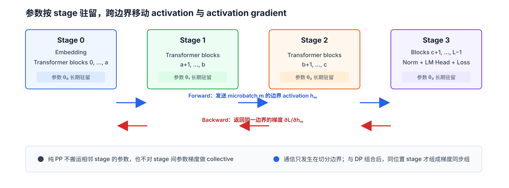

**图 1：** 参数长期驻留在所属 stage。Forward 只向后一 stage 发送边界 activation，backward 则沿相反方向返回同一边界的 activation gradient；纯 PP 不搬运相邻 stage 的参数。

### 2.2 Mini-batch 与 microbatch

设一个 mini-batch 被拆成 $M$ 个 microbatch：

$$ \mathcal{B}=\bigsqcup_{m=0}^{M-1}\mathcal{B}_m,\qquad \sum_{m=0}^{M-1}n_m=N. $$

Microbatch 是执行和调度单位，mini-batch 才是同步 GPipe 的参数更新单位。若完整批次损失按样本平均，则：

$$ \mathcal{L}(\theta)=\sum_{m=0}^{M-1}\frac{n_m}{N}\mathcal{L}_m(\theta). $$

相应的参数梯度为：

$$ \nabla_{\theta_s}\mathcal{L}=\sum_{m=0}^{M-1}\frac{n_m}{N}\nabla_{\theta_s}\mathcal{L}_m. $$

等大小 microbatch 时权重是 $1/M$。若直接对每个 microbatch 的平均损失求和而不除以 $M$，梯度会放大 $M$ 倍；若 microbatch 大小或有效 token 数不同，则必须按样本数或有效 token 数加权，而不能机械使用 $1/M$。

Microbatch 切分还可能改变依赖跨样本统计量的算子。GPipe 原论文专门讨论了 BatchNorm：训练统计量按 microbatch 计算，并维护用于评估的整体移动统计量。[[1]](#ref-1) 对 LayerNorm、RMSNorm 等逐样本归一化，microbatch 切分通常不改变这类统计语义，但 dropout 随机数消费顺序和浮点归约顺序仍可能造成数值差异。

### 2.3 同步更新的语义

同步 GPipe 要求同一个 mini-batch 的所有 microbatch 在 forward 和 backward 中使用同一组参数 $\theta^{(q)}$，其中 $q$ 是优化器 step：

$$ \theta^{(q+1)}=\operatorname{OptStep}\left(\theta^{(q)},\nabla_\theta\mathcal{L}^{(q)}\right). $$

optimizer 只能在全部 microbatch 完成 backward 后执行一次。只要损失加权、随机状态和状态型算子处理正确，这一更新在数学上等价于未切分 mini-batch 的同步训练。GPipe 原论文强调，其 gradient update 不依赖分区数，原因即所有 microbatch 的 gradient 在 mini-batch 末尾统一应用。[[1]](#ref-1)

## 3. GPipe 的 fill-drain 调度

### 3.1 原始调度

GPipe 使用“先全部 forward、再全部 backward ”的 fill-drain 调度：

1. **Fill**：第一个 microbatch 逐 stage 前进，流水线逐步填满。
2. **Forward steady region**：多个 stage 同时处理不同 microbatch 的 forward。
3. **Forward drain**：最后一个 microbatch 离开末 stage。
4. **Backward fill**：backward gradient 从末 stage 逐步传播回来。
5. **Backward steady region**：多个 stage 同时处理不同 microbatch 的 backward。
6. **Backward drain**：最早 stage 完成最后一个局部 backward。
7. **Update**：所有 stage 对同一 mini-batch 执行一次参数更新。

图 2 给出 $K=4$、$M=5$ 的完整时序：stage 编号为 0–3，microbatch 编号为 0–4。`F4` 表示“当前 stage 对 microbatch 4 执行 forward”，并不表示存在 stage 4；`B4` 同理表示该 microbatch 的 backward。

 backward 采用逆 microbatch 顺序有利于尽早释放最近建立的局部计算图，但不同 microbatch 之间不存在必须逆序的数学依赖。后来的同步 1F1B 正是利用这一点改变执行顺序，同时仍在 mini-batch 末尾统一更新。

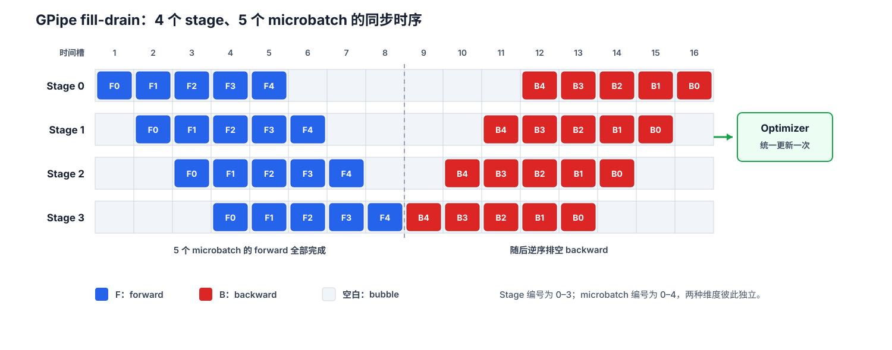

**图 2：** $K=4$、$M=5$ 时的完整 fill-drain。蓝色为 forward，红色为 backward；空白格是 pipeline bubble。所有 backward 完成后才执行一次 optimizer update。

### 3.2 Bubble 的严格推导

先采用理想化假设：

- 每个 stage 对一个 microbatch 的 forward 耗时均为 $t_f$；
- 每个 stage 对一个 microbatch 的 backward 耗时均为 $t_b$；
- 通信已包含在 $t_f,t_b$ 中，或可以被完全隐藏；
- 所有 microbatch 形状相同，stage 没有抖动和负载偏差。

第一个 microbatch 的 forward 需要穿过 $K$ 个 stage；之后每注入一个 microbatch，理想情况下只增加一个 forward 时隙。因此 forward 有 $M+K-1$ 个时隙，backward 同理：

$$ T_{\mathrm{GPipe}}=(M+K-1)(t_f+t_b). $$

若同样的 $K$ 段计算在一个设备上顺序执行，忽略跨设备差异时：

$$ T_{\mathrm{serial}}=MK(t_f+t_b). $$

相对于该顺序基线，理想加速比为：

$$ S_{\mathrm{ideal}}=\frac{MK}{M+K-1}. $$

除以设备数 $K$，得到平均设备利用率：

$$ \eta_{\mathrm{ideal}}=\frac{M}{M+K-1}. $$

额外的 $K-1$ 个时隙来自填充与排空，故 bubble fraction 为：

$$ f_{\mathrm{bubble}}=\frac{K-1}{M+K-1}. $$

这正是 GPipe 原论文给出的量级。论文还报告，在其实验设置中，当 $M\ge 4K$ 时 bubble 开销通常可忽略；这是论文的经验观察，不是适用于所有模型、互联和 kernel 形状的普遍定律。[[1]](#ref-1)

#### 3.2.1 这个公式用于决定需要多少个 microbatch

Bubble 公式的实际用途，是根据可接受的空闲比例反推 $M$。记允许的最大 bubble fraction 为 $f_{\max}$，若要求 $f_{\mathrm{bubble}}\le f_{\max}$：

$$ \frac{K-1}{M+K-1}\le f_{\max}\quad\Longrightarrow\quad M\ge\frac{1-f_{\max}}{f_{\max}}(K-1). $$

对 $K=4$：

- 图 2 的 $M=5$ 只有 $5/8=62.5\%$ 理想利用率，适合展示时序，但不是高效配置；
- 若要求 bubble 不超过 20%，至少需要 $M\ge12$；
- 若要求 bubble 不超过 10%，至少需要 $M\ge27$。

由此得到第一个工程结论：

> Pipeline 越深，microbatch 数必须近似按 $K$ 线性增加，才能维持相同利用率。

但该结论不等于“$M$ 越大越好”。固定全局 batch 时，增大 $M$ 会缩小单个 microbatch，可能降低 GEMM 效率并增加小消息启动开销。因此应选择能够满足 bubble 目标、同时仍保持高效 kernel 形状的最小 $M$。

部分资料还会报告 $(K-1)/M$，它表示 bubble 耗时相对于有用计算耗时的额外开销，而不是总耗时中的空闲比例。本文后续统一使用 $f_{\mathrm{bubble}}$，不再引入第二套口径。

### 3.3 从 bubble 推到实际吞吐

若流水线已经填满，均衡瓶颈 stage 每完成一个 microbatch 需要 $t_f+t_b$，所以无 bubble 时的吞吐上限为 $1/(t_f+t_b)$。GPipe 只能达到其中 $\eta_{\mathrm{ideal}}$ 的比例：

$$ \operatorname{Throughput}_{\mathrm{mb}}=\frac{M}{(M+K-1)(t_f+t_b)}=\underbrace{\frac{1}{t_f+t_b}}_{\text{满流水线吞吐上限}}\times\underbrace{\frac{M}{M+K-1}}_{\text{pipeline 利用率}}. $$

继续沿用图 2 的 $K=4,M=5$，并设 $t_f=2\text{ ms}$、$t_b=4\text{ ms}$：

$$ \operatorname{Throughput}_{\mathrm{mb}}=\frac{1}{0.002+0.004}\times\frac{5}{8}\approx104.2\text{ microbatches/s}. $$

这个分解给出第二个工程结论：

> 增大 $M$ 只能提高利用率因子；如果 microbatch 变小导致 $t_f+t_b$ 上升，满流水线吞吐上限会下降，最终吞吐仍可能变差。

因此，固定全局 batch 时要同时测量 bubble 与 kernel/通信效率；固定 microbatch size 时，增大 $M$ 又会增大全局 batch，可能改变优化与收敛。Megatron-LM 的系统研究也指出，最优 microbatch 取决于模型形状、HBM 和硬件。[[6]](#ref-6)

流水线主要提高一批请求的长期吞吐，不会缩短单个样本依次穿过全部 stages 的关键路径。这个“吞吐优化不等于单样本延迟优化”的区别在推理中尤其重要。

### 3.4 非均衡 stage 下的性能

前面的推导假设每个 stage 都有相同的 $t_f,t_b$。真实模型通常不满足这个条件：

- 首 stage 可能额外包含 embedding；
- 末 stage 可能包含 final norm、LM head 和 loss；
- 不同层的 hidden size、MoE token 数或 activation shape 可能不同；
- 某些 stage 位于跨节点边界，暴露的 P2P 耗时更长；
- Forward 与 backward 使用的 kernel 和通信方向不同，二者的瓶颈 stage 也可能不同。

因此，不能再用一个全局 $t_f,t_b$ 描述全部 stages。

#### 3.4.1 什么是 stage 的服务耗时

令 $\widetilde t_s^f$ 表示 stage $s$ 处理一个 microbatch forward 后，可以开始处理下一个 forward microbatch 所需的服务耗时。它包含本地 forward 计算耗时和无法被计算隐藏的 forward 通信耗时：

$$ \widetilde t_s^f=t_s^{f,\mathrm{compute}}+t_s^{f,\mathrm{exposed\ comm}}. $$

同理，$\widetilde t_s^b$ 表示 backward 方向的服务耗时：

$$ \widetilde t_s^b=t_s^{b,\mathrm{compute}}+t_s^{b,\mathrm{exposed\ comm}}. $$

这里只加入**暴露在关键路径上**的通信。如果 activation send 已与下一项计算完全重叠，就不应再次把完整通信耗时相加；若使用 blocking send/recv，则更多通信尾部会进入服务耗时。

#### 3.4.2 为什么第一条 microbatch 用求和，后续 microbatch 用最大值

先只看 forward。Microbatch 0 必须依次经过全部 $K$ 个 stages，尚未形成任何流水重叠，所以它从开始计算到离开末 stage 的耗时是：

$$ T_{\mathrm{first}}^f=\sum_{s=0}^{K-1}\widetilde t_s^f. $$

流水线填满后，各 stage 同时处理不同 microbatches。每个 stage 都像一段生产工序，而最慢工序决定整条流水线多久能再完成一件产品。因此，后续相邻 microbatch 离开末 stage 的间隔由最慢 forward stage 决定：

$$ \Delta T_{\mathrm{steady}}^f=\max_s\widetilde t_s^f. $$

完成第一个 microbatch 后还剩 $M-1$ 个，所以 forward 总耗时近似为：

$$ T_{\mathrm{forward}}\approx\sum_{s=0}^{K-1}\widetilde t_s^f+(M-1)\max_s\widetilde t_s^f. $$

Backward 沿相反方向流动，但推导完全相同：

$$ T_{\mathrm{backward}}\approx\sum_{s=0}^{K-1}\widetilde t_s^b+(M-1)\max_s\widetilde t_s^b. $$

GPipe fill-drain 要等全部 forward 完成后才开始 backward，两段没有交错，因此总耗时是二者之和：

$$ T_{\mathrm{nonuniform}}\approx\sum_{s=0}^{K-1}\widetilde t_s^f+(M-1)\max_s\widetilde t_s^f+\sum_{s=0}^{K-1}\widetilde t_s^b+(M-1)\max_s\widetilde t_s^b. $$

这个公式依赖固定服务耗时、充足缓冲和确定性执行，因此是性能模型而不是逐周期仿真。实际系统中的 backpressure、通信争用和 kernel 抖动会造成额外等待。

#### 3.4.3 这个模型给出什么工程结论

当 $M$ 足够大时，两项“第一条 microbatch 穿过全部 stages”的求和固定成本被摊薄，microbatch 吞吐上界趋近：

$$ \operatorname{Throughput}_{\mathrm{mb}}\le\frac{1}{\max_s\widetilde t_s^f+\max_s\widetilde t_s^b}. $$

由此得到四个直接结论：

1. Forward 与 backward 必须分别找瓶颈 stage。
2. 继续加速非瓶颈 stage，通常不会提高稳态吞吐。
3. 增大 $M$ 只能摊薄 fill/drain 固定成本，不能消除 stage imbalance。
4. 分区时应根据实测 forward、backward 和暴露通信耗时共同平衡，而不是只比较层数、参数量或平均 FLOPs。

### 3.5 全局复杂度与可并行性

设完整模型处理一个 microbatch 的基础 forward/backward 工作量为 $C_{\mathrm{model}}$，第 $s$ 个 stage 的对应工作量为 $C_s$。忽略重复计算时：

$$ \sum_{s=0}^{K-1}C_s=C_{\mathrm{model}}. $$

PP 没有减少全局算术工作，只是把工作量和模型状态沿层维分给多个设备。均衡分区下，单 stage 对一个 microbatch 的工作量约为 $C_{\mathrm{model}}/K$；GPipe rematerialization 还会重新执行被丢弃 activation 对应的 forward，因此全系统实际 FLOPs 高于无 checkpoint 基线。

PP 自身的可并行性来自跨 stage 的 microbatch 重叠：不同 stage 同时处理不同 microbatch。

同一个 microbatch 仍必须依次满足 $F_{0,m}\prec F_{1,m}\prec\cdots\prec F_{K-1,m}$，所以 PP 主要缩短一批 microbatch 的总体墙钟时间并扩展容量，不会把单个样本的层间依赖变成并行计算。其理想额外调度空间与 $M$ 有关，而全局计算复杂度仍由原模型和 rematerialization 策略决定。

## 4. Activation 内存与 rematerialization

### 4.1 训练内存的组成

Stage $s$ 的峰值 HBM 可概括为：

$$ H_s=H_s^{\mathrm{param}}+H_s^{\mathrm{grad}}+H_s^{\mathrm{optim}}+H_s^{\mathrm{act}}+H_s^{\mathrm{comm}}+H_s^{\mathrm{workspace}}+H_s^{\mathrm{runtime}}. $$

流水线分区直接降低本 stage 拥有的参数、梯度和优化器状态，但不会自动消除 activation。Fill-drain 在进入 backward 之前完成全部 $M$ 个 forward，因此每个 stage 可能同时保留多个 microbatch 的局部计算图或 checkpoint。

### 4.2 GPipe 的 rematerialization

普通 backward 保存 stage 内各层所需的 forward activation。GPipe 的 rematerialization 策略只长期保留分区边界 activation；当 backward 到达某个 stage 时，系统重新执行该 stage 的复合 forward 函数，恢复内部 activation，再计算局部 backward。[[1]](#ref-1)

在原论文的均匀层简化模型中，不做分区和 rematerialization 时，activation 空间量级为：

$$ O(NL). $$

采用 $K$ 个分区、$M$ 个 microbatch 和分区内 rematerialization 后，单设备峰值 activation 空间量级降为：

$$ O\left(N+\frac{L}{K}\frac{N}{M}\right). $$

第一项对应跨 microbatch 保留的分区边界，第二项对应对某个 microbatch 执行 rematerialization 时的 stage 内部 activation。该公式用于解释缩放趋势，不能直接替代精确 HBM 核算：不同层的 hidden size、attention 矩阵、卷积特征图、MoE token 分布和临时 workspace 都可能相差很大。

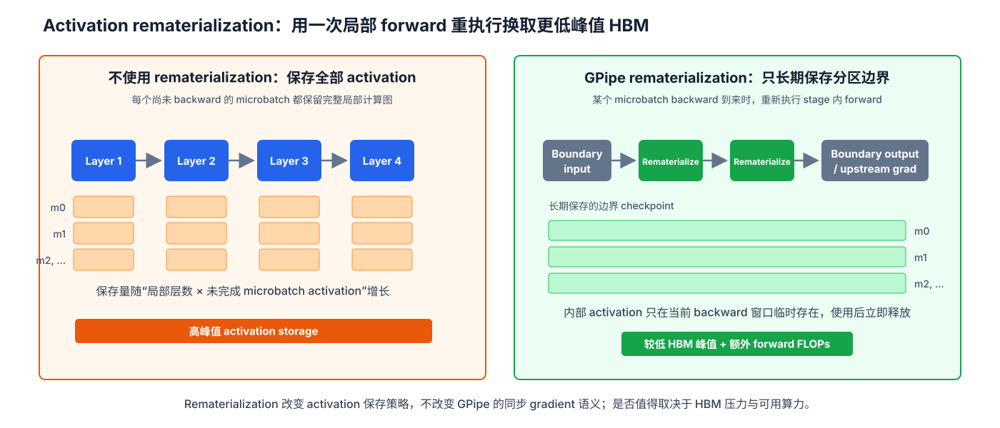

**图 3：** 不使用 rematerialization 时，每个待 backward microbatch 都保留 stage 内部 activation；GPipe 只长期保留分区边界，在对应 backward 到来时临时重新执行内部 forward，以额外 FLOPs 换取更低峰值 HBM。

### 4.3 Rematerialization 的正确性条件

Rematerialization 不是简单地“再调用一次 forward”。要得到与原 forward 一致的局部函数，必须处理：

- dropout 等随机算子的 RNG 状态；
- 状态型层的可变 buffer；
- autocast、FP8 scaling 和混合精度上下文；
- 动态路由、稀疏 token 分配和控制流；
- 外部副作用，例如统计计数或缓存写入。

若 rematerialization 得到的函数与原 forward 不同，backward 所使用的局部 Jacobian 也会改变。工程实现通常保存或重放 RNG 状态，并要求 checkpoint 区域在语义上近似纯函数。

## 5. 跨进程 autograd 与梯度通信

### 5.1 为什么 autograd 图不会自动跨进程延伸

普通 P2P 通信传输的是 tensor 数据，不会把发送进程中的 Python 对象、autograd 节点和执行上下文复制到接收进程。Stage 边界因此把完整计算图切成多个局部计算图。

对相邻 stages，记：

$$ h_m^{(s)}=F_s(h_m^{(s-1)};\theta_s). $$

Stage $s$ 向 $s+1$ 发送 $h_m^{(s)}$ 的数据。接收端把收到的数据作为本地叶子 tensor $\widehat{h}_m^{(s)}$，并建立 stage $s+1$ 的局部计算图。末 stage 从损失开始 backward 后，stage $s+1$ 得到边界梯度：

$$ g_m^{(s)}=\frac{\partial\mathcal{L}_m}{\partial \widehat{h}_m^{(s)}}. $$

该梯度沿反方向发送给 stage $s$。Stage $s$ 以 $g_m^{(s)}$ 作为外部梯度，对本地输出 $h_m^{(s)}$ 执行向量-Jacobian 乘积：

$$ \frac{\partial\mathcal{L}_m}{\partial \theta_s}=\left(\frac{\partial h_m^{(s)}}{\partial \theta_s}\right)^\top g_m^{(s)}. $$

同时得到继续向前一 stage 发送的 dgrad：

$$ g_m^{(s-1)}=\left(\frac{\partial h_m^{(s)}}{\partial h_m^{(s-1)}}\right)^\top g_m^{(s)}. $$

从末 stage 向首 stage 递归执行，即恢复完整模型的链式法则。PyTorch 的 `PipelineStage` 负责管理待 backward 的中间状态、创建 send/recv 操作并运行 stage 局部 backward；其源码显式维护每个 microbatch 的 forward state、backward cache、activation send 信息和 gradient send 信息。[[3]](#ref-3)[[4]](#ref-4)

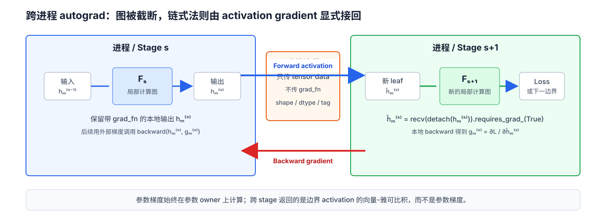

**图 4：** P2P 只传输 detached tensor data，不传输 `grad_fn`。接收端以新 leaf tensor 构造局部图；其 input gradient 返回前一 stage 后，发送端以该梯度对原本地输出执行 backward，从而显式恢复向量-雅可比积链。

### 5.2 Parameter gradient 与 activation gradient

纯流水线并行中需要区分两类梯度：

- **Activation gradient**：跨 stage 边界发送，用于连接局部 backward。
- **Parameter gradient**：由拥有 parameter 的 stage 本地计算，不因 PP 本身跨 stage all-reduce。

只有组合数据并行时，相同 stage 的不同 DP 副本才需要聚合参数梯度。

### 5.3 一个 stage 的生命周期

对 microbatch $m$，中间 stage 的典型生命周期是：

1. 从前一 stage 接收输入 activation。
2. 将接收 tensor 建立为本地可求导输入。
3. 执行局部 forward，保存 backward 所需状态。
4. 向后一 stage 发送输出数据。
5. 在调度允许时，从后一 stage 接收本 stage output 对应的 upstream gradient，即 $g_m^{(s)}=\partial\mathcal{L}_m/\partial h_m^{(s)}$。
6. 执行局部 backward，累积本地参数梯度。
7. 向前一 stage 发送输入 activation 的梯度。
8. 释放该 microbatch 的局部图和通信缓冲。

首 stage 不接收 forward activation，末 stage 不发送 forward activation；backward 方向恰好相反。任何通用实现都必须对这四种边界情况作显式处理。

## 6. P2P 通信协议

### 6.1 消息身份

一个可靠的 PP runtime 不能只依赖“向相邻 rank 发送一个 tensor”。概念上，每条消息至少具有以下身份：

```text
(step_id, phase, src_stage, dst_stage, microbatch_id, tensor_slot)
```

其中 `phase` 区分 forward activation 与 backward gradient，`tensor_slot` 区分多输入、多输出或跳连对应的 tensor。底层后端未必显式发送这些字段，但 schedule 和缓冲区索引必须在两端对它们达成一致。

### 6.2 Tensor metadata 与 buffer 分配

#### 6.2.1 静态 metadata

接收方通常需要在通信发生前分配目标 buffer，因此必须知道：

- shape；
- dtype；
- device；
- layout、stride 或是否要求 contiguous；
- 是否为 DTensor 及其 placement；
- 是否需要梯度；
- 多 tensor 输出的顺序与可选项。

PyTorch 官方 `PipelineStage` 要求 stage 输入输出具有预期 shape 和 dtype，并据此分配通信缓冲；运行时 shape 不匹配会触发 pipelining metadata/shape error。文档还特别提醒，混合精度、TP、FSDP 等组合会改变输出 dtype 或 layout，构建 stage 时必须反映这些变化。[[3]](#ref-3) 源码则集中维护输入、输出、dgrad 和 upstream gradient 的 tensor metadata，并在调试模式下执行运行时校验。[[4]](#ref-4)

静态元数据的优点是数据路径不必为每个 microbatch 额外发送 header；缺点是变长序列、动态路由和条件分支受到限制。常见替代方案包括 padding 到固定 shape、按 shape 建立 buffer 池，或者在 payload 前增加元数据握手。

#### 6.2.2 动态 metadata 协议

Megatron Core 的 P2P communicator 默认由配置提供 `tensor_shape` 和 `pipeline_dtype`，接收方据此创建 buffer；启用可变序列长度时，它先交换 shape tensor，再传输实际 activation 或 gradient。[[8]](#ref-8) 动态协议必须保证元数据消息与 payload 消息采用一致顺序。

元数据协议不应只传 shape 而忽略 dtype。混合精度或量化边界中，发送端的 BF16、FP16、FP8 编码和接收端预期不一致，可能造成通信错误或静默的数值解释错误。

### 6.3 通信量模型

设边界 $s$ 上完整 mini-batch 的 activation 总字节数为 $A_s^{\mathrm{batch}}$。训练时该边界通常传输一次 forward activation 和一次同形状的 backward gradient：

$$ V_s^{\mathrm{train}}\approx 2A_s^{\mathrm{batch}}. $$

若 mini-batch 被等分为 $M$ 个 microbatch，每条消息大小约为 $A_s^{\mathrm{batch}}/M$，两个方向各有 $M$ 条消息。固定完整 batch 时，理想总字节数不随 $M$ 改变，但消息数随 $M$ 线性增加。

采用 $\alpha$-$\beta$ 模型，单方向的串行通信耗时近似为：

$$ T_s^{\mathrm{one\ direction}}\approx M\alpha+\beta A_s^{\mathrm{batch}}. $$

$\alpha$ 是每条消息的固定启动延迟，$\beta$ 是每字节传输耗时。增大 $M$ 可以减少调度 bubble，却会增大消息启动开销，并可能让带宽利用率下降。异步 P2P 能隐藏部分通信，但不能消除真实带宽限制，也不能消除由数据依赖造成的等待。

对所有边界求和：

$$ V_{\mathrm{aggregate}}\approx 2\sum_{s=0}^{K-2}A_s^{\mathrm{batch}}. $$

这是全系统聚合流量，不等于关键路径时间。不同边界可以并行通信，真实性能取决于拓扑共享、链路争用、收发双工能力和通信计算重叠。

### 6.4 为什么 stage 间存在通信—计算 overlap

假设所有 stage 处理一个 microbatch 的 forward 计算耗时都为 $C$，每次发送边界 activation 的耗时都为 $S$。先只讨论均匀 forward pipeline，并假设计算与通信可以使用独立资源。

对同一个 microbatch $m$，dependency 的确是严格串行的：

$$ F_{s,m}\prec C_{s,m}\prec F_{s+1,m}. $$

这里 $F_{s,m}$ 表示 stage $s$ 的 forward，$C_{s,m}$ 表示把其输出 activation 发送给 stage $s+1$。因此，stage $s+1$ 不可能在 $C_{s,m}$ 完成前计算 $F_{s+1,m}$。

#### 6.4.1 从时序约束推导稳态 slot

记 $x_{s,m}$ 为 stage $s$ 开始计算 microbatch $m$ 的时刻。为了分析稳态最大吞吐，本文不是考察任意 schedule，而是寻找一个具有共同 initiation interval 的周期 schedule。先定义：

$$ x_{s,m+1}-x_{s,m}=D,\qquad \forall s,m. $$

这条等式是待构造周期 schedule 的定义，不是由 dependency 自动得到的结论。接下来推导怎样的 $D$ 才能使该 schedule 合法且稳定。

首先，同一 stage 不能同时计算两个 microbatches。每次计算耗时为 $C$，所以必须有：

$$ D\ge C. $$

其次，microbatch $m$ 必须先在 stage $s$ 完成耗时为 $C$ 的计算，再完成耗时为 $S$ 的通信，stage $s+1$ 才能开始：

$$ x_{s+1,m}\ge x_{s,m}+C+S. $$

最后，考虑同一个有向 stage 边 $s\to s+1$ 上的连续 messages。这里假设该边对应的 P2P 发送通道同一时刻只能传输一条 activation。Stage $s$ 对 microbatch $m$ 的 output 在 $x_{s,m}+C$ 时刻 ready；根据前面对周期 schedule 的定义，相邻 outputs 的 ready 时刻之差为：

$$ (x_{s,m+1}+C)-(x_{s,m}+C)=D. $$

因此，发送请求确实每隔 $D$ 到达一次，但这是由“周期 schedule + 固定计算耗时 $C$”推导出的结果。为了让耗时为 $S$ 的前一条传输在下一条发送请求到达前完成，避免消息队列无限增长，必须满足：

$$ D\ge S. $$

综合计算资源约束 $D\ge C$ 与发送通道约束 $D\ge S$，周期稳态的最小可行 initiation interval 是：

$$ D=\max(C,S). $$

下面还需要证明这个下界可以达到。由于系统在 stage 轴和 microbatch 轴上都是均匀的，可以寻找一个二维仿射 schedule。取时间原点 $x_{0,0}=0$，并把两个方向的增量都取到最早合法值：

1. 沿 microbatch 轴，同一 stage 的相邻启动时刻满足 $x_{s,m+1}-x_{s,m}=D$；
2. 沿 stage 轴，同一 microbatch 完成一次计算和一次通信后立即进入下一 stage，满足 $x_{s+1,m}-x_{s,m}=C+S$。

从 $(0,0)$ 出发，先跨过 $s$ 个 stage 增量，再跨过 $m$ 个 microbatch 增量，得到：

$$ x_{s,m}=s(C+S)+mD. $$

因此，这不是任意猜测的公式，而是在两个方向上都取紧约束后得到的周期构造；除整体平移常数外，它是这组仿射增量条件的唯一解。

下面逐项展开。左侧为上游 stage $s-1$ 对 microbatch $m+1$ 的启动时刻，再加上计算与通信耗时：

$$ x_{s-1,m+1}+C+S=(s-1)(C+S)+(m+1)D+C+S=s(C+S)+(m+1)D. $$

中间项展开为：

$$ x_{s,m}+D=s(C+S)+mD+D=s(C+S)+(m+1)D. $$

右侧为 stage $s$ 启动 microbatch $m+1$ 的时刻：

$$ x_{s,m+1}=s(C+S)+(m+1)D. $$

三项都等于 $s(C+S)+(m+1)D$，因此：

$$ x_{s-1,m+1}+C+S=x_{s,m}+D=x_{s,m+1}. $$

这说明，该紧致周期 schedule 可以让上游发送的 microbatch $m+1$ activation 不晚于 stage $s$ 计划开始 $F_{s,m+1}$ 的时刻准备就绪；等式表示当前构造取到了可行下界，不要求其他合法 schedule 也在同一时刻完成通信。

现在固定在 stage $s$ 的视角进行比较。Stage $s$ 当前执行的 $F_{s,m}$ 结束于 $x_{s,m}+C$；与此同时，上游 stage $s-1$ 发送的下一份输入 activation $h_{m+1}^{(s-1)}$，在 $x_{s,m}+D$ 时刻到达 stage $s$，并可供 $F_{s,m+1}$ 使用。二者之差为：

$$ (x_{s,m}+D)-(x_{s,m}+C)=D-C=\max(0,S-C). $$

因此：

1. 若 $S\le C$，则 $D=C$，$h_{m+1}^{(s-1)}$ 能够不晚于 $F_{s,m}$ 结束时在 stage $s$ 准备就绪，因此 stage $s$ 不必等待即可开始 $F_{s,m+1}$。
2. 若 $S>C$，则 $D=S$，$h_{m+1}^{(s-1)}$ 在 $F_{s,m}$ 结束后还需 $S-C$ 才能到达 stage $s$，因此必须暴露这段通信尾部。

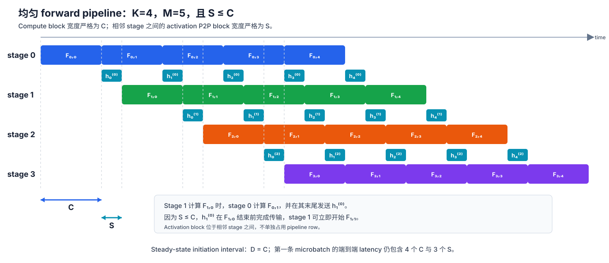

**图 5：** 与图 2 相同，取 $K=4,M=5$，并令 $S\le C$。每个 compute block 的宽度严格为 $C$，相邻 stage 之间每个 activation P2P block 的宽度严格为 $S$，但通信不单独占用 pipeline row。Stage 1 计算 $F_{1,0}$ 时，stage 0 计算 $F_{0,1}$ 并发送 $h_1^{(0)}$；该 activation 在 $F_{1,0}$ 结束前完成传输，因此 stage 1 可以立即开始 $F_{1,1}$。

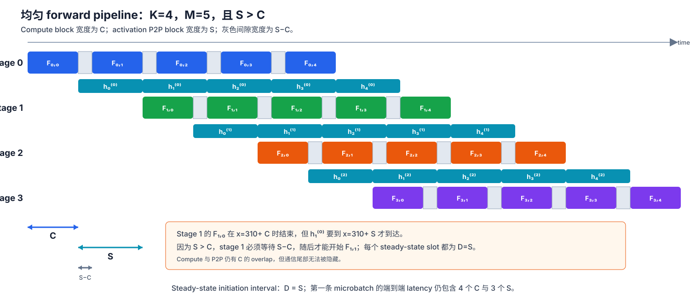

**图 6：** 仍取 $K=4,M=5$，但令 $S>C$。Compute block 的宽度为 $C$，activation P2P block 的宽度为 $S$，每个 compute block 后的灰色间隙宽度为 $S-C$。Stage 1 完成 $F_{1,0}$ 后仍需等待 $h_1^{(0)}$ 到达，因此 steady-state initiation interval 为 $D=S$。

图 5 与图 6 共同说明：同一 microbatch 仍按 compute $\to$ P2P $\to$ consume 严格串行；overlap 发生在不同 microbatch 之间。相比完全串行的 $C+S$，稳态 slot 为 $D=\max(C,S)$。第一条 microbatch 仍必须逐 stage 支付计算与通信延迟；overlap 改善的是 steady-state throughput，而不是首条 microbatch latency。Backward 方向具有相同结构，只是传输对象变为 dgrad。

#### 6.4.2 工程结论：stage 不能切得太细

设完整模型处理一个 microbatch 的 forward 总计算耗时为 $C_{\mathrm{total}}$。若模型被近似均匀地切成 $K$ 个 stages，则单 stage 的计算耗时约为：

$$ C(K)\approx\frac{C_{\mathrm{total}}}{K}. $$

设 stage 边界 activation 大小为 $A$ bytes，通信启动开销为 $\alpha$，有效带宽为 $B_{\mathrm{eff}}$，则边界 P2P 耗时近似为：

$$ S\approx\alpha+\frac{A}{B_{\mathrm{eff}}}. $$

对许多重复 Transformer blocks，继续增加 stage 数会减少每个 stage 包含的层数，因此 $C(K)$ 近似按 $1/K$ 下降；但边界 tensor 的 hidden shape 通常不变，所以 $A$ 与 $S$ 未必同步下降。结合前面的推导，steady-state slot 近似为：

$$ D(K)=\max\left(\frac{C_{\mathrm{total}}}{K},S\right). $$

这给出一个明确的饱和点：

$$ K_{\mathrm{sat}}\approx\frac{C_{\mathrm{total}}}{S}. $$

1. 当 $K<K_{\mathrm{sat}}$ 时，$C(K)>S$，系统处于 compute-bound 区域；增加 stage 数能够缩短 slot，并且通信可以落入计算窗口。
2. 当 $K>K_{\mathrm{sat}}$ 时，$C(K)<S$，系统进入 communication-bound 区域；slot 被 $S$ 限制，继续切分已经不能提高 steady-state throughput。

过细切分还会同时带来三项额外代价：

- 边界数随 $K-1$ 增加，单步 P2P message 数随之增加；
- 固定 $M$ 时，bubble fraction $(K-1)/(M+K-1)$ 上升；
- 单 stage 的 kernel 规模变小，更难获得高算术效率。

因此，stage partition 的目标不是“尽可能多切”，而是在 HBM 能容纳、load balance 可接受的前提下，让每个 stage 保留足够计算量，使 $C_s$ 不显著小于对应边界的 $S_s$。如果模型容量要求的最小 stage 数已经超过通信饱和点，仅靠继续增加 PP degree 无法得到良好性能，需要同时考虑更高带宽互联、减小边界 activation，或采用其他模型状态分片方式。

## 7. 通信顺序与死锁不变量

流水线程序最危险的故障通常不是数值误差，而是部分 rank 永久等待。正确 runtime 至少应维护以下不变量。

### 7.1 一一匹配

每个跨 rank 的 send 必须存在唯一匹配 recv，且双方对 peer、process group、dtype、shape 和消息身份达成一致：

$$ \#\operatorname{send}(e,m,p,j)=\#\operatorname{recv}(e,m,p,j)=1. $$

这里 $e$ 是有向 stage 边，$m$ 是 microbatch，$p$ 是 forward 或 backward phase，$j$ 是多输入、多输出边界中的 `tensor_slot`。同一 $(e,m,p)$ 可以包含多个 tensors，但每个 slot 都必须一一匹配。

### 7.2 因果顺序

同一 microbatch 必须满足：

$$ F_{s,m}\prec F_{s+1,m}\prec B_{s+1,m}\prec B_{s,m}. $$

不同 microbatch 可以交错，但不能违反本 microbatch 的 forward 和 backward 依赖。一个 rank 的本地 action 顺序还必须与相邻 rank 的通信顺序兼容。

### 7.3 全局 schedule 一致

所有 rank 必须使用相同的：

- microbatch 数和切分规则；
- stage-to-rank 映射；
- forward/backward action 表；
- tensor 元数据协议；
- train/eval 模式和是否执行 backward；
- 异常处理路径。

如果某个 rank 因输入校验失败提前退出，而其他 rank 已进入 P2P，后者可能永久等待。因此，应在第一条通信前完成可全局验证的配置检查，并用 collective 汇总错误状态。

### 7.4 通信序列的确定性

对共享 communicator，消息匹配通常依赖 FIFO 顺序。若 rank 0 依次发送 `(m=0,m=1)`，rank 1 却依次接收 `(m=1,m=0)`，即使 shape 相同也会发生语义错配。若 shape 不同，则可能立即报错或造成越界风险。

PyTorch 当前 schedule 源码把 forward、backward、send、recv 和 wait 都表示为显式 action，并对 stage/rank 映射和 action 表进行检查；这说明生产级 schedule 本质上是一个需要验证的分布式状态机，而不是几层 Python 循环。[[5]](#ref-5)

### 7.5 避免环形等待

阻塞 P2P 中若相邻 rank 都先执行 send，而后端不能在无接收方时取得进展，就可能形成等待环。常见策略包括：

- 一端先 recv，另一端先 send；
- 按 rank 奇偶采用相反顺序；
- 预先发布 `irecv`，再发布 `isend`；
- 用 `batch_isend_irecv` 同时提交一组匹配操作；
- 为不同有向边建立独立 communicator。

Megatron 的非批量 P2P 源码按 rank 奇偶改变收发顺序，批量路径则构造 `P2POp` 列表统一提交；PyTorch 新版源码还可为有向物理边建立独立 process group，并以确定性轮次预连接。[[8]](#ref-8)[[11]](#ref-11)

### 7.6 更新屏障

同步调度中，任何 stage 都不能在其他 microbatch 尚需旧参数时提前更新：

$$ \forall s,\quad \operatorname{Update}_s\succ B_{s,m},\ \forall m. $$

若再组合 DP/FSDP，还要保证对应 stage 的数据并行梯度聚合完成。更新屏障是优化语义的一部分，而不仅是实现细节。

## 8. 调度家族：GPipe 之后发生了什么

### 8.1 调度与更新语义是两个维度

需要分别回答两个问题：

1. 当前 stage 何时执行 forward 或 backward？
2. 参数何时更新，某次 forward/backward 使用哪个版本？

前者是执行 schedule，后者是优化一致性。同步 GPipe 与同步 1F1B 的执行顺序不同，但都可以在整个 mini-batch 结束后统一更新，因此都没有 mini-batch 内的 weight staleness。原始 PipeDream 也采用 1F1B，但在每个 stage 更细粒度地更新参数，因而需要 weight version 管理并具有不同于同步 SGD 的语义。[[2]](#ref-2)[[6]](#ref-6)

**Weight staleness** 是指：某个 gradient 根据较旧版本的 parameter 计算出来，却在稍后被应用到已经更新过的较新 parameter 上。设 microbatch $m$ 在 stage $s$ 的 forward 使用 parameter version $\theta_s^{(v_{s,m})}$，对应 gradient 记为 $g_{s,m}=\nabla_{\theta_s}\mathcal{L}_m(\theta_s^{(v_{s,m})})$；如果应用该 gradient 时，本 stage 的当前版本已经是 $\theta_s^{(u_s)}$，且 $u_s>v_{s,m}$，以最简单的 SGD 为例，实际更新就是：

$$ \theta_s^{(u_s+1)}=\theta_s^{(u_s)}-\eta g_{s,m},\qquad \delta_{s,m}=u_s-v_{s,m}>0. $$

其中 $\delta_{s,m}$ 是该梯度相对当前参数的版本延迟。梯度本身并未损坏，但它描述的是旧参数位置附近的损失曲面；把它应用到新位置会改变同步 SGD 的优化轨迹。流水线越深、在途 minibatch 越多，异步系统中的版本延迟通常越难忽略。

还必须区分两个相关但不同的问题：

1. **前后向版本不一致**：同一 stage 对 microbatch $m$ 做 forward 时使用旧权重，backward 时却直接读取新权重，得到的局部梯度甚至不再对应原 forward。Weight stashing 通过保存 forward 所用版本，保证该 microbatch 的本地 backward 仍使用同一版本。
2. **Gradient staleness**：即使 weight stashing 保证 forward/backward 使用同一版本，算出的旧版本 gradient 仍可能被应用到已经更新多次的当前 parameter 上。Weight stashing 不消除这种 staleness。

此外，一个 microbatch 依次穿过多个异步 stage 时，各 stage 可能处于不同更新计数，因此它看到的整条模型也未必对应某个单一全局参数快照。GPipe 和同步 1F1B 通过 mini-batch 内冻结参数、全部 backward 完成后统一更新，使 $\delta_{s,m}=0$，同时避免这种跨 stage 版本偏斜。

| 调度 | Stage 内顺序 | 更新时机 | 权重版本 | 主要目标 |
|---|---|---|---|---|
| GPipe fill-drain | 全部 F 后全部 B | mini-batch 末尾 | 单版本 | 简单、同步语义、配合 rematerialization |
| 同步 1F1B | warmup 后交替 F/B | mini-batch 末尾 | 单版本 | 更早释放 activation |
| Interleaved 1F1B | 多 virtual stages 交错 F/B | mini-batch 末尾 | 单版本 | 缩小 bubble |
| 原始 PipeDream | 稳态严格交替 F/B | 每个 stage 更细粒度更新 | 多版本 weight stashing | 避免 flush、提高利用率 |
| Forward-only | 仅 F | 无 | 单版本 | 推理或评估 |

第 6.4 节已经说明，通信能否 overlap 取决于通信期间是否存在另一个独立且 ready 的 compute action。不同 schedule 的核心差异之一，就是它们提供 ready action 的方式不同：

1. **GPipe**：forward phase 主要用下一个 microbatch 的 forward 覆盖上一 microbatch 的 activation send；backward phase 同理。
2. **同步 1F1B**：warmup 后同时维护 forward 与 backward ready queues，通信期间更可能找到另一方向的独立 action。
3. **Interleaved 1F1B**：把物理 stage 切成更细的 virtual stages，增加可调度 action 的粒度和数量。
4. **PipeDream**：取消周期性 flush，让跨 minibatch 的 ready work 持续存在，但为此引入 weight version 与 staleness 问题。

因此，schedule 不改变基础 dependency，而是在满足 dependency 的前提下，决定何时执行哪个 ready action，以及能否用它覆盖通信。

### 8.2 同步 1F1B

非交错同步 1F1B 分为三个区域：

- **Warmup**：先执行若干 forward，使后续 stage 有工作可做。
- **Steady state**：每个 stage 交替执行一次 forward 和一次 backward。
- **Cooldown**：停止注入新 forward，排空剩余 backward。

在每个物理 rank 只拥有一个 stage、总 microbatch 数相同且保持同步 flush 的条件下，1F1B 与 GPipe 的主要 bubble 量级相同；它的主要优势是较早执行 backward，从而减少活跃 activation。Megatron-LM 的默认非交错 schedule 即采用同步 1F1B，并在 pipeline flush 处更新参数以保持严格优化器语义。[[6]](#ref-6)[[7]](#ref-7)

#### 8.2.1 为什么提前执行 backward 能降低内存占用

这里必须区分三类内存：

1. **待 backward 的 activation**：每个 microbatch 都有自己的局部计算图或 activation checkpoint，必须一直保存到该 microbatch 在本 stage 完成 backward。其占用随未完成 microbatch 数增长。
2. **Activation gradient**：从后一 stage 返回的 upstream gradient，以及准备发送给前一 stage 的 dgrad。它们通常只在当前或少量 in-flight backward 操作期间占用 communication buffer，消费后即可复用。
3. **Parameter-gradient accumulator**：本 stage 每个参数对应的一组 `.grad` buffer。不同 microbatch 的参数梯度直接累加到同一 buffer，而不是为每个 microbatch 长期保存一份独立副本。

设 microbatch $m$ 在 stage $s$ 产生参数梯度 $g_{s,m}$，损失权重为 $w_m$。同步 1F1B 在局部 backward 完成后执行的是梯度累加：

$$ G_s\leftarrow G_s+w_mg_{s,m}. $$

这里 $G_s$ 是本轮 mini-batch 的参数梯度 accumulator。该操作不会执行 optimizer step，也不会修改参数 $\theta_s^{(q)}$。随后即可释放 microbatch $m$ 的局部 autograd graph、内部 activation 和不再需要的边界 buffer。所有 microbatch 的 backward 完成后，系统才执行必要的 DP/FSDP 梯度归约，并统一计算：

$$ \theta_s^{(q+1)}=\operatorname{OptStep}\!\left(\theta_s^{(q)},G_s\right). $$

因此，标准同步 1F1B 仍让全部 microbatch 使用同一参数版本 $\theta_s^{(q)}$，不会产生 weight staleness。提前发生的是 backward 和内存回收，不是参数更新。

若每个 microbatch 在 stage $s$ 需要保存 $a_s$ bytes 的 activation，并令 $q_s$ 表示该 stage 当前尚未完成 backward 的 microbatch 数，则 activation 项近似为：

$$ H_{s}^{\mathrm{act}}\approx q_sa_s. $$

GPipe fill-drain 在全部 forward 完成时可能有 $q_s=M$。对均衡、每个 rank 一个 stage 的非交错 1F1B，stage $s$ 在 warmup 和稳态交界处的活跃数量通常满足：

$$ q_s^{\mathrm{1F1B}}\lesssim\min(M,K-s). $$

因此当 $M\gg K$ 时，activation 的主要缩放项可从 $O(Ma_s)$ 降到 $O(Ka_s)$。参数梯度 buffer 的大小约等于本 stage 参数梯度总大小，是 GPipe 与同步 1F1B 都需要的固定加法项，不随 $M$ 复制；它不会抵消 activation 数量下降带来的节省。

同步 1F1B 只降低随活跃 microbatch 数增长的 activation 项，不会减少 parameter、parameter gradient 或 optimizer state。若这些固定模型状态主导 HBM，整体峰值下降可能不明显。

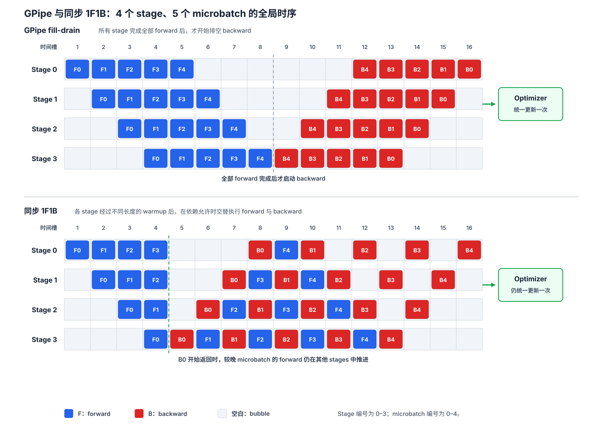

**图 7：** $K=4,M=5$ 时 GPipe 与同步 1F1B 的全局时序。GPipe 等所有 stages 完成全部 forward 后才启动 backward；同步 1F1B 在 warmup 后，让较早 microbatch 的 backward 与较晚 microbatch 的 forward 在不同 stages 上并行，从而更早释放 activation。两种同步 schedule 都可以让同一 mini-batch 的所有 microbatch 共用参数版本 $\theta^{(q)}$，并在全部 backward 后统一更新；交替执行 forward/backward 本身不会产生 weight staleness。

### 8.3 Interleaved 1F1B 与 virtual stages

Virtual stage 不是虚拟 GPU，而是同一物理设备拥有的多个模型分块。设有 $K$ 个物理 pipeline ranks，每个 rank 拥有 $v$ 个 model chunks，则模型沿深度方向被切成 $Kv$ 个逻辑 stages，再以 round-robin 方式映射回 $K$ 个设备。

以 $K=2$、$v=2$、8 层模型为例：

1. 普通 1F1B 只切成两个 stage：GPU 0 持有 layers 0–3，GPU 1 持有 layers 4–7。
2. Interleaved 1F1B 切成四个连续 chunks：$C_0=$ layers 0–1、$C_1=$ layers 2–3、$C_2=$ layers 4–5、$C_3=$ layers 6–7。
3. Round-robin 放置后，GPU 0 持有 $C_0,C_2$，GPU 1 持有 $C_1,C_3$。
4. 一个 microbatch 的 forward 仍按模型深度依次经过 $C_0\rightarrow C_1\rightarrow C_2\rightarrow C_3$，所以物理路径变成 GPU 0 $\rightarrow$ GPU 1 $\rightarrow$ GPU 0 $\rightarrow$ GPU 1；backward 沿相反方向返回。

同一 GPU 上的两个 chunks 不能同时计算。Interleaving 的收益不是凭空增加执行资源，而是把原来一个完整 stage 的大块工作切成更短的调度片段，使 scheduler 能在更细的时间边界插入其他 microbatch 的 forward 或 backward。

为公平比较，图 8 以一个 virtual stage action 的耗时作为一个 **chunk 时间槽**。在均衡理想模型中，一个完整 stage 含有两个等长 chunks，所以普通 1F1B 的一次完整 stage forward 或 backward 占两个 chunk 时间槽，而 Interleaved 1F1B 的一次 chunk forward 或 backward 只占一个。图中的 `C2·B1` 表示“在 virtual stage $C_2$ 上执行 microbatch 1 的 backward”。

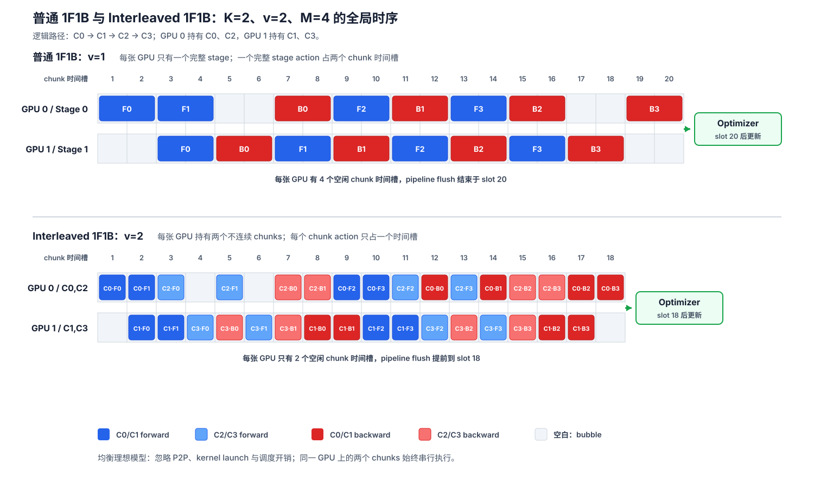

**图 8：** $K=2,M=4$ 时普通 1F1B 与 $v=2$ 的 Interleaved 1F1B 全局时序。上图中每张 GPU 有 4 个空闲 chunk 时间槽，pipeline flush 结束于 slot 20；下图将 $C_0,C_2$ 映射到 GPU 0，将 $C_1,C_3$ 映射到 GPU 1，同一 GPU 上的两个 chunks 始终串行执行。更细的 action 使每张 GPU 的空闲量降至 2 个 chunk 时间槽，flush 提前到 slot 18，正好展示理想 bubble 时长缩小为原来的 $1/v$。代价是单个 microbatch 穿过更多逻辑边界。

在 Megatron-LM 的均衡模型中，默认 schedule 的 bubble time 与 $(K-1)(t_f+t_b)$ 成正比；交错后可近似缩小为：

$$ T_{\mathrm{bubble,interleaved}}\approx\frac{K-1}{v}(t_f+t_b). $$

代价是模型被切出更多逻辑边界，pipeline 通信次数约增加 $v$ 倍，并且 action 状态、buffer 生命周期和 stage 映射更复杂。Megatron-LM 2021 论文提出该交错 schedule，并报告相对于已有 schedule 的吞吐改进；当前 Megatron Core 同时保留 non-interleaved 与 interleaved 1F1B 实现。[[6]](#ref-6)[[7]](#ref-7)

Virtual stage 不是免费的“bubble 除法器”。当消息启动延迟、跨节点带宽或调度开销占主导时，增加 $v$ 可能得不偿失。

每个 rank 持有多个 virtual stages 后，还要同时管理更多 chunk 的 activation 与 communication buffers；更复杂的生命周期和 allocator fragmentation 可能抬高实际 HBM 峰值。因此，interleaving 的收益必须与新增通信和内存占用一起评估。

### 8.4 PipeDream：weight stashing 与 weight staleness

**工程定位。** 原始 PipeDream 的 asynchronous/no-flush 设计是流水线调度史上的重要分支，但在当前公开的大模型训练 runtime 中，它不是主流默认方案。PyTorch 的标准 schedule 集合以 GPipe、同步 1F1B、Interleaved 1F1B 和 Zero-Bubble 为主；Megatron Core 提供 non-interleaved 与 interleaved 同步 schedule；DeepSpeed 的 `TrainSchedule` 也在一个 batch 的全部 backward 和梯度归约完成后执行 `OptimizerStep`。这些公开实现表明，现代训练栈更常继承 1F1B 的 action 排列，而不采用各 stage 独立更新参数的 asynchronous/no-flush 语义。[[3]](#ref-3)[[7]](#ref-7)[[13]](#ref-13) 这不是对未公开内部系统的完整统计。

推理流水线通常是单向的：一个请求只沿 stage 递增方向执行 forward，某个 stage 只需在输入到达后产生输出。DNN 训练流水线则是双向的：同一 minibatch 先沿正向经过全部 stages，再沿 backward 次序返回；backward 还要读取 forward 保存的 activation、随机状态和参数状态。于是，一个 stage 在任一时刻可能同时面对“为较新的 minibatch 做 forward”和“为较旧的 minibatch 做 backward”两类就绪工作，而且 backward 完成后还可能改变该 stage 的参数。推理中的单向填充问题由此变成了计算方向、状态版本和更新时机相互耦合的调度问题。[[2]](#ref-2)

PipeDream 采用 **inter-batch pipelining**：流水单元是可独立触发更新的 minibatch，而不是 GPipe 中共同组成一次同步更新的 microbatches。Warmup 期间先注入使流水线达到稳态所需的最少 minibatches；稳态中，每个 worker 严格交替执行一次 forward 和一次 backward，即异步 1F1B。一个 backward 完成后，本 stage 即可应用该 minibatch 的局部参数梯度；下一个 forward 使用当时最新的本地参数。系统不在固定 mini-batch 边界停止注入工作，也不周期性排空流水线，因此称为 **asynchronous/no-flush** 调度。对均衡流水线，这种调度可以避免反复出现由 fill-drain 引起的空槽，使流水线在稳态中持续运行。

这里的**在途 minibatch**，是指已经进入 pipeline、但尚未完成全部 backward 的 minibatch。若先连续执行许多 forward，再集中执行 backward，那么在 backward 开始前，系统必须同时保留所有这些 minibatches 的 activation 和 weight version。1F1B 则在 warmup 后一边注入新 minibatch 的 forward，一边推进较旧 minibatch 的 backward，使旧 minibatch 持续离开 pipeline。因此，稳态中的在途数量被限制在填满 pipeline 所需的有限窗口内，而不会随着已执行 forward 的数量持续增长。[[2]](#ref-2)

这里需要区分两个性能口径。**Hardware efficiency** 描述设备在单位墙钟时间内完成多少训练工作，bubble、通信等待和负载不均都会降低它；**statistical efficiency** 描述达到给定模型质量需要处理多少 minibatches 或执行多少参数更新，gradient staleness 可能使它下降。No-flush 1F1B 主要提高前者，但最终训练时间取决于“每次更新有多快”和“达到目标质量需要多少次更新”的共同作用。因此，流水线更满不自动意味着更快收敛。

这种调度首先带来同一 stage 内的前后向版本问题。设 minibatch $m$ 在 stage $s$ 的 forward 使用 $\theta_s^{(v_{s,m})}$。若轮到它 backward 时当前参数已经变为 $\theta_s^{(u_s)}$，直接用当前参数会使 backward 使用的局部 Jacobian 不再对应原 forward。**Weight stashing** 在 forward 后保存或引用计数该版本，并在对应 backward 时恢复它，从而保证：

$$ \theta_{s,m}^{B}=\theta_{s,m}^{F}=\theta_s^{(v_{s,m})}. $$

必须严格区分以下三个概念：

1. **Forward/backward version consistency**：同一 stage、同一 minibatch 的 forward 与 backward 是否使用同一 parameter version。Weight stashing 解决这一数值正确性问题。
2. **Gradient staleness**：即使 backward 使用了正确的暂存版本，由此得到的 $g_{s,m}$ 仍可能被应用到已经更新过的当前参数。若应用时当前版本为 $u_s$，则版本延迟为 $\delta_{s,m}=u_s-v_{s,m}$。Weight stashing 不保证 $\delta_{s,m}=0$。
3. **跨 stage 版本偏斜（cross-stage version skew）**：同一 minibatch 在不同 stages 可能看到不同更新计数，即版本向量 $(v_{0,m},v_{1,m},\ldots,v_{K-1,m})$ 未必对应任何单一的全局参数快照。Stage 内前后向一致并不蕴含跨 stage 一致。

**Bounded staleness** 指存在一个与执行窗口有关但不随训练步数增长的有限常数 $\tau$，使所有被应用的梯度都满足 $0\leq\delta_{s,m}\leq\tau$。PipeDream 只允许维持满流水线所需的有限个 active minibatches，因此延迟由流水线深度、stage replication 和在途窗口共同界定，而不会无限增长。对每个 stage 仅有一个 worker 的 $K$ 段直线流水线，论文给出的 weight-stashing 更新可写成：

$$ \theta^{(t+1)}=\theta^{(t)}-\eta\nabla\mathcal{L}\!\left(\theta_0^{(t-K+1)},\theta_1^{(t-K+2)},\ldots,\theta_{K-1}^{(t)}\right). $$

首段 gradient 相对当前更新点最多落后约 $K-1$ 次更新，越靠后的 stage 延迟越小。更重要的是，当版本向量 $(t-K+1,t-K+2,\ldots,t)$ 的各分量不相同时，一般不存在某个单一的全局参数快照 $\Theta$，使上式右侧的 gradient 等于 $\nabla\mathcal{L}(\Theta)$。因此，该更新不是在某个明确定义的全局模型状态上执行标准同步 SGD；weight stashing 只能保证 stage 局部的 forward/backward version consistency，不能恢复全局优化语义。这正是 gradient staleness 与 cross-stage version skew 同时存在时在数学上不够简洁的根源。可选的跨 stage 版本协调可以消除 version skew，但仍不能把旧快照 gradient 变成当前快照 gradient。原始 PipeDream 的默认语义使用 weight stashing，而不要求所有 stages 对齐到同一版本。[[2]](#ref-2)

下面给出一个 $K=3$、每段单 worker 的局部例子。Warmup 期间，$S_0$ 可能依次以 $\theta_0^{(0)}$ 执行 $F_1,F_2,F_3$；进入稳态后，其局部序列可以是 $B_1,F_4,B_2,F_5,B_3,\ldots$：

- $B_1$ 使用暂存的 $\theta_0^{(0)}$，随后当前参数更新为 $\theta_0^{(1)}$；$F_4$ 使用新版本 $\theta_0^{(1)}$。
- $B_2$ 仍使用其 forward 时暂存的 $\theta_0^{(0)}$，但梯度应用到当前 $\theta_0^{(1)}$，故 $\delta_{0,2}=1$。
- 到 $B_3$ 时，当前参数可能已是 $\theta_0^{(2)}$；weight stashing 仍令它用 $\theta_0^{(0)}$ 计算局部 backward，故前后向一致，但 $\delta_{0,3}=2$。若不暂存版本，$B_3$ 会错误地用 $\theta_0^{(2)}$ 解释由 $\theta_0^{(0)}$ 产生的 forward 状态。
- 同一个 minibatch 3 到达 $S_1$ 时，$S_1$ 可能已经完成 $B_1$ 并使用 $\theta_1^{(1)}$ 做 $F_3$。于是它在 $S_0$ 与 $S_1$ 分别看到 $\theta_0^{(0)}$ 和 $\theta_1^{(1)}$，形成跨 stage 版本偏斜。

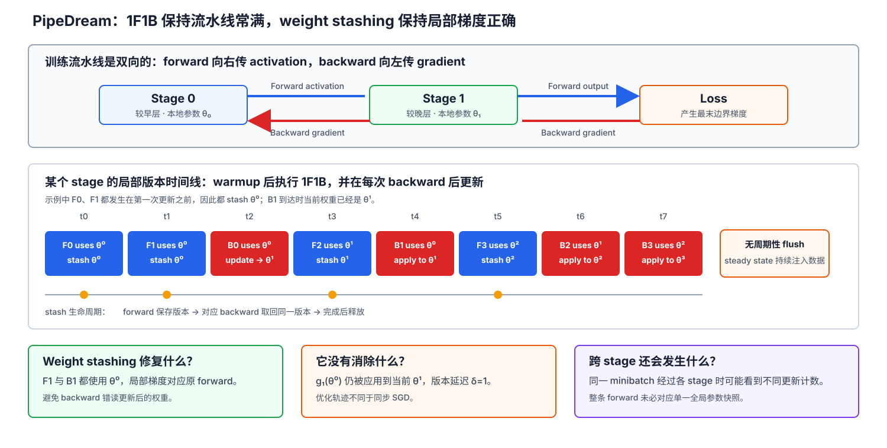

**图 9：** Weight stashing 只保证同一 stage 内某个 minibatch 的 $F/B$ 使用同一版本；梯度应用时的版本延迟和该 minibatch 跨 stages 看到的版本偏斜是另外两个问题。

多版本机制以 HBM 和状态管理为代价。若 stage $s$ 同时为 $A_s$ 个 active minibatches 保留状态，论文的直接方案为每个 active minibatch 暂存 forward 所用权重，最坏参数版本存储量为 $O(A_s|\theta_s|)$；此外还要保留相应 activation 和版本标识。相同版本可通过共享与引用计数减少物理副本，但不能消除版本生命周期管理。1F1B 的作用之一正是把 $A_s$ 限制在填满流水线所需的窗口内。[[2]](#ref-2)

因此，PipeDream 与 GPipe 的差异不只是局部 action 顺序。GPipe 在一个逻辑 mini-batch 内冻结参数，累积其全部 microbatch 梯度，排空后只更新一次；在正确缩放下，它保持同步 mini-batch SGD 语义。PipeDream 则让不同 minibatches 跨更新边界并发流动，每个 stage 独立推进版本。Weight stashing 使这种异步轨迹上的局部梯度在数值上有定义，却不会把该轨迹还原为 GPipe 的同步优化轨迹。

### 8.5 Zero-bubble 调度

Zero Bubble Pipeline Parallelism 的出发点不是取消 backward 计算，而是拆开传统运行时捆绑执行的 dgrad 与 wgrad。为什么这两个计算可以拆开？本质上需要考察线性层 backward 的 vector-Jacobian product（VJP）：它接收 output cotangent $\bar y$，并分别产生关于输入 $x$ 和参数 $W$ 的 cotangent。下面的推导不是为了重复介绍线性层求导，而是为了确认这两个 VJP 输出之间没有先后依赖，因而可以具有不同的调度优先级。

数学上采用列向量。设 $x\in\mathbb{R}^{d_{\mathrm{in}}}$、$W\in\mathbb{R}^{d_{\mathrm{out}}\times d_{\mathrm{in}}}$，forward 为 $y=Wx$，upstream gradient 为 $\bar y=\nabla_y\mathcal{L}\in\mathbb{R}^{d_{\mathrm{out}}}$。由 $dy=dW\,x+W\,dx$ 可得：

$$ d\mathcal{L}=\bar y^\top dy=\left\langle\bar yx^\top,dW\right\rangle_F+(W^\top\bar y)^\top dx. $$

其中 $\langle\cdot,\cdot\rangle_F$ 是矩阵的 Frobenius inner product。将上式与 VJP 的标准配对形式 $d\mathcal{L}=\langle\bar W,dW\rangle_F+\bar x^\top dx$ 对照，可得 dgrad（input gradient）与 wgrad（weight gradient）：

$$ \bar x=\nabla_x\mathcal{L}=W^\top\bar y,\qquad \bar W=\nabla_W\mathcal{L}=\bar yx^\top. $$

这个 VJP 分解给出了调度所需的关键结论：在 $\bar y$ 到达且本地仍持有 $W$ 与 forward 输入 $x$ 后，$\bar x$ 和 $\bar W$ 可以彼此独立地计算。产生 dgrad $\bar x$ 不需要等待 wgrad $\bar W$ 完成；反过来也一样。二者是同一次 VJP 的两个输出，而不是串行依赖的两个步骤。

维度上，$\bar x\in\mathbb{R}^{d_{\mathrm{in}}}$，$\bar W\in\mathbb{R}^{d_{\mathrm{out}}\times d_{\mathrm{in}}}$。

将这个 VJP 分解放回 pipeline：一旦 stage $s$ 收到后继 stage 返回的 $\bar y_{s,m}$，且本地仍持有相应的 parameter 与 forward 输入，dgrad 和 wgrad 都已 ready，但其跨 stage 依赖不同：

- **Dgrad 必须优先计算并发送。** $S_s$ 只有产生并发送 $\bar x_{s,m}$，前一 stage $S_{s-1}$ 才能继续同一 microbatch 的 backward；延迟 dgrad 会让前面所有 stages 的 backward 依次推迟。
- **Wgrad 可以延后计算。** 它不产生前一 stage 所需的消息，只要保存计算所需的 $x_{s,m}$、$\bar y_{s,m}$ 或等价中间量，并在本次 optimizer step 前完成即可。论文把 input-gradient pass 记为 $B$、weight-gradient pass 记为 $W$。[[12]](#ref-12)

为了比较拆分前后的全局效果，图 10 取 $K=2,M=4$，并假设 forward、dgrad、wgrad 的耗时相同，各占一个 action 时间槽。因此，传统 runtime 中捆绑执行的 fused backward 占两个时间槽。

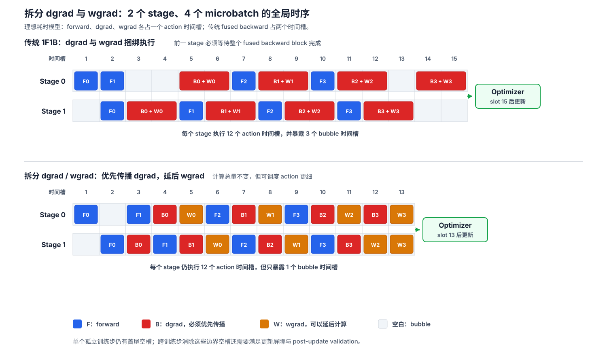

**图 10：** 上图把 dgrad 与 wgrad 捆绑成不可拆分的 fused backward，每个 stage 执行 12 个有效 action 时间槽，同时暴露 3 个 bubble 时间槽，统一更新发生在 slot 15 之后。下图优先计算并传播 dgrad，再把 wgrad 移入后续空槽；计算总量仍为 12 个 action 时间槽，但暴露的 bubble 减至 1 个，统一更新提前到 slot 13 之后。该图采用理想等耗时模型，暂不计入 P2P 和负载不均。

Zero-bubble schedule 将 dgrad 放在 backward 关键路径上优先执行，把 wgrad 移入原本的空槽。对同一 stage 和 microbatch，基本次序仍是 forward 先于 input-gradient，input-gradient 再先于被延后的 weight-gradient；跨 stage 还必须满足正向 activation 和 backward dgrad 的数据依赖。同一设备不能同时执行两个 action，调度器还要满足 HBM 上限、通信先后关系和有限 microbatch 数。故“存在可移动的 wgrad”只是调度机会，并不保证任意模型和配置都有可行的零空槽排布。

论文给出三种有代表性的高层方案。比较它们之前，需要补充本节使用的记号：[[12]](#ref-12)

- $P$ 是物理 pipeline workers 数。ZB-H1 与 ZB-H2 中每个 worker 持有一个 stage，因此 $K=P$；ZB-V 中每个 worker 持有两个 chunks，因此 $K=2P$。
- $M_B$ 是一个 microbatch 在执行 dgrad 前必须保留的 activation 状态量；$M_W$ 是 dgrad 完成后、为后续 wgrad 继续保留的状态量，通常有 $M_W<M_B$。
- $T_F,T_B,T_W$ 分别是一个 forward、dgrad 和 wgrad action 的耗时。手工 schedule 的图示先采用 $T_F=T_B=T_W$ 的理想假设。

#### 8.5.1 ZB-H1：保持 1F1B 的 activation 上限

ZB-H1 延续 1F1B 的总体形状，提前安排 dgrad，并根据各 worker 的 warmup 长度推迟 wgrad，使所有 workers 维持相同数量的在途 microbatches。其理想 bubble 时长和峰值 activation 为：

$$ T_{\mathrm{bubble,H1}}=(P-1)(T_F+T_B-T_W),\qquad H_{\mathrm{peak,H1}}=P M_B. $$

当 $T_F=T_B=T_W$ 时，ZB-H1 的 bubble 是普通 1F1B 的三分之一，但不会完全消失；它换取这一收益时不提高 1F1B 的峰值 activation 上限。

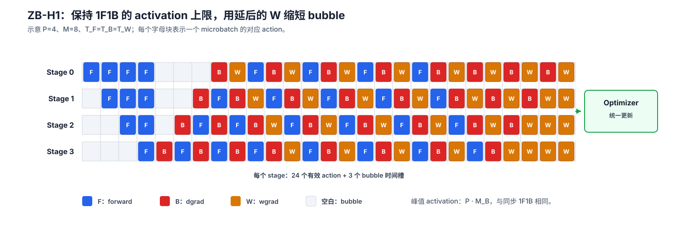

**图 11：** $P=4,M=8$ 的 ZB-H1。每个 stage 执行 8 个 $F$、8 个 $B$ 和 8 个 $W$，共 24 个有效 action 时间槽；推迟的 $W$ 填充 backward 尾部，但仍暴露 3 个 bubble 时间槽。统一更新发生在所有 $W$ 完成之后。

#### 8.5.2 ZB-H2：用更高 activation 峰值换取零 bubble

ZB-H2 在 warmup 中注入更多 forward，并把 wgrad 集中移向 timeline 尾部，使重复训练步形成平行四边形。其理想 bubble 时长和峰值 activation 为：

$$ T_{\mathrm{bubble,H2}}=(P-1)(T_F+T_B-2T_W),\qquad H_{\mathrm{peak,H2}}=(2P-1)M_B. $$

当 $T_F=T_B=T_W$、microbatch 数足够且训练步之间可以重叠时，理想 bubble 为零；代价是峰值 activation 接近 ZB-H1 和 1F1B 的两倍。

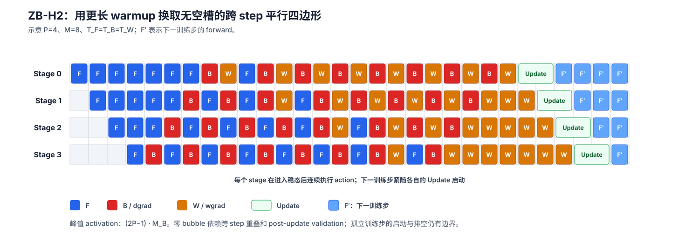

**图 12：** $P=4,M=8$ 的 ZB-H2。更长的 warmup 让每个 stage 在进入稳态后连续执行 $F/B/W$；各 stage 完成本步 $W$ 和 update 后，立即以错开的时刻启动下一训练步的 forward。图中的零 bubble 指重复训练步的理想稳态，不包含整个训练任务首次启动和最终排空的边界。

#### 8.5.3 ZB-V：用 V 形 chunk 放置降低 activation 峰值

ZB-V 把模型均分为 $2P$ 个连续 chunks，每个 worker 恰好持有两个。Chunks 先按 worker 0 到 worker $P-1$ 放置，再按 worker $P-1$ 到 worker 0 反向放置，形成 V 形 ownership。于是，模型的首个 chunk 与末尾 chunk 位于同一 worker；一个 microbatch 的 forward 从该 worker 出发并回到该 worker，backward 也从这里开始，不必先等待 backward 从物理末 worker 逐级返回。

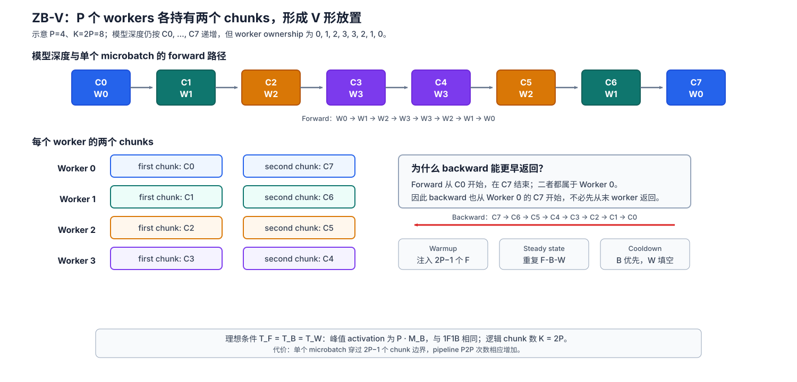

**图 13：** $P=4,K=2P=8$ 的 ZB-V。Worker 0 持有 $C_0,C_7$，worker 1 持有 $C_1,C_6$，依此类推。在 $T_F=T_B=T_W$ 的理想条件下，ZB-V 可以用 $P M_B$ 的峰值 activation 达到零 bubble，并使各 workers 的内存峰值更均衡；代价是单个 microbatch 穿过更多 chunk 边界。

延后 wgrad 并不是免费的。Dgrad 完成后仍须保留 wgrad 所需中间量，因此 wgrad 延迟越长，相关状态驻留时间越长；增加 warmup forward 也会增加在途 activation。ZB-H1 优先约束内存而接受残余 bubble，ZB-H2 用更多 HBM 换取更小 bubble，ZB-V 则用两个 chunks/worker 的特定放置和更复杂的 action/通信序列，在理想条件下兼顾 1F1B 量级的内存与零 bubble。实际选择必须同时满足 stage 划分、microbatch 数、每类 action 时长和 HBM 预算。

同步优化语义还要求明确的**更新屏障**。对逻辑训练步 $q$，所有 stages、所有 microbatches 的 wgrad 都必须在该步更新前完成：

$$ \operatorname{Update}^{(q)}\succ W_{s,m}^{(q)},\qquad \forall s,m. $$

下一步 forward 必须看到更新后的同一逻辑参数快照；若梯度裁剪、混合精度溢出检查或全局梯度范数需要跨 stages 归约，朴素全局同步会切断相邻训练步的平行四边形排布，重新产生边界空槽。论文为“真正零 bubble”提出 post-update validation：先依据逐 stage 传播的部分全局状态乐观更新并启动下一步 warmup，随后取得完整归约状态；极少数验证失败时回滚并重做更新。该机制的目的正是在保留同步优化语义的同时绕开 optimizer step 前的全局停顿，不能省略为“wgrad 做完即可任意更新”。[[12]](#ref-12)

“理论零 bubble”也不等于实机时间线上的“零空闲”。前者通常指在给定 action 时长模型下没有可见的计划空槽；后者还受到 $T_F$、$T_I$、$T_W$ 不相等、stage 负载不均、P2P 通信与等待、kernel 启动、归约、内存压力以及 microbatch 不足的影响。Zero Bubble 论文因此还使用包含实测 $T_F,T_B,T_W,T_{\mathrm{comm}}$ 与内存上限的自动调度；其目标是在真实约束下逼近最小 bubble，而不是把理想图直接视为硬件利用率保证。[[12]](#ref-12)

## 9. 分区、load balancing 与放置

### 9.1 分区不是平均层数

把 $L$ 层平均分成 $K$ 段只在重复、同构层中近似合理。Embedding、词表输出层、跨注意力、MoE、长序列 attention 和视觉模型的特征图变化都可能使不同层的：

- forward / backward 耗时；
- 参数与优化器状态；
- activation 峰值；
- 输出通信量；
- rematerialization 代价；

显著不同。

### 9.2 多约束分区目标

令候选 stage $s$ 的预测服务耗时为 $C_s$，峰值 HBM 为 $H_s$，边界通信耗时为 $Q_s$，设备 HBM 容量为 $H_s^{\max}$。一个更贴近工程的目标是：

$$ \min_{b_1,\ldots,b_{K-1}}\max_s(C_s+Q_s),\qquad \text{s.t. }H_s\le H_s^{\max}. $$

其中：

$$ C_s=C_s^f+C_s^b+C_s^{\mathrm{recompute}}. $$

若 stage 跨节点，还应使用对应链路的 $\alpha,\beta$ 参数估计 $Q_s$。同一切分在 NVLink、PCIe 和跨机网络上的最优性可能完全不同。

### 9.3 GPipe 与 PipeDream 的分区方法

GPipe 接受可选的每层计算代价估计，并选择连续 cell，使各 cell 估计代价尽量均衡；原论文同时承认，层间 FLOPs 和内存不均衡会使启发式分区产生负载偏差。[[1]](#ref-1)

PipeDream 先在单 GPU 上对各层作短暂 profiling，再结合目标部署的通信代价搜索分区，目标是平衡 stage 服务耗时并减少通信；当模型无法整齐分配给所有 worker 时，它还允许复制部分 stage，引入局部数据并行以提升瓶颈 stage 吞吐。[[2]](#ref-2)

现代系统通常需要以实测 profile 校准解析模型，因为 FLOPs 相同不代表 kernel 耗时相同。形状、融合、内存带宽、cache、collective 算法和并发通信都会影响真实服务耗时。

### 9.4 拓扑感知放置

常见放置原则是：

- 高频 TP collective 尽量留在节点内高速互联；
- PP 的相邻 stage 可跨节点，因为每个边界通常只有 activation P2P；
- activation 最大的边界优先放在高带宽链路上；
- DP/FSDP group 应结合网络分层选择 collective 拓扑；
- Virtual stage 的回绕边可能引入非相邻物理通信，必须纳入带宽模型。

Megatron-LM 的大规模设计把 TP 用于服务器内，把 PP 用于服务器间，再叠加 DP；论文将这种组合称为 PTD-P，并强调并行维度的配置会共同影响通信量、kernel 效率和 bubble。[[6]](#ref-6)

## 10. 与 DP、TP、FSDP 的组合

### 10.1 三维并行坐标

设数据并行度为 $D$，流水线并行度为 $P$，张量并行度为 $T$，暂不考虑其他维度时：

$$ W=DPT. $$

$W$ 是总 rank 数。每个 rank 可用三维坐标 $(d,p,t)$ 标识：

- 固定 $(p,t)$、改变 $d$：同一参数 shard 的数据并行组；
- 固定 $(d,p)$、改变 $t$：同一 stage 内的 tensor-parallel 组；
- 固定 $(d,t)$、改变 $p$：同一 pipeline replica 的流水线组。

Process group 建错会导致错误归约甚至 deadlock，因此组构造应来自统一的 rank mesh，而不是在各模块内临时推断。

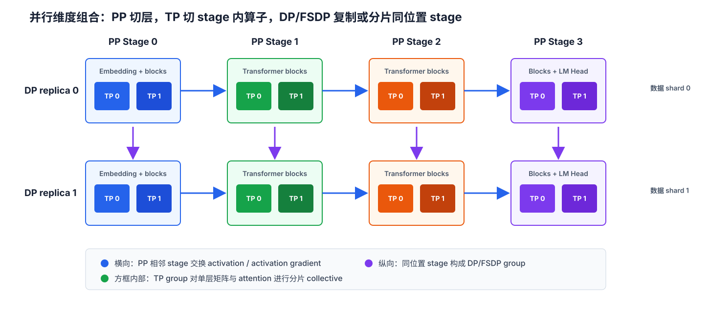

**图 14：** PP 沿模型深度连接相邻 stage，TP 在 stage 内切分矩阵计算，DP/FSDP 则连接不同 pipeline replica 中位置相同的 stage。三类通信必须使用不同且一致构造的 process group。

### 10.2 PP 与复制式 DP

每个 DP replica 拥有一条完整 pipeline，并处理不同数据。位置相同的 stage 构成 DP group，在 mini-batch backward 结束后对本 stage 参数梯度执行 all-reduce：

$$ \bar g_{p}=\frac{1}{D}\sum_{d=0}^{D-1}g_{d,p}. $$

PP 负责模型容量和跨层执行，DP 负责样本吞吐。梯度归约可以与后续 backward 计算重叠，但 optimizer step 必须等待本 stage 的 DP 梯度完成。

### 10.3 PP 与 FSDP

FSDP 可替代复制式 DP，使位置相同的 stage 参数、梯度和优化器状态在 DP group 内进一步分片。PyTorch 官方 pipelining API 明确支持与 DDP、FSDP 和 TP 组合，并允许先取得 stage module，再包装其他并行策略，最后构建 stage runtime。[[3]](#ref-3)

组合时需要关注：

- FSDP unshard/all-gather 是否落在 PP 关键路径；
- 1F1B 的 microbatch 交错是否导致同一参数频繁 reshard/unshard；
- 参数预取与 activation P2P 是否争用同一物理互联资源的带宽；
- FSDP 的 gradient reduction 是否与 PP 更新屏障正确衔接；
- stage 输出 dtype 是否因 mixed precision wrapper 改变。

最深分片不一定最快。若 stage 已足够小，DDP 的常驻副本可能比频繁 FSDP 参数物化更高效。

### 10.4 PP 与 TP

TP 在单个 stage 内切分矩阵或 attention 计算，PP 在 stage 之间传输边界 activation。原始 Megatron-LM 工作系统化展示了 Transformer 层内张量并行，后续 Megatron-LM 系统工作再将其与 PP、DP 组合。[[10]](#ref-10)[[6]](#ref-6) 组合后必须定义边界 layout：

- 若每个 TP rank 都拥有完整边界 activation，则相邻 stage 可按对应 TP rank 直接 P2P，但会复制边界数据。
- 若边界保持分片，则下一 stage 必须理解相同 placement，或在边界执行 all-gather、all-to-all 等 layout 转换。
- 若前后 stage 的 TP degree 不同，则需要显式 reshard。

数学上以列向量记线性层 $y=Wx$；PyTorch 中输入特征在最后一维，TP placement 应按框架真实 tensor 维度描述。不能因为数学上采用列向量，就把 PyTorch 的 `Shard(-1)` 错写为第一维分片。

### 10.5 通信层级

组合并行同时存在三类通信：

| 并行维度 | 典型通信 | 频率特征 |
|---|---|---|
| PP | 相邻 stage activation/gradient P2P | 每个 microbatch、每个边界 |
| TP | activation all-reduce/all-gather/reduce-scatter | 每层若干次 |
| DP/FSDP | parameter/gradient collective | 每层或每个 step |

性能优化必须考虑这些通信是否共享链路、能否重叠以及是否形成新的依赖环。只分别优化每一种并行方式，不能保证组合后的全局 schedule 最优。

## 11. 故障、rematerialization 与恢复边界

### 11.1 Rematerialization 不等于故障恢复

Rematerialization 是正常执行中的内存优化：丢弃可由边界输入和 parameter 重新生成的中间 activation，并在 backward 时重新执行相应 forward。故障恢复中的 recomputation 则要从一致 checkpoint 重放训练工作，以处理进程退出、通信中断、设备错误或节点丢失。两者都包含再次计算，但状态边界和目的完全不同。

### 11.2 同步 GPipe 的恢复单元

同步 GPipe 在 mini-batch 末尾统一更新，使一次 optimizer step 可以作为自然提交边界。若任一 rank 在更新前失败，安全策略通常是：

1. 中止整条 pipeline 和相关 DP/TP group；
2. 丢弃所有 rank 的局部梯度与 in-flight activation；
3. 从上一个一致 checkpoint 恢复模型、优化器和训练状态；
4. 重新读取并执行该 mini-batch。

不能只重启失败 stage 并继续使用其他 stage 的部分梯度，因为后者可能对应不同的 microbatch 完成集合。若部分 stage 已执行 optimizer step、另一些尚未执行，则参数版本已经分裂，必须回滚到共同提交点。

### 11.3 Checkpoint 必须覆盖的状态

一个可恢复的组合并行训练 checkpoint 至少应一致地覆盖：

- 各 stage 的参数 shard；
- 优化器状态与 master weight；
- 学习率调度器和全局 step；
- AMP/FP8 scaler；
- RNG 状态；
- 数据采样器、数据游标和已消费样本/token 数；
- DP/TP/PP 拓扑与分片元数据；
- PipeDream 类异步系统所需的权重版本和在途依赖。

In-flight activation 通常不写入长期 checkpoint，因为体积大、生命周期短，并且可以从已提交状态重放。若要求细粒度在线恢复，则必须同时保存消息序列、microbatch 完成位图和 RNG，这会显著增加协议复杂度。

### 11.4 可重放性

失败后重放一个 mini-batch 时，若数据增强、dropout 或动态路由的 RNG 状态不同，训练轨迹会发生变化。完全 bitwise 重放还要求固定 collective 和归约顺序；多数系统只追求数值和优化语义上的可接受恢复，而非逐 bit 一致。

### 11.5 异步 schedule 的额外困难

PipeDream 没有统一的 mini-batch flush，stage 之间可能持有不同 parameter versions 和在途 minibatch。故障恢复不仅要知道“最近 step”，还要恢复 weight stashing、每个 minibatch 的版本绑定和通信路由。同步语义虽然留下 bubble，却提供了更清晰的全局提交边界。

## 12. 流水线推理

### 12.1 Forward-only 调度

推理没有 backward 和参数梯度。均衡 stage、单个 microbatch forward 耗时为 $t_f$ 时，$M$ 个 microbatch 的理想总耗时为：

$$ T_{\mathrm{infer}}=(M+K-1)t_f. $$

平均利用率仍为：

$$ \eta_{\mathrm{infer}}=\frac{M}{M+K-1}. $$

单个请求的延迟近似为各 stage 计算与边界通信之和：

$$ T_{\mathrm{single}}\approx\sum_{s=0}^{K-1}t_s^f+\sum_{s=0}^{K-2}t_s^{\mathrm{comm}}. $$

因此，流水线推理适合模型单设备放不下或需要高批量吞吐的场景，不天然适合极低并发的单请求延迟。PyTorch 官方文档也把大模型推理列为流水线并行的目标场景。[[3]](#ref-3)

### 12.2 自回归解码

Prefill 可以沿 batch/token 维形成较大 microbatch，较容易填满流水线。Decode 期间每条序列的下一个 token 依赖上一个 token，单请求内部难以跨 token 任意流水；通常依靠多个请求、continuous batching 或多个序列并发来形成流水。

KV Cache 随层分布在对应 stage 的 HBM 中。这样能分散容量，却引入新的 load balancing 问题：不同 stage 的层数、attention 类型和 cache 访问量必须协调；请求取消、beam search 扩展和动态 batching 也需要跨 stage 保持一致的 sequence ID 与 slot 映射。

### 12.3 推理协议差异

Forward-only runtime 不需要 backward gradient 消息和 activation autograd state，但仍需要：

- 输入/输出 metadata；
- 请求与 microbatch 的全局身份；
- 输出重组顺序；
- 超时和取消传播；
- 最慢 stage 的背压；
- 动态 batch 改变时的 buffer 管理。

Megatron Core 的 schedule API支持 `forward_only` 和收集非 loss 输出，说明训练 schedule 与推理 schedule 可以共享 stage/P2P 基础设施，但状态机仍需显式进入 forward-only 模式。[[7]](#ref-7)

## 13. GPipe 原论文实验应怎样解读

### 13.1 已训练模型与容量实验必须分开

GPipe 原论文真正训练并报告任务质量的两个代表模型是：

1. 557M 参数 AmoebaNet，在 ImageNet-2012 上取得 84.4% top-1 accuracy；
2. 128 层、6B 参数的多语言 Transformer，覆盖 103 种语言，其中 102 种源语言翻译到英语，并在论文报告的 100 个语言对上优于双语基线。[[1]](#ref-1)

论文还通过最大可支持模型实验展示容量扩展：8 个 GPU partition 可容纳 1.8B 参数 AmoebaNet，而无 GPipe 的表格基线为 82M 参数。原论文正文将其描述为 25 倍扩展，但按表中展示值直接相除约为 22 倍，二者存在口径或舍入差异，引用时应同时保留这一事实。128 个 TPUv3 partition 可支持 83.9B 参数 Transformer，相比单设备表格基线 282.2M 约扩大 298 倍。[[1]](#ref-1) 后一组数字证明的是给定配置下的**可容纳和可执行规模**，不能写成“论文把 83.9B 模型完整训练到收敛”。区分 capacity experiment 与 converged training result，是阅读系统论文表格时必须保持的证据边界。

### 13.2 吞吐结果证明了什么

在原论文的均衡 Transformer 实验中，使用 4 倍设备获得约 3.5 倍加速；当 microbatch 数显著大于 partition 数时，吞吐接近线性扩展。论文还在没有 NVLink 的 P100 GPU 上进行 PCIe 路径实验：将 24 层 Transformer 从 2 个 partition 扩展到 8 个 partition，报告约 3.3 倍加速。[[1]](#ref-1)

这些结果支持“边界 activation P2P 可以比逐层 collective 更适合较慢互联”的判断，但不能外推成“PP 不需要高速网络”。现代大语言模型的 hidden size、sequence length、并发通信和跨节点拓扑都可能放大边界流量；是否受网络限制仍应由第 6.3 节的字节模型和实测 timeline 判断。

### 13.3 原论文同时暴露了哪些代价

GPipe 的收益并非只由 bubble 决定。原论文的时间分解显示，rematerialization 最多可占 step time 的 23%；AmoebaNet 的扩展性也明显受 stage 负载不均衡影响。[[1]](#ref-1) 这些结果说明：

1. Rematerialization 是明确的算力换 HBM，而不是免费内存优化；
2. $M\ge 4K$ 是特定实验中的经验观察，不能替代 kernel 粒度和消息延迟分析；
3. 对重复 Transformer block，连续均分较容易接近均衡；对非均匀网络，必须 profile 后分区；
4. “理论 bubble 下降”只描述一种空闲来源，不保证端到端 step time 单调改善。

GPipe 的历史价值不在某一个任务指标，而在于证明了同步 microbatch pipeline、分区内 rematerialization 和通用顺序模型接口可以组合成可用的模型并行系统，并为后续 1F1B、3D parallelism 与现代 pipeline runtime 提供了清晰基线。

## 14. 实现与验证方法

### 14.1 从最小正确实现开始

一个可验证的最小同步 GPipe runtime 应先限制为：

- 连续 stage；
- 固定 shape、固定 dtype；
- 一个 rank 一个 stage；
- 等大小 microbatch；
- 单一 PP process group；
- mini-batch 末尾统一 optimizer step；
- 明确的 forward activation 与 backward gradient P2P。

在正确性建立后，再逐步加入异步 P2P、1F1B、virtual stage、动态 shape 和 3D 并行。一次引入多个维度会让死锁、数值错误和性能回退难以定位。

成熟 runtime 还会加入更细的 tensor 生命周期优化。例如 Megatron Core 在 stage output 发送后保留 autograd 所需的 `grad_fn`，同时伪释放 output tensor 的 data storage，以降低 backward 到来前的驻留内存。[[7]](#ref-7)[[9]](#ref-9) 这属于 runtime 实现优化，不是同步 1F1B 的定义。

### 14.2 正确性测试

推荐的测试层次如下：

1. **分区守恒**：每个参数恰好属于一个 stage，合并 state dict 后与完整模型键集合一致。
2. **Forward 等价**：关闭随机性，流水线输出与完整模型输出在容差内一致。
3. **边界梯度等价**：保存完整模型在切分点的 activation gradient，与 PP 回传值比较。
4. **参数梯度等价**：比较每个 stage 参数梯度，验证 loss scaling。
5. **一步更新等价**：使用相同 optimizer 状态执行一步，比较参数。
6. **多步更新等价**：排除 optimizer state 或梯度清零错误。
7. **非整齐 microbatch**：验证按样本/token 数加权。
8. **Metadata 负例**：故意改变 shape/dtype，要求快速失败而不是挂起。
9. **Schedule trace**：检查每条 send/recv 唯一匹配，action 满足因果顺序。
10. **故障注入**：在指定 microbatch/stage 抛错，验证所有 rank 能退出并从共同 checkpoint 重放。

由于浮点归约顺序改变，正确性通常应表述为数学等价与数值容差内等价，而不是承诺 bitwise 相同。

### 14.3 性能测量

至少应分别报告：

- 每 stage 的 forward/backward 耗时分布；
- P2P 暴露时间与重叠时间；
- pipeline bubble；
- stage idle time；
- microbatch kernel 效率；
- activation、model state、communication buffer 和 reserved HBM 峰值；
- step latency、样本/token 吞吐；
- 端到端训练吞吐，而非只测 steady-state kernel。

测量 $M$ 的影响时，必须说明固定的是 global batch 还是 microbatch size。只报告理论利用率而不报告 kernel 粒度和通信启动开销，会高估增加 microbatch 的收益。

### 14.4 Schedule 验证器

对复杂 schedule，可把每个动作表示为：

```text
(rank, stage, phase, microbatch, peer, tensor_slot)
```

然后离线验证：

- 每个 recv 存在唯一先行 send；
- 每个 backward 存在先行 forward；
- buffer 在最后一次 consumer 完成前不被复用；
- optimizer step 晚于全部必需 backward 和梯度 collective；
- 任一时刻的 activation liveness 不超过规划上限；
- 所有 rank 的通信投影可以共同取得进展。

PyTorch 官方 schedule 源码采用显式 action 表示并支持自定义 schedule，这为构建静态检查器提供了直接模型。[[5]](#ref-5)

## 15. 设计决策清单

在采用流水线并行前，应依次回答：

1. **容量约束**：模型状态还是 activation 导致单设备 OOM？
2. **可切分性**：模型能否形成边界较小的连续 stage？
3. **瓶颈 stage**：按实测耗时而非层数切分后，最大服务耗时是多少？
4. **Microbatch**：最小可高效运行的 microbatch size 是多少？
5. **Schedule**：需要 GPipe 的简单同步语义、1F1B 的 activation 优势，还是交错 schedule 的更小 bubble？
6. **一致性**：是否允许 PipeDream 类异步更新以及由此产生的 gradient staleness？若不允许，必须保留 flush 和统一更新。
7. **Metadata**：shape/dtype 静态还是动态？变长序列如何处理？
8. **通信**：边界字节数、消息数、链路拓扑和 overlap 能力如何？
9. **组合并行**：PP、TP、DP/FSDP 的 process group 和 collective 顺序如何定义？
10. **恢复**：全局提交边界、checkpoint 内容和失败重放策略是什么？
11. **验证**：是否有 dense baseline、schedule trace 和故障注入测试？

## 16. 核心结论

流水线并行的本质是用 microbatch 提供时间维并行，使按层切分的模型能够同时占用多个设备。它的收益不是无条件的：容量下降来自模型状态分区和 activation 策略，吞吐上升取决于 bubble、stage balance、microbatch kernel 效率与边界通信之间的共同作用。

GPipe 的核心贡献应准确表述为：连续层分区、microbatch 流水、同步 fill-drain、mini-batch 末尾更新和 rematerialization。其理想 bubble fraction 为 $(K-1)/(M+K-1)$，但该公式建立在均衡 stage 和理想通信模型上。原论文没有提出同步 1F1B、virtual-stage interleaving 或 weight stashing。

后续 schedule 在不同维度上改进 GPipe。同步 1F1B 主要降低 activation 驻留；interleaved 1F1B 通过 virtual stage 缩小 bubble，但增加通信和调度复杂度；PipeDream 取消 flush 并使用多版本 weight，提升利用率的同时改变了同步优化语义。

从系统角度看，PP runtime 是一个分布式状态机。跨进程 autograd 依赖 forward activation 与 backward activation-gradient 的显式双向协议；tensor 元数据、消息顺序、buffer 生命周期、更新屏障和失败提交边界都是正确性条件，而不是附属工程细节。

现代大模型训练通常把 PP 作为组合并行的一维：TP 处理过大的单层，PP 把层组分到多个设备或节点，DP/FSDP 扩展样本吞吐并进一步分片状态。最终配置必须由模型形状、HBM、网络拓扑和实测 profile 共同决定。

## 参考资料

<a id="ref-1"></a>
1. Huang, Y. et al. [GPipe: Efficient Training of Giant Neural Networks using Pipeline Parallelism](https://papers.neurips.cc/paper_files/paper/2019/file/093f65e080a295f8076b1c5722a46aa2-Paper.pdf), NeurIPS 2019. [arXiv:1811.06965](https://arxiv.org/abs/1811.06965)（arXiv 页面标题为 *GPipe: Easy Scaling with Micro-Batch Pipeline Parallelism*）。

<a id="ref-2"></a>
2. Narayanan, D. et al. [PipeDream: Generalized Pipeline Parallelism for DNN Training](https://www.pdl.cmu.edu/PDL-FTP/BigLearning/sosp19-final271.pdf), SOSP 2019. [ACM DOI](https://doi.org/10.1145/3341301.3359646)

<a id="ref-3"></a>
3. PyTorch. [`torch.distributed.pipelining` official documentation](https://docs.pytorch.org/docs/stable/distributed.pipelining.html).

<a id="ref-4"></a>
4. PyTorch. [`PipelineStage` official source](https://github.com/pytorch/pytorch/blob/main/torch/distributed/pipelining/stage.py).

<a id="ref-5"></a>
5. PyTorch. [Pipeline schedules official source](https://github.com/pytorch/pytorch/blob/main/torch/distributed/pipelining/schedules.py).

<a id="ref-6"></a>
6. Narayanan, D. et al. [Efficient Large-Scale Language Model Training on GPU Clusters Using Megatron-LM](https://arxiv.org/abs/2104.04473), SC 2021. [HTML 全文](https://arxiv.org/html/2104.04473v5)

<a id="ref-7"></a>
7. NVIDIA Megatron Core. [Pipeline parallel package official documentation](https://docs.nvidia.com/megatron-core/developer-guide/0.15.0/api-guide/pipeline_parallel.html).

<a id="ref-8"></a>
8. NVIDIA Megatron-LM. [Point-to-point communication official source](https://github.com/NVIDIA/Megatron-LM/blob/main/megatron/core/pipeline_parallel/p2p_communication.py).

<a id="ref-9"></a>
9. NVIDIA Megatron-LM. [Pipeline schedules official source](https://github.com/NVIDIA/Megatron-LM/blob/main/megatron/core/pipeline_parallel/schedules.py).

<a id="ref-10"></a>
10. Shoeybi, M. et al. [Megatron-LM: Training Multi-Billion Parameter Language Models Using Model Parallelism](https://arxiv.org/abs/1909.08053), 2019.

<a id="ref-11"></a>
11. PyTorch. [Pipeline P2P process-group and edge setup official source](https://github.com/pytorch/pytorch/blob/main/torch/distributed/pipelining/_p2p.py).

<a id="ref-12"></a>
12. Qi, P. et al. [Zero Bubble Pipeline Parallelism](https://arxiv.org/abs/2401.10241), 2024.

<a id="ref-13"></a>
13. DeepSpeed. [Pipeline `TrainSchedule` official source](https://deepspeed.readthedocs.io/en/stable/_modules/deepspeed/runtime/pipe/schedule.html).

## 源路径

```text
institutionalized/Gpipe/Gpipe.md
institutionalized/stanford_cs336/assignments/assignment2-systems/notes/06_02_pipeline_parallel_report.md
institutionalized/stanford_cs336/assignments/assignment2-systems/notes/06_03_pipeline_parallel_training_example.md
```
