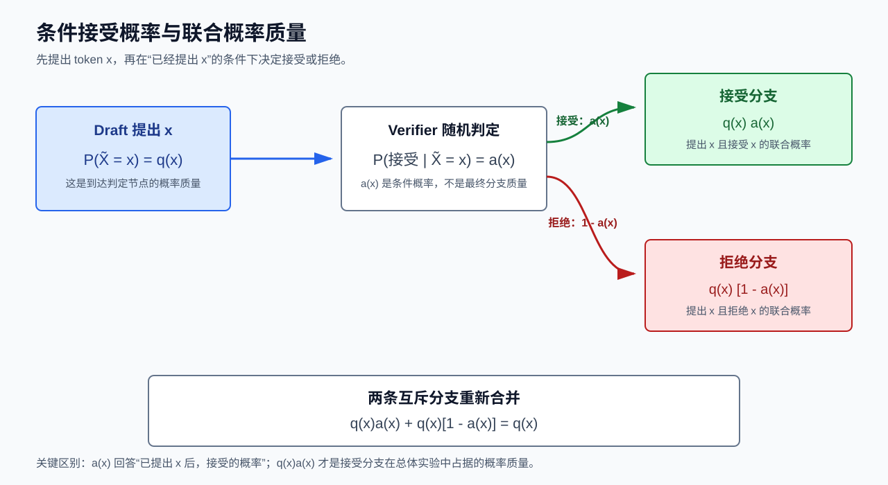
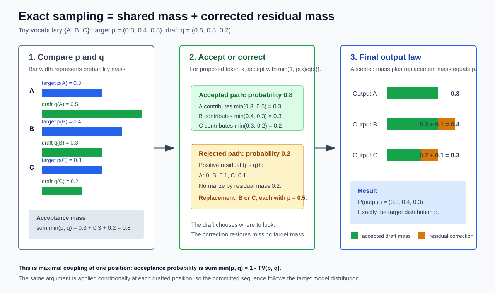

# Speculative Decoding 的概率论基础：从概率质量到精确随机验证

> 本文服务于一个具体目标：理解 speculative decoding 中为什么可以先从 draft 分布提出候选，再通过随机接受与 residual distribution 校正，使最终输出严格服从 target 分布。
>
> 全文只讨论概率语义，不讨论 GPU、并行执行、KV Cache 或服务系统。基础概率定义主要依据 Bertsekas 与 Tsitsiklis 的正式教材；经典拒绝采样依据 Devroye 的专著；total variation 与 maximal coupling 依据 Levin、Peres 与 Wilmer 的教材；speculative sampling 的算法与精确性依据 Leviathan 等人与 Chen 等人的原论文。完整来源见文末参考资料。

对应的算法与系统主文档见：[Speculative Decoding：Target 如何验收 Draft 候选 Token？](./speculative_decoding.md)。

## 0. 学习目标与阅读路线

目标是从基础概率质量出发，依次理解条件接受概率、overlap、total variation、maximal coupling、residual distribution，以及单步正确性如何通过链式法则扩展为序列级正确性；同时严格区分经典 rejection sampling 与 speculative sampling、same distribution 与 same sample。

全文分两部分：

- 第 1-7 节建立离散概率、拒绝采样、total variation 与 maximal coupling 的基础。
- 第 8-19 节把这些工具映射到 speculative decoding，完整推导 verifier、residual distribution 与序列级精确性，并通过边界情况、常见误区和练习巩固理解。

### 0.1 数学书写约定

1. 词表记为有限集合 $V$。
2. 概率分布既可以写成函数 $p(x)$，也可以按词表固定顺序写成概率列向量 $\boldsymbol{p}$。
3. 若 $V=\{v_1,\ldots,v_m\}$，则：

$$ \boldsymbol{p}=(p(v_1),\ldots,p(v_m))^\top\in\mathbb{R}^m $$

4. 向量一律按列向量书写。
5. 在 speculative decoding 部分，$x_{1:t}$ 始终表示已经提交的前缀；第 $i$ 个候选的绝对位置始终是 $t+i$；target 分布、draft 分布与候选分别写成 $p_{t+i}$、$q_{t+i}$ 与 $\tilde{x}_{t+i}$。

# 第一部分：离散概率与采样基础

## 1. 离散样本空间、事件与概率质量

### 1.1 样本空间与样本点

一次随机试验所有可能结果组成的集合称为**样本空间**，记为 $\Omega$。其中一个具体结果 $\omega\in\Omega$ 称为样本点。

投掷一次硬币时可以令 $\Omega=\{\mathrm{H},\mathrm{T}\}$。从词表中采样一个 token 时，可以令：

$$ \Omega=V $$

因此，token 采样是一个离散随机试验。

### 1.2 事件

事件是样本空间的子集。若 $A\subseteq\Omega$，则“事件 $A$ 发生”表示实际结果落在 $A$ 中。

例如，若 $V=\{\text{猫},\text{狗},\text{跑}\}$，则：

- $\{\text{猫}\}$ 是单点事件；
- $\{\text{猫},\text{狗}\}$ 可以表示“采到名词”的事件；
- $V$ 是必然事件；
- $\varnothing$ 是不可能事件。

### 1.3 概率质量函数

离散随机变量 $X$ 的 probability mass function，简称 PMF，定义为：

$$ p_X(x)=\Pr(X=x) $$

“概率质量”不是概率之外的新概念。它强调的是：总概率 $1$ 像质量一样分配在离散样本点上，而且互斥分支的质量可以相加。

对任意事件 $A\subseteq\Omega$：

$$ \Pr(X\in A)=\sum_{x\in A}p_X(x) $$

因此，单个 token $x$ 的概率质量是 $p_X(x)$，一组 token $A$ 的概率质量是 $\sum_{x\in A}p_X(x)$。

Bertsekas 与 Tsitsiklis 从样本空间、事件和概率公理出发，并把离散事件的概率写成单点概率之和；本文沿用这一标准框架 [[1]](#参考资料)。

### 1.4 非负性与归一化

合法 PMF 必须满足：

$$ p_X(x)\ge 0,\qquad \sum_{x\in\Omega}p_X(x)=1 $$

第二个条件称为**归一化**。它表示所有可能结果的概率质量总和必须恰好为 $1$。

若只有一组非负权重 $w(x)$，且 $Z=\sum_y w(y)>0$，可以通过：

$$ p(x)=\frac{w(x)}{Z} $$

把权重归一化为 PMF。记号 $\operatorname{norm}(w)$ 通常就是这一操作。

### 1.5 Support

分布 $p$ 的 support 定义为概率为正的样本点集合：

$$ \operatorname{supp}(p)=\{x\in\Omega:p(x)>0\} $$

support 决定哪些结果可能由该分布采到。若 $x\notin\operatorname{supp}(p)$，则 $p(x)=0$，从 $p$ 采样时不会得到 $x$。

必须区分：

- **样本空间**：允许讨论哪些结果；
- **support**：某个具体分布实际给哪些结果正概率。

两个分布可以定义在同一个词表 $V$ 上，却有不同 support。

### 1.6 一个三点分布

设 $\Omega=\{A,B,C\}$，且：

$$ \boldsymbol{p}=(0.3,0.4,0.3)^\top $$

则：

$$ \Pr(X=B)=0.4,\qquad \Pr(X\in\{A,C\})=0.3+0.3=0.6 $$

这里的 $0.3$、$0.4$、$0.3$ 就是分配给三个样本点的概率质量。

## 2. 联合概率、条件概率与链式法则

### 2.1 联合概率

若随机变量 $X$ 与 $Y$ 定义在同一随机试验上，其联合 PMF 为：

$$ p_{X,Y}(x,y)=\Pr(X=x,Y=y) $$

联合 PMF 同样归一化：

$$ \sum_x\sum_y p_{X,Y}(x,y)=1 $$

边缘 PMF 可以通过对另一个变量求和得到：

$$ p_X(x)=\sum_y p_{X,Y}(x,y) $$

### 2.2 条件概率

对 $\Pr(B)>0$ 的事件 $B$，条件概率定义为：

$$ \Pr(A\mid B)=\frac{\Pr(A\cap B)}{\Pr(B)} $$

因此：

$$ \Pr(A\cap B)=\Pr(B)\Pr(A\mid B) $$

这个乘法关系是理解 verifier 的第一把钥匙。若：

- $B$ 表示“draft 提出了 token $x$”；
- $A$ 表示“verifier 接受该候选”；

那么“提出 $x$ 且接受”的联合概率等于：

$$ \Pr(\text{提出 }x)\Pr(\text{接受}\mid\text{提出 }x) $$

不能把条件接受概率直接当成最终输出 $x$ 的概率。

### 2.3 条件 PMF

若 $p_Y(y)>0$，则：

$$ p_{X\mid Y}(x\mid y)=\Pr(X=x\mid Y=y)=\frac{p_{X,Y}(x,y)}{p_Y(y)} $$

反过来：

$$ p_{X,Y}(x,y)=p_Y(y)p_{X\mid Y}(x\mid y) $$

在自回归模型中，“给定已经生成的前缀后，下一个 token 的分布”就是条件 PMF。

### 2.4 链式法则

对随机变量序列 $X_1,\ldots,X_n$，联合概率可以逐项展开：

$$ \Pr(X_{1:n}=x_{1:n})=\Pr(X_1=x_1)\prod_{j=2}^{n}\Pr(X_j=x_j\mid X_{1:j-1}=x_{1:j-1}) $$

给定前缀 $x_{1:t}$ 后，未来序列满足：

$$ \Pr(X_{t+1:T}=x_{t+1:T}\mid X_{1:t}=x_{1:t})=\prod_{i=1}^{T-t}\Pr(X_{t+i}=x_{t+i}\mid X_{1:t+i-1}=x_{1:t+i-1}) $$

这条链式法则将成为序列级精确性的最终证明工具。

### 2.5 全概率公式

若互斥事件 $B_1,\ldots,B_n$ 构成样本空间的一个划分，则：

$$ \Pr(A)=\sum_{j=1}^{n}\Pr(B_j)\Pr(A\mid B_j) $$

对 verifier 而言，最重要的划分是：

- 候选被接受；
- 候选被拒绝。

因此最终输出 $x$ 的概率可以分解为：

$$ \Pr(Y=x)=\Pr(Y=x,\text{接受})+\Pr(Y=x,\text{拒绝}) $$

精确性证明的本质，就是证明右侧两条互斥分支贡献的概率质量之和恰好为 target 的 $p(x)$。

本节使用的条件概率、条件 PMF、全概率公式和链式法则均为标准概率论结果，可参见 [[1]](#参考资料)。

## 3. 独立、条件独立与独立均匀随机数

### 3.1 独立

事件 $A$ 与 $B$ 独立，当且仅当：

$$ \Pr(A\cap B)=\Pr(A)\Pr(B) $$

随机变量 $X$ 与 $Y$ 独立，当且仅当对所有 $x,y$：

$$ p_{X,Y}(x,y)=p_X(x)p_Y(y) $$

独立不是“两个结果看起来无关”，而是联合分布可以分解为边缘分布之积。

### 3.2 条件独立

给定事件或随机变量 $H$ 后，$X$ 与 $Y$ 条件独立，表示一旦固定 $H$，二者的条件联合分布可以分解：

$$ p_{X,Y\mid H}(x,y\mid h)=p_{X\mid H}(x\mid h)p_{Y\mid H}(y\mid h) $$

无条件独立不推出条件独立，条件独立也不推出无条件独立 [[1]](#参考资料)。

### 3.3 为什么 verifier 需要独立均匀随机数

设 $U\sim\operatorname{Uniform}(0,1)$。对任意 $a\in[0,1]$：

$$ \Pr(U\le a)=a $$

因此，要以概率 $a(x)$ 接受已经提出的候选 $x$，可以采样一个与候选生成过程独立的 $U$，并在 $U\le a(x)$ 时接受。

独立性保证：

$$ \Pr(U\le a(x)\mid X=x)=a(x) $$

若 $U$ 与候选 $X$ 之间存在未被算法定义的依赖，则条件接受概率可能不再是 $a(x)$，后续概率质量推导会失效。

多位置验证时，通常为每个绝对位置 $t+i$ 使用独立的：

$$ U_{t+i}\sim\operatorname{Uniform}(0,1) $$

并要求这些随机数彼此独立，也独立于候选采样和 residual sampling 所使用的随机性。严格来说，只要联合随机机制能够保证证明中需要的条件分布，完全独立不是唯一可能构造；但使用独立随机数是最清楚、最标准的充分条件。

## 4. 概率质量账本与正部

### 4.1 为什么使用“质量”语言

设最终输出随机变量为 $Y$。若算法有若干互斥路径可以输出同一个 $x$，则：

$$ \Pr(Y=x)=\sum_{\text{互斥路径 }b}\Pr(Y=x,\text{路径 }b) $$

把每一项看作一笔概率质量，就可以像记账一样检查：

1. 每条分支为 $x$ 分配了多少质量；
2. 各分支之和是否恰好等于目标预算 $p(x)$；
3. 全词表上的总质量是否归一化为 $1$。

### 4.2 正部

实数 $z$ 的正部定义为：

$$ (z)_+=\max(z,0) $$

因此：

$$ (p(x)-q(x))_+=\max(p(x)-q(x),0) $$

它只保留 $p(x)>q(x)$ 时 target 相对 draft 的正缺口。

同理：

$$ (q(x)-p(x))_+=\max(q(x)-p(x),0) $$

它只保留 draft 相对 target 的过量部分。

### 4.3 两个基本恒等式

对任意实数 $a,b$：

$$ a-\min(a,b)=(a-b)_+ $$

以及：

$$ |a-b|=(a-b)_++(b-a)_+ $$

若 $p,q$ 都归一化，则 $\sum_x(p(x)-q(x))=0$，所以：

$$ \sum_x(p(x)-q(x))_+=\sum_x(q(x)-p(x))_+ $$

左侧是 target 的总缺口，右侧是 draft 的总过量。二者总量相等，这是 residual distribution 能恰好补平概率质量的代数基础。

## 5. Proposal 与 Target：采样问题的两个角色

设我们希望得到服从 $p$ 的样本，但先从另一个分布 $q$ 生成候选。

- $p$ 称为 **target distribution**：最终输出应当服从的目标分布。
- $q$ 称为 **proposal distribution**：用于提出候选的分布。

记候选为 $\tilde{X}\sim q$，最终输出为 $Y$。目标不是让候选本身服从 $p$，而是设计一个随机变换，使：

$$ Y\sim p $$

Proposal 可以与 target 不同。算法正确性的标准是最终边缘分布：

$$ \Pr(Y=x)=p(x),\qquad \forall x\in V $$

而不是要求：

- 每个 proposal 都被接受；
- proposal 的 argmax 与 target 的 argmax 相同；
- 某次运行的输出与另一种采样实现逐样本相同。

## 6. 经典 Rejection Sampling

经典 rejection sampling 的标准形式可参见 Devroye 的正式专著 [[2]](#参考资料)。

### 6.1 包络条件

目标分布为 $p$，proposal 为 $q$。经典 rejection sampling 要求存在有限常数 $M\ge 1$，使所有 $x$ 都满足：

$$ p(x)\le Mq(x) $$

等价地，在 $q(x)>0$ 处：

$$ M\ge\frac{p(x)}{q(x)} $$

因此经典 rejection sampling 要求：

$$ \operatorname{supp}(p)\subseteq\operatorname{supp}(q) $$

否则存在 $p(x)>0$ 但 $q(x)=0$ 的点，不可能找到有限 $M$。

最小可用包络常数为：

$$ M^\star=\sup_{x:p(x)>0}\frac{p(x)}{q(x)} $$

在有限离散空间上，若 support 条件成立，supremum 可以写成 maximum。

### 6.2 算法

经典 rejection sampling 重复执行：

1. 采样候选 $\tilde{X}\sim q$。
2. 独立采样 $U\sim\operatorname{Uniform}(0,1)$。
3. 若 $U\le p(\tilde{X})/(Mq(\tilde{X}))$，返回 $\tilde{X}$。
4. 否则丢弃候选，从第 1 步重新开始。

### 6.3 为什么接受后的样本服从 $p$

一次尝试中，“提出 $x$ 且接受”的联合概率是：

$$ \Pr(\tilde{X}=x,\text{接受})=q(x)\frac{p(x)}{Mq(x)}=\frac{p(x)}{M} $$

一次尝试的总接受概率为：

$$ \Pr(\text{接受})=\sum_x\frac{p(x)}{M}=\frac{1}{M} $$

因此，在已经接受的条件下：

$$ \Pr(\tilde{X}=x\mid\text{接受})=\frac{p(x)/M}{1/M}=p(x) $$

注意这里证明的是**接受样本的条件分布**。一次拒绝后，经典算法不立即输出校正样本，而是重新进行一次完整 proposal。

### 6.4 $M$ 的作用

$M$ 同时决定：

- 包络 $Mq$ 是否处处覆盖 $p$；
- 单次尝试的平均接受率 $1/M$；
- 所需尝试次数的期望 $M$。

$M$ 越大，接受率越低。选择尽可能紧的包络是经典 rejection sampling 的核心。

## 7. Overlap、Total Variation 与 Maximal Coupling

### 7.1 Overlap

两个离散分布 $p,q$ 的重叠质量定义为：

$$ \operatorname{Ov}(p,q)=\sum_{x\in V}\min(p(x),q(x)) $$

对每个 $x$，$\min(p(x),q(x))$ 是两分布在该点能够共同拥有的最大质量。把这些共同质量相加，就得到全词表 overlap。

### 7.2 Total variation distance

有限离散空间上的 total variation distance 定义为：

$$ \operatorname{TV}(p,q)=\frac{1}{2}\sum_{x\in V}|p(x)-q(x)| $$

它也等于两分布对同一个事件所赋概率之差的最大值：

$$ \operatorname{TV}(p,q)=\max_{A\subseteq V}|p(A)-q(A)| $$

这些等价定义见 Levin、Peres 与 Wilmer 第 4 章 [[3]](#参考资料)。

### 7.3 Overlap 与 total variation 的关系

利用 $|a-b|=a+b-2\min(a,b)$：

$$ \operatorname{TV}(p,q)=\frac{1}{2}\sum_x\left(p(x)+q(x)-2\min(p(x),q(x))\right) $$

由于 $\sum_xp(x)=\sum_xq(x)=1$：

$$ \operatorname{TV}(p,q)=1-\sum_x\min(p(x),q(x)) $$

所以：

$$ \operatorname{Ov}(p,q)=1-\operatorname{TV}(p,q) $$

### 7.4 Coupling

分布 $p$ 与 $q$ 的 coupling，是定义在同一个联合概率空间上的随机变量对 $(X,Y)$，满足边缘分布：

$$ X\sim q,\qquad Y\sim p $$

Coupling 不要求 $X,Y$ 独立。相反，它通常刻意设计二者的依赖关系。

对任意 coupling，都有 coupling inequality：

$$ \Pr(X\ne Y)\ge\operatorname{TV}(p,q) $$

等价地：

$$ \Pr(X=Y)\le1-\operatorname{TV}(p,q)=\operatorname{Ov}(p,q) $$

也就是说，任何联合构造都不可能让两个边缘分布不同的随机变量以超过 overlap 的概率相等。

### 7.5 Maximal coupling

若某个 coupling 达到：

$$ \Pr(X=Y)=\operatorname{Ov}(p,q) $$

它称为 maximal coupling。Levin、Peres 与 Wilmer 的 Proposition 4.7 给出了这个最优值及其构造 [[3]](#参考资料)。

令共同质量：

$$ c(x)=\min(p(x),q(x)) $$

其总量为：

$$ \alpha=\sum_xc(x)=\operatorname{Ov}(p,q) $$

以概率 $\alpha$，从 $c(x)/\alpha$ 采样一个共同值并令 $X=Y$。以概率 $1-\alpha$，分别从不重叠的剩余质量采样：

$$ q_{\mathrm{excess}}(x)=\frac{(q(x)-p(x))_+}{1-\alpha},\qquad p_{\mathrm{residual}}(x)=\frac{(p(x)-q(x))_+}{1-\alpha} $$

两个剩余分布的 support 不相交，所以剩余分支中 $X\ne Y$。因此相等概率恰好是 $\alpha$，达到理论上限。

这正是稍后理解 speculative sampling 的核心视角。但要注意：这里讨论的是**固定条件历史下一个位置的两个离散分布**。不能未经额外证明，就把整条自回归序列直接称为这个单步 maximal coupling。

# 第二部分：映射到 Speculative Decoding

## 8. 自回归条件分布与统一记号

### 8.1 已提交前缀

设当前已经提交的 token 前缀为：

$$ x_{1:t}=(x_1,\ldots,x_t) $$

Draft 为本轮提出候选：

$$ \tilde{x}_{t+1},\tilde{x}_{t+2},\ldots,\tilde{x}_{t+\gamma} $$

第 $i$ 个候选的**绝对位置**是 $t+i$，不是一个脱离序列位置的通用编号。

### 8.2 第 $i$ 个位置的共同条件历史

当且仅当前 $i-1$ 个候选已经通过验证时，到达位置 $t+i$ 的真实条件历史为：

$$ h_{t+i}=(x_{1:t},\tilde{x}_{t+1:t+i-1}) $$

Target 与 draft 必须在这个相同历史上定义分布：

$$ p_{t+i}(x)=p(x\mid h_{t+i}),\qquad q_{t+i}(x)=q(x\mid h_{t+i}) $$

Draft 候选满足：

$$ \tilde{x}_{t+i}\sim q_{t+i} $$

这里的 $p_{t+i}$ 与 $q_{t+i}$ 都是定义在共同词表 $V$ 上的归一化 PMF，也可以写成概率列向量 $\boldsymbol{p}_{t+i}$ 与 $\boldsymbol{q}_{t+i}$。

### 8.3 必须使用实际采样分布

$q_{t+i}$ 必须是实际生成 $\tilde{x}_{t+i}$ 的 proposal 分布；$p_{t+i}$ 必须是最终希望保持的 target 分布。

若采样前应用了 temperature、top-$p$、top-$k$ 或其他概率变换，那么 verifier 中使用的 $p_{t+i},q_{t+i}$ 必须是变换并重新归一化后的实际分布。候选来自一个分布、接受比值却使用另一个分布时，后文等式不成立。

Leviathan 等人的算法把经过采样规则调整后的两个分布作为 $p,q$；Chen 等人的原论文也明确要求基于条件历史下 target 与 draft 的实际概率执行 modified rejection sampling [[4]](#参考资料) [[5]](#参考资料)。

## 9. 单步精确 stochastic verifier

本节固定一个已经到达的绝对位置 $t+i$。为突出代数结构，先明确声明：**仅在本节单步推导内部省略位置下标**，写：

$$ p=p_{t+i},\qquad q=q_{t+i},\qquad \tilde{X}=\tilde{x}_{t+i} $$

推导结束后恢复绝对位置下标。

### 9.1 候选与接受事件

先采样：

$$ \tilde{X}\sim q $$

设在已经提出 token $x$ 的条件下，接受它的概率为 $a(x)$：

$$ a(x)=\Pr(\text{接受}\mid\tilde{X}=x) $$

于是“提出 $x$ 且接受”的联合概率质量为：

$$ \Pr(\tilde{X}=x,\text{接受})=q(x)a(x) $$

这一项才是接受分支最终为 token $x$ 贡献的概率质量。$a(x)$ 自身只是条件概率。

### 9.2 从 target 预算推出接受概率

接受分支给 $x$ 的质量不能超过 target 允许的 $p(x)$：

$$ q(x)a(x)\le p(x) $$

同时：

$$ 0\le a(x)\le1 $$

为了尽可能多地保留 proposal，应在这两个约束下取最大的 $a(x)$：

$$ a(x)=\min\left(1,\frac{p(x)}{q(x)}\right) $$

这个比值只需要在 $q(x)>0$、即 proposal 可能实际提出 $x$ 时计算。若 $q(x)=0$，proposal 不会提出 $x$，无需计算 $p(x)/q(x)$。

接受分支为 $x$ 贡献：

$$ q(x)a(x)=q(x)\min\left(1,\frac{p(x)}{q(x)}\right)=\min(p(x),q(x)) $$

因此接受规则不是经验阈值。它恰好取出 $p$ 与 $q$ 在每个 token 上的共同质量。

### 9.3 用独立均匀随机数实现

采样与候选独立的 $U\sim\operatorname{Uniform}(0,1)$，并在：

$$ U\le\min\left(1,\frac{p(\tilde{X})}{q(\tilde{X})}\right) $$

时接受。

两种情况是：

1. 若 $p(x)\ge q(x)$，则 $a(x)=1$。Draft 对 $x$ 提出得不比 target 需要得多，所有这类候选都可接受。
2. 若 $p(x)<q(x)$，则 $a(x)=p(x)/q(x)$。Draft 过度提出 $x$，只能保留其中相应比例。

“Target 给 $x$ 的绝对概率很高”并不推出“一定接受”。是否必然接受取决于 $p(x)\ge q(x)$，而不是只看 $p(x)$。

### 9.4 总接受概率

总接受概率为：

$$ \alpha=\sum_xq(x)a(x)=\sum_x\min(p(x),q(x)) $$

所以：

$$ \alpha=\operatorname{Ov}(p,q)=1-\operatorname{TV}(p,q) $$

总拒绝概率为：

$$ \beta=1-\alpha=\operatorname{TV}(p,q) $$

也可以从各 proposal 分支直接推出。Draft 以 $q(x)$ 的概率提出 $x$，在已经提出 $x$ 的条件下以 $1-a(x)$ 的概率拒绝。由全概率公式：

$$ \beta=\sum_x\Pr(\tilde{X}=x)\Pr(\text{拒绝}\mid\tilde{X}=x)=\sum_xq(x)(1-a(x)) $$

对每个满足 $q(x)>0$ 的 token，代入接受概率：

$$ q(x)(1-a(x))=q(x)\left(1-\min\left(1,\frac{p(x)}{q(x)}\right)\right)=q(x)-\min(q(x),p(x))=(q(x)-p(x))_+ $$

当 $q(x)=0$ 时等式两边也都为 $0$，所以：

$$ \beta=\sum_xq(x)(1-a(x))=\sum_x(q(x)-p(x))_+ $$

## 10. Residual Distribution 的完整推导

### 10.1 接受分支已经覆盖了什么

接受分支已经为每个 $x$ 分配：

$$ \min(p(x),q(x)) $$

但 target 最终要求 $x$ 的总质量为 $p(x)$。因此尚未覆盖的质量是：

$$ p(x)-\min(p(x),q(x)) $$

利用正部恒等式：

$$ p(x)-\min(p(x),q(x))=(p(x)-q(x))_+ $$

这就是 residual distribution 的分子。

### 10.2 为什么必须截断负值

若 $q(x)>p(x)$，接受分支已经为 $x$ 分配了完整的 target 预算 $p(x)$。此时 $p(x)-q(x)<0$ 不是“负概率”，而是说明 draft 对 $x$ 提议过量；拒绝一部分 proposal 已经消除了过量，校正分支不应再给 $x$ 增加质量。

因此只保留：

$$ (p(x)-q(x))_+ $$

### 10.3 分母为什么等于拒绝概率

Residual 总质量为：

$$ \sum_y(p(y)-q(y))_+ $$

由于 $p,q$ 都归一化：

$$ \sum_y(p(y)-q(y))_+=\sum_y(q(y)-p(y))_+ $$

右侧正是总拒绝概率 $\beta$，故：

$$ \beta=\sum_y(p(y)-q(y))_+=\operatorname{TV}(p,q) $$

当 $\beta>0$ 时，拒绝后的 residual distribution 为：

$$ r(x)=\frac{(p(x)-q(x))_+}{\sum_{y\in V}(p(y)-q(y))_+}=\frac{(p(x)-q(x))_+}{\beta} $$

它是合法 PMF，因为每项非负且总和为 $1$。

### 10.4 为什么不能拒绝后直接从 $p$ 重采

若拒绝后直接从原始 $p$ 采样，则校正分支会再次给所有 $p(x)>0$ 的 token 分配质量，其中包括已经由接受分支覆盖的共同质量。

假设错误算法在拒绝后从 $p$ 重采，则最终输出 $x$ 的概率为：

$$ \min(p(x),q(x))+\beta p(x) $$

除特殊情形外，它不等于 $p(x)$。接受分支与重采分支重复计算了部分 target 质量。

正确 residual 只补尚未覆盖的缺口：

$$ \beta r(x)=(p(x)-q(x))_+ $$

### 10.5 单步精确性证明

设最终输出为 $Y$。按接受与拒绝两条互斥路径应用全概率公式：

$$ \Pr(Y=x)=\Pr(Y=x,\text{接受})+\Pr(Y=x,\text{拒绝}) $$

接受分支：

$$ \Pr(Y=x,\text{接受})=\min(p(x),q(x)) $$

拒绝分支：

$$ \Pr(Y=x,\text{拒绝})=\beta r(x)=(p(x)-q(x))_+ $$

所以：

$$ \Pr(Y=x)=\min(p(x),q(x))+(p(x)-q(x))_+=p(x) $$

因此：

$$ Y\sim p $$

这就是 Leviathan 等人 Appendix A.1 与 Chen 等人 Theorem 1 所证明的核心概率质量恒等式，只是本文统一采用 $p$ 表示 target、$q$ 表示 draft [[4]](#参考资料) [[5]](#参考资料)。Chen 等人的原论文符号恰好相反，阅读原文时应特别注意。

### 10.6 恢复绝对位置下标

对位置 $t+i$，接受概率为：

$$ a_{t+i}(x)=\min\left(1,\frac{p_{t+i}(x)}{q_{t+i}(x)}\right) $$

若候选 $\tilde{x}_{t+i}$ 被拒绝，则从：

$$ r_{t+i}(x)=\frac{(p_{t+i}(x)-q_{t+i}(x))_+}{\sum_{y\in V}(p_{t+i}(y)-q_{t+i}(y))_+} $$

采样 correction token。

## 11. 一个完整数值例子

设：

$$ V=\{A,B,C\},\qquad \boldsymbol{p}=(0.3,0.4,0.3)^\top,\qquad \boldsymbol{q}=(0.5,0.3,0.2)^\top $$

| Token | $p(x)$ | $q(x)$ | $a(x)$ | 接受质量 $\min(p,q)$ | target 缺口 $(p-q)_+$ |
|---|---:|---:|---:|---:|---:|
| $A$ | $0.3$ | $0.5$ | $0.6$ | $0.3$ | $0$ |
| $B$ | $0.4$ | $0.3$ | $1$ | $0.3$ | $0.1$ |
| $C$ | $0.3$ | $0.2$ | $1$ | $0.2$ | $0.1$ |

总接受概率为：

$$ \alpha=0.3+0.3+0.2=0.8 $$

只有 proposal 为 $A$ 时才可能拒绝：draft 以 $q(A)=0.5$ 的概率提出 $A$，给定已提出 $A$ 后又以 $1-a(A)=0.4$ 的概率拒绝，因此这条路径贡献 $0.5\times0.4=0.2$。提出 $B,C$ 后的拒绝概率均为 $0$。由全概率公式：

$$ \beta=\Pr(\text{拒绝})=\sum_{x\in V}q(x)(1-a(x))=0.5\times0.4+0.3\times0+0.2\times0=0.2 $$

等价地，总拒绝概率也可以由总接受概率的补集得到：$\beta=1-\alpha=0.2$。

Residual 为：

$$ \boldsymbol{r}=\frac{(0,0.1,0.1)^\top}{0.2}=(0,0.5,0.5)^\top $$

最终各 token 的质量是：

$$ \Pr(Y=A)=0.3+0.2\times0=0.3 $$

$$ \Pr(Y=B)=0.3+0.2\times0.5=0.4 $$

$$ \Pr(Y=C)=0.2+0.2\times0.5=0.3 $$

恰好恢复 target $\boldsymbol{p}$。

图中的绿色部分是接受分支复用的 overlap，橙色部分是拒绝分支补回的 positive residual。二者逐 token 相加得到 target。

## 12. 为什么这是单步 Maximal Coupling

在固定历史 $h_{t+i}$ 下，令：

- $X_{t+i}=\tilde{x}_{t+i}\sim q_{t+i}$ 表示 draft proposal；
- $Y_{t+i}$ 表示 verifier 在该位置最终提交的 token。

单步精确性已证明：

$$ Y_{t+i}\sim p_{t+i} $$

候选被接受时 $X_{t+i}=Y_{t+i}$。其概率为：

$$ \Pr(X_{t+i}=Y_{t+i})=\sum_x\min(p_{t+i}(x),q_{t+i}(x)) $$

而 coupling inequality 说明任何具有这两个边缘分布的 coupling 都满足：

$$ \Pr(X_{t+i}=Y_{t+i})\le1-\operatorname{TV}(p_{t+i},q_{t+i}) $$

由于：

$$ \sum_x\min(p_{t+i}(x),q_{t+i}(x))=1-\operatorname{TV}(p_{t+i},q_{t+i}) $$

该 verifier 达到相等概率的理论上限。因此，它在**这个固定条件历史、这个单一绝对位置**上实现了 maximal coupling。

拒绝时：

- 被拒 proposal 只可能来自 $q_{t+i}(x)>p_{t+i}(x)$ 的 draft 过量区域；
- correction 只可能来自 $p_{t+i}(x)>q_{t+i}(x)$ 的 target 缺口区域。

两个区域不相交，所以拒绝分支不会让 proposal 与 correction 相等。这与标准 maximal coupling 的共同质量加两侧剩余质量构造完全一致 [[3]](#参考资料)。

必须限制结论范围：整条序列的正确性来自逐历史的条件分布正确和链式法则，而不是因为把整条序列简单地套进了上述单步 coupling 结论。

## 13. 与经典 Rejection Sampling 的联系和差异

Leviathan 等人的 Appendix A.2 专门比较了二者 [[4]](#参考资料)。

### 13.1 联系

二者都：

1. 先从 proposal $q$ 生成候选；
2. 使用独立均匀随机数执行随机接受；
3. 通过概率比值校正 proposal 与 target 的差异；
4. 在理想精确算术下产生 target 分布的精确样本。

### 13.2 经典 rejection sampling 的接受规则

经典规则为：

$$ a_{\mathrm{classic}}(x)=\frac{p(x)}{Mq(x)} $$

其中全局常数 $M$ 必须满足 $p(x)\le Mq(x)$。总接受率为 $1/M$。拒绝后不输出 token，而是重新从 $q$ 开始尝试。

### 13.3 Speculative sampling 的接受规则

Speculative sampling 使用：

$$ a_{\mathrm{spec}}(x)=\min\left(1,\frac{p(x)}{q(x)}\right) $$

它逐 token 取可复用的最大共同质量，总接受率为：

$$ \alpha_{\mathrm{spec}}=\sum_x\min(p(x),q(x)) $$

拒绝后不重新开始 proposal 循环，而是立即从 normalized positive residual $(p-q)_+$ 输出一个 correction token。

### 13.4 为什么不能把 speculative 规则解释成 $M=1$ 的经典拒绝采样

经典 rejection sampling 只有在 $p(x)\le q(x)$ 对所有 $x$ 成立时才能取 $M=1$。但 $p,q$ 都归一化为 $1$，若处处 $p(x)\le q(x)$，则只能有 $p=q$。

一般情况下，某些点 $p(x)>q(x)$，另一些点 $p(x)<q(x)$。Speculative sampling 并没有要求 $q$ 是 $p$ 的全局包络，而是：

- 在共同质量区域直接耦合；
- 通过 residual 分支补足 $p>q$ 的缺口；
- 通过随机拒绝削去 $q>p$ 的过量。

因此它是 modified rejection sampling/maximal-coupling 构造，不是把经典包络常数偷偷设成了 $1$。

### 13.5 对照表

| 性质 | 经典 rejection sampling | Speculative sampling 单步 verifier |
|---|---|---|
| Proposal | $q$ | $q$ |
| Target | $p$ | $p$ |
| 额外条件 | 存在 $M$ 使 $p\le Mq$ | $p,q$ 定义在同一离散空间 |
| Support 要求 | $\operatorname{supp}(p)\subseteq\operatorname{supp}(q)$ | 不要求 target support 包含于 draft support |
| 条件接受率 | $p(x)/(Mq(x))$ | $\min(1,p(x)/q(x))$ |
| 总接受率 | $1/M$ | overlap $=1-\operatorname{TV}(p,q)$ |
| 拒绝后 | 丢弃并重新 proposal | 从 normalized $(p-q)_+$ 输出 correction |
| 正确性关键 | 接受条件下归一化为 $p$ | overlap 与 residual 质量之和逐点等于 $p$ |

## 14. 从单步精确性到序列级精确性

### 14.1 一轮验证的概率语义

设 draft 提出 $\gamma$ 个候选：

$$ \tilde{x}_{t+1:t+\gamma} $$

Verifier 从左到右依次检查。对第 $i$ 个候选，使用相同历史：

$$ h_{t+i}=(x_{1:t},\tilde{x}_{t+1:t+i-1}) $$

以及独立随机数 $U_{t+i}$，按：

$$ U_{t+i}\le\min\left(1,\frac{p_{t+i}(\tilde{x}_{t+i})}{q_{t+i}(\tilde{x}_{t+i})}\right) $$

决定是否接受。

有两种终止方式：

1. 若第 $i$ 个候选第一次被拒绝，则保留前 $i-1$ 个已接受候选，并从 $r_{t+i}$ 采样一个 correction token；本轮在此结束。
2. 若 $\gamma$ 个候选全部接受，则从完整候选前缀后的 target 条件分布 $p_{t+\gamma+1}$ 采样一个 bonus token；本轮结束。

遇到第一次拒绝后不能继续验证后续候选，因为真实前缀已被 correction 改变。后续预先提出的候选条件化在包含被拒 token 的历史上，不再对应新的真实历史。

### 14.2 条件分布归纳

考虑任意已经提交的真实前缀 $x_{1:s}$。要证明整个算法与 target-only sampling 同分布，只需证明它提交的下一个 token $Y_{s+1}$ 满足：

$$ \Pr(Y_{s+1}=y\mid X_{1:s}=x_{1:s})=p_{s+1}(y) $$

若这个 token 来自某个 speculative 验证位置，单步质量证明给出上述结论；若它是全部候选接受后的 bonus token，它本来就直接从相应 target 条件分布采样。

因此，无论该 token 在一轮中是：

- 被接受的 draft token；
- 第一次拒绝后的 correction token；
- 全部接受后的 bonus token；

在其真实已提交历史条件下，它都服从 target 定义的下一个 token 分布。

现在作归纳：

1. 基础步：给定初始前缀 $x_{1:t}$，算法提交的第一个新 token 服从 $p_{t+1}$。
2. 归纳假设：前面已提交 token 的联合分布与 target-only sampling 相同。
3. 归纳步：条件于任意已提交历史，下一个 token 的条件分布仍是 target 的条件分布，所以扩展一位后的联合分布也相同。

### 14.3 链式法则证明

对任意未来序列 $y_{t+1:T}$，speculative sampling 赋予它的概率为：

$$ \Pr_{\mathrm{spec}}(Y_{t+1:T}=y_{t+1:T}\mid x_{1:t})=\prod_{i=1}^{T-t}p_{t+i}(y_{t+i}\mid x_{1:t},y_{t+1:t+i-1}) $$

这与 target-only sampling 的自回归链式分解完全相同：

$$ \Pr_{\mathrm{target}}(Y_{t+1:T}=y_{t+1:T}\mid x_{1:t})=\prod_{i=1}^{T-t}p_{t+i}(y_{t+i}\mid x_{1:t},y_{t+1:t+i-1}) $$

故：

$$ \Pr_{\mathrm{spec}}(Y_{t+1:T}=y_{t+1:T}\mid x_{1:t})=\Pr_{\mathrm{target}}(Y_{t+1:T}=y_{t+1:T}\mid x_{1:t}) $$

这就是序列级精确性。它依赖每一步都使用正确的真实条件历史。

## 15. Same Distribution 不等于 Same Sample

### 15.1 分布相同

“Speculative sampling 与 target-only sampling 同分布”表示对任意序列 $y$：

$$ \Pr_{\mathrm{spec}}(Y=y)=\Pr_{\mathrm{target}}(Y=y) $$

这是对概率律的陈述。

### 15.2 样本相同

“两次运行得到相同样本”是关于某个 coupling 或随机数映射的陈述。即使两个随机变量边缘分布相同，它们也可以：

- 独立采样，因而经常不同；
- 使用同一个随机变量构造，因而总是相同；
- 使用其他 coupling，只在部分情况下相同。

例如，$X,Y$ 都是公平硬币并不意味着 $X=Y$。若独立采样，则 $\Pr(X=Y)=1/2$；若定义 $Y=X$，则 $\Pr(X=Y)=1$。两种情况下边缘分布都相同。

### 15.3 对 speculative sampling 的含义

Speculative verifier 额外消耗接受判定随机数，拒绝时又从 residual distribution 采样。Target-only sampling 则直接从 $p$ 采样。二者把随机数映射到 token 的方式不同。

所以：

- 精确性要求是 same distribution；
- 一般不要求 same seed 产生 same sample；
- 某次运行输出不同不能单独证明分布错误；
- 若要逐样本相同，必须额外设计特定 coupling，这不是标准精确性结论。

原论文使用的“identical output distribution”“without changing the distribution”应按这个分布层含义理解 [[4]](#参考资料) [[5]](#参考资料)。

## 16. 边界情况

### 16.1 $p=q$

此时对所有 $x$：

$$ a(x)=1 $$

且：

$$ \alpha=1,\qquad\beta=0 $$

所有 proposal 都接受。Residual 的分子总和为 $0$，归一化表达式是 $0/0$，但 residual 分支概率为零，理论上不可达。正确实现或伪代码不应在不可达分支强行构造 residual。

### 16.2 Support 完全不重叠

若：

$$ \operatorname{supp}(p)\cap\operatorname{supp}(q)=\varnothing $$

则：

$$ \alpha=0,\qquad\beta=1 $$

所有 proposal 都被拒绝，且 $(p-q)_+=p$，所以：

$$ r=p $$

最终输出仍服从 target。

### 16.3 $q(x)=0$ 且 $p(x)>0$

Draft 不可能提出 $x$，所以不会在接受判定中实际计算 $p(x)/q(x)$。该点的 target 质量通过 residual 分支补充：

$$ (p(x)-q(x))_+=p(x) $$

这说明 speculative sampling 不要求 $\operatorname{supp}(p)\subseteq\operatorname{supp}(q)$。

### 16.4 $p(x)=0$ 且 $q(x)>0$

Draft 可能提出 $x$，但：

$$ a(x)=0 $$

因此它必被拒绝，最终输出不会错误地给 $x$ 正质量。

### 16.5 单点 target

若 target 在 $x^\star$ 上退化：

$$ p(x^\star)=1 $$

则 proposal 提出 $x^\star$ 时总接受；提出其他 token 时必拒绝，而 residual correction 必为 $x^\star$。最终输出确定为 $x^\star$。

### 16.6 EOS

EOS 在概率层面只是词表 $V$ 中的一个 token。若 EOS 被接受或由 correction/bonus 采到，则它服从与其他 token 相同的质量证明；之后序列按照生成任务定义终止。

### 16.7 经过截断的分布

若 top-$p$ 或 top-$k$ 使某些 token 概率变成 $0$，应先把截断后的权重重新归一化为合法 PMF，再把这些实际 PMF 代入接受与 residual 公式。

### 16.8 理想数学与有限精度

本文证明假设概率值与采样操作遵循精确数学定义。有限精度实现需要保证非负化、归一化和零 residual mass 的处理与数学分支一致。Chen 等人因此谨慎表述为“within hardware numerics” [[5]](#参考资料)。这不改变理想概率推导，但说明数值实现仍需单独验证。

## 17. 常见误区

### 17.1 “Target 概率高就接受”

错误。接受概率取决于 $p(x)/q(x)$。只有 $p(x)\ge q(x)$ 时才必然接受。

### 17.2 “条件接受概率就是最终输出概率”

错误。$a(x)$ 是已知 proposal 为 $x$ 后的条件概率。接受分支输出 $x$ 的联合概率是 $q(x)a(x)=\min(p(x),q(x))$。

### 17.3 “拒绝后直接按 $p$ 重采也正确”

一般错误。接受分支已经使用了一部分 $p$ 的质量，直接从完整 $p$ 重采会重复分配。必须从 normalized $(p-q)_+$ 采样。

### 17.4 “Residual 是 $p-q$”

不完整。$p-q$ 可能为负，且通常不归一化。Residual PMF 是：

$$ r(x)=\frac{(p(x)-q(x))_+}{\sum_y(p(y)-q(y))_+} $$

### 17.5 “Residual 分母是随意加的归一化常数”

错误。它恰好等于拒绝概率：

$$ \sum_y(p(y)-q(y))_+=\beta=\operatorname{TV}(p,q) $$

因此拒绝分支贡献 $\beta r(x)=(p(x)-q(x))_+$。

### 17.6 “这是把经典 rejection sampling 的 $M$ 设成 1”

错误。经典方法需要全局包络 $p\le Mq$；speculative sampling 使用 overlap 加 residual 的 maximal-coupling 构造。一般 $p\ne q$ 时不能把经典 $M$ 设为 $1$。

### 17.7 “相同 argmax 意味着接受率高”

错误。总接受率是全分布 overlap：

$$ \alpha=\sum_x\min(p(x),q(x)) $$

两个分布可以有相同 argmax，却在其余质量上差异很大。

### 17.8 “单步 maximal coupling 自动证明整序列 maximal”

错误。单步 maximal coupling 只针对固定历史下的 $p_{t+i},q_{t+i}$。整序列的分布精确性由条件分布归纳和链式法则证明。

### 17.9 “同分布就应该同 seed 输出相同文本”

错误。同分布约束概率律，不约束两套算法如何消耗和映射伪随机数。

### 17.10 “可以跳过第一次拒绝，继续接受后面的候选”

错误。第一次拒绝后的 correction 改变了真实前缀，后续候选和条件分布建立在旧的假设前缀上，不能继续作为新历史下的有效验证结果。

## 18. 练习

### 练习 1：PMF 与事件质量

设 $V=\{A,B,C,D\}$，$\boldsymbol{p}=(0.1,0.2,0.3,0.4)^\top$。求事件 $\{B,D\}$ 的概率，并写出 $\operatorname{supp}(p)$。

### 练习 2：条件概率与联合概率

某 proposal 以概率 $0.3$ 提出 $B$。已提出 $B$ 时，verifier 以概率 $0.8$ 接受。求“提出 $B$ 且接受”的联合概率。说明为什么答案不是 $0.8$。

### 练习 3：经典 rejection sampling

设 $V=\{A,B\}$，$\boldsymbol{p}=(0.4,0.6)^\top$，$\boldsymbol{q}=(0.5,0.5)^\top$。

1. 求最小包络常数 $M^\star$。
2. 求经典 rejection sampling 的总接受率。
3. 求两点各自的条件接受率。

### 练习 4：Overlap 与 total variation

设 $\boldsymbol{p}=(0.5,0.3,0.2)^\top$，$\boldsymbol{q}=(0.2,0.3,0.5)^\top$。分别计算 overlap 与 total variation，并验证二者之和为 $1$。

### 练习 5：完整 verifier

沿用练习 4 的 $p,q$：

1. 求每个 token 的 speculative 条件接受率。
2. 求总拒绝概率。
3. 求 residual distribution。
4. 验证最终输出 PMF 等于 $p$。

### 练习 6：错误地从 $p$ 重采

沿用第 11 节 $\boldsymbol{p}=(0.3,0.4,0.3)^\top$、$\boldsymbol{q}=(0.5,0.3,0.2)^\top$。若拒绝后错误地从 $p$ 重采，计算最终输出分布。

### 练习 7：Support 缺失

设 $V=\{A,B\}$，$\boldsymbol{p}=(0.5,0.5)^\top$，$\boldsymbol{q}=(1,0)^\top$。

1. 经典 rejection sampling 是否存在有限包络常数 $M$？
2. Speculative sampling 的接受率与 residual 分布是什么？
3. 最终输出分布是什么？

### 练习 8：证明正负差总量相等

只使用 $\sum_xp(x)=\sum_xq(x)=1$，证明：

$$ \sum_x(p(x)-q(x))_+=\sum_x(q(x)-p(x))_+ $$

### 练习 9：序列链式法则

给定已提交前缀 $x_{1:t}$，假设某算法对每个真实历史 $y_{1:s}$ 都满足：

$$ \Pr_{\mathcal{A}}(Y_{s+1}=y\mid Y_{1:s}=y_{1:s})=p_{s+1}(y\mid y_{1:s}) $$

用链式法则证明算法 $\mathcal{A}$ 的任意有限输出序列分布与 target 相同。

## 19. 练习答案

### 答案 1

$$ \Pr(X\in\{B,D\})=p(B)+p(D)=0.2+0.4=0.6 $$

四个点概率均为正，所以：

$$ \operatorname{supp}(p)=\{A,B,C,D\} $$

### 答案 2

$$ \Pr(\tilde{X}=B,\text{接受})=0.3\times0.8=0.24 $$

$0.8$ 是已经提出 $B$ 后的条件接受概率；联合事件还必须乘以提出 $B$ 的概率 $0.3$。

### 答案 3

逐点比值为：

$$ \frac{p(A)}{q(A)}=0.8,\qquad\frac{p(B)}{q(B)}=1.2 $$

所以：

$$ M^\star=1.2 $$

总接受率为：

$$ \frac{1}{M^\star}=\frac{5}{6} $$

两个点的条件接受率分别为：

$$ \frac{0.4}{1.2\times0.5}=\frac{2}{3},\qquad\frac{0.6}{1.2\times0.5}=1 $$

### 答案 4

$$ \operatorname{Ov}(p,q)=\min(0.5,0.2)+\min(0.3,0.3)+\min(0.2,0.5)=0.7 $$

$$ \operatorname{TV}(p,q)=\frac{1}{2}(|0.5-0.2|+|0.3-0.3|+|0.2-0.5|)=0.3 $$

所以：

$$ \operatorname{Ov}(p,q)+\operatorname{TV}(p,q)=0.7+0.3=1 $$

### 答案 5

条件接受率为：

$$ \boldsymbol{a}=(1,1,0.4)^\top $$

接受质量为：

$$ \min(\boldsymbol{p},\boldsymbol{q})=(0.2,0.3,0.2)^\top $$

总拒绝概率为：

$$ \beta=1-(0.2+0.3+0.2)=0.3 $$

Positive residual 为：

$$ (\boldsymbol{p}-\boldsymbol{q})_+=(0.3,0,0)^\top $$

故：

$$ \boldsymbol{r}=(1,0,0)^\top $$

最终输出质量为：

$$ (0.2,0.3,0.2)^\top+0.3(1,0,0)^\top=(0.5,0.3,0.2)^\top=\boldsymbol{p} $$

### 答案 6

正确接受质量为 $(0.3,0.3,0.2)^\top$，拒绝概率为 $0.2$。若错误地从 $p$ 重采，最终分布为：

$$ (0.3,0.3,0.2)^\top+0.2(0.3,0.4,0.3)^\top=(0.36,0.38,0.26)^\top $$

它不等于 $(0.3,0.4,0.3)^\top$。

### 答案 7

由于 token $B$ 满足 $p(B)=0.5>0$ 但 $q(B)=0$，经典 rejection sampling 不存在有限 $M$。

Speculative sampling 中 proposal 总是第一个点，其接受概率为 $0.5/1=0.5$。所以：

$$ \alpha=0.5,\qquad\beta=0.5 $$

Positive residual 为 $(0,0.5)^\top$，故：

$$ \boldsymbol{r}=(0,1)^\top $$

最终输出为：

$$ (0.5,0)^\top+0.5(0,1)^\top=(0.5,0.5)^\top=\boldsymbol{p} $$

### 答案 8

对每个 $x$：

$$ p(x)-q(x)=(p(x)-q(x))_+-(q(x)-p(x))_+ $$

对 $x$ 求和：

$$ 0=\sum_x(p(x)-q(x))=\sum_x(p(x)-q(x))_+-\sum_x(q(x)-p(x))_+ $$

移项即得结论。

### 答案 9

对任意 $y_{t+1:T}$，由链式法则：

$$ \Pr_{\mathcal{A}}(Y_{t+1:T}=y_{t+1:T}\mid x_{1:t})=\prod_{i=1}^{T-t}\Pr_{\mathcal{A}}(Y_{t+i}=y_{t+i}\mid x_{1:t},y_{t+1:t+i-1}) $$

代入题设的逐历史条件分布：

$$ \Pr_{\mathcal{A}}(Y_{t+1:T}=y_{t+1:T}\mid x_{1:t})=\prod_{i=1}^{T-t}p_{t+i}(y_{t+i}\mid x_{1:t},y_{t+1:t+i-1}) $$

右侧正是 target 的自回归联合分布，所以二者对任意有限序列赋予相同概率。

## 参考资料

1. Dimitri P. Bertsekas, John N. Tsitsiklis. [*Introduction to Probability*, 2nd ed., selected summary material](https://www.ocw.mit.edu/courses/res-6-012-introduction-to-probability-spring-2018/resources/introduction-to-probability-selected-textbook-summary-material/). Athena Scientific, 2008；MIT OpenCourseWare 官方页面。用于样本空间、概率公理、条件概率、全概率公式、独立、PMF、联合 PMF 与条件 PMF。
2. Luc Devroye. [*Non-Uniform Random Variate Generation*](https://luc.devroye.org/rnbookindex.html). Springer-Verlag, 1986；作者官方开放版本。第 II.3 章系统给出 rejection method、包络分布、拒绝常数与正确性。
3. David A. Levin, Yuval Peres, with contributions by Elizabeth L. Wilmer. [*Markov Chains and Mixing Times*, 2nd ed.](https://pages.uoregon.edu/dlevin/MARKOV/mcmt2e.pdf). American Mathematical Society, 2017；作者官方 PDF。第 4.1-4.2 节给出 total variation 的等价定义、coupling inequality 与达到最优相等概率的 coupling 构造。
4. Yaniv Leviathan, Matan Kalman, Yossi Matias. [“Fast Inference from Transformers via Speculative Decoding”](https://proceedings.mlr.press/v202/leviathan23a.html). *Proceedings of the 40th International Conference on Machine Learning*, PMLR 202, 2023. Section 2.3、Theorem 3.5、Appendix A.1-A.2 给出 speculative sampling、overlap 接受率、精确性证明以及与经典 rejection sampling 的比较。
5. Charlie Chen, Sebastian Borgeaud, Geoffrey Irving, Jean-Baptiste Lespiau, Laurent Sifre, John Jumper. [“Accelerating Large Language Model Decoding with Speculative Sampling”](https://arxiv.org/abs/2302.01318). arXiv:2302.01318, 2023. Section 4.2 与补充材料 Theorem 1 独立给出 modified rejection sampling、positive residual 重采样和 target 分布恢复证明。
