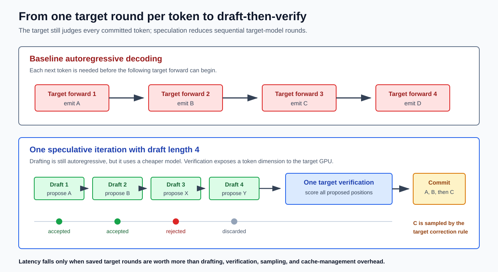
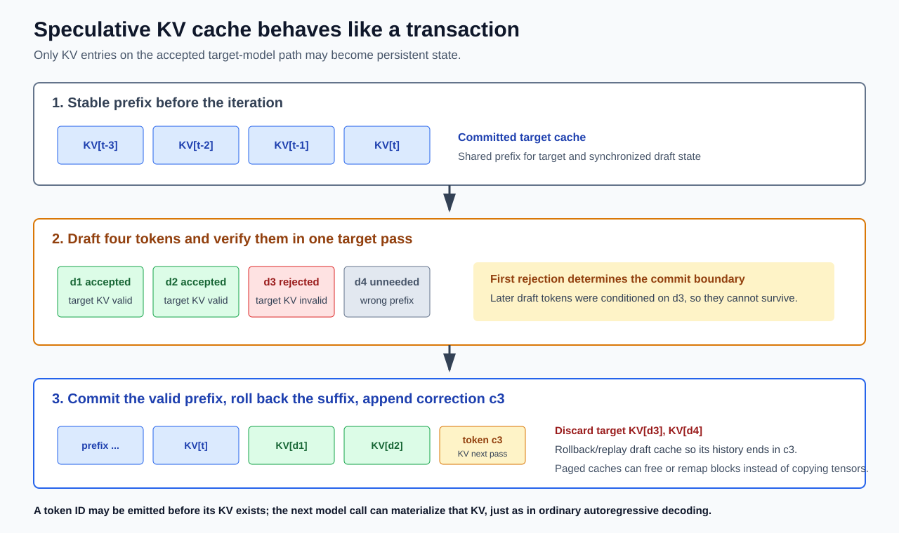

# Speculative Decoding：Target 如何验收 Draft 候选 Token？

> 本文以一个问题为主线：**target 模型如何决定是否接受 draft 产生的 token？** 简短答案是：target 不判断候选在语义上“对不对”，也不要求候选等于自己的 top-1；对于序列位置 $t+i$，它计算候选 $\tilde{x}_{t+i}$ 的目标概率 $p_{t+i}(\tilde{x}_{t+i})$，验证器再将其与 draft 的提议概率 $q_{t+i}(\tilde{x}_{t+i})$ 比较，以 $\min(1,p_{t+i}(\tilde{x}_{t+i})/q_{t+i}(\tilde{x}_{t+i}))$ 的概率接受。若拒绝，还必须从 residual distribution 采样一个校正 token。这样最终输出仍严格服从 target 分布。
>
> 主要理论来源：[Fast Inference from Transformers via Speculative Decoding](https://arxiv.org/abs/2211.17192) 与 [Accelerating Large Language Model Decoding with Speculative Sampling](https://arxiv.org/abs/2302.01318)。后文还会讨论 [SpecInfer](https://arxiv.org/abs/2305.09781)、[Medusa](https://arxiv.org/abs/2401.10774)、[EAGLE](https://arxiv.org/abs/2401.15077)、[EAGLE-2](https://arxiv.org/abs/2406.16858)、[LayerSkip](https://arxiv.org/abs/2404.16710) 等后续路线。

---

## 0. 先给出结论

设 $x_{1:t}$ 是当前已经确认的前缀，现在检查本轮第 $i$ 个候选，也就是序列绝对位置 $t+i$ 上的 token。该位置之前的共同历史为：

$$ h_{t+i}=(x_{1:t},\tilde{x}_{t+1:t+i-1}) $$

Draft 和 target 分别定义该绝对位置的条件分布：

$$ q_{t+i}(x)=q(x\mid h_{t+i}),\qquad p_{t+i}(x)=p(x\mid h_{t+i}) $$

Draft 先从 $q_{t+i}$ 采样候选 $\tilde{x}_{t+i}$。Target 定义目标分布 $p_{t+i}$，但 **target 模型本身并不输出 accept/reject；真正作出决定的是验证算法**。验证器采样 $u_{t+i}\sim U(0,1)$，并判断：

$$ u_{t+i}\le\min\left(1,\frac{p_{t+i}(\tilde{x}_{t+i})}{q_{t+i}(\tilde{x}_{t+i})}\right) $$

因此只有两种情况：

1. 若 $p_{t+i}(\tilde{x}_{t+i})\ge q_{t+i}(\tilde{x}_{t+i})$，则接受概率为 $1$，候选一定接受。
2. 若 $p_{t+i}(\tilde{x}_{t+i})<q_{t+i}(\tilde{x}_{t+i})$，则接受概率为 $p_{t+i}(\tilde{x}_{t+i})/q_{t+i}(\tilde{x}_{t+i})$，候选只按这个比例被接受。

这个规则比较的是**相对概率**而非 target 概率的绝对大小。即使 target 给某候选的概率不高，只要 draft 没有过度提出它，该候选也可能总是被接受；反之，即使 target 概率不低，只要 draft 提出得更频繁，就必须随机拒绝其中一部分。其目的不是选出“target 最喜欢的 token”，而是保证经过验收后的总体概率质量恰好等于 $p_{t+i}$。

> 本文中的“概率质量”不是一种新的量，就是“概率”。由于 token 构成离散样本空间，分布分配给单个 token $x$ 的概率 $p_{t+i}(x)$，就是该 token 的概率质量；一组 token $S$ 的概率质量则是 $\sum_{x\in S}p_{t+i}(x)$。使用“质量”一词，是为了强调这些概率可以按互斥事件或生成分支拆分、再相加。例如，$q_{t+i}(x)a_{t+i}(x)$ 是“draft 提出 $x$ 且 verifier 接受它”这条分支贡献的概率质量，而 $a_{t+i}(x)$ 本身只是已经提出 $x$ 之后的条件接受概率。

若候选被拒绝，不能把这次拒绝当成一次全新的 target-only 解码，直接按未经扣减的原始 target 分布 $x\sim p_{t+i}$ 再抽一个 token。因为 $p_{t+i}$ 仍包含已由接受分支分配过的概率质量，直接重采会将这部分质量重复计入。正确做法是仅从 $p_{t+i}$ 中尚未由接受分支覆盖的正剩余概率质量中采样：

$$ r_{t+i}(x)=\frac{(p_{t+i}(x)-q_{t+i}(x))_+}{\sum_{y\in V}(p_{t+i}(y)-q_{t+i}(y))_+} $$

其中 $(z)_+=\max(z,0)$。“剩余”是指接受 draft 的分支最多已经为 token $x$ 覆盖了 $\min(p_{t+i}(x),q_{t+i}(x))$ 的概率质量，因此 target 分布仍缺少 $p_{t+i}(x)-\min(p_{t+i}(x),q_{t+i}(x))=(p_{t+i}(x)-q_{t+i}(x))_+$；“正”是指只保留 $p_{t+i}(x)>q_{t+i}(x)$ 时的缺口，将负值截断为 $0$。把所有 token 的缺口归一化后就得到校正分布 $r_{t+i}$，第 3.4 节会给出完整推导。

多 token 场景只是把这个单 token 规则沿候选链从左到右重复：可以先得到候选路径上各位置的 target 条件分布，但接受判定必须顺序进行；遇到第一个拒绝便停止检查后续候选。

全文先理论、后工程：

1. 第 1-2 节定义自回归序列分布、共同条件历史以及 target、draft、verifier 的角色。
2. 第 3 节从概率质量守恒推导 $\min(1,p/q)$ 与 residual distribution。
3. 第 4 节把单 token 判定扩展成完整的多 token 精确采样算法。
4. 第 5-6 节讨论 greedy 情形、分布精确性与接受长度。
5. 第 7 节开始讨论为什么算法可能加速，随后进入 KV Cache、draft 方法、候选树、Transformer 执行和 serving 等工程问题。

---

## 1. 理论起点：自回归生成与候选路径

### 1.1 Target 定义的是条件概率序列

给定 prompt $x_{1:t}$，目标模型定义序列分布：

$$ P(x_{t+1:T}\mid x_{1:t})=\prod_{i=t+1}^{T}p(x_i\mid x_{<i}) $$

这个乘积分解表示：每个位置都从一个条件分布采样，而该条件分布由此前已经确定的 token 决定。普通 target-only 采样依次执行：

$$ x_{t+1}\sim p(\cdot\mid x_{1:t}),\quad x_{t+2}\sim p(\cdot\mid x_{1:t+1}),\quad\ldots $$

只有 $x_{t+1}$ 确定后，$p(\cdot\mid x_{1:t+1})$ 的条件历史才确定。因此，未知未来 token 的生成顺序不能被跳过。这个约束来自概率模型的自回归分解，而不是来自某种具体硬件或推理框架。

### 1.2 “生成未知未来”与“评价已知候选”不同

若另一过程已经给出一条候选路径：

$$ \tilde{x}_{t+1},\tilde{x}_{t+2},\ldots,\tilde{x}_{t+\gamma} $$

那么沿这条假设路径的所有 target 条件分布在数学上都已定义：

$$ p(\cdot\mid x_{1:t}),\quad p(\cdot\mid x_{1:t},\tilde{x}_{t+1}),\quad\ldots,\quad p(\cdot\mid x_{1:t},\tilde{x}_{t+1:t+\gamma}) $$

这里并没有声称候选都正确，只是暂时把它们作为条件，询问 target 在每个位置会给出什么分布。于是需要区分：

- **生成问题**：未来 token 尚未确定，必须逐步采样。
- **评价问题**：候选路径已经给定，可以先求出这条路径上各位置的条件分布。
- **提交问题**：只有通过验证的连续候选前缀才能成为真实输出。

Speculative decoding 的理论核心，就是为“哪些候选可以提交”构造一个精确的概率规则。至于这些条件分布能否被硬件高效地一起计算，是第 7 节之后才讨论的工程问题。

---

## 2. 必要背景：Target 到底在“验”什么？

### 2.1 Target-only 解码本来就在做概率采样

先只看普通 target-only 解码。给定已确认前缀 $x_{1:t}$，下一个 token 位于绝对位置 $t+1$，其历史为 $h_{t+1}=x_{1:t}$。Target 定义该位置的条件分布 $p_{t+1}(x)=p(x\mid h_{t+1})$，基线解码器采样：

$$ x_{t+1}\sim p_{t+1}(\cdot) $$

这里的 $p_{t+1}(x)$ 是 **target-only 解码器在历史 $h_{t+1}$ 下把第 $t+1$ 个输出取为 $x$ 的概率**。只要不是 greedy decoding，target 本来也可能采到非 top-1 token。

Draft 模型在同一个历史上定义提议分布 $q_{t+1}(x)=q(x\mid h_{t+1})$，并从中采样候选：

$$ \tilde{x}_{t+1}\sim q_{t+1}(\cdot) $$

因此，验证问题不是“$\tilde{x}_{t+1}$ 是否是唯一正确答案”，而是：

> Draft 按 $q_{t+1}$ 提出 $\tilde{x}_{t+1}$ 后，应保留多少比例的这类提议，才能使最终输出的总体频率仍等于 target 要求的 $p_{t+1}$？

### 2.2 $p_{t+i}$ 与 $q_{t+i}$ 必须描述同一个条件事件

比较第 $i$ 个候选位置的 $p_{t+i}(\tilde{x}_{t+i})$ 与 $q_{t+i}(\tilde{x}_{t+i})$ 有三个前提：

1. 二者定义在同一个词表和 token id 空间。
2. 二者都以同一个历史 $h_{t+i}$ 为条件。
3. $q_{t+i}$ 是 draft 实际用于提出候选的分布，$p_{t+i}$ 是最终希望保持的 target 分布。

在一条长度为 $\gamma$ 的候选链中，第 $i$ 个候选位于序列的绝对位置 $t+i$，其共同历史是：

$$ h_{t+i}=(x_{1:t},\tilde{x}_{t+1:t+i-1}) $$

所以：

$$ q_{t+i}(x)=q(x\mid h_{t+i}),\qquad p_{t+i}(x)=p(x\mid h_{t+i}) $$

注意，$h_{t+i}$ 只包含第 $i$ 个候选之前的 token，不包含正在被检查的 $\tilde{x}_{t+i}$。Target 要回答的是“在看到相同前缀时，我本来会以多大概率生成这个候选”，而不是“把候选喂进去后，它的下一个 token 是什么”。

关于 raw logits 如何经过 temperature、top-$p$ 和其他处理变成实际的 $p_{t+i},q_{t+i}$，见独立教材：[语言模型推理中的 Temperature 与 Top-p](./temperature_and_top_p.md)。

### 2.3 Target 不直接输出 accept/reject

Target 模型给出条件分布 $p_{t+i}$；随后 verifier 使用：

- draft 候选 $\tilde{x}_{t+i}$；
- draft 当时的提议概率 $q_{t+i}(\tilde{x}_{t+i})$；
- target 对同一候选的概率 $p_{t+i}(\tilde{x}_{t+i})$；
- 一个独立均匀随机数 $u_{t+i}$。

然后 verifier 才执行接受判定。也就是说，“target 验证候选”是系统层面的简称，内部实际分成两步：

1. **Target 模型负责评分**：计算 $p_{t+i}$。
2. **Verifier 负责决策**：按由 $p_{t+i}$ 和 $q_{t+i}$ 定义的规则随机接受或拒绝。

这也解释了为什么只知道 target 的 argmax 不够。精确 stochastic verifier 需要候选处的 $p_{t+i}(\tilde{x}_{t+i})$；第一次拒绝时，还需要 $p_{t+i}$ 与 $q_{t+i}$ 定义 residual distribution。

### 2.4 候选路径上每个 $p_{t+i}$ 分别表示什么？

设已提交前缀为 $x_{1:t}$，draft 已提出：

$$ \tilde{x}_{t+1},\tilde{x}_{t+2},\ldots,\tilde{x}_{t+\gamma} $$

候选路径确定后，语义上需要以下 $\gamma+1$ 个 target 条件分布：

$$ p_{t+1}(\cdot)=p(\cdot\mid x_{1:t}),\quad p_{t+2}(\cdot)=p(\cdot\mid x_{1:t},\tilde{x}_{t+1}),\quad\ldots,\quad p_{t+\gamma+1}(\cdot)=p(\cdot\mid x_{1:t},\tilde{x}_{t+1:t+\gamma}) $$

其中 $p_{t+i}$ 用于给第 $i$ 个候选 $\tilde{x}_{t+i}$ 评分，$p_{t+\gamma+1}$ 则在全部候选接受时用于采样 bonus token。

无论之后采用何种计算方式，第 $i$ 个候选都必须使用只包含此前候选的条件分布：

$$ p_{t+i}(\tilde{x}_{t+i})=p(\tilde{x}_{t+i}\mid x_{1:t},\tilde{x}_{t+1:t+i-1}) $$

### 2.5 记号表

| 符号 | 含义 |
|---|---|
| $V$ | target 与 draft 的共同词表 |
| $h_{t+i}$ | 序列位置 $t+i$ 之前，双方共享的条件历史 |
| $p_{t+i}(x)$ | target 在历史 $h_{t+i}$ 下生成 token $x$ 的概率 |
| $q_{t+i}(x)$ | draft 在历史 $h_{t+i}$ 下生成 token $x$ 的概率 |
| $\tilde{x}_{t+i}$ | draft 为序列位置 $t+i$ 采样出的候选 token |
| $u_{t+i}$ | 序列位置 $t+i$ 用于接受判定的独立均匀随机数 |
| $a_{t+i}(x)$ | 位置 $t+i$ 已提议 token $x$ 时的条件接受概率 |
| $\gamma$ | 每轮最多提出的 draft token 数 |
| $\alpha_{t+i}$ | 到达序列位置 $t+i$ 后，该位置候选的平均接受概率 |
| $A$ | 一轮接受的 draft token 数，$0\le A\le\gamma$ |
| $L$ | 一轮最终提交的 token 数，通常 $L=A+1$ |

$p_{t+i}$ 和 $q_{t+i}$ 都是定义在 $V$ 上的概率列向量；下标与候选 token $\tilde{x}_{t+i}$ 的绝对序列位置一致。

---

## 3. 主线：单个候选如何被验收，并恢复 Target 分布？

**本节主旨**：固定绝对位置 $t+i$ 及其条件历史 $h_{t+i}$，draft 先按 $q_{t+i}$ 提出候选 $\tilde{x}_{t+i}$，verifier 再以 $a_{t+i}(\tilde{x}_{t+i})$ 的概率接受它：

1. 若接受，最终 token $Y_{t+i}$ 就取候选 $\tilde{x}_{t+i}$。
2. 若拒绝，则从 residual distribution $r_{t+i}$ 采样 correction token，并把它作为 $Y_{t+i}$。

将接受与拒绝这两条互斥分支合并后，最终有 $Y_{t+i}\sim p_{t+i}$。因此，这一完整随机过程与直接从 target 分布 $p_{t+i}$ 采样具有相同的输出分布；不是说每个 draft 候选都会被接受，也不是说只执行接受判定而不做拒绝校正。

下面先分析一个固定位置，并省略位置下标。设 target 希望最终输出服从 $p$，draft 候选按 $\tilde{x}\sim q$ 产生。

> 如果对概率质量、条件概率、拒绝采样或 total variation 尚不熟悉，建议先阅读独立前置教材：[Speculative Decoding 的概率论基础](./probability_foundations.md)。其中第 1-4 节介绍基础概念，第 7-10 节逐步推导 overlap、接受概率与 residual distribution。

### 3.1 把验收问题写成概率质量账本

对任意 token $x\in V$，draft 提出 $x$ 的概率是 $q(x)$。设“已经提出 $x$ 后再接受它”的条件概率为 $a(x)$，那么通过“draft 提出并被接受”这条路径，最终直接输出 $x$ 的概率质量是：

$$ \Pr(\tilde{x}=x\ \text{and accept})=q(x)a(x) $$

而 target 要求最终输出 $x$ 的总概率只能是 $p(x)$。因此，接受分支分配给 $x$ 的概率质量不能超过 target 的预算：

$$ q(x)a(x)\le p(x) $$

同时接受概率必须满足 $0\le a(x)\le1$。为了尽可能多地复用 draft 候选，应在这两个约束下取最大的 $a(x)$。因此：

$$ a(x)=\min\left(1,\frac{p(x)}{q(x)}\right) $$

等价地，接受分支实际复用的概率质量为：

$$ q(x)a(x)=\min(p(x),q(x)) $$

这就是接受公式的来源：它不是经验阈值，而是在“**不超过 target 概率预算**”的约束下，逐 token 最大化 draft 可复用质量得到的选择。

### 3.2 为什么有时总是接受，有时随机接受？

公式可以分成两种情况理解。

**情况一：$p(x)\ge q(x)$。**

Draft 提出 $x$ 的频率不超过 target 本来需要的频率。即使把所有这类候选都留下，直接接受所贡献的概率也只有 $q(x)$，不会超过 $p(x)$。因此 $a(x)=1$。

但接受所有这类候选仍不足以补满 target 所需的 $p(x)$；缺少的 $p(x)-q(x)$ 会在拒绝其他过量 token 后通过校正分支补回来，具体见第 3.4 节。

**情况二：$p(x)<q(x)$。**

Draft 提出 $x$ 过于频繁。如果每次都接受，最终输出 $x$ 的概率至少为 $q(x)$，已经超过 target 允许的 $p(x)$。因此只能保留其中 $p(x)/q(x)$ 的比例，即 $a(x)=p(x)/q(x)$。

这样直接接受 $x$ 的总概率恰好变为：

$$ q(x)\frac{p(x)}{q(x)}=p(x) $$

所以 target 概率高低本身不是判定标准，关键是 $p(x)$ 相对于 $q(x)$ 是增加了还是减少了。验证器不是在问“target 是否喜欢 $x$”，而是在问“draft 提出 $x$ 的频率是否超过 target 的预算”。

### 3.3 如何得到一次具体的验收结果？

上面的 $a(x)$ 是条件接受概率。对已经采到的具体候选 $\tilde{x}$，验证器再采样独立随机数 $u\sim U(0,1)$。

并在以下条件成立时接受：

$$ u\le\min\left(1,\frac{p(\tilde{x})}{q(\tilde{x})}\right) $$

因此，同一个候选在相同的 $p,q$ 下可能在一次运行中被接受，在另一次运行中被拒绝。这不是不稳定，而是精确随机采样算法的一部分。

当 $q(x)=0$ 时，draft 不可能提出 $x$，因此接受分支不会遇到该 token；若此时 $p(x)>0$，相应概率质量会由拒绝后的校正分支提供，具体见第 3.4 节。

### 3.4 拒绝后为什么不能直接从 $p$ 重采？

接受分支已经为每个 token $x$ 分配了 $\min(p(x),q(x))$ 的概率质量。Target 尚未得到满足的部分是：

$$ p(x)-\min(p(x),q(x))=(p(x)-q(x))_+ $$

其中 $(z)_+=\max(z,0)$。所以拒绝发生后，校正 token 必须来自 target 的正剩余概率：

$$ r(x)=\frac{(p(x)-q(x))_+}{\sum_{y\in V}(p(y)-q(y))_+} $$

这个分母并非额外规定。Draft 以 $q(x)$ 的概率提出 $x$；在已经提出 $x$ 的条件下，verifier 又以 $1-a(x)$ 的概率拒绝。由于“提出不同 token”构成一组互斥且完备的事件，由全概率公式可得总拒绝概率：

$$ \beta=\sum_{x\in V}\Pr(\tilde{x}=x)\Pr(\text{拒绝}\mid\tilde{x}=x)=\sum_{x\in V}q(x)(1-a(x)) $$

再代入 $a(x)=\min(1,p(x)/q(x))$。对 $q(x)>0$ 的每个 token：

$$ q(x)(1-a(x))=q(x)\left(1-\min\left(1,\frac{p(x)}{q(x)}\right)\right)=q(x)-\min(q(x),p(x))=(q(x)-p(x))_+ $$

当 $q(x)=0$ 时，等式两边也都等于 $0$。因此逐点求和得到：

$$ \beta=\sum_{x\in V}q(x)(1-a(x))=\sum_{x\in V}(q(x)-p(x))_+ $$

因为 $p,q$ 都归一化为 $1$，有 $\sum_x(p(x)-q(x))=0$，所以正差与负差的总量相等：

$$ \sum_{x\in V}(q(x)-p(x))_+=\sum_{x\in V}(p(x)-q(x))_+ $$

因此 $r$ 的分母恰好就是拒绝事件的概率 $\beta$。拒绝分支只需把这部分概率质量重新分配给 target 尚缺的 token。

因此，一旦候选被拒绝，本轮用于替代该候选的 correction token 必须从 $r$ 采样，而不能从原始 target 分布 $p$ 采样。若改为从 $p$ 采样，就可能再次抽到已由接受分支覆盖的 token，重复分配概率质量，使最终输出分布偏离 $p$。

### 3.5 一个完整的三 token 例子

设词表为 $V=\{A,B,C\}$，draft 与 target 分布分别为：

$$ q=(0.5,0.3,0.2)^\top,\qquad p=(0.3,0.4,0.3)^\top $$

各 token 的概率质量账本如下：

| Token | Draft 概率 $q(x)$ | Target 概率 $p(x)$ | 接受概率 $a(x)$ | 直接接受质量 $\min(p,q)$ | 未覆盖质量 $(p-q)_+$ |
|---|---:|---:|---:|---:|---:|
| $A$ | $0.5$ | $0.3$ | $0.6$ | $0.3$ | $0$ |
| $B$ | $0.3$ | $0.4$ | $1$ | $0.3$ | $0.1$ |
| $C$ | $0.2$ | $0.3$ | $1$ | $0.2$ | $0.1$ |
| 合计 | $1$ | $1$ | - | $0.8$ | $0.2$ |

这个表可以逐行阅读：

- Draft 过度提出 $A$：$q(A)=0.5>p(A)=0.3$，所以只接受其中 $0.3/0.5=0.6$。最终直接输出 $A$ 的概率是 $0.5\times0.6=0.3$。
- Draft 对 $B$ 和 $C$ 提出不足：二者一旦被提出就全部接受，但接受分支仍分别缺少 $0.1$ 的 target 概率质量。

拒绝只可能发生在 draft 提出 $A$ 时：

- Draft 提出 $A$ 的概率是 $q(A)=0.5$；给定已提出 $A$，拒绝概率是 $1-a(A)=1-0.6=0.4$，所以这条路径的拒绝概率是 $0.5\times0.4=0.2$。
- Draft 提出 $B$ 或 $C$ 后的接受概率都是 $1$，所以这两条路径的拒绝概率都是 $0$。

将三个互斥 proposal 分支相加，总拒绝概率为：

$$ \Pr(\text{拒绝})=\sum_{x\in V}q(x)(1-a(x))=0.5\times0.4+0.3\times0+0.2\times0=0.2 $$

也可以先求总接受概率 $\alpha=0.3+0.3+0.2=0.8$，再得到 $\Pr(\text{拒绝})=1-\alpha=0.2$。正剩余质量只位于 $B,C$。

> 拒绝概率与未覆盖总质量都等于 $0.2$ 不是巧合，而是任意归一化分布 $p,q$ 在该接受规则下都满足的恒等式。在本例中：
>
> $$ \underbrace{(q(A)-p(A))_+}_{\text{draft 过量}}=0.2,\qquad \underbrace{(p(B)-q(B))_++(p(C)-q(C))_+}_{\text{target 未覆盖}}=0.1+0.1=0.2 $$
>
> 两者的**位置不同**：拒绝概率来自 draft 过量提出的 $A$，未覆盖质量位于 draft 提出不足的 $B,C$；但由于 $p,q$ 的总质量都为 $1$，过量总和必然等于缺口总和。Residual sampling 正是把拒绝释放出的这 $0.2$ 概率质量重新分配给 $B,C$。

校正分布为 $r=(0,0.5,0.5)^\top$。对每个 token，最终概率都等于“接受分支直接贡献的概率质量”加上“拒绝概率乘以 residual 条件概率”：

$$ \Pr(Y=A)=0.3+0.2\times 0=0.3 $$

$$ \Pr(Y=B)=0.3+0.2\times 0.5=0.4 $$

$$ \Pr(Y=C)=0.2+0.2\times 0.5=0.3 $$

结果恰好恢复 target 分布 $p$。这个例子也说明：target 并不是看到 $B$ 的概率最大就只接受 $B$；它是在整个词表上把 draft 的概率质量修正为 target 的概率质量。


### 3.6 单步精确性的完整证明

对任意 token $x\in V$，候选为 $x$ 且被接受的概率是：

$$ q(x)\min\left(1,\frac{p(x)}{q(x)}\right)=\min(p(x),q(x)) $$

记总接受概率为：

$$ \alpha=\sum_{x\in V}\min(p(x),q(x)) $$

总拒绝概率则为：

$$ 1-\alpha=\sum_{x\in V}(p(x)-q(x))_+ $$

算法最终输出 $x$ 的概率等于“候选 $x$ 被接受”与“拒绝后 residual 采到 $x$”两部分之和：

$$ \Pr(Y=x)=\min(p(x),q(x))+(1-\alpha)r(x) $$

代入 $r(x)$：

$$ \Pr(Y=x)=\min(p(x),q(x))+(p(x)-q(x))_+=p(x) $$

所以单步输出严格服从 target 分布 $p$。

当 $p=q$ 时，所有候选都被接受，拒绝概率和 residual 分母同时为零；此时 residual 分支在理论上不可达。

### 3.7 接受率就是两分布的重叠质量

上一节已经得到总接受概率 $\alpha=\sum_x\min(p(x),q(x))$。这个求和表示 $p$ 与 $q$ 在整个词表上的重叠质量。为了把“重叠程度”写成标准的分布距离，先引入 total variation distance：

$$ \operatorname{TV}(p,q)=\frac{1}{2}\sum_x|p(x)-q(x)| $$

接下来需要把 $\min(p(x),q(x))$ 与绝对差 $|p(x)-q(x)|$ 联系起来。对任意非负实数 $a,b$，有逐点恒等式：

$$ \min(a,b)=\frac{a+b-|a-b|}{2} $$

若 $a\ge b$，右侧为 $(a+b-a+b)/2=b$；若 $a<b$，右侧为 $(a+b-b+a)/2=a$。因此，该恒等式覆盖了 $a,b$ 大小关系的所有情况。

现在令 $a=p(x),b=q(x)$，再对所有 token 求和：

$$ \sum_x\min(p(x),q(x))=\frac{1}{2}\left(\sum_xp(x)+\sum_xq(x)-\sum_x|p(x)-q(x)|\right) $$

因为 $p,q$ 都是归一化概率分布，$\sum_xp(x)=\sum_xq(x)=1$，所以：

$$ \sum_x\min(p(x),q(x))=1-\frac{1}{2}\sum_x|p(x)-q(x)| $$

将右侧的绝对差项识别为 $\operatorname{TV}(p,q)$，并代回总接受概率 $\alpha=\sum_x\min(p(x),q(x))$，得到：

$$ \alpha=1-\operatorname{TV}(p,q) $$

因此，总接受率等于两分布的重叠质量，总拒绝概率则等于它们的 total variation distance。接受率由完整分布决定，而不是只由 draft 的 top-1 accuracy 决定；两个模型即使经常有相同 argmax，只要其余概率质量差异很大，stochastic acceptance 仍可能不高。

### 3.8 从单步精确性到整条序列

在一轮中，第 $i$ 个候选位置的 $p_{t+i}$ 与 $q_{t+i}$ 都以同一个、此前已接受的前缀为条件。单步证明保证该位置提交的 token 服从正确的 target 条件分布。对每轮和每个位置递归应用这一结论，就得到：

$$ P_{\mathrm{spec}}(x_{t+1:T}\mid x_{\le t})=\prod_{i=t+1}^{T}p(x_i\mid x_{<i})=P_{\mathrm{target}}(x_{t+1:T}\mid x_{\le t}) $$

这是一种分布级证明。它不要求 draft 与 target 相同，也不要求候选经常被接受；draft 很差只会损害性能，不会破坏标准算法的正确性。

---

## 4. 把单 token 判定扩展为多 token 精确采样

单 token 规则解决了“某个候选如何验收”。现在沿一条含 $\gamma$ 个候选的路径重复应用该规则。

### 4.1 一轮中每个角色做什么？

给定已经提交的前缀 $x_{1:t}$，一轮分为六步。

**第一步：Draft 串行提出候选。**

Draft 自回归地产生最多 $\gamma$ 个候选，并保存每一步的分布：

$$ \tilde{x}_{t+i}\sim q_{t+i}(\cdot)=q(\cdot\mid x_{1:t},\tilde{x}_{t+1:t+i-1}),\qquad 1\le i\le\gamma $$

对 $i<\gamma$，$q_{t+i+1}$ 依赖刚采样出的 $\tilde{x}_{t+i}$，因此 draft 必须串行生成候选。

**第二步：准备 Target 条件分布。**

沿 draft 给出的候选路径，target 定义 $p_{t+1},\ldots,p_{t+\gamma+1}$。前 $\gamma$ 个分布分别给 $\tilde{x}_{t+1},\ldots,\tilde{x}_{t+\gamma}$ 评分，最后一个分布预备用于 bonus token。

**第三步：Verifier 从左到右验收。**

对第 $i$ 个候选采样 $u_{t+i}\sim U(0,1)$，并检查：

$$ u_{t+i}\le\min\left(1,\frac{p_{t+i}(\tilde{x}_{t+i})}{q_{t+i}(\tilde{x}_{t+i})}\right) $$

只要通过，就暂时把该候选加入可提交前缀，并继续检查下一个位置。

**第四步：处理第一次拒绝。**

若第 $j$ 个候选第一次被拒绝，立即停止检查后续候选，从：

$$ r_{t+j}(x)=\frac{(p_{t+j}(x)-q_{t+j}(x))_+}{\sum_{y\in V}(p_{t+j}(y)-q_{t+j}(y))_+} $$

采样一个 correction token。该轮提交前 $j-1$ 个已接受候选和这个 correction token；第 $j$ 个及其后的候选全部作废。

**第五步：处理全部接受。**

若 $\gamma$ 个候选全部接受，再从 $p_{t+\gamma+1}$ 采样一个 bonus token。该轮因此提交 $\gamma+1$ 个 token。

**第六步：确定本轮输出。**

本轮输出由连续的已接受候选前缀，再加一个 correction 或 bonus token 组成。被拒绝候选及其后缀不属于输出序列。

### 4.2 为什么条件分布可预先求出，验收却必须从左到右？

Target 计算第 $i$ 个分布时，使用的是 draft 给出的候选前缀：

$$ p_{t+i}(\cdot)=p(\cdot\mid x_{1:t},\tilde{x}_{t+1:t+i-1}) $$

因为整条候选路径已经给定，所以这些条件分布都可以沿该假设路径预先求出。

但若第 $j$ 个候选被拒绝，真实输出会在该位置改成 correction token。于是对所有 $i>j$，预先算出的 $p_{t+i}$ 都条件化在已经作废的 $\tilde{x}_{t+j}$ 上：

$$ p_{t+i}(\cdot)=p(\cdot\mid x_{1:t},\tilde{x}_{t+1:t+j},\ldots,\tilde{x}_{t+i-1}) $$

它们不再是新真实前缀下的 target 分布，不能继续用于验收。因此，分布可以沿假设路径预先求出，验收却必须按位置顺序进行，并在第一次拒绝时终止。最终只能提交连续的已接受前缀，不能跳过中间拒绝位置去接受后面的候选。

### 4.3 为什么每轮至少前进一个 token？

若第一个候选立即被拒绝，算法仍从 residual distribution 提交一个校正 token。若全部候选接受，算法从 $p_{t+\gamma+1}$ 提交一个 bonus token。因此，除非遇到 EOS 等停止条件，一轮总会提交：

$$ 1\le L\le\gamma+1 $$

这保证算法不会因连续拒绝而停滞。它只是一项算法进展性质，不涉及运行时间是否更短；性能成本从第 7 节开始讨论。

### 4.4 为什么还需要 $p_{t+\gamma+1}$？

前 $\gamma$ 个分布 $p_{t+1},\ldots,p_{t+\gamma}$ 只负责验证 $\gamma$ 个候选。若这些候选全部接受，算法还要从完整候选前缀后的 target 分布 $p_{t+\gamma+1}$ 采样 bonus token。因此一轮在概率语义上共需要：

$$ p_{t+1},p_{t+2},\ldots,p_{t+\gamma},p_{t+\gamma+1} $$

---

## 5. Greedy speculative decoding 与“精确”含义

### 5.1 Greedy 验证规则

当 temperature 为零，基线解码不是从概率分布随机采样，而是确定性地选择：

$$ x^*=\arg\max_{x\in V}p(x) $$

这里的 `temperature=0` 是解码器选择 greedy 路径的约定，不是把 $0$ 代入 temperature-softmax 的除法公式。Temperature、top-$p$ 及其组合顺序的系统讲解见：[语言模型推理中的 Temperature 与 Top-p](./temperature_and_top_p.md)。

对第 $i$ 个候选，先把 target 在绝对位置 $t+i$ 选择的 greedy token 记为：

$$ x^*_{t+i}=\arg\max_{x\in V}p_{t+i}(x) $$

Greedy verifier 从左到右比较 draft 候选 $\tilde{x}_{t+i}$ 与 target greedy token $x^*_{t+i}$：

- 若 $\tilde{x}_{t+i}=x^*_{t+i}$，接受该 draft 候选并继续比较下一个位置。
- 若第一次出现 $\tilde{x}_{t+i}\ne x^*_{t+i}$，提交 $x^*_{t+i}$，并丢弃该位置及其后的所有 draft 候选。
- 若 $\gamma$ 个候选都与对应的 target greedy token 相等，再提交 bonus token $x^*_{t+\gamma+1}$。

在数学上，只要 target argmax 的定义及平局处理规则与 target-only greedy decoding 相同，它就产生相同的 token 序列。实现层面的等价性检查放在第 16 节。

### 5.2 Greedy 与 stochastic 不应混用

Greedy verifier 不需要 $p/q$ 接受率或 residual sampling，因为目标本身是确定性的 argmax 序列。反过来，在 temperature 大于零的随机采样中，仅接受“draft token 等于 target argmax”会改变 target 分布，不能声称 lossless。

常见的三类“正确性”应明确区分：

| 目标 | 正确验证方式 | 保证 |
|---|---|---|
| Target greedy 序列 | 从左到右比较 target argmax | 条件满足时逐 token 相同 |
| Target sampling 分布 | $\min(1,p/q)$ 接受与 residual 校正 | 概率分布相同 |
| 近似质量 | typical acceptance、阈值、启发式打分等 | 只保证经验质量，通常不保证精确分布 |

### 5.3 分布等价为什么不是 same-seed 等价？

分布等价只说明两个算法对任意序列赋予相同概率，并不规定两次运行如何共享随机变量。Speculative sampling 额外使用了接受判定随机数，且 residual sampling 与直接从 $p$ 采样不是同一个随机映射。因此，即使二者从形式上使用同一个 seed，也不必得到同一条样本路径。

若要求逐样本相同，必须另外构造使两种算法共享随机性的 coupling；标准精确性结论并不包含这一要求。实际测试应如何处理随机数流与数值误差，放到第 16 节讨论。

---

## 6. 接受长度的概率模型

### 6.1 一轮输出长度

设第 $i$ 个候选在前 $i-1$ 个候选已经接受的条件下，接受概率为 $\alpha_{t+i}$。要使至少前 $j$ 个候选都被接受，概率为：

$$ \Pr(A\ge j)=\prod_{i=1}^{j}\alpha_{t+i} $$

利用非负整数随机变量的 tail-sum formula：

$$ \mathbb{E}[A]=\sum_{j=1}^{\gamma}\Pr(A\ge j)=\sum_{j=1}^{\gamma}\prod_{i=1}^{j}\alpha_{t+i} $$

一轮还会提交 correction 或 bonus token，因此：

$$ \mathbb{E}[L]=1+\sum_{j=1}^{\gamma}\prod_{i=1}^{j}\alpha_{t+i} $$

若近似认为各位置条件接受率相同，即 $\alpha_{t+i}=\alpha$，则：

$$ \mathbb{E}[L]=1+\alpha+\alpha^2+\cdots+\alpha^\gamma=\frac{1-\alpha^{\gamma+1}}{1-\alpha} $$

当 $\alpha=1$ 时取极限，得到 $\mathbb{E}[L]=\gamma+1$。

### 6.2 为什么平均接受率不够？

候选块后部只有在此前全部接受后才有价值。即使所有位置的算术平均接受率相同，接受率沿深度的分布不同，也会产生不同的有效长度。

例如 $\gamma=4$：

- 配置 A：$(0.95,0.95,0.60,0.60)$。
- 配置 B：$(0.60,0.60,0.95,0.95)$。

二者位置平均值相同，但 A 更有利，因为高接受率位于前部。因此，只知道所有位置的算术平均接受率，无法确定 $\mathbb{E}[L]$。

### 6.3 一个具体数值例子

若 $\gamma=4$ 且 $\alpha=0.8$：

$$ \mathbb{E}[L]=1+0.8+0.8^2+0.8^3+0.8^4=3.3616 $$

这意味着每个 target 验证轮次平均提交约 $3.36$ 个 token。它不是 $4\times0.8+1=4.2$，因为后部候选受到前缀全部接受这一条件约束。

固定 $\gamma=4$ 时：

| 条件接受率 $\alpha$ | $\mathbb{E}[L]$ | 相对一轮一个 token 的理论上限 |
|---:|---:|---:|
| 0.4 | 1.6496 | 1.65 倍 |
| 0.6 | 2.3056 | 2.31 倍 |
| 0.8 | 3.3616 | 3.36 倍 |
| 0.9 | 4.0951 | 4.10 倍 |
| 1.0 | 5.0000 | 5.00 倍 |

最后一列只是“一轮提交长度相对于普通解码一轮一个 token”的倍数，不代表实际运行时间的加速比。

### 6.4 接受长度的完整分布

在常数 $\alpha$ 近似下：

$$ \Pr(A=k)=\alpha^k(1-\alpha),\quad 0\le k<\gamma $$

全部 $\gamma$ 个候选接受的概率为：

$$ \Pr(A=\gamma)=\alpha^\gamma $$

这说明随着 $\gamma$ 增大，走到候选链后部以及进入 bonus 分支的概率会快速下降。本节只描述期望提交长度；候选长度与运行成本的权衡留到第 7 节。

---

## 7. 从理论到系统：为什么它可能加速？

前 6 节只回答算法输出什么、为何精确以及一轮能提交多少 token。从本节开始才讨论这些性质在实际硬件上能否转化为更低延迟或更高吞吐。

### 7.1 减少 Target 轮次为什么可能有用？

普通解码每轮只得到一个 token：

$$ x_{t+1}\sim p(\cdot\mid x_{\le t}) $$

即使设备仍有并行计算余量，也必须等 $x_{t+1}$ 产生后才能进入下一轮。生成 $n$ 个 token 时，普通解码会重复启动约 $n$ 轮 target forward：

$$ T_{\mathrm{baseline}}\approx n\,t_{\mathrm{target},1} $$

这里 $t_{\mathrm{target},1}$ 是当前 batch、上下文长度和并行配置下一次 target 单步时间。

在低 batch 解码中，每轮只为每条序列处理一个新 token。大型线性层的权重规模很大，但参与计算的 token 数很少。每轮需要从 HBM 读取大量权重，却只执行较小的矩阵向量或窄矩阵乘法，因此 decode 常常是 memory-bound。

粗略地说，若 target 模型参数量为 $W$，权重每元素占 $b_w$ 字节，单 token decode 每轮至少要面对数量级为 $Wb_w$ 的权重流量。这里不是说每轮必然完整从 HBM 重新加载所有权重，而是强调 HBM 中的权重与 KV 流量、kernel launch、collective 和调度开销要被反复支付。

若一次 target forward 验证 $m$ 个位置的时间 $t_{\mathrm{target},m}$ 远小于 $m\,t_{\mathrm{target},1}$，就存在可利用的并行余量：

$$ t_{\mathrm{target},m}<m\,t_{\mathrm{target},1} $$

Speculative decoding 正是利用“生成未知 token 必须串行，但给定候选块可以批量计算”这一不对称，用少量额外计算换取更少的昂贵 target 轮次。这通常对低 batch 或未饱和场景更有利；随着 batch 增大并逐渐达到算力上限，验证多个位置的成本会更接近线性增长。



### 7.2 它主要改善 TTIT，不天然改善 TTFT

Prefill 建立 prompt 的 KV Cache，决定 Time To First Token；decode 决定后续相邻 token 的 Time To Inter-Token。Speculative decoding 通常发生在 decode 阶段，因此主要减少 target 解码轮数和平均 TTIT。

生成 $N$ 个输出 token 的简化延迟是：

$$ T_{\mathrm{request}}\approx T_{\mathrm{TTFT}}+(N-1)T_{\mathrm{TTIT}} $$

若请求只生成极少 token，或者 prefill 占绝大多数延迟，即使 decode 加速明显，端到端收益也会受 Amdahl 定律限制。设原始总延迟中可被 speculative decoding 加速的比例为 $f$，decode 加速比为 $S_d$，则端到端加速上限为：

$$ S_{\mathrm{e2e}}=\frac{1}{(1-f)+f/S_d} $$

#### 7.2.1 从时间分解推导

设 speculative decoding 启用前的端到端延迟为 $T_0$。按照“是否能被 speculative decoding 加速”，将它拆成两部分：

- 可加速部分占比为 $f$，时间为 $fT_0$。
- 不可加速部分占比为 $1-f$，时间为 $(1-f)T_0$。

二者相加仍等于原始延迟：

$$ T_0=(1-f)T_0+fT_0 $$

这里的 $f$ 是按照**优化前的基线延迟**计算的比例。对本文讨论的典型场景：

- $(1-f)T_0$ 主要包括 prefill、排队、网络传输及其他未被 speculative decoding 缩短的时间。
- $fT_0$ 主要是可以被 speculative decoding 加速的 decode 时间。

设 decode 部分的加速比为 $S_d$。按照加速比的定义：

$$ S_d=\frac{\text{优化前的 decode 时间}}{\text{优化后的 decode 时间}} $$

所以优化后的 decode 时间为：

$$ T_{\mathrm{decode},1}=\frac{fT_0}{S_d} $$

不可加速部分保持不变，因此启用 speculative decoding 后的端到端延迟为：

$$ T_1=(1-f)T_0+\frac{fT_0}{S_d} $$

提取公因子 $T_0$：

$$ T_1=T_0\left((1-f)+\frac{f}{S_d}\right) $$

端到端加速比定义为基线延迟除以优化后延迟：

$$ S_{\mathrm{e2e}}=\frac{T_0}{T_1} $$

代入 $T_1$：

$$ S_{\mathrm{e2e}}=\frac{T_0}{T_0\left((1-f)+f/S_d\right)}=\frac{1}{(1-f)+f/S_d} $$

### 7.3 最简成本模型

把普通 target 单 token decode 时间归一化为 $1$。设：

- draft 生成一个候选的时间比为 $c$。
- 一轮生成 $\gamma$ 个候选的 draft 成本近似为 $\gamma c$。
- 批量 target 验证的时间先理想化为 $1$。

则理想化加速比为：

$$ S_{\mathrm{ideal}}=\frac{\mathbb{E}[L]}{1+\gamma c} $$

仍以 $\gamma=4,\alpha=0.8$ 为例：

- 若 $c=0.05$，则 $S_{\mathrm{ideal}}=3.3616/1.2\approx2.80$。
- 若 $c=0.20$，则 $S_{\mathrm{ideal}}=3.3616/1.8\approx1.87$。
- 若 $c=0.60$，则 $S_{\mathrm{ideal}}=3.3616/3.4<1$，反而减速。

因此 draft 选择是“质量与成本的联合优化”，不能只追求接受率。

### 7.4 更现实的系统模型

真实一轮时间可拆成：

$$ t_{\mathrm{round}}=t_d(\gamma)+t_v(\gamma,B,S)+t_s(\gamma,B)+t_{\mathrm{KV}}(\gamma,B)+t_{\mathrm{sched}} $$

其中：

- $t_d$：draft 生成候选的时间。
- $t_v$：target 验证时间，依赖候选长度 $\gamma$、batch $B$ 与上下文长度 $S$。
- $t_s$：接受判定、softmax、residual 与 sampling 时间。
- $t_{\mathrm{KV}}$：临时 KV 分配、复制、提交或回收时间。
- $t_{\mathrm{sched}}$：continuous batching、队列和同步开销。

第 6.1 节定义了随机变量 $L$：它表示一轮 speculative decoding 最终提交的 token 数。因此，$\mathbb{E}[L]$ 表示每轮平均提交的 token 数。Target-only 解码生成同样数量的 token，预计需要 $\mathbb{E}[L]$ 次单 token 解码，对应时间约为 $\mathbb{E}[L]t_{\mathrm{target},1}$；speculative decoding 完成这些 token 的平均时间为 $t_{\mathrm{round}}$。

所以实际加速比近似为：

$$ S_{\mathrm{spec}}\approx\frac{\mathbb{E}[L]t_{\mathrm{target},1}}{t_{\mathrm{round}}} $$

加速的必要条件是：

$$ t_{\mathrm{round}}<\mathbb{E}[L]t_{\mathrm{target},1} $$

这个不等式比“接受率超过某个阈值”更可靠，因为它直接比较实际成本与收益。

### 7.5 Target 验证并不免费

验证 $\gamma$ 个候选相当于对一小段新 token 做增量 prefill。与单 token decode 相比，它会增加：

- activation 和 attention query 数量。
- 新 token 之间的三角形 causal attention。
- 临时 KV 写入量。
- logits、softmax 和采样处理量。
- TP collective 中参与计算的数据量。

在 memory-bound 区域，这些额外 FLOPs 可能被未充分利用的算力吸收，验证时间增长较慢。在 compute-bound 区域，验证成本会更接近候选数线性增长，收益消失。

### 7.6 Arithmetic intensity 视角

设一次读取 target 权重带来约 $M_w$ 字节流量，处理 $m$ 个新位置产生约 $F(m)$ FLOPs。忽略 KV 和其他流量时，算术强度近似为：

$$ I(m)=\frac{F(m)}{M_w} $$

普通低 batch decode 的 $m=1$，$I(1)$ 较低。验证时 $m=\gamma+1$，同一轮权重读取服务于更多 token，$I(m)$ 提高。这相当于把多个未来步骤在“候选已知”的前提下折叠为一个更宽的执行块。

但随着上下文变长，KV Cache 读取也会成为重要流量。此时简单的“少读几次权重”解释不完整，还必须把 attention 的 KV bandwidth 纳入模型。

### 7.7 如何选择 $\gamma$？

静态选择可以对候选值集合做 profiling：

$$ \gamma^*=\arg\max_{\gamma\in\Gamma}\frac{\mathbb{E}[L(\gamma)]}{t_{\mathrm{round}}(\gamma)} $$

动态选择还可以利用：

- 最近若干轮的接受长度。
- draft token 的置信度、熵或 target-draft divergence 预测。
- 当前 batch size 与 GPU 饱和度。
- 上下文长度和剩余生成长度。
- 当前队列压力与 TTIT SLO。
- 序列所属领域、语言或任务类型。

合理的控制器应有滞回或平滑机制，避免 $\gamma$ 在相邻轮次剧烈震荡。对长尾请求，还应防止某个高 $\gamma$ 请求占用过多验证槽位，拖慢其他请求。

### 7.8 延迟、吞吐与 goodput

Speculative decoding 可能同时改变多个指标：

| 指标 | 可能收益 | 潜在代价 |
|---|---|---|
| TTFT | 通常几乎不变 | 加载 draft、额外调度可能略增 |
| 平均 TTIT | 一轮返回多个 token，通常下降 | 流式输出呈 burst，轮间间隔可能更大 |
| P99 TTIT | target 轮数减少 | batch 波动和回滚可扩大长尾 |
| Throughput | target 每轮提交更多 token | draft 占用算力和显存，可能挤压 batch |
| Goodput | 在 SLO 内完成更多 token | 只优化均值而忽略尾延迟时可能恶化 |
| Cost/token | 减少昂贵 target 轮数 | 接受率低时增加无效计算 |

尤其要注意流式体验：一次验证后连续发送 4 个 token，再等待下一轮，与每隔固定时间发送 1 个 token 的节奏不同。只报告“平均每 token 延迟”可能掩盖 burstiness。

---

## 8. KV Cache 是一项事务

KV Cache 为什么只缓存 K/V、容量如何计算，以及 block 分配、释放与 prefix cache 的完整生命周期，属于通用推理系统基础。本节不重复这些内容，只讨论 speculative decoding 特有的暂存、提交与回滚语义。

### 8.1 Draft 与 target 各自需要什么缓存？

独立 draft 模型方案通常有两套 KV Cache：

- draft KV：用于串行提出候选。
- target KV：用于批量验证和后续 target 解码。

它们的层数、head 数、head dimension、量化格式都可能不同，不能共享同一块物理 KV。两套缓存至少共享逻辑 token 序列与 position 进度。

自推测或共享骨干方案可能复用部分 hidden states 或层间状态，但仍必须明确哪些状态对应已提交前缀，哪些只对应候选分支。

### 8.2 Prepare、Commit、Rollback

把一轮 speculative decoding 看成数据库事务很有帮助：

1. `prepare`：为最多 $\gamma+1$ 个新位置保留逻辑槽位或物理 blocks。
2. `write`：draft/target 向暂存区写入候选状态。
3. `validate`：得到接受长度 $A$。
4. `commit`：把接受候选与 correction/bonus 对应状态变为可见。
5. `rollback`：释放或标记覆盖所有未提交候选状态。



真正需要提交的 target KV 数量取决于实现如何得到 correction token：

- 已验证候选位置的 KV 可以直接提交到接受前缀末尾。
- 第一个拒绝位置在 target forward 中写入的是“被拒绝候选”的 KV，不是 correction token 的 KV。
- correction token 成为新序列末尾后，其 KV 通常要在下一轮 forward 中计算，或者执行额外一步立即写入。
- 全部接受时，候选 token 的 target KV 都有效；bonus token 同样可能在下一轮输入时才写 KV。

不要把“已经有该位置的 logits”误认为“已经有最终提交 token 的 KV”。logits 预测下一个 token，而 KV 属于当前作为模型输入的 token。

### 8.3 内存开销

设 target 和 draft 在所有层上为每个 token 分别占用 $m_t$ 与 $m_d$ 字节 KV，当前已提交上下文长度为 $S$。Target-only 解码每条序列的 KV 占用约为：

$$ M_{\mathrm{KV,base}}\approx S m_t $$

使用独立 draft 模型后，target 与 draft 都要为完整的已提交前缀保存 KV，因此常驻占用变为：

$$ M_{\mathrm{KV,resident}}\approx S(m_t+m_d) $$

候选阶段还要为最多 $\gamma$ 个 speculative positions 暂存两套 KV，其占用约为：

$$ M_{\mathrm{KV,temp}}\approx\gamma(m_t+m_d) $$

因此，相对于 target-only，单条序列增加的 KV 占用约为：

$$ \Delta M_{\mathrm{KV}}\approx\underbrace{S m_d}_{\text{draft 完整前缀 KV}}+\underbrace{\gamma(m_t+m_d)}_{\text{短候选块的暂存 KV}} $$

这里的核心通常不是 $\gamma$，而是 $m_d$ 对完整上下文产生的 $S m_d$ 常驻开销。实际系统一般满足 $\gamma\ll S$，候选块只占原序列的一小段；在 $m_t/m_d$ 没有大到抵消该长度差距时，$S m_d$ 会成为新增 KV 的主导项。二者的相对大小可写成：

$$ \frac{M_{\mathrm{KV,temp}}}{S m_d}\approx\frac{\gamma}{S}\left(\frac{m_t}{m_d}+1\right) $$

这个比值也给出了例外条件：若 draft 的 $m_d$ 极小、target 的 $m_t$ 远大于 $m_d$，临时候选对应的 target KV 仍可能不可忽略。因此不能只看 $\gamma/S$，还要同时比较 $m_t/m_d$。

若有 $B$ 条活跃序列，新增 KV 开销还会乘以 $B$。此外，独立 draft 模型的权重也会占用固定 HBM。设 target/draft 权重和其他固定 workspace 共占 $M_{\mathrm{fixed}}$，则最大驻留 batch 粗略受限于：

$$ B_{\max}\lesssim\frac{M_{\mathrm{HBM}}-M_{\mathrm{fixed}}}{S(m_t+m_d)+\gamma(m_t+m_d)} $$

因此，draft 的结构会通过 $m_d$ 直接影响服务并发度：$m_d$ 越大，每个请求为完整前缀保存的额外 KV 越多，可同时驻留的请求越少，吞吐收益也越容易被抵消。自推测或共享骨干方案若能复用部分状态，则需要按实际共享边界重新计算，不能直接套用独立 draft 的公式。

---

## 9. Draft 从哪里来？

Speculative decoding 的核心要求不是“必须有一台小 Transformer”，而是能以低成本提出与 target 高度一致的候选。不同方法主要在 draft 成本、额外参数、可部署性和候选结构上取舍。

### 9.1 独立小模型

最经典方案使用同一模型家族中的较小模型作为 drafter，例如 target 与 draft 共享 tokenizer、语料领域和基本架构。

优点：

- 概念简单，标准 stochastic verifier 可直接应用。
- draft 可独立量化、编译或放置到不同设备。
- 不需要修改 target 模型结构。
- draft logits 给出完整 $q$，便于严格接受/拒绝。

代价：

- 额外的模型权重与 KV Cache。
- draft 仍是自回归的，要串行执行 $\gamma$ 步。
- 两个模型之间需要同步 token、position 和请求状态。
- 小模型过小则分布不匹配，过大则成本过高。

经验上应比较的是单位时间有效提交量：

$$ \text{draft utility}=\frac{\mathbb{E}[L]-1}{t_d(\gamma)+\Delta t_v(\gamma)} $$

其中分子是相对基线额外提交的 token，分母是为此支付的 draft 与增量验证成本。

### 9.2 量化 drafter

Drafter 可以使用比 target 更激进的 INT8、INT4 或其他低精度。它不直接决定最终分布，所以数值误差只要不破坏验证器使用的 $q$ 定义，主要体现为接受率变化。

需要注意：验证接受率时必须使用 drafter **实际执行后**的 $q$，而不是未量化教师模型离线保存的分布。否则候选来自 $q_{\mathrm{runtime}}$，比值却使用 $q_{\mathrm{reference}}$，精确性证明不成立。

### 9.3 Self-speculative decoding

Self-speculation 让 target 自己扮演 drafter，减少第二套完整模型。常见方式包括：

- 跳过若干中间层，用浅层路径提出候选。
- 提前退出，在较浅层接 lm head。
- 只执行部分专家、部分 attention 或低秩近似路径。
- 共享 target 的 embedding、部分层与 KV。

[LayerSkip](https://arxiv.org/abs/2404.16710) 代表了一类训练时加入 layer dropout、使早期层更容易预测 token，并在推理时用 early-exit logits 自推测的方法。

优点是减少额外权重与显存；难点是：

- 用于提出候选的 draft 近似路径与用于验证候选的完整 target 路径，可能在同一 GPU 上争用 SM、HBM 带宽和通信资源；二者还可能重复读取共享权重。
- 层跳过路径需要训练适配，原始 checkpoint 未必具有高接受率。
- cache 复用和 target 完整 forward 的边界更复杂。
- 提前退出的 logits head 与最终 head 是否共享会影响成本。

Self-speculation 的关键不是“没有 draft 成本”，而是将 draft 成本变成 target 部分层的成本，并争取复用状态。

### 9.4 多 token prediction heads：Medusa

[Medusa](https://arxiv.org/abs/2401.10774) 在冻结或微调后的 backbone 顶部增加多个 decoding heads。不同 head 预测未来不同 offset 的 token，因而可以一次提出多个候选。

设当前 hidden state 为列向量 $h_t\in\mathbb{R}^{d}$，第 $k$ 个 head 预测第 $t+k$ 个 token：

$$ z_t^{(k)}=W_k\,\phi_k(h_t) $$

数学上采用列向量与矩阵左乘；在 PyTorch 中 hidden state 特征位于最后一维，对应线性层内部实现为与 $W_k^\top$ 相乘。

多个 offset 的独立 top candidates 可以组合成候选树，再由 target backbone 用 tree attention 验证。与独立小模型相比，Medusa 避免串行运行一个完整 drafter，但增加了 heads 和训练/微调要求。

需要警惕一个统计问题：仅根据同一个 $h_t$ 分别预测多个未来 token，较难表达未来 token 之间的条件依赖。树结构和 target 验证可以筛选候选，却不能让错误候选变得免费。

### 9.5 特征级预测：EAGLE

[EAGLE](https://arxiv.org/abs/2401.15077) 不直接只在 token 空间猜测，而是让轻量 autoregressive head 预测 target 的高层 feature，再从 feature 导出 token 候选。论文的出发点是：feature 序列通常比离散 token 序列更规则，但 feature 仍存在由采样 token 带来的不确定性，因此 drafter 同时条件化于 feature 与 token 信息。

EAGLE 的系统收益来自：

- draft head 远小于完整 target。
- feature 预测与 target 表征更接近，通常有较高接受长度。
- 可以构建多分支候选树并一次验证。

[EAGLE-2](https://arxiv.org/abs/2406.16858) 进一步根据 draft confidence 动态调整候选树结构，而不是为所有上下文使用固定树。直觉是：低熵位置适合向深处扩展，高不确定位置更适合保留多个分支。

这里“feature 更容易预测”是经验与训练设计，不是无条件数学定理。部署时仍要基于具体 checkpoint、任务分布和硬件实测。

### 9.6 Prompt lookup 与 n-gram proposer

代码补全、文档问答和重复性文本中，后续片段经常已经出现在 prompt 或近期生成历史中。Prompt lookup 不运行神经 drafter，而是根据最近 $n$-gram 在上下文中查找匹配，并复制其后继 token 作为候选。

优点：

- 几乎没有额外模型权重。
- 候选生成可在 CPU 或轻量 GPU kernel 上完成。
- 对抽取、复制、模板化代码和重复文本可能非常有效。

限制：

- 开放式创作、跨语言改写等低重复任务接受率较低。
- 查找结构和 host-device 同步也有成本。
- 必须按 token ids 匹配，字符串匹配后重新分词可能改变边界。
- 候选仍必须由 target 验证，不能因为“来自 prompt”就直接提交。

[vLLM 的官方 speculative decoding 文档](https://docs.vllm.ai/en/latest/features/spec_decode/) 将 prompt lookup、draft model 等作为不同 proposer 路线公开说明，实际可用能力应以所安装版本为准。

### 9.7 Retrieval 与缓存型 proposer

更一般地，可以从以下来源提出候选：

- 相同 prompt prefix 的历史输出。
- 检索到的模板或代码片段。
- prefix cache 中相邻请求已生成的 continuation。
- 领域词典、语法自动机或业务规则。

只要 verifier 仍按正确 target 语义验证，候选来源不必是概率模型。但若 proposer 没有显式 $q$，标准 $p/q$ stochastic verifier 不能直接套用。系统可能只支持 greedy matching，或者需要为 proposal 机制定义可计算的提议概率。

---

## 10. 从单链到候选树

### 10.1 为什么需要多分支，代价又是什么？

单链 draft 一旦早期 token 猜错，后续候选全部失效。若某个位置存在多个概率接近的合理 token，只押一个分支会浪费后续预测能力。

候选树在一个位置保留若干分支，并让不同分支继续向后扩展。例如：

```text
committed prefix
├── A
│   ├── C
│   │   └── F
│   └── D
└── B
    ├── D
    └── E
```

Target 一次验证树中的多个节点，再选择一条满足验证规则的可提交路径。

若每个非叶节点都保留 $b$ 个子节点，并连续扩展 $d$ 层，完整 $b$ 叉候选树包含：

$$ N_{\mathrm{tree}}=\sum_{\ell=1}^{d}b^\ell=\frac{b^{d+1}-b}{b-1} $$

因此，**完整候选树的节点数确实随深度指数增长**。对普通自回归 drafter，每个新增节点都代表一次新的 token 扩展：即使不同节点可以按深度组成 batch、祖先 KV 可以共享，drafter 仍要为每个节点计算一份新的 hidden state 与 KV。共享前缀避免了重复计算祖先，却不会消除对子节点本身的计算，所以总 token-node 工作量仍是 $O(N_{\mathrm{tree}})$。

但不能由此推出所有 tree-based drafter 的实际成本都按 $b^d$ 无限制增长：

- 实际系统通常固定总节点预算，只扩展概率最高或置信度最高的少量节点，而不构造完整 $b$ 叉树。
- Beam pruning、top-$k$ children、动态深度等方法会让树变成稀疏、不规则结构。
- Medusa 一类多 token heads 可以在一次 backbone 计算后产生多个 offset 候选，节点成本不等于逐节点运行一次完整 drafter；但预测头、树构造和后续 target 验证成本仍会随节点数增加。
- EAGLE-2 等方法根据上下文动态分配节点预算，在高置信度路径上向深处扩展，在不确定位置保留更多分支。

所以真正需要控制的是 $N_{\mathrm{tree}}$，而不是单独控制名义上的分支因子 $b$ 或深度 $d$。树只在“提高可接受路径概率”带来的收益大于 draft 与 target 处理额外节点的成本时才有价值。

### 10.2 Tree attention mask 如何隔离不同分支？

#### 10.2.1 从线性 causal mask 到树形依赖

在线性序列中，第 $j$ 个位置只能看到已提交前缀和序列中不晚于自己的位置，普通下三角 causal mask 足以表达这种全序关系。

候选树不是全序，而是偏序。以上面的树为例，节点 `F` 属于路径 `A → C → F`。它对应的 target 条件历史只能包含：

- 已提交 prefix。
- 祖先节点 `A`、`C`。

它不能看到根节点的另一个候选 `B`，也不能看到 `A` 的另一子分支 `D`。这些兄弟分支不会同时出现在任何一条真实 target-only 序列中。

#### 10.2.2 为什么需要把树压平？

GPU kernel 通常接收规则或 packed 的 token tensor，而不是递归树对象。因此实现会先给每个树节点分配唯一节点编号，再把节点压平成一个列表。上例中的两个 `D` 虽然 token id 相同，却是两个不同节点，可分别记作 $D_A$ 与 $D_B$：

| 节点 | 所属路径 | 树深度 | 逻辑 token 位置 | 可见的树节点 |
|---|---|---:|---:|---|
| $A$ | $A$ | $1$ | $t+1$ | $A$ |
| $B$ | $B$ | $1$ | $t+1$ | $B$ |
| $C$ | $A\to C$ | $2$ | $t+2$ | $A,C$ |
| $D_A$ | $A\to D$ | $2$ | $t+2$ | $A,D_A$ |
| $D_B$ | $B\to D$ | $2$ | $t+2$ | $B,D_B$ |
| $E$ | $B\to E$ | $2$ | $t+2$ | $B,E$ |
| $F$ | $A\to C\to F$ | $3$ | $t+3$ | $A,C,F$ |

压平列表中的物理顺序只用于存储和执行，不能被解释为一条真实 token 序列。若直接对压平列表使用普通下三角 mask，排在后面的节点会看到此前排列的兄弟分支，从而获得本不属于其条件历史的信息。

#### 10.2.3 Tree attention mask 的可见性规则

对 query 节点 $u$ 和 key 节点 $v$，定义 $M_{uv}=1$ 表示允许 attention。正确规则是：

$$ M_{uv}=1\iff v\in\operatorname{Ancestors}(u)\cup\{u\}\ \text{or}\ v\in\text{committed prefix} $$

也就是说，每个节点都能看到完整的已提交前缀，以及自己从树根到当前位置的唯一路径；不能看到兄弟节点、堂兄弟节点或其他分支的后代。

从 Transformer 表示计算的角度，节点 $u$ 可以关注自己，以形成该节点的 hidden state，并用其 logits 预测下一深度的候选。若要验证节点 $u$ 自身对应的 token，则使用其父节点位置产生的 target 分布；根节点候选使用 prefix 末尾的 target 分布。不同实现可能采用不同的 logits shift 与 gather 方式，但都必须保持这条条件历史语义。

#### 10.2.4 Position ids 也必须按树深度设置

Tree attention mask 只控制“能看见谁”，position id 决定“这些 token 位于哪个逻辑位置”。同一深度的兄弟节点都代表同一个绝对 token 位置：

- 根节点 $A,B$ 都位于 $t+1$。
- 第二层的 $C,D_A,D_B,E$ 都位于 $t+2$。
- 第三层的 $F$ 位于 $t+3$。

因此 position id 必须根据 prefix 长度与树深度计算，不能直接使用压平列表下标。否则 RoPE 或其他位置编码会把同一深度的兄弟分支误认为不同时间步。

#### 10.2.5 KV 共享与并行验证

树中所有节点共享已提交 prefix 的 target KV；同一分支的后代还可以复用祖先节点的 KV。兄弟节点共享祖先 KV，但各自新增的 KV 必须保持逻辑隔离。

有了节点索引、tree attention mask、基于深度的 position ids 和正确的 KV 映射后，target 才能在一次批量 forward 中计算多个树节点，同时保证每个节点得到的 hidden state 与“单独运行它所属路径”一致。若 mask 允许跨分支 attention，就会产生 target-only 解码中不存在的信息泄漏；若漏掉祖先或 position id 错位，则该节点的条件分布同样不再正确。

### 10.3 树越宽不一定越快

设树中共验证 $N_{\mathrm{tree}}$ 个节点，最终只能提交一条根到叶路径。分支增加会提高“至少有一条好路径”的概率，但也增加：

- target 验证 token 数。
- attention mask 与 position mapping 复杂度。
- 临时 KV 和 logits 内存。
- verifier 和 sampling 成本。
- CUDA Graph shape 数量。

树设计本质上是预算分配问题：应把有限节点放到最有可能增加接受深度的位置。因此实际系统常用固定节点预算下的稀疏、不规则或动态树，而不是构造第 10.1 节描述的完整 $b$ 叉树。

### 10.4 不能直接选 target 分数最高的整条分支

“target 已经给每个节点打分，所以选择最高概率路径”听起来合理，但对随机采样而言通常会改变分布。候选树由某个联合 proposal 过程生成，不同路径可能共享前缀，选择与拒绝事件之间还存在相关性。

正确做法是使用该算法证明过的 generalized acceptance/rejection verifier，或明确把它作为近似 decoding。不能把单链 $\min(1,p/q)$ 公式逐节点随意拼接，也不能在树中直接做 beam-search 式最大分支选择后声称与 target sampling 等价。

[SpecInfer](https://arxiv.org/abs/2305.09781) 提出了 tree-based speculative inference，并为并行验证设计相应机制；Medusa 与 EAGLE 系列也各自定义了候选构造与验证流程。实现时应遵循具体算法，而不是只复用“tree attention”这一外形。

---

## 11. Target 验证在 Transformer 中如何执行？

### 11.1 它是一段增量 prefill

已有 prefix 的 target KV 已缓存。对一条长度为 $\gamma$ 的候选链，target 只需把候选 token 作为新输入，通过每一层：

1. 计算候选位置的 Q/K/V。
2. Query 关注历史 prefix KV 与候选块内更早位置。
3. 写入候选位置的临时 target KV。
4. 计算各位置 hidden states 和 logits。

它不是重新 prefill 整个上下文，也不是同时运行 $\gamma$ 次独立 target decode。其形态介于单 token decode 与短 chunked prefill 之间。

### 11.2 Logits 与预测位置如何对齐？

设已提交前缀为 $x_{1:t}$，候选链为 $\tilde{x}_{t+1:t+\gamma}$。第一个候选的验证分布来自已有前缀末尾，第二个候选的验证分布来自输入第一个候选之后的位置，以此类推。若全部候选接受，还需要候选链末尾之后的分布来采样 bonus token。

因此，验证阶段在语义上需要：

$$ p_{t+1},p_{t+2},\ldots,p_{t+\gamma},p_{t+\gamma+1} $$

对 causal language model，某个输入位置产生的 logits 预测的是**下一个**位置。采用增量 KV Cache 时，$p_{t+1}$ 可能来自此前保存的 prefix-end logits，其余分布来自本轮候选 forward；实现也可以通过把边界 token 纳入输入等方式统一计算。无论采用哪种张量组织，都必须保证：

$$ p_{t+i}(\tilde{x}_{t+i})=p(\tilde{x}_{t+i}\mid x_{1:t},\tilde{x}_{t+1:t+i-1}) $$

数学上，$p_{t+i}$ 是形状为 $|V|$ 的概率列向量；在常见框架中，批量 logits 通常采用 feature-last 布局，例如形状为 $(B,m,|V|)$。二者只是数学记法与张量布局的区别。

这里容易出现 off-by-one bug。测试时应明确每一行 logits 预测哪个 token，并分别覆盖第一个候选、中间候选和 bonus token。

### 11.3 Attention 计算量

设历史长度为 $S$，候选 query 数为 $m$。忽略 head 常数后，新 attention score 数量近似为：

$$ mS+\frac{m(m+1)}{2} $$

第一项是候选 query 对历史 KV 的 attention，第二项是候选块内部的 causal 下三角。普通单 token decode 对应 $m=1$，约为 $S+1$。

当 $S\gg m$ 时，attention 工作近似随 $mS$ 增长。由此可见，长上下文下验证多个候选的 KV 读取并非免费。Speculative decoding 的权重 amortization 收益必须与额外 attention 流量共同评估。

### 11.4 Linear/GEMM 计算量

对每层线性变换，普通 decode 的 token 维很窄；验证把 token 维扩大到 $m$。FLOPs 大约增为 $m$ 倍，但 GEMM 形状更规则、硬件利用率可能显著提升。

因此 wall-clock 时间常满足：

$$ t_{\mathrm{linear}}(m)<m\,t_{\mathrm{linear}}(1) $$

不等式是否明显，取决于模型宽度、batch、量化 kernel、GPU 型号、TP degree 和并发度。不能把某个单卡 benchmark 的收益直接外推到多机服务。

### 11.5 Logits 是否全部需要物化？

精确 stochastic verifier 需要访问每个候选位置的 target token probability，并在第一次拒绝位置构造 residual distribution。朴素实现会物化形状为 $(B,m,|V|)$ 的 logits/probabilities。

可优化为：

- fused lm-head、softmax、gather proposed-token probability。
- 只为可能发生 residual sampling 的位置保留必要状态。
- vocabulary parallel 下分布式采样，避免 all-gather 全词表 logits。
- greedy 模式只计算 argmax 所需的归约结果。

但第一次拒绝位置在验证前未知。优化不能提前丢弃构造 residual 所需的信息，除非有等价的重算或分布式算法。

---

## 12. Serving 调度与 continuous batching

### 12.1 每个请求的验证长度不同

普通 decode 中，每条活跃序列通常每轮贡献一个 token。Speculative decoding 中，不同请求可能具有不同：

- $\gamma$。
- 候选树节点数。
- 接受长度。
- draft backend。
- 剩余长度与停止状态。

调度器面对的不再是整齐的 `one token per sequence`，而是 variable-length verification workload。它需要按 token budget 而不是只按 sequence count 控制批次。

### 12.2 与 chunked prefill 争夺 token budget

现代 serving 引擎常在同一 iteration 混合：

- 新请求 prefill chunks。
- 普通 decode tokens。
- speculative verification tokens。

若调度器有最大 batched tokens 预算 $C$，一个请求的 speculative 验证可能占 $\gamma+1$ 个位置，而普通 decode 只占一个。过大的 $\gamma$ 会挤出其他请求，改善自身 TTIT 却恶化全局 P99 或 goodput。

因此调度器应基于 SLO 和队列压力决定：

- 是否启用 speculation。
- 每条序列分配多少 proposal tokens。
- 是否降级为普通 decode。
- draft 与 target 是否并行或交错。

### 12.3 Ragged batch 与 padding

若不同请求候选长度为 $m_j$，朴素 padding 到 $m_{\max}$ 会浪费：

$$ N_{\mathrm{waste}}=B\,m_{\max}-\sum_{j=1}^{B}m_j $$

更好的实现使用 packed tokens、offset metadata、ragged attention 或按候选长度分桶。但分桶过细又会增加排队延迟和 kernel 数量。

### 12.4 流式输出与取消

一次 target 验证可能提交多个 token。流式服务需要决定：

- 一次性推送整个接受块，还是逐 token 写 socket。
- stop string 跨越块边界时如何截断。
- 客户端在验证中途取消时如何回收 draft/target 临时 KV。
- backpressure 是否阻止下一个 speculative round。

候选 token 在验证前绝不能对客户端可见，否则拒绝后无法撤回。只有 committed tokens 才能进入 detokenizer、usage 统计和计费。

### 12.5 Prefix cache 与请求迁移

Prefix cache 可以分别复用 target 和 draft 的已提交前缀状态，但二者 cache key 应包含各自模型、adapter、量化和 tokenizer 配置。请求迁移到另一 worker 时，若只迁移 target KV 而没有 draft 状态，系统可以重建 draft KV 或临时退回普通 decode；不能默默让 draft 从不同前缀继续。

---

## 13. 与 TP、PP、CP、Replica 和 MoE 的组合

### 13.1 Tensor Parallelism

Target 使用 TP 时，验证块沿用 target 的 TP process group。候选长度增加后：

- column/row parallel linear 的局部 GEMM 更宽。
- All-Reduce 或 Reduce-Scatter 的消息量可能随 token 数增长。
- vocabulary parallel softmax 与采样需要跨 rank 协作。

Drafter 可以：

- 复制到每个 target TP rank。
- 使用自己的较小 TP group。
- 只在一个 rank 运行，再广播候选和所需概率。

第一种避免中心瓶颈但重复权重；第三种节省显存但增加广播与单 rank draft 延迟。最优方案依赖 drafter 大小与互联。

### 13.2 Pipeline Parallelism

Target 使用 PP 时，一个验证块仍按 stage 顺序前进。相比每 token 启动一次 pipeline，块验证可减少启动次数，但单请求 latency 仍包含全部 stage。

独立 drafter 若也跨 PP，连续生成 $\gamma$ 个候选会反复穿越 pipeline，通常代价过高。工程上更倾向于让 drafter 足够小，放在单 stage、单 GPU 或较小并行组中。

### 13.3 Context Parallelism

Target 使用 CP 时，历史 KV 按上下文分片。验证多个 query positions 时，各 CP rank 对本地 KV shard 计算局部 attention，再通过在线 softmax/LSE 合并恢复全局结果。候选 query 数从 $1$ 增加到 $m$，会同时改变计算与通信消息形状。

Speculative decoding 不会取消 CP 的全局 attention 依赖。它只让一次 CP attention 处理多个新 query positions。CP degree、候选长度和上下文长度需要联合调优：过大的 CP 可能让短验证块受通信延迟主导。

### 13.4 Replica parallelism

多个 serving replicas 之间通常独立运行 speculative decoding。路由器可以按以下特征分流：

- 是否有兼容 draft model。
- 预计接受率与请求类型。
- prompt 长度、剩余 KV 容量。
- TTFT/TTIT SLO。

若部分 replica 配置 draft、部分只运行 target，可以把后者作为高并发或不兼容请求的 fallback pool。

### 13.5 MoE 与 Expert Parallelism

MoE target 的验证块会为多个候选 token执行 router 和 expert dispatch。候选增加可能提高每轮 expert GEMM 的 token 数，改善小 batch 利用率；也可能增加 EP All-to-All 流量和负载偏斜。

Drafter 与 target 的路由不需要相同，因为 drafter 只提出 token。但 target 最终必须完整执行自己的 MoE 路径。若 drafter 本身也是 MoE，应把其 EP 通信计入 $t_d$，它未必仍然“便宜”。

### 13.6 组合后的总原则

Speculative decoding 改变的是每个请求每轮输入 target 的新 token 数；TP、PP、CP、EP 决定 target forward 如何映射到设备。二者没有逻辑冲突，但必须重新测量：

$$ t_v=t_v(\gamma,B,S,n_t,n_p,n_c,n_e,\text{topology}) $$

只根据单 GPU 接受率决定多机配置，通常会忽略 collective 和 pipeline 的固定延迟。

---

## 14. 什么时候有效，什么时候会减速？

### 14.1 最适合的场景

Speculative decoding 往往适合：

1. Target 很大，单步 decode 明显受权重带宽限制。
2. Batch 较小，GPU 算力未被充分利用。
3. 输出长度较长，decode 在端到端延迟中占比高。
4. Draft 与 target 同族、同域，条件分布高度重叠。
5. Draft 足够轻量，且能与 target 验证重叠一部分工作。
6. 任务具有可预测结构，例如代码、抽取、模板文本或重复上下文。
7. 服务允许额外 draft 权重、KV 和实现复杂度。

### 14.2 常见减速场景

**高 batch、target 已饱和。**

Target 的普通 decode 已形成足够宽的 GEMM。验证更多 token 主要增加 FLOPs，权重 amortization 的边际收益很小。

**Draft-target 域不匹配。**

例如 drafter 不熟悉目标语言、代码库或专业术语，早期候选频繁拒绝。后部候选计算几乎全部浪费。

**上下文极长、attention bandwidth 主导。**

每个新增 query 都要读取大量历史 KV。候选数增加会近似成比例增加 attention 流量，不能仅靠少读 target 权重获益。

**输出很短。**

只生成 1 到 3 个 token 时，加载/预热 drafter、构图和调度的固定成本难以摊销。

**Draft 本身过大或分布式通信昂贵。**

接受率虽高，但 $t_d$ 太大。尤其是跨节点 drafter、MoE drafter 或高 TP drafter。

**受 KV capacity 限制。**

第二套 draft KV 与 speculative slots 降低可容纳序列数，迫使 batch 下降或产生更多 preemption。

**复杂 sampling/grammar。**

每个候选位置都要更新 grammar state、构造 mask 或计算 residual；验证后的 CPU/GPU sampling 成本可能不可忽略。

**调度器未感知 speculation。**

单请求 benchmark 很快，但线上把 verification tokens 当成一个普通 token 计费，导致 token budget 超卖、P99 恶化。

### 14.3 不要用静态接受率替代在线判断

接受率会随以下因素变化：

- prompt 语言与领域。
- 生成阶段，开头、正文、代码块、列表和结尾可能不同。
- temperature 与 top-p。
- adapter、system prompt 和 grammar。
- 上下文长度。
- target/draft checkpoint 版本。

一个全局固定 $\gamma$ 很容易在平均指标上可接受，却在特定租户或长尾任务上减速。生产系统应至少按模型对、sampling 配置、上下文桶和请求类型观测。

---

## 15. 选型与调优方法

### 15.1 第一步：建立 target-only 基线

在打开 speculation 前，固定并记录：

- target checkpoint、dtype、量化和 adapter。
- tokenizer、chat template 和 sampling 参数。
- TP/PP/CP/EP degree 与硬件拓扑。
- batch policy、max batched tokens、prefix cache。
- prompt/output 长度分布。
- TTFT、TTIT、throughput、goodput、GPU 利用率和 KV 容量。

没有基线就无法判断收益来自 speculative decoding，还是来自 batch、kernel 或缓存配置变化。

### 15.2 第二步：筛选 draft 候选

对每个 draft，离线测量：

- 参数显存和 KV/token。
- 单 token draft 延迟 $t_{d,1}$。
- 在真实 workload 上每个绝对位置 $t+i$ 的条件接受率 $\alpha_{t+i}$。
- 接受长度分布。
- tokenizer、vocabulary、special tokens 兼容性。
- 对 sampling/grammar/adapter 的支持范围。

不要只在通用 benchmark 上比较 perplexity。Speculation 关心的是目标 workload 上处理后分布的重叠与运行成本。

### 15.3 第三步：二维或三维扫描

至少扫描：

- draft model 或 proposer 类型。
- $\gamma$ 或树节点预算。
- batch/concurrency。

长上下文服务还应加入 context length 维度。对每个配置计算：

$$ \text{effective tokens/s}=\frac{\text{committed output tokens}}{\text{wall-clock time}} $$

并同时检查 TTFT/TTIT SLO，而不是只看总 throughput。

### 15.4 第四步：做在线降级策略

以下情况可自动退回 target-only：

- 最近窗口 $\mathbb{E}[L]$ 低于 break-even。
- 当前 batch 超过已 profiling 的饱和阈值。
- 临时 KV 水位过高。
- 请求使用不兼容 tokenizer、adapter、grammar 或 logits processor。
- 输出即将达到 max tokens。
- draft worker 不健康或跨机通信超时。

降级应保持请求语义不变。已经提交的 target-equivalent prefix 可以直接继续 target-only，不需要重启请求。

### 15.5 Break-even 在线估计

可以对每个配置维护指数滑动平均：

$$ \widehat{g}=\frac{\widehat{\mathbb{E}[L]}\,\widehat{t}_{\mathrm{target},1}}{\widehat{t}_{\mathrm{round}}} $$

当 $\widehat{g}$ 持续低于 $1$ 时关闭 speculation，高于带滞回的阈值时再启用。例如关闭阈值为 $0.98$、开启阈值为 $1.05$，避免测量噪声导致频繁切换。

这只是控制框架。生产实现还需保护样本量、分请求类型统计，并防止 target-only 延迟估计因长期不运行而陈旧。

---

## 16. 正确性测试

### 16.1 单元测试：构造小词表

使用 3 到 8 个 token 的人工分布，可以精确枚举结果。至少覆盖：

1. $p=q$：所有候选应接受，residual 分支不可达。
2. 分布完全不重叠：候选必拒绝，输出来自 $p$ 的剩余质量。
3. 部分重叠：枚举每个 token 的最终概率，验证等于 $p$。
4. $q(x)$ 极小：检查 log-space 接受判断。
5. residual mass 接近零：检查数值稳定性。
6. 第 1、中央、最后候选分别拒绝。
7. 全部接受并产生 bonus token。
8. EOS 在候选、correction 和 bonus 三条路径出现。

### 16.2 Greedy differential test

固定 target、prompt 和 deterministic kernels，对多种 $\gamma$ 比较：

```text
target-only greedy tokens == speculative greedy tokens
```

若不相同，优先排查：

- target 模型、精度与 attention kernel 是否与基线一致。
- logits 的位置偏移。
- target mask 或 position ids。
- KV commit length。
- logits processor history。
- EOS/stop handling。
- argmax tie-breaking 规则。
- 浮点 argmax 边界。

### 16.3 Stochastic distribution test

随机模式不应要求每个 seed 的字符串相同。Speculative 路径额外消耗接受判定随机数，residual sampling 与基线直接 sampling 的随机数映射也不同；batched multinomial、请求调度、GPU kernel、TP 和 fused sampling 还可能进一步改变随机数流与浮点归约顺序。因此，same-seed 不同输出不等于分布错误。

可在小词表或短序列上运行大量样本，比较：

- 单位置 token frequency。
- 两 token/三 token joint frequency。
- EOS length distribution。
- KL divergence、total variation estimate 或卡方统计。

统计检验存在假阳性，应事先设定样本量与容差，并用多个已知正确实现交叉验证。

### 16.4 Cache invariant test

每轮后断言：

- committed logical length 等于输出 token 数加 prompt 长度。
- draft 与 target 的逻辑 token prefix 一致。
- 已提交位置的 target logits 与从头重算一致到数值容差。
- free + allocated blocks 总数守恒。
- 未提交 slots 不会被下一轮 attention 看见。
- EOS 或 cancel 后所有临时资源最终释放。

可以随机生成接受长度和取消时机，对 block allocator 做 property-based testing。

### 16.5 分布式测试

至少覆盖：

- TP rank 上 proposed probability 的 gather/reduction。
- PP stage 间候选长度与 request ids 对齐。
- CP 下多个 query positions 的 LSE 合并。
- EP 下不同 token 路由和 All-to-All zero-token rank。
- 某个 draft worker 失败后的 target-only fallback。
- 多请求动态加入/退出后的 RNG stream 隔离。

### 16.6 不能只测“回答看起来正常”

肉眼质量测试无法发现小概率偏差、KV 污染、EOS 长度偏差和 sampling processor 错位。Speculative decoding 的价值之一是可以 lossless；若测试方法无法验证 lossless，就等于放弃了核心保证。

---

## 17. Benchmark 与可观测性

### 17.1 最小指标集合

每个模型对和 workload bucket 至少记录：

| 指标 | 定义 |
|---|---|
| Proposed tokens | draft 提出的 token 或树节点数 |
| Accepted draft tokens | 被提交的 draft token 数，不含 correction/bonus |
| Acceptance ratio | accepted draft / proposed |
| Accepted length histogram | 每轮连续接受前缀长度分布 |
| Committed tokens/round | 含 correction/bonus 的 $L$ |
| Draft latency | 一轮 draft wall time |
| Verify latency | target 验证 wall time |
| Sampling latency | 接受、residual 与 sampling 时间 |
| KV transaction latency | 分配、提交、回收时间 |
| Rollback tokens | 已计算但未提交的候选数 |
| Target rounds/request | 每个请求实际 target forward 次数 |
| Fallback rate | 降级到 target-only 的请求/轮次比例 |

这些指标应与 TTFT、TTIT、throughput、goodput、HBM 使用量、SM 利用率和网络带宽关联分析。

### 17.2 三类 benchmark 都要有

**Microbenchmark。**

固定 $B,S,\gamma$，分别测 draft、target verification、sampling 和 KV 操作。用于理解 kernel 与硬件上限。

**Offline end-to-end。**

固定请求集和并发，比较完成时间与 token/s。用于容量规划和回归测试。

**Online serving。**

使用到达过程、长度分布和 SLO，测 queueing、P50/P95/P99 TTFT/TTIT 与 goodput。用于判断是否真的改善用户体验。

单请求 microbenchmark 的速度不能代表线上收益。

### 17.3 正确的对照实验

对照组与实验组必须保持：

- 相同 target、量化、并行度和 kernel 版本。
- 相同 prompts、sampling 配置和最大长度。
- 相同 batch scheduler 约束。
- 相同 warmup 与测量区间。
- 相同输出 token 统计口径。

随机采样时输出长度可能不同。更稳妥的性能比较可以固定最大输出 token，报告总 committed tokens，并单独报告 EOS 长度分布是否统计等价。

### 17.4 GPU profiling 要回答什么？

使用 profiler 时重点判断：

1. Target-only decode 是 HBM、compute、launch 还是 collective bound？
2. Verification GEMM 的形状和 Tensor Core 利用率是否改善？
3. Attention 是否因长上下文成为主瓶颈？
4. Draft 与 target 是否串行空等，能否流水重叠？
5. Sampling/residual 是否产生昂贵的全词表 materialization？
6. 临时 KV 分配是否造成同步或碎片？
7. 分布式 collective 消息是否因 $\gamma$ 增长而主导？

只有先定位瓶颈，才能解释接受率相同而速度差异巨大的现象。

---

## 18. 复杂度分析

### 18.1 时间复杂度

设：

- 生成输出长度为 $N$。
- 平均每轮提交 $\bar{L}=\mathbb{E}[L]$。
- draft 单 token 成本为 $C_d$。
- target 验证 $m$ 个位置的成本为 $C_v(m,S)$。
- sampling/KV 每轮成本为 $C_o(m)$。

预计轮数近似为：

$$ R\approx\frac{N}{\bar{L}} $$

总成本近似为：

$$ C_{\mathrm{spec}}\approx\frac{N}{\bar{L}}\left(\gamma C_d+C_v(\gamma+1,S)+C_o(\gamma+1)\right) $$

基线成本为：

$$ C_{\mathrm{base}}\approx N C_v(1,S) $$

二者仍都是关于输出长度 $N$ 的 $O(N)$。Speculative decoding 改善的是常数、硬件利用率和昂贵 target 串行轮数，不改变自回归生成关于输出长度的渐进阶。

### 18.2 Attention 复杂度

对每轮长度 $m$ 的验证块和历史 $S$，attention score 工作为：

$$ O(mS+m^2) $$

当 $S\gg m$ 时是 $O(mS)$。若整段生成中上下文逐渐增长，总 attention 工作仍会随上下文和输出长度累积。Speculation 可能执行被拒绝候选的额外 attention，因此 FLOPs 通常不比 target-only 更少。

### 18.3 空间复杂度

独立 drafter 增加：

- Draft 权重 $O(W_d)$。
- Draft KV $O(SL_dH_{kv,d}D_d)$。
- 每轮临时 target/draft KV $O(\gamma)$ token。
- Logits 或 verifier workspace，朴素形式可达 $O(B\gamma|V|)$。

Target 本身的权重与 committed KV 不减少。因此 speculative decoding 通常是**用额外显存和计算换取 wall-clock 延迟/吞吐**。

### 18.4 通信复杂度

通信取决于并行策略：

- TP：验证 token 数扩大，collective payload 常随 $m$ 增长。
- PP：每轮 pipeline traversal 次数下降，但 activation payload 更宽。
- CP：每轮处理多个 query，attention 通信 payload 随 $m$ 增长。
- EP：候选 token 增加 dispatch/combine 数据。
- 独立 draft rank：每轮至少传候选 ids、概率信息和控制元数据。

因此“target forward 次数减少”不等于“通信总量必然减少”。固定启动延迟可能下降，字节总量可能上升。

---

## 19. 可并行性分析

### 19.1 能并行的部分

- Target 对候选块各位置的 Transformer 计算。
- 候选树多个节点的 target 验证。
- Batch 中不同请求的 draft 或 verify。
- 各候选位置的 proposed-token probability 提取。
- 在接受位置已知后，部分 KV 元数据更新与资源回收。
- Draft 和上一轮 target 后处理在特定流水设计中的重叠。
- 多个 serving replicas 上独立请求。

### 19.2 仍然串行的部分

- 单链 drafter 自回归提出 $\gamma$ 个候选。
- 接受判定的前缀逻辑，后一个位置只在前面都接受时有效。
- 轮与轮之间的 committed prefix 依赖。
- 单个 token 沿 Transformer 层或 PP stages 的依赖。
- correction token 改变前缀后的下一轮。

Speculative decoding 并没有“消除自回归”，而是用一个廉价串行过程预测未来，再让昂贵过程并行核验。

### 19.3 流水化机会

可能的流水包括：

1. Target 验证请求 A 时，draft 为请求 B 提议。
2. CPU 更新请求 A 的 grammar/streaming 时，GPU 启动其他请求。
3. Draft 使用独立 GPU，与 target GPU 并行，但须控制候选版本和前缀一致性。
4. 多级 speculation：极小模型给中等模型提议，中等模型再给大 target 提议。

流水会引入 stale proposal 风险。任何候选必须绑定：

```text
(request_id, prefix_version, committed_length, sampling_state_version)
```

验证前若版本不一致，应丢弃候选，不能应用到新前缀。

### 19.4 Amdahl 与资源竞争

即使 target verify 加速很大，draft、sampling、调度和网络返回仍限制端到端收益。另一方面，draft 若与 target 共享 GPU，会竞争 SM、HBM bandwidth 和 cache；若用独立 GPU，则增加成本和跨设备延迟。

最优目标不一定是最低 latency，也可能是每美元 goodput：

$$ \text{cost efficiency}=\frac{\text{SLO-compliant committed tokens}}{\text{GPU-seconds}} $$

---

## 20. 常见错误认知

### 20.1 “小模型直接生成，大模型偶尔看一眼”

不准确。标准方法中 target 每一轮都会为所有可能提交的 draft token 计算概率。没有通过基于 target 分布的 verifier 验收的候选不能成为最终输出。

### 20.2 “Target 给候选的概率高，就一定会接受”

错误。Stochastic verifier 比较的是 $p(\tilde{x})/q(\tilde{x})$，不是只看 $p(\tilde{x})$。只有 $p(\tilde{x})\ge q(\tilde{x})$ 时才必然接受；若 draft 相对 target 过度提出该 token，就要随机拒绝一部分。

### 20.3 “接受率 80%，所以四个候选平均接受 3.2 个”

不准确。连续前缀接受具有乘积概率。在常数接受率近似下，$\gamma=4,\alpha=0.8$ 时平均接受候选数是 $0.8+0.64+0.512+0.4096=2.3616$，加 correction/bonus 后每轮提交 $3.3616$ 个 token。

### 20.4 “它减少 FLOPs”

通常不成立。Draft、被拒绝候选和批量 target 验证都会增加计算量。它常用更多总 FLOPs 换取更好的并行利用率和更少的昂贵 target 轮次。

### 20.5 “只要 draft 更大就更快”

错误。更大 draft 往往提高接受率，也提高 $t_d$、权重显存和 KV 占用。最终应最大化 $\mathbb{E}[L]/t_{\mathrm{round}}$。

### 20.6 “验证多个 token 等于一次普通 decode”

不完全等价。它会增加 query 数、block 内 causal attention、activation、KV 写入、logits 和 collective payload。只是硬件上可能比多次独立 decode 便宜得多。

### 20.7 “分布相同，所以固定 seed 输出一定相同”

错误。分布等价不规定随机数耦合方式，也不保证浮点 bitwise 一致。

### 20.8 “树中选 target 最高分路径仍然 lossless”

一般错误。随机采样需要与 proposal 过程匹配的 generalized verifier。最高分路径更接近 search/approximate decoding。

### 20.9 “Prefill 也能直接用 speculative decoding 加速”

标准 speculative decoding 针对未知未来 token 的 decode。Prompt token 已经给定，prefill 本来就能成块并行执行，不需要 draft 猜测。Prompt 很长时应关注 FlashAttention、chunked prefill、CP、prefix cache 等技术。

### 20.10 “只看 accepted/proposed ratio 就够了”

不够。还要看接受位置、每轮提交长度、draft/verify 时间、batch 变化、KV 容量与 tail latency。

---

## 21. 一套从零实现的推荐顺序

1. 先实现 target-only greedy decode，并建立 token/KV 对照测试。
2. 加入固定候选输入的 target chunk verification，不接 drafter，验证 logits 位置和 mask。
3. 接入 greedy drafter，只实现线性候选链。
4. 实现 KV prepare/commit/rollback，并做随机接受长度的 allocator 测试。
5. 加入 stochastic $p/q$ verifier 和 residual sampling，在小词表上做精确枚举。
6. 接入 temperature、top-k/top-p，再逐个支持 history-dependent processors。
7. 改造 scheduler，以 verification token budget 处理 ragged batch。
8. 增加指标、target-only fallback 和动态 $\gamma$。
9. 完成 TP/PP/CP 等分布式路径验证。
10. 最后再考虑候选树、Medusa/EAGLE 或异步流水。

这个顺序把最难排查的三类问题分开：概率正确性、KV 状态正确性、调度性能。一次同时引入树、continuous batching 和随机采样，错误会很难定位。

---

## 22. FAQ

### 22.1 Draft 猜错会不会降低回答质量？

使用标准精确 stochastic verifier 或严格 greedy verifier 时，不会改变目标分布或 greedy 序列。猜错只增加拒绝和浪费计算。使用 typical acceptance、阈值接受等近似方法时则可能改变质量。

### 22.2 Draft 可以在 CPU 上运行吗？

可以，但是否划算取决于 CPU draft 延迟、token/probability 传输和 GPU 空等。极小模型、prompt lookup 或 n-gram proposer 可能适合 CPU；普通 Transformer drafter 往往需要实测。

### 22.3 Draft 和 target 必须同架构吗？

不必。标准 token-level 方法更关键的是共享可对齐词表、tokenizer 和采样语义。架构可以不同。

### 22.4 两者必须使用相同 temperature 吗？

不必在抽象上完全相同，但 verifier 中的 $q$ 必须是 draft 真正用于提出候选的分布，$p$ 必须是期望保持的 target 分布。不同处理会影响分布重叠与接受率，工程实现也更容易出错。

### 22.5 为什么全部候选接受后还要 bonus token？

Target 验证已经得到候选块末尾之后的分布。从中再采一个 token 几乎不增加 target backbone 成本，却保证一轮最多前进 $\gamma+1$ 个 token，并提高期望提交长度。

### 22.6 第一个候选拒绝后，为什么后面不能继续验？

因为后面的 target logits 条件化于包含错误候选的前缀。拒绝后真实前缀改变，这些 logits 不再对应正确条件分布。

### 22.7 可以让 drafter 一次并行预测所有未来 token 吗？

可以使用多 token heads 或特征预测，但未来 token 之间仍有依赖，通常需要候选树或专门训练。独立预测并不自动等价于正确联合分布。

### 22.8 Speculative decoding 与 beam search 相同吗？

不同。Beam search 维护若干高分序列，目标通常是搜索高概率结果；speculative decoding 的目标是减少 target 自回归轮数，并可通过拒绝采样保持原始 target sampling 分布。

### 22.9 能否与量化、FlashAttention、CUDA Graph 同时使用？

可以，且经常组合使用。量化改变 target/draft 成本，FlashAttention 加速验证 attention，CUDA Graph 降低 launch 开销。需要为 verification shapes、临时 KV 和 sampling workspace 设计兼容路径。

### 22.10 为什么某些框架提示 speculative decoding 不提升 throughput？

因为收益高度依赖模型、硬件、batch、上下文、实现成熟度和 workload。框架支持某功能不等于任意配置都能加速。应以对应版本官方限制和本地 benchmark 为准。

---

## 23. 参考资料与继续阅读

### 23.1 基础论文

1. Yaniv Leviathan, Matan Kalman, Yossi Matias. [Fast Inference from Transformers via Speculative Decoding](https://arxiv.org/abs/2211.17192), ICML 2023. 给出基于 draft/target 的 speculative decoding、接受校正和性能分析。
2. Charlie Chen et al. [Accelerating Large Language Model Decoding with Speculative Sampling](https://arxiv.org/abs/2302.01318), 2023. 独立系统阐述 speculative sampling，并报告大模型推理加速。
3. Xupeng Miao et al. [SpecInfer: Accelerating Generative Large Language Model Serving with Tree-based Speculative Inference and Verification](https://arxiv.org/abs/2305.09781), ASPLOS 2024. 讨论候选树与并行验证。

### 23.2 Draft 与候选结构

4. Tianle Cai et al. [Medusa: Simple LLM Inference Acceleration Framework with Multiple Decoding Heads](https://arxiv.org/abs/2401.10774), ICML 2024.
5. Yuhui Li et al. [EAGLE: Speculative Sampling Requires Rethinking Feature Uncertainty](https://arxiv.org/abs/2401.15077), ICML 2024.
6. Yuhui Li et al. [EAGLE-2: Faster Inference of Language Models with Dynamic Draft Trees](https://arxiv.org/abs/2406.16858), EMNLP 2024.
7. Mostafa Elhoushi et al. [LayerSkip: Enabling Early Exit Inference and Self-Speculative Decoding](https://arxiv.org/abs/2404.16710), ACL 2024.
8. Heming Xia et al. [Speculative Decoding: Exploiting Speculative Execution for Accelerating Seq2seq Generation](https://arxiv.org/abs/2203.16487), 2022. 更早讨论 speculative execution 在序列生成中的应用。

### 23.3 Serving 与分析

9. Heming Xia et al. [BASS: Batched Attention-optimized Speculative Sampling](https://arxiv.org/abs/2404.15778), 2024. 聚焦 batched speculative sampling 的系统优化。
10. Zihao Liu et al. [Decoding Speculative Decoding](https://arxiv.org/abs/2402.01528), 2024. 对延迟、吞吐和配置因素进行系统分析。
11. [vLLM Speculative Decoding Documentation](https://docs.vllm.ai/en/latest/features/spec_decode/). 用于核对具体版本支持的 proposer、限制与参数。
12. [Hugging Face Transformers Assisted Generation](https://huggingface.co/docs/transformers/generation_strategies#speculative-decoding). 提供应用层 assisted/speculative generation 接口说明，具体能力以版本文档为准。

### 23.4 配套阅读

- 概率论前置：[Speculative Decoding 的概率论基础](./probability_foundations.md)。
- 推理执行主线：[nano-vllm 学习路线](../nano-vllm/road_map.md)。
- 调度与 batching：[nano-vllm Scheduler](../nano-vllm/scheduler.md)。
- KV 管理：[nano-vllm KV Cache](../nano-vllm/kv_cache.md)。
- 长上下文验证：[Context Parallelism](../context_parallel/context_parallel.md)。
- MoE target：[Expert Parallelism](../expert_parallelism/expert_parallelism.md)。

---

## 24. 总结

Speculative decoding 的思想可以压缩成一句话：

> **让便宜过程猜未来，让昂贵 target 一次并行验证多个位置，并用严格校正保证最终仍服从 target。**

对一个具体候选，target 只负责给出 $p(\tilde{x})$，verifier 才负责作出决定：若 $p(\tilde{x})\ge q(\tilde{x})$ 就总是接受，否则以 $p(\tilde{x})/q(\tilde{x})$ 的概率接受；拒绝时再从归一化的 $(p-q)_+$ 中采样 correction token。接受分支覆盖 $\min(p,q)$，校正分支补齐 $(p-q)_+$，二者之和恰好是 $p$。

它成立依赖三层逻辑同时正确：

1. **概率层。** Stochastic 模式使用 $\min(1,p/q)$ 接受率和 residual distribution；greedy 模式严格比较 target argmax。
2. **状态层。** 候选 KV、位置、processor state 和输出必须遵守 prepare、commit、rollback 边界。
3. **系统层。** 只有当一轮成本小于其平均替代的 target 单步成本时，接受长度才真正转化为速度。

最值得保留的性能判断式是：

$$ \frac{t_d+t_v+t_s+t_{\mathrm{KV}}+t_{\mathrm{sched}}}{\mathbb{E}[L]}<t_{\mathrm{target},1} $$

左侧是 speculative decoding 平均每个 committed token 的真实成本，右侧是 target-only 单 token 成本。接受率、draft 大小、候选长度、batch、上下文和并行拓扑最终都通过这个不等式共同决定成败。

因此，它不是一个打开开关就必然加速的技巧，而是一项跨越概率论、Transformer 执行、KV Cache、sampling、分布式并行和在线调度的系统优化。理解 residual 校正解释了“为什么结果仍正确”；理解短块验证解释了“为什么可能更快”；理解事务式 KV 与在线成本模型，才足以把它可靠地部署到真实服务中。
