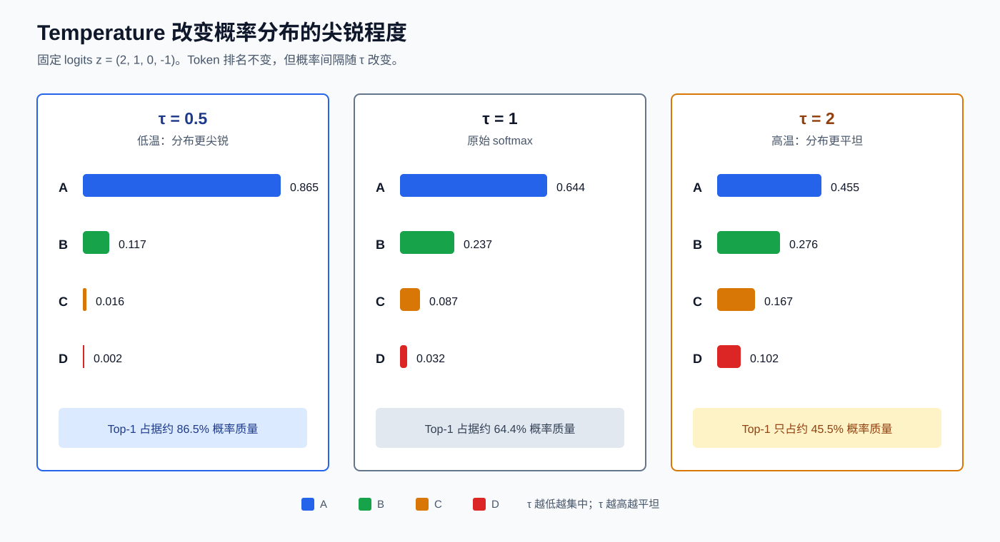
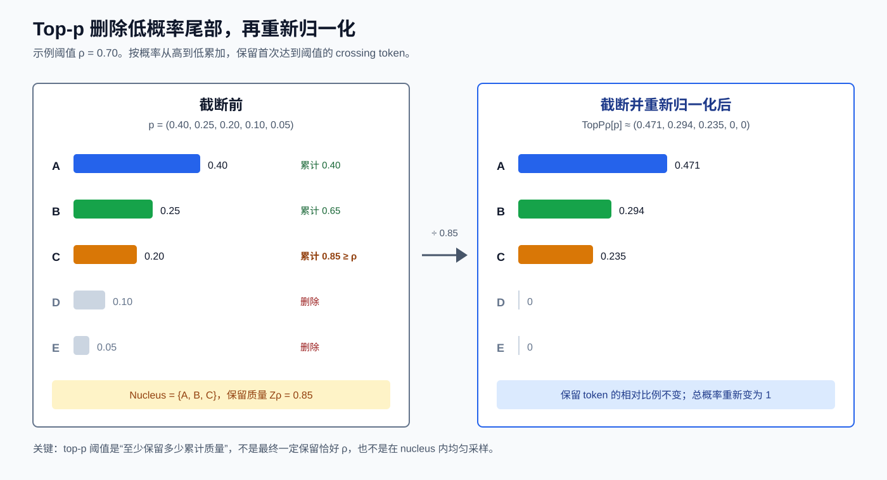
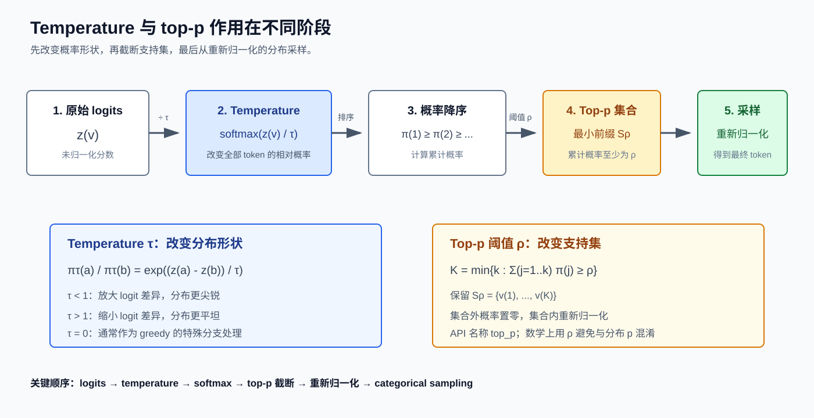

# 语言模型推理中的 Temperature 与 Top-p：先建立直觉，再看原理

> Temperature 和 top-$p$ 都作用在“如何从下一个 token 的候选分布中采样”这一步。它们不会修改模型参数，也不是回答质量的直接分数。
>
> 只想正确使用参数时，阅读第一部分即可；需要理解公式、边界、源码语义或 speculative decoding 时，再进入扩展阅读。

概率论前置材料见：[Speculative Decoding 的概率论基础](./probability_foundations.md)。Speculative decoding 主文档见：[Speculative Decoding：Target 如何验收 Draft 候选 Token？](./speculative_decoding.md)。

---

# 第一部分：先建立直觉与实际用法

## 先看结论

语言模型在每一步都会给词表中的每个 token 一个分数，并将这些分数转换成概率分布。Temperature 与 top-$p$ 分别解决不同问题：

| 参数 | 它改变什么 | 参数减小时 | 中性值 |
|---|---|---|---|
| temperature $\tau$ | 所有 token 之间的概率间隔 | 分布更尖锐，更偏向 top token | $\tau=1$ |
| top-$p$ 阈值 $\rho$ | 哪些 token 仍有资格被采样，即可采样 token 集合 | 删除更多低概率尾部 token | $\rho=1$ |

一句话概括：

- **Temperature 改变概率分布的形状。**
- **Top-$p$ 改变概率分布的支持集。**
- **实际采样通常先应用 temperature，再应用 top-$p$。**
- **需要确定性输出时，直接使用 greedy；不要把 $\tau=0$ 代入除法公式。**

## Temperature 是什么？

Temperature 控制“高分 token 相对于低分 token 有多占优势”。固定一组 logits $\boldsymbol{z}$，temperature 后的概率满足 $p_\tau(x)\propto\exp(z(x)/\tau)$。

- $\tau<1$：放大 logit 差异，top token 获得更多概率，输出更集中。
- $\tau=1$：保持原始 softmax。
- $\tau>1$：缩小 logit 差异，低概率 token 获得更多机会，输出更分散。
- `temperature=0`：实际 API 通常将其解释为 greedy 控制流，而不是计算 $\boldsymbol{z}/0$。



图中 token 排名始终是 $A>B>C>D$。Temperature 没有改变排序，只改变了它们之间的概率间隔。因此，temperature 更像“分布尖锐度”控制器，而不是直接指定随机性的百分比。

## Top-p 是什么？

Top-$p$ 也叫 nucleus sampling。它先将 token 按概率从高到低排序，再保留累计概率首次达到阈值 $\rho$ 的最小前缀集合。集合外 token 的概率设为 $0$，集合内概率重新归一化后再采样。



图中的原始分布为 $(0.40,0.25,0.20,0.10,0.05)^\top$，阈值为 $\rho=0.70$：

1. 前两个 token 的累计概率是 $0.65$，尚未达到阈值。
2. 加入第三个 token 后累计概率为 $0.85$，首次达到阈值。
3. 因此保留前三个 token，而不是只保留前两个。
4. 保留质量是 $0.85$，并不要求恰好等于 $0.70$。
5. 重新归一化后，从 $(0.471,0.294,0.235,0,0)^\top$ 采样。

Top-$p$ 不是在保留集合内均匀采样，也不是永远保留固定数量的 token。分布越尖锐，达到同一阈值所需的 token 越少；分布越平坦，所需 token 越多。

## 两个参数一起使用时，先做什么？

实际语义通常是：

$$ \boldsymbol{z}\rightarrow\boldsymbol{z}/\tau\rightarrow\operatorname{softmax}\rightarrow\operatorname{TopP}_\rho\rightarrow\text{重新归一化}\rightarrow\text{categorical sampling} $$



必须先让 temperature 形成准备采样的概率形状，再用 top-$p$ 根据该分布的累计概率选择 nucleus。虽然正 temperature 不改变 token 排名，但会改变累计概率，所以也会改变 top-$p$ 最终保留多少 token。

先 top-$p$ 再 temperature 一般会得到不同结果：前者先用旧概率固定 support，后者则让 temperature 参与决定 support。只有 `top_p=1`、两种顺序恰好选出同一 support 等特殊情况下，结果才可能一致。

工程实现不一定真的先物化完整 softmax 张量再过滤；它可以在 logits 上完成等价的排序和 masking。这里描述的是概率语义，而不是要求 kernel 必须逐步生成每个中间张量。

## 业界通常怎样使用？

主流推理框架一般将 greedy 与 sampling 明确分成两条路径。以 Hugging Face 为例，`do_sample=False` 使用 greedy 或 beam 类搜索；只有 `do_sample=True` 时，temperature、top-$p$ 等 sampling warper 才参与随机采样 [[5]](#参考资料)。

常见使用模式如下：

| 目标 | 常见做法 | 原因 |
|---|---|---|
| 可复现评测、分类式回答、严格结构化输出 | greedy，或配合 grammar constraint | 避免随机采样引入方差 |
| 希望保留少量表达变化 | 启用 sampling，以 temperature 为主要旋钮，先保持 `top_p=1` | 更容易单独观察 temperature 的效果 |
| 希望过滤极低概率长尾 | 在选定 temperature 后，再降低 `top_p` | 防止很低概率 token 进入采样集合 |
| 创作、头脑风暴、多样候选生成 | 使用较高 temperature 或较宽的 top-$p$ nucleus | 提高分布多样性，但不保证事实正确性 |
| JSON、代码语法或受限词表 | 优先使用 grammar/allowed-token mask，再考虑 sampling 参数 | temperature/top-$p$ 不能替代硬约束 |

不存在跨模型通用的“最佳 temperature/top-$p$ 数值”。相同参数在不同模型、量化方式、上下文和 processor 顺序下可能产生完全不同的熵与 nucleus 大小。实践中更稳妥的方法是：

1. 先明确需要确定性还是随机性。
2. 确定性任务直接建立 greedy 基线。
3. 需要随机性时，先令 `top_p=1`，单独调 temperature。
4. 若低概率尾部仍造成明显问题，再逐步降低 `top_p`。
5. 不要一开始同时大幅降低 temperature 和 top-$p$，否则很难判断是哪一个参数导致分布塌缩。
6. 用任务指标、输出长度、重复率、事实正确率和人工偏好评估，而不是只凭“更有创造力”这类模糊描述。

框架默认值不等于生产最佳实践。例如 Hugging Face 的 generation 配置默认不启用随机采样；即使 `temperature=1`、`top_p=1`，只要 `do_sample=False`，仍然走确定性路径。部署时应记录模型版本、processor 顺序、temperature、top-$p$、seed 与约束配置。

## 一个最小决策表

| 你的需求 | 建议起点 |
|---|---|
| 每次都要相同答案 | greedy / `do_sample=False` |
| 想让答案稍有变化 | `do_sample=True`，先只调 temperature |
| 偶尔采到明显不合理的长尾 token | 在选定 temperature 后降低 top-$p$ |
| 输出只允许满足固定语法 | 使用 grammar constraint，不依赖 sampling 参数兜底 |
| 正在比较两个模型或做 benchmark | greedy，或固定完整采样配置并做统计比较 |
| 正在使用 speculative decoding | verifier 必须使用 target/draft 各自处理后的实际分布 |

到这里已经足以正确理解和使用两个参数。后面的内容用于回答“公式为什么如此”“极限与 ties 怎么处理”“源码具体做了什么”以及“如何映射到 speculative decoding”。

---

# 第二部分：概率原理与扩展阅读

> 以下内容是扩展阅读。它不会改变第一部分的使用结论，而是为严格推导、实现验证和边界分析提供依据。

## 扩展阅读的学习目标、范围与记号

### 学习目标

扩展阅读将进一步说明：

1. logits、softmax 与 categorical sampling 的严格关系。
2. temperature 对 odds、极限和熵的影响。
3. top-$p$ 的最小前缀集合、crossing token、ties 与重新归一化。
4. 两个参数为何一般不可交换。
5. 框架实现、随机种子和可复现性边界。
6. speculative decoding 为什么必须使用实际处理后的分布。

### 讨论对象

本文讨论单步自回归生成中的 token 采样。设有限词表为 $V$，词表大小为 $|V|$。在任意一个生成位置，模型为每个 token 输出一个实数 score；这些 score 称为 logits。解码器把 logits 变成离散概率分布，再从中选择 token。Temperature 与 top-$p$ 是解码规则，不是模型训练目标，也不是语言质量的直接度量。

### 符号冲突：概率分布 $p$ 与 API 参数 `top_p`

概率论中通常用 $p$ 表示概率质量函数或概率分布。Nucleus sampling 又常被称为 top-$p$ sampling，框架 API 通常把参数命名为 `top_p`。本文作如下约定：

- $p(x)$ 表示 token $x$ 的概率。
- $\boldsymbol{p}$ 表示按固定词表顺序排列的概率列向量。
- $\rho$ 表示 top-$p$ 的累计概率阈值。
- `top_p` 表示工程 API 参数名。

因此，API 调用 `top_p=0.9` 在数学部分写成 $\rho=0.9$。

### 位置下标约定

设当前已经提交的前缀为 $x_{1:t}$。本轮第 $i$ 个候选所在的绝对位置是 $t+i$，该位置之前的条件历史写成 $h_{t+i}$。Target 与 draft 在该位置的实际采样分布分别写成 $p_{t+i}$ 与 $q_{t+i}$。若某节只分析一个固定位置并省略位置下标，会在该节开头明确声明。

### 向量与框架张量约定

数学向量一律写成列向量。若词表按 $V=\{v_1,\ldots,v_{|V|}\}$ 排列，则 logits 与概率分别写成：

$$ \boldsymbol{z}=(z(v_1),\ldots,z(v_{|V|}))^\top,\qquad \boldsymbol{p}=(p(v_1),\ldots,p(v_{|V|}))^\top $$

数学上将单个位置的 hidden state 记为列向量 $\boldsymbol{s}$，线性层写作 $\boldsymbol{z}=W\boldsymbol{s}+\boldsymbol{b}$。在 PyTorch 中，批量张量通常把特征放在最后一维；数学列向量约定与框架张量布局不是同一个层面。

## 1. 自回归语言模型定义条件分布序列
### 1.1 序列概率的链式分解
给定 prompt $x_{1:t}$，语言模型对未来序列的联合概率可写成：

$$ \Pr(X_{t+1:T}=x_{t+1:T}\mid x_{1:t})=\prod_{i=1}^{T-t}\Pr(X_{t+i}=x_{t+i}\mid x_{1:t+i-1}) $$
这意味着生成不是只采样一次。在每个绝对位置 $t+i$，解码器都面对一个新的条件分布。该分布依赖已经确定的完整历史。正式教材对自回归语言模型的链式分解和逐 token 采样有标准说明 [[1]](#参考资料)。
### 1.2 一个位置上的条件历史
普通 target-only 解码到达位置 $t+i$ 时，历史为：

$$ h_{t+i}=x_{1:t+i-1} $$
模型根据该历史计算 hidden state $\boldsymbol{s}_{t+i}$，再产生 logits 列向量：

$$ \boldsymbol{z}_{t+i}=W\boldsymbol{s}_{t+i}+\boldsymbol{b} $$
这里的 $\boldsymbol{z}_{t+i}\in\mathbb{R}^{|V|}$ 还不是概率分布。其分量可以为负，可以大于 $1$，也不要求总和为 $1$。
### 1.3 解码规则也是条件分布的一部分
模型给出 raw logits。解码器还可能应用：

- vocabulary mask；
- repetition penalty；
- grammar constraint；
- minimum length 下的 EOS mask；
- temperature；
- top-k、top-p 或 min-p；
- 其他 history-dependent processor。

因此应区分三层对象：

1. 模型的 raw logits。
2. 经过 logits processing 后的 scores。
3. 最终真正用于 categorical sampling 的归一化分布。

在概率正确性问题中，第三层最重要。“模型分布”这个口语说法若不说明处理链，可能同时指三种不同对象。
## 2. Logits 与 softmax
### 2.1 Softmax 的定义
本节固定一个已经到达的位置，明确省略位置下标。对每个 token $x\in V$，标准 softmax 定义：

$$ p(x)=\frac{\exp(z(x))}{\sum_{y\in V}\exp(z(y))} $$
写成列向量就是：

$$ \boldsymbol{p}=\operatorname{softmax}(\boldsymbol{z}) $$
Softmax 把任意有限实数 logits 映射为合法 PMF：

$$ p(x)>0,\qquad \sum_{x\in V}p(x)=1 $$
PyTorch 官方文档给出的定义与此一致 [[2]](#参考资料)。
### 2.2 Logits 不是概率，也不是 log probability
单个 logit $z(x)$ 没有独立的概率含义。只有它与其他 logits 的差值影响 softmax。对任意常数 $c$：

$$ \operatorname{softmax}(\boldsymbol{z}+c\boldsymbol{1})=\operatorname{softmax}(\boldsymbol{z}) $$
因此，所有 logits 同时加 $1000$，理想数学分布不变。这也说明 raw logit 的绝对零点没有可辨识意义。Softmax 后的 log probability 为：

$$ \log p(x)=z(x)-\log\sum_{y\in V}\exp(z(y)) $$
它与 logit 相差一个依赖整条向量的 log-normalizer。
### 2.3 Logit 差就是 log odds
对任意两个 token $a,b\in V$：

$$ \frac{p(a)}{p(b)}=\exp(z(a)-z(b)) $$
取对数得到：

$$ \log\frac{p(a)}{p(b)}=z(a)-z(b) $$
所以 logit gap 控制 token 之间的 odds ratio。若 $z(a)-z(b)=\log 3$，则 $a$ 的概率是 $b$ 的 $3$ 倍。这个结论与其他 token 的 logits 无关，因为 softmax 分母在比值中抵消。
### 2.4 排序保持
指数函数严格单调。所以对有限 logits：

$$ z(a)>z(b)\iff p(a)>p(b) $$
Softmax 不改变 token 的排序。因此只求 top-1 token 时，不需要先显式计算 softmax：

$$ \arg\max_{x\in V}p(x)=\arg\max_{x\in V}z(x) $$
正式教材也明确给出了 softmax 的归一化、排序保持和 argmax 等价性 [[1]](#参考资料)。
### 2.5 数值稳定的 softmax
直接计算 $\exp(z(x))$ 可能溢出。利用平移不变性，可令：

$$ m=\max_{y\in V}z(y) $$
然后计算：

$$ p(x)=\frac{\exp(z(x)-m)}{\sum_{y\in V}\exp(z(y)-m)} $$
此时最大的指数输入为 $0$，其他输入不大于 $0$。框架的 softmax 或 log-softmax kernel 通常会采用等价的稳定化方法。工程代码不应手写不稳定的 `exp(logits) / exp(logits).sum()`。
## 3. Categorical sampling
### 3.1 分布到随机变量
给定词表 $V$ 上的 PMF $p$，categorical sampling 定义随机变量 $X$：

$$ \Pr(X=x)=p(x),\qquad x\in V $$
记为：

$$ X\sim\operatorname{Categorical}(\boldsymbol{p}) $$
或者简写为：

$$ X\sim p $$
PyTorch 的 `torch.distributions.Categorical` 可以由 `probs` 或 `logits` 参数化。官方文档说明它与 `torch.multinomial()` 所采样的分布等价 [[3]](#参考资料)。
### 3.2 概念上的逆 CDF 实现
固定 token 顺序 $v_1,\ldots,v_{|V|}$。定义累计质量：

$$ C_k=\sum_{j=1}^{k}p(v_j) $$
采样 $U\sim\operatorname{Uniform}(0,1)$。返回第一个满足 $U<C_k$ 的 token $v_k$。这个过程满足：

$$ \Pr(X=v_k)=p(v_k) $$
实际 GPU sampler 可以使用其他等价算法。概率语义只要求最终 token 的边缘分布正确。
### 3.3 分布不是样本
$\boldsymbol{p}$ 是一张概率质量表。

$X$ 是按照这张表定义的随机变量。

$x$ 是某次运行得到的具体样本。例如：

$$ \boldsymbol{p}=(0.7,0.2,0.1)^\top $$
不表示“这次必定返回第一个 token”。它表示大量独立重复采样中，三个 token 的频率分别趋近 $0.7,0.2,0.1$。一次采到低概率 token 不说明 sampler 错误。同样，一次采到 top-1 token 也不说明执行了 greedy。

---
# 第三部分：Temperature 的概率原理
## 4. Temperature-softmax 的定义
### 4.1 严格正 temperature
仍然固定一个位置并省略位置下标。令 temperature 为 $\tau>0$。Temperature-softmax 定义：

$$ p_\tau(x)=\frac{\exp(z(x)/\tau)}{\sum_{y\in V}\exp(z(y)/\tau)} $$
Hinton、Vinyals 与 Dean 给出了这一 temperature-softmax 公式，并指出较高 temperature 会产生更软的分布 [[4]](#参考资料)。工程 API 中的参数通常名为 `temperature`。数学上先要求 $\tau>0$，因为公式中需要除以 $\tau$。
### 4.2 $\tau=1$ 是原始 softmax
当 $\tau=1$ 时：

$$ p_{\tau=1}(x)=\frac{\exp(z(x))}{\sum_{y\in V}\exp(z(y))} $$
所以 $\tau=1$ 不改变原始 softmax 分布。“原始”只表示没有 temperature rescaling。它不表示没有其他 logits processor。
### 4.3 Temperature 直接缩放 logit gap
对 token $a,b$：

$$ \frac{p_\tau(a)}{p_\tau(b)}=\exp\left(\frac{z(a)-z(b)}{\tau}\right) $$
因此：

$$ \log\frac{p_\tau(a)}{p_\tau(b)}=\frac{z(a)-z(b)}{\tau} $$
Temperature 不是给概率做线性乘法。它把所有 pairwise log odds 同时除以 $\tau$。
### 4.4 用原始 odds 表示
因为：

$$ \frac{p_{\tau=1}(a)}{p_{\tau=1}(b)}=\exp(z(a)-z(b)) $$
所以：

$$ \frac{p_\tau(a)}{p_\tau(b)}=\left(\frac{p_{\tau=1}(a)}{p_{\tau=1}(b)}\right)^{1/\tau} $$
若原始 odds 为 $9:1$：

- $\tau=1$ 时仍为 $9:1$；
- $\tau=2$ 时变为 $3:1$；
- $\tau=1/2$ 时变为 $81:1$。这比“temperature 控制随机性”更精确。
### 4.5 排序不变
只要 $\tau>0$：

$$ z(a)>z(b)\iff \frac{z(a)}{\tau}>\frac{z(b)}{\tau}\iff p_\tau(a)>p_\tau(b) $$
所以 temperature 不改变 token 排名。它只改变排名之间的概率间隔。特别地，对所有 $\tau>0$：

$$ \arg\max_x p_\tau(x)=\arg\max_x z(x) $$
但“argmax 相同”不表示采样分布相同。
## 5. Temperature 的等价变换与尺度
### 5.1 平移不变性仍成立
对任意常数 $c$：

$$ \operatorname{softmax}\left(\frac{\boldsymbol{z}+c\boldsymbol{1}}{\tau}\right)=\operatorname{softmax}\left(\frac{\boldsymbol{z}}{\tau}\right) $$
Temperature 不会让 logit 的共同偏移获得意义。
### 5.2 缩放 logits 等价于反向缩放 temperature
对任意 $c>0$：

$$ \operatorname{softmax}\left(\frac{c\boldsymbol{z}}{\tau}\right)=\operatorname{softmax}\left(\frac{\boldsymbol{z}}{\tau/c}\right) $$
因此 logits 整体放大 $c$ 倍，等价于 temperature 降低到 $\tau/c$。这说明 temperature 的效果依赖模型的 logit scale。不同模型、不同量化实现、不同 logits processor 下，相同的 `temperature=0.8` 不保证产生相同熵或相同风格。
### 5.3 Temperature 控制的是相对尺度
把所有 logit gap 与 $\tau$ 比较，比只看 $\tau$ 的数值更有意义。若典型 logit gap 远小于 $\tau$，分布较平。若典型 logit gap 远大于 $\tau$，分布较尖。因此不存在脱离模型和上下文的“绝对创造力刻度”。
## 6. Temperature 的极限
### 6.1 $\tau\to\infty$：趋向均匀分布
对任意有限 logit：

$$ \lim_{\tau\to\infty}\exp(z(x)/\tau)=1 $$
因此：

$$ \lim_{\tau\to\infty}p_\tau(x)=\frac{1}{|V|} $$
这个结论假设所有 token 都有有限 logit。若某些 token 已被 mask 为 $-\infty$，则极限是在剩余 support 上均匀，而不是在完整词表上均匀。
### 6.2 $\tau\to0^+$：质量集中到最大 logit 集合
定义最大 logit：

$$ z_{\max}=\max_{x\in V}z(x) $$
定义最大值集合：

$$ M=\{x\in V:z(x)=z_{\max}\} $$
对任意非最大 token $y\notin M$，存在正 gap：

$$ z_{\max}-z(y)>0 $$
于是：

$$ \frac{p_\tau(y)}{p_\tau(x^\star)}=\exp\left(-\frac{z_{\max}-z(y)}{\tau}\right)\to0,\qquad x^\star\in M $$
最终：

$$ \lim_{\tau\to0^+}p_\tau(x)=1/|M|,\qquad x\in M $$
$$ \lim_{\tau\to0^+}p_\tau(x)=0,\qquad x\notin M $$
若最大 logit 唯一，则极限是该 token 上的单点分布。若有并列最大值，则极限在所有并列最大 token 上均匀。
### 6.3 极限不是把 $\tau=0$ 代入公式
表达式 $z(x)/\tau$ 在 $\tau=0$ 时没有定义。所以：

$$ p_{\tau=0}^{\mathrm{invalid}}(x)=\frac{\exp(z(x)/0)}{\sum_y\exp(z(y)/0)} $$
不是合法公式。正确说法是研究右极限 $\tau\to0^+$。这一区别在处理 ties 时尤其重要。
### 6.4 为什么 API 的 `temperature=0` 通常是 greedy 特殊分支
工程 API 经常允许用户把 `temperature=0` 理解为“关闭随机采样，改用 greedy”。对应规则是：

$$ X=\operatorname{TieArgMax}_{x\in V}z(x) $$
这里必须有一个确定的 tie-breaking 规则。这个规则不是 temperature-softmax 公式在 $\tau=0$ 的直接求值。它甚至不一定等于 $\tau\to0^+$ 的抽样极限：

- 唯一最大值时，两者都集中到同一个 token。
- 多个最大值并列时，数学极限在并列项上均匀采样。
- Greedy 实现通常按固定规则只选其中一个。Hugging Face 当前 `TemperatureLogitsWarper` 要求 temperature 严格大于 $0$。其官方源码在传入 `0.0` 时明确提示使用 `do_sample=False` 进入 greedy 解码 [[5]](#参考资料)。因此，框架中的 `temperature=0` 应视为控制流语义，而不是普通 floating-point temperature。
## 7. Temperature 与熵
### 7.1 Shannon entropy
对离散分布 $p_\tau$，使用自然对数定义熵：

$$ H(p_\tau)=-\sum_{x\in V}p_\tau(x)\log p_\tau(x) $$
单位为 nat。正式教材给出了这一离散熵定义 [[1]](#参考资料)。熵描述分布的不确定性，不描述生成文本的事实正确性、审美质量或任务价值。
### 7.2 用 inverse temperature 推导
令：

$$ \beta=\frac{1}{\tau} $$
定义 partition function：

$$ Z(\beta)=\sum_{x\in V}\exp(\beta z(x)) $$
则：

$$ p_\tau(x)=\frac{\exp(\beta z(x))}{Z(\beta)} $$
其 log probability 为：

$$ \log p_\tau(x)=\beta z(x)-\log Z(\beta) $$
代入熵：

$$ H(p_\tau)=\log Z(\beta)-\beta\mathbb{E}_{p_\tau}[z] $$
又因为：

$$ \frac{\mathrm{d}}{\mathrm{d}\beta}\log Z(\beta)=\mathbb{E}_{p_\tau}[z] $$
以及：

$$ \frac{\mathrm{d}}{\mathrm{d}\beta}\mathbb{E}_{p_\tau}[z]=\operatorname{Var}_{p_\tau}(z) $$
所以：

$$ \frac{\mathrm{d}H}{\mathrm{d}\beta}=-\beta\operatorname{Var}_{p_\tau}(z) $$
再用 $\mathrm{d}\beta/\mathrm{d}\tau=-1/\tau^2$：

$$ \frac{\mathrm{d}H}{\mathrm{d}\tau}=\frac{\operatorname{Var}_{p_\tau}(z)}{\tau^3}\ge0 $$
因此，在固定有限 logits、固定 support、尚未做 top-p 截断时，熵随 $\tau$ 单调不减。若 logits 在 support 上不全相等，则方差为正，熵严格增加。
### 7.3 两个熵极限
设最大值集合为 $M$。则：

$$ \lim_{\tau\to0^+}H(p_\tau)=\log|M| $$
若最大值唯一，该极限为 $0$。若所有 $|V|$ 个有限 logits 都参与 softmax：

$$ \lim_{\tau\to\infty}H(p_\tau)=\log|V| $$
这是完整词表上均匀分布的最大熵。
### 7.4 加入 top-p 后不能直接照搬导数结论
上面的导数针对未截断 temperature-softmax。Top-p 会让 support 随 $\tau$ 和 $\rho$ 离散变化。Support 改变的位置可能出现不光滑点。因此不能不加说明地声称“temperature 加 top-p 后，最终熵仍按同一导数公式变化”。正确做法是先分析 temperature-softmax，再分析 top-p 截断后的实际分布。
## 8. Temperature 数值例子
### 8.1 给定 logits
设词表有四个 token：

$$ V=\{A,B,C,D\} $$
其 logits 列向量为：

$$ \boldsymbol{z}=(2,1,0,-1)^\top $$
### 8.2 $\tau=1$
计算得到：

$$ \boldsymbol{p}_1\approx(0.643914,0.236883,0.087144,0.032059)^\top $$
熵约为：

$$ H(p_{\tau=1})\approx0.947537 $$
### 8.3 $\tau=0.5$
Logits 被除以 $0.5$，等价于放大两倍：

$$ \boldsymbol{z}/0.5=(4,2,0,-2)^\top $$
概率变为：

$$ \boldsymbol{p}_{0.5}\approx(0.864955,0.117059,0.015842,0.002144)^\top $$
熵约为：

$$ H(p_{0.5})\approx0.455429 $$
头部 token $A$ 获得更多质量。
### 8.4 $\tau=2$
概率变为：

$$ \boldsymbol{p}_2\approx(0.455054,0.276004,0.167405,0.101536)^\top $$
熵约为：

$$ H(p_{\tau=2})\approx1.245050 $$
分布更接近均匀。
### 8.5 Odds ratio 检查
$A$ 与 $B$ 的 logit gap 为 $1$。因此：

$$ \frac{p_\tau(A)}{p_\tau(B)}=\exp(1/\tau) $$
三个 temperature 下分别约为：

- $\tau=0.5$：$7.389$；
- $\tau=1$：$2.718$；
- $\tau=2$：$1.649$。这个比值与 $C,D$ 的 logits 无关。

---
# 第四部分：Top-p，也就是 Nucleus Sampling
## 9. Top-p 的严格定义
### 9.1 输入必须先是概率分布
Top-p 的定义依赖累计概率质量。所以它的数学输入是一个 PMF $p$，而不是未经归一化的任意 score。工程实现可以直接在 logits 上完成等价的排序和 masking。但判断累计阈值时，语义上使用的是 softmax 概率。
### 9.2 降序排列
固定一个位置并省略位置下标。为避免 ties 导致定义不完整，先规定一个确定的 secondary key，例如 token id。把 token 排成：

$$ p(v_{(1)})\ge p(v_{(2)})\ge\cdots\ge p(v_{(|V|)}) $$
括号下标 $(j)$ 表示**概率排序名次**，不是序列位置。它不会取代绝对序列位置 $t+i$。
### 9.3 最小前缀长度
给定阈值：

$$ 0<\rho\le1 $$
定义：

$$ K_\rho=\min\left\{k:\sum_{j=1}^{k}p(v_{(j)})\ge\rho\right\} $$
于是 nucleus 是排序后的最小前缀：

$$ S_\rho=\{v_{(1)},\ldots,v_{(K_\rho)}\} $$
“最小”指前缀长度最小。它不是在所有任意子集上做组合优化。Holtzman 等人的原论文把 top-p vocabulary 定义为累计概率至少达到阈值的最小高概率集合 [[6]](#参考资料)。
### 9.4 Crossing token 必须保留
由最小性可知：

$$ \sum_{j=1}^{K_\rho-1}p(v_{(j)})<\rho\le\sum_{j=1}^{K_\rho}p(v_{(j)}) $$
第 $K_\rho$ 个 token 使累计质量第一次达到或跨过 $\rho$。它称为 crossing token。它必须保留。如果把“累计和超过 $\rho$ 的 token”全部删除，很容易误删 crossing token。
### 9.5 截断与重新归一化
定义 nucleus 的保留质量：

$$ Z_\rho=\sum_{y\in S_\rho}p(y) $$
一般有：

$$ \rho\le Z_\rho\le1 $$
Top-p 后的实际分布定义为：

$$ \operatorname{TopP}_\rho[p](x)=p(x)/Z_\rho,\qquad x\in S_\rho $$
$$ \operatorname{TopP}_\rho[p](x)=0,\qquad x\notin S_\rho $$
重新归一化不可省略。只把尾部设为零但不除以 $Z_\rho$，得到的总质量小于 $1$，不是合法 PMF。原论文明确给出了截断后除以保留质量的重缩放公式 [[6]](#参考资料)。
### 9.6 Top-p 是随机采样，不是选 nucleus 中的 top-1
得到 $\operatorname{TopP}_\rho[p]$ 后，还要执行 categorical sampling：

$$ X\sim\operatorname{TopP}_\rho[p] $$
如果 nucleus 中有多个 token，它们都可能被采到。Top-p 不等于 greedy。Top-p 也不等于从 nucleus 中均匀采样。保留 token 之间仍按原概率的相对比例采样：

$$ \frac{\operatorname{TopP}_\rho[p](a)}{\operatorname{TopP}_\rho[p](b)}=\frac{p(a)}{p(b)},\qquad a,b\in S_\rho $$
## 10. Top-p 的边界与 ties
### 10.1 当 $\rho\le p(v_{(1)})$
此时：

$$ K_\rho=1 $$
Top-p 后的分布是 top-1 token 上的单点分布。即使 temperature 大于 $0$，最终采样也变成确定性的。所以“只要 temperature 大于 $0$ 就一定随机”是错误的。截断规则仍可能把 support 压缩到一个 token。
### 10.2 当 $\rho=1$
如果所有 softmax 概率都严格为正，则：

$$ K_1=|V| $$
Top-p 不删除任何 token。若此前已有 token 被 mask 为零，则只需保留累计到总质量 $1$ 的有效 support。工程上 `top_p=1.0` 通常表示禁用 top-p 截断 [[5]](#参考资料)。
### 10.3 为什么数学定义通常不取 $\rho=0$
若直接令 $\rho=0$，空集已经满足累计质量至少为 $0$。但空 support 无法归一化，也无法采样。所以本文采用：

$$ 0<\rho\le1 $$
框架可能为了接口便利接受 `top_p=0`，再通过“至少保留一个 token”避免空集。Hugging Face 当前源码的检查实际接受区间 $[0,1]$，并默认至少保留一个 token；但报错文案写的是严格区间。这类实现细节可能随版本变化，不应反推为统一数学定义 [[5]](#参考资料)。
### 10.4 累计和恰好等于 $\rho$
若：

$$ \sum_{j=1}^{k}p(v_{(j)})=\rho $$
且前 $k-1$ 项之和小于 $\rho$，则：

$$ K_\rho=k $$
第 $k+1$ 个 token 不应仅因“想超过阈值”而被加入。数学定义使用“至少达到”，也就是 $\ge\rho$。
### 10.5 Boundary tie
考虑：

$$ \boldsymbol{p}=(0.4,0.2,0.2,0.1,0.1)^\top,\qquad \rho=0.6 $$
最大 token 后有两个概率同为 $0.2$ 的 token。只需其中一个就能使累计质量达到 $0.6$。如果没有 secondary key，“最小高概率集合”并不唯一。因此完整实现必须选择一种 tie policy。
### 10.6 两种合理的 tie policy
**策略一：固定全序前缀。**

先按概率降序，再按 token id 等 secondary key 排序。只保留达到阈值所需的最短前缀。上例保留 $0.4$ 和其中一个 $0.2$。优点是 support 最小。缺点是相同概率 token 可能因 secondary key 得到不同待遇。

**策略二：tie-inclusive。**

先找到 crossing probability，再保留所有与 crossing token 同概率的 token。上例会保留 $0.4,0.2,0.2$，总质量为 $0.8$。优点是并列项对称。缺点是保留集合不再是最短长度前缀。两种策略定义了不同的采样分布。不能只说“实现支持 top-p”而不允许测试 ties。
### 10.7 官方框架中的 ties
Hugging Face 当前 `TopPLogitsWarper` 对 scores 排序，计算 softmax 累积概率，mask 尾部，并保证至少保留 `min_tokens_to_keep` 个 token [[5]](#参考资料)。当 scores 精确相等时，具体保留哪个并列 token 由实际排序结果和底层实现共同决定。因此：

- 不要假定所有设备和框架采用同一个 tie-breaking。
- 精确回归测试应固定框架版本、设备和排序语义。
- Speculative verifier 必须使用实际 mask 后的分布，而不是理想化的另一种 tie policy。
### 10.8 零概率与 $-\infty$
标准 softmax 对有限 logits 给每个 token 正概率。工程 processor 常把禁止 token 的 score 设为 $-\infty$。Softmax 后这些 token 的概率为 $0$。Top-p 排序时，零概率 token 位于尾部。只要有效 support 的总质量为 $1$，它们无需被重新加入。如果所有 logits 都被 mask 为 $-\infty$，softmax 无法产生合法 PMF。实现必须在更早阶段防止空 support，或定义明确 fallback。
## 11. Top-p 数值例子
### 11.1 原始分布
设：

$$ \boldsymbol{p}=(0.40,0.25,0.20,0.10,0.05)^\top $$
概率已经降序排列。取：

$$ \rho=0.70 $$
累计质量依次为：

$$ 0.40,\quad0.65,\quad0.85,\quad0.95,\quad1.00 $$
前两个 token 的质量 $0.65$ 不足。第三个 token 是 crossing token。所以：

$$ K_\rho=3,\qquad Z_\rho=0.85 $$
### 11.2 重新归一化
Top-p 分布为：

$$ \operatorname{TopP}_{0.70}[p]\approx(0.470588,0.294118,0.235294,0,0)^\top $$
检查总和：

$$ 0.470588+0.294118+0.235294=1 $$
前三个 token 的相对比例仍是：

$$ 0.40:0.25:0.20 $$
### 11.3 阈值不是最终保留质量
这里设置 $\rho=0.70$，但实际保留质量是 $0.85$。原因是 token 不可拆分。Crossing token 的整个概率质量都必须保留。因此 `top_p=0.9` 不表示每一步都精确保留 $90\%$ 的质量。它表示保留质量至少达到 $90\%$ 的最小前缀。

---
# 第五部分：Temperature 与 Top-p 如何组合
## 12. 标准执行顺序
### 12.1 先 temperature，后 top-p
常见采样管线是：

$$ \boldsymbol{z}\xrightarrow{\div\tau}\boldsymbol{z}/\tau\xrightarrow{\operatorname{softmax}}\boldsymbol{p}_\tau\xrightarrow{\operatorname{TopP}_\rho}\widehat{\boldsymbol{p}}_{\tau,\rho}\xrightarrow{\operatorname{Categorical}}X $$

等价的工程实现通常是：

1. logits 除以 `temperature`；
2. 基于当前 scores 计算 top-p mask；
3. 把被过滤 logits 设为 $-\infty$；
4. 对剩余 logits 做 softmax；
5. categorical sample。Hugging Face 当前 generation 源码按 temperature、top-k、top-p、min-p 的次序追加相应 warper [[5]](#参考资料)。具体框架和版本可能使用不同 processor 顺序。需要以实际实现为准。
### 12.2 Temperature 不改排序，但会改累计质量
对 $\tau>0$，temperature 不改变 token 排名。所以 top-p 排序次序不变。但 temperature 会改变每个 token 的概率，因而改变累计质量。结果是 $K_\rho$ 可能改变。低 temperature 往往让头部更集中，用更少 token 就能达到 $\rho$。高 temperature 往往让分布更平，需要更多 token 才能达到同一 $\rho$。
### 12.3 Top-p 改变 support
Temperature-softmax 对所有有限 logits 给正概率。Top-p 把 nucleus 外 token 的概率精确设为 $0$。所以二者作用不同：

- Temperature 连续改变 support 内的相对概率。
- Top-p 离散改变哪些 token 仍有可能被采到。这也是为什么二者不能简单合并成一个“随机性旋钮”。
## 13. 二者一般不交换
### 13.1 两种管线
管线 A 先做 temperature，再按新概率决定 nucleus：

$$ \operatorname{TopP}_\rho[\operatorname{softmax}(\boldsymbol{z}/\tau)] $$
管线 B 先按原始概率决定 nucleus，再只对已保留 token 做 temperature：

$$ \operatorname{Temp}_\tau[\operatorname{TopP}_\rho[\operatorname{softmax}(\boldsymbol{z})]] $$
两者一般不相等。原因是管线 A 的 nucleus 由 temperature 后的累计质量决定。管线 B 的 support 在 temperature 之前已经冻结。
### 13.2 数值反例
继续使用：

$$ \boldsymbol{z}=(2,1,0,-1)^\top,\qquad \rho=0.8 $$
当 $\tau=1$ 时：

$$ \boldsymbol{p}_1\approx(0.643914,0.236883,0.087144,0.032059)^\top $$
累计前两个 token 的质量约为 $0.880797$。所以原始 top-p nucleus 为 $\{A,B\}$。
### 13.3 先 top-p，再降温
先保留 $\{A,B\}$，再取 $\tau=0.5$。两者的 logit gap 被放大，归一化后：

$$ \boldsymbol{p}_{\mathrm{top\text{-}p\ then\ temp}}\approx(0.880797,0.119203,0,0)^\top $$
### 13.4 先降温，再 top-p
先取 $\tau=0.5$：

$$ \boldsymbol{p}_{0.5}\approx(0.864955,0.117059,0.015842,0.002144)^\top $$
第一个 token 单独已有质量 $0.864955\ge0.8$。所以 top-p 只保留 $A$：

$$ \boldsymbol{p}_{\mathrm{temp\ then\ top\text{-}p}}=(1,0,0,0)^\top $$
两种顺序产生了不同 support 和不同采样分布。
### 13.5 同一组参数不足以定义分布
只记录：

```text
temperature=0.5
top_p=0.8
```

还不足以完整定义采样语义。还需要知道：

- processor 顺序；
- 是否先应用 grammar 或 repetition penalty；
- top-p 的 tie policy；
- 是否至少保留固定数量 token；
- 何时重新归一化；
- greedy 与 sampling 的控制流。
## 14. Temperature 与 top-p 的联合数值表
仍令：

$$ \boldsymbol{z}=(2,1,0,-1)^\top,\qquad \rho=0.8 $$
| $\tau$ | Temperature 后概率 | $K_\rho$ | Top-p 后概率 |
|---:|---|---:|---|
| $0.5$ | $(0.864955,0.117059,0.015842,0.002144)^\top$ | $1$ | $(1,0,0,0)^\top$ |
| $1$ | $(0.643914,0.236883,0.087144,0.032059)^\top$ | $2$ | $(0.731059,0.268941,0,0)^\top$ |
| $2$ | $(0.455054,0.276004,0.167405,0.101536)^\top$ | $3$ | $(0.506480,0.307196,0.186324,0)^\top$ |

这个表说明：

1. Temperature 先改变概率间隔。
2. 同一个 $\rho$ 因此选择不同大小的 nucleus。
3. Top-p 再把保留质量归一化到 $1$。
4. 最终分布的变化不是单靠一个参数可以解释的。
## 15. 与 top-k 和 min-p 的简要对比
### 15.1 Top-k
Top-k 固定保留概率最高的 $k$ 个 token。若排序后 token 为 $v_{(1)},\ldots,v_{(|V|)}$，则：

$$ S_k=\{v_{(1)},\ldots,v_{(k)}\} $$
然后在 $S_k$ 上重新归一化并采样。Top-k 的 support 大小固定，保留的原始概率质量随上下文变化。Top-p 的保留质量至少达到 $\rho$，support 大小随分布形状变化。Holtzman 等人原论文同时给出了二者定义，并指出 top-k 的固定候选数不能适应分布有时尖、有时平的变化 [[6]](#参考资料)。
### 15.2 Top-k 的 ties
若第 $k$ 名与第 $k+1$ 名概率相同，top-k 同样需要 tie policy。固定排序实现通常只保留其中达到数量 $k$ 的 token。Tie-inclusive 实现可能保留超过 $k$ 个 token。因此 top-k 也不是完全免除边界语义。
### 15.3 Min-p
设 min-p 阈值为 $\mu\in[0,1]$。一种常见定义是保留满足下式的 token：

$$ p(x)\ge\mu\max_{y\in V}p(y) $$
它使用相对于 top-1 概率的局部阈值。Hugging Face 官方文档与当前 `MinPLogitsWarper` 使用这一语义 [[5]](#参考资料)。
### 15.4 Min-p 的 logit-gap 解释
设 $x^\star$ 是最大 logit token。由 softmax odds：

$$ \frac{p_\tau(x)}{p_\tau(x^\star)}=\exp\left(\frac{z(x)-z(x^\star)}{\tau}\right) $$
Min-p 条件等价于：

$$ z(x^\star)-z(x)\le-\tau\log\mu $$
所以 min-p 可以理解为保留与最大 logit 差距不超过某个 temperature-dependent 阈值的 token。
### 15.5 三者对照
| 方法 | 控制量 | Support 大小 | 依赖完整累计质量 | 典型边界问题 |
|---|---|---:|---|---|
| top-k | 固定数量 $k$ | 固定或受 tie policy 影响 | 否 | 第 $k$ 名 ties |
| top-p | 累计阈值 $\rho$ | 自适应 | 是 | crossing token 与 boundary ties |
| min-p | 相对 top-1 阈值 $\mu$ | 自适应 | 否 | 等于阈值、至少保留 token |

它们都要在保留 support 上重新归一化后再采样。组合多个 filter 时，最终 support 取决于执行顺序。

---
# 第六部分：工程实现、随机种子与验证
## 16. 一个清晰的参考实现
### 16.1 先分开 greedy 与 stochastic
下面的 PyTorch 风格代码明确区分两条路径：

```python
import torch


def choose_next_token(
    logits: torch.Tensor,
    *,
    do_sample: bool,
    temperature: float = 1.0,
    top_p: float = 1.0,
    generator: torch.Generator | None = None,
) -> torch.Tensor:
    if not do_sample:
        return torch.argmax(logits, dim=-1)

    if temperature <= 0.0:
        raise ValueError("temperature must be positive when do_sample=True")
    if not 0.0 < top_p <= 1.0:
        raise ValueError("top_p must be in (0, 1]")

    scores = logits.float() / temperature
    sorted_scores, sorted_indices = torch.sort(scores, descending=True)
    sorted_probs = torch.softmax(sorted_scores, dim=-1)
    cumulative_probs = torch.cumsum(sorted_probs, dim=-1)

    # Keep the crossing token: mass strictly before it is still below top_p.
    sorted_keep = cumulative_probs - sorted_probs < top_p
    sorted_keep[..., 0] = True

    keep = torch.zeros_like(sorted_keep)
    keep.scatter_(-1, sorted_indices, sorted_keep)
    filtered_scores = scores.masked_fill(~keep, -torch.inf)
    probs = torch.softmax(filtered_scores, dim=-1)

    return torch.multinomial(
        probs,
        num_samples=1,
        generator=generator,
    ).squeeze(-1)
```

这段代码用于解释语义，不声称替代高性能 fused sampler。
### 16.2 Crossing token 条件
代码使用：

```python
sorted_keep = cumulative_probs - sorted_probs < top_p
```

对当前排序位置，它检查“加入当前 token 之前的累计质量”是否仍小于 $\rho$。因此，第一个让累计质量达到或超过 $\rho$ 的 token 会被保留。
### 16.3 重新 softmax
被过滤 score 设为 `-torch.inf`。随后重新执行 softmax。这一步同时完成：

- nucleus 外概率变成 $0$；
- nucleus 内概率除以保留质量；
- 最终概率总和恢复为 $1$。
### 16.4 Batch 与张量布局
代码把词表放在最后一维。

`logits` 可以是形状 `(batch_size, vocab_size)` 的张量。数学上每个 batch element 对应一个 logits 列向量。框架中用 feature-last 行存储，不表示数学公式改成了行向量线性变换。
### 16.5 生产实现还需要处理什么
生产 sampler 至少还要考虑：

- BF16/FP16 到 FP32 的适当提升；
- distributed vocabulary 下的 global normalization；
- top-p 排序或选择算法的成本；
- NaN、正无穷和全 $-\infty$；
- 每个请求独立的 RNG state；
- continuous batching 中的请求重排；
- CUDA Graph 兼容；
- 明确的 tie behavior；
- 与其他 logits processors 的组合顺序。
## 17. 框架语义不能只靠参数名猜
### 17.1 `do_sample`
Hugging Face `GenerationConfig` 明确用 `do_sample` 决定是否采样，否则使用 greedy 解码 [[5]](#参考资料)。因此设置 `temperature` 却保持 `do_sample=False`，通常不会得到 temperature sampling。Temperature 是采样分布参数。Greedy 路径只关心处理后 scores 的 argmax。
### 17.2 当前 Hugging Face 的顺序
按本文核验时的官方 `GenerationMixin._get_logits_processor` 源码，sampling warper 的追加顺序为：

1. `TemperatureLogitsWarper`
2. `TopKLogitsWarper`
3. `TopPLogitsWarper`
4. `MinPLogitsWarper`
5. 其他后续 warper

这意味着同时启用 top-k 与 top-p 时，top-p 看到的是已经经过 top-k mask 的 scores。它不一定等于分别计算两个集合后再做集合交集。源码行为可能随版本变化，部署文档应记录具体版本 [[5]](#参考资料)。
### 17.3 `top_p` 的官方接口语义
Hugging Face 官方文档把 `top_p<1` 描述为只保留概率和达到 `top_p` 或更高的最小高概率 token 集合 [[5]](#参考资料)。这与原论文的 nucleus 定义一致。但具体 ties、最少保留数和 floating-point 比较仍由源码实现决定。
### 17.4 PyTorch categorical input
`torch.multinomial` 接受非负、有限且总和非零的权重。输入行不必预先归一化为 $1$，函数可把它们当相对权重 [[3]](#参考资料)。尽管如此，speculative verifier 需要明确的 PMF 数值。不能因为 sampler 接受未归一化权重，就把这些权重直接当作 $p_{t+i}(x)$ 或 $q_{t+i}(x)$。
### 17.5 有限精度
理想数学中，temperature 对正 $\tau$ 保持严格排序。有限精度中可能出现：

- 两个接近 logits 舍入为相等；
- 很小概率下溢到 $0$；
- 累计和在 $\rho$ 附近产生舍入差；
- 不同 kernel 的 reduction 顺序不同；
- BF16 与 FP32 得到不同 nucleus 边界。所以边界测试应包含：

- 累计和恰好接近 $\rho$；
- 大量相等 logits；
- 极低 temperature；
- 大词表长尾；
- processor 产生 $-\infty$ 的情况。
## 18. 随机种子、分布与样本
### 18.1 Seed 控制伪随机数流
伪随机数生成器根据内部状态产生确定的数列。Seed 用来初始化该状态。在相同软件、硬件、算法和调用顺序下，固定 seed 常可重放相同伪随机数流。PyTorch 的 `torch.manual_seed()` 用于设置设备上的随机数生成 seed [[7]](#参考资料)。
### 18.2 Seed 不改变理论分布
设 sampler 的目标分布为 $p$。改变 seed 会改变本次使用的伪随机数，从而可能改变样本。它不应改变算法声明的 PMF：

$$ \Pr(X=x)=p(x) $$
因此：

- Temperature 与 top-p 定义分布。
- Seed 选择一次可重放的伪随机轨迹。
- Sample 是该轨迹下的具体输出。三者不是同一种对象。
### 18.3 Same distribution 不等于 same sample
若：

$$ X\sim p,\qquad Y\sim p $$
只能推出二者边缘分布相同。不能推出：

$$ X=Y $$
若 $X,Y$ 独立，即使 PMF 相同也可能不同。若二者共享专门设计的随机数 coupling，则可能总是相同或更经常相同。“同分布”与“同样本”之间还缺少联合随机机制的定义。
### 18.4 Same seed 也不自动保证 same sample
两个解码算法可能以不同次序消耗随机数。例如：

- baseline 每个位置只做一次 categorical sample；
- speculative sampling 还要采 acceptance uniform；
- 被拒绝时还要采 residual token；
- batch 重排可能改变 generator 的调用顺序。即使从同一个 seed 开始，后续随机数与操作的映射也可能不同。所以 exact speculative decoding 的标准保证是输出分布不变，不是 same-seed 文本逐 token 相同。
### 18.5 跨环境可复现性
PyTorch 官方可复现性说明明确指出：

- 不保证跨 PyTorch 版本完全复现；
- 不保证跨平台完全复现；
- CPU 与 GPU 即使 seed 相同也可能不复现；
- 某些 operation 本身可能非确定性 [[8]](#参考资料)。因此实验报告至少应记录：

- 模型与 tokenizer 版本；
- 框架版本；
- sampler 实现；
- processor 顺序；
- seed 与 generator 绑定方式；
- 设备和 dtype；
- deterministic algorithm 配置。
## 19. 如何验证采样实现
### 19.1 不要只看一条文本
一条输出只能说明某个样本被生成。它不能可靠估计整个分布。要验证 sampler，应使用小词表和大量重复试验。
### 19.2 频率检验
给定已知 PMF $p$，重复采样 $N$ 次。经验频率为：

$$ \widehat{p}_N(x)=\frac{1}{N}\sum_{n=1}^{N}\mathbf{1}\{X^{(n)}=x\} $$
随着 $N$ 增大，经验频率应接近目标概率。可以同时报告置信区间或使用适当的 goodness-of-fit test。
### 19.3 分阶段断言
对 temperature/top-p 管线，建议分别断言：

1. Temperature 后概率非负且总和为 $1$。
2. 正 temperature 不改变严格排序。
3. Nucleus 保留质量至少为 $\rho$。
4. 去掉 crossing token 后的前缀质量小于 $\rho$。
5. Nucleus 外最终概率为 $0$。
6. Top-p 后最终概率总和为 $1$。
7. Greedy 路径不消耗 categorical sampling 随机数。
### 19.4 观测分布而不是“创造力”
调试时应记录可计算量：

- top-1 probability；
- entropy；
- nucleus size；
- retained mass $Z_\rho$；
- sampled token probability；
- masked token count；
- NaN/Inf count。“更有创造力”不是足够精确的 sampler 指标。

---
# 第七部分：映射到 Speculative Decoding
## 20. 先定义实际 proposal 与 target 分布
### 20.1 共同条件历史
设已经提交的前缀为 $x_{1:t}$。Draft 已经提出候选：

$$ \tilde{x}_{t+1},\ldots,\tilde{x}_{t+\gamma} $$
验证第 $i$ 个候选时，双方的共同历史为：

$$ h_{t+i}=(x_{1:t},\tilde{x}_{t+1:t+i-1}) $$
这个历史不包含正在验证的 $\tilde{x}_{t+i}$。
### 20.2 Raw logits
Target 与 draft 在同一历史上分别产生 raw logits：

$$ \boldsymbol{z}^{\mathrm{tar}}_{t+i}=F_{\mathrm{tar}}(h_{t+i}),\qquad \boldsymbol{z}^{\mathrm{dra}}_{t+i}=F_{\mathrm{dra}}(h_{t+i}) $$
这两个列向量通常不同。即使模型架构相同，参数、量化误差或执行 kernel 不同也会造成差异。
### 20.3 解码变换
令 target 与 draft 的完整采样变换分别为 $G^{\mathrm{tar}}_{t+i}$ 与 $G^{\mathrm{dra}}_{t+i}$。它们可以包含 temperature、top-p、top-k、mask 和其他 processor。实际分布定义为：

$$ \boldsymbol{p}_{t+i}=G^{\mathrm{tar}}_{t+i}(\boldsymbol{z}^{\mathrm{tar}}_{t+i};h_{t+i}) $$
$$ \boldsymbol{q}_{t+i}=G^{\mathrm{dra}}_{t+i}(\boldsymbol{z}^{\mathrm{dra}}_{t+i};h_{t+i}) $$
这里的 $\boldsymbol{p}_{t+i}$ 与 $\boldsymbol{q}_{t+i}$ 必须已经非负且归一化。它们不是 raw softmax 的默认别名。
### 20.4 “实际”二字的含义
$q_{t+i}$ 必须是实际生成 proposal 的分布：

$$ \tilde{x}_{t+i}\sim q_{t+i} $$
$p_{t+i}$ 必须是希望 speculative algorithm 最终保持的 target sampling 分布。如果 draft 实际用了 `temperature=0.7, top_p=0.9`，则 $q_{t+i}$ 就是这些处理后的分布。如果 target baseline 实际用了 `temperature=1.0, top_p=0.95`，则 $p_{t+i}$ 就是 target 处理后的分布。Verifier 不能改用未经处理的模型 softmax。本仓库的概率论前置教材和 speculative decoding 主文档也采用这一实际分布约定。
## 21. 两边可以使用不同处理，但 verifier 必须知道两边
### 21.1 数学上不要求相同 temperature
可以有：

$$ \tau_{\mathrm{tar}}\ne\tau_{\mathrm{dra}} $$
也可以有：

$$ \rho_{\mathrm{tar}}\ne\rho_{\mathrm{dra}} $$
甚至可以一边用 top-p，另一边不用。Modified rejection sampling 的公式只要求：

- 候选确实来自 $q_{t+i}$；
- 最终目标确实是 $p_{t+i}$；
- verifier 能取得二者在共同词表上的实际概率。Leviathan 等人与 Chen 等人的原论文都以实际 proposal/target 条件分布构造 verifier，并证明输出保持 target 分布 [[9]](#参考资料) [[10]](#参考资料)。
### 21.2 不同处理会影响 overlap
单步平均接受率为：

$$ \alpha_{t+i}=\sum_{x\in V}\min(p_{t+i}(x),q_{t+i}(x)) $$
不同 temperature 或 top-p 会改变两边概率质量和 support。因此会改变：

- proposal token 的接受概率；
- 总 overlap；
- residual distribution；
- 一轮接受长度；
- 最终性能。数学正确不等于工程高效。
### 21.3 相同参数也不保证相同 support
即使 target 与 draft 都使用相同 $\tau$ 和 $\rho$，二者 raw logits 不同。所以各自达到累计阈值的 nucleus 也可能不同。不能只传一份 boolean mask 给两边，再假定它代表各自 top-p。每个分布必须由自己的 scores 计算。
### 21.4 History-dependent processor 也属于实际分布
若 repetition penalty 或 grammar state 依赖历史，则位置 $t+i$ 的处理必须读取：

$$ h_{t+i}=(x_{1:t},\tilde{x}_{t+1:t+i-1}) $$
只根据已提交前缀 $x_{1:t}$ 处理所有候选位置，会得到错误的 $p_{t+i}$ 或 $q_{t+i}$。Verifier 知道 temperature/top-p 还不够。它必须知道完整的实际处理链。
## 22. Stochastic speculative decoding
### 22.1 单点推导声明
本节固定一个已经到达的绝对位置 $t+i$。仅为简化单点推导，临时写：

$$ p=p_{t+i},\qquad q=q_{t+i},\qquad \tilde{X}=\tilde{x}_{t+i} $$
本节结束后恢复绝对位置下标。
### 22.2 Proposal
Draft 按实际 proposal distribution 采样：

$$ \tilde{X}\sim q $$
如果 $q$ 是 temperature 与 top-p 后的分布，nucleus 外 token 的 proposal 概率就是 $0$。
### 22.3 接受概率
对实际提出的 token $\tilde{X}$，verifier 以以下概率接受：

$$ a(\tilde{X})=\min\left(1,\frac{p(\tilde{X})}{q(\tilde{X})}\right) $$
这里的分子和分母都必须来自实际采样分布。用 raw logits softmax 代替 top-p 后概率，会改变接受质量。
### 22.4 接受分支的质量
对任意 token $x$：

$$ q(x)a(x)=\min(p(x),q(x)) $$
所以接受分支只使用两分布的重叠质量。
### 22.5 拒绝后的 residual
若候选被拒绝，correction token 必须从：

$$ r(x)=\frac{(p(x)-q(x))_+}{\sum_{y\in V}(p(y)-q(y))_+} $$
采样。Top-p 造成的零概率必须原样进入这个差值。不能为了“数值平滑”擅自给 nucleus 外 token 加回概率，除非重新定义并证明整个算法。
### 22.6 恢复绝对位置下标
候选满足：

$$ \tilde{x}_{t+i}\sim q_{t+i} $$
接受概率为：

$$ a_{t+i}(\tilde{x}_{t+i})=\min\left(1,\frac{p_{t+i}(\tilde{x}_{t+i})}{q_{t+i}(\tilde{x}_{t+i})}\right) $$
Residual distribution 为：

$$ r_{t+i}(x)=\frac{(p_{t+i}(x)-q_{t+i}(x))_+}{\sum_{y\in V}(p_{t+i}(y)-q_{t+i}(y))_+} $$
正确的接受与 residual 两条分支合并后，最终 token 服从：

$$ Y_{t+i}\sim p_{t+i} $$
### 22.7 Top-p support 不同并不破坏理论
若：

$$ q_{t+i}(x)>0,\qquad p_{t+i}(x)=0 $$
则 draft 可能提出 $x$，但其接受概率为 $0$。它必被拒绝。若：

$$ q_{t+i}(x)=0,\qquad p_{t+i}(x)>0 $$
Draft 不可能提出 $x$。但 target 的这部分质量可以由 residual correction 补回。所以标准 modified rejection sampling 不要求：

$$ \operatorname{supp}(p_{t+i})\subseteq\operatorname{supp}(q_{t+i}) $$
不过 support 差异越大，overlap 往往越小，性能越差。
### 22.8 一个实际分布例子
设 temperature/top-p 全部处理后得到：

$$ \boldsymbol{p}_{t+i}=(0.6,0.4,0)^\top $$
$$ \boldsymbol{q}_{t+i}=(0.3,0.5,0.2)^\top $$
若 draft 提出第二个 token，则接受概率为：

$$ \min(1,0.4/0.5)=0.8 $$
若提出第三个 token，则 target 实际概率为 $0$，所以必拒绝。正 residual 质量为：

$$ (\boldsymbol{p}_{t+i}-\boldsymbol{q}_{t+i})_+=(0.3,0,0)^\top $$
所以一旦拒绝，correction 必为第一个 token。这个例子必须使用处理后的两个列向量。若改用 raw softmax，接受率和 residual 都会改变。
## 23. Greedy speculative decoding 必须单独讨论
### 23.1 Greedy target 的目标不是一个随机采样轨迹
设 target 在位置 $t+i$ 的处理后 scores 为 $\boldsymbol{s}^{\mathrm{tar}}_{t+i}$。严格 greedy baseline 输出：

$$ g_{t+i}=\operatorname{TieArgMax}_{x\in V}s^{\mathrm{tar}}_{t+i}(x) $$
给定历史和 tie-breaking 后，$g_{t+i}$ 是确定的。
### 23.2 Greedy verifier
严格 greedy speculative decoding 从左到右比较：

$$ \tilde{x}_{t+i}\stackrel{?}{=}g_{t+i} $$
若相等，候选可以提交。遇到第一个不相等的位置，就提交 target 的 $g_{t+i}$，并丢弃依赖错误候选历史的后续预计算结果。
### 23.3 Greedy 不需要随机接受与 residual
Greedy 目标不是从非退化 $p_{t+i}$ 中抽样。因此不需要：

- 独立 acceptance uniform；
- $\min(1,p_{t+i}/q_{t+i})$ 随机接受；
- residual distribution；
- same-distribution 的频率检验。其正确性标准是输出序列与 target-only greedy 在相同 tie policy 和数值语义下逐 token 一致。
### 23.4 不要把 `temperature=0` 塞进 stochastic 公式
工程上的 `temperature=0` 通常选择 greedy 控制流。它不应通过计算：

$$ \operatorname{softmax}(\boldsymbol{z}/0) $$
来构造 $p_{t+i}$。也不应先得到 NaN，再用 ad hoc fallback 声称等价于 greedy。正确实现是在进入 softmax sampling 前分支。
### 23.5 Greedy ties 必须与 baseline 一致
如果两个 target scores 精确相等，greedy baseline 需要 tie-breaking。Speculative 路径必须使用同一规则。否则即使两个 token 都是数学 argmax，也可能与 baseline 产生不同序列。这属于 greedy exactness 问题，不是 stochastic 分布等价问题。
## 24. Speculative decoding 中的常见错误
### 24.1 候选按 top-p 后的 $q_{t+i}$ 产生，却用 raw $q_{t+i}$ 验证
错误。候选的 proposal law 与接受比值分母不一致。证明中的 $q_{t+i}(x)a_{t+i}(x)=\min(p_{t+i}(x),q_{t+i}(x))$ 不再对应真实联合质量。
### 24.2 Target baseline 用 top-p，却把完整 softmax 当作 $p_{t+i}$
错误。Verifier 会错误地给 baseline 本来禁止的尾部 token 分配 target 质量。最终恢复的是另一个分布。
### 24.3 认为 target 与 draft 必须使用相同 temperature
不是数学必要条件。必要条件是 verifier 知道双方各自的实际分布。相同处理通常更容易实现和测试，也可能提高 overlap，但不是定理前提。
### 24.4 只保存 sampled token 的 $q_{t+i}$ 概率
接受判定只需 proposal token 处的 $q_{t+i}$ 和 $p_{t+i}$。但第一次拒绝时，构造 residual 通常需要完整的：

$$ \boldsymbol{p}_{t+i},\qquad \boldsymbol{q}_{t+i} $$
只保存一个标量不够。
### 24.5 用不同 top-p tie policy 重建分布
如果 drafter 采样时由 kernel A 决定 boundary tie，而 verifier 由另一套代码重新排序，二者可能得到不同 support。此时记录的 $q_{t+i}$ 不是实际 proposal law。应共享 mask、共享规范化结果，或证明两条实现严格一致。
### 24.6 期待 same seed 与 baseline 输出相同
Stochastic verifier 消耗额外随机数。Exactness 是：

$$ \Pr_{\mathrm{spec}}(Y=y)=\Pr_{\mathrm{target}}(Y=y) $$
不是固定 seed 下逐样本相同。Greedy 路径才适合做逐 token differential test。

---
# 第八部分：常见误区、练习与答案
## 25. 常见误区
### 25.1 “Logit 为负，所以概率为负”
错误。有限 logit 经指数化后为正。Softmax 概率不会因 logit 为负而变成负数。
### 25.2 “Temperature 直接乘概率”
错误。标准定义是 logits 除以 $\tau$ 后再 softmax。对原始概率直接乘同一个常数并重新归一化，分布完全不变。
### 25.3 “Temperature 会改变 top-1 排名”
对 $\tau>0$ 的纯 temperature scaling，错误。正数缩放保持 logits 排序。其他 processor 可能改变排序，但那不是 temperature 本身的作用。
### 25.4 “Temperature 越高，任何 token 都同样可能”
只有 $\tau\to\infty$ 且所有 token 均在有限-logit support 中时才趋于均匀。有限高 temperature 仍保留 logit 差异。已 mask token 仍为零概率。
### 25.5 “Temperature 为零就是把零代入 softmax”
错误。公式在 $\tau=0$ 未定义。API 通常把零解释为 greedy 特殊分支。
### 25.6 “$\tau\to0^+$ 总是一个确定 token”
只有最大 logit 唯一时正确。若最大值有 ties，数学极限在最大值集合上均匀。确定 greedy 还需要 tie-breaking。
### 25.7 “Top-p 保留的质量恰好等于 $\rho$”
错误。Token 不可拆分，crossing token 会让保留质量超过 $\rho$。只保证至少达到阈值。
### 25.8 “Top-p 删除累计和超过阈值的那个 token”
错误。第一个使累计和达到或超过阈值的 crossing token 必须保留。删除从它之后开始。
### 25.9 “Top-p 后不需要归一化”
错误。截断后总质量为 $Z_\rho\le1$。必须把保留概率除以 $Z_\rho$。
### 25.10 “Top-p 内均匀采样”
错误。Top-p 保持 nucleus 内原概率的相对比例。它只删除尾部并统一缩放保留概率。
### 25.11 “先 top-p 再 temperature 与反过来相同”
一般错误。Temperature 改变累计质量，因此可能改变 nucleus support。第 13 节已给出反例。
### 25.12 “固定 seed 就证明分布正确”
错误。固定 seed 只提供一条可重放轨迹。分布正确性需要概率推导和重复采样统计测试。
### 25.13 “相同分布必然相同文本”
错误。相同边缘分布不规定两个算法如何 coupling 随机数。同分布不是同样本。
### 25.14 “Speculative verifier 应使用 raw model softmax”
错误。它必须使用 proposal 和 target 各自真正采样时的处理后分布。Temperature、top-p 和其他 processor 都属于分布定义。
### 25.15 “Greedy 也应该使用 $p/q$ 接受率”
通常错误。严格 greedy verifier 比较 draft token 与 target argmax，并在首个 mismatch 提交 target token。它与 stochastic modified rejection sampling 是两套目标和证明。
## 26. 练习
### 练习 1：Softmax 与平移
设：

$$ \boldsymbol{z}=(\log4,\log2,0)^\top $$
1. 求 $\operatorname{softmax}(\boldsymbol{z})$。
2. 将所有 logits 加 $10$ 后，概率是否改变？
### 练习 2：Temperature 与 odds
两个 token 的 logit gap 为：

$$ z(A)-z(B)=\log4 $$
分别求 $\tau=2$、$\tau=1$、$\tau=0.5$ 时的 odds $p_\tau(A)/p_\tau(B)$。
### 练习 3：零温极限与 ties
设：

$$ \boldsymbol{z}=(2,2,0)^\top $$
1. 求 $\tau\to0^+$ 时的极限分布。
2. 为什么不能据此断言任意 greedy API 会以 $1/2$ 概率选择前两个 token？
### 练习 4：Entropy 导数
从：

$$ H=\log Z(\beta)-\beta\mathbb{E}[z] $$
推导：

$$ \frac{\mathrm{d}H}{\mathrm{d}\tau}=\frac{\operatorname{Var}(z)}{\tau^3} $$
并说明等号何时成立。
### 练习 5：Top-p 基本计算
设：

$$ \boldsymbol{p}=(0.40,0.25,0.20,0.10,0.05)^\top $$
取 $\rho=0.70$。求 nucleus、保留质量和重新归一化后的分布。
### 练习 6：精确阈值与 ties
设：

$$ \boldsymbol{p}=(0.4,0.2,0.2,0.1,0.1)^\top,\qquad \rho=0.6 $$
1. 固定全序前缀策略会保留几个 token？
2. Tie-inclusive 策略会保留几个 token？
3. 两者是否定义同一分布？
### 练习 7：执行顺序
设：

$$ \boldsymbol{z}=(2,1,0,-1)^\top,\qquad \tau=0.5,\qquad \rho=0.8 $$
比较：

1. 先 temperature 再 top-p；
2. 先按 $\tau=1$ 的分布 top-p，再在保留 support 上取 $\tau=0.5$。
### 练习 8：Top-k、top-p 与 min-p
对同一分布，解释以下三个参数各自固定什么：

1. `top_k=20`
2. `top_p=0.9`
3. `min_p=0.05`
### 练习 9：分布与样本
算法 A 与算法 B 都声明输出分布为：

$$ \boldsymbol{p}=(0.7,0.3)^\top $$
它们使用同一个整数 seed，但内部随机数调用次数不同。能否推出两者输出相同 token？为什么？
### 练习 10：绝对位置记号
设已提交前缀为 $x_{1:t}$，draft 已接受前两个候选，正准备验证第三个候选。写出：

1. 该候选的绝对位置；
2. 共同条件历史；
3. Proposal sampling 公式。
### 练习 11：Speculative acceptance
设处理后的实际分布为：

$$ \boldsymbol{p}_{t+i}=(0.6,0.4,0)^\top $$
$$ \boldsymbol{q}_{t+i}=(0.3,0.5,0.2)^\top $$
1. Draft 提出第二个 token 时的接受概率是多少？
2. Draft 提出第三个 token 时呢？
3. 拒绝后的 residual distribution 是什么？
### 练习 12：错误分布
Draft 从 top-p 后的 $q_{t+i}$ 采样，但 verifier 在接受比值中使用 top-p 前的 raw softmax。指出 modified rejection sampling 证明中哪一个基本概率质量等式不再描述真实过程。
### 练习 13：Greedy 与 stochastic
说明以下两种 exactness 的区别：

1. Greedy speculative decoding 与 target-only greedy。
2. Stochastic speculative decoding 与 target-only sampling。
### 练习 14：Scale
模型 A 的 logits 为 $\boldsymbol{z}$。模型 B 的 logits 为 $2\boldsymbol{z}$。若模型 A 使用 $\tau=0.7$，模型 B 使用什么 temperature 才产生相同的未截断 softmax 分布？
## 27. 练习答案
### 答案 1
因为：

$$ \exp(\boldsymbol{z})=(4,2,1)^\top $$
所以：

$$ \operatorname{softmax}(\boldsymbol{z})=(4/7,2/7,1/7)^\top $$
共同加 $10$ 不改变分布，因为 softmax 对共同平移不变。
### 答案 2
使用：

$$ \frac{p_\tau(A)}{p_\tau(B)}=\exp(\log4/\tau)=4^{1/\tau} $$
所以：

- $\tau=2$ 时为 $2$；
- $\tau=1$ 时为 $4$；
- $\tau=0.5$ 时为 $16$。
### 答案 3
最大值集合包含前两个 token。因此：

$$ \lim_{\tau\to0^+}\boldsymbol{p}_\tau=(1/2,1/2,0)^\top $$
Greedy API 通常不从这个极限分布采样，而是执行带固定 tie-breaking 的 argmax。所以它可能始终选择其中一个 token。
### 答案 4
先令 $\beta=1/\tau$。利用：

$$ \frac{\mathrm{d}}{\mathrm{d}\beta}\log Z=\mathbb{E}[z],\qquad \frac{\mathrm{d}}{\mathrm{d}\beta}\mathbb{E}[z]=\operatorname{Var}(z) $$
可得：

$$ \frac{\mathrm{d}H}{\mathrm{d}\beta}=-\beta\operatorname{Var}(z) $$
再乘：

$$ \frac{\mathrm{d}\beta}{\mathrm{d}\tau}=-\frac{1}{\tau^2} $$
得到：

$$ \frac{\mathrm{d}H}{\mathrm{d}\tau}=\frac{\operatorname{Var}(z)}{\tau^3}\ge0 $$
当且仅当当前分布 support 上的 logits 方差为 $0$ 时取等号。
### 答案 5
累计质量为：

$$ 0.40,\ 0.65,\ 0.85,\ 0.95,\ 1.00 $$
所以 nucleus 是前三个 token，保留质量为 $0.85$。归一化后：

$$ (0.40/0.85,0.25/0.85,0.20/0.85,0,0)^\top\approx(0.470588,0.294118,0.235294,0,0)^\top $$
### 答案 6
固定全序前缀只需保留两个 token：$0.4$ 与某一个 $0.2$。Tie-inclusive 会保留三个 token：$0.4,0.2,0.2$。二者 support 和归一化常数不同，所以不是同一分布。
### 答案 7
先 temperature 时：

$$ \boldsymbol{p}_{0.5}\approx(0.864955,0.117059,0.015842,0.002144)^\top $$
第一个 token 已跨过 $0.8$，最终为：

$$ (1,0,0,0)^\top $$
先按 $\tau=1$ 做 top-p 会保留前两个 token。再降温并归一化得到：

$$ (0.880797,0.119203,0,0)^\top $$
结果不同。
### 答案 8
`top_k=20` 固定最多保留概率最高的 $20$ 个 token，边界 ties 依赖实现。

`top_p=0.9` 保留累计质量至少达到 $0.9$ 的最小高概率前缀，数量自适应。

`min_p=0.05` 常表示保留概率至少为 top-1 概率 $5\%$ 的 token。三者都需要对保留权重重新归一化。
### 答案 9
不能。相同 seed 只有在 RNG、调用顺序、算法、设备和数值实现都一致时才可能重放同一样本。内部调用次数不同会使同一伪随机数流映射到不同操作。而且相同边缘分布本身也不要求样本相同。
### 答案 10
第三个候选的绝对位置是：

$$ t+3 $$
共同条件历史是：

$$ h_{t+3}=(x_{1:t},\tilde{x}_{t+1},\tilde{x}_{t+2}) $$
Proposal sampling 为：

$$ \tilde{x}_{t+3}\sim q_{t+3}(\cdot\mid h_{t+3}) $$
### 答案 11
第二个 token 的接受概率为：

$$ \min(1,0.4/0.5)=0.8 $$
第三个 token 的接受概率为：

$$ \min(1,0/0.2)=0 $$
正 residual 质量为：

$$ (\boldsymbol{p}_{t+i}-\boldsymbol{q}_{t+i})_+=(0.3,0,0)^\top $$
归一化后：

$$ \boldsymbol{r}_{t+i}=(1,0,0)^\top $$
### 答案 12
真实 proposal law 记为 $q^{\mathrm{actual}}_{t+i}$，错误分母使用另一个 $q^{\mathrm{raw}}_{t+i}$。于是接受分支的真实质量是：

$$ q^{\mathrm{actual}}_{t+i}(x)\min\left(1,\frac{p_{t+i}(x)}{q^{\mathrm{raw}}_{t+i}(x)}\right) $$
它一般不等于：

$$ \min(p_{t+i}(x),q^{\mathrm{actual}}_{t+i}(x)) $$
所以 overlap 账本和 residual 推导都失效。
### 答案 13
Greedy exactness 要求给定相同历史和 tie policy，speculative 输出 token 与 target-only argmax 逐位置相同。Stochastic exactness 要求任意输出序列在两套算法下具有相同概率。前者是确定性 differential equivalence。后者是 probability-law equivalence，不要求 same-seed 样本相同。
### 答案 14
需要：

$$ \operatorname{softmax}\left(\frac{2\boldsymbol{z}}{\tau_B}\right)=\operatorname{softmax}\left(\frac{\boldsymbol{z}}{0.7}\right) $$
所以：

$$ \tau_B=1.4 $$
这再次说明 temperature 的绝对数值依赖 logit scale。
## 28. 总结
1. Language model 在每个绝对位置 $t+i$ 定义一个依赖历史的条件分布。
2. Logits 经 softmax 变成 PMF，categorical sampling 再从 PMF 产生一个样本。
3. Temperature $\tau>0$ 把 logits 除以 $\tau$，等价于把 pairwise log odds 除以 $\tau$。
4. 未截断 softmax 的熵满足 $\mathrm{d}H/\mathrm{d}\tau=\operatorname{Var}(z)/\tau^3\ge0$。
5. $\tau\to0^+$ 在最大 logit 集合上集中；有 ties 时不是单个确定 token。
6. API 的 `temperature=0` 通常是 greedy 控制流，不是把零代入 softmax。
7. Top-p 阈值用 $\rho$ 表示，对应 API 参数 `top_p`。
8. Top-p 保留累计质量至少达到 $\rho$ 的最小高概率前缀，包括 crossing token。
9. 截断后必须重新归一化；ties 和阈值边界需要明确策略。
10. 常见顺序是先 temperature，后 top-p；两者一般不可交换。
11. Top-k 固定候选数量，top-p 固定最低累计质量，min-p 使用相对 top-1 概率阈值。
12. Seed 控制伪随机轨迹，不改变理论 PMF；同分布不等于同样本。
13. Stochastic speculative decoding 中，$p_{t+i}$ 与 $q_{t+i}$ 必须是实际 target/proposal sampling distributions。
14. Target 与 draft 数学上可以使用不同 temperature/top-p，但 verifier 必须知道双方实际分布。
15. Greedy speculative decoding 与 stochastic modified rejection sampling 必须分开实现、分开证明、分开测试。

---
## 参考资料
1. Aston Zhang, Zachary C. Lipton, Mu Li, Alexander J. Smola. [*Dive into Deep Learning*：Softmax Regression 与 Language Models](https://d2l.ai/). Cambridge University Press, 2023；作者官方在线教材。用于 softmax、排序保持、离散熵、自回归语言模型与链式分解。
2. PyTorch. [`torch.nn.functional.softmax` 官方文档](https://docs.pytorch.org/docs/stable/generated/torch.nn.functional.softmax.html). 用于核对 softmax 的框架定义、归一化维度与 dtype 说明。
3. PyTorch. [`torch.distributions.Categorical` 官方文档](https://docs.pytorch.org/docs/stable/distributions.html#categorical) 与 [`torch.multinomial` 官方文档](https://docs.pytorch.org/docs/stable/generated/torch.multinomial.html). 用于 categorical sampling、相对权重和 generator 参数语义。
4. Geoffrey Hinton, Oriol Vinyals, Jeff Dean. [“Distilling the Knowledge in a Neural Network”](https://arxiv.org/abs/1503.02531). 2015. Section 2 给出 $q(x)\propto\exp(z(x)/\tau)$ 的 temperature-softmax 公式，并说明高 temperature 产生更软分布。
5. Hugging Face Transformers. [Generation 官方文档](https://huggingface.co/docs/transformers/main/en/main_classes/text_generation)、[`generation/utils.py` 官方源码](https://github.com/huggingface/transformers/blob/main/src/transformers/generation/utils.py) 与 [`generation/logits_process.py` 官方源码](https://github.com/huggingface/transformers/blob/main/src/transformers/generation/logits_process.py). 用于 `do_sample`、`temperature`、`top_p`、`top_k`、`min_p`、warper 顺序、参数边界和 masking 实现；源码行为以具体版本为准。
6. Ari Holtzman, Jan Buys, Li Du, Maxwell Forbes, Yejin Choi. [“The Curious Case of Neural Text Degeneration”](https://arxiv.org/abs/1904.09751). ICLR 2020. Section 3.1 定义 nucleus sampling 的最小累计概率集合及重新归一化；Section 3.2-3.3 对比 top-k 与 temperature sampling。
7. PyTorch. [`torch.manual_seed` 官方文档](https://docs.pytorch.org/docs/stable/generated/torch.manual_seed.html). 用于 seed 与 generator 的接口语义。
8. PyTorch. [Reproducibility 官方说明](https://docs.pytorch.org/docs/stable/notes/randomness.html). 用于跨版本、跨平台、CPU/GPU 与非确定性 operation 的可复现性边界。
9. Yaniv Leviathan, Matan Kalman, Yossi Matias. [“Fast Inference from Transformers via Speculative Decoding”](https://proceedings.mlr.press/v202/leviathan23a.html). ICML 2023. Section 2.3、Theorem 3.5 与 Appendix A 给出 speculative sampling、接受校正和输出分布保持。
10. Charlie Chen, Sebastian Borgeaud, Geoffrey Irving, Jean-Baptiste Lespiau, Laurent Sifre, John Jumper. [“Accelerating Large Language Model Decoding with Speculative Sampling”](https://arxiv.org/abs/2302.01318). 2023. Section 4.2 与补充材料给出 modified rejection sampling、正 residual 校正与 target 分布恢复。
