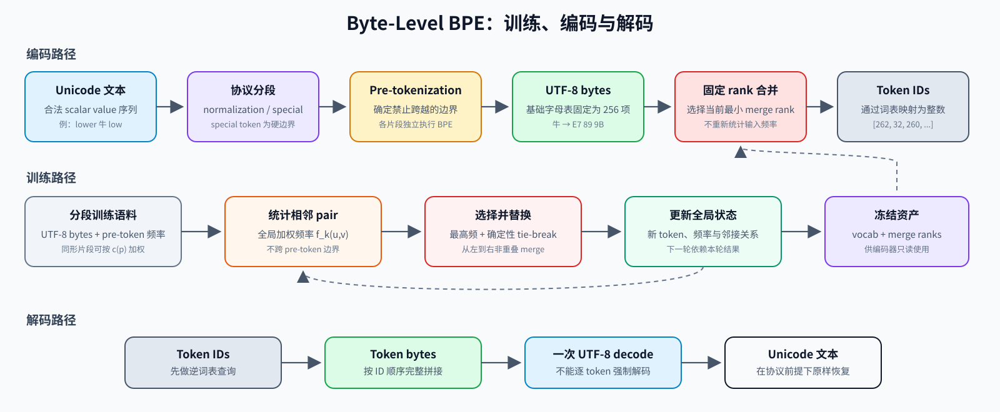
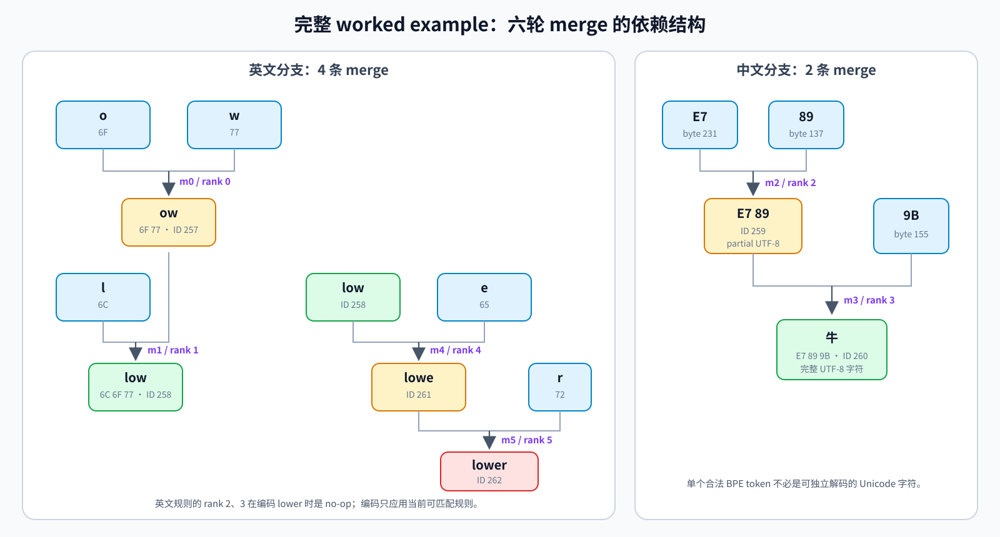
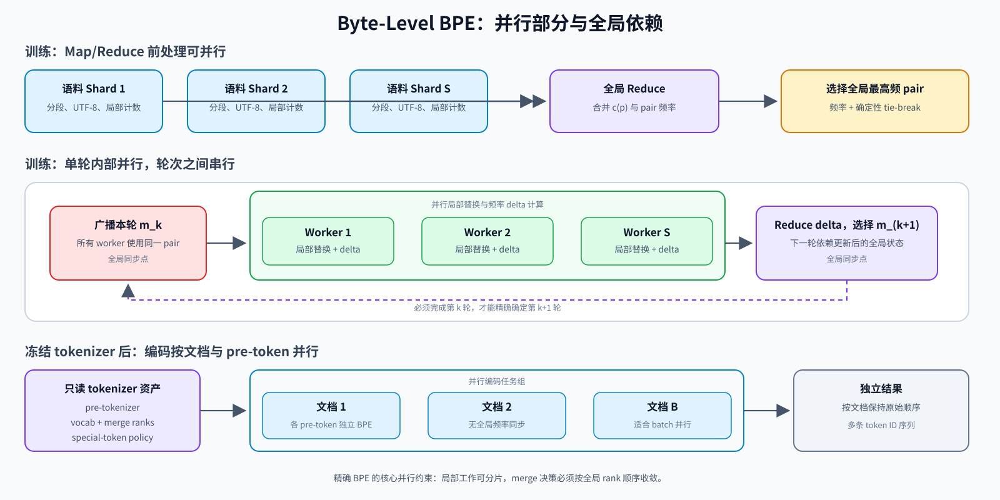

# Byte-Level BPE：从 UTF-8 字节到可逆子词词表

> 主题范围：算法背景、完整算例、形式化定义、训练、编码、解码、GPT-2 风格预分词、复杂度、并行性、边界情况与可逆性

## 0. 阅读目标

Byte-Level Byte Pair Encoding（Byte-Level BPE）把两个看似冲突的目标结合在一起：

1. 以固定且很小的基础字母表覆盖任意合法 Unicode 文本；
2. 把训练语料中的高频字节串提升为较长 token，以缩短模型序列。

本文将严格区分四个容易混淆的对象：

- **Unicode code point**：文本抽象层的码点；
- **UTF-8 byte**：文本序列化后的 8 bit 编码单元；
- **BPE token**：一个非空 byte string，可能覆盖完整字符、多个字符，也可能只是某个字符的一部分；
- **token ID**：词表为 token 分配的整数索引，本身没有固定字节语义。

本文采用“先具体、后抽象”的顺序：先通过六轮完整训练观察 pair 统计、merge、编码与解码，再把例子中出现的对象写成一般形式。读完本文后，读者应能够：

- 手工复算一个包含英文、空格、中文、special token 和 tie-break 的完整例子；
- 从数学上定义 Byte-Level BPE 的训练、编码和解码；
- 解释 pre-tokenization 为什么属于算法定义，而不只是性能优化；
- 证明合法输入不会产生 OOV（Out-of-Vocabulary，即输入无法由现有词表表示）并满足 round-trip 性质；
- 分析朴素实现和增量实现的复杂度；
- 判断训练、编码和解码中的可并行部分与全局串行依赖；
- 正确处理 normalization、非法 UTF-8、special token、流式输入和不完整字符 token。



图 1：Byte-Level BPE 的对象层次。训练学习词表与 merge rank；编码只使用已冻结的规则；解码先恢复完整字节流，再执行一次 UTF-8 解码。

---

## 1. 为什么语言模型需要 tokenizer

### 1.1 从开放字符串空间到有限离散状态空间

语言模型通常接收整数序列，而不是字符串。Tokenizer 定义从文本空间到有限词表序列的映射：

$$ \operatorname{Encode}:\mathcal{X}\rightarrow\{0,1,\ldots,V-1\}^{*}. $$

其中，$\mathcal{X}$ 是 tokenizer 接受的文本空间，$V$ 是词表大小。解码器定义反向映射：

$$ \operatorname{Decode}:\{0,1,\ldots,V-1\}^{*}\rightarrow\mathcal{X}. $$

理想的无损 tokenizer 对合法输入满足：

$$ \operatorname{Decode}(\operatorname{Encode}(x))=x. $$

因此，tokenizer 不是普通的“文本清洗步骤”，而是模型输入输出协议的一部分。Embedding 的行、语言模型输出类别、训练语料中的序列长度、上下文窗口的计量单位，均由该协议决定。

### 1.2 词级建模的开放词表问题

固定词级词表无法封闭地枚举人名、产品型号、URL、拼写变体、代码标识符以及形态丰富语言中的全部词形。这些无法由现有词表表示的输入称为 OOV；传统方案通常把它们统一映射为 unknown token `<unk>`，使不同原始字符串在进入模型前坍缩为同一个 ID，造成不可逆的信息丢失。Sennrich、Haddow 和 Birch 因此把开放词表翻译表述为子词组合问题：高频词可保留为大单位，稀有词和未见词由更小单位组合得到。[Sennrich et al. 2016，摘要与第 1 节](https://arxiv.org/html/1508.07909#S1)

子词表示的基本形式是：

$$ x=t_1\Vert t_2\Vert\cdots\Vert t_n, $$

其中 $\Vert$ 表示有序连接。关键并不是让每个 $t_i$ 都对应语言学上的词素，而是让一个有限 token 集合通过连接覆盖开放字符串空间。

### 1.3 词表大小与序列长度的系统权衡

设词表大小为 $V$，模型宽度为 $d$，token 序列长度为 $n$。若输入 embedding 与输出 projection 不共享参数，仅这两部分的参数量就近似为：

$$ P_{\mathrm{vocab}}\approx 2Vd. $$

若共享权重，则近似为：

$$ P_{\mathrm{vocab}}\approx Vd. $$

增大 $V$ 往往能缩短 $n$，但会增大 embedding 与输出层；减小 $V$ 则会使序列更长，并提高 attention 与中间激活的成本。Byte-Level BPE 的工程意义正是在固定的 256 项基础覆盖之上，用有限数量的 merge 在两类成本之间取得折中。

---

## 2. 从原始 BPE 到 Byte-Level BPE

### 2.1 BPE 的 NLP 改造

[Gage 1994](https://www.derczynski.com/papers/archive/BPE_Gage.pdf) 提出的原始 Byte Pair Encoding 是一种反复替换高频相邻 byte pair 的通用数据压缩方法。Sennrich et al. 将这一贪心字典构造思想改造成子词学习算法：先把词写成字符序列，再反复统计相邻符号对，把最高频 pair $(A,B)$ 替换为新符号 $AB$。每轮 merge 增加一个词表项，因而最终词表大小等于初始符号数加 merge 数。[Sennrich et al. 2016，第 3.2 节与 Algorithm 1](https://arxiv.org/html/1508.07909#S3.SS2)

该工作中的基础单位是字符，并使用 end-of-word 标记恢复原有词边界；它还明确指出，为提高效率，可以在带词频权重的词典上训练，并通过 pair 索引进行增量更新。[Sennrich et al. 2016，第 3.2 节](https://arxiv.org/html/1508.07909#S3.SS2) 这说明“BPE”描述的是逐轮学习高频相邻 pair 的算法家族，而“基础符号是字符还是字节”“是否允许跨词边界”属于 tokenizer 的进一步设计。

### 2.2 GPT-2 的关键改动

GPT-2 技术报告指出，纯字节语言模型具备开放覆盖能力，但序列过细；字符/词级 BPE 更紧凑，却需要为 Unicode 字符覆盖付出较大的基础词表。GPT-2 因而采用 byte-level BPE：基础字母表固定为 256 个字节，同时用类别感知的预分词限制不理想的跨类别 merge。报告把它描述为字节级通用性与词级经验效率之间的折中。[Radford et al. 2019，第 2.2 节，第 4 页](https://cdn.openai.com/better-language-models/language_models_are_unsupervised_multitask_learners.pdf#page=4)

OpenAI 官方 GPT-2 实现还增加了一个**可逆 byte-to-Unicode 显示映射**：先把 256 个 byte value 一一映射到便于以 Unicode 字符串保存的符号，再在这些符号上执行 BPE。[`bytes_to_unicode()`，GPT-2 官方源码](https://github.com/openai/gpt-2/blob/9b63575ef42771a015060c964af2c3da4cf7c8ab/src/encoder.py#L8-L28)

必须强调：

> GPT-2 的 byte-to-Unicode 映射只是 256 个字节的可逆序列化表示，不是 UTF-8 编码，也不会把一个多字节 UTF-8 字符变成一个基础 token。

例如，空格字节 `0x20` 在 GPT-2 词表的可视化形式中常显示为 `Ġ`。这不表示原文中存在字符 `Ġ`；它只是 byte value `0x20` 的代理符号。现代 tiktoken 的概念接口可以直接把 mergeable token 表示为 `bytes`，从而不必把这一显示层误认为算法本体。[tiktoken 教学实现中的 `dict[bytes, int]`](https://github.com/openai/tiktoken/blob/4e71bbe0c078468e00fefbf94b39849389f346e5/tiktoken/_educational.py#L12-L21)

### 2.3 Byte-Level BPE 的核心性质

Byte-Level BPE 的基础普通词表为：

$$ \mathcal{A}=\{\langle 0\rangle,\langle 1\rangle,\ldots,\langle 255\rangle\}. $$

任意合法 Unicode 字符串都可先编码为 UTF-8 字节串，而任意字节都属于 $\{0,\ldots,255\}$。因此，不论训练语料是否见过某个字符，其 UTF-8 字节串都能由基础 token 表示。OpenAI 的 tiktoken 教学实现也显式要求词表至少包含 256 项，并先注册每个单字节 token。[tiktoken `_educational.py` 第 119–137 行](https://github.com/openai/tiktoken/blob/4e71bbe0c078468e00fefbf94b39849389f346e5/tiktoken/_educational.py#L119-L137)

这给出两项不同但相关的性质：

1. **无 OOV**：任意合法 UTF-8 文本都有 token 序列；
2. **可逆**：若前处理不改写文本，解码时完整拼接 token bytes 并严格按 UTF-8 解码，则可恢复原字符串。

无 OOV 不自动蕴含所有 API 都无损。若 tokenizer 先做 Unicode normalization、把 special token 拼写解释成控制符，或在非法 UTF-8 上采用 replacement 策略，原始输入仍可能发生变化。第 10 节将精确定义这些前提。

### 2.4 Byte-Level BPE 在 tokenizer 技术谱系中的位置

Byte-Level BPE 不是“tokenizer”的同义词，而是“基础符号选择 + 词表学习算法 + 编码规则”的一种组合。讨论具体系统时，应把算法家族、实现框架和模型专用资产分开。

| 方案 | 词表学习方向 | 编码时如何切分 | 开放输入覆盖 | 关键性质 |
|---|---|---|---|---|
| Character-level BPE | 从字符出发逐轮合并 | 重放固定 merge rank | 取决于基础字符覆盖 | token 更接近可见字符，但多语言基础集合较大 |
| Byte-Level BPE | 从 256 个 bytes 出发逐轮合并 | 重放固定 merge rank | 对合法 UTF-8 无 OOV | 固定基础词表、可逆，token 可切断字符 |
| WordPiece | 从较小词表逐步构造子词 | 通常使用 longest-match-first | 传统实现可能产生 `[UNK]` | BERT 系模型资产广泛采用 |
| Unigram Language Model | 从较大候选词表反复剪枝 | Viterbi 最优路径或概率采样 | 取决于基础字符与 byte fallback | 具有显式概率模型，可支持多种切分 |
| 纯字节模型 | 不学习子词词表 | 每个 byte 直接成为模型单位 | 无 OOV | 协议最简单，但序列通常最长 |

SentencePiece 处于不同概念层级：它是可以直接从原始句子训练的 tokenizer 框架，同时实现 BPE 与 Unigram，而不是第三种与二者并列的词表学习算法。[SentencePiece 论文](https://aclanthology.org/D18-2012/) 强调其语言无关、从 raw sentences 训练以及可逆空格表示；[Unigram 与 subword regularization](https://aclanthology.org/P18-1007/) 则给出了概率化候选切分与训练期采样。

同理，tiktoken 是面向 BPE encoding 的高性能实现与资产生态，不是独立于 BPE 的统计目标。一个可复现的具体 tokenizer 必须同时给出 normalization、special-token policy、pre-tokenizer、基础字母表、merge ranks、词表 ID 和解码策略。

### 2.5 BPE 没有解决什么

BPE 的成功来自简单、确定、可控，而不是来自对语言结构的完备建模。它具有以下明确边界：

1. **不保证语言学边界。** 高频 byte string 不必对应词根、词缀、单词或 grapheme cluster。
2. **不保证全局最优。** 每轮最高频 pair 是局部贪心选择；早期 merge 会改变后续候选空间。
3. **不直接优化语言模型目标。** 更高 bytes/token 不必然带来更低 validation loss 或更高下游准确率。
4. **不能消除语料偏置。** 高频语言、代码模式、模板字符串乃至数据污染都会竞争有限 merge 预算。
5. **默认只给出一种切分。** 标准 BPE 是确定性的；BPE-Dropout 等扩展才在训练期随机跳过部分 merge，以构造多种分词结果。[BPE-Dropout](https://aclanthology.org/2020.acl-main.170/)

---

## 3. Unicode、UTF-8 与 token 边界

### 3.1 三种“字符”概念

Unicode 文本处理中至少要区分：

| 层次 | 例子 | 说明 |
|---|---|---|
| Unicode code point | `牛` 是 U+725B | Unicode 编码空间中的抽象位置 |
| UTF-8 byte | `E7 89 9B` | U+725B 的三个 8 bit 编码单元 |
| Extended grapheme cluster | `e` + combining acute accent | 用户可能感知为一个“字符”，但可由多个 code point 构成 |

UTF-8 使用 1 至 4 个 byte 表示一个 Unicode scalar value；ASCII 范围 U+0000 至 U+007F 保持相同的单字节值。[RFC 3629，第 3 节](https://www.rfc-editor.org/rfc/rfc3629#section-3) Unicode 进一步区分 code point、编码单元和用户感知字符；grapheme cluster 的默认边界由 Unicode Standard Annex #29 定义。[Unicode UAX #29，第 1 节和第 3 节](https://www.unicode.org/reports/tr29/#Grapheme_Cluster_Boundaries)

因此，一个 Byte-Level BPE token 可以：

- 恰好等于一个 ASCII 字符；
- 覆盖一个多字节 Unicode 字符；
- 只包含多字节字符的一部分；
- 覆盖多个 code point；

### 3.2 UTF-8 的唯一编码与合法性

对合法 Unicode scalar value，UTF-8 使用唯一的最短序列；代理码点 U+D800 至 U+DFFF 不能直接编码为 UTF-8。RFC 3629 同时要求解码器拒绝 overlong encoding 等非法序列，因为把非法序列解释成字符会产生一致性和安全问题。[RFC 3629，第 3–4 节](https://www.rfc-editor.org/rfc/rfc3629#section-3)

定义 $\mathcal{X}_{\mathrm{Unicode}}$ 为由合法 Unicode scalar value 构成的所有有限字符串的集合，并定义 UTF-8 编码函数：

$$ \mathcal{E}:\mathcal{X}_{\mathrm{Unicode}}\rightarrow\mathbb{B}^{*},\qquad \mathbb{B}=\{0,1,\ldots,255\}. $$

对合法 UTF-8 字节串，存在逆映射 $\mathcal{E}^{-1}$，且：

$$ \mathcal{E}^{-1}(\mathcal{E}(x))=x. $$

Unicode Consortium 将 UTF 描述为从 Unicode code point 序列到唯一字节序列的可逆映射，并明确说明非法字节序列不能被当作字符解释。[Unicode UTF FAQ，“What is a UTF?”与非法序列说明](https://www.unicode.org/faq/utf_bom.html#gen2)

### 3.3 Canonical equivalence 不等于 byte equality

两个 Unicode 字符串可以规范等价，却具有不同 code point 序列和不同 UTF-8 bytes。例如，预组合字符与“基本字母 + combining mark”可能显示相同，但底层序列不同。NFC、NFD、NFKC 和 NFKD 会以不同规则重写字符串；其中兼容分解还可能删除具有语义价值的格式差异。[Unicode UAX #15，第 1.1–1.2 节](https://www.unicode.org/reports/tr15/#Norm_Forms)

所以：

- **不做 normalization**：Byte-Level BPE 可以保持原始 code point 序列；
- **先做 normalization**：tokenizer 只能保证恢复 normalization 后的文本；
- **训练与推理 normalization 不一致**：即使 BPE merges 相同，token ID 也可能不同。

Normalization 策略必须与 pre-tokenizer、词表和 merges 一起版本化。

---

## 4. 完整 tokenizer 流水线

Byte-Level BPE 不只是“统计 byte pair”。一个可复现的 tokenizer 至少包含以下层次：

1. **输入域与 normalization**：接受合法 Unicode string 还是任意 bytes，是否执行 NFC/NFKC；
2. **special token 识别**：哪些字符串具有控制语义，是否允许普通文本出现同形拼写；
3. **pre-tokenization**：在哪些边界禁止 BPE merge；
4. **UTF-8 编码**：把普通文本片段转换为 bytes；
5. **BPE 训练产物**：mergeable token bytes 与 merge rank；
6. **token-ID 映射**：把 token 映射到模型整数索引；
7. **解码错误策略**：strict、replacement 或直接返回 bytes。

GPT-2 官方实现的实际顺序是：正则 `findall` 得到 pre-token，对每个 pre-token 做 UTF-8 编码和 byte-to-Unicode 映射，在该片段内部执行 BPE，最后查词表得到 ID。[GPT-2 `encode()`](https://github.com/openai/gpt-2/blob/9b63575ef42771a015060c964af2c3da4cf7c8ab/src/encoder.py#L96-L105) tiktoken 的教学实现保留同样的抽象边界：正则分片、`word.encode("utf-8")`、逐片 BPE、连接 token ID。[tiktoken `SimpleBytePairEncoding.encode()`](https://github.com/openai/tiktoken/blob/4e71bbe0c078468e00fefbf94b39849389f346e5/tiktoken/_educational.py#L23-L37)

### 4.1 为什么 pre-tokenization 是算法的一部分

若直接在整个语料字节流上训练，BPE 可以学习跨任意空白、标点、文档边界甚至控制标记的 token。GPT-2 技术报告指出，无约束 merge 会把有限词表容量浪费在同一词的多种标点变体上，因此通过字符类别限制跨类别 merge，并为空格设置例外。[Radford et al. 2019，第 2.2 节](https://cdn.openai.com/better-language-models/language_models_are_unsupervised_multitask_learners.pdf#page=4)

GPT-2 官方实现使用如下类别：

- 英语缩写后缀，如 `'s`、`'t`、`'re`；
- 可带一个前导普通空格的 Unicode letter 序列；
- 可带一个前导普通空格的 Unicode number 序列；
- 可带一个前导普通空格的非空白、非字母、非数字序列；
- 若干空白序列。

精确定义见 [GPT-2 `Encoder.pat`](https://github.com/openai/gpt-2/blob/9b63575ef42771a015060c964af2c3da4cf7c8ab/src/encoder.py#L42-L53)。其中“可选前导空格”使常见词 token 往往携带左侧空格，而不是让空格总是独立成 token。

Pre-tokenization 产生硬边界。若：

$$ \mathcal{P}(x)=(p_1,p_2,\ldots,p_q), $$

则普通 BPE merge 只在单个 $p_j$ 的内部发生，不跨 $p_j$ 与 $p_{j+1}$。因此，正则或分段规则一旦改变，pair 统计、merge 顺序和最终 token ID 序列都会改变。

**简单例子。** 考虑文本：

```text
low,low
```

假设一个简化的 pre-tokenizer 把连续字母和标点分别切开，则：

$$ \mathcal{P}(\texttt{low,low})=(\texttt{low},\texttt{,},\texttt{low}). $$

BPE 分别处理这三个 pre-token。两个 `low` 内部可以统计并合并 `(l,o)`、`(o,w)` 等 pair；逗号片段长度为 1，不产生 pair。边界两侧的 pair `(w, 逗号)` 与 `(逗号, l)` 不属于任何单个 pre-token，因此即使 `low,low` 在语料中反复出现，也不会学习跨越逗号边界的 token `w,` 或 `,l`。

如果省略 pre-tokenization，把整段 `low,low` 当作一个连续 byte sequence，那么 `(w, 逗号)` 和 `(逗号, l)` 都会进入候选 pair 集合，并可能在频率足够高时被合并。这说明 pre-tokenization 改变的不只是运行速度，而是 BPE 允许学习哪些 token。

### 4.2 Special token 与普通文本必须分层

Special token 具有控制语义，不应仅靠普通 BPE “碰巧”编码成一个 token。现代 tiktoken 明确区分 mergeable token 与 special token，并允许调用方指定哪些 special token 可被识别；默认策略会拒绝未经允许的 special-token 字面量，以降低把普通输入意外解释为控制指令的风险。[tiktoken `Encoding.encode()`](https://github.com/openai/tiktoken/blob/4e71bbe0c078468e00fefbf94b39849389f346e5/tiktoken/core.py#L82-L136)

形式上，special token 应在普通 pre-tokenization 之前识别，并形成硬边界。对于 special token $s$，编码器直接输出原子 token $\langle s\rangle_{\mathcal{S}}$；普通 BPE 不拆分它，也不学习跨越它的 pair。

**简单例子。** 设有两个文档：

```text
cat
dog
```

以 GPT-2 的实际命名为例，tokenizer 协议定义原子 special token `<|endoftext|>` 表示一段文本结束，通常称为 EOT（end of text）token。记其专用 ID 为 $\operatorname{id}_{\mathrm{eot}}$。把两个文档序列化后得到：

```text
cat<|endoftext|>dog
```

Special-token 识别必须先于普通 pre-tokenization，因而协议分段结果为：

$$ \mathcal{G}(\texttt{cat<|endoftext|>dog})=(\texttt{cat},\langle\texttt{<|endoftext|>}\rangle_{\mathcal{S}},\texttt{dog}). $$

编码结果具有如下结构：

$$ \operatorname{Encode}(\texttt{cat})\Vert[\operatorname{id}_{\mathrm{eot}}]\Vert\operatorname{Encode}(\texttt{dog}). $$

其中 `<|endoftext|>` 不会被拆成 `<`、`|`、`endoftext` 等普通 token，也不会统计 `(cat,<|endoftext|>)` 或 `(<|endoftext|>,dog)` 这类跨边界 pair。若用户普通文本中真的出现字面量 `<|endoftext|>`，编码 API 还必须明确选择：将其解释为控制 token、按普通文本编码，或拒绝该输入。

`<|endoftext|>` 不是 Unicode 自带的字符，而是 tokenizer 协议人为定义的原子 special token。

---

## 5. 完整算例：六轮训练、编码与解码

本节先给出一个可手工复算的完整例子，再由第 6 章提炼一般定义。首次阅读时，只需把 $c(p)$ 理解为 pre-token $p$ 在语料中的出现次数，把 $Z_k(p)$ 理解为第 $k$ 轮 merge 后的 token 序列，把 $m_k$ 理解为第 $k$ 条 merge 规则；不必预先掌握完整符号系统。

这个例子刻意包含：

- 重复英文词；
- 多字节 UTF-8 中文字符；
- 原样保留的空格；
- 文档边界 special token；
- pair 频率并列时的确定性 tie-break；
- 不能独立解码成 Unicode 字符的中间 token；
- 训练语料中未出现的字符。



图 2：六条 merge 规则形成两棵局部 DAG。英文分支得到 `low`、`lowe`、`lower`，中文分支先产生不完整 UTF-8 token `E7 89`，再得到完整字符 `牛`。

### 5.1 训练文档与 special token

定义两个文档：

| 文档 | 原始文本 |
|---|---|
| $D_1$ | `low low lower 牛` |
| $D_2$ | `low lower 牛 牛` |

使用 `<|endoftext|>` 分隔文档，序列化后为：

```text
low low lower 牛<|endoftext|>low lower 牛 牛
```

本例把 `<|endoftext|>` 定义为协议层 special token：

1. 它作为一个完整 token 加入词表；
2. 不参与普通 BPE pair 频率统计；
3. 左右两侧是硬边界；
4. merge 不得跨越该边界。

这是一项显式的教学设定。实际库必须通过 special-token API 实现同等语义，不能只假设某个可见字符串会被自动识别。

### 5.2 目标词表大小

设：

$$ V_{\mathrm{target}}=263. $$

256 个单字节 token 加一个 special token，得到：

$$ V_0=256+1=257. $$

每轮产生一个新 token，因此需要：

$$ M=V_{\mathrm{target}}-V_0=263-257=6. $$

### 5.3 本例的简化 pre-tokenizer

为集中展示 byte-level BPE，本例采用以下可逆规则：

1. 连续英文字母构成一个 pre-token；
2. 每个汉字构成一个 pre-token；
3. 连续空格作为独立 pre-token；
4. `<|endoftext|>` 在普通分段前被识别；
5. merge 不跨 pre-token 边界。

### 5.4 Pre-token 序列与频率

$D_1$ 被切分为：

$$ P(D_1)=(\texttt{low},\texttt{ },\texttt{low},\texttt{ },\texttt{lower},\texttt{ },\texttt{牛}). $$

$D_2$ 被切分为：

$$ P(D_2)=(\texttt{low},\texttt{ },\texttt{lower},\texttt{ },\texttt{牛},\texttt{ },\texttt{牛}). $$

频率表为：

| Pre-token $p$ | $c(p)$ |
|---|---:|
| `low` | 3 |
| `lower` | 2 |
| `牛` | 3 |
| 空格 ` ` | 6 |

Special token 不进入普通 pre-token 频率表。

### 5.5 转换为 UTF-8 bytes

ASCII 字符保持其单字节值：

| 字符 | 十六进制 | 十进制 |
|---|---:|---:|
| 空格 | `20` | 32 |
| `e` | `65` | 101 |
| `l` | `6C` | 108 |
| `o` | `6F` | 111 |
| `r` | `72` | 114 |
| `w` | `77` | 119 |

因此：

$$ \operatorname{UTF8}(\texttt{low})=(\texttt{6C},\texttt{6F},\texttt{77}). $$

$$ \operatorname{UTF8}(\texttt{lower})=(\texttt{6C},\texttt{6F},\texttt{77},\texttt{65},\texttt{72}). $$

字符 `牛` 是 U+725B：

$$ \operatorname{UTF8}(\texttt{牛})=(\texttt{E7},\texttt{89},\texttt{9B})=(231,137,155). $$

初始状态：

| Pre-token | $c(p)$ | $Z_0(p)$ |
|---|---:|---|
| `low` | 3 | `[6C, 6F, 77]` |
| `lower` | 2 | `[6C, 6F, 77, 65, 72]` |
| `牛` | 3 | `[E7, 89, 9B]` |
| 空格 | 6 | `[20]` |

空格状态长度为 1，不产生内部 pair。

### 5.6 初始 ID 约定

本例令：

$$ \operatorname{id}(b)=b,\qquad b\in\{0,\ldots,255\}. $$

并令：

$$ \operatorname{id}(\texttt{<|endoftext|>})=256. $$

后续新 token 按创建顺序分配 257 至 262。

### 5.7 Tie-break

若多个 pair 具有相同最高频率，本例选择底层 byte string pair 中字典序最大的一个。比较 $(a,b)$ 与 $(c,d)$ 时，先比较 $\beta(a)$ 与 $\beta(c)$；仅当第一项相同时才比较第二项。

#### 第 1 轮：`(o,w) → ow`

输入为 $Z_0$。加权 pair 统计：

| Pair | `low`，$c=3$ | `lower`，$c=2$ | `牛`，$c=3$ | $f_0$ |
|---|---:|---:|---:|---:|
| `(6C, 6F)`，即 `(l,o)` | 3 | 2 | 0 | 5 |
| `(6F, 77)`，即 `(o,w)` | 3 | 2 | 0 | 5 |
| `(77, 65)`，即 `(w,e)` | 0 | 2 | 0 | 2 |
| `(65, 72)`，即 `(e,r)` | 0 | 2 | 0 | 2 |
| `(E7, 89)` | 0 | 0 | 3 | 3 |
| `(89, 9B)` | 0 | 0 | 3 | 3 |

最高频率为 5。`6F > 6C`，故选：

$$ m_0=(\texttt{6F},\texttt{77}). $$

创建：

$$ \texttt{6F}\Vert\texttt{77}=\texttt{6F77}=\texttt{ow},\qquad \operatorname{id}(\texttt{ow})=257. $$

输出：

| Pre-token | $Z_1(p)$ |
|---|---|
| `low` | `[6C, ow]` |
| `lower` | `[6C, ow, 65, 72]` |
| `牛` | `[E7, 89, 9B]` |
| 空格 | `[20]` |

#### 第 2 轮：`(l,ow) → low`

从 $Z_1$ 重新统计：

| Pair | 来源 | $f_1$ |
|---|---|---:|
| `(6C, ow)` | `low`: 3；`lower`: 2 | 5 |
| `(ow, 65)` | `lower`: 2 | 2 |
| `(65, 72)` | `lower`: 2 | 2 |
| `(E7, 89)` | `牛`: 3 | 3 |
| `(89, 9B)` | `牛`: 3 | 3 |

唯一最高频 pair：

$$ m_1=(\texttt{6C},\texttt{ow}). $$

创建：

$$ \texttt{6C}\Vert\texttt{ow}=\texttt{low},\qquad \operatorname{id}(\texttt{low})=258. $$

输出：

| Pre-token | $Z_2(p)$ |
|---|---|
| `low` | `[low]` |
| `lower` | `[low, 65, 72]` |
| `牛` | `[E7, 89, 9B]` |
| 空格 | `[20]` |

#### 第 3 轮：`(E7,89) → E7 89`

从 $Z_2$ 统计：

| Pair | 来源 | $f_2$ |
|---|---|---:|
| `(low, 65)` | `lower`: 2 | 2 |
| `(65, 72)` | `lower`: 2 | 2 |
| `(E7, 89)` | `牛`: 3 | 3 |
| `(89, 9B)` | `牛`: 3 | 3 |

最高频率为 3。因为 `E7 > 89`，选择：

$$ m_2=(\texttt{E7},\texttt{89}). $$

创建：

$$ \texttt{E7}\Vert\texttt{89}=[\texttt{E7 89}],\qquad \operatorname{id}([\texttt{E7 89}])=259. $$

输出：

| Pre-token | $Z_3(p)$ |
|---|---|
| `low` | `[low]` |
| `lower` | `[low, 65, 72]` |
| `牛` | `[E789, 9B]` |
| 空格 | `[20]` |

`E7 89` 是合法 BPE token bytes，却不是完整 UTF-8 字符。它单独进入严格 UTF-8 decoder 会报“不完整序列”，但这不违反 BPE 定义。

#### 第 4 轮：`(E789,9B) → 牛`

从 $Z_3$ 统计：

| Pair | 来源 | $f_3$ |
|---|---|---:|
| `(low, 65)` | `lower`: 2 | 2 |
| `(65, 72)` | `lower`: 2 | 2 |
| `(E789, 9B)` | `牛`: 3 | 3 |

选择：

$$ m_3=(\texttt{E789},\texttt{9B}). $$

创建：

$$ \texttt{E789}\Vert\texttt{9B}=\texttt{E7899B}=\texttt{牛},\qquad \operatorname{id}(\texttt{牛})=260. $$

输出：

| Pre-token | $Z_4(p)$ |
|---|---|
| `low` | `[low]` |
| `lower` | `[low, 65, 72]` |
| `牛` | `[牛]` |
| 空格 | `[20]` |

#### 第 5 轮：`(low,e) → lowe`

此时仅 `lower` 仍有两个 pair：

| Pair | $f_4$ |
|---|---:|
| `(low, 65)` | 2 |
| `(65, 72)` | 2 |

比较第一项的底层 bytes，`low` 以 `6C` 开头，而 `e` 是 `65`，故选择：

$$ m_4=(\texttt{low},\texttt{65}). $$

创建：

$$ \texttt{low}\Vert\texttt{65}=\texttt{lowe},\qquad \operatorname{id}(\texttt{lowe})=261. $$

输出：

| Pre-token | $Z_5(p)$ |
|---|---|
| `low` | `[low]` |
| `lower` | `[lowe, 72]` |
| `牛` | `[牛]` |
| 空格 | `[20]` |

#### 第 6 轮：`(lowe,r) → lower`

唯一剩余 pair：

$$ (\texttt{lowe},\texttt{72}),\qquad f_5=1\times c(\texttt{lower})=2. $$

选择：

$$ m_5=(\texttt{lowe},\texttt{72}). $$

创建：

$$ \texttt{lowe}\Vert\texttt{72}=\texttt{lower},\qquad \operatorname{id}(\texttt{lower})=262. $$

最终状态：

| Pre-token | $Z_6(p)$ |
|---|---|
| `low` | `[low]` |
| `lower` | `[lower]` |
| `牛` | `[牛]` |
| 空格 | `[20]` |

### 5.8 训练产物

Merge 列表必须按创建顺序保存：

| Rank | 左 token | 右 token | 新 token | ID |
|---:|---|---|---|---:|
| 0 | `6F` (`o`) | `77` (`w`) | `ow` | 257 |
| 1 | `6C` (`l`) | `ow` | `low` | 258 |
| 2 | `E7` | `89` | `E7 89` | 259 |
| 3 | `E7 89` | `9B` | `牛` | 260 |
| 4 | `low` | `65` (`e`) | `lowe` | 261 |
| 5 | `lowe` | `72` (`r`) | `lower` | 262 |

即：

$$ \mathcal{M}=\big[(\texttt{o},\texttt{w}),(\texttt{l},\texttt{ow}),(\texttt{E7},\texttt{89}),(\texttt{E789},\texttt{9B}),(\texttt{low},\texttt{e}),(\texttt{lowe},\texttt{r})\big]. $$

最终词表：

$$ \mathcal{V}=\mathcal{V}_0\cup\{\texttt{ow},\texttt{low},[\texttt{E7 89}],\texttt{牛},\texttt{lowe},\texttt{lower}\}. $$

仅保存 token bytes 和 ID 不足以复现编码；还必须保存 merge priority。GPT-2 源码同时加载 `encoder.json` 与有序 `vocab.bpe`，再构造 ID 词表与 `bpe_ranks`。[GPT-2 `get_encoder()`](https://github.com/openai/gpt-2/blob/9b63575ef42771a015060c964af2c3da4cf7c8ab/src/encoder.py#L108-L119)

### 5.9 编码新文本 `lower 牛 low`

Pre-tokenization：

$$ (\texttt{lower},\texttt{ },\texttt{牛},\texttt{ },\texttt{low}). $$

基础 byte token：

| Pre-token | 初始状态 |
|---|---|
| `lower` | `[6C, 6F, 77, 65, 72]` |
| 空格 | `[20]` |
| `牛` | `[E7, 89, 9B]` |
| 空格 | `[20]` |
| `low` | `[6C, 6F, 77]` |

编码 `lower`：

| 检查顺序 | 规则 | 检查前 | 结果 |
|---:|---|---|---|
| 1 | $m_0:(o,w)\rightarrow ow$ | `[l,o,w,e,r]` | `[l,ow,e,r]` |
| 2 | $m_1:(l,ow)\rightarrow low$ | `[l,ow,e,r]` | `[low,e,r]` |
| 3 | $m_2:(E7,89)\rightarrow E789$ | `[low,e,r]` | no-op |
| 4 | $m_3:(E789,9B)\rightarrow 牛$ | `[low,e,r]` | no-op |
| 5 | $m_4:(low,e)\rightarrow lowe$ | `[low,e,r]` | `[lowe,r]` |
| 6 | $m_5:(lowe,r)\rightarrow lower$ | `[lowe,r]` | `[lower]` |

只显示实际改变的紧凑形式：

$$ [l,o,w,e,r]\xrightarrow{m_0}[l,ow,e,r]\xrightarrow{m_1}[low,e,r]\xrightarrow{m_4}[lowe,r]\xrightarrow{m_5}[lower]. $$

编码 `牛`：

$$ [E7,89,9B]\xrightarrow{m_2}[E789,9B]\xrightarrow{m_3}[E7899B]. $$

编码 `low`：

$$ [l,o,w]\xrightarrow{m_0}[l,ow]\xrightarrow{m_1}[low]. $$

空格 `[20]` 不发生 merge。最终 token 序列：

$$ [\texttt{lower},\texttt{ },\texttt{牛},\texttt{ },\texttt{low}]. $$

最终 ID：

$$ [262,32,260,32,258]. $$

### 5.10 解码

逆词表查询：

| ID | Token bytes |
|---:|---|
| 262 | `6C 6F 77 65 72` |
| 32 | `20` |
| 260 | `E7 89 9B` |
| 32 | `20` |
| 258 | `6C 6F 77` |

拼接：

$$ \texttt{6C 6F 77 65 72 20 E7 89 9B 20 6C 6F 77}. $$

对完整 byte string 执行一次 UTF-8 decode：

```text
lower 牛 low
```

特别地，ID 259 对应 `E7 89`，不能单独解码；但：

$$ \beta(259)\Vert\beta(155)=\texttt{E7 89}\Vert\texttt{9B}=\texttt{E7 89 9B}, $$

拼接后可正确解码为 `牛`。

### 5.11 Special token 进入最终序列

训练语料编码为：

$$ [258,32,258,32,262,32,260,\boxed{256},258,32,262,32,260,32,260]. $$

ID 256 表示原子 `<|endoftext|>`。训练和编码均不会产生跨文档 pair，例如 `(牛,low)`。

### 5.12 压缩效果

忽略 special token，$D_1$ 的 UTF-8 字节数：

$$ 3+1+3+1+5+1+3=17. $$

$D_2$ 同样为 17 bytes，总字节数：

$$ B=34. $$

初始逐字节表示需要 34 个普通 token；训练后两个文档各 7 个，共：

$$ N=14. $$

Bytes/token：

$$ R_{\mathrm{bytes/token}}=\frac{34}{14}\approx2.43. $$

相对纯字节序列的 token 数减少比例：

$$ 1-\frac{14}{34}\approx58.8\%. $$

这里的压缩是“模型序列长度压缩”，不是通用文件压缩率，也不包含词表本身的存储成本。

### 5.13 未见字符串

对训练中未出现的 `lows`：

$$ [l,o,w,s]\xrightarrow{m_0}[l,ow,s]\xrightarrow{m_1}[low,s]. $$

所以：

$$ \operatorname{Encode}(\texttt{lows})=[258,115]. $$

对完全未见的汉字 `新`：

$$ \operatorname{UTF8}(\texttt{新})=(\texttt{E6},\texttt{96},\texttt{B0}). $$

没有 merge 适用，故：

$$ \operatorname{Encode}(\texttt{新})=[230,150,176]. $$

它仍可无损解码。这正是 256 个基础 byte token 提供的开放覆盖能力。

---

## 6. 训练算法的形式化定义

上一章已经具体展示了语料频率、逐轮 pair 统计、tie-break、非重叠替换以及 merge rank。本章不再改变算法过程，而是把这些对象从特定语料中抽离出来，给出适用于任意训练语料的一般定义。

### 6.1 输入对象

设训练语料由 $N$ 个 Unicode 文档组成：

$$ \mathcal{D}=(d_1,d_2,\ldots,d_N). $$

设 $\mathcal{S}$ 为 special token 集合，$\mathcal{P}_{\mathcal{S}}$ 为边界感知的 pre-tokenizer。它先识别 special token，再对每个普通文本区间分段。所有普通 pre-token 构成多重集：

$$ \mathcal{C}=\biguplus_{n=1}^{N}\mathcal{P}_{\mathcal{S}}(d_n). $$

不同普通 pre-token 的集合为：

$$ \mathcal{U}=\operatorname{supp}(\mathcal{C}). $$

对任意 $p\in\mathcal{U}$，定义其语料频率：

$$ c(p)=\operatorname{mult}_{\mathcal{C}}(p). $$

用“不同 pre-token + 频率”表示语料，不改变 pair 的加权计数，却可避免重复存储相同字符串。这正是 Sennrich et al. 所述“在词典上按词频加权训练”的一般化形式。[Sennrich et al. 2016，第 3.2 节](https://arxiv.org/html/1508.07909#S3.SS2)

### 6.2 初始词表与 byte string 映射

定义字节值域：

$$ \mathbb{B}=\{0,1,\ldots,255\}. $$

对每个 $b\in\mathbb{B}$，定义原子 byte token $\langle b\rangle$。基础普通词表为：

$$ \mathcal{A}=\{\langle b\rangle:b\in\mathbb{B}\}. $$

Special token 是另一类原子：

$$ \mathcal{V}_0=\mathcal{A}\cup\{\langle s\rangle_{\mathcal{S}}:s\in\mathcal{S}\}. $$

定义普通 token 到底层非空 byte string 的映射 $\beta$：

$$ \beta(\langle b\rangle)=(b). $$

对 token 序列 $Z=(z_1,\ldots,z_\ell)$，定义：

$$ \beta^{*}(Z)=\beta(z_1)\Vert\beta(z_2)\Vert\cdots\Vert\beta(z_\ell). $$

Special token 的控制语义与普通 byte string 空间分开管理；若系统需要把 special token 解码成其可见拼写，应由协议层单独定义。

### 6.3 Pre-token 的初始状态

若：

$$ \mathcal{E}(p)=(b_1,b_2,\ldots,b_{\ell_p}), $$

则 $p$ 的初始 BPE 状态为：

$$ Z_0(p)=(\langle b_1\rangle,\langle b_2\rangle,\ldots,\langle b_{\ell_p}\rangle). $$

由定义可得：

$$ \beta^{*}(Z_0(p))=\mathcal{E}(p). $$

### 6.4 Pair 频率

对 token 序列 $Z=(z_1,\ldots,z_\ell)$，定义 pair $(u,v)$ 的相邻出现次数：

$$ \operatorname{occ}_{Z}(u,v)=\sum_{j=1}^{\ell-1}\mathbf{1}[z_j=u\land z_{j+1}=v]. $$

第 $k$ 轮开始时，全局加权频率为：

$$ f_k(u,v)=\sum_{p\in\mathcal{U}}c(p)\operatorname{occ}_{Z_k(p)}(u,v). $$

候选 pair 集合为：

$$ \mathcal{Q}_k=\{(u,v):f_k(u,v)>0\}. $$

频率只统计单个 pre-token 内部的相邻关系，不跨 pre-token、special token 或文档边界。

### 6.5 Pair 选择与 tie-break

最高频候选集合为：

$$ \mathcal{H}_k=\underset{(u,v)\in\mathcal{Q}_k}{\arg\max}\ f_k(u,v). $$

BPE 的“最高频”规则并不能在并列时唯一确定输出，因此可复现实现必须再定义一个全序 $\succ_{\tau}$。第 $k$ 条 merge 为：

$$ m_k=(u_k,v_k)=\max_{\succ_{\tau}}\mathcal{H}_k. $$

第 5 章算例采用 CS336 规则：比较 token 的底层 byte string，先比较 pair 第一项，再比较第二项；并列时选择字典序最大的 pair。这是**本例的确定性策略**，不是所有 BPE 实现共享的普遍规定。若 tie-break 不同，算法仍可逆，但 merge 顺序、词表和 token ID 会不同。

### 6.6 非重叠替换与状态更新

选中 $m_k=(u_k,v_k)$ 后，创建新 token $w_k$：

$$ \beta(w_k)=\beta(u_k)\Vert\beta(v_k). $$

词表更新：

$$ \mathcal{V}_{k+1}=\mathcal{V}_k\cup\{w_k\}. $$

定义 $\mathcal{R}_{(u,v)}$ 为从左到右执行的非重叠替换算子。所有普通 pre-token 同步更新：

$$ Z_{k+1}(p)=\mathcal{R}_{m_k}(Z_k(p)),\qquad p\in\mathcal{U}. $$

“非重叠”很重要。例如对 `[a,a,a]` 应用 `(a,a)\rightarrow aa`，从左到右得到 `[aa,a]`，而不是让中间的 `a` 同时参与两次 merge。

### 6.7 Merge rank、token ID 与训练输出

有序 merge 列表为：

$$ \mathcal{M}^{(K)}=(m_0,m_1,\ldots,m_{K-1}). $$

Merge rank 定义为：

$$ \rho(m_k)=k. $$

Token ID 映射是另一个对象：

$$ \iota:\mathcal{V}_K\xrightarrow{\sim}\{0,1,\ldots,|\mathcal{V}_K|-1\}. $$

教学实现常按创建顺序分配 ID，使 token ID 与创建 rank 单调相关；但在一般模型协议中，ID 只是词表索引，不能从 ID 数值直接推导 token bytes。完整训练输出应写成：

$$ \operatorname{TrainBPE}(\mathcal{D},\mathcal{S},\mathcal{P}_{\mathcal{S}},V_{\mathrm{target}})=(\mathcal{V}_K,\mathcal{M}^{(K)},\iota). $$

训练在达到词表预算或 $\mathcal{Q}_k=\varnothing$ 时终止。因此，若语料中已经没有任何相邻 pair，实际词表可能小于目标上限。

---

## 7. 编码算法

### 7.1 编码不重新训练

训练阶段用全语料频率选择 merge；编码阶段不得根据当前输入重新统计“最高频 pair”。编码只使用冻结的 pre-tokenizer、merge rank 和 ID 映射。GPT-2 官方实现把 merge 列表转换为 rank 表，并在每一步选择当前存在且 rank 最小的 pair。[GPT-2 `bpe_ranks` 与 `bpe()`](https://github.com/openai/gpt-2/blob/9b63575ef42771a015060c964af2c3da4cf7c8ab/src/encoder.py#L42-L94)

对普通 pre-token $g$，先构造单字节序列：

$$ Y_0(g)=(\langle b_1\rangle,\ldots,\langle b_\ell\rangle),\qquad \mathcal{E}(g)=(b_1,\ldots,b_\ell). $$

在每一步，从当前相邻 pair 中选择 rank 最小的可用规则：

$$ (u^{*},v^{*})=\underset{(u,v)\in\operatorname{Adj}(Y)}{\arg\min}\ \rho(u,v), $$

并执行非重叠 merge；若当前没有 pair 出现在 merge 表中，则停止。tiktoken 的教学编码器直接体现了这一过程：从单字节 parts 开始，寻找可合并 pair 中最小 rank，合并后重新检查，直到没有规则可用。[tiktoken `bpe_encode()`](https://github.com/openai/tiktoken/blob/4e71bbe0c078468e00fefbf94b39849389f346e5/tiktoken/_educational.py#L83-L116)

对由合法 BPE 训练过程产生的 merge DAG，以下两种描述等价：

1. 每次选择当前可用的最小 rank；
2. 按 rank 从小到大重放全部规则，不匹配的规则为 no-op。

生产实现通常采用第一种描述，因为不必扫描与当前输入无关的全部规则。

### 7.2 整串编码

设边界感知分段器输出：

$$ \mathcal{G}(x)=(g_1,g_2,\ldots,g_q). $$

普通 pre-token 独立执行 BPE；special token 保持原子状态。把各段结果按原顺序连接：

$$ T(x)=Y(g_1)\Vert Y(g_2)\Vert\cdots\Vert Y(g_q). $$

若：

$$ T(x)=(t_1,t_2,\ldots,t_h), $$

则：

$$ \operatorname{Encode}(x)=(\iota(t_1),\iota(t_2),\ldots,\iota(t_h)). $$

Pre-token 边界禁止 merge，但不会在最终 ID 序列中自动产生额外分隔符；各段 token 只是按原顺序直接连接。

---

## 8. 解码算法与可逆性

### 8.1 ID 不是 byte

给定 ID 序列：

$$ I=(i_1,i_2,\ldots,i_h), $$

必须先执行逆词表查询：

$$ t_j=\iota^{-1}(i_j). $$

再取 token bytes：

$$ \beta(t_j)\in\mathbb{B}^{+}. $$

类型关系是：

$$ i_j\xrightarrow{\ \iota^{-1}\ }t_j\xrightarrow{\ \beta\ }\beta(t_j). $$

例如，ID 262 完全可以对应五字节字符串 `lower`；整数 262 不是可直接写入输出的单字节值。

### 8.2 先拼接 bytes，再解码 UTF-8

定义完整输出字节流：

$$ B(I)=\beta(t_1)\Vert\beta(t_2)\Vert\cdots\Vert\beta(t_h). $$

然后只对完整字节流执行一次 UTF-8 解码：

$$ \operatorname{Decode}(I)=\mathcal{E}^{-1}(B(I)). $$

不能逐 token 调用 UTF-8 decoder，因为单个 token 可能只包含一个多字节字符的前缀。tiktoken 官方 API 因而同时提供 `decode_bytes()` 和 `decode_single_token_bytes()`；其字符串 `decode()` 还明确警告，任意 token 序列产生的 bytes 未必是合法 UTF-8，默认 replacement 策略可能有损。[tiktoken 解码 API](https://github.com/openai/tiktoken/blob/4e71bbe0c078468e00fefbf94b39849389f346e5/tiktoken/core.py#L261-L301)

### 8.3 字节保持不变量

对任意普通 pre-token $p$ 和任意训练轮次 $k$：

$$ \beta^{*}(Z_k(p))=\mathcal{E}(p). $$

证明采用归纳法。

- 基础情形：$k=0$ 时由 $Z_0(p)$ 的定义成立。
- 归纳步骤：merge 只把相邻 $\beta(u)$ 与 $\beta(v)$ 替换为连接后的 $\beta(u)\Vert\beta(v)$，既不插入、删除，也不重排字节。

所以任意 merge 序列都保持原始 UTF-8 byte string。

### 8.4 Round-trip 定理

在以下条件同时成立时：

1. 输入 $x$ 是合法 Unicode scalar value 序列；
2. normalization 为恒等变换，或把“原文”定义为 normalization 后文本；
3. pre-tokenizer 覆盖输入且不丢弃字符；
4. 普通 token 均按其底层 bytes 解码；
5. special token 的识别和解码策略前后一致；
6. 对编码产生的合法完整字节流执行 UTF-8 解码；

则：

$$ \operatorname{Decode}(\operatorname{Encode}(x))=x. $$

证明要点是：pre-tokenization 只增加边界而不改写内容；BPE merge 保持每段 bytes；按原顺序连接各段可恢复 $\mathcal{E}(x)$；UTF-8 的逆映射恢复 $x$。

---

## 9. 正确性不变量

### 9.1 边界不变量

训练与编码的 merge 都只作用于单个普通 pre-token 内部。因此不会出现：

- 跨 pre-token merge；
- 跨 special token merge；
- 跨文档 merge。

### 9.2 词表闭包不变量

每个普通 token 都对应有限非空 byte string：

$$ \forall t\in\mathcal{V}_k^{\mathrm{ordinary}},\qquad \beta(t)\in\mathbb{B}^{+}. $$

### 9.3 无 OOV

任意合法 Unicode 字符串 $x$ 都有有限 UTF-8 表示，而每个 byte 都在基础词表中，所以：

$$ \forall x\in\mathcal{X}_{\mathrm{Unicode}},\qquad \operatorname{Encode}(x)\ \text{存在}. $$

这里的“无 OOV”针对普通文本 bytes；special token 是否允许、非法 surrogate 如何处理，仍由 API 协议决定。

### 9.4 确定性

若以下对象全部固定：

- 训练语料与文档边界；
- normalization；
- special token 集合与识别优先级；
- pre-tokenizer；
- UTF-8 错误策略；
- tie-break 全序；
- 目标词表大小；
- token-ID 映射；

则训练结果和任意输入的编码结果唯一确定。缺少其中任一项，都可能得到同名但行为不同的 tokenizer。

---

## 10. 可逆性的精确边界

### 10.1 合法编码结果与任意 ID 序列不同

`Decode(Encode(x)) = x` 只要求解码编码器实际产生的 ID 序列。任意手工构造的 ID 序列可能拼成非法 UTF-8，例如只包含本例 ID 259 的序列。对此 API 有三种合理选择：

1. strict：报告解码错误；
2. replacement：用 U+FFFD 替换非法片段；
3. byte API：返回原始 bytes，不尝试构造 Unicode string。

Unicode 标准允许对 ill-formed sequence 报错、过滤或替换，但禁止把非法序列解释为合法字符。[Unicode UTF FAQ，非法 byte sequence](https://www.unicode.org/faq/utf_bom.html#gen8)

### 10.2 Python lone surrogate 等非标准输入

某些运行时字符串可包含 lone surrogate，而它不属于合法 Unicode scalar value 序列。tiktoken 的 Python 包装层会捕获相应编码错误，并以 replacement 方式修复；源码明确说明这会形成 `encode + decode` 不能恢复原 Python string 的例外。[tiktoken `core.py` 第 126–136 行](https://github.com/openai/tiktoken/blob/4e71bbe0c078468e00fefbf94b39849389f346e5/tiktoken/core.py#L126-L136)

因此，教材中“任意 Unicode 文本可逆”的严格含义应是：任意由 Unicode scalar value 构成的合法字符串，而不是某种语言运行时能够容纳的所有异常字符串对象。

### 10.3 Special token 同形冲突

若普通用户文本恰好包含 `<|endoftext|>`，系统必须决定：

- 把它当 special token；
- 把它当普通字符序列；
- 拒绝输入并要求调用方显式授权。

三者都可形成一致协议，但不能隐式混用。tiktoken 的 `allowed_special` 与 `disallowed_special` 就是在 API 层显式表达该策略。[tiktoken special token 文档与示例](https://github.com/openai/tiktoken/blob/4e71bbe0c078468e00fefbf94b39849389f346e5/tiktoken/core.py#L89-L114)

### 10.4 Normalization

若前处理定义为 $N(x)$，实际 round-trip 是：

$$ \operatorname{Decode}(\operatorname{Encode}(x))=N(x), $$

而不一定是 $x$。特别是 NFKC/NFKD 可能折叠兼容字符和格式差异，不应在要求逐 code point 保真的协议中盲目使用。[Unicode UAX #15，Normalization Forms](https://www.unicode.org/reports/tr15/#Norm_Forms)

### 10.5 BOM 与不可见字符

UTF-8 的 BOM 是字节序列 `EF BB BF`；UTF-8 本身没有字节序问题，BOM 只可能充当签名。[RFC 3629，第 6 节](https://www.rfc-editor.org/rfc/rfc3629#section-6) Byte-Level BPE 会把它和零宽字符、控制字符一样视为 bytes。是否在 tokenization 前删除它是上层协议决定；若删除，就不再是字节级原样可逆。

---

## 11. 复杂度分析

本节给出数据结构假设明确的复杂度。设：

- $K$：实际 merge 数；
- $V$：最终普通词表大小；
- $U_k=\sum_{p\in\mathcal{U}}|Z_k(p)|$：第 $k$ 轮不同 pre-token 状态的总长度；
- $L_k=\sum_{p\in\mathcal{U}}c(p)|Z_k(p)|$：按语料频率加权的总长度；
- $P$：活跃 pair type 数；
- $m$：待编码单个 pre-token 的初始 byte 数；
- $h$：待解码 token 数；
- $B_{\mathrm{out}}$：解码后的 byte 数。

### 11.1 训练：朴素重扫

每轮完整扫描所有不同 pre-token，可在 $O(U_k)$ 时间内重建 pair 频率并更新状态。总时间：

$$ O\!\left(\sum_{k=0}^{K-1}U_k\right)\subseteq O(KU_0). $$

空间主要用于当前 token 序列、pair 计数和词表：

$$ O(U_0+P+V). $$

这一形式利用了相同 pre-token 的频率压缩；若直接物化整个语料，应把 $U_k$ 换成加权规模 $L_k$。Sennrich et al. 的 Algorithm 1 展示的是每轮重算统计的简化实现，并说明实践中使用 pair 索引和增量更新。[Sennrich et al. 2016，第 3.2 节](https://arxiv.org/html/1508.07909#S3.SS2)

### 11.2 训练：增量 pair 索引

一种典型增量设计维护：

- 每个 pre-token 的双向链表或等价邻接结构；
- pair 到出现位置的反向索引；
- pair 的加权频率；
- 按频率排序的堆、平衡树或桶结构。

一次局部替换只影响被合并 pair 及其左右邻接 pair。设 $R$ 为压缩表示中实际执行的非重叠替换总数，则 $R\le U_0$。在“位置可 $O(1)$ 定位、堆更新为 $O(\log P)$、惰性项可均摊清理”的假设下，理想化上界为：

$$ O\!\left(U_0+(R+K)\log P\right). $$

由于 $R\le U_0$，可写成：

$$ O\!\left((U_0+K)\log P\right). $$

这是带数据结构假设的推导，不是任意 BPE trainer 的无条件保证。哈希冲突、失效位置清理、pair 大量并列以及磁盘/分布式聚合都可能改变常数或额外项。

### 11.3 编码：三种实现层次

**按全部规则重扫。** 对每条 merge 规则扫描当前序列：

$$ O(Km). $$

**教学式反复扫描当前 pair。** 每次合并前扫描当前序列寻找最小 rank；最多执行 $m-1$ 次 merge，最坏时间：

$$ O(m^2). $$

tiktoken 的 `_educational.py` 为清晰起见采用这一形式。[tiktoken `bpe_encode()`](https://github.com/openai/tiktoken/blob/4e71bbe0c078468e00fefbf94b39849389f346e5/tiktoken/_educational.py#L83-L116)

**链表 + 最小堆。** 初始化所有当前可合并 pair 的 rank；每次弹出最小 rank，合并后只更新左右邻接。最多 $m-1$ 次合并：

$$ O(m\log m)\ \text{time},\qquad O(m)\ \text{space}. $$

输入被 pre-tokenizer 分成多个片段时，各片段独立计算。设总 byte 数为 $M$，最长片段为 $m_{\max}$，则堆实现可写成：

$$ O(M\log m_{\max}). $$

该上界解释了 pre-tokenization 的第二个系统作用：除约束词表统计外，它也限制单个 BPE 问题的局部规模。

### 11.4 解码

每个 ID 做一次逆词表查询，并写出其 token bytes，随后线性执行 UTF-8 decode：

$$ O(h+B_{\mathrm{out}})=O(B_{\mathrm{out}}). $$

最后一个等号利用了每个普通 token 至少包含一个 byte。解码不执行 pair 搜索，也不依赖 $K$。

### 11.5 复杂度汇总

| 阶段 | 朴素实现 | 优化实现 | 主导规模 |
|---|---|---|---|
| 训练 | $O(KU_0)$ | 假设下 $O((U_0+K)\log P)$ | 不同 pre-token 状态与 merge 数 |
| 编码，单片段 | $O(Km)$ 或教学实现 $O(m^2)$ | $O(m\log m)$ | 片段 byte 数 |
| 编码，整串 | 各片段求和 | $O(M\log m_{\max})$ | 输入 bytes 与最长片段 |
| 解码 | $O(h+B_{\mathrm{out}})$ | $O(B_{\mathrm{out}})$ | 输出 bytes |

---

## 12. 并行性与分布式训练



图 3：训练轮次之间存在全局依赖；单轮内部的局部统计、替换和 delta 聚合可以分片并行。冻结 tokenizer 后，文档级与 pre-token 级编码天然并行。

### 12.1 训练前处理可并行

以下工作可按文档或语料 shard 并行：

- special token 分段；
- pre-tokenization；
- UTF-8 编码；
- 局部 pre-token 频率统计；
- 局部 pair 频率统计。

各 worker 输出计数映射，随后做按 key 求和的 reduce：

$$ c(p)=\sum_{s=1}^{S}c_s(p). $$

### 12.2 Merge 轮次具有全局串行依赖

第 $k+1$ 轮的候选频率依赖第 $k$ 轮修改后的状态：

$$ f_{k+1}=F(\mathcal{R}_{m_k}(Z_k)). $$

所以精确贪心 BPE 的 merge 选择形成长度为 $K$ 的全局依赖链。不能在未知 $m_k$ 的情况下精确选择 $m_{k+1}$。

单轮内部仍可并行：

1. 广播本轮全局 pair $m_k$；
2. 各 shard 在本地 pre-token 状态中执行非重叠替换；
3. 各 shard 产生受影响 pair 的频率 delta；
4. reduce delta 并选出下一轮 pair。

这意味着分布式训练通常每轮至少需要一次全局同步。一次选择多个高频 pair 只有在证明它们的出现位置和频率更新互不影响时才与串行算法等价；一般的“批量 top-$q$ merge”会改变标准贪心 BPE。

### 12.3 编码高度并行

冻结 tokenizer 后：

- 不同文档之间独立；
- 同一文档内不同普通 pre-token 之间独立；
- special token 可独立识别后按原顺序拼接。

tiktoken 官方 Python API 的 batch encode 使用线程池并行不同字符串，体现了文档级并行边界。[tiktoken batch encoding](https://github.com/openai/tiktoken/blob/4e71bbe0c078468e00fefbf94b39849389f346e5/tiktoken/core.py#L164-L206)

### 12.4 解码与流式处理

不同样本的解码可直接并行。单个样本内，ID 到 bytes 的查表和拷贝可通过长度前缀和并行安排输出位置，但最终 UTF-8 边界处理仍需保留相邻 bytes 的有限状态。

任意字符位置切分输入并分别编码，通常不等价于整串编码：

- 正则 pre-token 可能跨 chunk 边界；
- chunk 尾部 token 可能与未来 bytes 形成更高优先级 merge；
- GPT-2 空白规则还可能依赖后续是否存在非空白字符。

精确流式编码只能在已确认的硬边界后提交结果，或保留足够未决后缀。tiktoken 提供的 `encode_with_unstable()` 直接返回“稳定前缀 + 可能补全序列”，正是对这一问题的接口化表达。[tiktoken `encode_with_unstable()`](https://github.com/openai/tiktoken/blob/4e71bbe0c078468e00fefbf94b39849389f346e5/tiktoken/core.py#L208-L243)

---

## 13. 边界情况与失败模式

### 13.1 空输入和单字节片段

- 空输入应编码为空 ID 序列；
- 长度为 1 的 pre-token 没有相邻 pair；
- 若整个训练语料都没有 pair，应提前停止，而不是强行达到目标词表大小。

### 13.2 重叠 pair

对 `[a,a,a]` 合并 `(a,a)` 时，必须定义非重叠方向。本教材与常见实现采用从左到右，结果为 `[aa,a]`。subword-nmt 官方实现也会跳过起点落在已合并区间内的重叠位置。[subword-nmt `apply_bpe.py` 第 301–329 行](https://github.com/rsennrich/subword-nmt/blob/92d6139d07d30e12735a0af9e7f7f925ebe62c54/subword_nmt/apply_bpe.py#L301-L329)

### 13.3 Pair 并列

如果没有稳定 tie-break，同一语料可能因哈希表遍历顺序、worker reduce 顺序或运行时版本不同而产生不同词表。测试应构造明确并列的语料，并断言第一条 merge。

### 13.4 Pre-tokenizer 丢字符

正则 `findall` 必须覆盖原文的每个位置。若某些字符没有匹配，它们会在进入 BPE 前被静默删除，从而破坏可逆性。可靠实现应验证：

$$ p_1\Vert p_2\Vert\cdots\Vert p_q=x $$

或使用能够返回连续 span 的扫描接口检查无 gap、无 overlap。

### 13.5 Token 边界不是字符边界

可视化工具不应对每个 token 强制 UTF-8 decode。应展示：

- 原始 token bytes；
- 十六进制；
- 在可独立解码时附加文本；
- 不能独立解码时明确标注“partial UTF-8”。

tiktoken 教学可视化对不完整 token 使用 replacement character，并在源码注释中说明 token boundary 可能不在 Unicode character boundary 上。[tiktoken 可视化实现](https://github.com/openai/tiktoken/blob/4e71bbe0c078468e00fefbf94b39849389f346e5/tiktoken/_educational.py#L187-L203)

### 13.6 Emoji、ZWJ 与 combining mark

用户感知的一个 emoji 或带音标字符可能由多个 code point 组成；每个 code point 又可包含多个 UTF-8 bytes。Byte-Level BPE 不保证保留 grapheme cluster。若产品 UI 需要按“可见字符”着色或截断，应使用 UAX #29 的 grapheme boundary，而不是 token boundary。[Unicode UAX #29，Grapheme Cluster Boundaries](https://www.unicode.org/reports/tr29/#Grapheme_Cluster_Boundaries)

### 13.7 Special token 注入

把用户字符串直接送入“允许所有 special token”的编码接口，可能把普通文本提升为控制 token。应区分：

- 模板系统注入的可信控制 token；
- 用户提供的普通文本；
- tokenizer 对 special-token 字面量的默认拒绝策略。

### 13.8 Vocab 与 merges 不匹配

以下错误应在加载期拒绝：

- merge 的组成 token 不存在；
- merge 结果没有词表 ID；
- token ID 重复；
- special token ID 与普通 token ID 冲突；
- merge rank 重复或不满足依赖顺序；
- pre-tokenizer/normalization 配置与词表版本不匹配。

### 13.9 训练语料污染

BPE 只看频率，不理解语义。大量重复 URL、模板、base64、日志 ID 或隐私字符串会占据 merge 预算。训练前的去重、采样与领域配比会直接影响词表容量分配；“高频”是语料分布事实，不是语言学重要性的同义词。

---

## 14. 工程实现与复现清单

一个完整 tokenizer 资产应共同版本化：

| 资产 | 必须回答的问题 |
|---|---|
| 输入域 | 接受 Unicode string 还是任意 bytes |
| Normalization | 是否为 identity、NFC、NFKC 或其他规则 |
| Special tokens | 拼写、ID、识别优先级、默认允许策略 |
| Pre-tokenizer | 完整正则/状态机及其 Unicode 属性版本 |
| 基础字母表 | 是否为全部 256 bytes，是否有显示代理层 |
| Merge ranks | 每条 merge 的左右 token 与稳定 rank |
| Vocab | token bytes 到 token ID 的双射 |
| Decode policy | strict、replace 或 byte output |
| 测试向量 | 文本、bytes、ID、round-trip 与边界案例 |

推荐至少固定以下测试：

1. ASCII、中文、emoji、combining mark、换行与 NUL；
2. 空输入与单字节输入；
3. 未见 Unicode 字符回退到 bytes；
4. pair tie-break；
5. `[a,a,a]` 的重叠 merge；
6. special token 作为普通文本、允许控制 token、默认拒绝三种模式；
7. 单 token 为非法 UTF-8 片段、完整序列为合法 UTF-8；
8. normalization 前后差异；
9. chunked encoding 与 whole-string encoding 的一致性边界；
10. `Decode(Encode(x)) = x` 的属性测试。

---

## 15. 评估指标与模型成本

### 15.1 Bytes per token

$$ R_{\mathrm{bytes/token}}=\frac{\text{UTF-8 byte count}}{\text{token count}}. $$

该值越高，固定 token 上下文通常能容纳更多原始 bytes。但应按语言、领域和文本类型分别报告，不能只给全局均值。

### 15.2 Fertility

对有稳定词边界的语料：

$$ F=\frac{\text{token count}}{\text{word count}}. $$

较高 fertility 表示单词被切得更碎。对于中文、日文、代码和 emoji，word count 依赖分词定义，应同时报告 bytes/token、code points/token 或 grapheme clusters/token。

### 15.3 多语言相对成本

若语义对齐内容在语言 $a$、$b$ 中分别使用 $n_a$、$n_b$ 个 token，可定义：

$$ \Gamma_{a,b}=\frac{n_a}{n_b}. $$

长期偏离 1 意味着不同语言承受不同的有效上下文、推理费用和截断概率。Byte-level 的“无 OOV”只保证覆盖，不保证不同语言的 token 效率相同。

### 15.4 不能只优化压缩率

Tokenizer 评估至少应联合考虑：

- 词表大小与 embedding/LM head 参数；
- 平均和尾部分位序列长度；
- 各语言与领域的 bytes/token；
- 编码吞吐和小请求延迟；
- 模型 validation loss 与下游质量；
- special token、聊天模板和 serving runtime 的协议兼容性。

BPE 的贪心 pair 频率目标既不保证全局最优压缩，也不直接优化语言模型 loss。它的主要优势是简单、确定、词表预算可控，并具有成熟的高性能实现。

---

## 16. 常见误解

### 误解一：Byte-Level BPE 的 token 就是字符

错误。Token 是 byte string，可以是字符的一部分、一个字符或多个字符。

### 误解二：Token ID 小于 256 才是 byte，其他 ID 可以直接转字符

错误。ID 始终只是词表索引。必须先查词表得到 token bytes。

### 误解三：编码新文本时重新选择最高频 pair

错误。频率只用于训练；编码使用固定 merge rank。

### 误解四：有 256 个 byte token 就自动保证原文可逆

不充分。Normalization、丢字符的 pre-tokenizer、special token 策略和 replacement decode 都可能破坏原样 round-trip。

### 误解五：GPT-2 词表中的 `Ġ` 是原文字符

错误。它通常是空格 byte 的可逆显示代理，属于 byte-to-Unicode 序列化层。

### 误解六：Pre-tokenization 只影响速度

错误。它决定哪些 pair 可以被统计和合并，因此直接改变训练结果和编码协议。

### 误解七：BPE merge 轮次可以任意批量并行

错误。精确贪心 BPE 的下一轮统计依赖本轮结果；单轮内部可并行，轮次之间通常需要同步。

---

## 17. 结论

Byte-Level BPE 可以概括为三层组合：

1. **UTF-8 提供完备基础表示**：所有合法 Unicode 文本都可还原为 256 种 byte value 的序列；
2. **Pre-tokenization 提供统计与语义边界**：限制不合理的跨类别、跨文档和跨控制标记 merge；
3. **BPE 提供频率驱动的序列压缩**：逐轮把高频相邻 byte string 提升为新 token。

训练与编码的区别必须保持清晰：训练根据全语料频率学习有序 merges，编码只使用固定 rank；解码既不反向执行 merges，也不从 ID 数值猜 bytes，而是查逆词表、拼接完整 byte string、最后统一执行 UTF-8 decode。

Byte-Level BPE 的理论优势不是让 token 天然具有语言学意义，而是以固定基础词表获得开放覆盖，并用可控词表预算压缩常见模式。它的真实行为则由 normalization、special token、pre-tokenizer、tie-break、merge rank、ID 映射和错误策略共同决定。只有把这些对象作为一个整体版本化，tokenizer 才是可复现、可部署、可证明可逆的模型协议。

---

## 附录 A：符号表

| 符号 | 含义 |
|---|---|
| $\mathcal{X}_{\mathrm{Unicode}}$ | 合法 Unicode scalar value 字符串集合 |
| $\mathbb{B}$ | byte value 集合 $\{0,\ldots,255\}$ |
| $\mathcal{E}$、$\mathcal{E}^{-1}$ | UTF-8 编码与对合法 UTF-8 的解码 |
| $\mathcal{D}$ | 训练文档序列 |
| $\mathcal{S}$ | special token 集合 |
| $\mathcal{P}_{\mathcal{S}}$ | special-token-aware pre-tokenizer |
| $\mathcal{C}$ | 普通 pre-token 多重集 |
| $\mathcal{U}$ | 不同普通 pre-token 集合 |
| $c(p)$ | pre-token $p$ 的语料频率 |
| $\mathcal{A}$ | 256 个基础 byte token |
| $\mathcal{V}_k$ | 完成 $k$ 轮 merge 后的词表 |
| $\beta(t)$ | token $t$ 对应的底层 byte string |
| $\beta^{*}(Z)$ | token 序列的 byte string 拼接 |
| $Z_k(p)$ | 训练第 $k$ 轮时 $p$ 的 token 序列 |
| $\operatorname{occ}_{Z}(u,v)$ | pair $(u,v)$ 在 $Z$ 中的相邻出现次数 |
| $f_k(u,v)$ | 第 $k$ 轮 pair 的全局加权频率 |
| $\mathcal{Q}_k$ | 第 $k$ 轮正频率候选 pair 集合 |
| $\mathcal{H}_k$ | 第 $k$ 轮最高频 pair 集合 |
| $m_k=(u_k,v_k)$ | 第 $k$ 条 merge 规则 |
| $\rho(m_k)$ | merge rank |
| $\mathcal{R}_{m_k}$ | 从左到右的非重叠替换算子 |
| $\mathcal{M}^{(K)}$ | 有序 merge 列表 |
| $\iota$、$\iota^{-1}$ | token-ID 映射及逆映射 |
| $\mathcal{G}(x)$ | 输入的 special/ordinary 有序分段 |
| $T(x)$ | 输入完成 BPE 后的 token 序列 |
| $B(I)$ | ID 序列查表后拼接得到的 bytes |
| $K$ | 实际 merge 数 |
| $V$ | 最终词表大小 |
| $U_k$ | 不同 pre-token 状态的未加权总长度 |
| $L_k$ | 按语料频率加权的总长度 |
| $P$ | 活跃 pair type 数 |

## 附录 B：一手资料

1. Rico Sennrich, Barry Haddow, Alexandra Birch, [“Neural Machine Translation of Rare Words with Subword Units,” ACL 2016](https://aclanthology.org/P16-1162/)，[arXiv HTML 全文](https://arxiv.org/html/1508.07909)。
2. OpenAI, [“Language Models are Unsupervised Multitask Learners,” §2.2 Input Representation](https://cdn.openai.com/better-language-models/language_models_are_unsupervised_multitask_learners.pdf#page=4)。
3. OpenAI GPT-2 官方仓库，[`src/encoder.py` 固定 commit](https://github.com/openai/gpt-2/blob/9b63575ef42771a015060c964af2c3da4cf7c8ab/src/encoder.py)。
4. OpenAI tiktoken 官方仓库，[README 固定 commit](https://github.com/openai/tiktoken/blob/4e71bbe0c078468e00fefbf94b39849389f346e5/README.md)，[`_educational.py`](https://github.com/openai/tiktoken/blob/4e71bbe0c078468e00fefbf94b39849389f346e5/tiktoken/_educational.py)，[`core.py`](https://github.com/openai/tiktoken/blob/4e71bbe0c078468e00fefbf94b39849389f346e5/tiktoken/core.py)。
5. Rico Sennrich, [subword-nmt 官方仓库固定 commit](https://github.com/rsennrich/subword-nmt/tree/92d6139d07d30e12735a0af9e7f7f925ebe62c54)。
6. Unicode Consortium, [The Unicode Standard, §3.9 Unicode Encoding Forms](https://www.unicode.org/versions/latest/core-spec/#G7404)。
7. Unicode Consortium, [UTF-8, UTF-16, UTF-32 & BOM FAQ](https://www.unicode.org/faq/utf_bom.html)。
8. Unicode Consortium, [UAX #15: Unicode Normalization Forms](https://www.unicode.org/reports/tr15/)。
9. Unicode Consortium, [UAX #29: Unicode Text Segmentation](https://www.unicode.org/reports/tr29/)。
10. IETF, [RFC 3629: UTF-8, a transformation format of ISO 10646](https://www.rfc-editor.org/rfc/rfc3629)。
11. Philip Gage, [“A New Algorithm for Data Compression,” *C Users Journal*, 1994](https://www.derczynski.com/papers/archive/BPE_Gage.pdf)。
12. Taku Kudo, [“Subword Regularization: Improving Neural Network Translation Models with Multiple Subword Candidates,” ACL 2018](https://aclanthology.org/P18-1007/)。
13. Taku Kudo, John Richardson, [“SentencePiece: A Simple and Language Independent Subword Tokenizer and Detokenizer for Neural Text Processing,” EMNLP 2018](https://aclanthology.org/D18-2012/)。
14. Ivan Provilkov, Dmitrii Emelianenko, Elena Voita, [“BPE-Dropout: Simple and Effective Subword Regularization,” ACL 2020](https://aclanthology.org/2020.acl-main.170/)。

## 附录 C：源路径

```text
institutionalized/stanford_cs336/assignments/assignment1-basics/notes/bpe/01_01_bpe_tokenizer.md
institutionalized/stanford_cs336/assignments/assignment1-basics/notes/bpe/01_02_byte_level_bpe_worked_example.md
```
