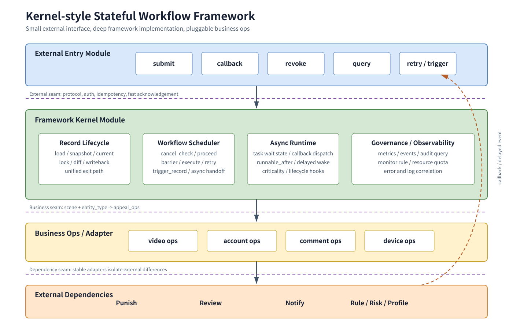
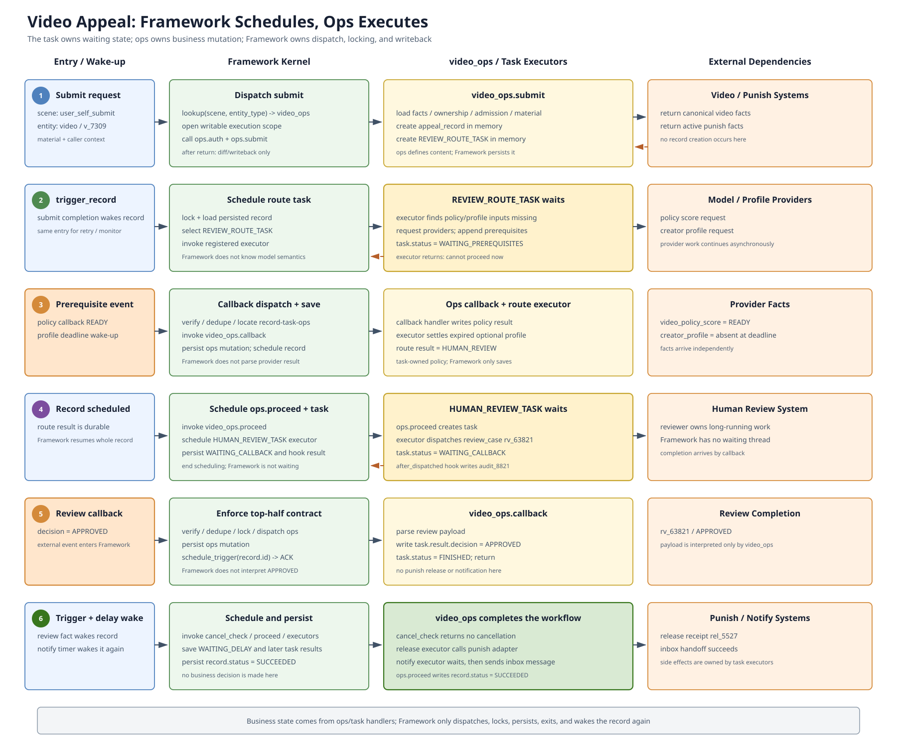
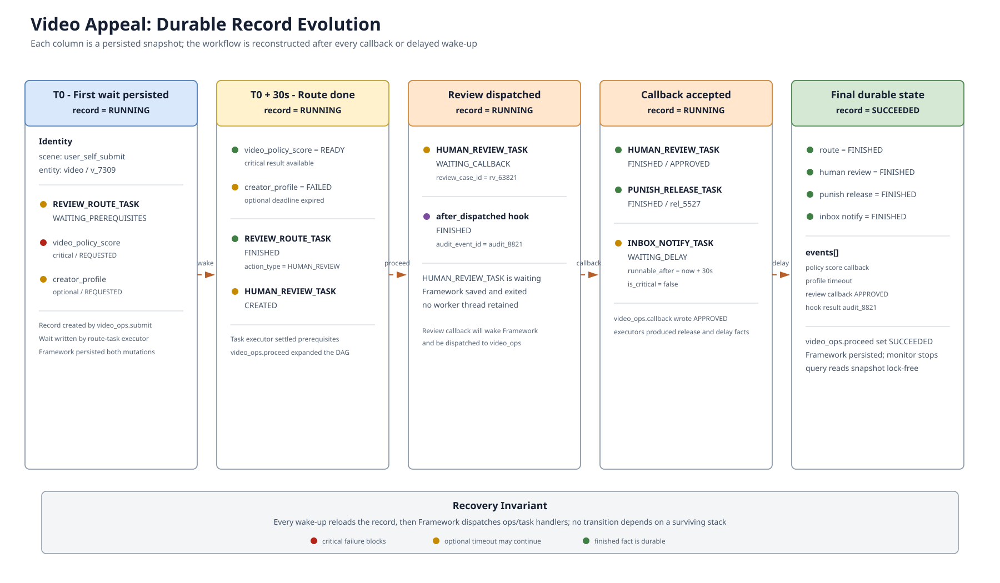
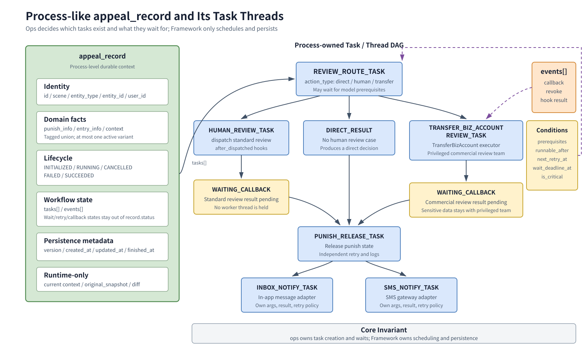
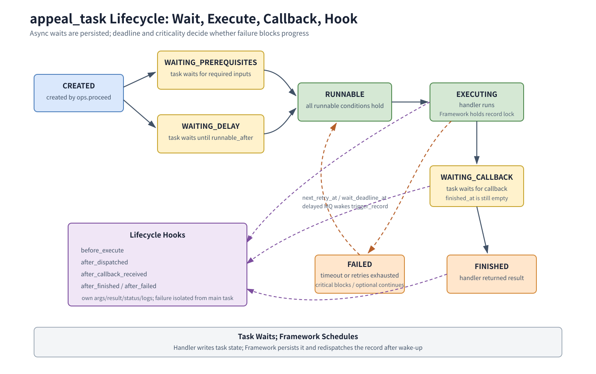
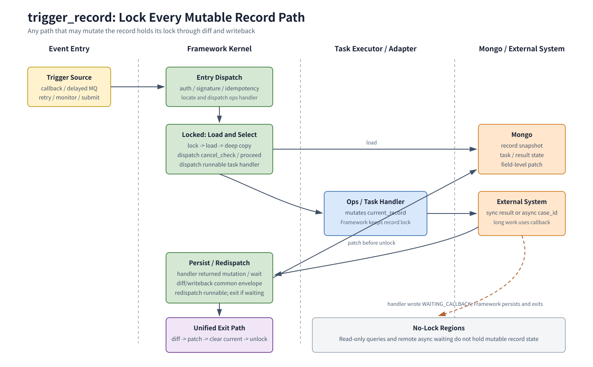

# 内核风格的状态流程框架：以申诉系统为例

## 摘要

申诉系统表面上像一个表单加审核流程，实际却同时包含入口准入、实体差异、权限校验、动态流程、异步回调、延时执行、失败重试、结果通知、审计与监控。若把这些能力直接堆进业务函数，系统很快会演变成由大量条件分支、回调接口和补偿脚本拼成的浅层模块：调用者必须理解几乎全部实现细节，任何修改都可能波及整条链路。

本文借鉴 Linux kernel 的设计思想，把申诉系统设计成一个**通用的有状态流程内核**：

- 少量稳定入口对应 syscall interface；
- `appeal_record` 对应进程级执行上下文，`record.tasks` 对应该进程内的可调度线程；
- `scene + entity_type -> appeal_ops` 对应可注册的 operations；
- task DAG 对应可调度工作；
- prerequisites、callback、timer 和 monitor 对应显式等待与唤醒；
- lifecycle hooks 对应 tracepoint、notifier chain 和 LSM hook；
- 统一 exit path 对应 `_exit` 式集中收尾；
- snapshot、diff 与 writeback 把持久化复杂性隐藏在框架内部。

这套框架并不只适用于申诉。审批、工单、风控处置、售后退款、资金补偿、内容治理和数据修复等系统，只要具有“中心状态对象 + 异步流程 + 多业务扩展”的特征，都可以复用同一种设计。

> 公开说明：文中的实体 ID、策略键、任务键和状态数据均为架构示例，不对应真实用户、线上记录或生产配置。

---

## 目录

1. [问题与设计目标](#1-问题与设计目标)
2. [设计语言与核心不变量](#2-设计语言与核心不变量)
3. [系统职责与关键 seam](#3-系统职责与关键-seam)
4. [总体架构](#4-总体架构)
5. [核心对象 appeal_record](#5-核心对象-appeal_record)
6. [入口、scene 与 appeal_ops](#6-入口scene-与-appeal_ops)
7. [审核分流：先选择 action_type](#7-审核分流先选择-action_type)
8. [Task DAG 与调度模型](#8-task-dag-与调度模型)
9. [异步是一等能力](#9-异步是一等能力)
10. [统一执行闭环 trigger_record](#10-统一执行闭环-trigger_record)
11. [锁、snapshot、diff 与 writeback](#11-锁snapshotdiff-与-writeback)
12. [cancel_check：协作式取消门](#12-cancel_check协作式取消门)
13. [Monitor 与可观测性](#13-monitor-与可观测性)
14. [进一步可借鉴的 Kernel 思想](#14-进一步可借鉴的-kernel-思想)
15. [通用化、测试与演进](#15-通用化测试与演进)
16. [已确认设计决策](#16-已确认设计决策)

---

## 1. 问题与设计目标

### 1.1 申诉不是一条线性流程

一个典型申诉可能经历：

```text
入口判断
  -> 创建申诉记录
  -> 补齐模型与画像特征
  -> 审核分流
  -> 直接裁决 / 送人审 / 转交其他团队
  -> 等待异步回调
  -> 解除处罚
  -> 发送结果通知
  -> 监控、重试或人工介入
```

其中任何一步都可能：

- 同步完成；
- 等待异步结果；
- 延时执行；
- 失败后重试；
- 派生多个后续 task；
- 因外部对象变化而取消；
- 触发旁路通知、日志或 metrics。

因此，申诉不能建模为一个不断增长的 `status` 枚举，也不能建模为一个从头跑到尾的同步函数。它需要一个可持久化、可恢复、可扩展的状态流程框架。

### 1.2 框架的目标

框架负责隐藏所有申诉记录共有的复杂性：

- 外部入口与鉴权；
- record 生命周期；
- ops 查找与分派；
- record 级并发控制；
- 动态 Task DAG；
- prerequisites、callback 和延时唤醒；
- 重试与幂等；
- lifecycle hooks；
- snapshot、diff 与字段级 writeback；
- monitor、metrics 与审计查询。

具体业务只表达差异：

- 某类实体如何查询处罚；
- 某个场景如何鉴权；
- 是否允许申诉或撤销；
- 如何构造后续 task；
- 如何分流；
- 如何解除处罚；
- 如何选择通知方式；
- 哪些外部状态会使流程失效。

### 1.3 非目标

申诉框架不吞并外部领域系统：

- 不成为处罚系统；
- 不成为审核系统；
- 不成为通知系统；
- 不复制外部实体的全部状态；
- 不替代规则平台的发布、灰度与回滚能力；
- 不把每个业务字段都上升为框架公共字段。

核心原则是：

> 框架提供机制，ops 提供策略；框架管理生命周期，业务表达领域差异。

---

## 2. 设计语言与核心不变量

### 2.1 统一设计语言

本文使用以下术语：

| 术语 | 含义 |
|---|---|
| Module | 具有一个稳定 interface 和内部 implementation 的模块 |
| Interface | 调用者正确使用模块所需知道的全部约束，不只是函数签名 |
| Seam | 可以替换行为而不修改调用方的位置 |
| Adapter | 位于 seam 上、满足 interface 的具体实现 |
| ops | 某类业务实体在指定 scene 下注册的 operations |
| record | 一次流程的中心状态对象 |
| task | record 内 DAG 的可调度节点 |
| event | 已经发生的外部事件或关键内部事实 |
| hook | task 生命周期中的可注册扩展点 |

框架应该是一个**深模块**：外部 interface 很小，但隐藏了大量执行、并发、等待与持久化机制。若调用者仍需自己处理锁、重试、延时、回调和 writeback，说明框架还不够深。

### 2.2 核心不变量

后文所有设计都建立在以下不变量上：

1. `appeal_record` 存在，表示入口准入已经通过。
2. 具体 ops 的 `submit` 在内存中创建 record；框架负责调度 `submit` 并统一持久化。`submit` 不属于 record 内部 Task DAG。
3. record 的 `status` 只表达五种粗粒度生命周期状态。
4. 细粒度进度由 tasks、events 和其他字段实时推导。
5. 所有 record 变更都经过 record lock 和统一 exit path。
6. 业务代码只修改内存中的 record，不直接决定何时 writeback。
7. callback、延时 MQ 和 monitor 都只写事实或唤醒，不绕过 `trigger_record` 直接推进业务。
8. 任何可能修改 record 的路径都必须持有 record lock；只有严格只读的查询和不持有 record 的异步等待阶段可以无锁。
9. task 的等待条件必须持久化，不能依赖某个线程一直存活。
10. hook 是旁路扩展点，不是隐式主流程。
11. 框架只定义 task envelope；每类 `args` 和 `result` 由业务定义。
12. task 和 prerequisite 都显式声明 `is_critical`；只有非关键节点才允许在等待截止后失败并继续推进。
13. ops 根据 record 自身状态决定创建哪些 task、task 等待什么；Framework 只负责调度、保存与唤醒。

---

## 3. 系统职责与关键 seam

### 3.1 申诉框架负责什么

框架负责：

- 接收 submit、callback、revoke、query、retry；
- 验证外部身份和请求；
- 创建、加载、锁定和保存 record；
- 维护 current execution context；
- 根据 `scene + entity_type` 查找 ops；
- 调用 ops 的 `submit/proceed/callback` 等业务入口；
- 判断 task 是否可运行；
- 在 record lock 内把 task 调度给 ops 注册的 executor；
- 接入 callback、重试和延时唤醒，并分派给对应 ops；
- 执行 hook；
- 输出 metrics、events 和诊断视图；
- 按 scene 启动 monitor。

调用者看到的 external interface 应保持很小：

```c
struct appeal_framework {
    submit();
    callback();
    revoke();
    query();
    retry();
};
```

`load_record`、`lock_record`、`proceed`、`execute_task`、`diff_writeback` 和 `trigger_record` 属于框架 implementation 的内部机制。除受控的运维入口外，普通业务调用者不能绕过 external interface 直接调用这些原语，否则框架的不变量将无法成立。

### 3.2 ops 负责什么

ops 负责：

- 查询实体和处罚详情；
- 完成实体特定鉴权；
- 判断是否允许提交或撤销；
- 在 `submit` 中创建 record 并填充领域信息；
- 构造动态 DAG；
- 实现多前置任务汇合的 barrier；
- 定义 task executor；
- 处理 prerequisite、task callback 等业务结果；
- 选择审核 action；
- 选择结果通知渠道；
- 判断流程是否因外部状态变化而取消；
- 注册 task lifecycle hooks。

### 3.3 三类关键 seam

系统至少包含三类 seam：

| Seam | 稳定 interface | Adapter |
|---|---|---|
| 外部入口 seam | submit/callback/revoke/query/retry | HTTP、RPC、MQ consumer、后台工具 |
| 业务 seam | `appeal_ops` | video/account/comment/device 等 ops |
| 依赖 seam | punish/review/notify/rule/risk interface | 各外部系统 adapter |

一个 seam 只有在确实存在多个 adapter 时才有价值。不要为了“看起来解耦”而为永远只有一种实现的代码制造额外层级。

---

## 4. 总体架构



**图 4-1　框架模块、业务 ops 与外部依赖之间的 seam**

总体执行关系是：

```text
外部入口
  -> 框架内核
  -> 根据 scene + entity_type 分派 appeal_ops
  -> 动态生成并调度 task
  -> 通过 adapter 调用外部依赖
  -> callback / delayed event 回到统一入口
  -> trigger_record 继续推进
```

这与 VFS 的核心价值相似：

```text
Linux:
  上层调用稳定的 VFS interface
  -> VFS 找到具体 file_operations
  -> 文件系统或设备驱动执行实现

申诉框架:
  外部调用稳定的流程 interface
  -> 框架找到具体 appeal_ops
  -> scene/entity 对应的业务实现执行
```

类比只用于解释分层与扩展方式，不要求函数名或执行语义一一对应。

### 4.1 贯穿示例：一次视频申诉

下面用一条完整的视频申诉串联全文中的抽象。理解这个例子前，必须先固定三个所有权边界：

1. **ops 执行业务**：`video_ops.submit` 创建 record；各 task executor 决定 task 如何执行或进入等待；`video_ops.callback` 解释 callback 并修改 task。
2. **Framework 负责调度**：选择 ops、建立 execution scope、调度 record/task、处理锁和唤醒。
3. **Framework 负责保存**：ops 只修改内存对象；Framework 在统一 exit path 做 diff/writeback。

换句话说，Framework 不创建视频 record、不向模型索取视频特征，也不解释审核 callback。它只像 Kernel 一样，把具体业务实现调度进来，并保存业务实现留下的状态变化。

在这个例子中，`appeal_record` 是“进程”，`REVIEW_ROUTE_TASK`、`HUMAN_REVIEW_TASK`、`PUNISH_RELEASE_TASK` 和 `INBOX_NOTIFY_TASK` 是该进程中的“线程”。创建哪些线程、线程何时睡眠，都由 `video_ops` 的流程逻辑决定；Framework 只调度这些线程。

#### 场景设定

用户 `u_1842` 的视频 `v_7309` 因“疑似误导性内容”被下架。用户从端内入口提交申诉：

| 维度 | 示例值 |
|---|---|
| `scene` | `user_self_submit` |
| `entity_type` | `video` |
| `entity_id` | `v_7309` |
| `user_id` | `u_1842` |
| record ID | `ap_20260906_0001` |
| 入口模板 | `video_appeal_v3` |

本例采用以下业务策略：

- 视频政策模型结果是审核分流的关键输入，`is_critical = true`；
- 创作者画像是辅助输入，`is_critical = false`，最长等待 30 秒；
- 分流结果为 `HUMAN_REVIEW`；
- 人审返回 `APPROVED`；
- 解除处罚是 critical task；
- 站内信通知是 non-critical task，并在处罚解除 30 秒后执行；
- 所有会修改 record 的路径都持有 record lock；
- 所有修改都由框架在统一 exit path 做 diff/writeback。



**图 4-2　Framework 调度 video_ops 与 task executor 完成一次视频申诉**

### 4.2 阶段一：入口准入与 record 创建

用户调用外部 `submit` 时，record 尚不存在。Framework 解析协议，根据 `scene + entity_type` 找到 `video_ops`，然后调用：

```text
video_ops.auth(context)
video_ops.submit(context)
```

真正的提交业务发生在 `video_ops.submit` 中：

```text
video_ops.submit(context):
  -> load video and punish facts
  -> verify ownership
  -> evaluate video admission policy
  -> validate appeal material
  -> create appeal_record in memory
  -> create REVIEW_ROUTE_TASK in memory
  -> return
```

若鉴权或准入失败，`video_ops.submit` 返回拒绝，不创建 `appeal_record`。因此，不需要在 record 中保存 `can_appeal = false`、`deny_code` 或鉴权结果。

准入通过后，`video_ops.submit` 在内存中创建：

```text
record.id = ap_20260906_0001
record.scene = user_self_submit
record.entity_type = video
record.entity_id = v_7309
record.user_id = u_1842
record.punish_info.video = {...}
record.entry_info.submit_template_id = video_appeal_v3
record.status = RUNNING

record.tasks = [
  REVIEW_ROUTE_TASK
]
```

Framework 不理解这些视频领域字段，也不调用 `create_record`。ops 返回后，Framework 只执行统一收尾：

```text
video_ops.submit returns
  -> Framework observes in-memory record
  -> diff/writeback
  -> clear execution context
  -> release lock
```

这里最重要的分工是：**record 的内容由 ops 决定，record 的保存由 Framework 决定。**

### 4.3 阶段二：准备审核分流所需的 prerequisites

Framework 调度 record 时，从公共 envelope 中发现 `REVIEW_ROUTE_TASK` 尚未完成，于是调用 video ops 注册的 route-task executor。此时 task 的关键字段最初只是：

```text
task_key = review_route:7d31
task_type = REVIEW_ROUTE_TASK
status = CREATED
is_critical = true
wait_deadline_at = T0 + 2 minutes
```

真正判断需要哪些 prerequisite 的是 task executor：

```text
video_ops.execute_review_route(record, task):
  -> inspect video appeal context
  -> find video_policy_score missing
  -> find creator_profile missing
  -> request model/profile providers
  -> append prerequisites to task
  -> task.status = WAITING_PREREQUISITES
  -> return: task cannot proceed now
```

executor 写入的 prerequisite 为：

```text
prerequisites:
  - key = video_policy_score
    is_critical = true
    wait_deadline_at = T0 + 2 minutes

  - key = creator_profile
    is_critical = false
    wait_deadline_at = T0 + 30 seconds
```

executor 返回以后，Framework 只知道：

```text
this task is waiting and cannot continue
```

Framework 不理解 `video_policy_score` 和 `creator_profile`，也不替 task 等待。它只执行：

```text
diff/writeback
  -> release record lock
  -> end this scheduling round
```

这和进程等待 IO 的关系一致：等待的是 task，不是 Framework；Framework 只是调度器。

随后发生：

1. `video_policy_score` 在第 8 秒返回并进入 `READY`；
2. `creator_profile` 一直没有返回；
3. 模型 callback 进入 Framework，Framework 定位 `record/task/video_ops`；
4. Framework 调用 `video_ops.callback`；
5. `video_ops.callback` 把 `video_policy_score` 的 result/status 写入内存 task；
6. Framework 保存 mutation，并调用 `schedule_trigger(record.id)`。

第 30 秒的延时事件再次触发整个 record。Framework 重新调度 `REVIEW_ROUTE_TASK`，route-task executor 发现 non-critical 的 `creator_profile` 已超过 `wait_deadline_at`，于是把它标记为 `FAILED`，并按缺省画像继续执行。

这里的 `FAILED` 不等于整个申诉失败。决定超时后如何降级的是 task executor 的 prerequisite policy，不是 Framework。

```text
task executor:
  understands prerequisite meaning
  mutates prerequisite/task state

Framework:
  schedules executor
  persists resulting mutation
  exits when task says it is waiting
```

### 4.4 阶段三：审核分流与人审派发

`trigger_record` 重新取得 record lock 后，再次把 `REVIEW_ROUTE_TASK` 调度给 route-task executor。executor 自己检查：

```text
video_policy_score = READY
creator_profile = FAILED but non-critical and expired
now >= runnable_after
now < task.wait_deadline_at
```

条件满足后，executor 调用 router，并把结果写入 task：

```json
{
  "action_type": "HUMAN_REVIEW",
  "human_review": {
    "queue": "video_policy_review",
    "priority": "normal"
  }
}
```

该结果只写入 `REVIEW_ROUTE_TASK.result`，不复制到 record 顶层。executor 返回后，Framework 调用 `video_ops.proceed(record)`；ops 观察到分流 task 已完成，幂等地创建：

```text
task_key = human_review:91af
task_type = HUMAN_REVIEW_TASK
parents = [review_route:7d31]
is_critical = true
status = CREATED
```

Framework 随后把新 task 调度给 human-review executor。executor 调用审核 adapter 创建人审单，并在内存中写入：

```text
HUMAN_REVIEW_TASK.result.review_case_id = rv_63821
HUMAN_REVIEW_TASK.status = WAITING_CALLBACK
```

executor 还触发 `after_dispatched` hook，并记录其结果：

```text
hook_name = emit_review_dispatch_audit
status = FINISHED
result.audit_event_id = audit_8821
exec_logids = [...]
```

human-review executor 此时返回“正在等待 callback”。等待的是 `HUMAN_REVIEW_TASK`，Framework 没有进入等待态；它只发现本轮没有可继续执行的工作，于是 diff/writeback、释放 record lock 并结束调度。

### 4.5 阶段四：人审 callback 唤醒流程

审核员判定申诉成立，审核系统回调：

```text
review_case_id = rv_63821
decision = APPROVED
```

callback 先进入 Framework。Framework 完成通用验签、幂等与路由后，调用 `video_ops.callback`。top-half 是 Framework 对这个 ops handler 的要求：

```text
Framework:
  verify / deduplicate / locate record-task-ops
  -> lock and load record
  -> call video_ops.callback(record, task, payload)

video_ops.callback:
  parse review decision
  -> task.result.decision = APPROVED
  -> task.status = FINISHED
  -> append exec_logids
  -> return immediately

Framework:
  diff/writeback
  -> unlock
  -> schedule_trigger(record.id)
  -> ACK
```

Framework 不解释 `APPROVED` 的业务含义；`video_ops.callback` 也不在 callback handler 里直接解除处罚或发送通知。它只把当前外部事件翻译成 record/task mutation。`schedule_trigger` 可以提交本地异步执行器，也可以发布 MQ 消息。

### 4.6 阶段五：cancel_check、解除处罚与延时通知

新一轮 `trigger_record` 获取 record lock 后，调用：

```text
cancellation = video_ops.cancel_check(record)
```

本例中视频仍存在、处罚仍有效，因此没有返回 cancellation，record 不发生任何变化，流程自然继续。

`video_ops.proceed` 读取人审结果并创建：

```text
task_key = punish_release:2bc4
task_type = PUNISH_RELEASE_TASK
parents = [human_review:91af]
is_critical = true
```

Framework 把新 task 调度给 punish-release executor。executor 在执行关键副作用前调用：

```text
video_ops.cancel_check(record, punish_release:2bc4)
```

仍未发现取消事实后，punish-release executor 调用处罚系统，并在成功后修改当前 task：

```text
PUNISH_RELEASE_TASK.status = FINISHED
PUNISH_RELEASE_TASK.result = {
    release_receipt_id: "rel_5527"
}
```

executor 返回后，Framework 再次调用 `video_ops.proceed`。ops 随即创建站内信 task：

```text
task_key = inbox_notify:cc09
task_type = INBOX_NOTIFY_TASK
parents = [punish_release:2bc4]
is_critical = false
runnable_after = now + 30 seconds
wait_deadline_at = now + 10 minutes
```

延时 30 秒是为了等待视频状态在读取链路中完成最终一致。Framework 调度到该 task 时，只从公共 envelope 看出时间条件尚未满足，于是保存 record 并退出；处于等待态的是 `INBOX_NOTIFY_TASK`。

延时 MQ 到期时只调用 `trigger_record`。Framework 重新调度整个 record，并把到期的 task 交给 inbox-notify executor。executor 调用站内信 adapter，成功 handoff 后把 task 标记为 `FINISHED`；Framework 只负责保存这次 mutation。

### 4.7 阶段六：推导终态并停止 monitor

最后一次 `video_ops.proceed` 根据已有事实判断：

```text
human review completed with APPROVED
AND critical punish release completed
AND inbox notification reached a terminal state
```

于是：

```text
record.status = SUCCEEDED
record.finished_at = now
```

ops 在内存中写入终态，Framework 的统一 exit path 只把本轮变化字段写回。monitor 的下一条延时消息即使已经在途，Framework 再次调度 record 时也会发现其已终态并停止继续轮询。

最终 record 的关键信息如下：

```text
record.status = SUCCEEDED

tasks:
  review_route:7d31    -> FINISHED
  human_review:91af    -> FINISHED
  punish_release:2bc4  -> FINISHED
  inbox_notify:cc09    -> FINISHED

events:
  prerequisite_callback(video_policy_score)
  prerequisite_timeout(creator_profile)
  review_callback(APPROVED)
  hook_result(audit_8821)
```



**图 4-3　异步事件之间没有常驻线程；每次唤醒都从持久化 record 恢复执行**

### 4.8 这个例子展示了哪些框架能力

| 机制 | 在示例中的作用 |
|---|---|
| `scene + entity_type -> ops` | 选择 `user_self_submit + video` 对应的鉴权、准入和流程逻辑 |
| record | 保存一次视频申诉的稳定事实和完整 DAG |
| tagged `punish_info` | 只激活 `punish_info.video` |
| prerequisites | task executor 发现输入未就绪后写入等待状态；Framework 保存并退出 |
| `is_critical` | 模型结果不可缺失，画像结果允许超时降级 |
| `wait_deadline_at` | 到期后让 non-critical 画像收敛为 `FAILED` |
| `proceed` | 根据已发生事实幂等地产生下一批 task |
| callback | Framework 分派给 ops handler；ops 快速写入业务结果，Framework 保存并唤醒 |
| lifecycle hook | 记录人审派发审计结果，不污染主 executor |
| `cancel_check` | 在推进前和解除处罚前阻止无效副作用 |
| `runnable_after` | task 等待时间条件；延时事件只唤醒 Framework 重新调度 |
| record lock | 保护所有可能修改 record 的代码路径 |
| unified writeback | 业务只改内存，由框架统一提交字段级 diff |
| monitor | 反复唤醒未终态 record 供 Framework 重新调度，终态后停止 |

### 4.9 关键异常分支

完整生命周期还必须能解释失败和竞争：

1. **重复审核 callback**：Framework 做通用幂等，ops handler 识别业务重复；已落库的相同结果不会再次创建解除处罚 task。
2. **解除处罚前视频已删除**：第二级 `cancel_check` 返回 cancellation；框架写 cancellation event，将 record 置为 `CANCELLED`，不再调用处罚系统。
3. **关键模型 prerequisite 超时**：route-task executor 将其标记 `FAILED`；因为 `is_critical = true`，task 仍不能完成，等待重试、人工恢复或由 ops 终止 record。
4. **辅助画像 prerequisite 超时**：route-task executor 将其标记 `FAILED`；因为 `is_critical = false`，executor 使用缺省画像继续。
5. **站内信持续失败**：inbox-notify executor 在 `wait_deadline_at` 后将 task 标记 `FAILED`；本例策略允许 non-critical 通知失败后仍由 `video_ops.proceed` 把 record 推进到 `SUCCEEDED`。
6. **延时消息重复到达**：`trigger_record` 和 `proceed` 都是幂等的；已有 `task_key` 不会被重复创建或重复完成。
7. **无状态变化的唤醒**：snapshot 与 current record 无 diff，框架跳过 Mongo writeback。

### 4.10 barrier 的可选扩展

若一个视频处罚实际横跨两个独立下游，例如内容系统的可见性限制和推荐系统的流量限制，人审通过后可以并行创建：

```text
CONTENT_PUNISH_RELEASE_TASK
TRAFFIC_PUNISH_RELEASE_TASK
```

两者都是 critical task。`video_ops.proceed` 中的 barrier 只有在两个 task 都成功后才综合结果并创建 `INBOX_NOTIFY_TASK`：

```text
CONTENT_PUNISH_RELEASE_TASK --+
                              +--> barrier --> INBOX_NOTIFY_TASK
TRAFFIC_PUNISH_RELEASE_TASK --+
```

barrier 不单独持久化。两个上游 task 的 status/result 是运行事实；通知 task 产生后，其 `parents` 记录这两个已经收敛的上游 task，只用于血缘追溯。

---

## 5. 核心对象 appeal_record

### 5.1 record 是流程的状态载体

`appeal_record` 不是一条仅供查询的数据库记录，而是一次流程的完整运行态上下文。它在概念上更像一个进程：拥有自己的身份、领域状态、生命周期、事件以及一组可调度的 tasks。



**图 5-1　record 保存事实，task DAG 表达流程**

建议结构：

```c
struct appeal_record {
    string id;

    string scene;
    string entity_type;
    string entity_id;
    string user_id;

    punish_info punish_info;
    entry_info entry_info;
    appeal_context context;

    string status;
    appeal_task tasks[];
    appeal_event events[];

    int version;
    timestamp created_at;
    timestamp updated_at;
    timestamp finished_at;
};
```

字段职责：

| 字段 | 语义 |
|---|---|
| `id` | record 主键 |
| `scene` | 这次流程从什么业务场景进入 |
| `entity_type` | 视频、账号、评论、设备等实体类型 |
| `entity_id` | 被申诉实体标识 |
| `user_id` | 申诉用户 |
| `punish_info` | 由 `entity_type` 判别的处罚信息 tagged union |
| `entry_info` | 入口准入后确实要参与后续流程的信息 |
| `context` | 流程执行所需的结构化上下文 |
| `status` | record 顶层生命周期 |
| `tasks` | 动态 DAG 节点 |
| `events` | 关键外部事件和内部事实 |
| `version` | record 修订号 |

#### Kernel 类比：record 是进程，tasks 是线程

从整体运行模型看：

```text
appeal_record
  ≈ process-level context

appeal_record.tasks[]
  ≈ threads owned by that process

Framework
  ≈ Kernel scheduler + wait/wake + persistence mechanism
```

对应关系如下：

| 操作系统概念 | 流程框架概念 |
|---|---|
| 进程级共享上下文 | `appeal_record` |
| 进程中的线程 | `record.tasks[]` |
| 用户程序决定创建线程 | `ops.submit/proceed` 决定创建哪些 task |
| 线程执行自身逻辑 | task executor 解释 `args` 并修改 task/record |
| 线程因 IO/condition 睡眠 | task 写入 `WAITING_PREREQUISITES/WAITING_CALLBACK/WAITING_DELAY` |
| Kernel scheduler 保存线程状态并切换 | Framework 保存 record 并结束本轮调度 |
| IO completion 唤醒线程 | callback/delayed event 调用 `trigger_record` |

最关键的不变量是：

> Kernel 不替进程决定要创建哪些线程，也不替线程决定等待哪个 IO；同样，Framework 不替 record 决定 DAG，也不替 task 定义等待条件。

这些决定来自 record 对应的 ops 和 task executor。Framework 只提供：

- task 的公共 envelope；
- 可运行 task 的调度；
- 等待状态的持久化；
- callback 和 timer 唤醒；
- record lock；
- 统一 diff/writeback。

Linux 的具体实现中，每个线程通常都有自己的 `task_struct`，传统意义上的“进程”是共享资源的一组线程，即 thread group。因此，这里不是把 `appeal_record` 机械对应到某一个 `task_struct`，而是在语义层面对应“进程级共享上下文”；`appeal_task` 才是 record 内的可调度执行单元。

业务 task 也不是真正驻留内存的 OS 线程。它没有需要一直保留的调用栈；进入等待态后，状态被持久化，worker 可以退出。下一次 callback 或延时事件到达时，Framework 重新加载 record，再次调度对应 task。

### 5.2 punish_info：由 entity_type 判别的 union

不同实体的处罚来自不同系统，很难用一个统一 `punish_id` 表达。`punish_info` 应明确建模为 union：

```c
union punish_info {
    video_punish_info video;
    account_punish_info account;
    comment_punish_info comment;
    device_punish_info device;
};
```

`entity_type` 是这个 union 的 discriminator。一条 record 的 `punish_info` **至多只有一个 variant 生效**，不能同时填充多个实体子结构：

```text
entity_type = video   -> punish_info.video
entity_type = account -> punish_info.account
entity_type = comment -> punish_info.comment
entity_type = device  -> punish_info.device
```

例如 `entity_type = video` 时，只有 `punish_info.video` 可以生效，`account/comment/device` 都必须为空。框架只负责校验 discriminator 与 active variant 一致，不理解 variant 内部字段；对应 ops 负责解释和读写具体结构。

### 5.3 entry_info：入口信息容器

record 存在本身就表示准入通过，因此不保存：

- `can_appeal`；
- `deny_code`；
- `deny_reason`；
- 鉴权结果；
- 规则输入摘要；
- 规则版本。

不可申诉时不创建 record，拒绝原因直接作为入口响应返回。

入口阶段需要沉淀的信息统一放进 `entry_info`：

```c
struct entry_info {
    string submit_template_id;
};
```

该结构可以扩展，但只能加入后续流程确实需要读取的信息，不能变成入口规则的完整运行日志。

### 5.4 status 只表达顶层生命周期

record 只有五种状态：

```text
INITIALIZED
RUNNING
CANCELLED
FAILED
SUCCEEDED
```

不要加入 `REVIEWING`、`WAITING_CALLBACK`、`RETRY_PENDING`、`NOTIFYING` 等细状态。动态 DAG 不是线性状态机，一个单字段无法同时表达并行 task、等待条件、回调和重试关系。

细粒度状态应实时推导：

| 问题 | 推导来源 |
|---|---|
| 是否等待人审 | 审核 task 的 status |
| 是否等待模型特征 | prerequisites |
| 是否处于延时等待 | `runnable_after` |
| 是否等待 callback | task status |
| 是否重试等待 | `next_retry_at`、`retry_count` |
| 谁取消了流程 | event 或 `cancel_reason` |
| 哪个步骤失败 | task result、exec_logids |

特别地，某个 task 失败不自动把 record 改成 `FAILED`。它是否阻塞后续流程由 `is_critical` 决定：关键 task 必须成功；非关键 task 可以在超过 `wait_deadline_at` 后标记失败并继续推进。

### 5.5 current execution context

框架入口设置一次执行上下文：

```text
enter framework execution
  -> set current_record
  -> 深层函数读取 current_record
  -> exit path 清理 current_record
```

它类似 kernel 的 `current`。作用不是制造全局变量，而是避免在很深的函数调用栈中反复传递 record。

约束：

- 只能由框架入口设置；
- 必须在统一 exit path 清理；
- 作用域必须绑定当前请求、协程或执行单元；
- 不能跨异步等待长期持有内存对象；
- callback 到来后必须重新加载 record 并建立新上下文。

---

## 6. 入口、scene 与 appeal_ops

### 6.1 少量外部入口

外部 interface 保持小而稳定：

| 入口 | 作用 |
|---|---|
| `submit` | 框架选择并调用具体 `ops.submit`，再保存 ops 创建的 record |
| `callback` | 框架定位 record/task/ops，调用 ops callback handler，再保存其 mutation |
| `revoke` | 请求撤销 |
| `query` | 查询 record 与派生进度 |
| `retry` | 运营或系统触发重新推进 |

内部统一收敛到 record 生命周期和 `trigger_record`，而不是每个入口实现一套流程引擎。

### 6.2 submit 不是 task

框架的 `submit` 入口只负责通用执行骨架：

1. 解析协议并构造调用上下文；
2. 根据 `scene + entity_type` 选择 ops；
3. 建立可写 execution scope；
4. 调用 `ops.auth` 和 `ops.submit`；
5. 在统一 exit path 保存 ops 对内存对象的修改。

真正的提交业务由具体 ops 完成。以视频申诉为例，`video_ops.submit` 自己负责查询处罚和视频事实、执行准入规则、校验材料、在内存中创建 `appeal_record`，并生成初始 task：

```text
framework.submit(request)
  -> lookup video_ops
  -> video_ops.auth(context)
  -> video_ops.submit(context)
       - load video and punish facts
       - evaluate admission policy
       - validate material
       - create appeal_record in memory
       - create initial tasks
  -> framework diff/writeback
```

框架不知道视频 record 应填哪些领域字段，也不会替 ops 调用 `create_record`。框架只负责把 `video_ops.submit` 产生的内存状态可靠保存。

它不属于 `appeal_record.tasks`。类比进程创建：`fork/exec` 之后才形成可调度对象；不能再把 `exec` 当成进程内部的一项普通任务。

是否允许同一处罚再次申诉、是否禁止同时存在多条进行中申诉、失败后是否允许重提，都属于申诉准入策略。入口规则可以读取历史 record 和进行中 record，再决定本次是否创建新 record。框架不内建“同一处罚只能有一条进行中 record”这一约束。

若某个 scene 要求强并发保证，应由该 scene 的准入策略及其存储 adapter 原子实现，例如使用业务唯一键、条件写或策略侧锁；这仍然是准入策略的实现细节，不上升为通用流程框架的不变量。

### 6.3 scene 是进入上下文

`entity_type` 表示操作对象，`scene` 表示从什么场景进入系统。

例如同样是账号申诉：

```text
scene = user_self_submit        // 用户主动提交
scene = customer_service_proxy  // 客服代用户提交
```

这些场景面对同一种实体，但可能具有不同：

- 鉴权主体；
- 材料来源；
- 审计要求；
- 提交模板；
- 通知方式；
- 可执行动作。

这一点更接近 kernel 的进入上下文：

| Kernel 进入方式 | 语义 |
|---|---|
| syscall | 代表用户进程执行，检查 credentials 和参数 |
| interrupt | 响应外部事件，要求快速且不可睡眠 |
| kernel thread | 推进后台维护或已入队工作 |

同一类内核函数在不同进入上下文中具有不同约束。这个类比只用于解释 `scene`：它描述调用从什么场景进入、代表谁发起以及受到哪些上下文约束。

### 6.4 appeal_ops

建议 interface：

```c
struct appeal_ops {
    auth;
    load_punish_info;

    can_submit;
    submit;
    callback;

    can_revoke;
    revoke;

    get_progress;

    proceed;
    cancel_check;
};
```

这对应 Kernel 中 VFS 与 `file_operations` 的分工。VFS 只掌握统一文件语义和生命周期，不理解 ext4、xfs、procfs 或具体设备的内部实现；它从文件对象上取得 operations table，再调用对应实现：

```text
VFS
  -> file/inode
  -> file_operations
  -> ext4 / xfs / procfs / device driver

申诉框架
  -> appeal_record
  -> appeal_ops
  -> 某个 scene + entity_type 的业务实现
```

这个类比与上一节的 `scene` 类比关注不同维度：

- `scene` 类比进入上下文，解释调用代表谁、从哪里进入；
- `appeal_ops` 类比 operations table，解释具体对象行为由谁实现。

operations table 的优势在于：

1. **框架不包含业务分支**：核心代码不需要维护不断增长的 `if entity_type == ...`。
2. **扩展不侵入主干**：新增实体或场景时注册一套 ops，不修改 record 生命周期、调度器和 writeback。
3. **机制与策略分离**：框架保证锁、重试、异步和持久化；ops 只表达业务判断与 task 生成。
4. **接口可独立测试**：可以给框架注入 fake ops，测试调度机制；也可以脱离框架测试具体 ops。
5. **能力可以显式缺省**：某个场景不支持撤销时，`can_revoke` 可统一返回 false，或由框架返回标准“不支持”结果，而不是散落特殊判断。
6. **变更具有 locality**：视频申诉逻辑变化集中在 video ops，不传播到账号、评论和框架核心。

ops registry 应在启动或配置加载阶段完成注册并检查冲突。同一个 `(scene, entity_type)` 不能同时绑定两套 ops；注册完成后应视为只读，让运行路径只做稳定查找和调用。

注册示例：

```text
user_self_submit + account
  -> user_account_appeal_ops

customer_service_proxy + account
  -> cs_proxy_account_appeal_ops

user_self_submit + video
  -> user_video_appeal_ops
```

更细的色情、谣言、版权等处罚差异，留在 ops 内部的二级 policy table，不继续膨胀顶层 registry。

### 6.5 鉴权是入口切面

这可以类比 Kernel 的 credentials、DAC、capabilities 与 LSM 鉴权链路。

一个用户线程进入内核后，内核可以通过 `current->cred` 取得调用者的 uid、gid、effective credentials 和 capabilities。具体资源操作再在合适位置执行权限判断，例如 VFS 的 inode 权限检查、capability 检查以及 LSM hook。namespace 还会改变调用者能够观察和操作的资源范围。

这套设计的重点不是“所有权限都由 syscall 入口一次判断完”，而是：

> 调用始终携带明确身份；通用机制做统一检查；资源相关策略在接近资源操作的位置补充判断。

申诉框架对应两层鉴权：

```text
external entry
  -> framework auth
       verify caller / token / signature
  -> ops.auth
       verify punish ownership
       verify scene-specific permission
       verify operation permission
  -> pass: continue
  -> fail: reject
```

callback 不使用普通用户身份，而是验证外部系统身份、签名和回调关联关系。内部 task 则代表已经通过外部入口鉴权的操作继续推进，不再重复以原用户身份鉴权。

这种设计的优势是：

1. **覆盖完整**：所有外部入口经过统一 auth seam，避免某个新增入口忘记鉴权。
2. **通用检查与领域检查分离**：框架验证调用者，ops 判断处罚归属和 scene 特定权限。
3. **支持代理场景**：用户本人提交与客服代提交可以使用不同 credentials 和授权规则，而不用复制整条流程。
4. **尽早拒绝**：无权限请求在创建或修改 record 前终止，避免产生业务副作用。
5. **内部流程简洁**：异步 task 不需要在每一层重新携带和解释用户 token。
6. **便于测试**：framework auth 与 `ops.auth` 可以分别使用 fake credentials 和 fake ops 验证。

鉴权结果不写入 record：失败即拒绝服务，通过即继续执行。record 保存的是申诉业务事实，不是认证系统的运行日志。认证审计如有需要，应由网关或鉴权模块自身承担。

---

## 7. 审核分流：先选择 action_type

### 7.1 分流不是选择一个队列

审核分流的核心是选择下一步动作：

```text
review context
  -> review router
  -> action_type
  -> action-specific payload
```

分流结果直接保存在负责分流的 `REVIEW_ROUTE_TASK.result` 中，不在 `appeal_record` 顶层重复保存 `review_route`。后续 `proceed` 从该 task 的 result 读取 `action_type` 和对应子结构，并据此生成后续 task。

典型 `action_type`：

- `DIRECT_RESULT`：直接产生审核结果；
- `HUMAN_REVIEW`：创建人审任务；
- `TRANSFER_REVIEW`：转交其他团队或审核域。

### 7.2 使用 tagged union 隔离字段

不同 action 使用独立子结构：

```json
{
  "action_type": "HUMAN_REVIEW",
  "human_review": {
    "review_queue": "video_rumor_review",
    "review_team": "rumor_policy_team",
    "review_vendor": "internal",
    "priority": "normal",
    "sla_seconds": 86400,
    "callback_contract": "review_callback_v2",
    "fallback_route": "manual_escalation"
  },
  "direct_result": null,
  "transfer_review": null
}
```

直接结果：

```json
{
  "action_type": "DIRECT_RESULT",
  "direct_result": {
    "result": "APPROVED",
    "model_id": "appeal_review_model_2026_09",
    "reason_code": "high_confidence_model_result",
    "reason_message": "审核模型已给出足够高置信度的结果，无需进入人审"
  },
  "human_review": null,
  "transfer_review": null
}
```

模型直接给出结果时应记录 `model_id`，用于说明该审核结果由哪个模型产生。它是审核结果的来源字段，不等价于把入口规则、分流规则或 ops 版本固化到 record 顶层。

转交审核：

```json
{
  "action_type": "TRANSFER_REVIEW",
  "transfer_review": {
    "action": "TransferBizAccount",
    "target_team": "biz_account_review",
    "transfer_reason": "商业账号采用独立审核标准，并需要访问更敏感的商业信息",
    "priority": "high",
    "sla_seconds": 43200
  },
  "direct_result": null,
  "human_review": null
}
```

禁止把所有字段摊平在一个对象里。tagged union 能保证：

- 字段不会互相串扰；
- 每种 action 可独立校验；
- 新增 action 不破坏已有结构；
- `proceed` 可以按 action 明确派生后续 task。

### 7.3 分流器是只读决策模块

分流器可以读取 record、处罚、画像、风险和队列信息，但不能：

- 修改外部实体；
- 创建审核单；
- 解除处罚；
- 发送通知。

它只返回决策。副作用由后续 task 执行。

---

## 8. Task DAG 与调度模型

### 8.1 task 是 record 创建后的流程节点

典型 task：

```text
REVIEW_ROUTE_TASK
HUMAN_REVIEW_TASK
TRANSFER_BIZ_ACCOUNT_REVIEW_TASK
PUNISH_RELEASE_TASK
INBOX_NOTIFY_TASK
SMS_NOTIFY_TASK
```

`submit` 不在其中。

这些 task 可以理解为 record 这个“进程”内部的线程。Framework 可以调度已有 task，但不能凭空决定业务需要哪些 task；task 的创建、参数和等待条件都由 `ops.submit`、`ops.proceed` 及具体 executor 根据 record 状态决定。

task type 的粒度遵循一条原则：

> 一类 task 对应一个具体 executor 或一类稳定的下游调用契约。

因此，不设计一个宽泛的 `NOTIFY_TASK`，再在内部判断站内信还是短信；应从 task type 层直接拆成 `INBOX_NOTIFY_TASK` 和 `SMS_NOTIFY_TASK`。两者调用不同下游、使用不同参数、具有不同结果语义和失败处理，强行合并只会把分支藏进 executor。

同理，商业账号需要访问更敏感的商业信息，审核标准也不同，应交给权限更高的审核团队。转送商业账号审核可以建模为独立的 `TRANSFER_BIZ_ACCOUNT_REVIEW_TASK`，由对应的 `TransferBizAccount` executor 负责，而不是继续塞进通用人审 task。

`cancel_check` 则不是 task。它是 ops 在 record 推进前和关键 task 执行前提供的检查点，不对应一个需要独立调度的下游动作。



**图 8-1　Task 的等待、执行、callback 与 hook 生命周期**

### 8.2 task envelope

```c
struct appeal_task {
    string task_key;
    string task_type;
    string status;
    bool is_critical;

    string parents[];
    prerequisite prerequisites[];
    task_hook hooks[];

    object args;
    object result;

    int retry_count;
    int max_retry_count;
    string exec_logids[];

    timestamp created_at;
    timestamp runnable_after;
    timestamp next_retry_at;
    timestamp wait_deadline_at;
    timestamp started_at;
    timestamp finished_at;
};
```

从整体关系看，`appeal_record/tasks` 类似“进程/线程”；从单个 task 的公共 envelope 实现看，这个结构又接近 Linux workqueue 的 `work_struct + container_of` 模式。这是两个不同层次的类比。

Kernel 中，workqueue 只调度统一的 `struct work_struct`。具体子系统通常把它嵌入自己的工作对象：

```c
struct release_work {
    struct work_struct work;
    /* 只有 release executor 理解的领域字段 */
};
```

workqueue 只理解 `work` 中的排队状态和执行入口，不理解外围 `release_work` 的领域字段。回调被调用后，再通过 `container_of(work, struct release_work, work)` 找回具体对象并解释其业务数据。

申诉框架采用同一个分层原则：

| Kernel workqueue | 申诉流程框架 |
|---|---|
| `struct work_struct` | `appeal_task` 的公共 envelope |
| workqueue | `trigger_record` 中的通用 task 调度机制 |
| work callback | 由 `task_type` 定位的 executor |
| 包含 `work_struct` 的具体对象 | 由 `task_type` 判别的 `args/result` |
| `container_of` 恢复具体对象 | executor 按 `task_type` 解释具体载荷 |

二者不是字段级等价关系。Kernel 的 work 通常只存在于内存中，而 `appeal_task` 还必须持久化 parents、等待条件、重试和时间信息，以支持跨进程、跨机器、长时间等待后的恢复。真正对应的是这条设计原则：

> 调度框架只理解稳定的公共 envelope；具体 executor 只理解自己的领域载荷。

因此，框架可以统一完成调度、等待状态的持久化、重试、审计和生命周期管理，却不需要知道商业账号转审、解除处罚、站内信或短信各自有哪些业务字段。具体 task executor 决定自己是否已经完成、正在等待 prerequisite，还是已经发起异步调用并等待 callback；框架只解释公共 status，保存后退出本轮调度。新增 task type 时，只需增加对应的载荷结构和 executor，不应修改公共 envelope。

### 8.3 args 与 result

使用 `args`，而不是 `params` 或 `req`：

`task_type` 决定具体子结构：

```c
union task_args {
    review_route_args review_route;
    human_review_args human_review;
    transfer_biz_account_review_args transfer_biz_account_review;
    release_punish_args release_punish;
    inbox_notify_args inbox_notify;
    sms_notify_args sms_notify;
};

union task_result {
    review_route_result review_route;
    human_review_result human_review;
    transfer_biz_account_review_result transfer_biz_account_review;
    release_punish_result release_punish;
    inbox_notify_result inbox_notify;
    sms_notify_result sms_notify;
};
```

`external_request_id`、响应码和原始 payload 都不是公共字段。需要它们的 task 自己放进 `args`、`result` 或 event 扩展字段。

是否保存原始 payload，由 `proceed` 中具体业务 task 的生成逻辑决定；默认只保存参与后续推进的结构化信息。

### 8.4 task_key、parents 与幂等

`task_key` 在 record 内唯一：

```text
human_review:8f3a1c
inbox_notify:5b92de
```

它的目的：

- 区分一个 record 内多个同类型 task；
- 作为 record 内 task 查找键；
- 直接作为该 task 的幂等键；
- callback 用它定位逻辑 task。

`task_key` 直接承担幂等键职责。adapter 调用下游时传递 `task_key`；因此它的随机部分应具有足够大的取值空间，避免不同 record 之间发生实际碰撞。

同一 task 重试时复用相同 `task_key`，并向 `exec_logids[]` 追加每次尝试的日志 ID。

`parents` 只表达直接血缘：

- 这个 task 是根据哪些已经收敛的上游 task 派生出来的。

它不再承担执行依赖。`proceed` 只有在上游结果满足 barrier 时才创建下游 task，因此一旦某个 task 存在，其 parents 已经满足 barrier 就是生成时已经成立的历史事实，无需在调度阶段重复检查。

若上游尚未满足 barrier，正确做法是暂不创建下游 task；若 task 已经确定需要执行，但仍在等待模型、画像或其他外部输入，则使用 `prerequisites` 表达。这样 `parents` 负责回答“从哪里派生”，`prerequisites` 负责回答“现在为什么还不能执行”。

### 8.5 proceed 动态扩展 DAG

`ops.proceed(record)` 是 record 自身的流程逻辑：它检查已经发生的事实，并决定是否生成后续 task。Framework 只负责调用它并调度它创建出来的 task：

```text
review route = HUMAN_REVIEW
  -> create HUMAN_REVIEW_TASK

review route = TRANSFER_REVIEW(target = biz_account)
  -> create TRANSFER_BIZ_ACCOUNT_REVIEW_TASK

human review result = APPROVED
  -> create PUNISH_RELEASE_TASK

punish released AND user can receive in-app messages
  -> create INBOX_NOTIFY_TASK

punish released AND account cannot log in
  -> create SMS_NOTIFY_TASK
```

`proceed` 必须幂等。在 record lock 内重复执行时，若目标逻辑 task 已存在，不得再次创建。

### 8.6 barrier：多个前置任务汇合后再推进

有些下游 task 的产生不只依赖一个上游结果，而要等多个彼此独立的前置任务达到可收敛状态，再综合它们的结果决定后续流程。这是 DAG 的 **barrier（汇合点）**：

```text
CONTENT_REVIEW_TASK ---------+
                             |
                             +--> barrier --> combine results --> next task
                             |
BIZ_COMPLIANCE_REVIEW_TASK --+
```

barrier 不是 task，也不属于某个尚未产生的下游 task，因此不应在 record 中保存一份类似“等待哪些 task 完成”的运行态对象。否则会产生一个无法回答的问题：下游 task 还不存在时，这份条件究竟记录在哪里？

正确的职责划分是：

- barrier 的**定义**位于 `ops.proceed` 的代码或静态流程配置中；
- barrier 的**运行事实**就是 record 中已经存在的上游 tasks 及其 results；
- 每个上游 task 完成后都会触发 `trigger_record`，继而重新调用 `proceed`；
- critical 前置 task 只有成功才算满足 barrier；
- non-critical 前置 task 成功，或超过 `wait_deadline_at` 后标记失败，都算满足 barrier；
- 只要还有一个前置 task 未满足 barrier，`proceed` 就不创建下游 task；
- 最后一个前置 task 满足 barrier 后，`proceed` 综合可用结果并幂等地创建下游 task。

例如，商业账号申诉同时需要内容审核与商业合规审核：

```text
ops.proceed(record):
    content_review = find_task(CONTENT_REVIEW_TASK)
    biz_review = find_task(BIZ_COMPLIANCE_REVIEW_TASK)

    if not barrier_satisfied(content_review, now):
        return
    if not barrier_satisfied(biz_review, now):
        return

    decision = combine_available_results(
        content_review.result,
        biz_review.result
    )

    if decision == APPROVED:
        ensure_task(
            type = PUNISH_RELEASE_TASK,
            parents = [content_review.task_key, biz_review.task_key],
            args = build_release_args(decision)
        )
    else:
        ensure_task(
            type = INBOX_NOTIFY_TASK,
            parents = [content_review.task_key, biz_review.task_key],
            args = build_rejection_notice(decision)
        )
```

这里没有额外持久化 barrier 状态。两个上游 task 的 `status`、`result`、`is_critical` 和 `wait_deadline_at` 已经是事实来源；重复保存一份 `all = [...]` 只会制造冗余和一致性问题。下游 task 创建后再把两个已经收敛的 task 写入 `parents`，只是记录“该结果由哪些上游事实共同派生”，不参与后续调度。

这个语义接近 Kernel 中的 `dma_fence_array`：多个独立 fence 都 signal 后，聚合 fence 才满足，后续工作才能继续。类比的重点是“等待多个独立完成条件后统一唤醒”，而不是要求业务系统真的持久化一个 Kernel 式 fence 对象。

---

## 9. 异步是一等能力

框架是否原生允许异步，决定了它能否承接真正复杂的业务流程。

### 9.1 prerequisites：输入未准备好

审核分流可能依赖：

- 色情风险浓度；
- 谣言风险浓度；
- 用户画像；
- 外部模型结果。

这些信息可能需要很长时间获取。等待动作发生在具体 task executor 内，而不是框架内：

```text
framework schedules REVIEW_ROUTE_TASK
  -> video_ops executes review-route task
  -> executor finds prerequisites not ready
  -> executor writes task.status = WAITING_PREREQUISITES
  -> executor returns: cannot proceed now
  -> framework diff/writeback
  -> framework ends this scheduling round
```

```c
struct prerequisite {
    string key;
    string status;
    bool is_critical;
    string provider;
    object request;
    object result;
    string exec_logids[];

    timestamp requested_at;
    timestamp wait_deadline_at;
    timestamp ready_at;
};
```

这更具体地类似 Kernel 中 `wait_for_completion()` 的不可中断等待：条件不满足时，调用进程进入 `TASK_UNINTERRUPTIBLE`，在 `ps` 中通常表现为 D 状态；普通 signal 不会让它提前返回，只有 completion 完成后才被唤醒。需要注意，并非所有 wait queue 都不可中断，Kernel 也提供 `wait_event_interruptible()` 和 `wait_for_completion_interruptible()`；这里类比的是“必须等目标条件收敛才能继续”的不可中断变体。

类比中的主体必须对应正确：

| Kernel | 流程框架 |
|---|---|
| 进程发现 IO/condition 未完成 | task executor 发现 prerequisite 未就绪 |
| 进程进入等待态 | task 写入 `WAITING_PREREQUISITES` |
| Kernel 调度其他进程 | Framework 保存 record 并结束本轮调度 |
| IO completion 唤醒进程 | prerequisite callback 写入结果并触发 `trigger_record` |

因此，是 **task 在等**，不是 Framework 在等；正如是进程等待 IO，不是 Kernel 自己等待 IO。Framework 只知道这个 task 当前没有执行资格，于是通过统一 writeback 保存事实并退出。

业务系统也不能真的让线程长期停在 D 状态。task executor 把等待原因、关键性和截止时间写入内存 record 后返回；Framework 持久化这些 mutation 并释放当前 worker。prerequisite callback 到来时，Framework 只负责定位并分派给 ops callback handler；handler 写入 prerequisite result，Framework 保存后再调度整个 record。

### 9.2 is_critical 与最长等待时间

task 和 prerequisite 都包含：

```c
bool is_critical;
timestamp wait_deadline_at;
```

`wait_deadline_at` 是根据对应 task/prerequisite 策略中的“最长等待时间”计算出的绝对时间，并在对象创建时持久化。它与 monitor 的 `max_poll_until` 不同：

- `wait_deadline_at` 决定某个 task 或 prerequisite 超时后的业务语义；
- `max_poll_until` 只决定 monitor 轮询调度持续到什么时候，不决定该节点能否被跳过。

task 的 `wait_deadline_at` 覆盖从创建到成功结束的整个生命周期，包括等待 prerequisites、延时、重试和 callback；prerequisite 的截止时间则从 `requested_at` 开始计算。框架应校验 `wait_deadline_at >= runnable_after`。`is_critical` 默认取 `true`，只有业务明确允许缺失该结果并定义了降级逻辑时，才能显式设为 `false`。

在截止时间之前，critical 与 non-critical 节点都正常等待、重试，不会因为 `is_critical = false` 就立即忽略失败。截止时间到达时，延时 MQ 只唤醒 `trigger_record`；Framework 重新调度对应 task，task executor 再根据自己的 prerequisite policy 做如下收敛：

```text
item completed successfully:
  -> satisfied

item not completed AND now < wait_deadline_at:
  -> keep waiting or retrying

item not completed AND now >= wait_deadline_at:
  -> mark item FAILED
  -> if is_critical:
       barrier remains blocked
       wait for retry/manual recovery, or let ops terminate the record
  -> else:
       treat item as settled without a usable result
       allow proceed/barrier to continue with the remaining results
```

因此：

- `is_critical = true` 表示“该结果不可缺失”，只有成功才能推进；
- `is_critical = false` 表示“该结果可以降级缺失”，但必须等到最长等待时间耗尽后才允许失败并继续；
- 下游 executor 必须把 non-critical 上游或 prerequisite 的 result 视为 optional，不能假设它一定存在；
- timeout 只把局部节点标记为 `FAILED`，不会自动把 record 改成 `FAILED`。

这里的“成功”是执行语义，不是申诉业务结论。task 到达 `FINISHED` 并产生可用 result 即为成功；例如人审正常返回 `REJECTED`，仍表示审核 task 成功完成。只有超时、调用失败或始终没有可用结果才属于 task 的 `FAILED`。prerequisite 同理，`READY` 表示成功取得输入。

### 9.3 runnable_after：时间未到

ops 创建 task 时可以声明最早执行时间：

```text
runnable_after = now + 10 minutes
```

task executor 因时间条件未满足而返回，Framework 观察到该 task 暂不可运行，保存 record 并结束本轮调度；同时安排延时唤醒。消息到期后只调用：

```text
trigger_record(record.id)
```

它不直接执行 task，只让 Framework 重新调度整个 record。task executor 再判断自己的全部执行条件：

```text
task runnable =
  prerequisites satisfied
  AND now >= runnable_after
  AND now < wait_deadline_at
  AND retry policy allows execution
```

时间未到时：

```text
task.status = WAITING_DELAY
record.status = RUNNING
```

这类似 timer/hrtimer：等待时间的是 task；Framework 只提供 timer 与调度机制。到期事件负责唤醒，重工作仍由 task executor 完成。

### 9.4 callback：Framework 对 ops handler 的 top-half 契约

人审 task executor 创建审核单后，task 并未完成：

```text
调用审核系统
  -> 返回 review_case_id
  -> task.status = WAITING_CALLBACK
  -> 不写 finished_at
  -> 等待审核结果 callback
```

外部 callback 先进入 Framework 的统一入口。Framework 负责通用协议与执行骨架，再把业务 payload 分派给对应 ops callback handler：

```text
framework.callback_entry(request)
  -> verify transport identity / signature
  -> deduplicate envelope
  -> locate record / task / ops
  -> lock and load mutable record
  -> ops.callback(record, task, payload)
       - parse business result
       - update prerequisite or task result
       - update task status / exec_logids / finished_at
       - do not execute downstream business
  -> framework diff/writeback
  -> unlock
  -> schedule_trigger(record.id)
  -> ACK
```

因此，业务 callback 不是由 Framework 代替 ops 执行。Framework 只规定 callback handler 必须像 hardirq top-half 一样短小：消费并记录当前事件，不在入口里解除处罚、发送通知或继续展开 DAG。

这个入口可以类比 Kernel 的 hardirq top-half。硬件中断到达时，top-half 通常只做不能推迟的最小工作：

1. 确认并应答中断源；
2. 读取足够判断事件类型的设备状态；
3. 把后续处理所需的最小事实保存下来；
4. 调度 softirq、tasklet 或 workqueue；
5. 尽快退出中断上下文。

它不会在 hardirq 上下文中执行可能睡眠的慢 IO，也不会把一整条复杂业务链路都做完。Framework 对 ops callback handler 施加同一种职责边界：

| hardirq top-half | Framework 约束下的 ops callback handler |
|---|---|
| 确认中断来源 | Framework 验证来源、幂等并定位 record/task/ops |
| 读取设备状态寄存器 | ops handler 解析业务 payload |
| 保存事件事实 | ops handler 修改内存中的 prerequisite/task result |
| 内核维护公共状态 | Framework 统一 diff/writeback |
| 调度下半部 | Framework 安排 `trigger_record` |
| 尽快返回中断现场 | ops handler 不执行下游链路，入口快速 ACK |

对应的完整路径是：

```text
external review callback
  -> Framework dispatches to video_ops.callback
  -> video_ops callback handler writes review fact
  -> Framework persists
  -> Framework schedules trigger_record
  -> Framework returns ACK
  -> scheduler invokes video_ops.proceed/task executors
```

`schedule_trigger` 是语义接口，不规定必须经过 MQ：

- **本地异步执行**：在同一个 callback 调用内，把 `trigger_record` 提交给线程池、协程调度器或本地 executor，然后直接返回 ACK。它少一次消息传递，延迟更低；
- **MQ 调度**：向队列发布唤醒消息，由独立 consumer 调用 `trigger_record`。它增加一次传递，但更适合削峰、跨进程隔离和持久化投递。

两种实现都必须保证 ops callback handler 不在 ACK 前执行完整的 `trigger_record` 和下游 RPC。先保存 ops mutation 也很重要：即使本地异步任务因进程退出而丢失，或 MQ 发布暂时失败，callback 结果仍然存在，monitor 或 retry 可以重新唤醒该 record。

这里是 Framework 对 ops 的执行契约，不是说 callback 业务逻辑属于 Framework。ops handler 通常运行在普通进程或协程上下文中，技术上可以阻塞；hardirq 上下文则不能睡眠。但 Framework 主动施加“最小处理、快速确认、重工作后移”的纪律。后续可能阻塞的 RPC 由重新调度后的 task executor 执行，更接近 Kernel workqueue。

### 9.5 lifecycle hooks：主动作之后立即扩展

调用审核系统成功后，虽然 task 仍在等待 callback，但可能要立即：

- 通知外部系统已开始人审；
- 写审计日志；
- 打 metrics；
- 同步运营视图；
- 触发低优先级旁路工作。

框架提供 hook：

```c
struct task_hook {
    string hook_point;
    string hook_name;
    object args;
    object result;
    string status;
    string exec_logids[];
};
```

稳定 hook 点：

```text
before_execute
after_dispatched
after_callback_received
after_finished
after_failed
```

送人审示例：

```text
HUMAN_REVIEW_TASK
  -> create review case
  -> result.review_case_id = ...
  -> status = WAITING_CALLBACK
  -> run after_dispatched hooks
       - notify_review_started
       - emit_audit_event
       - emit_metrics
```

约束：

- hook 是扩展点，不是隐式主流程；
- hook 默认失败隔离，不直接令主 task 失败；
- hook 有自己的 `args`、`result`、状态和 `exec_logids`；
- hook 可异步执行；
- hook 修改 record 时仍经过 current context 和统一 writeback。

`result` 保存 hook 的结构化执行结果，例如外部通知事件 ID、审计记录 ID 或旁路系统回执。它与 `exec_logids` 的职责不同：`result` 用于表达业务输出和后续幂等判断，`exec_logids` 用于定位每次执行尝试的日志。

这对应 kernel 的 tracepoint、notifier chain 和 LSM hook。

---

## 10. 统一执行闭环 trigger_record

### 10.1 trigger_record 的职责

`trigger_record(record.id)` 是状态推进器：

```text
调用 ops.cancel_check
  -> 调用 ops.proceed 生成后续 task
  -> 扫描可运行 task
  -> 调用 ops 注册的 task executor
  -> executor 修改内存 record/task 或返回等待
  -> 再次调用 ops.proceed
  -> Framework 统一 diff/writeback
```

它可以由多种事件唤醒：

- submit 完成；
- callback 到来；
- prerequisite 就绪；
- 延时 MQ 到期；
- monitor 轮询；
- 运营 retry。

触发原因不同，推进语义相同。

### 10.2 可写 record 必须加锁，只读查询可以无锁



**图 10-1　所有可能改写 record 的路径都在锁内完成**

锁边界可以归结为一条规则：

> 只要一条代码路径持有 record，并且存在修改它的可能，就必须先获取 record lock。

因此，submit 后的首次推进、callback 落结果、revoke、retry、`proceed`、task 执行和同步 hook 都属于可写路径。锁在加载可写 record 前取得，在 diff/writeback 与 current context 清理后释放：

```text
lock(record.id)
  -> load mutable record
  -> deep_copy original_snapshot
  -> set current_record
  -> 执行可能改写 record 的逻辑
       - cancel_check / proceed
       - task executor
       - result / status / events 更新
       - synchronous hooks
  -> diff writeback
  -> clear current_record
  -> unlock
```

可写路径不能因为某段逻辑当前“看起来只读”就临时释放锁，因为后续分支仍可能修改同一个内存对象。整个 mutation scope 必须由一把锁覆盖。同步 adapter 调用若位于这个 scope 内，也继续持锁；若耗时不可控，应把下游契约改造成 callback 型异步 task。

#### 只读 query

`query` 和 `get_progress` 若严格只读取 record 并计算派生状态，可以不获取 record lock：

```text
snapshot = load_record(record.id)
progress = ops.get_progress(snapshot)
return progress
```

这里读取到修改前或修改后的某个完整快照都可以接受，但不能读到一半旧、一半新的撕裂状态。若 record 存储为单个 Mongo document，单文档读取本身可以提供这一边界；若进度依赖多个文档，则需要额外的一致性读取策略。

无锁 query 必须保持纯读。若查询入口还想顺便刷新缓存、补字段、修复状态或触发惰性推进，它就不再是只读路径，必须重新进入 record lock 保护的 mutation scope。

#### 异步等待

远端异步执行和等待 callback 时不持有 record lock，因为框架在释放锁前已经把 `WAITING_CALLBACK`、外部 case ID 等事实写回存储，也不会跨越等待期继续持有可变的内存 record。callback 到来后重新获取锁、加载最新 record 并写入结果。

因此，异步等待不是“可写逻辑的锁外特例”，而是这段时间根本没有对 record 的内存修改。任何新的状态变化都必须通过 callback 或 `trigger_record` 重新进入有锁路径。

### 10.3 task 可运行判定

框架统一判断：

```text
is_runnable(task, record, now) =
  task not finished
  AND all prerequisites satisfied
  AND now >= runnable_after
  AND now >= next_retry_at
  AND now < wait_deadline_at
  AND retry_count <= max_retry_count
```

业务不应在不同 executor 中复制这套逻辑。

### 10.4 重试与局部失败

同一个逻辑 task 重试时：

- 复用 `task_key`，并直接将其作为幂等键；
- 递增 `retry_count`；
- 设置 `next_retry_at`；
- 向 `exec_logids` 追加本次日志 ID；
- 不创建新的逻辑 task。

重试耗尽不等于立即跳过 task。框架仍需结合 `wait_deadline_at` 和 `is_critical`：

- 未到 `wait_deadline_at`：继续等待下一次重试、人工恢复或外部 callback；
- 已到 `wait_deadline_at` 且 `is_critical = false`：将 task 标记为 `FAILED`，再调用 `proceed`，允许流程在缺失该结果的情况下继续；
- 已到 `wait_deadline_at` 且 `is_critical = true`：task 可以标记为 `FAILED`，但 barrier 仍不满足，不能越过该节点；
- critical task 最终是继续重试、人工修复，还是由 ops 把 record 终止为 `FAILED`，属于具体业务策略。

---

## 11. 锁、snapshot、diff 与 writeback

### 11.1 record lock 的职责

record lock 保护：

- 所有持有可写 record 的执行路径；
- task、hook 和 callback 对 record 的修改；
- 异步 task 的发起及 `WAITING_CALLBACK` 状态落库；
- status、result、events 的一致修改；
- proceed 的幂等生成；
- callback 与 retry 的竞争；

严格只读的 query/get_progress 可以无锁读取完整快照。远端异步执行和等待 callback 的阶段也不持锁，因为该阶段不保留可写 record；callback 到来后必须重新获取 record lock，落完事实再释放。

锁失败时按框架策略重试有限次数，耗尽后记录本次执行失败。

### 11.2 每次 load 后建立 original_snapshot

在锁内加载 record 后立即深拷贝：

```text
current_record = load_record(id)
original_snapshot = deep_copy(current_record)
```

业务只修改 `current_record`。退出时：

```text
patch = diff(original_snapshot, current_record)

if patch is empty:
    skip writeback
else:
    save changed fields only
```

record 不保存持久化 `dirty` 字段。

### 11.3 为什么不使用 record.dirty

若把 `dirty` 放进 record：

```text
dirty: false -> true
```

这个布尔字段自身就制造了 diff，可能触发整条大 record 的无意义写回。record 可能包含 tasks、events、回调结果和上下文，体积并不小。

snapshot diff 的收益：

- 没有真实变化时不写库；
- 只更新变化字段；
- 减少 Mongo 网络流量；
- 减少写放大；
- 业务无需记住设置 dirty；
- 任意 return/异常路径都由 exit path 统一处理。

### 11.4 统一 exit path

所有可能修改 record 的框架执行，最终都进入同一收尾路径：

```text
business mutation
  -> diff
  -> field-level patch
  -> update timestamps/version if needed
  -> clear current context
  -> unlock
```

这不是单纯为了少写几段重复代码，而是在框架层建立一个不可绕过的提交与资源释放边界。无论业务函数正常返回、提前 return、task 失败还是抛出异常，控制流都必须回到这里。

#### 核心类比：`do_exit()` 集中处理生命周期终结

Linux 进程可能从很深的用户态调用栈进入 `_exit()`，也可能因为致命信号、异常或线程组退出而终止。不同原因最终都会收敛到内核的统一退出逻辑，由内核集中完成：

- 标记退出状态；
- 释放或解除对地址空间、文件表等资源的引用；
- 处理线程组和父子进程关系；
- 通知等待中的父进程；
- 退出调度，不再返回原执行流。

进程内部代码不负责在每一条业务分支上各自释放所有内核资源。资源生命周期由 `do_exit()` 一类可信路径统一收口。

申诉框架继承的是这种**集中收尾**思想：

| Kernel 进程退出 | record mutation scope 退出 |
|---|---|
| 多种退出原因收敛到统一路径 | 正常返回、提前 return 和异常都进入统一 exit path |
| 内核统一回收进程资源 | 框架统一 diff、writeback、清理 current context 和 unlock |
| 业务代码不直接释放全部内核对象 | ops/executor 不直接保存 record 或释放 record lock |
| 退出状态对父进程和调度器可见 | task/result/status 的变化持久化后对后续 trigger 可见 |

但二者不能机械等同：`do_exit()` 终止进程且不会返回，而框架 exit path 在**每一次可写调用结束时**执行，record 本身通常仍然存在，之后还可能被 callback、retry 或 monitor 再次加载。这里借鉴的是统一收尾边界，而不是“对象销毁”语义。

对单次内核函数而言，还可以简单类比常见的 `goto out_*` 清理路径：多个正常或错误分支最终汇合到少量 cleanup label，按固定顺序释放资源。业务框架可以用 `defer`、`finally`、RAII 或显式 execution scope 实现同一原则，无需照搬 C 的 `goto` 语法。

#### 补充类比：返回调用方之前的公共内核出口

syscall、异常处理和部分内核执行路径在返回用户态前，也会经过公共出口处理待决工作，例如检查调度请求、signal 或 tracing 状态，再恢复用户态上下文。具体内核版本和架构的函数组织不同，但共同原则是：

> 子系统逻辑可以分散，离开受控执行上下文之前的收尾必须集中。

对应到本框架，ops、task executor 和 hook 可以位于很深的调用栈中，但它们不能自行决定“这次是否保存”“何时清理 current”“何时释放锁”。这些动作只能由统一 exit path 决定。

#### exit path 必须保证的不变量

统一出口至少保证：

1. 同一次 mutation scope 最多执行一次 diff/writeback。
2. 没有真实 diff 时不产生 Mongo 更新。
3. 有 diff 时，在释放 record lock 前完成字段级 patch。
4. `current_record` 无论成功或异常都必须清理。
5. record lock 无论成功或异常都必须释放且只释放一次。
6. 业务执行失败与 writeback 失败必须区分：前者可以形成 task 失败事实；后者表示该事实尚未可靠持久化，不能对外宣称处理完成。
7. hook、task 或 ops 中的提前 return 不能绕过上述步骤。

严格只读的 `query/get_progress` 不进入这条 mutation exit path，因为它们既不创建 `current_record` 可写上下文，也不执行 diff/writeback；它们只需遵守自身的只读资源清理规则。

业务层和框架层的职责非常清楚：

```text
业务层:
  把内存中的 record 改成正确状态

框架层:
  发现变化并安全持久化
```

#### 为什么框架统一 writeback 是核心优势

“业务只修改内存，框架统一 writeback”不是实现细节，而是这套框架最重要的抽象收益之一。框架同时掌握 record lock、`original_snapshot`、`current_record` 和执行出口，因此只有框架具备完整信息来决定是否写、写哪些字段以及在什么时点写。

如果让每个 ops、task executor 和 hook 自己保存 record，每个业务分支都必须重复回答：

- 当前是否真的发生了状态变化；
- 哪些字段需要更新；
- `updated_at` 等公共字段何时变化；
- 正常返回、提前 return 和异常分别是否需要保存；
- 保存失败后是否还能向调用方报告成功；
- 保存完成后何时清理 current context 和释放锁。

这些问题一旦分散到业务层，就会产生漏写、重复写、整对象覆盖和不同分支持久化语义不一致。更严重的是，业务代码会直接依赖 Mongo patch 语法和字段路径，框架无法再统一演进存储策略。

由框架统一 writeback 后，收益是系统性的：

1. **业务代码更纯粹**：ops、task executor 和 hook 只表达“record 应变成什么状态”，不处理数据库协议。
2. **不会遗漏保存**：所有正常返回、提前 return 和异常都经过统一 exit path，不依赖业务作者记得调用 `save_record()`。
3. **天然消除空写**：没有 diff 就不写库，也不更新时间戳。
4. **天然支持最小 patch**：只有变化字段进入 Mongo 更新，避免因一个小字段变化覆盖整条大型 record。
5. **提交顺序唯一**：diff、writeback、清理 current context 和 unlock 的先后关系由框架固定，不会因 task 类型而变化。
6. **失败语义统一**：writeback 失败时，框架不会把尚未持久化的内存状态当成已完成结果。
7. **存储实现可演进**：未来调整 patch 生成、审计字段、压缩、分片或更换存储适配器时，业务 ops 无需修改。
8. **测试边界清晰**：业务测试只验证内存状态变化；框架测试集中验证 diff 与 writeback 的正确性。

这个设计形成了清晰的双向约束：

```text
ops / task / hook:
  may mutate current_record
  must not call persistence APIs directly

framework exit path:
  must observe every mutation
  must persist exactly the resulting diff
  must not invent business state changes
```

它把**业务正确性**与**持久化正确性**解耦：业务层负责得到正确的新状态，框架层负责把这次状态变化完整、最小且一致地提交。只要这条边界保持稳定，新增 task 类型、hook 或业务 scene 就不会把保存逻辑复制到新的分支中。

---

## 12. cancel_check：协作式取消门

通知和 revoke 都只是普通业务能力：前者由具体通知 task 执行，后者由 `can_revoke/revoke` ops 实现。真正值得上升为框架机制的是 `cancel_check`，因为外部状态可能在 record 存续期间使整条流程失去继续执行的前提：

- 视频已删除；
- 账号已注销；
- 评论已不可见；
- 处罚已由其他系统撤销；
- 审核对象已经不存在；
- 业务主体已经进入不允许继续处理的状态。

### 12.1 cancel_check 不是 task

`cancel_check` 不对应一个独立下游，也不需要被调度、重试或等待 callback，因此不应建模成 `CANCEL_CHECK_TASK`。它是 ops 暴露给框架的 guard：

```text
cancellation = ops.cancel_check(record, optional_task)
```

`cancel_check` 只负责证实“取消条件已经成立”，不负责证明“当前一定可以继续”。ops 命中取消事实时返回 cancellation，未命中时不返回任何业务结果：

```text
if cancellation exists:
    append cancellation event
    record.status = CANCELLED
    record.finished_at = now
    stop creating or executing subsequent tasks

otherwise:
    do nothing
```

没有发现取消事实时，`cancel_check` 对 record 什么都不做，原执行流自然继续，不需要额外生成“允许继续”的结果。外部查询失败也只属于检查过程的执行错误：记录日志和 metrics，但不转化为 record 的业务状态，更不能因为一次超时就误取消 record。

### 12.2 Kernel 类比：pending signal 与安全检查点

这个机制最接近 Kernel 的协作式取消。向进程发送 signal 时，Kernel 通常不会在任意指令位置强行跳入清理逻辑，而是先记录 pending signal。任务在返回用户态、从可中断睡眠中醒来或进入其他安全检查点时，再通过 `signal_pending()`、`fatal_signal_pending()` 等机制发现该事实并进入退出或信号处理路径。

`need_resched()` 也体现了相同的控制原则：它与取消不是同一种语义，但同样先记录一个 pending condition，再由执行流在允许切换的安全点主动检查，而不是在任意临界区中破坏控制流。

对应关系如下：

| Kernel | 流程框架 |
|---|---|
| pending signal / fatal signal | 外部对象已经使 record 不再具备继续条件 |
| `signal_pending()` / `fatal_signal_pending()` | `ops.cancel_check(record, task)` |
| 返回用户态或可中断等待后的检查点 | `trigger/proceed` 入口 |
| 执行不可逆操作前再次检查 | 关键副作用 task 执行前 |
| 统一 signal/exit 处理路径 | 框架统一写 cancellation event、状态与 finished_at |

核心思想是：

> 取消不是一个可以在任意位置强行插入的异步跳转，而是一个已经 pending 的事实；框架在定义好的安全点观察它，并沿统一路径停止后续执行。

同样地，`signal_pending()` 返回 false 只表示当前没有待处理 signal，并不是在证明“后续一定不会有 signal”。`cancel_check` 未返回 cancellation 也只是本次检查没有证实取消条件，不需要生成一个与 `CANCEL` 对称的“允许继续”结论。

这种设计避免业务代码在任意调用栈深度突然中断，确保当前持有的锁、current context 和待 writeback 状态仍可由统一 exit path 正常收尾。

### 12.3 两级检查点

框架至少在两个位置调用 `cancel_check`：

```text
trigger/proceed 前:
  ops.cancel_check(record)

关键副作用 task 执行前:
  ops.cancel_check(record, task)
```

第一次检查用于尽早停止已经失效的流程，避免继续生成无意义 task。第二次检查紧贴解除处罚、发送通知、创建外部审核单等副作用，用于缩短“第一次检查通过后，外部对象又发生变化”的竞争窗口。

两次检查都位于 record lock 保护的 mutation scope 中，因为取消结果会修改 events、record status 和 finished_at。但 record lock 只能串行化本系统内的 record 修改，无法锁住外部处罚或实体系统。因此第二次检查只能缩小 TOCTOU 窗口，不能彻底消除跨系统竞争。

若某个副作用要求强一致，外部 adapter 仍需提供条件更新、状态版本、幂等键或“仅当对象仍满足条件时执行”的原子接口。`cancel_check` 不能替代下游系统自身的并发控制。

### 12.4 约束

`cancel_check` 应满足：

- **幂等**：对同一 record 重复检查得到一致语义，不产生额外副作用；
- **只报告正向事实**：只有证实取消条件时才返回 cancellation，否则保持 no-op；
- **只做判断**：ops 返回 cancellation，由框架统一修改 record；
- **足够轻量**：它位于持锁路径，不应执行不可控的长时间阻塞；
- **错误不进入业务状态**：检查失败记录日志和 metrics，但不产生取消结论；
- **关键点全覆盖**：新增副作用 task 时必须声明执行前是否需要再次检查；
- **统一收尾**：命中取消后不直接写库或释放锁，而是修改内存 record，由统一 exit path writeback。

若判断所需信息必须通过长耗时异步调用获取，应先把该信息建模为 prerequisite 或独立 task，结果写回 record 后再由 `cancel_check` 读取；不能让 guard 自己演变成另一个异步流程引擎。

### 12.5 机制收益

把 `cancel_check` 作为框架级安全门，可以获得：

1. **取消策略与执行机制分离**：ops 定义“何时应取消”，框架定义“在何处检查以及如何收尾”。
2. **防止无效副作用**：对象已失效时，不再创建审核单、解除不存在的处罚或发送误导通知。
3. **新增 task 不易漏检**：关键副作用必须接入统一检查点，而不是各自实现零散判断。
4. **审计语义统一**：所有取消都形成结构化 event、reason 和 finished_at。
5. **与动态 DAG 兼容**：无论当前执行到哪个分支，下一次 `trigger_record` 都会重新检查 pending cancellation。

---

## 13. Monitor 与可观测性

### 13.1 三类观察者

系统需要同时服务：

1. 研发排障；
2. 运营管理；
3. 审计追责。

对应三类视图：

```text
debug metrics:
  task latency
  retry count
  lock wait
  callback duplicate
  external error rate

business metrics:
  submit count
  approval/rejection rate
  review duration
  scene/entity distribution

audit query:
  record snapshot
  task DAG
  events
  hook executions
  exec_logids
```

这类似 `/proc`、`/sys` 与 tracepoint：框架必须能解释自己正在做什么，而不是只在失败后依赖零散日志猜测。

### 13.2 monitor rule

monitor rule 由 `scene` 配置，一个 scene 只有一套轮询计划：

```c
struct monitor_rule {
    duration first_poll_after;
    duration poll_interval;
    duration max_poll_until;
};
```

三个字段只决定时间：

- `first_poll_after`：创建 record 后多久第一次轮询；
- `poll_interval`：后续轮询间隔；
- `max_poll_until`：轮询调度持续到创建后的多久。

`max_poll_until` 不内建告警语义。是否告警由 monitor action 决定。

它也不是 task 或 prerequisite 的最长等待时间。节点是否超时、失败后能否继续，完全由各自持久化的 `wait_deadline_at` 和 `is_critical` 决定；monitor 只负责按计划唤醒和观察 record。

### 13.3 monitor 执行

```text
record created
  -> publish delayed message(first_poll_after)
  -> message arrives
  -> trigger_record(record.id)
  -> inspect record

if final:
  stop
else if within max_poll_until:
  publish next delayed message(poll_interval)
else:
  stop polling
  invoke monitor action
```

monitor action 可以：

- 什么都不做；
- 发送运营提醒；
- 发送研发告警；
- 生成一个人工介入 task；
- 记录诊断事件。

延时消息只负责唤醒，不直接决定告警。

### 13.4 可自描述对象树

可以提供稳定诊断 interface：

```text
/records/{id}/status
/records/{id}/tasks
/records/{id}/events
/records/{id}/hooks
/records/{id}/monitor
```

这不限定为 HTTP 路径，而是强调 record、task、hook 和 monitor 状态必须能够被结构化查询。

---

## 14. 进一步可借鉴的 Kernel 思想

### 14.1 wait queue / completion

`WAITING_PREREQUISITES`、`WAITING_CALLBACK` 和 `WAITING_DELAY` 都是在表达：

> 当前 task 尚不具备继续执行的条件。

这里具体类比 `wait_for_completion()` 的 `TASK_UNINTERRUPTIBLE` 等待：未完成时任务处于 D 状态，普通 signal 不能使其绕过条件；completion 到达后才恢复执行。Kernel 同时也有 interruptible 版本，因此“wait queue 必然不可中断”并不成立。

业务系统不能占住线程模拟 D 状态。task executor 把等待条件、`is_critical` 和 `wait_deadline_at` 写入 task 后返回；Framework 负责持久化并释放 worker，再由 callback 或延时消息调用 `trigger_record`。等待主体始终是 task，Framework 只是像 Kernel scheduler 一样保存其状态并调度其他工作。critical 节点对应不可绕过的等待条件；non-critical 节点则允许在截止时间后由 executor 以失败状态收敛并继续。

### 14.2 workqueue

凡是会慢、会失败、需要重试、审计或监控的动作，都应成为 task，而不是塞进入口同步链路。task 不只是异步函数，而是有身份、状态、重试、幂等和日志的可调度工作。

### 14.3 notifier chain / tracepoint / LSM hook

稳定 hook 点允许旁路能力注册，而不污染主 executor。统一 auth seam 也类似 LSM：安全检查位于关键入口，不散落在业务逻辑中。

### 14.4 RCU 式规则发布

record 不固化规则版本，每次读取最新规则。规则平台可借鉴 RCU 思想：

```text
读路径:
  读取当前不可变规则快照

发布路径:
  构建新快照
  原子替换当前引用
  延迟清理旧快照
```

目标不是机械实现 RCU，而是让规则读取快速、发布原子、旧执行不受新发布破坏。

### 14.5 lockdep 式锁纪律

框架应固化以下规则：

- 任何可能修改 record 的代码路径都必须持锁；
- 一个 mutation scope 从加载可写 record 开始，到 diff/writeback 和 current context 清理结束，中途不得释放锁；
- 严格只读且只返回派生结果的 query/get_progress 可以不加锁；
- 异步等待期间不持有可写 record，callback 必须重新加锁并加载最新状态；
- 可能长期阻塞的下游调用应建模为异步 task；
- callback 必须重新加载 record；
- 所有锁都在统一 exit path 释放。

这比依靠代码评审记住锁规则更可靠。

### 14.6 journal / WAL

record snapshot 回答“现在是什么”，append-only events 回答“为什么走到这里”。

events 适合记录：

- 外部 callback；
- 撤销；
- task 结果；
- 人工操作；
- hook 结果；
- monitor action。

只记录结构化事实，不默认复制原始 payload。

### 14.7 cgroup / quota

当多个 scene 共用框架时，可以按 scene 隔离：

- task 并发度；
- 外部调用速率；
- 重试速率；
- hook 执行预算；
- monitor 频率；
- 队列优先级。

这样某个高流量场景不会拖垮其他业务。

---

## 15. 通用化、测试与演进

### 15.1 这不是申诉专用框架

适用条件：

- 有一个中心状态对象；
- 外部入口少，内部流程复杂；
- 流程需要异步推进；
- 多种业务类型需要扩展；
- 需要重试、延时和 callback；
- 需要审计与可观测；
- 不希望每个业务自行处理锁和持久化。

可复用场景：

- 审批；
- 工单；
- 售后退款；
- 风控处置；
- 内容治理；
- 补偿发放；
- 权限申请；
- 数据修复。

通用骨架：

```text
record
  +-- ops registry
  +-- task DAG
  +-- prerequisites
  +-- runnable_after
  +-- is_critical / wait_deadline_at
  +-- callback
  +-- hooks
  +-- monitor
  +-- snapshot/diff/writeback
```

### 15.2 interface 就是测试面

框架可以围绕稳定 interface 测试：

| 测试对象 | 重点 |
|---|---|
| entry evaluator | canonical context 到 entry_info |
| `ops.submit` | 是否只通过内存 mutation 创建正确 record 与初始 tasks |
| ops registry | `scene + entity_type` 查找 |
| review router | 输入到 tagged action |
| proceed | barrier 是否按 criticality 在前置节点收敛后幂等生成正确 task |
| runnable predicate | prerequisites/criticality/deadline/retry 组合 |
| callback entry + ops handler | Framework 是否正确分派；ops 是否只写当前 callback 事实 |
| hook runner | 失败隔离与日志 |
| diff writer | 字段级 patch |
| monitor | 时间调度与 action 解耦 |

依赖通过 interface 注入 adapter，不在业务逻辑内部直接创建客户端。测试使用 fake adapter 即可覆盖完整流程。

### 15.3 删除测试

判断框架模块是否足够深，可以问：

> 如果删除这个模块，复杂性会消失，还是会重新散落到所有业务调用方？

若删除框架后，每个业务都需要重新实现锁、回调、重试、延时、hook、monitor 和 writeback，说明框架提供了真实 leverage。

### 15.4 演进原则

新增能力时优先判断：

1. 是否所有 scene 都需要？若是，放框架。
2. 是否只有某类实体需要？若是，放 ops。
3. 是否只是某个外部系统差异？若是，放 adapter。
4. 是否只是某个 task 字段？若是，放该 task 的 args/result。
5. 是否只是旁路动作？若是，放 lifecycle hook。
6. 是否需要等待多个上游 task 汇合？若是，在 `proceed` 中实现 barrier；是否是已创建 task 的等待条件？若是，放 prerequisites、runnable_after、is_critical 和 wait_deadline_at。

这能避免把业务细节不断提升成公共框架字段。

---

## 16. 已确认设计决策

| 主题 | 已确认决策 |
|---|---|
| 系统职责 | Framework 只做入口分派、调度、锁与持久化；业务 mutation 由 ops/task handler 完成 |
| 中心对象 | `appeal_record` 是进程级状态载体，`record.tasks` 是进程内的可调度执行单元 |
| 准入语义 | record 存在即代表入口准入通过 |
| 入口信息 | 需要沉淀的信息统一放 `entry_info` |
| submit | `ops.submit` 在内存中创建 record；Framework 调度并保存；submit 不是 task |
| ops 分派 | `scene + entity_type -> appeal_ops` |
| 处罚信息 | `punish_info` 是由 `entity_type` 判别的 union，至多一个 variant 生效 |
| record 状态 | 仅 `INITIALIZED/RUNNING/CANCELLED/FAILED/SUCCEEDED` |
| 子状态 | 从 tasks、events 和条件实时推导 |
| DAG | `ops.proceed` 动态且幂等地生成 task |
| 分流结果 | 保存在 `REVIEW_ROUTE_TASK.result`，不在 record 顶层重复保存 |
| task 粒度 | 一类 task 对应一个具体 executor 或稳定下游契约；通知渠道在 task type 层拆分 |
| task 所有权 | ops 根据 record 状态创建 task，task executor 决定等待条件；Framework 不定义业务 DAG |
| task key | `task_type:a_random_str`，用于定位 task，并直接作为其幂等键 |
| parents | 只记录 task 的直接血缘，不参与可运行判定 |
| barrier | 定义在 `ops.proceed` 中；根据已有上游 task 事实求值，不单独持久化运行态 |
| task 参数 | 使用 `args` 与 `result`，由 `task_type` 决定子结构 |
| 日志 | task 与 hook 使用 `exec_logids[]` |
| criticality | task 与 prerequisite 均有 `is_critical`；critical 必须成功，non-critical 可在截止后失败并继续 |
| 最长等待 | task 与 prerequisite 均持久化 `wait_deadline_at`；到期由延时消息唤醒 `trigger_record` |
| prerequisites | task executor 决定并写入等待状态；Framework 保存后退出调度；non-critical result 按 optional 处理 |
| 延时 | `runnable_after` + 延时 MQ；到期只触发 `trigger_record` |
| callback | Framework 对 ops callback handler 施加 top-half 契约；ops 解释并写入业务结果，Framework 保存、`schedule_trigger` 并 ACK |
| hook | ops 可注册 lifecycle hooks；hook 保存 `args/result/status/exec_logids`，默认与主 task 失败隔离 |
| 重试 | 同一逻辑 task 复用 task_key，失败默认局部化 |
| 锁 | 任何可能改写 record 的路径必须持锁；严格只读查询可以无锁读取完整快照 |
| 统一 exit path | 所有 mutation scope 无论正常返回或异常都统一执行 diff/writeback、清理 current context 和 unlock |
| 持久化 | 业务只修改内存中的 record，框架在 exit path 统一 diff/writeback，并且只写变化字段 |
| dirty | 不在 record 中保存 dirty 字段 |
| 鉴权 | 外部入口鉴权，内部流转不重复鉴权，不保存裁决摘要 |
| 规则 | 每次使用最新规则，record 不固化规则版本 |
| 原始 payload | 由 task 生成逻辑决定，默认不保存 |
| cancel_check | 作为协作式取消门，在 trigger/proceed 前和关键副作用 task 前检查；只报告已证实的 cancellation，未命中时保持 no-op |
| monitor | 每个 scene 一套时间规则；action 与调度时间解耦 |
| 可观测性 | debug metrics、business metrics、audit query 分层暴露 |

---

## 结语

这套设计的核心不是把业务术语机械映射到 kernel 名词，而是吸收 kernel 长期演进后形成的结构性经验：

- 用少量稳定 interface 隐藏复杂 implementation；
- 围绕有状态对象组织执行；
- 把变化隔离在 ops 和 adapter seam；
- 把慢操作转成可调度 task；
- 把等待条件显式持久化；
- 用 hook 扩展旁路能力；
- 用统一 exit path 收敛并发与持久化；
- 用可观测对象树解释系统运行状态。

最终，业务代码只需要回答“领域状态应该如何变化”，框架负责“这次变化如何被安全、异步、可恢复、可观测地执行”。这正是该框架能够从申诉系统推广到更多复杂业务系统的根本原因。

---

## 源路径

```text
institutionalized/design_xx_as_kernel/appeal_system_kernel_style_design.md
```
