# 超大规模向量检索：基于 IVF 的聚类、建库与阈值检索

---

## 摘要

内容相似检索要解决的问题是：给定一批 query 向量，在海量底库里判断有没有和它相似度超过阈值 $s$ 的向量。底库规模是每天约 $2.5\times 10^9$（25 亿）条 128 维向量，而一次查询往往要覆盖数年数据。当前线上链路用的是「全表扫描」，端到端时延在 8 小时量级。本方案用 IVF（Inverted File Index，倒排聚类索引）取代无索引的全表扫描，把整个流程拆成三个可以独立调度的阶段：

1. **训练阶段**：在 Spark 抽样集上用全量 Lloyd k-means 算法训练出 $n_{list}$ 个球面聚类中心（coarse quantizer）；
2. **建库阶段**：把每条子向量分配到最近的聚类中心、落成按 cell 分区的倒排 shard，并在**同一遍扫描里算出**每个 cell 的残差半径 $R_j$；
3. **检索阶段**：基于每个cell的聚类信息做查询前的数据剪枝，只扫描那些可能含有超阈值点的 cell。

线上 A/B 双跑实验的结果是：总体召回率约 **96.52%**；净算力（`vcore_hours`）消耗是原方式的 **1/8**（净省约 7/8）；切流放量后，线上观察的端到端耗时降到原方式的约 **1/10**（详见 §8）。

> 公开说明：本文已移除本机源码路径及隐藏的实验明细；保留的规模、效果数据、任务标识和资源监控截图用于说明系统设计与实际运行效果。

---

## 1. 引言

### 1.1 问题定义

检索的输入有两个集合：

- **query 向量集合** $q = \{q_i\}_{i=1}^{n_q}$：每条 $q_i \in \mathbb{S}^{d-1}$ 是一条 $d$ 维单位向量，归属于某个检索任务 $\tau = \text{owner}(q_i)$；每条 query 各自带一个相似度阈值 $s_i \in (0, 1]$ 和一个时间窗 $[t^{\text{start}}_i, t^{\text{end}}_i]$；
- **底库子向量集合** $X = \{x\}$：海量的数据子向量，每条 $x \in \mathbb{S}^{d-1}$ 都带着它所属内容的 `group_id` 和 `create_time`。

把归属同一个 task $\tau$ 的 query 记作子集 $Q_\tau = \{\, q_i \in Q \mid \text{owner}(q_i) = \tau \,\}$。检索要做的，就是给每个 task $\tau$ 输出它命中的 group_id 集合：

$$G_\tau = \left\{\, \text{group\_id}(x) \;\middle|\; x \in X,\ \exists\, q_i \in Q_\tau:\ \langle q_i, x\rangle \ge s_i \ \wedge\ t^{\text{start}}_i \le \text{create\_time}(x) \le t^{\text{end}}_i \,\right\}$$

说白了：一条底库向量 $x$，只要被 task $\tau$ 里**任意一条** query $q_i$ 在相似度和时间窗上同时命中，它的 `group_id` 就算进 $G_\tau$（这里的存在量词 $\exists$ 对应「只要有任一帧/一段相似，就判为同源」的相似判定语义），最后再按 group 去重。

上式涉及的符号、集合与算符含义如下（$\text{owner}(\cdot)$、$\text{group\_id}(\cdot)$、$\text{create\_time}(\cdot)$ 为「取属性」算符，作用对象写在括号内）：

| 符号 | 含义 | 取值范围 / 值域 |
| --- | --- | --- |
| $Q = \{q_i\}_{i=1}^{n_q}$ | 单次检索的全部 query 向量集合 | $Q \subseteq \mathbb{S}^{d-1}$|
| $X = \{x\}$ | 底库中全部数据子向量集合 | $X \subseteq \mathbb{S}^{d-1}$ |
| $\tau$ | 一个检索任务（task） | task 全集 |
| $Q_\tau$ | 归属 task $\tau$ 的 query 子集 | $Q_\tau \subseteq Q$ |
| $G_\tau$ | task $\tau$ 的命中 group 集合（检索输出） | 全体 `group_id` 的子集 |
| $q_i$ | 第 $i$ 条 query 向量（已 L2 归一化的单位向量） | $\mathbb{S}^{d-1}$（即 $\|q_i\|=1$） |
| $x$ | 底库中任一数据子向量（同为 L2 归一化单位向量） | $\mathbb{S}^{d-1}$（即 $\|x\|=1$） |
| $n_q$ | query 向量总数（同一 context 内所有 task 的 query 拼平后条数） | 正整数 |
| $d$ | 向量维度 | $128$ |
| $s_i$ | 第 $i$ 条 query 所属 task 的相似度阈值（业务下发，与已归一化向量的内积直接比较） | $(0, 1]$，线上常用 0.8 / 0.9 |
| $t^{\text{start}}_i,\ t^{\text{end}}_i$ | 第 $i$ 条 query 所属 task 的时间窗（Unix 时间戳，闭区间） | 整数，$t^{\text{start}}_i \le t^{\text{end}}_i$ |
| $\langle q_i, x\rangle$ | query 与数据子向量的内积（因均为单位向量，等于余弦相似度） | $[-1, 1]$ |
| $\text{owner}(q_i)$ | 算符：返回 query $q_i$ 归属的 task | 值域为 task 全集 |
| $\text{group\_id}(x)$ | 算符：返回子向量 $x$ 所属内容的分组标识（检索去重粒度） | 值域为字符串 |
| $\text{create\_time}(x)$ | 算符：返回子向量 $x$ 所属内容的产出时间 | 值域为整数（Unix 时间戳） |


这里值得强调一点：我们做的是**阈值判定——只要相似度超过阈值就得召回**，而不是 top-$k$ 近邻检索。两者的区别很关键：top-$k$ 关心的是"谁排在前面"，排序稍有近似误差也能接受；而阈值判定关心的是"该召回的有没有全召回"，看重的是集合的完整性——这也是"推荐场景"和"全量防控场景"最主要的差别之一。相应地，衡量质量的指标是**召回率**：

$$\text{recall\_rate} = \frac{|G_{\text{exact}} \cap G_{\text{ivf}}|}{|G_{\text{exact}}|}$$

其中 $G_{\text{exact}}$ 是暴力精确扫描命中的 group 集合，$G_{\text{ivf}}$ 是 IVF 方案命中的集合。

### 1.2 数据规模与契约

单行 schema 的关键字段为 `id`（group_id，字符串）、`create_time`（long）、`embeddings`（`array<array<float>>`）。其中 `embeddings` 外层长度 $L_i$ **行级可变**（业务均值 $\bar L \approx 25$），内层维度固定 $d = 128$。

规模量级（线上真实数据集）：

| 量 | 记号 | 量级 |
| --- | --- | --- |
| 单日数据行数 | $N_{\text{row}}$ | $\sim 10^8$ |
| 单行平均子向量数 | $\bar L$ | $\approx 25$ |
| 单日子向量总数 | $N_{\text{vec}} = \bar L \cdot N_{\text{row}}$ | $\approx 2.5\times 10^9$ |
| 向量维度 | $d$ | $128$ |

由上表可粗估单日数据的原始体积。以 float32 精度计，每条子向量占 $d \times 4 = 128 \times 4 = 512$ 字节，故单日 embedding 主体的裸字节量为

$$N_{\text{vec}} \times d \times 4\,\text{B} \approx 2.5\times10^9 \times 512\,\text{B} \approx 1.28\times10^{12}\,\text{B} \approx 1.28\,\text{TB}\ (\approx 1.16\,\text{TiB})$$

此为未压缩、仅计向量主体（不含 `id` / `create_time` 等元字段）的量级。

**关键契约**：上游已保证 embedding 为 L2-normalized，故内积即余弦相似度，索引层不再重复归一化。所有 IVF 衍生产物（中心、倒排、半径）落在与源数据镜像的 `ivf/` 前缀子树下，**源路径全程只读**。

### 1.3 cosine 相似度的依据

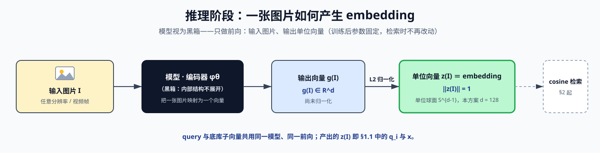

**向量之间的 cosine 能衡量相似度是表征模型的训练阶段「相似样本」构造与损失函数共同决定的**。损失函数（e.g., InfoNCE, Pairwise Margin Contrastive Loss）在单位向量上等价于「拉高相似样本对的 cosine、压不相似样本对的 cosine」。

推理阶段用同一编码器，度量没变，向量之间的cosine可以衡量样本之间的相似性。

### 1.4 三阶段流水线总览

整条流水线由三个阶段串联：前两个阶段构建索引，第三个阶段利用倒排索引完成检索。

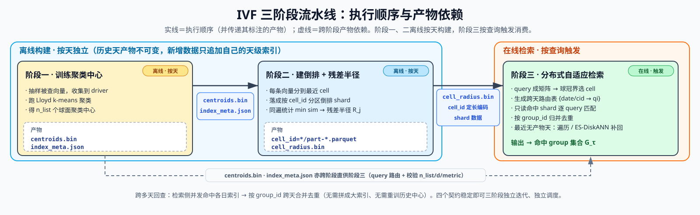


- **阶段一 · 训练聚类中心（按天构建）**：对被查向量抽样，收集到 Spark driver 里跑 Lloyd k-means 聚类，得到 $n_{list}$ 个聚类中心。产物为 `_coarse/centroids.bin`（中心矩阵）与 `_coarse/index_meta.json`（$n_{list}/d/\text{metric}$ 等元信息），是后续两阶段共同的分桶依据。
- **阶段二 · 构建倒排 + 残差半径（按天构建）**：读入阶段一的中心，把每条向量分配到最近 cell，落成按 cell_id 分区的倒排 shard；同一遍扫描内顺带精确统计每个 cell 的成员最小相似度，换算出残差半径 $R_j$。产物为 `cell_id=*/part-*.parquet`（倒排数据）与 `_coarse/cell_radius.bin`（半径向量），后者是检索侧剪枝的几何依据。
- **阶段三 · 分布式自适应检索（按查询触发）**：把 query 组织成矩阵，分布式地用球冠界为每个 query 选出可能含超阈值点的 cell（跨天路由表），只读命中的 shard 做逐 query 精确匹配、按 `group_id` 归并；对最近尚无 IVF 产物的那几天（一般是2天），另走遍历匹配/ES-DiskANN补回。

索引**按天独立构建**：历史天的产物不可变，新增数据只追加到它自己的天级索引；一次跨多天的检索由检索阶段并发处理各天索引，结果按 `group_id` 合并去重，不需要把多天拼成一个大索引、也不需要重新聚类历史数据。

三个阶段的耦合点是**三个稳定的契约**：`centroids.bin`（阶段一 → 二、三）、`cell_radius.bin`（阶段二 → 三）、`index_meta.json`（单一事实来源，锚定 $n_{list}/d/\text{metric}$）。只要这三个契约稳定，三阶段就可以独立迭代、独立调度。

### 1.5 记号约定

| 记号 | 含义 | 取值范围 |
| --- | --- | --- |
| $d$ | 向量维度 | $128$ |
| $n_{list}$（$K$） | cell 数 / 聚类中心数 | $262144 = 2^{18}$ |
| $N_{\text{vec}}$ | 单日底库子向量数 | $\sim 2.5\times 10^9$ |
| $q$ | query 向量（单位向量） | $\mathbb S^{d-1}$ |
| $x$ | 数据向量（单位向量） | $\mathbb S^{d-1}$ |
| $c_j$ | 第 $j$ 个聚类中心（单位向量） | $\mathbb S^{d-1}$ |
| $s$ | 相似度阈值 | $(0, 1]$ |
| $\langle q, x\rangle$ | 内积（= 余弦） | $[-1, 1]$ |
| $\min\!sim_j$ | cell $j$ 内成员到中心的最小相似度 | $[-1, 1]$ |
| $R_j$ | cell $j$ 残差半径（成员到中心的最大弦长） | $[0, 2]$ |
| $\theta_j$ | cell $j$ 锥半角，$\cos\theta_j = \min\!sim_j$ | $[0, \pi]$ |
| $\varphi_j$ | query 与中心夹角，$\cos\varphi_j = \langle q, c_j\rangle$ | $[0, \pi]$ |
| $\beta$ | 收缩系数（`RADIUS_SHRINK`） | $(0, 1]$ |
| $n_{probe}$ | 单 query 实际入选 cell 数（自适应） | $[0, n_{list}]$ |

---

## 2. 单位球面上的几何性质

本节描述三个阶段共用的几何工具。所有向量已 L2-normalized，故落在单位球面 $\mathbb S^{d-1}$ 上。

### 2.1 归一化与内积—余弦等价

对 $d$ 维实向量 $u = (u_1, \ldots, u_d)$、$v = (v_1, \ldots, v_d)$，内积（记 $\langle u, v\rangle$）与 L2 范数（记 $\|u\|$）定义为

$$\langle u, v\rangle = \sum_{k=1}^{d} u_k v_k,\qquad \|u\| = \sqrt{\langle u, u\rangle} = \sqrt{\sum_{k=1}^{d} u_k^2}$$

对单位向量 $u, v$（即 $\|u\|=\|v\|=1$），余弦相似度分母恒为 1，退化为内积：

$$\cos(u, v) = \frac{\langle u, v\rangle}{\|u\|\,\|v\|} = \langle u, v\rangle \in [-1, 1]$$

这是全流水线「Inner Product = cosine」前提的来源，也是训练侧可以用欧氏 k-means、检索侧可以用矩阵乘一次算完全部相似度的基础。

### 2.2 余弦、欧氏距离、夹角的单调双射

把差向量的平方范数按内积展开（用内积对两个变量的双线性性）：

$$\|u - v\|^2 = \langle u - v,\ u - v\rangle = \langle u, u\rangle - 2\langle u, v\rangle + \langle v, v\rangle = \|u\|^2 + \|v\|^2 - 2\langle u, v\rangle$$

代入单位范数 $\|u\|^2 = \|v\|^2 = 1$，得恒等式

$$\|u - v\|^2 = 2 - 2\langle u, v\rangle$$

于是三个度量在单位球面上一一对应：

$$\|u - v\| = \sqrt{2 - 2s},\qquad s = \langle u, v\rangle = 1 - \tfrac12\|u - v\|^2 = \cos\angle(u, v)$$

**这是一条严格单调（余弦增 $\iff$ 欧式距离减 $\iff$ 夹角减）的双射，这与向量维度无关。** 它保证「相似度大」与「欧式距离小」在单位球面上严格等价，不存在高维下「点积接近 1 却距离大」的解耦（该解耦只发生在未归一化向量，模长项主导时）。§4.2 的残差半径换算、§5.3 的锥半角还原、以及旧剪枝界失效的诊断（§2.5）都建立在这条双射上。

### 2.3 本场景中球面 k-means 与欧氏 k-means 的等价

对单位向量集合，欧氏 k-means 的簇内失真

$$\sum_{x} \|x - c\|^2 = \sum_x (2 - 2\langle x, c\rangle)$$

在 $\|x\|=1$ 下与 $-\sum_x \langle x, c\rangle$ 只差常数与正因子。因此**最小化簇内欧氏距离的平方和 $\iff$ 最大化簇内内积和**，即球面（内积）k-means。这一等价允许训练阶段直接调用sklearn里成熟的欧氏 k-means 实现，训练结束后把中心投回单位球面（$c_j \leftarrow c_j / \|c_j\|$），即与检索侧的内积语义对齐。

### 2.4 残差半径与锥半角

定义 cell $j$ 的残差半径为成员到中心的最大弦长：

$$R_j = \max_{x \in cell_j} \|x - c_j\|$$

由 §2.2 双射，弦长关于相似度单调递减，故最大距离对应最小相似度：

$$R_j = \sqrt{2 - 2\cdot \min_{x \in cell_j}\langle x, c_j\rangle} = \sqrt{2 - 2\,\min\!sim_j}$$

几何上，cell $j$ 是单位球面上一块「球冠」（spherical cap），等价于以 $c_j$ 为中心轴、半角为 $\theta_j$ 的圆锥，最离群成员恰落在锥边缘：

$$\cos\theta_j = \min\!sim_j = 1 - \tfrac12 R_j^2,\qquad R_j = 2\sin(\theta_j/2)$$

后一式（弦长—半角关系）是 §5.3 收缩系数几何语义的基础。

### 2.5 球冠精确角度界（零漏召）

检索剪枝的核心是：**在只知道 cell 中心 $c_j$ 与半角 $\theta_j$ 的前提下，cell 内成员与 query 的相似度能达到多高？**
若这个上界都够不到阈值 $s$，该 cell 可安全跳过。

> **命题（球冠精确界）**：设 $q, c_j \in \mathbb S^{d-1}$，$\cos\varphi_j = \langle q, c_j\rangle$，$cell_j \subseteq \{x \in \mathbb S^{d-1}: \angle(x, c_j) \le \theta_j\}$。当 $d \ge 2$ 时，
> $$\max_{x \in cell_j}\langle q, x\rangle = \cos\!\big(\max(0,\ \varphi_j - \theta_j)\big) = \cos\varphi_j\cos\theta_j + \sin\varphi_j\sin\theta_j$$
> （右式仅在 $\varphi_j \ge \theta_j$ 分支成立；$\varphi_j < \theta_j$ 时 $q$ 落在锥内，最大相似度饱和为 $1$。）

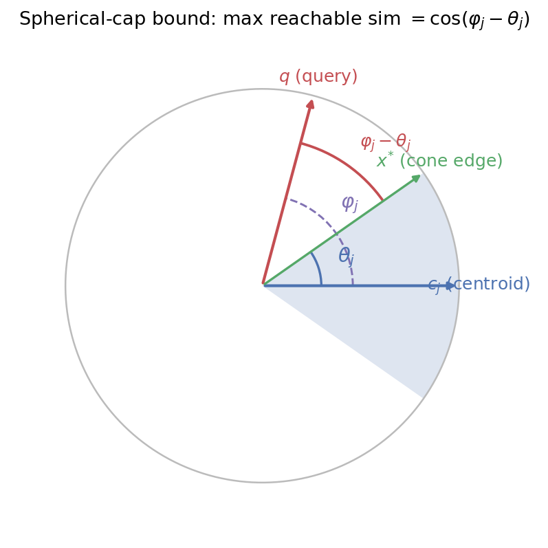

*图 2.5-1　命题的几何直观（单位球在 $c_j$–$q$ 所张平面上的截面）。蓝色扇形是 cell $j$ 对应的球冠——以中心 $c_j$ 为轴、半角 $\theta_j$ 的圆锥；$q$ 与 $c_j$ 的夹角为 $\varphi_j$。由球面三角不等式，锥内任一成员 $x$ 与 $q$ 的夹角 $\ge \varphi_j - \theta_j$，最小值在锥边缘 $x^{*}$（落在 $c_j$、$q$ 所张大圆弧上）取到，对应锥内可达最大相似度 $\cos(\varphi_j - \theta_j)$。当 $\varphi_j < \theta_j$（$q$ 落入锥内）时最近夹角为 $0$、相似度饱和为 $1$。同一张图在 §5.3 用于说明 shrink 如何缩放 $\theta_j$。*

**证明**：对锥内任意 $x$，记 $\angle(x, c_j) = r \le \theta_j$。球面上角度满足三角不等式，故 $\angle(q, x) \ge |\varphi_j - r|$。在 $\varphi_j \ge \theta_j$ 时该下界随 $r$ 增大而减小，在 $r = \theta_j$（锥边缘、且 $x$ 落在 $q$ 与 $c_j$ 张成的大圆弧上）取到最小夹角 $\varphi_j - \theta_j$；$\varphi_j < \theta_j$ 时可取锥内朝 $q$ 方向的点使夹角为 $0$。因 $\langle q, x\rangle = \cos\angle(q, x)$ 关于夹角单调递减，最大内积对应最小夹角 $\max(0, \varphi_j - \theta_j)$。取到最优的 $x$ 的存在性要求 $d \ge 2$（此处 $d = 128$ 满足）。第二个等号是两角差余弦公式，纯为**规避 $\arccos$** 的等价改写。$\blacksquare$

**两点性质决定了它的价值**：

1. **精确性（零漏召）**：该值是「锥内可达最大相似度」的**精确值**（least upper bound），不是任何松弛。因此判据 $\cos(\max(0,\varphi_j - \theta_j)) \ge s$ 才入选，不会漏掉任何真正含超阈值点的 cell。
2. **可向量化**：右式四个量 $\cos\varphi_j = \langle q, c_j\rangle$、$\cos\theta_j = 1 - R_j^2/2$、$\sin\varphi_j = \sqrt{1 - \cos^2\varphi_j}$、$\sin\theta_j = \sqrt{1 - \cos^2\theta_j}$ 全部 elementwise 可算，对全部 $n_{list}$ 个 cell 一次矩阵运算得出，不碰反三角函数。

#### **与「相加界」的对比（一次踩坑的教训）**：早期实现用 Cauchy-Schwarz 得的松弛上界

$$\langle q, x\rangle = \langle q, c_j\rangle + \langle q, x - c_j\rangle \le \langle q, c_j\rangle + \|x - c_j\| \le \langle q, c_j\rangle + R_j$$

虽是合法上界，但把 $[-1,1]$ 的余弦与 $[0,2]$ 的欧氏残差**直接相加**，量纲错误：只要 cell 里混入一个与中心近乎正交的离群点，$R_j \to \sqrt 2 \approx 1.41$，界起步即 $\langle q,c_j\rangle + 1.41 \ge s$ 对绝大多数 cell 恒成立 → 零剪枝。球冠界的修复正是先把 $R_j$ 翻译成角度 $\theta_j$，再让 $\theta_j$ 与 $\varphi_j$ 在**同一角度空间相减**。可证球冠界恒不大于相加界（差值 $= 2\sin(\theta_j/2)[1 + \sin(\theta_j/2 - \varphi_j)] \ge 0$），故剪枝只多不少。

---

## 3. 阶段一：聚类中心训练


本阶段对底库向量抽样后在 Spark driver 内存里按「彼此靠近」归类成 $n_{list}$ 个簇，每簇取一个代表点作为中心 $c_j$。这些中心就是后续「建库」与「检索」共用的「分桶器」：

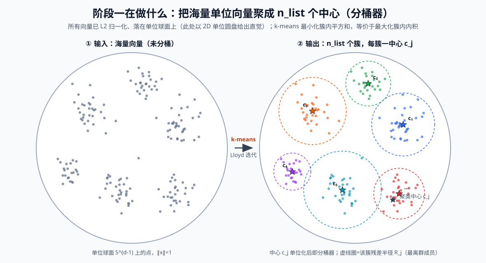

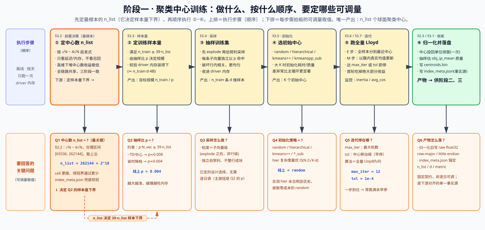

唯二持久化产物是：

- `_coarse/centroids.bin`：$n_{list} \times d$ 的 raw float32，row-major、little-endian。$n_{list} = 262144,\ d = 128$ 时体积 $= 262144 \times 128 \times 4 \approx 134\,\text{MB}$。
- `_coarse/index_meta.json`：记录 $n_{list}$、$d$、dtype、byteorder、layout、metric、训练样本量与超参等，作为下游对齐的**单一事实来源**。

抽样训练集只存在于 Spark driver 内存中，HDFS 不残留任何抽样数据。

### 3.1 $n_{list}$ 的选择：速度—内存权衡而非召回权衡

$n_{list}$（cell 数 / 中心数）蕴含着所需训练样本量的下界（§3.2），是建库与检索粒度的本质。本节分三步定它：先从量化理论说明「为何 $n_{list}$ 不是召回旋钮」（§3.1.1），再用业界启发式给出合理区间（§3.1.2），最后落到本方案的取值与后果（§3.1.3）。

#### 3.1.1 理论依据：量化失真与维度诅咒

把聚类视为有损量化——每个向量都用「离它最近的那个中心」来代替，丢失的精度称为**失真**（distortion）。它就是「每个点到最近中心的距离平方的人均值」，与 §3.6 的 avg_dist_sq（$= \text{inertia}/N$）同义：

$$D = \frac{1}{N}\sum_{i} \big\|x_i - c_{a(i)}\big\|^2 = \text{avg\_dist\_sq},\qquad a(i) = \arg\min_j \|x_i - c_j\|$$

中心越多，每个点离最近中心越近，$D$ 越小。高分辨率量化理论（Zador）给出失真随中心数 $K$ 的衰减速度：

$$D(K) \propto K^{-2/d}$$

在 $d = 128$ 时指数 $-2/128 \approx -0.016$，**极平**：欲将失真减半，需把中心数 $K$ 乘以 $2^{d/2} = 2^{64}$ 倍，完全不现实。

这个「$2^{d/2}$」是这样推出来的。设把中心数从 $K$ 增到 $K' = mK$（乘以倍数 $m$），由 $D(K)\propto K^{-2/d}$，失真之比为

$$\frac{D(K')}{D(K)} = m^{-2/d}$$

要让失真减半，即令这个比等于 $\tfrac12$，解 $m^{-2/d} = \tfrac12$（两边取 $-d/2$ 次幂）得

$$m = 2^{d/2}\ \xrightarrow{\ d=128\ }\ 2^{64}\approx 1.8\times10^{19}$$

也就是说中心数得翻十几个数量级才能把失真砍一半，现实中完全办不到。

反过来看更直观：$K$ 每翻一倍（$m=2$），失真只降到 $2^{-2/d} = 2^{-1/64}\approx 0.989$，即仅降约 $1.1\%$。

这解释了实测「$K$ 翻 4 倍，avg_cos 仅 $0.663\to 0.689$」——是维度灾难在量化上的必然表现，而非训练不足。**正因增大 $K$ 换不回多少召回质量，$n_{list}$ 的取值就退化为主要考虑速度—内存的权衡**。

> **关于 Zador 佐证的适用性（诚实边界）**：Zador 定理是 $K\to\infty$ 的**渐近**结论，且假设数据分布**光滑**；而真实 embedding 有明显的团簇结构，加中心的**前期**收益会比渐近式稍高。以上文实测为例，$K$ 翻 4 倍时纯 Zador 预测的失真降幅为
>
> $$4^{-2/128}\approx 0.979\quad(\text{即失真只降约 } 2.1\%)$$
>
> 而实测由 avg_cos $0.663\to0.689$、经 $D = 2(1-\text{avg\_cos})$ 反推的失真降幅约 $7.7\%$——实测比理论略大（同一量级，约 3 倍）。二者**方向与量级完全一致**（都是「个位数百分比、聊胜于无」），故用 Zador 佐证「高维下堆中心数收益极低」是成立的。

#### 3.1.2 $\sqrt N$ 启发式

既然召回质量对 $n_{list}$ 不敏感，工业界转而按**查询代价**平衡取值。查询代价近似两段：

$$\text{cost} \approx \underbrace{K}_{\text{与全部中心比、找近 cell}} + \underbrace{n_{probe}\cdot \frac{N}{K}}_{\text{扫选中 cell 内的点}}$$

$K$ 太小则第二项爆，太大则第一项 $O(K)$ 贵且训练/内存/空 cell 上升，两项在 $K \sim \sqrt N$ 附近平衡。对单日 $N_{\text{vec}} \approx 2.5\times10^9$：

$$\sqrt N \approx 5\times10^4,\qquad 4\sqrt N \approx 2\times10^5\quad\Rightarrow\quad \text{合理区间}\ [65536,\ 262144]$$

#### 3.1.3 本方案取值

本方案取合理区间的上沿 $n_{list} = 262144 = 2^{18}$：cell 更瘦、残差半径分布整体下移、球冠界通过的 cell 更少，以更贵的 $O(K)$ 粗排换更快的候选扫描。$n_{list}$ 是全链路共享参数，三阶段必须一致。

### 3.2 训练样本量下界

训练样本量 $n_{train}$ 由抽样比 $p$ 与单日子向量总数 $N_{\text{vec}}$ 决定（$n_{train}\approx p\cdot N_{\text{vec}}$，$N_{\text{vec}}\approx 2.5\times10^9$）。它同时受两端牵制：样本太少则大量簇欠定/空；样本越多，driver 内存与训练耗时越大）。

**参考下界（Faiss 经验）**。Faiss 建议 $n_{train} \ge 39\cdot n_{list}$，即每个中心平均约 39 个样本，以免大量簇欠定或为空。承 §3.1 的 $n_{list} = 262144$：

$$n_{train} \ge 39 \times 262144 \approx 1.02\times 10^7$$

这条经验线正是本方案定 $p$ 的**出发点**：把它除以单日子向量总数 $N_{\text{vec}}$，即反推出所需抽样比

$$p \gtrsim \frac{39\,n_{list}}{N_{\text{vec}}} = \frac{1.02\times10^7}{2.5\times10^9}\approx 0.0041\ \to\ p = 0.004$$

下面再验证这个值在资源上可行。

**资源上界（driver 内存）**。抽样集全部收进 driver 内存做全量 Lloyd，占用约

$$n_{train}\cdot d \cdot 4\,\text{B}\ \big|_{\,n_{train}\sim10^7,\ d=128}\ \approx 5\ \text{GB}$$


**本方案取值 $p = 0.004$**。

### 3.3 采样的无偏性与低相关性

**为什么必须先 explode**。源数据是「一行一个内容」的形态：每行携带一个变长数组 `embeddings`（`array<array<float>>`），即该内容的 $L_i$ 条子向量打包在一起（§1.2，$\bar L\approx 25$）。而 k-means 眼里没有「行」「内容」的概念，它要的是一条条**独立、扁平的 $d$ 维向量**。所以第一步必须把每行的数组摊开成 $L_i$ 条独立记录——这正是 `explode`（把 `array<array<float>>` 展成多行 `array<float>`）。

**采样放在 explode 之前还是之后**。既然 explode 免不了，真正的设计选择是：在**展开前按行采样**，还是**展开后按子向量采样**？两者期望样本量相等：

$$\mathbb E[\text{行级}] = N_{\text{row}} \cdot p \cdot \bar L, \qquad \mathbb E[\text{子向量级}] = (N_{\text{row}}\cdot \bar L)\cdot p$$

二者恒等，故抽样比 $p$ 无需因采样粒度而调整。但**二阶矩不同**：行级采样是「整个视频的 $L_i$ 条子向量同进同出」的成块采样，样本间存在行内相关，且高 $L_i$ 的行会成块主导样本；子向量级采样是对点过程的独立稀释（Bernoulli thinning），**破坏行内相关、在球面上分布更均匀**，训练集对底库分布的估计更无偏。

**本方案选「explode 后再按子向量采样」**。代价是需先对全量行做一遍 `explode`（采样无法下推到展开之下），比先采样多一遍展开开销——但训练只跑一次，此代价可接受，换来的是更无偏的训练集。

### 3.4 初始化策略

在 $K$ 很大时，初始化阶段的耗时/质量差异往往比 Lloyd 主循环本身更显著，故抽成独立配置项。

#### 3.4.1 四种候选策略总览

四种策略及其分配复杂度：

| 策略 | 机制 | 分配复杂度 | 特点 |
| --- | --- | --- | --- |
| **random** | 无放回抽 $K$ 个训练点、单位化作初始中心 | $O(K)$ | 最快、零成本；中心随样本密度分布，偶发坏簇/空簇 |
| **kmeans++** | 在全量集上按 $D^2$-加权串行挑 $K$ 个中心 | $O(N\cdot K\cdot d)$ + $K$ 步串行 | 初始 inertia 低、质量好；$K$ 大时可能比整段 Lloyd 还慢 |
| **hierarchical** | 两级：先聚 $K_1$ 粗中心，分桶后每桶再聚 $K_2$，$K = K_1 K_2$ | $O(N\cdot(K_1 + K_2)\cdot d)$ | 无 $K$ 步串行，中心天然铺开，质量优于 random |
| **kmeanspp_sub** | 仅在 $m$ 条子样本上跑 kmeans++ 挑种子 | $O(m\cdot K\cdot d)$ | kmeans++ 的低成本近似，仍保留 $K$ 步串行 |

其中 kmeans++ 是理解另外三者的基准（hierarchical 与 kmeanspp_sub 都是对它的「稀释」）。

#### 3.4.2 基准：kmeans++ 的原理与质量保证

kmeans++ 是一种「按距离加权、逐个挑选初始中心」的方法（Arthur & Vassilvitskii, 2007），流程为：

1. 从训练集中随机选第 1 个中心；
2. 对每个样本 $x$，算它到**已选中心集合**的最近距离 $D(x) = \min_{c\,\text{已选}}\|x - c\|$；
3. 以正比于 $D(x)^2$ 的概率随机抽下一个中心——**离已选中心越远的点，越可能被选中**；
4. 重复 2–3 直到选满 $K$ 个。

对比 `random`（均匀乱抽 $K$ 个点），kmeans++ 的关键差别在第 3 步的 $D^2$ 加权：它**刻意让新中心远离已有中心**，于是初始中心在空间里自然铺开、避免多个中心挤在同一个高密度团里（`random` 恰恰容易这样——密集区被反复抽中、稀疏区没人管，留下坏簇/空簇）。

「质量好」有理论保证：kmeans++ 的期望初始 inertia 满足 $\mathbb E[\text{inertia}] \le 8(\ln K + 2)\cdot \text{inertia}^{*}$（$\text{inertia}^{*}$ 为全局最优），即**开局就与最优解只差一个对数因子**；而纯 `random` 无任何此类保证，最坏可以差任意倍。

它的代价也恰恰卡在第 3 步：选第 $t$ 个中心要重算所有样本到 $t$ 个已选中心的距离，$K$ 个中心就是 $K$ 步**必须串行**（第 $t$ 步依赖前 $t-1$ 步的结果，无法并行）的挑选，总分配代价 $O(NKd)$。

在 $K = 262144$ 这种量级下，这 $K$ 步串行反而可能比整段 Lloyd 聚类还慢——这也是本方案未直接用它、而转向两种「稀释版」的原因：`kmeanspp_sub` 只在子样本上跑它、`hierarchical` 用两级聚类绕开 $K$ 步串行。

#### 3.4.3 层次初始化的复杂度最优性

两级分解的总分配代价约 $O(N(K_1 + K_2)d)$，在约束 $K_1 K_2 = K$ 下由均值不等式在 $K_1 = K_2 = \sqrt K$ 处取最小：

$$K_1 + K_2 \ge 2\sqrt{K_1 K_2} = 2\sqrt K$$

故最优分配复杂度 $O(N\cdot 2\sqrt K\cdot d)$。对 $K = 262144$，$2\sqrt K = 1024 \ll K = 262144$，相比全量 kmeans++ 的 $O(NKd)$ 约省 $256\times$，且消除了 $K$ 步串行。当前实现取 $K_1 = K_2 = 512$（恰 $512^2 = 262144$），是最平衡的分解。

#### 3.4.4 本方案取值

当前默认策略为 `random`，层次法作为质量与耗时兼顾的推荐项备选。在本实验中，尚未观察到 `hierarchical` 比 `random` 更好或更差，所以取成本更低的 `random`。

### 3.5 优化算法选型：全量 Lloyd

初始中心（§3.4）定好后，用 Lloyd 算法迭代优化。本方案采用 sklearn 全量 Lloyd（`algorithm="full"`），每轮以簇内**真实均值**更新中心，单轮即实质推进目标（收敛曲线见 §3.6）。下面形式化描述该算法。

给定训练集 $X = \{x_1,\dots,x_N\}\subset\mathbb R^{d}$ 与簇数 $K$，k-means 要找一组中心 $C=\{c_1,\dots,c_K\}$ 与一个把每个样本指派到某簇的映射 $a:\{1,\dots,N\}\to\{1,\dots,K\}$，使**簇内平方和（inertia）**最小：

$$\min_{C,\,a}\ J(C,a) = \sum_{i=1}^{N}\big\|x_i - c_{a(i)}\big\|^2$$

这个联合优化是 NP-难的，Lloyd 算法用「固定一方、优化另一方」的**交替下降**来逼近它。设初始中心为 $\{c_j^{(0)}\}$（§3.4 给出），第 $t$ 轮（$t=1,2,\dots$）执行两步：

- **分配步（Assignment）**：固定中心 $\{c_j^{(t-1)}\}$，把每个样本指派到最近的中心

$$a^{(t)}(i) = \arg\min_{1\le j\le K}\ \big\|x_i - c_j^{(t-1)}\big\|^2,\qquad i=1,\dots,N$$

由此得到第 $j$ 簇的成员集 $S_j^{(t)} = \{\,i : a^{(t)}(i)=j\,\}$。

- **更新步（Update）**：固定分配 $a^{(t)}$，把每个中心移到该簇成员的**均值**处

$$c_j^{(t)} = \frac{1}{\big|S_j^{(t)}\big|}\sum_{i\in S_j^{(t)}} x_i,\qquad j=1,\dots,K$$

**为什么两步都在下降 $J$**：分配步把每个点重指派给更近的中心，逐点不增加其平方距离；更新步中，簇均值是「到簇内各点平方距离之和」的唯一最小点（对 $c_j$ 求导置零即得 $c_j=\text{mean}$），故也不增。于是 $J(C^{(t)},a^{(t)})$ 单调不增且有下界 $0$，**必收敛**；又因 $(C,a)$ 的可能组合有限，算法在有限轮内到达一个不动点（局部极小）。收敛判据与「一步到位」现象见 §3.6。

> **注**：Lloyd 只保证收敛到**局部**极小，最终质量强依赖初始中心——这正是 §3.4 花力气选初始化的原因。本方案训练集已 L2 归一化，由 §2.3 欧氏 k-means 与球面（内积）k-means 等价，故可直接跑欧氏 Lloyd、训练完再把中心投回单位球面。

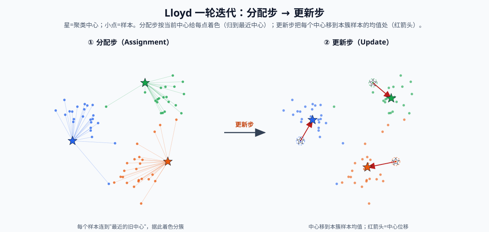


### 3.6 收敛判据与聚类质量度量

训练有两个各自独立的停止条件，**先满足哪个就先停**：一是 `tol` 提前停止（收敛得足够好即提前结束，§3.6.1），二是最大迭代轮数 `max_iter`（无论收没收敛，到轮数就截断，§3.6.2）。

#### 3.6.1 提前停止条件（`tol`）

记第 $t$ 轮的 inertia（簇内平方和）为 $\text{inertia}^{(t)} = \sum_i \|x_i - c^{(t)}_{a(i)}\|^2$（$a(i)$ 是样本 $x_i$ 当轮的最近簇，inertia 语义详见 §3.6.2），则「inertia 相对变化」指相邻两轮的归一化降幅

$$\rho^{(t)} = \frac{\big|\,\text{inertia}^{(t-1)} - \text{inertia}^{(t)}\,\big|}{\text{inertia}^{(t-1)}}$$

即「这一轮又挤掉了百分之几的簇内平方和」。它与「中心移动量」并非严格相等（由平行轴定理，update 步的 inertia 降幅 $= \sum_k n_k\|c^{(t)}_k - c^{(t-1)}_k\|^2$，是按簇大小 $n_k$ 加权的中心位移平方和），但二者在收敛附近同步趋零，都是「这一轮几乎没再改变什么」的信号。sklearn（本方案锁定 1.0.2）的 `tol` 具体卡在中心移动量上：取 $\text{tol} = 10^{-4}$ 时约对应「单个中心移动 $< \sqrt{10^{-4}} = 1\%$ 单位向量长」即停。

**「单个中心移动 < 1% 单位向量长」通俗解释**：每个聚类中心都是单位球面上的一个点、长度固定为 $1$；所谓「中心移动」，就是同一个中心在相邻两轮之间挪动的直线距离。之所以要开平方根，是因为 `tol` 拿来比的是移动距离的**平方**（$10^{-4}$），开方还原成真实距离才是 $\sqrt{10^{-4}} = 0.01$；而中心自身长度为 $1$，挪动 $0.01$ 正好是挪了「自身长度的 $1\%$」。一句话——**当某一轮里中心只挪动了不到自身长度的百分之一，就认为它基本不动、已经收敛，可以停了。**

#### 3.6.2 质量度量、收敛观测与最大迭代次数（`max_iter`）

**质量度量的换算**。sklearn 的聚类库会报告 inertia（簇内距离平方和），它随 $N$ 膨胀、不直观，换算为人均指标：

$$\text{avg\_dist\_sq} = \frac{\text{inertia}}{N},\qquad \text{avg\_cos} = 1 - \frac{\text{avg\_dist\_sq}}{2}$$

后者由 §2.2 双射得来，表示「人均到最近中心的余弦」，$\in[-1,1]$，越接近 1 越紧。训练结束再单独抽样估计 $\overline{obj}_{IP} = \mathbb E[\max_j \langle x, c_j\rangle]$ 作为最终质量指标，用于与历史横向对比。

**收敛「一步到位」现象**。实测中首个迭代吃掉几乎全部收益（avg_cos 从 $0.586$ 跳到 $0.683$，之后皆千分位长尾）。这主要说明初始中心已很好（层次初始化把中心放到接近 Lloyd 收敛点），其次印证局部团簇归属稳定、以及 §3.1 的高维量化地板。

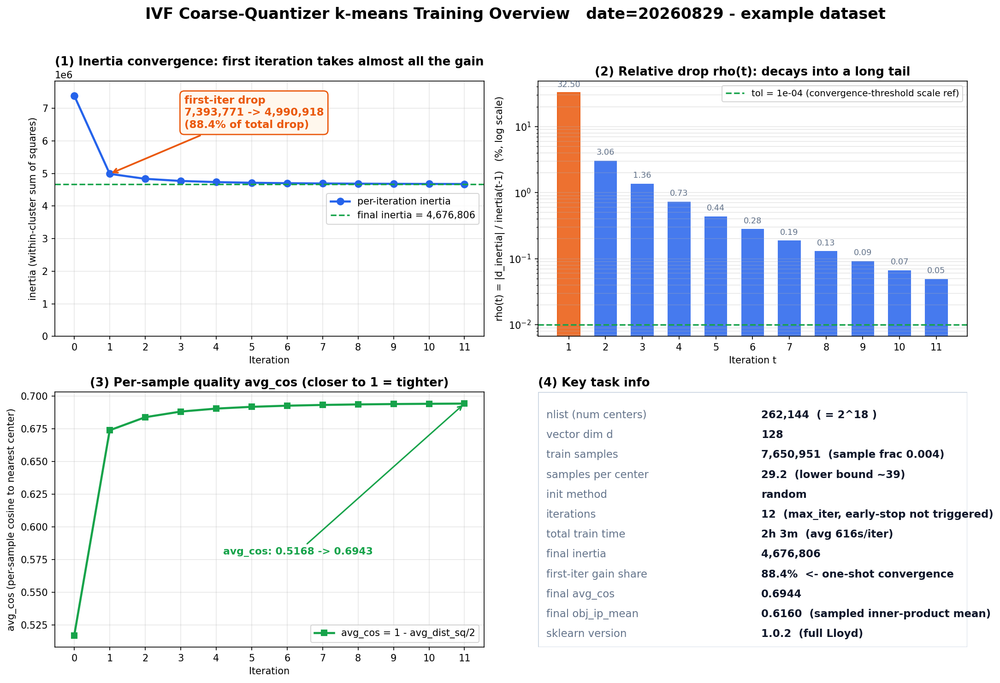

*图 3.6-1　单次线上训练（`date=20260829`，$n_{list}=262144$、`random` 初始化、跑满 12 轮）的收敛全貌。①**inertia 收敛**：首轮由 $7.39\times10^6$ 骤降至 $4.99\times10^6$，占全程总降幅的 **88.4%**，直观印证「一步到位」；②**相对降幅** $\rho^{(t)}$（§3.6.1 定义）逐轮衰减为长尾（首轮 $32.5\%$ → 末轮 $0.05\%$，对数轴）；③**人均质量** avg_cos 由 $0.517$ 升至 $0.694$*

**由此定最大迭代次数 `max_iter` $= 12$**。`max_iter` 是兜底的硬上限：即使 `tol` 尚未触发，到达该轮数也强制结束。既然上述观测表明首轮即吃掉约 88% 的降幅、后续为千分位长尾，再多迭代对 avg_cos 的提升已进入千分位、性价比极低；故在「基本收敛」与「训练耗时（每轮约 $615$s，见图 3.6-1）」之间取 $12$。

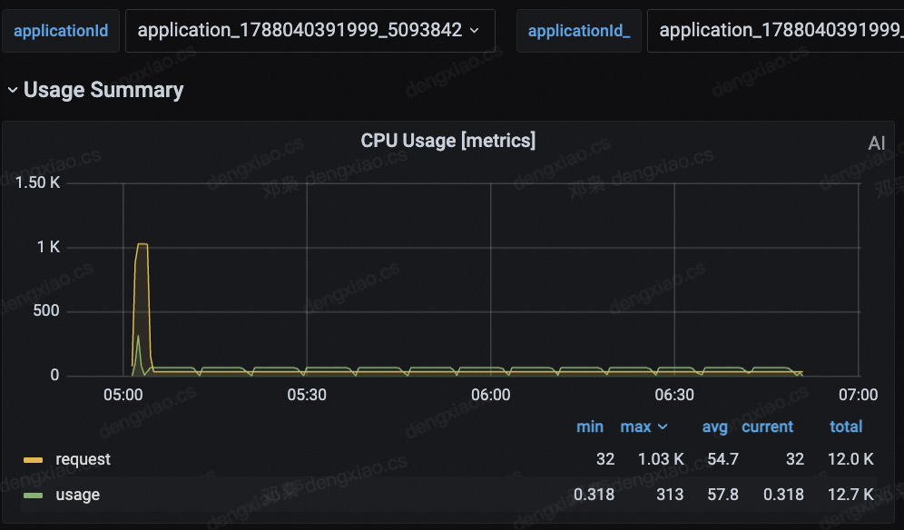

*图 3.6-2　阶段一（中心训练）单次任务的 CPU 用量。前面的短促脉冲对应聚簇前的向量采样；随后回落到 32 cores，在 driver 执行 k-means 聚类，总耗时约 1.5 小时。*

---

## 4. 阶段二：倒排建库与残差半径计算


本阶段读入阶段一的中心，把每条子向量分到最近 cell、落成按 cell 分区的倒排 shard，并在同一遍里顺手算出每个 cell 的残差半径。下图先总览其数据流与 shuffle 边界：

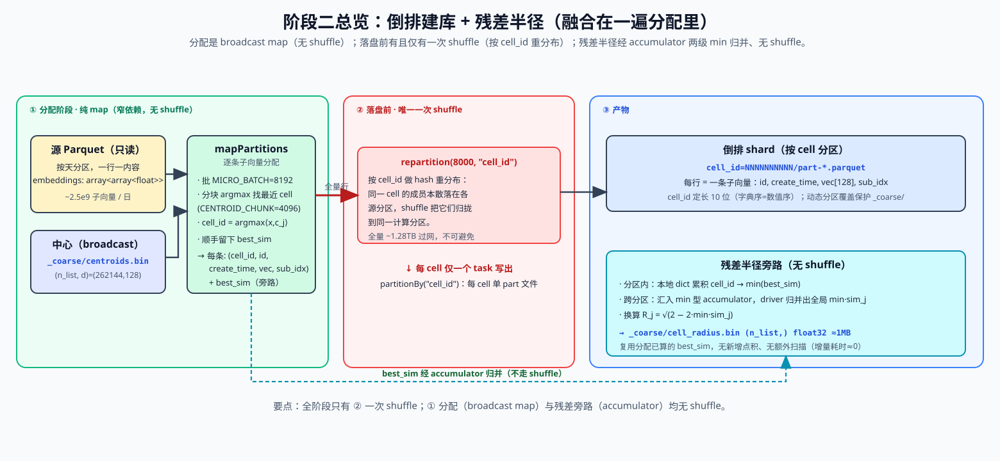


### 4.1 cell 分配：分块 running argmax

阶段二把每行的 $L_i$ 个子向量**逐条独立**分到最近中心：

$$\text{cell\_id}(x) = \arg\max_j\ \langle x, c_j\rangle$$

向量之间互不影响——不丢、不聚合。同一 `id` 的 $L_i$ 条子向量会被分散到至多 $L_i$ 个不同 cell。

### 4.2 残差半径的融合精确计算

检索侧的球冠界需要每个 cell 的残差半径 $R_j$（§2.4、§2.5），它由该 cell 成员到中心的最小相似度换算：

$$R_j = \sqrt{2 - 2\,\min\!sim_j},\qquad \min\!sim_j = \min_{x \in cell_j}\langle x, c_j\rangle$$

$\min\!sim_j$ 与 §4.1 的分配共用同一次点积：argmax 给每条子向量选出最近中心时，已经算出它与该中心的相似度 $\langle x, c_{\text{cell}(x)}\rangle$（即被分配 cell 的 best_sim），把这个值保留下来即可，无需再乘一遍。

由 best_sim 汇总出各 cell 的 $\min\!sim_j$ 分两级：

- **分区内**：分配在 `mapPartitions` 里执行，每个源数据分区一边分配、一边用一个本地 dict 累积 `cell_id → min(best_sim)`，对本分区落到的每个 cell 记录当前最小值；
- **跨分区**：分区结束时把本地 dict 汇入一个按 cell_id 取 min 的 accumulator，由 driver 归并出全局 $\min\!sim_j$（同一 cell 的成员分散在多个源分区，故需跨分区再取一次 min）。

最后按 $R_j = \sqrt{2 - 2\min\!sim_j}$ 换算，落盘为 `_coarse/cell_radius.bin`（raw float32、little-endian、形状 $(n_{list},)$，体积 $\approx 1\,\text{MB}$）。

### 4.3 内存分析

承 §4.1，这一步要为**当前批**的 $B$ 条子向量，各自在全部 $n_{list}$ 个中心里取 $\arg\max_j\langle x, c_j\rangle$（找最近 cell）。“先把每条子向量对所有中心的相似度都算出来、再沿中心维取最大”是最直接的实现。

**是哪两个量在做运算**：把这批子向量按行堆叠成矩阵 $X \in \mathbb{R}^{B\times d}$（$B$ 条、每条 $d=128$ 维），把全体中心按列排成 $[\,c_1\ \cdots\ c_{n_{list}}\,] \in \mathbb{R}^{d\times n_{list}}$。所谓“相似度矩阵”就是这两者的一次矩阵乘（GEMM）：

$$S = X\,[\,c_1\ \cdots\ c_{n_{list}}\,] \in \mathbb{R}^{B\times n_{list}},\qquad S_{ij} = \langle x_i, c_j\rangle$$

即 $S$ 的第 $i$ 行，是第 $i$ 条子向量对**全部** $n_{list}$ 个中心的相似度；cell 分配就是对每行取 $\arg\max_j$。

**为什么要占这么大**：朴素实现为了对每行取 argmax，需要先**把整个 $S$ 一次性物化**在内存里——共 $B \times n_{list}$ 个 float32、每个 4 字节，

$$B \cdot n_{list} \cdot 4\,\text{字节} = 8192 \times 262144 \times 4 \approx 8\,\text{GiB}$$

单批即打爆 executor。对策是对**中心维度分块**，维护 running argmax：每次只算 $(B, C)$（`CENTROID_CHUNK` $C = 4096$）子矩阵，与已维护的 `best_sim`/`best_idx` 逐块更新。中间矩阵压到

$$B \cdot C \cdot 4\,\text{字节} = 8192 \times 4096 \times 4 \approx 128\,\text{MiB}$$

**正确性**：全局 argmax 等于各块局部 argmax 的胜者归并，因 $\max$ 在分块并集上可交换、可结合。running 更新 $\text{best} \leftarrow \max(\text{best}, \text{chunk\_max})$ 与一次性全量 argmax 结果严格一致。

### 4.4 落盘布局：每个 cell 对应一个可直接寻址的固定路径

这一步决定倒排 shard 在 HDFS 上如何摆放，而摆放方式服务于一个来自检索侧（§5）的硬需求：**检索时要能仅凭一个 cell 编号，就直接拼出该 cell 数据文件的路径去读**——不必列目录、扫全表或做模糊匹配。为此建库要同时保证两点：路径能由 cell 编号唯一确定，且每个 cell 只落一个数据文件。下面几项设计都是为这个目标服务的。

**路径由 cell 编号定长编码而来**。每个 cell 的数据落在 `cell_id=NNNNNNNNNN/` 目录下，cell_id 用**定长 10 位**十进制、前导补零表示（覆盖 $0\sim 262143$）。定长补零意味着检索侧能用 cell 编号直接格式化出目录名（`cell_id=%010d`）、无需任何查表；同时它保证**字典序 = 数值序**，前缀匹配、路径排序、分区裁剪的行为都可预测。`CELL_ID_WIDTH = 10` 是阶段二、三共享的硬约束，两侧必须逐字一致，否则拼出来的路径对不上。

**每个 cell 独占一个目录、且目录内只有一个数据文件**。落盘用 `partitionBy("cell_id")` 让每个 cell 各占一个 `cell_id=*/` 目录（共 $n_{list}$ 个，正是前面由编号拼出的路径所指的实体）；同时落盘前按 cell_id 做一次 hash repartition（`SHUFFLE_PARTITIONS = 8000`，随 cell 总数放大以摊平单 task 负载、防倾斜/OOM），令同一 cell_id 必落到同一计算分区，故每个目录里最终只产出 1 个数据文件。

**该数据文件重命名为固定名 `data.parquet`**。这是能"仅凭编号直达"的最后一环：Spark 默认写出的文件名带随机串（形如 `part-*.parquet`，含随机 UUID），检索侧无从预知——若照原样保留，仍得先逐个列目录才能找到那个文件，前面「文件直接寻址」就前功尽弃。故写盘后在同一 HDFS 目录内把这个唯一的 `part-*.parquet` **原子 rename 为固定名 `data.parquet`**（同目录 rename 只改 NameNode 元数据，不复制、不重写 Parquet）。至此完整路径 `cell_id=%010d/data.parquet` 完全由 cell 编号决定，检索环节无需任何 list/glob 即可直达。

**重跑后路径不漂移**。倒排根目录与阶段一的 `_coarse/`（中心、半径产物）同处 `ivf_path` 下，故用 `partitionOverwriteMode = dynamic` 只覆盖本次写出的 `cell_id=*` 分区——既不会误删 `_coarse/`，也保证同一 cell 重跑后仍落在原路径、绝对路径稳定。

**倒排数据独占一套 HDFS NameNode 集群**。海量 cell 目录在建库期集中创建、又在检索期被高并发地按路径打开，对 NameNode 的元数据操作压力很大。若与其他业务共用主 NameNode 集群，这类瞬时高并发偶尔会让主 NN 出现 pending（元数据请求积压、响应变慢），进而波及共用该集群的其他用户。我们把倒排索引数据单独落在一套独立的 HDFS NameNode 集群上，将这部分元数据压力与主集群隔离，互不干扰。

### 4.5 空 cell 与数值兜底

未命中任何成员的 cell（empty cell）默认 $\min\!sim_j = 1.0 \Rightarrow R_j = 0$。此时其剪枝界退化为 $\langle q, c_j\rangle \ge s$（即该 cell 必须中心自身超阈值才入选），对召回无害（空 cell 本就无成员可贡献超阈值点）。数值上对 $\min\!sim_j$ 做 $[-1, 1]$ clip，防浮点误差令 $2 - 2\min\!sim_j < 0$ 开方为 NaN。`nonempty_cells` 是否等于 $n_{list}$ 可作为「中心是否有浪费」的诊断（等于则零空 cell）。

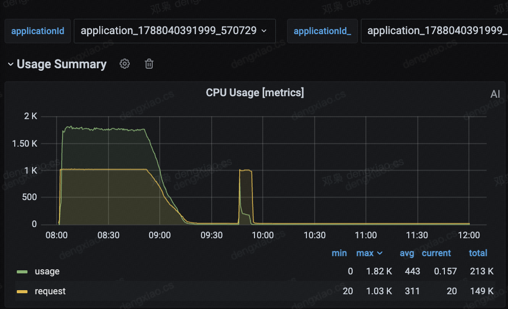

*图 4-1　阶段二（倒排建库与残差半径计算）单次任务的 CPU 用量。第一个 stage 将向量分配到对应 cell；第二个 stage 汇集各 cell 的向量、统计最大半径并落盘，两个 stage 都存在少量长尾分区。*

---

## 5. 阶段三：检索

阶段三是检索流程的主体，支持**多天检索**：把检索时间窗展开为多天，IVF索引产物齐全的历史天走 IVF 分支，最近几天（一般是2天）IVF索引未构建完成的走 ES-DiskANN 补回，二者天然互斥（增量补回分支不在本章展开）。

### 5.1 查询矩阵与逐 query 语义

从任务规则构造 $(n_q, d)$ 的 query 矩阵，同时记录每条 query 向量的归属 task、阈值 $s_i$、时间窗 $[t^{\text{start}}_i, t^{\text{end}}_i]$。每条 query 做防御性 L2 归一化（球冠几何与 cosine 匹配都要求单位向量）。同一 task 的多条 query 向量在矩阵中**连续排列**。所有 query 级向量与标量以 broadcast 下发至 executor。

### 5.2 分布式选 cell

**为何必须分布式**。多天的 `centroids.bin`/`cell_radius.bin` 若在 driver 串行读取并逐天算选 cell，会成为单点瓶颈。本方案采用**一天数据由一个 task 在 executor 上并行选 cell**：

- centroids 与 radius 用 Spark `binaryFile` 数据源读成 `(date, bytes)`，driver 按 `date` join 配对后交给 executor；

### 5.3 自适应剪枝：球冠界 + shrink 豁免 + min_radius托底

对每天的数据，先一次矩阵乘算出全部 cell 的 $\cos\varphi_j = \langle q, c_j\rangle$（形状 $(n_{list}, n_q)$），再按 §2.5 球冠界逐 query 判定入选。

先重述 §2.5 的核心结论（此处直接引用，证明见 §2.5）：给定 query 与中心夹角 $\varphi_j$、cell 锥半角 $\theta_j$，**cell 内成员与 $q$ 的可达最大相似度**为

$$\max_{x \in cell_j}\langle q, x\rangle = \cos\!\big(\max(0,\ \varphi_j - \theta_j)\big) = \cos\varphi_j\cos\theta_j + \sin\varphi_j\sin\theta_j$$

即 $q$ 在锥外（$\varphi_j > \theta_j$）时取 $\cos(\varphi_j - \theta_j)$、落入锥内时饱和为 $1$。该值够不到阈值 $s$ 的 cell 不可能含超阈值点，可安全跳过；等价地，**入选判据**为 「$\varphi_j \le \theta_j + \arccos s$ 」把锥半角 $\theta_j$ 放宽一个随阈值而定的容差 $\arccos s$，query 落入这个「加宽锥」的 cell 才需扫描。

上式第二个等号（$\varphi_j \ge \theta_j$ 分支）由两角差余弦公式展开，把 bound 拆成四个 elementwise 可算的量：$\cos\varphi_j = \langle q, c_j\rangle$ 由矩阵乘一次得到，$\cos\theta_j = 1 - \tfrac12 R_j^2$ 只由 cell 残差半径 $R_j$ 决定，两个 $\sin$ 再由各自的 $\cos$ 开方补出。

**这一展开正是 shrink 的接入点**：式中唯一刻画 cell「胖瘦」的量只有 $\cos\theta_j$、$\sin\theta_j$，而它们仅由半径经 $\cos\theta_j = 1 - \tfrac12 R_j^2$ 生成。于是收缩剪枝无需改动 bound 的形式，只需把真实半径 $R_j$ 替换为**有效半径** $R_j^{\text{eff}}$（等价于把锥半角换成 $\theta_j^{\text{eff}}$）再代入同一展开式即可（见下文）。下文两个旋钮 $\beta$、$r_{\min}$ 做的全部事情，就是决定 $R_j \mapsto R_j^{\text{eff}}$ 这一映射。


*图 5.3-1　球冠界的几何直观。cell 是以中心 $c_j$ 为轴、半角 $\theta_j$ 的圆锥（球冠截面，蓝色扇形）；query $q$ 与中心夹角为 $\varphi_j$。锥内离 $q$ 最近的成员落在锥边缘 $x^{*}$，与 $q$ 的最小夹角为 $\varphi_j - \theta_j$，故锥内可达最大相似度 $= \cos(\varphi_j - \theta_j)$。该值够不到阈值 $s$ 的 cell 可安全跳过，等价判据 $\varphi_j \le \theta_j + \arccos s$。*

在纯球冠界之上叠加两个可控旋钮：

**收缩系数 $\beta$（`RADIUS_SHRINK`，默认 $0.58$）**。$\beta = 1$ 时为精确球冠界、零漏召；$\beta < 1$ 缩小 $\theta_j$、更激进剪枝，以极小召回损失换扫描量下降。

**半径豁免阈值 $r_{\min}$（`SHRINK_MIN_RADIUS`，默认 $0.4$）**。只对 $R_j > r_{\min}$ 的**肥胖簇**施加收缩，紧簇（$R_j \le r_{\min}$）保留真实半径（局部零漏召）。有效半径分两支：

- 肥胖簇（$R_j > r_{\min}$）取 $R_j^{\text{eff}} = \max(\beta R_j,\ r_{\min})$；
- 紧簇（$R_j \le r_{\min}$）取 $R_j^{\text{eff}} = R_j$。

统一写成单行即

$$R_j^{\text{eff}} = \max\big(\beta R_j,\ r_{\min}\big)\cdot \mathbb 1[R_j > r_{\min}] + R_j\cdot \mathbb 1[R_j \le r_{\min}]$$

（后续可优化为单调且非边界处处可导）。

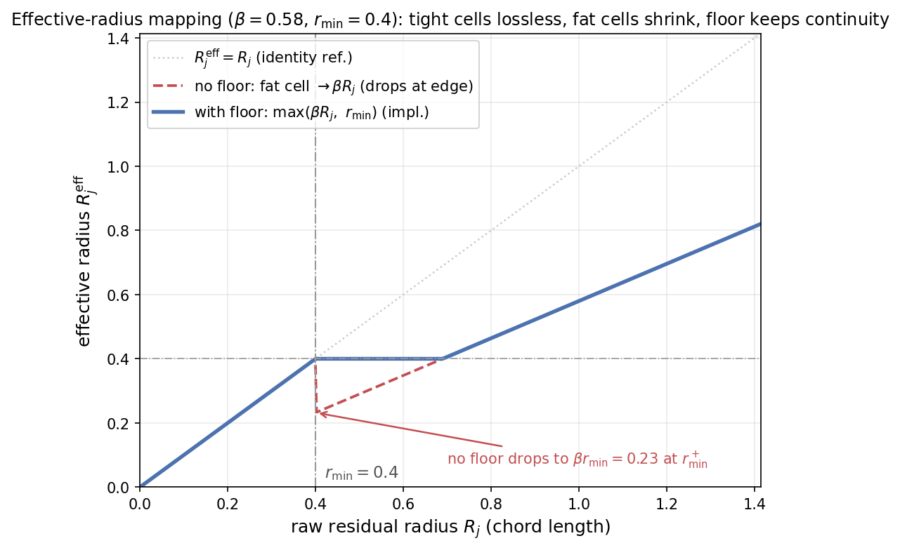

*图 5.3-2　有效半径映射 $R_j^{\text{eff}}(R_j)$（参数 $\beta=0.58$、$r_{\min}=0.4$）。紧簇（$R_j \le r_{\min}$，图中左段）落在恒等线上、真实半径无损，保证局部零漏召；肥胖簇（$R_j > r_{\min}$）按 $\beta$ 收缩。托底 $\max(\cdot, r_{\min})$ 消除了临界簇的不连续跳变——若无托底（红虚线），刚过阈值的簇有效半径会从 $r_{\min}$ 暴跌到 $\beta r_{\min}=0.23$、比紧簇还小；托底后（蓝实线）在 $r_{\min}$ 两侧连续，临界肥胖簇召回更稳。*

随后由有效半径还原锥角、代入球冠界并判定入选：

- $\cos\theta_j^{\text{eff}} = \text{clip}(1 - \tfrac12 (R_j^{\text{eff}})^2, -1, 1)$，$\sin\theta_j^{\text{eff}} = \sqrt{1 - \cos^2\theta_j^{\text{eff}}}$，代入球冠界得 bound；
- $q$ 落在锥内（$\cos\varphi_j \ge \cos\theta_j^{\text{eff}}$）时 bound 饱和为 1；
- 入选条件 $\text{bound} \ge s_i$；
- 若某 query 入选 cell 数超过硬上限 `NPROBE_CAP`（默认 $= n_{list}$，即不封顶），按 $\cos\varphi_j$ 降序保留最近的若干（防御性截断）。


$\beta$ 支持从 TCC 配置的 $[\text{left}, \text{right}]$ 区间按 $0.02$ 网格随机采样（用整数域 + eps 规避浮点误差），便于按固定档位做灰度统计。


### 5.4 命中 shard 的读取难题：为何不能在 Driver 汇总路径

选完 cell 后，剩下的事看似简单：只读**被选中**的 `(date, cell)` shard、逐 query 匹配即可。难点全在「读」这一步的**规模**上。

**简单做法及其瓶颈。** 最直接的实现是：Driver 把所有选中的 `(date, cell)` 拼成一份精确路径列表，一次性交给 Spark 读入。但 `nlist = 262144`、跨多年，选中的 cell 可达**千万**量级。而 Spark 读 Parquet 时的**文件列举与 schema/footer 推断在 Driver 端是非 lazy、当场同步执行**的：把数千万条叶子路径一次性交给它，Driver 要在单机上串行探查每个目录、读每个 Parquet 文件页脚、构建文件索引——**元数据解析本身就会把 Driver 拖垮甚至 OOM**，数据都还没开始扫。

核心约束：**「选中 cell 的路径集合」本身已是大体积数据，不能只由 Driver 解析。** 绕开它有两条路，本方案都实现了，默认走后者。

### 5.5 方案一：Python 流水线——分批解析与扫描重叠

思路是**把「路径解析 + 数据扫描」切成有界的批，边解析边扫描**，任一时刻 Driver 手上只有一批的路径，峰值内存与批大小挂钩、与总选中量无关。

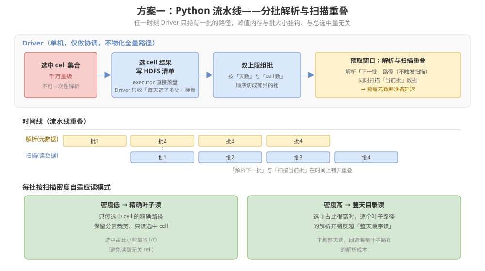

**分布式选 cell 写清单，Driver 只收标量。** 选 cell 的结果（每天选中了哪些 cell）由 executor 直接写成 HDFS 上的清单文件，Driver 侧只把**日期级的标量统计**收回（每天选了多少 cell、占多少字节），绝不把 cell 号本身收回 Driver。

**双上限组批 + 预取窗口。** 按「天数」与「选中 cell 数」双重上限把清单顺序切成一个个有界的批；主循环维持一个有界的**多批预取窗口**：提前为**下一批**做好路径构造与文件元数据准备（此步不触发真正的数据扫描），让它与**当前批**的实际扫描在时间上重叠，从而掩盖元数据准备的延迟。每批的解析规模被上限钳住，Driver 不会一次性面对全量路径。

这条路径纯 Python/PySpark 即可实现，代价是 Driver 仍要承担「分批解析」的协调工作，且逐 query 匹配发生在 Python 侧。

### 5.6 方案二：JVM Reader——把解析与匹配整体下放 executor（默认）

流水线只是把 Driver 的解析压力**摊薄到多批**，Driver 依然是路径解析的必经之地。更彻底的做法是让 **Driver 完全不碰路径与匹配**，把「读 Parquet + 逐 query 匹配」整段下沉到 executor 并行执行。

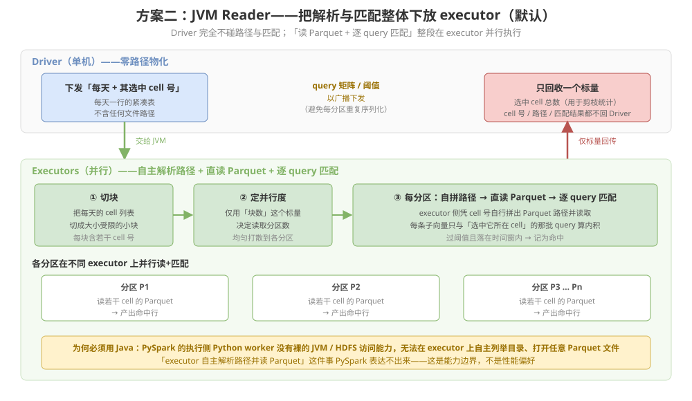

**为什么必须用 Java。** PySpark 的执行侧是 Python worker，它**没有裸的 JVM / Hadoop 文件系统访问能力**：不能在 executor 上自主列举 HDFS 目录、打开任意 Parquet 文件读取——这些都得回到 JVM。因此「executor 自主解析路径并读 Parquet」这件事，PySpark 表达不出来，只能用 Java 直接写 Spark 算子。这不是性能偏好，是**能力边界**：把解析下放 executor 的前提就是用 JVM 侧代码。

**Driver 侧零路径物化。** Driver 只把「每天及其选中的 cell 号」这张**每天一行**的紧凑表交给 JVM 入口。**cell 号列表、Parquet 路径、匹配中间结果，全程不回 Driver。**

**executor 侧的解析—匹配流程。** 一句话概括数据流：**「每天一张长短不一的选中 cell 清单」→ 裁成等大的任务块 → 均匀撒到各分区 → 各分区各自读数据各自执行匹配**。三步分别解决一个问题：

1. **切块——把「大小不均的天」拉平成「等大的活儿」**：每天选中的 cell 数量差异很大（有的天几千、有的天上万）。若直接「一天一个任务」，选中多的那天会成为一个超大任务、拖慢整体。所以先按固定容量把每天的清单裁成若干**等大的任务块**（每块只装若干个 cell 号），这样无论某天选多选少，单块的活儿量都相当、不会畸大。
2. **按块数定并行度——用「一个数字」规划，不把路径收回 Driver**：Driver 只需要知道「一共裁出了多少块」这**一个标量**，就能据此决定开多少个并行读取分区，再把任务块均匀撒到各分区上。**规划并行度靠的是「块的数量」，而不是把成千上万条 cell 路径收回 Driver 再清点**——这正是绕开 §5.4 那个瓶颈的关键。
3. **各分区自读自匹配——解析与匹配都在 executor 就地完成**：每个分区拿到自己那几个任务块后，**凭块里的 cell 号自己拼出 Parquet 路径、直接打开读取**（无需 Driver 下发路径）。


### 5.7 归并与结果契约

两条路径的匹配结果都按 $(\text{task}, \text{item})$ 归并，保留每对的**最优命中**（最大 sim）。最终输出 $(\text{task\_id}, \text{json})$，字段 `{item_id, similarity, sim_idx, create_time}` 与线上现状 **逐字段一致**，使 IVF 作为其平替对下游透明。召回计数在 executor 侧累加（每命中一条 `+1`），随任务完成消息透传。


### 5.8 剪枝率统计口径

**先明确口径：这是 cell 基数的剪枝率，非数据体积的剪枝率。** 下述 `scan_ratio` 的分子分母都是 **cell 计数**（选中的 `(date, cell)` 数 / 全部 `(date, cell)` 数），刻画的是「跳过了多少个 cell」。而真正决定 I/O 与 GEMM FLOPs 的是被扫描的**向量条数**，即数据体积。二者的桥梁是各 cell 的载荷 $m_j$（cell $j$ 内的子向量数），一般并不相等，故 cell 基数剪枝率与体积剪枝率未必相等。

记选中集为 $\mathcal S$，体积口径的扫描占比应为按载荷加权的
$$\text{vol\_ratio} = \frac{\sum_{j\in\mathcal S} m_j}{\sum_{j} m_j}$$
**在「数据均匀分布于各 cell」的假设下**（$m_j \equiv \bar m$），加权退化为计数，$\text{vol\_ratio} = |\mathcal S|/C = \text{scan\_ratio}$，此时 cell 基数剪枝率可直接读作体积剪枝率、进而正比于扫描量与时延。运维日志中的剪枝率均在此假设下报告；均匀性来自 kmeans 对簇规模的自然均衡（软约束，非硬保证），是良好近似而非恒等。


选 cell 完成后产出剪枝统计，透传进运维日志。分母 `total_cells` $= n_{list}\times$ 合法天数（跨天口径）。两个层级：

- **scan 级（真实 IO 口径）**：`scan_cells` = 各 query 选中 `(date, cell)` 的**并集**大小；$\text{scan\_ratio} = \text{scan\_cells}/\text{total\_cells}$，$\text{scan\_prune\_rate} = 1 - \text{scan\_ratio}$。这是真正决定扫描量与时延的量（在上述均匀假设下）。
- **per-query 级**：各 query 平均选中 cell 数（并集前，含跨 query 重叠）。

二者差异源于不同 query 选中集的重叠度：重叠越低，并集越大、scan_ratio 相对越高。


---

## 6. 复杂度、正确性与局限

### 6.1 端到端复杂度

| 阶段 | 主导代价 | 说明 |
| --- | --- | --- |
| 训练 | $O(n_{train}\cdot K\cdot d)$/iter（Lloyd 分配步） | 抽样使 $n_{train}\sim 10^7 \ll N_{\text{vec}}$；层次初始化把 init 从 $O(NKd)$ 降到 $O(N\cdot 2\sqrt K\cdot d)$ |
| 建库 | $O(N_{\text{vec}}\cdot K\cdot d)$（全量分配） | 分块 running argmax 把内存从 $O(BK)$ 降到 $O(BC)$；残差半径零额外 FLOPs |
| 检索选 cell | $O(n_q\cdot K\cdot d)$/天，分布式 | 一天一 task 并行 |
| 检索扫描 | $O(\text{scan\_ratio}\cdot N_{\text{vec}}\cdot \bar q\cdot d)$ | $\bar q$ 为每 cell 平均命中 query 数；相比全表暴力 $O(N_{\text{vec}}\cdot n_q\cdot d)$ 的加速比 $\approx 1/\text{scan\_ratio}$（叠加逐 query pruning 使有效 query 数远小于 $n_q$）|

核心收益：把端到端瓶颈从「全表 HDFS I/O + 暴力 GEMM」转移到「索引读 + 命中 cell 的小 GEMM」，扫描量数量级缩减。

### 6.2 零漏召与近似档位

- **$\beta = 1$**：球冠界是精确值，选中判据零漏召（相对暴力扫描召回 $= 1$，仅受浮点误差影响）。
- **$\beta < 1$ 与分位数半径**：以可解析映射（§5.3）的极小、可量化漏召换更高剪枝率，是不同取舍档位。
- **紧簇豁免（$R_j \le r_{\min}$）**：局部保持零漏召，只对肥胖簇让利。

### 6.3 剪枝率的真实瓶颈：max 残差

$R_j$ 定义为 **max** 残差，只取决于 cell 内**单个**最离群成员。只要混入一个与中心近乎正交的点，$\min\!sim_j \to 0$、$\theta_j \to 90°$，剪枝判据右边 $\theta_j + \arccos s$ 巨大，几乎无 cell 能被剪掉。这是剪枝率的真正瓶颈，且**与 cell 内存储形态（raw / PQ）无关**——故 IVFPQ 对剪枝率零帮助，只关心剪枝率时不必引入 PQ。三个提升杠杆按性价比排序：

1. **分位数半径（主杠杆）**：建库时把 per-cell `min(sim)` 换成低分位 $p_{0.1}$（对应残差 $p_{99.9}$），把离群点排除在半径外。按每个 cell 各自的残差分布踢离群点，比全局 shrink 精细。需重跑阶段二重建 `cell_radius.bin`，与球冠界正交、可叠加。
2. **`RADIUS_SHRINK` < 1（现成旋钮）**：零成本探路，只改阶段三、不重建产物；一刀切、收缩过头会漏召。适合先跑 sweep 曲线确认「降半径能换回多少剪枝」。
3. **增大 $K$（谨慎）**：只在 cell「点多但均匀不散」时有效；对「单点离群撑大 $\theta_j$」无效（离群点只是换到另一个 cell），且粗排 $O(K)$ 变贵、训练下限约束 $n_{train}/K \gtrsim 39$。


---

## 7. 参数总表与调参路径

| 参数 | 记号 | 当前值 | 所在阶段 | 调参依据 |
| --- | --- | --- | --- | --- |
| cell 数 | $n_{list}$ | $262144$ | 全链路共享 | 按底库 $\sqrt N \sim 4\sqrt N$；只看延迟/内存，不看召回（§3.1）|
| 维度 | $d$ | $128$ | 全链路 | 由上游 embedding 决定 |
| 抽样比 | $p$ | $0.004$ | 训练 | 由 driver 内存/耗时权衡定；Faiss 经验下界 $39\,n_{list}$ 仅作参考，实际人均约 29 仍收敛良好（§3.2）|
| Lloyd 迭代数 | — | $12$ | 训练 | 首步收敛为主，10 步内达 $0.95+$（§3.6）|
| 提前停止容差 | tol | $10^{-4}$ | 训练 | 约对应中心移动 $< 1\%$ |
| 初始化 | — | random | 训练 | 大 $K$ 推荐 hierarchical（$O(N\cdot 2\sqrt K\cdot d)$，§3.4）|
| shuffle 分区 | — | $8000$ | 建库 | 每 cell 单文件、防倾斜（§4.4）|
| **收缩系数** | $\beta$ | $0.58$ | 检索 | 阈值越高越须温和；先 sweep（§5.3）|
| 半径豁免 | $r_{\min}$ | $0.4$ | 检索 | 紧簇零漏召、高阈值下更重要（§5.3）|
| 入选上限 | — | $n_{list}$（不封顶）| 检索 | 完全由阈值决定 |

**推荐调参顺序**：① 按底库规模定 $n_{list}$（只看延迟/内存）；② 按 driver 内存/耗时定抽样比 $p$（$39\,n_{list}$ 仅作参考下界，可低于它）；③ 固定 $\beta=1$ 验证零漏召基线；④ 跑 `RADIUS_SHRINK` sweep，读剪枝率-召回损失曲线定档；⑤ 若普遍肥胖且需根治，上分位数半径重建。

---

## 8. 实验结果：线上任务对照（IVF  vs Origin）

在同一份 query、同一底库上，让 IVF 方案与原始「全表扫描 + 暴力 GEMM」链路对跑，从**召回质量**与**资源/耗时**两个维度评估。结果如下：

- **召回率与计算算力对比**（同 query、同底库的 A/B 双跑，`vcore_hours` 为净算力口径）：
  - **召回近乎无损**：总体召回率 **96.52%**（存量段 IVF 剪枝 ≈ 96%、增量段 ES ≈ 93.8% 且有额外时效红利）。
  - **净算力降到约 1/8**：按 `application_id` 去重的 `vcore_hours` 仅为原链路的 **≈ 12.97%**，净省约 **7/8**——省算力来自「历史天 IVF 剪枝只扫少数簇 + 近几天转 ES 检索」，检索侧都不再暴力全表扫描。
- **端到端耗时对比**（线上切流放量后的真实任务，任务创建至结束的总时延，含集群排队）：
  - **检索任务**：IVF 平均耗时为原链路的 **≈ 9.7%**（31min vs 5h20min），中位数 **7.1%**、p99 22.2%。
  - 切流放量后端到端耗时已逼近净算力占比（约 1/8），说明前期「耗时占比偏高」主要是双跑期集群排队所致，随规模化铺开而收敛。

一句话结论：**召回近乎无损，净算力大幅下降**——与 §6 / §7 的理论预期一致。

---

## 源路径

```text
institutionalized/db/instance_retrieval_desen.md
```
